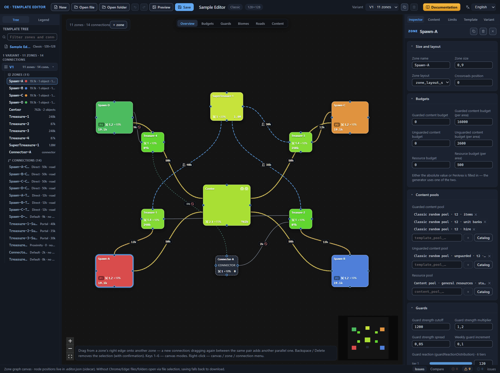

# Editor overview

*Current for the editor as of 29.09.2026.*

This is the manual for the web editor of random map templates for the game Heroes of Might and Magic: Olden Era. The editor draws the diagram of the future map, helps you tune its economy and rules, validates the template, and saves the file that the game reads. Written for template authors, the manual requires no preparation: every term is explained on first mention, and you never have to type JSON by hand. This chapter is the entry point: first the big picture of “what a template is”, then the map of the manual itself.

## What a random map template is

A random map is not drawn tile by tile. Instead, the author prepares a template — a `.rmg.json` file that describes the layout of the future map. The map is divided into zones — parts with their own content and guard settings; zones are joined by connections — corridors, portals, and other passages. For each zone, the template defines its biomes (environment types) and how much content and how many guards it holds — the forces covering content and passages. Game rules and the win condition are set separately. Map size is measured in tiles — from 80 to 240, in multiples of 16; the map is always square.

The format is declarative: in the template, you describe “what and how much” should end up on the map, not “where exactly” it sits. Where a road will run and at which point of a zone a particular object will land — the game’s generator decides that when it creates the map.

One file — one template. If you want the game to sometimes assemble the map with a different arrangement of zones, add another layout variant to the same file: during generation, the game randomly picks one of them.

## Three layers of map generation

It is convenient to picture the generator’s work as three layers.

1. **The template** answers the question “what and how much”: zones, connections, content budgets, guards, game rules.
2. **Content pools** — named sets of game objects — answer the question “what to fill it with”. The pools live in the game’s database; the template references them by name.
3. **Encounters** — ready-made “micro-maps” of objects and guards — answer the question “how to present it”. The generator picks encounters itself, by type and size; the template does not reference them.

The key takeaway from this picture: you only need to set up the zones, connections, and budgets. You do not need to fill the map with specific items — the generator draws objects from the pools until it exhausts the budget and packs them into encounters.

Map balance is measured in value — a notional currency in which both content and guards are expressed. A zone’s content budget tells the generator how much content value to place in the zone; the guard value — the strength of the guard protecting content or a passage between zones.

## Editor capabilities

The editor is a browser window. On the canvas — the central area of the window — lives the diagram of zones and connections; in the Inspector on the right — the properties of the selected zone, connection, or the whole template; in the tree on the left — the template structure. The diagram can be read in six view modes: overview, budgets, guards, biomes, roads, mandatory content — each mode repaints the nodes and connections for its own task.

The editor catches errors itself: the built-in validator checks the template and collects issues on the “Issues” panel. Nearby — the content pool catalog with filters, the layout variant comparison mode, and the preview — a 700×700-pixel PNG minimap of the active variant. The change history undoes and redoes template edits.

A template is saved as a pair of files. The game reads the `.rmg.json`; the `.editor.json` sidecar file is for internal use — the editor keeps the diagram’s node positions, zone notes, and section layout in it, so that everything is back in place the next time you open the template. Along with the pair, the editor also writes a PNG preview.

Full folder support — opening a templates folder and saving into it — is available in the Chrome and Edge browsers. In other browsers, the editor runs in a lightweight mode: opening — via file selection, saving — via download.

The editor does not touch the game’s files. You install the finished template by copying it into the game’s profile folder `my_map_templates`; the service cache is rebuilt by the game itself — no need to edit it manually. Details — in [Installing a template into the game](install.md).

## Manual structure

### Chapter types

Chapters come in four types. Tutorials take you by the hand from zero to a finished result. How-to chapters solve one specific task: save, validate, compare. References describe every field without steps — material to read as needed. Explanations — this chapter is one of them — answer the question “how does this work”.

If a how-to chapter does not list every field, and a reference has no step-by-step instructions — that is by design: the chapters do not duplicate each other.

### Where to start

Start with the [Quick start](quick-start.md) chapter: in a single pass, it takes you from an empty editor window to a map installed into the game — the shortest way to find out whether the tool fits your tasks. Continue with [Interface: windows and panels](interface.md) and [Canvas: view modes](canvas-modes.md): with them, no button in the window stays a mystery. After that, open the references as needed — the relevant section first, the whole chapter later.

### Chapter map

**Getting started**

- [Quick start](quick-start.md) — the first template, from creation to installation into the game.
- [Interface: windows and panels](interface.md) — the top bar, the tree, the Inspector, the status bar, dialogs.
- [Canvas: view modes](canvas-modes.md) — six modes for reading the diagram, and the Legend.
- [Canvas: graph editing](canvas-editing.md) — adding, renaming, and deleting zones and connections; hotkeys.

**Files**

- [Files: opening and saving](files.md) — the `.rmg.json` and `.editor.json` file pair, saving scenarios, undo.
- [Preview and PNG](preview.md) — the variant minimap and PNG export.
- [Installing a template into the game](install.md) — the profile folder, the game cache, checking in the lobby.

**Template element reference**

- [Zone: all properties](zone.md) — name, size, budgets, biomes, guards, and the rest of the zone settings.
- [Zone main objects](main-objects.md) — the city, hero spawn points, outposts, and arenas in zone cards.
- [Connections between zones](connections.md) — passage types, the connection guard, roads, and portal gates.
- [Variant: orientation and border](variant-layout.md) — how the generator fits the diagram into the map and how the outer border works.
- [Variants: management and selection](variant-manage.md) — switching, duplicating, and deleting layout variants.
- [Variant comparison](compare.md) — the mode for comparing two variants and reading the differences.
- [Template settings (root)](root.md) — name, game mode, rules, bonuses, bans, zone layouts.

**Content and validation**

- [Content pool catalog](pools.md) — browsing and selecting pools for zones.
- [Template validation (validator)](validator.md) — the “Issues” panel and typical issues.
- [Direct JSON editing](json-editor.md) — the JSON draft and when it is justified.

**Format and terms**

- [.rmg.json format reference](rmg-json.md) — the file structure and a dictionary of fields.
- [Glossary](glossary.md) — the manual’s terms in one place.

## Documentation limits and honest caveats

### Fields with unknown purpose

The `.rmg.json` format is being researched through the game’s files, and the purpose of some fields is not confirmed yet. Throughout the manual, such places are marked the same way: *Purpose to be confirmed.* The marker does not mean a bug in the editor: the field is honestly shown in the interface and saved to the file, but its effect on the map cannot be predicted in advance. Treat such settings as experimental.

### Non-localized values

In the editor’s interface, you will come across “raw” technical object identifiers — sids, for example `random_hire_3`. The editor shows them as they are and adds the object’s official Russian name next to them whenever it knows one. English terms in certain selectors are names from the format, not a translation gap: the manual explains them as you meet the corresponding fields. The documentation neither translates nor invents the meaning of such values — it only shows what the editor does with them.

Both situations are normal and safe: a template with marked or non-localized values is an ordinary working file, not a broken one.

### The demo template in examples

The reference chapters walk through field values on the “Sample Editor” demo template. This is a teaching example: it does not ship with the editor or the game — do not look for it on your machine. The numbers illustrate field mechanics rather than set a norm: you will see the same fields when you open any official template — the values will be different, the meaning of the settings the same.
