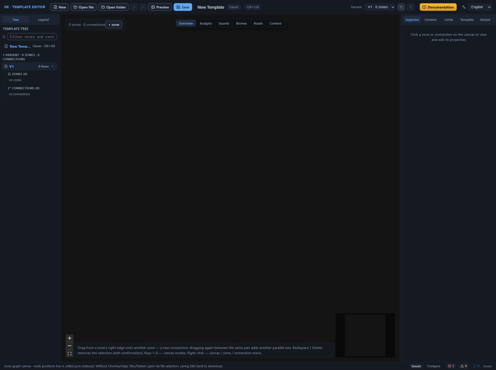
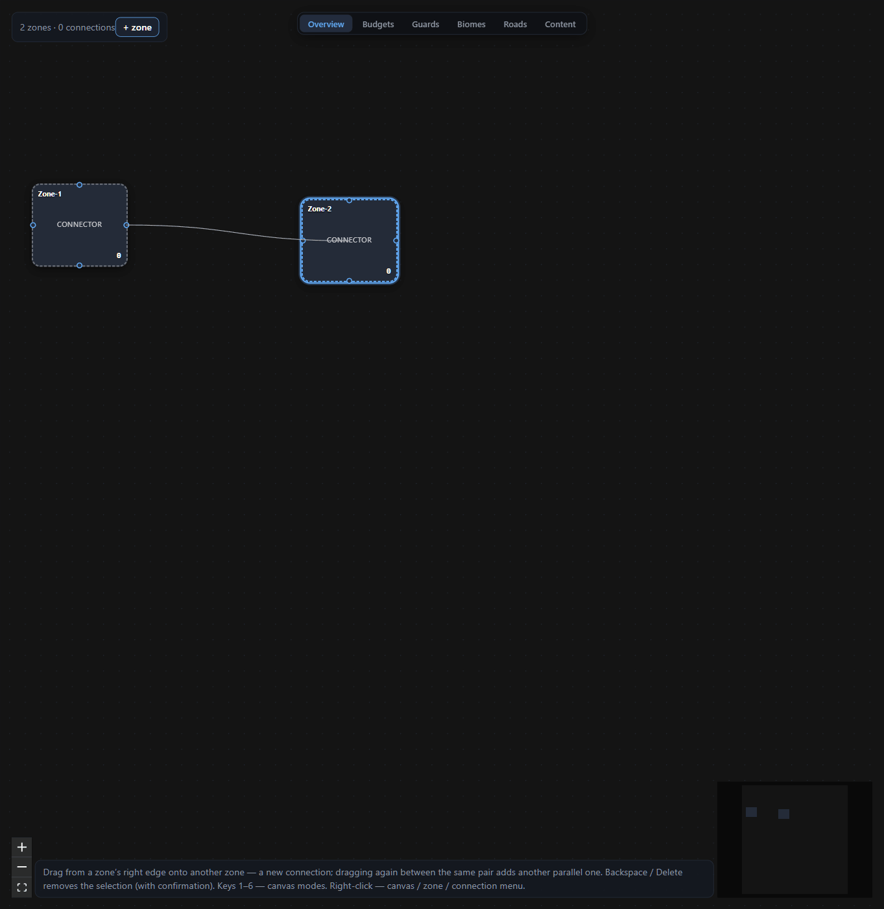
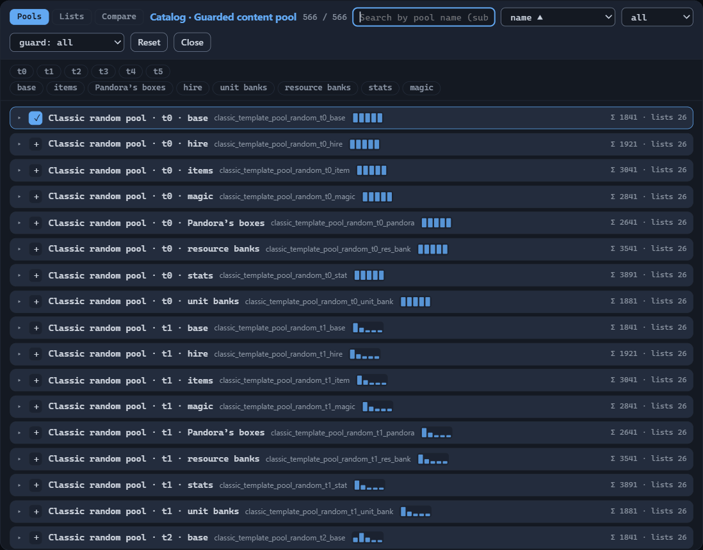
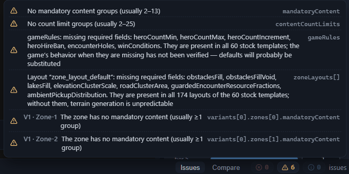
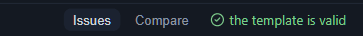

# Quick start

This chapter is one end-to-end route: an empty editor window, a first template with two zones, a validation with no issues, and a finished map in the game. Every window and field along the way is explained just as far as the step needs; the full breakdown of properties lives in the reference chapters — the links stand right next to the steps.

You will need a browser to work: in Chrome and Edge the editor can save files straight into the folder you pick, while in other browsers saving goes via download. The last section requires an installed copy of Heroes of Might and Magic: Olden Era.

## The first template

### Empty template

1. Open the editor in your browser.
2. Press “New” on the top bar. The editor creates an empty template: a 128×128-tile map, one layout variant, and not a single zone.

A layout variant is one diagram of zones and connections. When creating a map, the game assembles it from a single variant; for now the diagram is empty — you will fill it in the next steps.

3. Look around. The diagram lives on the canvas — the central area of the window; on the left — the template tree, on the right — the properties Inspector, at the bottom — the “Issues” panel. A detailed walkthrough of the window — in [Interface: windows and panels](interface.md).

### Two zones and a road between them

A zone is a part of the map with its own content; a connection is a passage between zones. The minimal working diagram is two zones and one connection.

1. Press “+ zone” on the canvas. The first zone appears, and the Inspector immediately opens its properties.
2. Press “+ zone” again — the canvas now has two zones.
3. Drag from the right edge of the first zone onto the second. A connection appears between the zones: a road with a guard — the force covering the passage. Leave the guard values at their defaults for now.

Click the connection — the Inspector shows its properties: the passage type, the guard, and the guard increment. Configuring connections is the topic of [Connections between zones](connections.md); for a first pass, the default values will do.

### Map name and size

1. Switch to the “Template” tab in the Inspector.
2. In the “Basics” section, fill in the “Name” field — for example, with “My first map”. This name will appear in the game’s template list and become the name of the files when you save.
3. Leave the “Map size X” and “Map size Z” fields alone for now: the default value of 128 tiles is a sensible start. The size is set in tiles from 80 to 240, always a multiple of 16; the map is square.

### The first content pool

Two things define the zone’s content. A content pool is a named set of game objects the generator draws finds from. The content budget is how much “value” (the notional balance currency in which both content and guards are expressed) the generator must place in the zone. Details — in [Zone: all properties](zone.md).

1. Click the first zone on the canvas and open the “Inspector” tab.
2. Find the “Guarded content pool” field in the “Content pools” section and press “Catalog”.
3. Pick any pool in the catalog (the landmarks of a row are its Σ total value and number of lists) and press “+”. The button turns into a checkmark: the pool is added.
4. Close the catalog with the “Close” button. The pool name lands in the zone’s field.

Search, filters, and reading the catalog — in [Content pool catalog](pools.md).

Nearby, in the “Budgets” section, are the “Guarded content budget (per area)”, “Unguarded content budget”, and “Resource budget” fields. Fill in either the absolute value or the “per area” (PerArea) variant — the generator uses one of the two. You will pick the values for your own balance using the zone reference; validation does not forbid empty budgets, and the first template can be finished without them.

## Validation and saving

### Validator issues

The validator is the built-in template check. Open the “Issues” tab at the bottom. You have already cleared one issue: the “No zones at all” error goes away by itself as soon as zones appear on the canvas. Others remain:

- “No mandatory content groups (usually 2–13)”;
- “No count limit groups (usually 2–25)”;
- “The zone has no mandatory content (usually ≥1 group)” — for each of the two zones;
- “Layout ‘zone_layout_default’: missing required fields…” — about terrain generation;
- “gameRules: missing required fields: heroCountMin, heroCountMax, heroCountIncrement, heroHireBan, encounterHoles, winConditions…” — about the game rules: the number of heroes, encounter “holes”, and win conditions.

A click on an issue about a zone or a connection moves the selection to the problem element of the diagram. Issues about the template settings behave differently: a click opens the “Template” tab in the Inspector but does not highlight the specific field — look for it by the path at the end of the issue line. Let us go through the issues one by one — and by the end of the section, the list will be empty.

### Zone layout fields

A zone layout is a set of rules by which the generator builds the terrain inside zones: obstacles, lakes, roads, and the scatter of finds. In a fresh template these fields are empty, and the validator asks you to fill them in: without them, terrain generation is unpredictable.

1. Open the “Template” tab and find the “Zone layouts (zoneLayouts)” panel.
2. Fill in the fields with the working values from the table. All the numbers lie within the ranges that the field hints show from the game’s stock templates.

| Field | Value |
|---|---|
| Obstacle density | 0.5 |
| Obstacles in “voids” | 0.5 |
| Lake density | 0.3 |
| Elevation cluster scale | 0.5 |
| Road cluster area | 100 |
| Share of resource encounters | 0.7 |
| Pickup repulsion | 1 |
| Random noise | 0.35 |
| Road attraction | 0 |
| Obstacle attraction | 0.02 |
| Group size weights | 20 · 2 · 1 |

Fields seven through eleven are grouped in the “Ambient pickups” section. Leave the “Min lake area” field empty — it is optional. The meaning of each field and the exact limits — in [Template settings (root)](root.md).

### A mandatory content group

Mandatory content is the objects that the generator places unconditionally, regardless of budgets. It is stored in groups: a group gets a name, and zones reference it.

1. Find the “Mandatory content” panel on the “Content” tab and press “group”. A group named `group_1` appears.
2. Press “object” — a ready-made stub is added to the group: a random legendary item (sid `random_item_legendary`) under guard.
3. Select the first zone, open the “Inspector” tab, and in the “Mandatory content and limits” section type `group_1` into the “Mandatory content groups” field.
4. Repeat for the second zone.

Working templates usually have several groups — the validator hint gives a landmark of 2 to 13. One is enough for a first pass.

### A count limit group

Count limits are a ceiling on the number of objects: they keep the generator from covering the whole map with some single find.

1. Find the “Count limits” panel on the “Limits” tab and press “group”. The group `content_limits_1` appears.
2. Press “limit” — a stub is added: no more than one `pandora_box` object across the whole map.
3. Type `content_limits_1` into the “Count limit groups” field of both zones — the same place, in the “Mandatory content and limits” section.

### Game rules

The last warning is about the “Game rules” section: all of the game’s stock templates have six of its entries filled in, and the validator reminds you about the omission. For the first map, take the values of the classic mode.

1. Open the “Template” tab and expand the “Game rules” section.
2. Enter the numbers: “Initial hero count” — 1, “Maximum hero count” — 3, “Hero limit increment” — 1; the purpose of the last field — *Purpose to be confirmed.* Its allowed values are from 0 to 2. The player starts with one hero and keeps up to three at a time.
3. Select `false` in the “Hero hiring ban” and “Encounter ‘holes’” lists: hero hiring stays allowed, and the “holes” mechanic stays switched off. The “not set” state does not clear the warning — an explicit answer is needed.
4. Select `true` in the “Classic” row of the “Win conditions” block below. The rule will match the displayed win condition from the “Basics” section: the game ends with victory over all enemy heroes and the capture of all enemy cities.

Numbers apply on Enter or when the field loses focus — clicking the next list saves the value by itself. The warning about the six entries goes away, and the issue list empties. The meaning of each field and its ranges — in [Template settings (root)](root.md#game-rules).

### The “template is valid” line

Return to the “Issues” tab. Not a single issue is left, and the panel shows the “the template is valid” line — your template has reached this state.

Note: “valid” means the absence of validation issues, not a verdict on balance. How much value to leave in the zones and where to place the guards are map design questions; validation does not decide them for you. A catalog of typical issues — in [Template validation (validator)](validator.md).

### Saving

1. Press “Save” on the top bar.
2. If the editor asks you to point to a folder (this happens in Chrome and Edge on the first save), choose an empty folder or create a new one. The folder is remembered, and the next saves go into it without a dialog.
3. Look into the folder: three files are there — “My first map.rmg.json”, “My first map.editor.json”, and “My first map.png”.

The first file is the template itself; the game reads it. The second is the editor’s sidecar file: the diagram’s service data, node positions, and notes — it is what puts everything back in place the next time you open the template. The third is the preview, a PNG minimap of the active variant. If Chrome or Edge is unavailable and you are working in another browser, the same three files download to your downloads folder. The scenarios in detail — in [Files: opening and saving](files.md).

## Installing the template into the game

1. Open the game’s profile folder in File Explorer:
   `C:\Users\<username>\AppData\LocalLow\Unfrozen\HeroesOldenEra\users\Steam_<id>\my_map_templates\`
   Here `<id>` is your Steam account number; if there are several `Steam_…` folders, find yours by their contents.
2. Copy the “My first map.rmg.json” file into it. You can put the PNG preview alongside — it does not interfere with the game; the game does not need the `.editor.json` sidecar file.
3. Do not touch the `.foldercache` file in the profile folder: the game itself reconciles the templates with the cache and rebuilds it.
4. Launch the game and start creating a random map: “My first map” appears in the list of custom templates — under the name from the “Name” field.

The profile folder, the cache, and checking the installation in detail — in [Installing a template into the game](install.md).

## Next steps

- [Zone: all properties](zone.md) — budgets, biomes, guards, and the rest of the zone settings.
- [Connections between zones](connections.md) — passage types and guards on the roads.
- [Content pool catalog](pools.md) — search, filters, and selecting pools for zones.
- [Template settings (root)](root.md) — all root panels, including layouts.
- [Template validation (validator)](validator.md) — the full list of issues and their causes.
