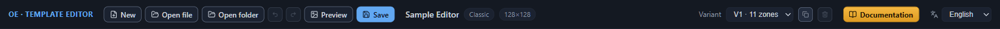
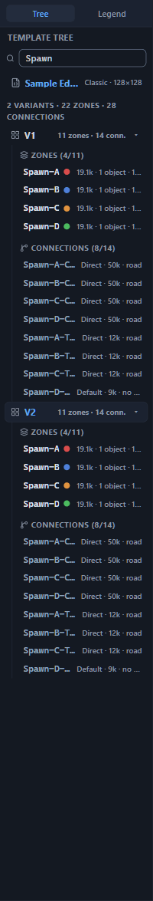
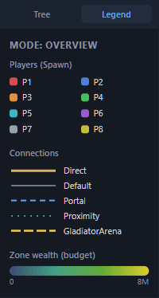
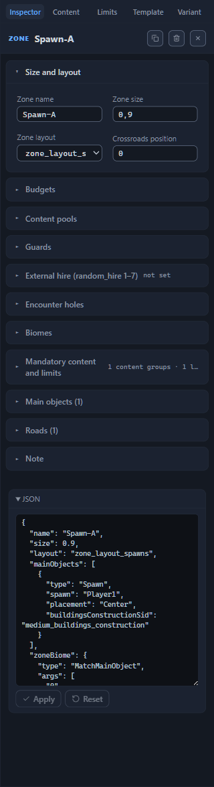
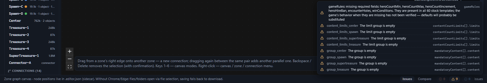
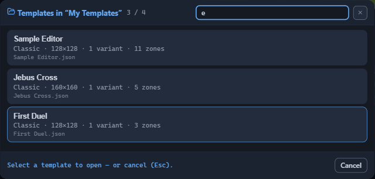
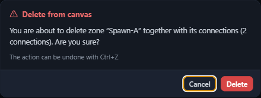
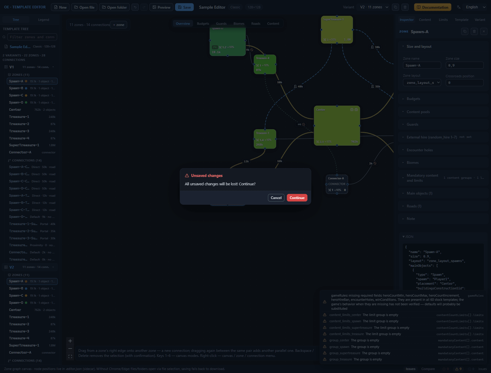

# Interface: windows and panels

The editor window is assembled from six areas: the top bar with the buttons and the template info, the left panel with the template tree and the Legend, the canvas with the diagram in the center, the right panel with the Inspector, the bottom panel with validation, and the status bar along the bottom edge. On top of them, dialogs open as needed: template selection from a folder, preview, delete confirmation, and the built-in manual. This chapter is a reference: for each area it describes what it holds and how every detail behaves. The meaning of specific fields is not covered here — that is what the references [Zone: all properties](zone.md), [Connections between zones](connections.md), and [Template settings (root)](root.md) are for.

## Top bar

The top bar stretches along the top edge of the window. From left to right it holds: the editor name, the template action buttons, info about the open template, the layout variant selector, the “Documentation” button, and the interface language selector.

### Template action buttons

Every button has a tooltip: hover the cursor, and the editor explains what the button does.

- **“New”** — tooltip “Create a template from scratch”. Replaces the current template with an empty one: one layout variant, not a single zone or connection. The change history is reset, and the undo buttons will not bring the previous state back. With unsaved changes, the editor first opens the “Unsaved changes” window (see the [“Dialogs and notifications”](#dialogs-and-notifications) section), and after “Continue” the edits are lost for good.
- **“Open file”** — opens the file picker dialog for a `.rmg.json` file; the template’s service `.editor.json` file is selected there too, in the same dialog. The editor rejects a file that does not read as a template with the notification “The file is not a JSON object” or “The file does not look like .rmg.json: no name / variants[]”.
- **“Open folder”** — points to a folder of templates as the working one. A single template found opens immediately; several open the dialog for picking from the folder; none leads to the notification “No .rmg.json files found in the selected folder.” In browsers with full file-handling support, the selected folder becomes the save location.
- **“Preview”** — tooltip “Minimap of the active variant → PNG preview”. Opens the preview dialog.
- **“Save”** — the panel’s main button; its scenarios are broken down in the [“Saving”](#saving) section.

### Undo and redo

The buttons with rounded arrows undo and redo changes: “Undo (Ctrl+Z)” and “Redo (Ctrl+Shift+Z / Ctrl+Y)”. Every template change goes into a history 100 steps deep; steps older than that are pushed out by new ones. A button is inactive and grayed out when there is nothing to undo or redo — the state is visible even before you press it. The shortcuts work while the focus is not in an input field: inside a field, Ctrl+Z edits the typed text, and it reaches the template history only after you leave the field.

### Saving

The “Save” button’s tooltip changes along with the file-handling scenario:

- a folder is selected — “Save to ‘folder-name’ (+ PNG preview)”;
- no folder selected, a browser with full file support — “Pick a folder and save .rmg.json + .editor.json + PNG preview”;
- no folder selected, another browser — “No folder selected — download .rmg.json + .editor.json + PNG preview”.

The editor always writes a trio of files: the `.rmg.json` template, the service `.editor.json`, and the `.png` preview. What each of them is and how the scenarios differ is the topic of [Files: opening and saving](files.md).

The button’s lock is tied to the JSON draft. While the JSON draft of the selected element still has an unfixed error, “Save” is unavailable and the tooltip switches to “Saving is blocked: the JSON editor has an unfixed error” — apply or reset the draft first, otherwise the editor cannot write a state the game understands. The draft-handling rules are covered in [Direct JSON editing](json-editor.md).

### Template info

Next to the buttons is the info block: the template name, the game mode, and the size in tiles. After each save, a mark with a checkmark and the time appears in the block; its tooltip repeats where the files went — “Saved to the ‘folder-name’ folder” or “Downloaded to the browser’s downloads folder”. The mark is a convenient way to check whether the latest edits have made it to the file.

### Variant

The “Variant” selector lists the layout variants — alternative diagrams of zones and connections, from which the game picks one when generating a map — as rows like “V2 · 7 zones”. Selecting switches the active variant: the one shown on the canvas and receiving the edits. To the right of the selector are two buttons. The copy button, with the tooltip “Duplicate the active variant”, adds a copy to the end of the list and makes it active; the trash button, “Delete the active variant”, deletes the active variant and is unavailable while it is the only one.

Note: deleting a variant goes through immediately, without confirmation. Only the undo button can bring it back — miss the rollback, and the variant, with all its zones and connections, leaves the file at the next save. Variant management is the subject of [Variants: management and selection](variant-manage.md).

### Documentation and interface language

The “Documentation” button (tooltip “Editor manual (F1)”) opens the built-in manual — the window that this text is part of. F1 fires even from input fields, where the other shortcuts do not work. Next to it stands the “Interface language” selector; the language list is “Русский” and “English”.

## Left panel

The left panel is split into two tabs: “Tree”, with the template structure (the tab’s tooltip — “Template structure: variants, zones, connections”), and “Legend”, with the decoding of the current canvas mode (“Legend of the current canvas mode”). You can change the panel’s width — the [“Side panel width”](#side-panel-width) section tells how.

### The “Tree” tab

The tab’s heading is “Template tree”; below it is the “Filter zones and connections” field. Filtering selects zones by a name substring and connections by an identifier substring; for a connection without a name of its own, the identifier is the pair of zone names “from–to”.

The root row of the tree repeats the template name with the game mode and the size; the “Open the template root settings” tooltip promises nothing extra — a click opens the “Template” tab in the Inspector. Below stands the summary for the whole file: the total number of variants, zones, and connections.

Each variant is a separate “V1” branch with its own “7 zones · 9 conn.” summary and a chevron tooltiped “Collapse” or “Expand”. The branch holding the selected element expands by itself, and the selected row is additionally scrolled into the visible part; a branch collapsed by hand stays collapsed. Inside a branch are two groups — “Zones” and “Connections”. With the filter running, the group heading gains a “found out of total” counter, and empty groups are labeled “no zones” and “no connections”.

A zone row shows the name and a colored player dot if the zone has a hero spawn point: the color matches player Player1–Player8, and the dot’s tooltip looks like “Player1 · Spawn”. Next to it stand the labels: the zone’s total content budget — that is, how much content value is due to be placed in the zone (in connector zones the “connector” mark replaces it) — the number of objects, like “3 objects”, and the number of roads, like “2 roads”.

A connection is shown by its identifier — its own name or the “from–to” pair — and labels: the connection type from the set Direct, Default, Portal, Proximity, GladiatorArena; the guard value in units of value; “road” or “no road”.

A click on a zone or connection row makes its variant active and selects the element on the canvas and in the Inspector. Right-clicking a row opens the context menu: for a zone — “Duplicate zone” and “Delete zone”; for a connection — “Duplicate connection” and “Delete connection” (the [Canvas: graph editing](canvas-editing.md#context-menu) chapter). Clicking a variant row opens the “Variant” tab of the Inspector.

### The “Legend” tab

The tab’s heading is “Mode: Overview” or another current mode; below is the decoding of the colors, lines, and icons with which the canvas draws the diagram in exactly this mode. Its set of sections changes along with the mode: players and connection types — in “Overview”; budget sums — in “Budgets”; guard colors — in “Guards”; biomes and their switches — in “Biomes”; roads — in “Roads”; mandatory content points — in “Content”. Keep the Legend open while you learn a new mode, otherwise part of the markings on the diagram stays unreadable. Modes are switched with the buttons above the canvas and keys 1–6; the breakdown of each — in [Canvas: view modes](canvas-modes.md).

## Right panel (Inspector)

The Inspector occupies the right panel and shows the properties of whatever is selected: a zone, a connection, the template root, or the active variant. There are five tabs; the set does not depend on the selection — only the contents of the “Inspector” tab change.

### Inspector tabs

| Tab | What it shows | Where it is covered |
|---|---|---|
| “Inspector” | the properties of the selected zone or connection | [Zone: all properties](zone.md), [Connections between zones](connections.md) |
| “Content” | the “Mandatory content” panel | [Template settings (root)](root.md) |
| “Limits” | the “Count limits” panel | [Template settings (root)](root.md) |
| “Template” | the template’s root settings | [Template settings (root)](root.md) |
| “Variant” | the settings of the active layout variant | [Variant: orientation and border](variant-layout.md) |

### Selected element header

While nothing is selected, the “Inspector” tab shows the hint “Click a zone or connection on the canvas to view and edit its properties”. After a selection, the header appears: the kind — “ZONE” or “CONNECTION” — and the name of the element (for a connection without a name — the “from–to” pair).

The header holds the action buttons. The zone has three: the copy button, tooltip “Duplicate zone (copy without connections)”, creates a copy of the zone next to the original (the [Canvas: graph editing](canvas-editing.md#zone-duplication) chapter); the trash button, “Delete zone (and its connections)”; and ✕. A connection has two buttons: the trash button, “Delete connection”, and ✕. The trash deletes the element immediately and without a dialog — not like deleting from the canvas. Rollback — the undo button or Ctrl+Z; miss the rollback, and the element disappears from the file on save. ✕ clears the selection and brings back the hint.

Below the header come the property sections of the selected element, and the tab is closed off by the expandable “JSON” block with the JSON draft: you can edit the draft and apply it, or reset it to the current state. The rules for safe work with it are collected in [Direct JSON editing](json-editor.md).

In comparison mode, a “≠ V3: …” badge appears next to the name — an abbreviated list of the differing fields; for an element that the compared variant does not have — “missing in V3”. Its full tooltip lists all the differences. The letter V with the number marks the compared variant; the mode itself is described in [Variant comparison](compare.md).

## Canvas

The canvas is the window’s central area: the diagram of the active variant’s zones and connections. Above the diagram, in the center, stand the six view mode buttons — “Overview”, “Budgets”, “Guards”, “Biomes”, “Roads”, “Content”; the same modes are switched with keys 1–6. In the “Budgets” and “Biomes” modes, extra switches appear next to the buttons: the budget metric and the biome layers. Top left — the counter of the active variant’s zones and connections, and the “+ zone” button with the tooltip “Add a zone to the active variant”. The bottom left corner is home to the hint line about editing techniques; the bottom right — the minimap, which pans the view of the diagram. A right click on the canvas, a zone, or a connection opens the context menu with actions (the [Canvas: graph editing](canvas-editing.md#context-menu) chapter). Reading the diagram is the topic of [Canvas: view modes](canvas-modes.md); editing — [Canvas: graph editing](canvas-editing.md).

## Bottom panel and status bar

The bottom panel carries two tabs: “Issues” — the issues of the validator, the built-in template check (the [Template validation (validator)](validator.md) chapter), and “Compare” — the differences between two layout variants (the [Variant comparison](compare.md) chapter).

Along the bottom edge runs the status bar. It reminds you that the canvas node positions are stored in `.editor.json`, and that in browsers without full file-handling support, opening goes via file selection and saving — via download. The `.editor.json` sidecar file is the service file next to the template: the editor keeps the diagram’s node positions, the zone notes, and the section layout in it, so that everything is back in place the next time you open the template. Details — in [Files: opening and saving](files.md).

## Dialogs and notifications

On top of the main window, dialogs open: template selection from a folder, preview, canvas delete confirmation, unsaved changes, and the built-in manual. The editor reports file events with notifications in the corner of the window. All dialogs share one layout: what they are for, how they are invoked, what is inside, and how to confirm or cancel them.

### Template selection from a folder

The dialog appears when “Open folder” finds more than one template in the folder and the choice cannot be made for the user. Its heading is “Templates in ‘folder-name’”. Below it are the “Search by name…” field — it searches both the template name and the file name — and the found counter. Each row of the list is the template name, the “game mode · size · number of variants · number of zones” summary, and the file name. Opening — a click on a row; canceling — the “Cancel” button, Esc, ✕, or a click on the dimmed backdrop, as the caption “Select a template to open — or cancel (Esc).” reminds you. An empty result reads “Nothing found.”

### Preview

The “Preview” button on the top bar opens the preview dialog. Inside — the “Preview” heading with the label of the active variant, the “N zones · M connections · 700×700” counter, the minimap itself, and the reading caption: zone color — the player or the budget; lines — the connection type, as on the canvas. The “Refresh” button redraws the picture from the current template state; “Download” carries the PNG to the browser’s downloads folder; and “Save to the template folder” writes the PNG file next to the template files. Without a selected folder, the last button is unavailable — the tooltip suggests “First select the template folder (the ‘Open folder’ button at the top)”; in browsers without full file support, “Download PNG” takes its place. Closing — Esc, ✕, or a click on the backdrop. In a variant with no zones, only the background remains in the picture — a dark gradient and grid dots. The [Preview and PNG](preview.md) chapter covers it in full.

### Canvas delete confirmation

Deleting the selection from the canvas — with the Backspace or Delete key — opens the “Delete from canvas” dialog. Its message names what exactly will go: a zone; a zone together with its connections and their number; the connection between two zones; or, with a multiple selection, the number of selected elements. The buttons are “Delete” and “Cancel”; below them is the note “The action can be undone with Ctrl+Z”. Esc and a click on the backdrop work as cancel, and the focus starts on “Cancel”, so an accidental Enter will delete nothing. The Inspector’s trash button and the context menu’s delete items do not bring up this window — there, deletion goes through immediately, and all you can count on is undo.

### The “Unsaved changes” window

The window opens when you press “New”, “Open file”, or “Open folder” while the current template has unsaved changes. Its message reads: “All unsaved changes will be lost! Continue?” There are two buttons — “Cancel” and “Continue”; the second is highlighted in color as dangerous. The focus starts on “Cancel”, so an accidental Enter will not throw the work away; Esc and a click on the dimmed backdrop work as cancel.

“Continue” carries out the intended action: the template is replaced, the history is cleared, the edits are lost for good — the session backup is immediately overwritten with the new state (the backup’s mechanics — in the [Files: opening and saving](files.md#session-backup) chapter). After a successful save, the confirmation is not asked — the buttons work right away.

### Manual window

The “Documentation” button and the F1 key open the window. On its left is the “Contents” with the list of chapters; on the right — the chapter text with screenshots; a click on a screenshot expands it to the full window; Esc closes the manual. The window does not hide the unwritten parts: a chapter without text is labeled “Chapter not written yet”; a frame without a screenshot — “Screenshot will appear later”.

### Notifications

Notifications stack up in the corner of the window and do not disappear on their own: each is closed by a click; the hover tooltip is “Dismiss notification”. Errors are marked with the alert icon; info — with an “i” icon. Typical texts: “Could not write ‘Name.rmg.json’”, “Could not write ‘Name.png’ — preview not saved”, “No .rmg.json files found in the selected folder.”, “Could not save the session backup: browser storage is unavailable or full. Save the template to disk manually.”, “Files saved to the ‘folder-name’ folder”. The last one arrives on the first save into a newly selected folder; repeat saves into the same folder come without a notification.

### Side panel width

Between the canvas and the side panels stand vertical separators. Dragging changes the width of the panel; a double click returns the standard one — the separators’ tooltips say just that: “Drag to resize the left panel (double-click to reset)” and “Drag to resize the Inspector (double-click to reset)”. The chosen widths are remembered between sessions: a screen you set up once survives a restart of the editor.

## Next steps

- [Canvas: view modes](canvas-modes.md) — the six modes of reading the diagram, and the Legend.
- [Canvas: graph editing](canvas-editing.md) — adding and deleting zones and connections, hotkeys.
- [Files: opening and saving](files.md) — the template’s file pair and the saving scenarios.
- [Template validation (validator)](validator.md) — the “Issues” panel and working with issues.
