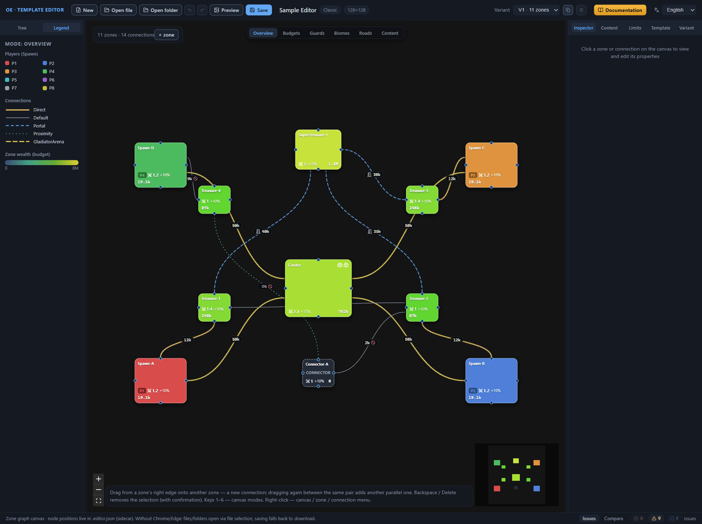
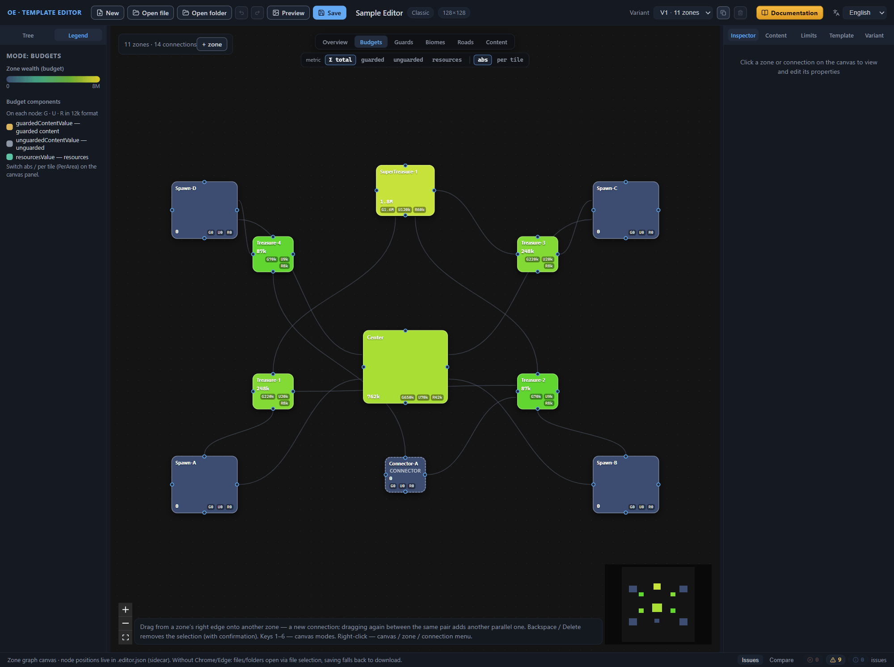
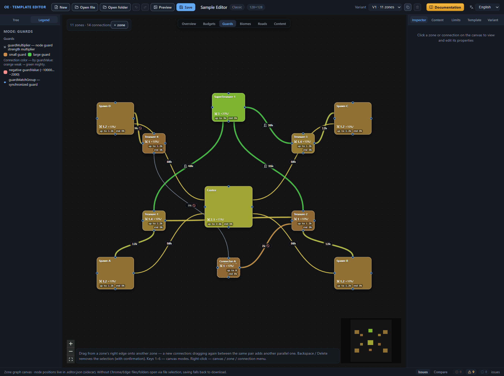
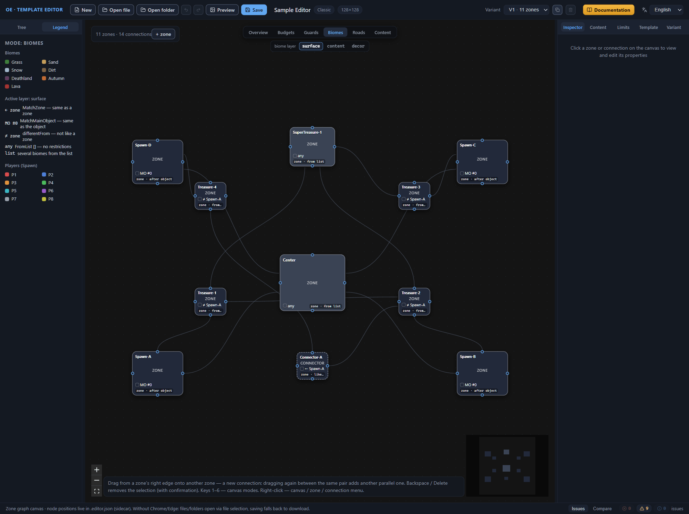
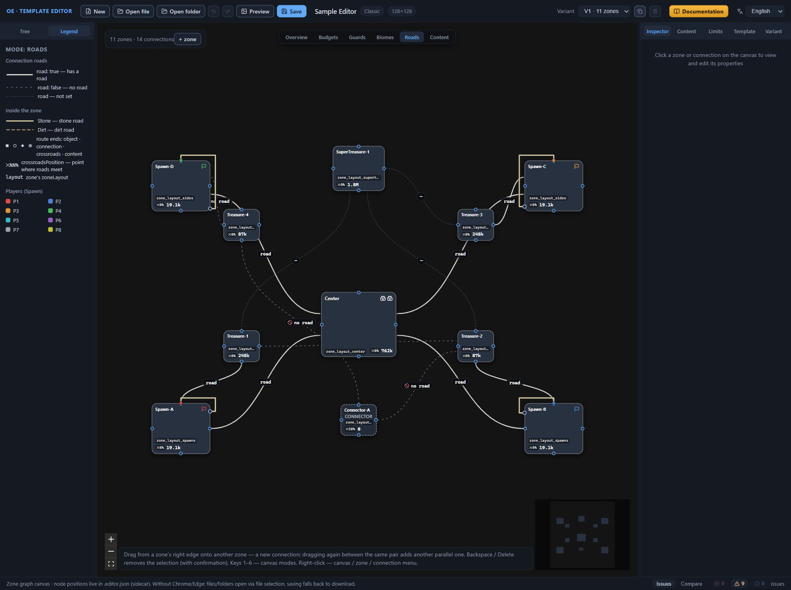
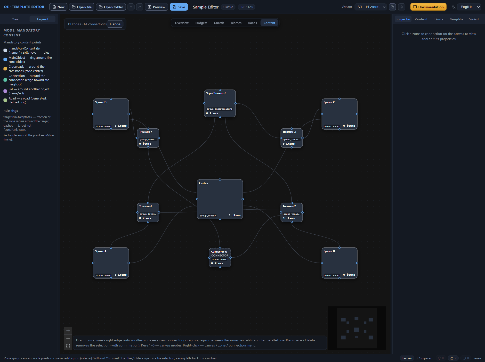

# Canvas: view modes

The diagram on the canvas is always the same — the zones and connections of the active layout variant — but it has six colorings: the view mode picks which side of the template to show in color. The mode buttons stand above the diagram, in the center: “Overview”, “Budgets”, “Guards”, “Biomes”, “Roads”, “Content”. Keys 1–6 switch the modes in the order of the buttons: 1 — “Overview”, 2 — “Budgets”, 3 — “Guards”, 4 — “Biomes”, 5 — “Roads”, 6 — “Content”; while the focus is in an input field, the digits type into the text and leave the mode alone. The Legend in the left panel rebuilds for the active mode, and the minimap in the bottom right corner of the canvas paints the zones with the same colors. Switch modes freely: only the display changes, the template data stays untouched.

## The “Overview” mode

“Overview” is the default mode: the canvas greets you with it after you open the editor. The button tooltip sums the mode’s content up as “Players · wealth · key fields”, and this is the best starting point: at a single glance you see where each player’s hero spawn point is, how filled the zones are, and how they are connected.

### Nodes

The zone name is the node’s heading, and next to the name stand the icons of the main objects: a flag at the hero spawn point (in the player color), a castle at a city, a building at an abandoned outpost, crossed swords at an arena. The icons are visible in “Overview” and “Roads”; the other modes hide them, leaving the nodes purely textual.

The node color is assigned by priority. If the zone has a hero spawn point, the node is filled with that player’s color — the same as the “P1”–“P8” label in the node’s bottom line and the color swatch in the Legend. When there is no spawn point but the zone is a connector — without budgets and main objects, or with a name starting with “Connector” — the node is painted a flat dark color and marked with the word connector. Otherwise the wealth scale applies: a logarithmic gradation from deep blue for empty zones to amber for rich ones, with the extreme marks labeled “0” and “8M”.

The node’s bottom line is a summary that shows only what is set: the player label “P1”–“P8”; the guard strength multiplier with a swords icon (guardMultiplier); the weekly guard increment like “+10%”; the total zone budget in a single number. The total budget is the sum of the three content budgets: guarded, unguarded, and resource content; for each component the canvas takes the absolute value if it is set and greater than zero, and the per-area value otherwise. Numbers are compressed to a compact form: 9,500 → “9.5k”, 12,345 → “12.3k”, 250,000 → “250k”, 2,500,000 → “2.5M”. What goes into each budget is the topic of the [Zone: all properties](zone.md) chapter.

### Connections

The line style encodes the connection type:

- Direct — a thick golden line, the most noticeable transition on the diagram;
- Default — a thin gray solid line;
- Portal — a dashed blue line;
- Proximity — a greenish short-dashed line;
- GladiatorArena — an amber long-dashed line.

Line samples with the same names lie in the Legend; the meaning of the types — in the [Connections between zones](connections.md) chapter.

The badge in the middle of the line appears when the connection has something to show: the guard value if it is not zero — in the same value units and the same compact format as the budgets; a door icon for a portal; “≈N” — the distance of a Proximity connection; a crossed-out circle — a road along the connection is explicitly forbidden. A negative guard value does not change the line color — it stays in the connection type’s color — but the badge takes a warning color and a “?” sign before the number. *Purpose to be confirmed.* Along a connection with a road laid runs a thin white dashed thread — the same road as in the “Roads” mode. Several parallel connections of the same zone pair with the same nonzero guard value share one badge: “×N value” stands on the middle line of the bundle.

A connection from a synchronized guard group (guardMatchGroup) is painted in the group’s own color instead of the type color — a flat color computed from the group name; details about groups — in the [Connections between zones](connections.md) chapter.

The mode’s Legend shows the player colors under the “Players (Spawn)” heading, line samples of the five types, and the “Zone wealth (budget)” scale.

## The “Budgets” mode

“Budgets” shows the filling of the zones: how much content value each zone is entitled to and which components it is made of. The button tooltip names the components and their fields: “guarded / unguarded / resources (guardedContentValue · unguardedContentValue · resourcesValue; abs · PerArea)”.

### Metric toggles

Two toggles appear under the mode buttons. The “metric” toggle picks the component: “Σ total” — the sum of the three budgets (default), “guarded” — the guarded content budget, “unguarded” — the unguarded content budget, “resources” — the resource budget. The chip labels are in English; the technical field name of each chip appears in the tooltip on hover: guardedContentValue / guardedContentValuePerArea for “guarded”, unguardedContentValue / unguardedContentValuePerArea for “unguarded”, resourcesValue / resourcesValuePerArea for “resources”, and “Sum: guardedContentValue + unguardedContentValue + resourcesValue” for “Σ total”. The second toggle picks the value form: “abs” — absolute (default) or “per tile” — the per-area value (PerArea). The display rule is symmetric: “abs” takes the absolute value, and if the zone has only a per-area value set, it shows that; “per tile” does the opposite.

### Nodes

The node’s big number is the selected metric in the selected form. Below it runs the component line G · U · R: G — guarded content, U — unguarded (free), R — resources; each component is shown in the selected form and in the 12k format. The node color is the same wealth scale as in “Overview”, but recomputed by the selected metric.

Note: the absolute value and the per-area value can be set at the same time — the editor’s tooltip phrases this as “Either the absolute value or PerArea is filled in — the generator uses one of the two”. Which of the two the generator uses — *Purpose to be confirmed.*

### Connections

Connections in this mode are muted: thin gray lines without badges. The mode is focused on the zones, and the diagram does not distract from the numbers.

The mode’s Legend repeats the “Zone wealth (budget)” scale and adds a “Budget components” section: the hint “On each node: G · U · R in 12k format” and three sample dots — guardedContentValue (guarded content), unguardedContentValue (unguarded), resourcesValue (resources). Right there is the reminder “Switch abs / per tile (PerArea) on the canvas panel.”

## The “Guards” mode

“Guards” gathers the guard settings on a single diagram: the zone multipliers and the guard values of connections. The button tooltip lists the fields: “guardMultiplier · connection guardValue · guardMatchGroup”.

### Nodes

The node color comes from the guard strength multiplier (guardMultiplier): the scale runs from the red-orange “small guard” end to the green “large guard” end. If the multiplier is not set, the tone is computed from guardCutoffValue; if that is absent too, the node is painted a mid tone.

The node’s bottom line carries the guard labels, again only the ones set: the multiplier with a swords icon; “+10%/” — the weekly guard increment; “up to 2k” — guardCutoffValue; “rnd 15%” — the guard strength spread (guardRandomization); “diplo −0.3” — diplomacyModifier. The meaning of guardCutoffValue and diplomacyModifier is not confirmed by the sources: *Purpose to be confirmed.*

### Connections

The line color is determined by the guard value. Zero is drawn as a gray line of normal thickness. For a positive value, the line runs from orange for a weak guard to green for a mighty one; the thickness grows on a logarithmic scale and reaches its maximum at about 4,000 value units. A negative value gives a light red line and a “?” sign in the badge; the Legend gives the encountered range −10000…−2000. *Purpose to be confirmed.*

A synchronized guard group (guardMatchGroup) repaints its connections in a color computed from the group name and thickens the lines — such guards are found on the diagram by their shared color; in the Legend the group is marked with a ◆ icon. The badges on connections are the same as in “Overview”: the guard value, “?” for negatives, and a bundle of identical parallel connections collapses into a single “×N value” badge. The requirements for matching settings within a group — in the [Connections between zones](connections.md) chapter.

The mode’s Legend shows the swords icon with the label “guardMultiplier — node guard strength multiplier”, the pair of dots “small guard” → “large guard”, the light red dot of a negative guardValue, and the ◆ icon of a synchronized guard.

## The “Biomes” mode

“Biomes” repaints the diagram by the zones’ biomes: the node fill shows which biome the zone gets on the finished map. The button tooltip lists the three layers: “zoneBiome / contentBiome / metaObjectsBiome”.

### Biome layer

A “biome layer” toggle appears under the mode buttons — it picks which of the zone’s three biome settings the canvas shows. The toggle chips are labeled in English: “surface” — `zoneBiome`, the surface biome, the default; “content” — `contentBiome`, the biome the zone takes its content objects from; “decor” — `metaObjectsBiome`, the biome of environment decorations, meta-objects. Each chip’s technical field name appears in the tooltip on hover. The Legend names the active layer in English the same way: the “Active layer: …” heading carries the field name in its tooltip. The layer changes the node fills, the lines on them, and the Legend heading, but does not touch the template data.

### Nodes

The node fill is the color of the biome resolved for the active layer. Seven biomes carry constant colors: Grass — green, Sand — sandy, Snow — snow-blue, Dirt — brown, Deathland — crimson-purple, Autumn — russet, Lava — reddish; the same seven samples lie in the Legend. The interface shows the biome names in English, and the file stores the same Latin-script values — `Grass`, `Sand`, `Snow`, `Dirt`, `Deathland`, `Autumn`, `Lava` (the [Zone: all properties](zone.md#biomes) chapter). When there is no specific biome, the node is painted in one of three states: “any” — restrictions lifted, an empty list of expressions — dark blue-gray; “list” and “?” — near-black, and the lines on the node tell them apart: “list” means several allowed biomes, “?” — the biome is not set or cannot be resolved.

The node’s first line starts with a square color swatch, followed by the name of the resolved biome if it is specific, and the selector line — the way the biome is chosen:

- “Grass” — a fixed biome, the only specific name in the list;
- “← ZoneName” — MatchZone, the same as another zone;
- “MO #N” — MatchMainObject, after the main object; if the selector also has a search zone set — the “Zone” field in the Inspector, the second argument in the file — the line appends it: “MO #2 ← Center”;
- “≠ ZoneName” — differentFrom: the specified zone’s biome will not appear here;
- “list” — several allowed biomes;
- “any” — an empty list, no restrictions;
- “?” — the biome is not set or cannot be resolved.

The second line is a short label of the active layer and the selection method: “zone · like zone”, “cont · from list”, “meta · after object”; if the zone has no selector, the method reads “none”. Hover over the line — the tooltip shows the selector as written in the file: the type and the arguments separated by commas, for example “MatchMainObject · 2, Center”, or “no selector”. In the middle of the node, if the zone is not a connector, stands a short label of the active layer: zone, cont, or meta.

The biome is resolved by the canvas, not by the template data. A FromList list with a biome name gives a fixed color; an empty list or a single unrecognized argument — “any”; several unrecognized arguments — the “list” line with a dark fill. The differentFrom expression excludes from the list the specified zone’s biome and the biome of its main object #0; how the generator chooses among the remaining biomes — *Purpose to be confirmed.* The canvas paints such a node with the reference zone’s biome: a visual landmark of “which biome will not be here”. More fully — in the [Zone: all properties](zone.md) chapter. MatchZone recursively takes the same-layer biome of the target zone; if the zone is not found — “?”. MatchMainObject with a search zone set takes that zone’s biome: the canvas does not compute the object’s own biome, this is an approximation; without a zone — a dark “?” again. Do not be alarmed by such “?” marks: in stock templates, MatchMainObject is the most frequent way of choosing a biome, and it usually carries only the object index, so a dark fill on the nodes of zones with a hero spawn point is a normal picture, not a data error. Cyclic references — MatchZone or differentFrom closed in a circle — also give “?”; the canvas breaks such chains itself.

### Connections

Connections are muted: thin gray semi-transparent lines without badges. The mode is busy with the zones, and the transitions do not compete with the biome colors.

The mode’s Legend holds a “Biomes” section with seven samples and an “Active layer: …” section decoding the selector lines: “← zone” — MatchZone, the same as a zone; “MO #0” — MatchMainObject, the same as the object; “≠ zone” — differentFrom, not like a zone; “any” — FromList [], no restrictions; “list” — several biomes from the list. Below — the player colors from “Players (Spawn)”. Where the zone biomes and their selectors are set — the [Zone: all properties](zone.md) chapter.

## The “Roads” mode

“Roads” gathers everything road-related on the diagram: the road flags of connections, the routes inside zones, the layouts, and the points where roads meet. The button tooltip lists: “connection road flags · zone.roads routes · layout · crossroads”.

### Nodes

The node fill is neutral dark — road affairs do not repaint the zones — while the object icons stay visible, as in “Overview”.

The node’s first line is the name of the zone layout (zone.layout), a named set of terrain parameters from the template settings; “layout?” means the layout is not set. The second line opens with the “✕NN%” label — the point where roads meet (crossroadsPosition), when the field is set — and then shows the total zone budget in the same compact format as in “Overview”. The percent is the rounded field value: 0.5 turns into “✕50%”. The field itself is a single number 0–1, the normalized position of the meeting point inside the zone; what the ends of the scale mean, the editor’s tooltip phrases as a hypothesis: 0 — the roads meet at the center, 1 — at the edge. In stock templates, the values 0 and 0.5 occur. The tooltips on the lines name the fields: the layout — “zone’s zoneLayout”, the meeting label — “crossroadsPosition — point where roads meet”, the budget — “total zone budget”.

### Connections

The line style encodes the road flag:

- “road” — a light thick line with a thin white dashed thread running on top: the road is laid;
- “no road” — a sparsely dashed gray line, with a crossed-out circle icon in the badge;
- “—” — a dark thin muted short-dashed line: the flag is not set.

“Not set” is a legitimate state, not an error: in 19 of the 60 stock templates, no connection has the road flag. Every connection has its badge, and parallel connections do not share it: the badges are spread along the lines, and a bundle that collapses into a single “×N” in “Overview” reads line by line here.

### Routes inside zones

Orthogonal polylines with a dark halo are drawn over the nodes — the zone.roads routes: they show which points of the zone the road connects. The route’s surface sets the line style: Stone — a stone road, light solid; Dirt — a dirt road, brownish dashed. If the surface is not set — a neutral beige solid line. In stock templates, most roads are stone; dirt ones are roughly one in fifteen; roads with no surface at all also occur.

The route ends carry target markers: ■ a light square — the main object, in the player color if it is a hero spawn point; ◯ a ringed circle — a connection; ◆ a golden diamond — the zone’s crossroads; ◎ a green empty ring — a mandatory content item. The polyline skirts the node with an outward offset: objects dock to the node’s top edge, connections — to the edge facing the neighboring zone, the crossroads stands at the center, content — at the bottom edge. Markers keep a constant screen size: when you zoom out, they do not shrink, and the route ends stay distinguishable.

The mode’s Legend shows a “Connection roads” section with three line samples — road: true, road: false, and road not set — and an “Inside the zone” section: samples of the stone and dirt surfaces, the marker line “■ ◯ ◆ ◎” — route ends: object · connection · crossroads · content, the “✕NN%” label — crossroadsPosition, the point where roads meet, and “layout” — the zone’s zoneLayout. Below — “Players (Spawn)”. The road flag and its field — the [Connections between zones](connections.md) chapter; how the zone’s roads list works — [Zone: all properties](zone.md).

## The “Content” mode

“Content” shows the template’s mandatory content: groups of objects that the generator must place on the map. Every item of a group attached to a zone is drawn as a dot next to the node, and its placement rules — as colored rings. In the Legend the mode is called “Mandatory content”. The button tooltip: “mandatoryContent: object points · placement rules (targetMin/Max as a ring)”. Connections in this mode are muted: thin gray semi-transparent lines without badges; all attention — to the zones.

### Nodes

The node fill is neutral dark, slightly darker for connector zones; the connector mark is kept, as in the other modes, while the object icons are hidden. The zone name stays in place. The first line lists the names of the mandatory content groups attached to the zone, separated by “ · ”; “—” — there are no groups; “name?” — a group with that name is not found in the template’s mandatory content list (the line’s tooltip — “mandatoryContent groups”). The second line is the “N items” counter: the sum of the items of those attached groups that were found in the template; a broken reference contributes zero to the sum (the tooltip — “sum of group items”).

### Mandatory content points

Every item of every found attached group gets a dot next to the node; items of groups that were not found are not drawn. The dot’s label is the item’s name_*; if there is no name — the sid; if neither — “element N”, where N is the item’s index in the group, counted from zero. Long labels are truncated with an ellipsis. The dot’s rim is colored by the type of the first rule with a set distance — the one that draws the first ring at the dot; if there are no rings at all, the rim is a neutral light gray. Hover over the dot — the tooltip lists the label, the sid, the group name, and all of the item’s rules in the form “Type [args] r min–max”, including rules without rings; the “r …” part is absent for those.

A rectangle around the dot — isMine: the item is marked as a mine. In the item card, in the “Mandatory content” section of the template’s root settings, this toggle is called “Resource generator”.

### Rule rings

Rules with a distance are drawn as a ring around the target: an annular band between targetMin and targetMax — a fraction of the zone radius; on the canvas, the radius is counted as half of the node rectangle’s shorter side. If only one of the two bounds is set, or a point-like target — the band degenerates into a thin circle. The ring color is the rule type: MainObject — blue, Crossroads — golden, Sid — purple, Connection — turquoise, Road — green.

The ring’s center is the rule’s target. For Crossroads it is the node’s center; for MainObject — the object’s anchor at the node’s top edge, and the rule’s argument picks the object by index; for Connection — a point on the edge facing the neighboring zone, and the connection is looked up by its name, or without a name — by the pair of the source zone and the receiving zone; for Sid — the position of another item of the same zone, found by name_* or sid; for Road — the zone’s center, and such a ring is always dashed: the road is built by the generator, the target is not resolved.

A pale dashed ring — the target is not found or unknown: a broken object index, a nonexistent connection, an unresolvable name or sid. An unresolved ring is drawn at the zone’s center — there is nothing else to attach to. A solid saturated one — the target is resolved. From the dot to the center of its first ring runs a thin dashed thread — the “item — target” link; if there are no rings, the thread leads to the placement target that the editor computed from the rule. If the dot has neither a ring nor a resolvable target, there is no thread.

The editor computes the positions of the dots — by the first rule it managed to resolve: Crossroads puts the dot at the rule’s distance from the zone center, MainObject — at the object’s anchor, Connection — on the ray from the edge toward the zone center. If the first rule is Sid and its target is found in the zone, the dot moves to the target item. Road does not move the dot. When no rule resolves, the dots are distributed evenly along a circle centered on the node. This is an approximate diagram for reading the template, not the in-game placement: where exactly the object ends up is decided by the generator.

In stock templates, Road rules occur most often — 837 occurrences across 60 files; then MainObject (461), Crossroads (297), and Sid (292); Connection is rare (19).

The mode’s Legend holds a “Mandatory content points” section: a neutral dot — a mandatoryContent item with a name_* or sid label, hover — the rules; five colored lines decode the rings: MainObject — a ring around the zone object, Crossroads — around the crossroads, the zone center, Connection — around the connection, the edge toward the neighbor, Sid — around another object by name/sid, Road — a road, generated, dashed ring. The “Rule rings” section explains: targetMin–targetMax — a fraction of the zone radius around the target, dashed — the target is not found or unknown; a rectangle around the dot — isMine, a mine. How groups, items, and rules are set — the [Template settings (root)](root.md) chapter; how a zone is attached to groups — [Zone: all properties](zone.md).

## Legend and general principles of reading the diagram

The sections above covered the modes one by one; this one gathers what is common — where to find the diagram’s decoding and by which rules the diagram is read in any mode.

### The “Legend” tab

The Legend shares the left panel with the template tree: at the top stand two tabs — “Tree” and “Legend”; the second one’s tooltip reads “Legend of the current canvas mode”. After you open the editor, the panel shows the tree; click the “Legend” tab — the diagram’s decoding takes its place. The tabs are only views of the template: switching between them touches neither the data nor the selection.

The Legend’s heading — “Mode: …” — names the active mode with the same names as the buttons above the canvas, with one exception: the “Content” button is spelled out in the Legend under its full name “Mandatory content”. When the mode changes, the Legend is rebuilt entirely: each mode has its own set of sections, and nothing remains of the previous one. The minimap in the bottom right corner of the canvas is repainted along with the diagram and is read by the same Legend.

### Legend contents by mode

- “Overview” — the sections “Players (Spawn)” (the colors of P1–P8), “Connections” (line samples of the five types), “Zone wealth (budget)” (a scale from 0 to 8M).
- “Budgets” — “Zone wealth (budget)”, “Budget components”: the hint about the G · U · R line, three sample dots of the components, the reminder about the “abs / per tile” toggles.
- “Guards” — “Guards”: the swords icon with guardMultiplier, the pair of dots “small guard” → “large guard”, the hint about the connection color by guard value, the light red dot of a negative value, the ◆ icon of a synchronized guard.
- “Biomes” — “Biomes” (seven color samples), “Active layer: …” (the decoding of the selector lines), “Players (Spawn)”.
- “Roads” — “Connection roads” (three line samples), “Inside the zone” (the surfaces, the route end markers, the “✕NN%” and layout labels), “Players (Spawn)”.
- “Mandatory content” — “Mandatory content points” (the item line and five colored ring lines), “Rule rings” (the hints about the targetMin–targetMax band and the mine rectangle).

Three legends hold the “Players (Spawn)” section — “Overview”, “Biomes”, and “Roads”. The detailed decoding of each section — in its mode’s section above.

### Principles of reading the diagram

The diagram is the same in all modes: the nodes are the zones of the active layout variant, the lines are the connections between them. The view mode changes the coloring and the labels, but not the data: switching modes edits nothing in the template.

Nodes and connections show only what is set. If a zone has no guard multiplier, there is no swords icon; if a connection has no guard value, no badge appears. The absence of a label is information too: the field is not set.

Numbers on the diagram are compressed into the compact format: 9,500 → “9.5k”, 2,500,000 → “2.5M”; the format is the same for budgets, guards, and counters.

Hover when you need precision: the color scale conveys a range, while the tooltip gives the exact value. The node lines in “Biomes” reveal the full selector, the dots in “Content” — the sid, the group, and the rules; the mode buttons — the list of the mode’s fields.

This chapter is about reading. How the diagram is changed — zones and connections added and deleted, renamed, nodes moved — is described in the [Canvas: graph editing](canvas-editing.md) chapter.

### Legend and tree together

The tree names, the canvas shows, the Legend decodes. The tree lines carry in text part of what the canvas encodes in color: for a connection — the type, the guard value, and the road flag; for a zone — the connector mark, the total zone budget, the number of objects and roads. When you need a list by names instead of a picture by colors, the tree is indispensable: the filter narrows it to the matching lines.

A click on a tree line selects the element and pans the canvas camera to it — for a connection, the camera settles midway between the zones; an element from another layout variant also switches the active variant. From there, the element is read in any mode, and the colors are checked against the Legend. In detail about the template tree — the [Interface: windows and panels](interface.md) chapter.

## Next steps

- [Canvas: graph editing](canvas-editing.md) — editing the diagram: zones, connections, hotkeys.
- [Zone: all properties](zone.md) — the content budgets and the guard settings of a zone in the Inspector.
- [Connections between zones](connections.md) — connection types, guard value, synchronized guards.
- [Interface: windows and panels](interface.md) — the other areas of the editor window.
