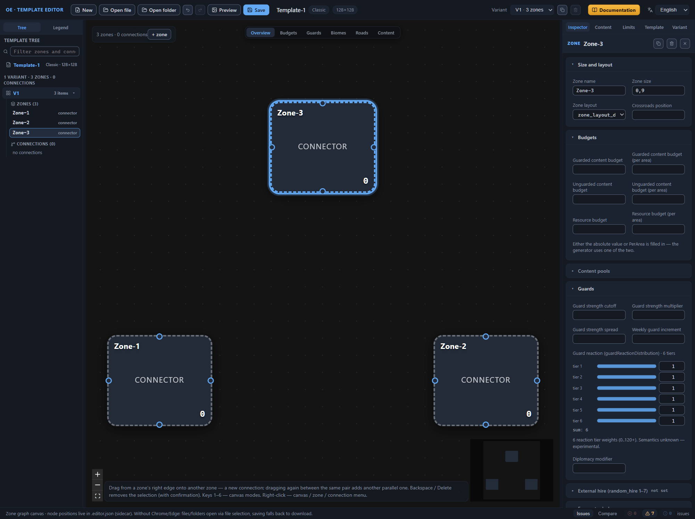
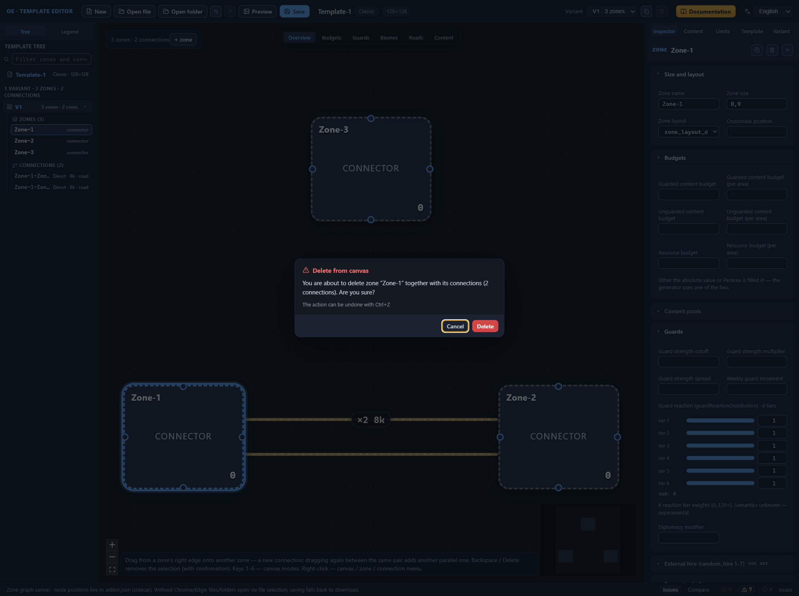
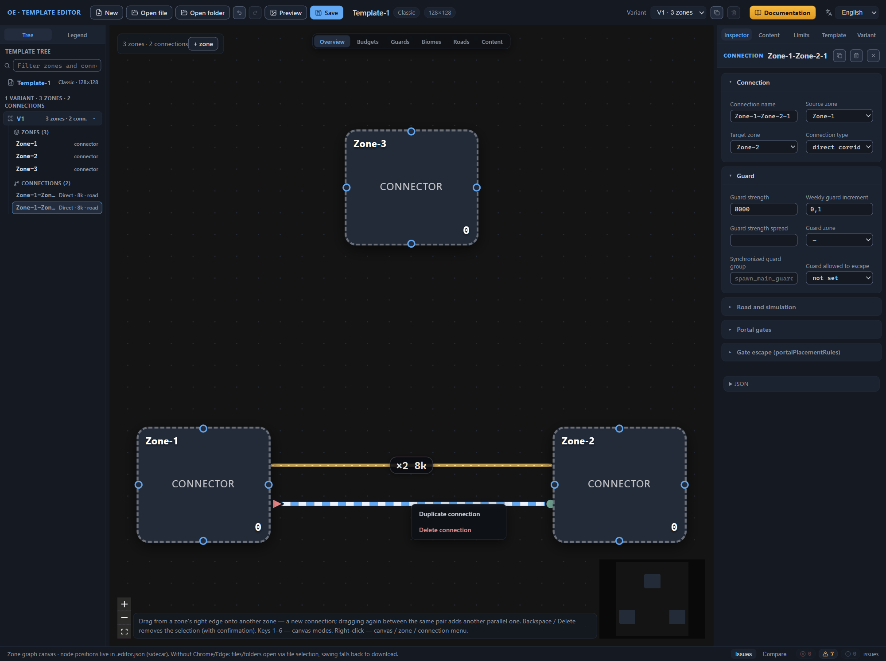
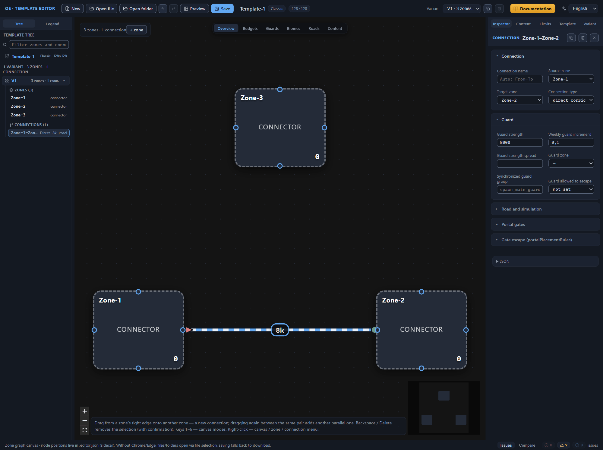
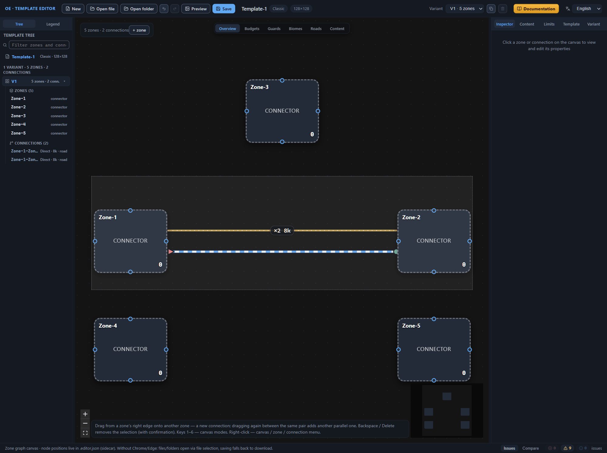

# Canvas: graph editing

The canvas shows the diagram of the active layout variant — and the diagram is edited right there: zones are added, duplicated, renamed and deleted, connections are dragged between zones and removed. Every operation lands in the change history, so a mistaken step is rolled back by pressing Ctrl+Z. How to read the diagram — colors, modes, the Legend — is covered in the [Canvas: view modes](canvas-modes.md) chapter; this chapter is about changing the diagram.

## Zone addition, duplication, renaming and deletion

### Zone addition

1. Press the “+ zone” button in the panel at the top left corner of the canvas, next to the counter of zones and connections.
2. Inspect the result: the zone appears to the right of the middle of the current diagram, gets selected, and the Inspector on the right opens its properties. On an empty canvas, the first zone lands in the center.

The button tooltip — “Add a zone to the active variant” — sets the rule: the zone appears only in the active layout variant. If you need the diagram in another variant, switch to it in the “Variant” selector in the top bar and add the zones there.

A new zone comes as a blank, ready to be configured in the Inspector:

- name — the first free of the series Zone-1, Zone-2, …;
- size — 0.9, the relative weight of the zone area;
- layout — the first layout from the template’s list of layouts;
- biomes — all three (surface, content, decor) set to “any”;
- main objects — none.

The second path is the context menu: a right click on an empty spot of the canvas opens a menu with the “Create zone” item, and the new zone lands exactly at the click point (the [“Context menu”](#context-menu) section).

### Zone duplication

Duplication is a quick way to get a zone with ready-made settings: instead of an empty blank, a copy of an existing zone appears on the diagram. Start duplication in any of three ways:

- with the copy button in the header of the Inspector for the selected zone — its tooltip reads “Duplicate zone (copy without connections)”;
- with the “Duplicate zone” item of the context menu of the zone node on the canvas;
- with the same item in the context menu of the zone row in the template tree.

The copy gets the first free name of the series Zone-1, Zone-2, … and lands on the diagram next to the original zone — slightly to the right and below. The zone’s settings are copied in full; two exceptions are the connections and the zone note: they stay with the original. The copy is selected, and the Inspector opens its properties. Ctrl+Z undoes the duplication.

### Zone renaming

The zone name is its address in the template: connections hold their ends by it, roads and mandatory content rules find their targets by it, and the template tree shows the zone’s row. Rename the zone through the Inspector field — the editor rewrites all the references itself.

1. Click the zone node on the canvas or the zone row in the template tree — the Inspector shows the zone’s properties.
2. In the “Size and layout” section, correct the “Zone name” field.
3. The name applies immediately, with every change of the field — there is no separate confirm button. The field tooltip reminds you: “Unique name within the variant; connections, biomes and references update automatically”.

The editor rejects two kinds of name, showing a message in place of the field tooltip: an empty one (“Zone name cannot be empty”) and a taken one (“The name ‘X’ is already taken by another zone”). In both cases the old name stays in force.

The rename cascade touches everything that references the zone:

- connection ends (the source zone and the receiving zone), the guard zone and the gate placement zone;
- the zero-angle zone in the orientation of the variant layout;
- biome and faction selectors — the “same as another zone” lines and the “not like a zone” expressions;
- main object placement arguments — “near another zone” and “on a specific connection”;
- the auto names of connections of the From-To kind, and along with them — the road ends and the mandatory content rules that reference those names;
- the node position and the zone note in the .editor.json sidecar file.

A zone that occurs in several layout variants is renamed in all of them at once. There is nothing to configure: the cascade is the main safety net when editing the diagram, and that is why you should not edit zone names by hand in the file — one missed reference sends a road or a placement rule to the wrong zone.

### Zone deletion

Deletion starts in three ways. From the canvas: select the zone node and press Backspace or Delete — the editor asks for confirmation. Without asking, deletion goes through the trash button in the Inspector header, tooltip “Delete zone (and its connections)”, and the “Delete zone” item of the context menu — of the zone node on the canvas or the zone row in the template tree.

The confirmation dialog is called “Delete from canvas”. If the zone has connections, the message warns about them in full: “You are about to delete zone ‘X’ together with its connections (N). Are you sure?”; zones without connections are deleted with the message “You are about to delete zone ‘X’. Are you sure?”. The buttons are “Delete” and “Cancel”; the focus starts on “Cancel”, so an accidental Enter is safe, and Esc and a click on the backdrop behind the window also close the dialog without deleting. Below the buttons is the note “The action can be undone with Ctrl+Z”.

Along with the zone, its connections, the node position on the diagram, and the zone note from the sidecar file are deleted. Changed your mind — press Ctrl+Z right after the deletion: the zone, its connections, and the note all come back.

## Connection creation, duplication and deletion

### Connection creation

A connection is a transition between two zones. On the canvas it is drawn by dragging: the hint along the bottom edge of the canvas reads “Drag from a zone’s right edge onto another zone — a new connection; dragging again between the same pair adds another parallel one”.

1. Hover the cursor over the right edge of the zone node — an attachment point appears.
2. Drag the point toward another zone: a rubber-band line stretches behind the cursor.
3. Release the mouse button on the target zone. The connection is created, gets selected, and the Inspector opens its properties with the “CONNECTION” heading.

Where you dragged from is the source zone; where you released is the receiving zone; the direction sets the auto name of the connection and the order of names in the Inspector tooltips.

A new connection is a blank too:

- type — direct corridor (Direct);
- connection road — yes;
- guard value — 8000 in value units;
- weekly guard increment — 0.1;
- name — auto, from the zone names (see below).

Only one action ends in nothing: a connection of a zone to itself is not created.

Dragging again between the same pair of zones adds another transition — a parallel connection. Stock templates carry several parallel transitions of one pair and distinguish them by suffixes in the names, and the editor takes name assignment upon itself. It leaves the first connection of the pair unnamed — that one lives under the auto name made of the zone names. Every next connection of the same direction immediately gets a name with a numeric suffix: “Zone-1-Zone-2-1”, then “Zone-1-Zone-2-2”. There is no need to rename such connections: the suffix already makes the name unique, and the references to it in road ends and placement arguments stay intact. Dragging in the opposite direction gives a connection with its own auto name from the other pair of names — “Zone-2-Zone-1”; the editor distinguishes transitions by direction.

Duplication gives a parallel connection with ready-made settings (the [“Connection duplication”](#connection-duplication) section): dragging again creates an empty blank with a guard value of 8000, while the copy inherits all the fields of the original transition.

### Connection name

The connection Inspector starts with the “Connection name” field with the “Auto: From-To” placeholder. While the field is empty, the connection lives under the auto name made of its zones’ names — for example, “Zone-1-Zone-2”; under this name the connection is visible in the template tree, and road ends and the “on a specific connection” placement arguments reference it.

Write a name of your own into the same field — the tooltip formulates its role as “name — referenced by roads and placementArgs”. Note: renaming a connection does not cascade. References to the old name — auto or manual — do not rewrite themselves: a road or a placement rule fails to find its target, and the reference stays broken. Rename the connection before anything references it, or check the references after renaming.

### Connection duplication

Duplication is a quick way to get a second passage between the same pair of zones with ready-made settings. Start it in any of three ways:

- with the copy button in the header of the Inspector for the selected connection — its tooltip reads “Duplicate connection”;
- with the “Duplicate connection” item of the context menu of the connection line on the canvas;
- with the same item in the context menu of the connection row in the template tree.

The copy inherits all the fields of the original transition: the connection type, the connection road, the guard strength, the weekly increment, the spread, the guard zone, the synchronized guard group, and the gate escape rules. It gets a new name — the first free of the series “Original-name-1”, “Original-name-2”, … In the list it lands right after the original connection, on the canvas it lies next to it, the selection moves to the copy, and the Inspector opens its properties. Ctrl+Z undoes the duplication.

Check the synchronized guard group in the copy. The group requires identical values of guard strength, increment, and spread across all its connections, and the copy joins the group of the original transition together with its numbers. If you change the guard strength and leave the group as it was, the validator answers with a mismatch warning, and the symmetry of the passages the group was created for does not happen. Give the secondary passage its own group or remove the group entirely (the [Connections between zones](connections.md#synchronized-guard-group) chapter).

### Connection deletion

The procedure is the same as for a zone. Select the connection line on the canvas (or its row in the template tree) and press Backspace or Delete — the “Delete from canvas” dialog opens with the message “You are about to delete the connection between zones ‘A’ and ‘B’. Are you sure?”; the “Delete” button completes it, “Cancel”, Esc, and a click on the backdrop do not. Immediately, without a dialog, the connection is removed by the trash button in the Inspector header, tooltip “Delete connection”, and the “Delete connection” item of the context menu — of the connection line on the canvas or its row in the tree. Rollback — Ctrl+Z.

## Context menu

A right click opens a context menu at the cursor point — a list of actions for the spot that was clicked. The canvas hint line names this technique: “Right-click — canvas / zone / connection menu”.

| Right-click location | Menu items |
|---|---|
| an empty spot of the canvas | “Create zone” — the new zone lands exactly at the click point |
| the zone node on the canvas | “Duplicate zone”, “Delete zone” |
| the connection line on the canvas | “Duplicate connection”, “Delete connection” |
| the zone row in the template tree | “Duplicate zone”, “Delete zone” |
| the connection row in the template tree | “Duplicate connection”, “Delete connection” |

The delete items are marked red as dangerous. The menu closes by picking an item, pressing Esc, or clicking away from it.

Note: the menu’s actions go through immediately, without a confirmation dialog — unlike Backspace and Delete, which ask before deleting. The safety net is the same as for the Inspector’s trash button: Ctrl+Z.

The template tree shows the rows of all layout variants, while the menu’s actions apply to the active variant. If you pick an item for a row from another variant, the editor first makes that variant active and then carries out the action; selecting a row by a click works the same way.

## Node movement and order on the diagram

### Node dragging

1. Grab the zone node with a click and drag it across the canvas.
2. Release the button. The node stays in the new place, and the connections are rebuilt: the lines run to their target by the shortest path — from the side of the zone that faces the neighbor; if the zone has several connections, their ends spread evenly as attachment points along the side, and parallel transitions do not merge into one line.

Keep connected zones next to each other and move unconnected ones apart — otherwise the lines stretch across the whole diagram, and reading it becomes hard. The template itself does not care about the order: node positions are not part of the `.rmg.json` file, the game never sees them, so move freely. Dragging still goes into the change history — Ctrl+Z returns the node or the group of nodes to their old places.

Several nodes move in one gesture. Hold Shift and drag a selection box over an empty spot of the canvas — the nodes under the box are selected. Drag any of the selected ones, and the rest follow it; the gesture is recorded in the history once.

### Node positions and the sidecar file

Node positions are part of the editor’s diagram, not of the template. The “Save” button writes them to the sidecar file `.editor.json` next to the template — together with the zone notes and the section layout of the Inspector, so the order you set up survives closing the editor. The sidecar file is always written in full: it receives the positions of all zones of every layout variant — both the ones moved by hand and the ones placed by the editor itself. The saving scenarios and the rules of the file pair are the topic of the [Files: opening and saving](files.md) chapter.

Every layout variant has its own set of node positions: the “Variant” selector in the top bar switches not only the zones and connections but also their arrangement on the diagram.

With no saved position, the canvas places the zone on a ring around the diagram center, in the order the zones follow in the variant. This is what a template opened without its sidecar file looks like: if you carried over a single `.rmg.json` without its pair, the diagram rebuilds itself on the ring, and the zones and connections stay intact. Move the nodes the way you like and save: the sidecar file records the positions of all the variant’s zones — both the moved ones and the ones left on the ring — and the layout survives the next opening.

The editor has no auto-arrange button. The ring is the starting arrangement for the case of lost positions; the rest of the order on the diagram is manual work.

### Zoom and view

A spacious diagram does not fit into the window as a whole — three tools keep the view.

1. The mouse wheel zooms the view in and out; dragging an empty spot of the canvas pans it.
2. The column of buttons in the bottom left corner of the canvas zooms in, zooms out, and fits the whole diagram into the window with a single button — it returns the full view after a series of zoom-ins.
3. The minimap in the bottom right corner repeats the whole diagram: click it or drag the cursor across — the view moves to the chosen spot.

When you open a template, the canvas fits the diagram into the window by itself — adjusting the view by hand is only needed after zooming in.

## Hotkeys and jumping to an element

### Editor keys

The hint line in the bottom left corner of the canvas repeats the main techniques: “Drag from a zone’s right edge onto another zone — a new connection; dragging again between the same pair adds another parallel one. Backspace / Delete removes the selection (with confirmation). Keys 1–6 — canvas modes. Right-click — canvas / zone / connection menu.” The full list is gathered in the table.

| Keys | Action | Where it works |
|---|---|---|
| 1–6 | switch the canvas view mode | anywhere in the window; does not fire with Ctrl, Cmd, Alt or Shift held, or inside input fields |
| Backspace, Delete | delete the selection — with confirmation | the canvas: with a zone, a connection, or several elements selected |
| Ctrl+Z | undo the last step | anywhere in the window except input fields |
| Ctrl+Shift+Z, Ctrl+Y | redo the undone step | anywhere in the window except input fields |
| F1 | open the editor manual | everywhere, including input fields |
| Esc | close a dialog, a window, or the context menu; for the delete dialog it equals “Cancel” | the editor’s dialogs, the context menu |

On macOS, Cmd works instead of Ctrl — the editor understands both keys. The change history holds up to 100 steps; the rollback does not go deeper.

### Jumping to an element from the panels

Three panels point the canvas camera at an element — no need to search for a node by hand.

**Template tree.** Click a zone or connection row: the element is selected, the Inspector opens its properties, and the camera smoothly pans to the node; for a connection, the target is the midpoint between its zones. A right click on the row opens the context menu with actions (the [“Context menu”](#context-menu) section). A row from another layout variant first switches the active variant and only then points the camera.

**The “Issues” panel.** A validator issue is a button with the “go to issue” tooltip. A click selects the zone or connection named in the issue and points the camera; an issue about another variant switches the variant first. An issue about the template root is not focused by the camera — the click opens the “Template” tab of the Inspector.

**The “Compare” panel.** The “changed” or “only in A” difference row points the camera at the element in base variant A — by the same mechanism as the validator. The “only in B” row is not clickable: the element is not present in variant A, there is nothing to focus.

The view zoom is preserved on any jump — the camera pans without zooming in or out.

## Next steps

- [Zone: all properties](zone.md) — what to fill the zone with: budgets, biomes, guards, objects.
- [Connections between zones](connections.md) — transition types, guard value, roads and gates.
- [Variants: management and selection](variant-manage.md) — switching, copying, and deleting layout variants.
- [Files: opening and saving](files.md) — the template’s file pair and the saving scenarios.
- [Template validation (validator)](validator.md) — reading the “Issues” panel and working with issues.
