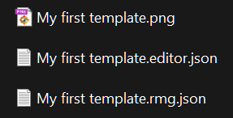
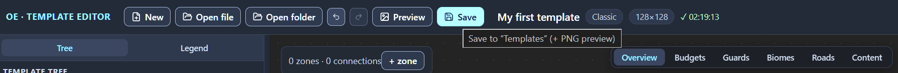

# Files: opening and saving

On disk, the template lives as a pair of files: the template itself in `.rmg.json` and the `.editor.json` sidecar file, in which the editor keeps its service data; every save adds a PNG preview next to them. This chapter is about the entire file mechanics: how the pair is structured, how to open a template from a file or from a folder, what exactly the “Save” button does, how the session backup safeguards the work, and how undo works.

The scenarios depend slightly on the browser. In Chrome and Edge, full file-handling support is available: the editor reads and writes the selected folder directly. Elsewhere, opening goes via file selection and saving — via download; the status bar along the bottom edge of the window always reminds you of the current mode.

## The file pair: template and sidecar file

Saving always writes three files with one base name — it is taken from the template’s “Name” field:

- `Name.rmg.json` — the whole template: zones, connections, budgets, game rules. The only file of the pair that the game reads.
- `Name.editor.json` — the sidecar file, the editor’s service data: the diagram’s node positions for every layout variant, the zone notes, and the layout of the Inspector’s collapsed sections.
- `Name.png` — the preview, a minimap of the active variant, 700×700 pixels. The game does not read the contents of the PNG file — the preview’s role is decorative; whether the file’s presence is mandatory for a custom template has not been determined. The editor always writes it.

Only what cannot be restored from the template lands in the sidecar: node positions, zone notes, your usual section layout. Positions are always written in full — for all zones of every layout variant: nodes moved by hand and nodes placed by the editor on a ring land in the file the same way, and the sidecar stores the arrangement exactly as you saw it on the canvas. Empty blocks are not written to the file — a template without notes gets a sidecar of positions only.

The files of the pair are linked by the base name: on opening, the editor looks for the sidecar next to the template, under the same name with the `.editor.json` extension. Rename and move the pair as a whole. If you leave the sidecar under the old name, the editor will not find it, and everything service-related is lost.

Opening a single `.rmg.json` without the pair is safe for the template: the zones, connections, and settings stay intact. Only the surroundings suffer: the nodes take their places on a ring around the diagram center (this starting arrangement is described in the [Canvas: graph editing](canvas-editing.md#node-positions-and-the-sidecar-file) chapter), the notes disappear, and the Inspector sections take your browser’s local settings.

## Opening a file

1. Press “Open file” on the top bar.
2. Select a `.rmg.json` file in the dialog — the file filter is labeled “RMG templates (can be selected together with .editor.json)”. Optional: add this template’s `.editor.json` to the selection — both files of the pair in one selection, and the service data returns together with the template.
3. Confirm the selection. The editor loads the template and shows the first layout variant.

The sidecar does not open without the template: if only the `.editor.json` is selected, nothing loads.

When you select only one `.rmg.json`, the editor tells you with a notification that the pair was not restored. If no folder is open or the pair is not in it, the notification is generic: “The template was opened without its companion .editor.json file: nodes were placed on a ring. If the template has its pair next to it — select both files when opening.” It is shown once until the page is reloaded: the editor does not know whether the template has a pair, and it does not nag you with repeats.

If the editor has an open folder — one selected via “Open folder” or during the last save — it looks for the pair in it. When it finds a readable `.editor.json` with the same base name, a precise notification arrives: “The open ‘folder-name’ folder contains a companion file ‘Name.editor.json’. Open the template together with it — node positions, notes and section layout will be restored.” Unlike the generic one, it arrives on every single-file opening. Note: the editor does not load the pair from the folder by itself — open the file again and add the `.editor.json` to the selection.

The “Open folder” scenario does not show these hints: sidecar files are picked up on their own, by matching names.

The editor rejects unreadable files with a notification: “The file is not a JSON object”, “The file does not look like .rmg.json: no name / variants[]”, and if the file picker window itself fails to open — “Could not open the file picker”.

Loading clears the change history of the current template: the replacement cannot be undone; about the history — in the [“Undo and redo”](#undo-and-redo) section. With unsaved changes, the editor first asks for confirmation: the “Unsaved changes” window opens (breakdown — in the [Interface: windows and panels](interface.md#the-unsaved-changes-window) chapter), and the file picker dialog appears only after “Continue”; “Cancel” leaves everything as it is. A confirmed replacement loses the edits for good — the session backup is immediately overwritten with the loaded state (see the [“Session backup”](#session-backup) section).

“Open file” does not touch the save location: the folder selected earlier via “Open folder” or during the last save stays in effect — its name is visible in the “Save” button’s tooltip.

## Opening a folder

“Open folder” is meant for a folder that holds several templates.

1. Press “Open folder” on the top bar.
2. Select a folder. The editor collects the templates from the `.rmg.json` files in the folder itself — subfolders are not checked, unreadable files are skipped silently; sidecar files are picked up by matching names.
3. Wait for the result. A single template loads immediately; several open the dialog for selecting a template from the folder, with a search and counters of variants and zones — its breakdown is in the [Interface: windows and panels](interface.md#template-selection-from-a-folder) chapter; none — the notification “No .rmg.json files found in the selected folder.” arrives.

In browsers with full file-handling support, the selected folder becomes the save location: the “Save” button’s tooltip changes to “Save to ‘folder-name’ (+ PNG preview)”, and the following saves go there without a dialog. Check this tooltip before saving: writing into the remembered folder goes without further questions. The folder choice lives until the page is reloaded — after that, the editor asks for the folder again on save.

In browsers without full support, folder selection is replaced with file selection, and the save location does not change: saving still goes via download.

## Saving

1. Press “Save” on the top bar.
2. If no folder is selected yet and the browser supports file handling, select a folder in the dialog that opens — it is remembered until the page is reloaded. Canceling the dialog stops the save: not a single file is written.
3. Check the folder: three files appear or are updated there — the `.rmg.json` template, the `.editor.json` sidecar file, and the `.png` preview of the active variant.

The names of all three files are built from the “Name” field: the characters `\ / : * ? " < > |` forbidden in file names are replaced with an underscore. If you change the “Name”, the next save adds a new trio under the new name next to the old files; the editor does not delete the old files.

Files with matching names are overwritten without questions. Keep templates in different folders or under different names — otherwise saving one template wipes out the files of another.

After each save, a mark with a checkmark and the time appears next to the info block; its tooltip repeats where the files went — “Saved to the ‘folder-name’ folder”. The notification “Files saved to the ‘folder-name’ folder” arrives once: when the folder is selected right in the save dialog. Repeat saves into the same folder pass quietly — only the time mark tells of them.

The editor reports write errors with notifications: “Could not write ‘Name.rmg.json’” — the save is aborted, the template stays unsaved; “Could not write ‘Name.png’ — preview not saved” — the template and the sidecar are already written.

In browsers without full file support, “Save” downloads the same three files to the browser’s downloads folder; the mark with the checkmark reminds you of this with the tooltip “Downloaded to the browser’s downloads folder”. Keep the downloaded pair together — the [“The file pair: template and sidecar file”](#the-file-pair-template-and-sidecar-file) section tells why.

While an unfixed error remains in the JSON draft, the “Save” button is unavailable, and its tooltip reads: “Saving is blocked: the JSON editor has an unfixed error”. How to apply and reset the draft — in the [Direct JSON editing](json-editor.md) chapter.

## Session backup

Independently of the “Save” button, the editor keeps a session backup — the latest state of the work in the browser storage. Closing the tab or the whole browser, or an accidental page reload, does not reset the edits: on the next launch, the editor silently restores the backup, and the work continues as if it had never been interrupted. The browser does not ask for confirmation on closing — the backup is exactly what provides the protection against loss.

The backup takes in the template in its current state, the node positions on the canvas, the zone notes, the Inspector’s section layout, and the active variant. Writing happens with a small delay after each change: a quick series of edits merges into one write; before the tab closes or you switch to another tab, the backup updates immediately. There is one backup: each new state overwrites the previous one; no version history accumulates. The template lands in the backup in any intermediate state — validator issues do not block the write.

Not restored after a restart:

- the change history — it is not written into the backup: after restoration, Ctrl+Z will not roll back the changes made before closing;
- the save folder — the editor asks for it again on the next save;
- the selection, the canvas view mode, the comparison pair, and the unapplied JSON draft — they return to their initial states.

Note: the backup lives in the browser storage and is not attached to the template files. It is visible only in the same browser; on another computer, in another browser, and for the game, only one instance of the template exists — the one saved on disk. Treat the backup as emergency insurance, not as a replacement for saving.

When the browser storage is unavailable or full, the editor warns once with the notification “Could not save the session backup: browser storage is unavailable or full. Save the template to disk manually.” If you receive this warning — save to disk after every series of edits, otherwise a page reload returns the work to the last save. A broken or incompatible backup is discarded silently — the editor starts with an empty “New Template”, as usual.

The “has unsaved changes” flag is part of the backup too and returns with it. After a successful save, “New”, “Open file”, and “Open folder” run immediately; with unsaved changes, the “Unsaved changes” window opens first — its breakdown is in the [Interface: windows and panels](interface.md#the-unsaved-changes-window) chapter. “Continue” discards the edits for good: the backup is immediately overwritten with the new state.

## Undo and redo

The undo and redo buttons on the top bar keep the template’s change history. One history step is one completed action:

- editing any field in the Inspector: properties of a zone, a connection, the template settings, or a variant;
- adding, renaming, and deleting zones and connections;
- moving nodes — dragging a node or an entire selection box is recorded as a single step;
- editing a zone note;
- duplicating and deleting a layout variant;
- an applied JSON draft.

Everything that does not change the template stays out of the history: switching the variant, the canvas view mode with its switches, the comparison mode, the tabs, the section layout, the panel widths. These are views of the template, not edits — there is nothing to roll back.

The history holds 100 steps; older steps are pushed out by new ones. If you undo several edits and make a new one, the redo branch is erased, and the undone changes cannot be brought back.

Undo returns not only the template but also the editing surroundings: the active layout variant and the selection become the same as they were at the moment of the step. If you were editing the second variant and have already switched to the first, undo itself brings you back to the second.

Note: the history lives only inside a single template and is not written into the session backup. “New”, “Open file”, and “Open folder” clear it entirely — a template replacement cannot be undone; with unsaved changes, the editor first asks for confirmation in the “Unsaved changes” window. After a page reload, the editor restores the work from the backup, but the history returns empty: Ctrl+Z will not roll back the edits made before closing.

The keys repeat the buttons: Ctrl+Z undoes, Ctrl+Shift+Z and Ctrl+Y redo; on macOS, Cmd works instead of Ctrl. While the cursor is in an input field, the global shortcuts do not fire — the usual text undo works there. The full table of keys — in the [Canvas: graph editing](canvas-editing.md#editor-keys) chapter.

## Next steps

- [Direct JSON editing](json-editor.md) — JSON drafts and their effect on saving.
- [Zone: all properties](zone.md) — the zone note, which is stored in the sidecar file.
- [Preview and PNG](preview.md) — what the preview draws and how to take the PNG without saving.
- [Installing a template into the game](install.md) — which file of the pair the game needs and where to put it.
