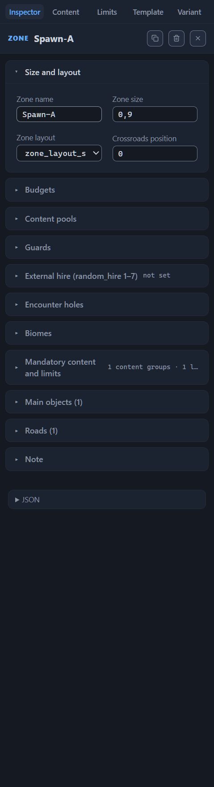
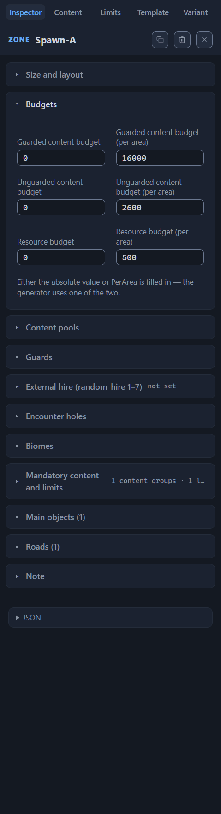
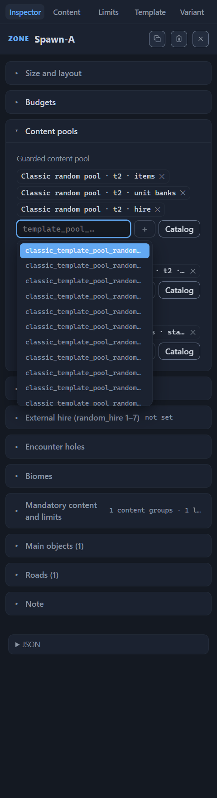
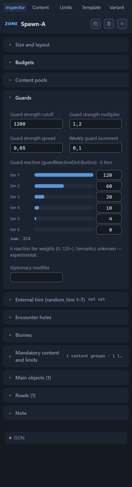
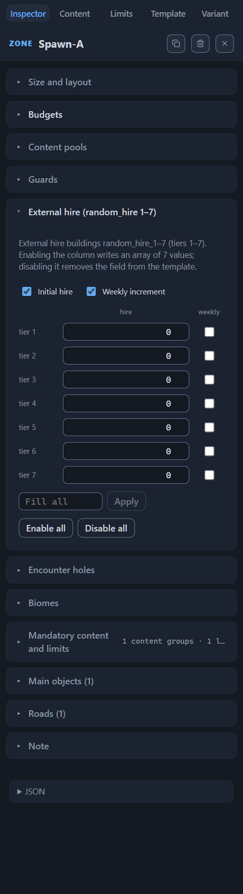
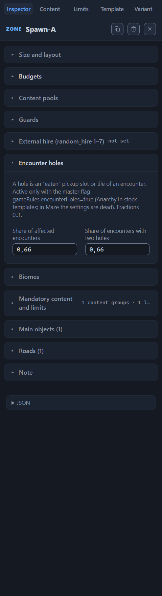
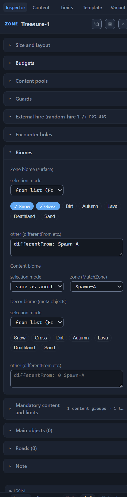
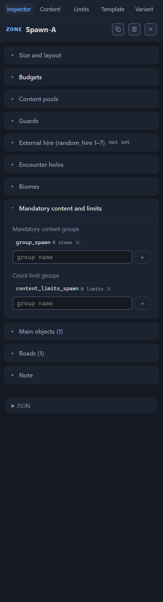
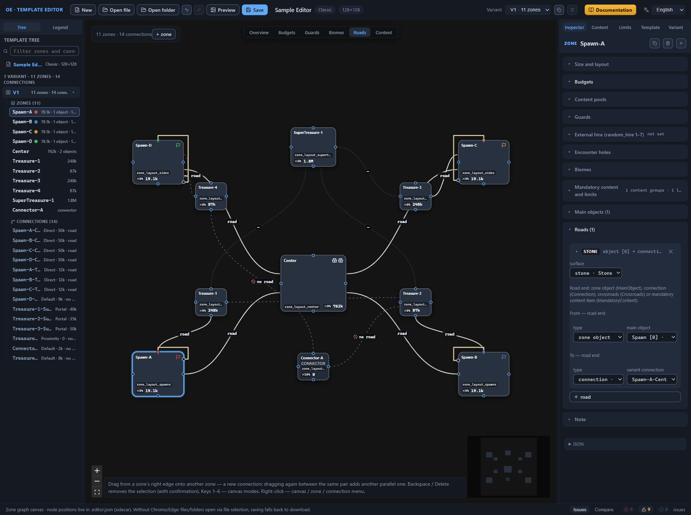
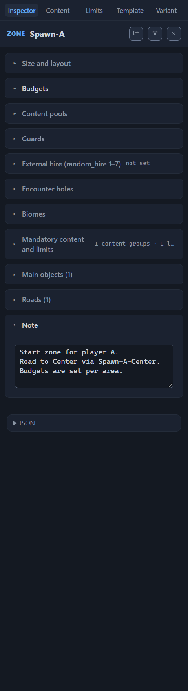

# Zone: all properties

A zone is a part of the future map with its own settings: a name, a size, a terrain layout, content budgets, biomes, guards, and roads. All of the zone’s properties are gathered in the Inspector — the right panel that opens when you select a zone node on the canvas or a zone row in the template tree. The chapter is a reference: the Inspector’s sections are broken down field by field, and each field follows a single scheme (the name in the interface and the name in the file, what it does, the valid values, the default, the limits). The practical techniques for working with the diagram — adding, renaming, deleting zones — are gathered in the [Canvas: graph editing](canvas-editing.md) chapter.

A zone belongs to a layout variant: each variant has its own list of zones, and edits affect only the active variant. A zone that occurs in several variants under the same name is renamed by a cascade everywhere at once — the editor does this; you do not need to carry the references over manually.

## Size and layout

The first section of the zone Inspector handles identification and shape: the name, the area weight, the terrain layout, and the crossroads position.

### Zone name

The name in the file is `name`. It is the zone’s address in the template: connections hold their ends by it, biome and faction selectors find the “other zone” by it, roads and mandatory content rules — their targets, and the template tree shows the zone’s row. The field stores arbitrary text; the game neither localizes this name nor shows it to the player.

A valid value is a non-empty string, unique within the variant. For a new zone the editor substitutes the first free name from the series Zone-1, Zone-2, …; stock templates have developed a practice of meaningful prefixes — Spawn-, Center-, Treasure-, Side-, SuperTreasure-, Connector-: a prefix does not have to mean anything, but a name starting with “Connector” is recognized by the editor as the mark of a connector zone, and the canvas paints such a node a flat dark color with the connector mark.

The editor rejects two kinds of names, reporting right in the field’s hint: an empty one — “Zone name cannot be empty”, a taken one — “The name ‘X’ is already taken by another zone”; in both cases the previous name stays in force. The validator complements the control with the error “Empty zone name” — it concerns zones with an empty `name` in the file itself. Renaming through the Inspector cascades over all references and all variants; rename only this way, otherwise a single missed reference sends a road or a placement rule to the wrong zone (the cascade’s contents — in the [Canvas: graph editing](canvas-editing.md) chapter).

### Zone size

The name in the file is `size`. It is the relative weight of the zone’s area, not a size in tiles: the generator arranges the zones on the map in proportion to the weights, normalizing their sum to the map area. Read the field as a ratio to the neighbors: a zone of weight 1.8 next to a zone of weight 0.9 claims roughly twice the share of the area, while the absolute area of both depends on the map size set in the template settings.

The field accepts numbers 0.15–2 with a step of 0.05. The default of a new zone is 0.9; it also returns when the field is cleared. The validator watches two bounds: a value of 0 or less — the error “size must be greater than zero”; a value outside the range — a warning of the form “size 2.5 outside the usual range 0.15–2”; going outside the range is not forbidden but does not occur in stock templates.

### Zone layout

The name in the file is `layout`. It is a reference to one of the template’s layouts — named sets of terrain parameters from the “Zone layouts (zoneLayouts)” section on the “Template” tab. A layout name (for example, `zone_layout_center`) is an arbitrary technical identifier that the game does not localize; the meaning is given by the set’s parameters — obstacle density, lake density, elevation modes. How to configure them is the topic of the [Template settings (root)](root.md) chapter.

The selection list shows a summary of the parameters next to each name: “obstacles 36% · lakes 30% · elevation: 2 modes” for a set with several elevation modes, “flat elevation” for a set without them, “parameters not set” for an empty set — the summary makes it convenient to choose a layout without opening the template panel. The default of a new zone is the first layout from the template’s list; if there are no layouts yet, the technical name `zone_layout_empty` is substituted. There is no empty value in the list: a zone always has some layout selected.

The validator checks the reference against the list: a name that is not among the template’s layouts gives the warning “layout ‘X’ is not declared in the template’s zoneLayouts” — the reference leads to a parameter set that the template does not have. On the canvas the layout name is visible as the node’s first line in the “Roads” mode; the “layout?” mark means the layout is not set (the [Canvas: view modes](canvas-modes.md) chapter).

### Crossroads position

The name in the file is `crossroadsPosition`. It is a single number 0–1, not a coordinate pair: the normalized position of the crossroads — the point where the zone’s roads meet. What the ends of the scale mean, the editor’s tooltip phrases as a hypothesis: 0 — the crossroads at the zone center, 1 — at the edge; the values 0 and 0.5 occur in stock templates. *Purpose to be confirmed.*

The field accepts numbers 0–1 with a step of 0.05. For a new zone it is empty — the value appears when you set it. The canvas shows a set value with the “✕NN%” label in the “Roads” mode: 0.5 turns into “✕50%”. The crossroads is one of the four kinds of ends of a zone road route; the zone’s roads have their own section below.

## Budgets

The second Inspector section handles the zone’s filling: how much content and of what kind the generator places inside it. There are three content budgets — guarded, unguarded, and resource content; each is set in two ways, by an absolute value or by a per-area value (PerArea), so the section has six fields, in pairs by content kind.

The currency of the budgets is value: the conventional balance currency in which both content and guards are counted. A budget answers only the question “how much”: the generator collects objects from the zone’s content pools until it exhausts the budget. What exactly lands in the zone is determined by the pools — their fields are covered further down the chapter, and the catalog and the selection techniques — in the [Content pool catalog](pools.md) chapter.

The rule of the pair is worded in the hint under the fields: “Either the absolute value or PerArea is filled in — the generator uses one of the two.” The absolute value assigns the zone a fixed value regardless of its area. The per-area value sets the value per unit of area: the larger the zone, the more total content it collects with the same number in the field. Which of the two values the generator uses when both are filled in — *Purpose to be confirmed.*

On the diagram the three budgets add up into the zone’s total budget — the number in the node’s bottom line in the “Overview” mode. The reading formula: total budget = guarded + unguarded + resources; for each component the canvas takes the absolute value if it is set and greater than zero, and the per-area value otherwise. Substitution on the demo template’s treasure zone: 70,000 + 9000 + 8000 = 87,000 — the node shows “87k”; the central zone of the same template gives 650,000 + 70,000 + 42,000 = 762,000, that is “762k”. The start zones show the second branch of the rule: the absolute fields are zeros, the canvas reads the per-area values, 16,000 + 2600 + 500 = 19,100 → “19.1k”. Viewing the components separately and choosing the value form — in the canvas’s “Budgets” mode (the [Canvas: view modes](canvas-modes.md#the-budgets-mode) chapter).

### Guarded content budget

The names in the file are `guardedContentValue` for the “Guarded content budget” field and `guardedContentValuePerArea` for the “Guarded content budget (per area)” field. The number is the value of the zone’s guarded content: the finds that the generator places under guard.

The field accepts any number; the field’s arrows change it in steps of 1000; the editor sets no hard bound. Stock templates give an orientation: the absolute values fit in the 0–8,000,000 range, the per-area values — in 0–40,000. A negative absolute value gives a validator warning of the form “Negative budget (−5000)”; in stock templates budgets are non-negative.

In a new zone both fields are empty; clearing a field makes the value unset; zero is a legitimate value. The demo template shows both ways: the start zones leave the absolute field at zero and fill in the per-area field (16,000 for guarded content); the treasure zone is configured the other way around — 70,000 in the absolute field and zero per area.

### Unguarded content budget

The names in the file are `unguardedContentValue` and `unguardedContentValuePerArea`; the fields are called “Unguarded content budget” and “Unguarded content budget (per area)”. The number is the value of the free content: finds without guards; the canvas legend labels unguarded content with the word “unguarded”.

The rules are shared with the guarded budget; the stock-template orientations differ: 0–350,000 for the absolute value, 0–5,000 for the per-area value. The default is empty fields; a negative absolute — a validator warning. In the demo template the treasure zone gets 9000.

### Resource budget

The names in the file are `resourcesValue` and `resourcesValuePerArea`; the fields are “Resource budget” and “Resource budget (per area)”. The number is the value of the resource content: the resource piles on the map. The stock-template orientations: 0–300,000 for the absolute value, 0–1,200 for the per-area value; the default and the negative-value warning — as with the other pairs. In the demo template the treasure zone gets 8000, the central zone — 42,000.

### Filling in the value pair

Both fields of one pair filled in at the same time are not an error. The validator answers with an info on the “Issues” panel: “Both the absolute value and PerArea are filled in — half of the official templates do the same, this is acceptable”. Half of the official templates indeed fill in both fields; which of the two values the generator picks — *Purpose to be confirmed.*

The validator does not forbid empty budgets, but a zone without budgets gets no filling from the pools — only the mandatory content remains in it: the objects that the generator places unconditionally, regardless of the budgets. The demo template’s connector zones are configured this way: all six fields are zeros.

If the filling should grow along with the zone’s area, set the per-area value; otherwise a large zone with a fixed absolute budget stretches the same value over a larger area, and the filling turns out sparser than in a small zone with the same number.

## Content pools

The budgets answer the question “how much”, the pools — “what exactly”: until the budget is exhausted, the generator collects the filling from the pools recorded in the zone. The “Content pools” section in the Inspector is collapsed by default — expand it by its header. Inside there are three fields, and each works in a pair with the budget of the same name: “Guarded content pool” — with the guarded content budget, “Unguarded content pool” — with the unguarded budget, “Resource pool” — with the resource budget.

The pools themselves live in the game’s database; the template stores only their names — identifiers like `classic_template_pool_random_t2_item`. You do not need to keep the identifiers in your head: the editor shows a short label for each pool and builds it itself, since pools have no official names; if the editor does not recognize a name, the label simply repeats it. What lies inside the pools and how to choose a suitable one is the topic of the [Content pool catalog](pools.md) chapter; here — the structure of the fields and the techniques for working with them.

### Filling in the field

The selected pools are shown as chips — small blocks with the pool’s label and a ✕ button that removes it from the field. The chip’s tooltip shows the original name and the tags parsed from it: the pool kind (for example, “random” or “classic”), the guard tag, the content profile (for example, “items” or “hire”); separate markers like `t2` are printed as is.

A new name is typed from the keyboard. When the line opens — by focus, by a click, or by the down arrow — a suggestion list unfolds: first the whole pool catalog, and it narrows to matches as you type. Enter or a click outside the field adds the typed text as is; Escape closes the list; the “＋” button adds the typed text as a separate action. An empty name and a duplicate pass by without a reaction.

Note: the catalog loads on the first opening of the field, so the suggestions appear with a short delay. Before the load the field accepts any name; after — it silently ignores names outside the catalog: a typo does not make it into the list, and the field does not report it. Check a doubtful name with the “Catalog” button — the dialog has a search across the whole pool catalog.

The “Catalog” button opens a dialog titled “Catalog · Guarded content pool” — the field’s name is substituted into the title template. On the “Pools” tab, the “+” button on a row adds the pool to the zone field; on selected rows it turns into “✓”, and a repeated click removes the pool. The “Lists” tab is for viewing only; it has no selection buttons. The “Compare (N)” tab does not touch the zone field: its “+” and “✓” buttons collect pools for comparison inside the dialog, which the hint at the bottom of the tab reminds you of.

The names already recorded in the template are checked by the validator: a pool that is not in the catalog is marked with the warning “Pool ‘name’ not found in the catalog (total pools: …)”. The check runs when the catalog is loaded.

### Guarded content pool

The name in the file is `guardedContentPool`.

The generator takes objects from this pool until it exhausts the zone’s guarded content budget. The value is a list of pool names; the stock-template orientation is from one to seven names. In the demo template the start zones specify three pools: `classic_template_pool_random_t2_item`, `classic_template_pool_random_t2_unit_bank`, and `classic_template_pool_random_t2_hire`; the central zone — two: `classic_template_pool_random_t4_item` and `classic_template_pool_random_t5_item`.

### Unguarded content pool

The name in the file is `unguardedContentPool`.

The source for the unguarded content budget: until the budget is exhausted, the generator draws objects from this pool. The stock-template orientation is the same — from one to seven names. In the demo template the start zones specify `classic_template_pool_random_unguarded_t2_base`, the treasure zones — `classic_template_pool_random_unguarded_t3_base`, the central zone — `classic_template_pool_random_unguarded_t4_base`.

### Resource pool

The name in the file is `resourcesContentPool`.

The source for the resource budget. Unlike the two neighboring fields, stock templates hold exactly one name here, usually from the `content_pool_general_resources_*` family. The demo template specifies `content_pool_general_resources_start_zone_medium` in the start zones, `content_pool_general_resources_treasure_zone_medium` — in the treasure zones, `content_pool_general_resources_treasure_zone_rich` — in the central zone and the supertreasure one. The connector zones keep all budgets at zero but still set the resource pool — `content_pool_general_resources_side_zone_poor`.

## Guards

While the budgets and the pools determine how much of what goods lands in the zone, this section sets the price of access to them: its fields control the guard — the protection that the generator puts on the zone’s finds and objects. The “Guards” section is expanded by default, like the first two, and stands in the Inspector right after the content pools. The guard of a single transition between zones is configured not here but in the connection’s properties — the topic of the [Connections between zones](connections.md) chapter.

Of the section’s six fields, a new zone has one filled in — “Guard reaction” with six unit weights; the rest are empty; the values appear when you set them.

### Guard strength cutoff

The name in the file is `guardCutoffValue`. The field’s presumed role is to cut off the small stuff: per the editor’s tooltip (a hypothesis) it is the minimum value below which an object is not placed with a guard — too cheap a find stays without protection. *Purpose to be confirmed.*

The field accepts any numbers; the arrows change the value in steps of 100. Stock templates give an orientation: the values fit in the 0–3500 range; the editor does not forbid going outside it. Zero is a legitimate value — the one the demo template’s connector zone is set to; in the demo template the cutoff grows with the zone’s wealth — 1200 in the start and treasure zones, 2400 in the central one, 3000 in the supertreasure zone SuperTreasure-1.

The canvas shows a set value with the “up to N” label in the “Guards” mode: the cutoff 1200 reads as “up to 1.2k” (the [Canvas: view modes](canvas-modes.md#the-guards-mode) chapter).

### Guard strength multiplier

The name in the file is `guardMultiplier`. The number shows how many times the zone’s guard is strengthened.

Input is limited to the 0–10 range; the arrows change the value in steps of 0.1; the stock-template orientation is 0.1–5. In a new zone the field is empty. The demo template lines the multiplier up in a ladder following the zone’s wealth: 1 in the lower-tier treasure zones and the connector zone, 1.2 in the start zones, 1.4 in the upper-tier treasure zones, 2.1 in the central zone, and 3 in the supertreasure zone. Two similar stock templates with the same geometry show the same ladder: in one, the start, side, and central zones carry 1.05, 1.35, and 1.7; in the other — 1.0, 1.3, and 1.6, that is, the second is more restrained in guards everywhere.

Raise the multiplier along with the zone’s budget; otherwise the richest zone ends up under the weakest guard — the player clears it out without resistance, and the map’s tension sags. On the canvas the value is visible in the “Guards” mode: a swords icon and the multiplier number next to the zone name.

### Guard strength spread

The name in the file is `guardRandomization`. The fraction of the random addition: how much the generated guard strength deviates from the computed one. In stock templates the field always equals 0.05, which the editor’s tooltip reads as ±5% of the guard strength.

Input is limited to the 0–1 range; the arrows change the value in steps of 0.05. In a new zone the field is empty; in the demo template all zones keep the stock 0.05, and the “Guards” mode label shows “rnd 5%”.

Stick to the stock value: with a larger spread, zones with identical settings get noticeably different guards — some players get strong guards, others weakened ones, and the equality of conditions breaks.

### Weekly guard increment

The name in the file is `guardWeeklyIncrement`. The fraction by which the zone’s guard is strengthened each game week: the map ages, and the guard grows along with it.

The field accepts any numbers; the arrows change the value in steps of 0.05. The stock-template orientation is 0.05–0.2; the demo template covers the whole range: 0.1 in the start, treasure, and connector zones, 0.15 in the central one, 0.2 in the supertreasure zone. Reading the value: an increment of 0.1 adds a tenth of its strength to the guard per week — a guard of 5000 strength grows by 500 by the end of the first week. The “+10%/” label in the “Guards” mode shows this same value on the canvas.

Check the increment against the players’ pace of development, otherwise by the late weeks the guard outgrows their armies and cuts off access to the loot.

### Guard reaction

The name in the file is `guardReactionDistribution`; the block’s caption is “Guard reaction (guardReactionDistribution) · 6 tiers”. The value is six weights, one per reaction tier. What a tier is has not been determined: the block’s tooltip says straight out “6 reaction tier weights. Semantics unknown — experimental”. *Purpose to be confirmed.*

The weights are entered row by row: the “tier N” row holds a number and a bar whose length shows the weight relative to the heaviest tier. The sum of the weights is printed under the rows; a zero sum is labeled “not set”. A weight is a non-negative integer: the fractional part is discarded, a negative or non-numeric value resets the field to the previous one, and a comma is allowed in the decimal notation. Zeroing all six weights removes the field from the zone entirely.

In a new zone all six weights equal one. Stock templates use integer weights from 0 to 120 and above; frequent sets are `[120, 60, 20, 10, 4, 0]`, `[3, 2, 0, 0, 0, 0]`, and `[1, 1, 4, 4, 2, 1]`. The demo template assigns `[120, 60, 20, 10, 4, 0]` to the start, central, and supertreasure zones, `[40, 40, 20, 10, 4, 0]` — to the treasure zones, `[3, 2, 0, 0, 0, 0]` — to the connectors.

The validator checks only the array’s shape, and any violation is a warning of the form “guardReactionDistribution: length 5 instead of the expected 6 ‘tiers’”, “…all 6 values must be numbers…”. Such issues cannot come from the Inspector: they occur in templates modified outside the editor.

### Diplomacy modifier

The name in the file is `diplomacyModifier`. The value is always negative; the field is filled in in half of the stock templates (30 files of 60), and the values lie in the −0.5…−0.25 range. The editor’s tooltip phrases the purpose as a hypothesis: the chance of armies joining in the zone. *Purpose to be confirmed.*

The field accepts any numbers; the arrows change the value in steps of 0.05. In a new zone the field is empty; in the demo template no zone has it. The canvas’s “Guards” mode shows a set value with the “diplo N” label: the modifier −0.3 reads as “diplo −0.3”.

## External hire

The “External hire (random_hire 1–7)” section stands in the Inspector right after “Guards” and is collapsed by default — expand it by its header. It configures the external hire buildings — the game objects random_hire_1…random_hire_7, one per each of the seven tiers: the zone sets two parameters for each tier, the initial hire increment and enabling the weekly increment. The section does not place the buildings themselves: they are ordinary game objects; in the sid field tooltips they are labeled “Внешний найм · ярус N” (Russian for “External hire · tier N”), and they occur among the objects of mandatory content groups too — the topic of the [Template settings (root)](root.md) chapter.

The collapsed state does not hide the setting: the section header carries a summary — “init.: 2×7 · weekly: all”, and without settings — “not set”. Both columns are optional: in a new zone they are off; in the demo template the section is not filled in for any zone; among the stock ones it is filled in for 8 templates of 60, which is 40 zones. The stock templates’ values are small integers, for example [3, 3, 3, 3, 3, 3, 3] or [6, 5, 5, 4, 4, 3, 3].

### Columns and array lengths

The values are entered in a table: seven rows are the tiers, two columns are the parameters. The columns are enabled independently: two toggles with their names stand above the table, “Initial hire” and “Weekly increment”. Enabling a column writes an array of exactly seven values into the template — seven zeros for the numbers, seven unchecked flags for the “weekly increment”; disabling a column removes the field from the template entirely, and the row fields of the column become inactive.

The order of the array elements repeats the buildings’ numbering: the element at index 0 configures random_hire_1, the element at index 6 — random_hire_7, so the length of both arrays is exactly seven. The validator watches the length and answers with a warning of the form “randomHireInitialUnitIncrement (numbers, idx = random_hire 1..7): length 5 instead of the expected 7”; for the flags the issue is the same, with the name randomHireEnableWeeklyUnitIncrement. Such arrays cannot come from the Inspector — they occur in templates modified outside the editor.

The editor shows an array of a wrong length as is and warns right in the section: “Initial hire: the file has an array of 5 — normalized to 7 on edit”. The very first edit of the column normalizes the length: missing elements are padded with a zero for the numbers and an unchecked flag for the toggles; extra ones are discarded. Do not change the length of these arrays in the JSON draft — otherwise the first edit in the Inspector silently pads or trims the values to seven, and you will not notice the substitution.

### Initial hire

The name in the file is `randomHireInitialUnitIncrement`. The numbers set the initial hire increment by tier: the value of the “tier N” row configures the random_hire_N building. The tooltip on the row label shows the building’s name.

The value is seven non-negative integers. The row field commits the input on Enter or on loss of focus; the fractional part is discarded — 3.7 turns into 3 — and a comma is allowed as the decimal separator. An empty, negative, or non-numeric value resets the field to the previous one. The default of a just-enabled column is seven zeros.

Bulk filling is gathered in the “Fill all” field with the “Apply” button: the number from the field is written to all seven tiers at once. The button is inactive while the field is empty or holds a negative or non-numeric value; Enter in the field does the same as the button.

The collapsed section shows the values right in the header: an identical seven of numbers reads compactly — “init.: 3×7”; different values are printed as a list — “init.: 6,5,5,4,4,3,3”. One of the stock templates is configured this way: the central zone gets 2 per tier (“init.: 2×7”), the side ones — 3 each; the weekly increment is enabled there as well.

### Weekly increment

The name in the file is `randomHireEnableWeeklyUnitIncrement`. The flags enable the weekly hire increment by tier: a checked box of the “tier N” row enables the weekly increment of the random_hire_N building.

The value is seven flags; a click on a row’s checkbox toggles it. The default of an enabled column is all flags off. The buttons under the table control the whole list: “Enable all” sets all seven flags, “Disable all” clears them.

The header of the collapsed section counts the flags: seven of seven read “weekly: all”; in the other cases the number of enabled ones is printed — “weekly: 4 of 7”. The validator warning about a wrong length is shared with the “Initial hire” column (see the [“Columns and array lengths”](#columns-and-array-lengths) section).

## Encounter holes

The “Encounter holes” section stands in the Inspector right after “External hire” and is collapsed by default — expand it by its header. Its mechanic is holes: generation glitches that the template author builds in deliberately. A hole is a gap inside an encounter — a ready “micro-map” of objects and guards that the generator picks automatically by type and size. The gap appears in place of an “eaten” pickup slot — where a picked object should have appeared — or of an encounter tile. Holes do not affect the game rules or balance — this is a content layout parameter: it decides which part of the encounters’ content does not make it onto the map.

The mechanic is assembled from two settings of different levels. The template level is the “Encounter ‘holes’” toggle on the Inspector’s “Template” tab, the “Game rules” section (the name in the file is `gameRules.encounterHoles`): it turns the mechanic on for the whole template at once. The toggle has three states — “not set”, true, and false — and any state but true leaves the mechanic off. The zone level is the shares of this section: which part of the zone’s encounters gets a hole and which part gets two holes. Enable the rule together with the shares, otherwise the zone’s settings stay in the file as dead weight and the generator ignores them — the validator reminds of this with the info “encounterHolesSettings is set, but gameRules.encounterHoles is not enabled — the field is ignored”; the note appears both with the rule off and in the “not set” state. The full reference of the “Game rules” section — in the [Template settings (root)](root.md) chapter.

In a new zone both fields of the section are empty; the demo template does not fill the section in for any zone — the setting appears in the file only when you set it. Stock templates use the mechanic rarely. The rule is written in all 60 files but enabled only in Anarchy — the only one whose official description promises the player “…no limits, broken rules and glitched terrain await!”. There the shares are written for every zone — 79 zones across five variants in total. The same settings also occur in Maze — 84 zones across three variants — but the rule is off there, and the shares stay dead. All 163 settings in the two templates are identical: 0.66 and 0.66.

### Share of affected encounters

The name in the file is `affectedEncounters`, inside the zone’s `encounterHolesSettings` object. The number is the share of the zone’s encounters that gets a hole: 0 — no holes, 1 — a hole in every encounter. The template does not list the specific encounters — the generator picks them itself; the share applies to those picked for the zone. Substitution: 0.66 is roughly two thirds; of ten encounters of the zone, about seven get a hole.

The field is conceived as a number from 0 to 1: the arrows change the value in steps of 0.01 and do not go outside the bounds, but there is no hard input limit. Committing — on Enter or on loss of focus; a comma is allowed as the decimal separator; non-numeric input returns the field to the previous value. A value outside the range lands in the file, and the validator answers with a warning of the form “Share affectedEncounters (1.2) outside 0..1”: the format provides for a share from 0 to 1; the generator’s behavior outside the range is not described. Clearing the field removes the value, and clearing both fields of the section deletes `encounterHolesSettings` from the zone entirely.

### Share of encounters with two holes

The name in the file is `twoHoleEncounters`, inside the same `encounterHolesSettings` object. The number is the share of encounters that gets two holes instead of one. The base of the count has not been determined: the share is counted from all of the zone’s encounters or only from those affected by the first share — in the stock data both values equal 0.66, and the difference is not visible. *Purpose to be confirmed.*

The input rules, the empty default of a new zone, and the validator warning about a value outside the range are shared with the share of affected encounters.

How a hole looks on the finished map — *Purpose to be confirmed.* Only the mechanism is known: the generator is able to “eat” a pickup slot inside an encounter, and some of the encounter’s tiles are marked as holes from the start; there is no separate “hole” entity in the game. Judge the result visually on the finished map — how to obtain it is described in the [Installing a template into the game](install.md) chapter.

## Biomes

The “Biomes” section ties the zone to biomes. A biome is a landscape type of the finished map; there are seven biomes: “Snow”, “Grass”, “Dirt”, “Autumn”, “Lava”, “Deathland”, and “Sand”. The chips of each selection mode list the seven English names in the same order; the file stores the same values in Latin script. A zone has three independent settings — three biome layers; each is set by its own selector with the shared “selection mode” list:

- **Zone biome (surface)** — `zoneBiome`: the surface biome — how the zone itself looks on the finished map.
- **Content biome** — `contentBiome`: the biome the zone takes its content objects from.
- **Decor biome (meta objects)** — `metaObjectsBiome`: the biome of the environment decor — meta-objects.

The layers do not depend on each other: a zone can be built in “Snow” while taking content from “Grass”. In a new zone all three selectors are “from list” with an empty list: the restrictions are lifted; on the canvas this state is labeled “any”. In the file the fields are mandatory; the editor creates them for every zone.

You can view the biomes of the whole diagram with the canvas’s “Biomes” mode and its “biome layer” toggle: the node fill shows the selected biome, the line next to it — the selection mode (the [Canvas: view modes](canvas-modes.md#the-biomes-mode) chapter). Switching the selection mode in the Inspector keeps the arguments already set — after switching, check that they fit the new mode. The Inspector offers exactly three modes, so the validator warning “Unknown biome selector type: ‘X’” occurs only in templates modified outside the Inspector.

### From list (FromList)

The type name in the file is `FromList`; the item of the “selection mode” list is “from list (FromList)”. The mode lists the allowed biomes: the generator builds the zone in one of the named ones. An empty list lifts the restrictions — the “any” state, the default of a new zone.

Biomes are set with chips: a click adds or removes a name; an enabled chip is marked with a “✓” checkmark (the tooltips “Add to list” and “Remove from list”). Lines beyond the seven names are entered in the “other (differentFrom etc.)” field, comma-separated; the field applies on loss of focus or on Ctrl+Enter. On the canvas a list of several names is labeled “list”; a single chip gives a fixed biome — the node is labeled with its English name.

The “other” field accepts differentFrom expressions — the file’s technical notation, which the editor shows as is. A record like `differentFrom: Spawn-A` excludes from the list the biome of the Spawn-A zone and the biome of its main object #0; an object index is allowed between the colon and the zone name — `differentFrom: 0 Spawn-A`. How the generator chooses a biome from the remaining ones — *Purpose to be confirmed.* On the canvas a node with such an expression is painted with the reference zone’s biome and the “≠ zone” mark.

The validator checks every differentFrom line: a zone with such a name is not found — the warning “Nonexistent differentFrom zone: ‘Spawn-C’”. This is how biomes are spread across the map: the treasure zones and the side zones in stock templates carry the lines `differentFrom: Spawn-A`, `differentFrom: Spawn-B`, and so on — otherwise a zone may get the same biome as the start one. A single chip can pin the zone’s character: a fixed “Sand” in the stock templates sets a desert center. In the demo template the treasure zones’ surface biome is a list of the single line `differentFrom: Spawn-A`; the content and decor biomes are “any”.

### Same as another zone (MatchZone)

The type name in the file is `MatchZone`; the item of the “selection mode” list is “same as another zone (MatchZone)”. The “zone (MatchZone)” field offers the zones of the current variant; the field’s hint is “Name of the zone whose biome to use”. The zone takes the biome of the specified zone; on the canvas the selector line reads “← ZoneName”.

A frequent target is the start zone: in stock templates MatchZone most often points to Spawn-A or Spawn-B so that the zone follows the player’s biome. In the demo template the connector zone is configured this way: the surface biome is taken from Spawn-A; the content and decor biomes stay “any”.

The validator checks the zone name: not found — the warning “Nonexistent MatchZone zone: ‘X’”. Renaming the target updates the reference by a cascade; you do not need to carry it over manually (the [Canvas: graph editing](canvas-editing.md) chapter). The canvas breaks reference chains itself: a zone that takes its biome from a zone that takes it from the first one is displayed with a dark “?”.

### Same as the main object (MatchMainObject)

The type name in the file is `MatchMainObject`; the item of the “selection mode” list is “same as the main object (MatchMainObject)”. The mode takes the biome from the zone’s main object (the [Zone main objects](main-objects.md) chapter) — a city, a hero spawn point, an abandoned outpost, or an arena. Two lists set the reference:

- **Main object** — the object whose biome to take. The options are the list from the “Main objects” section: while the “Zone” field is empty, these are the current zone’s objects; when a zone is set — the objects of the specified zone. Each option is labeled with a number and a type; the hero spawn point adds the player — for example, “0 · Player spawn point (Spawn) · Player1”. Objects are numbered from zero; usually the first is taken; in the file the number is recorded as the object index (`args[0]`); an empty value is shown as “—”. A value recorded in the file but missing from the list stays as the explicit option “N · outside the object list” — the choice is not lost silently.
- **Zone** — an optional zone whose “Main objects” to search the object in; without it the list is taken from the current zone. The list offers the zones of the current variant; an empty value is shown as “—”. The purpose of the “object + zone” pair is a hypothesis: it is presumed to reference an object of another zone when the zone’s own has none.

Note: the “Roads” section has a selector with a similar name — “main object”; it is a different field, and its options are labeled differently — “Spawn [0] · Player1” (the [Roads](#roads) section).

On the canvas the selector line reads “MO #N” with the object index, and with a zone selected it is appended with “← ZoneName”. The canvas does not compute the object’s own biome: with a zone, the node shows the specified zone’s biome; without one — a dark “?”; this is an approximation; the finished map shows the exact biome.

The validator checks the zone — “Nonexistent MatchMainObject zone: ‘X’”; the object number is not checked. The list guards against a typo but not against deleting a card: deleting an object shifts the numbering, and the selection silently starts pointing at the neighbor. After deleting an object, check the selection in “Biomes” anew, otherwise the biome is taken from the wrong object.

This is how the start zones are configured: the biome follows the faction of the main object, and each faction has its biomes — “Grass” for human, “Dirt” for dungeon, “Autumn” for nature, “Lava” for demon, “Snow” for unfrozen, “Deathland” for undead. The faction-to-biome mapping is taken from the game’s database; the editor’s faction selector does not offer an undead chip, but the corresponding biome is selectable on equal terms with the others. Without a faction only “Sand” remains. In the demo template all three layers of every start zone are “same as the main object” with object 0 selected — the hero spawn point: the surface, the content, and the decor follow it.

## Mandatory content and limits

The section ties the zone to groups from the template’s root. Mandatory content is groups of objects that the generator must place on the map; count limits are groups of restrictions on the number of objects. The groups’ composition is set in the root panels: “Mandatory content” on the “Content” tab and “Count limits” on the “Limits” tab (the [Template settings (root)](root.md) chapter). The zone stores only the group names: the same group is attached to several zones, and editing its composition applies to all referencing zones.

The section stands after “Biomes” and is collapsed by default. The collapsed header carries a summary like “1 content groups · 1 limit groups” — one number per list; for an empty zone the summary reads “0 content groups · 0 limit groups”.

### Mandatory content groups

The field is called “Mandatory content groups”; in the file — `mandatoryContent`. The value is an array of group names: each line matches the `name` field of a root group character by character. An attached group is a guarantee to the generator: its objects land on the map regardless of the zone’s budgets.

The selected names are shown as chips. The chip carries the group’s original name — the very identifier written in the `.rmg.json` file — and the “N items” summary with the number of the group’s items; the ✕ button removes the name from the list. The editor shows the group name as is and does not translate it: the game looks the group up by an exact string match, and prefixes like `mandatory_content_` and `content_limits_` are only a naming convention of stock templates. The chip’s tooltip repeats the group name and lists its contents line by line: the item name, the object’s Russian name and its identifier — for example, “Ящик Пандоры (pandora_box)” — the “mine” mark, the choice variants from a list.

A click on the chip’s name jumps to the group card: the editor switches the root panel’s tab, scrolls the list to the needed group, and highlights it. A new name is entered in the “group name” field: the suggestions list the root groups not yet attached to the zone. Enter, picking a suggestion, or the “＋” button adds the name; empty input and duplicates are ignored silently.

Defaults and orientations:

New zone
: the `mandatoryContent` field is absent; the validator marks the zone with the warning “The zone has no mandatory content (usually ≥1 group)”.

Demo template
: one group for each of the eleven zones — `group_spawn` in the start zones and the connector zone, `group_treasure` in the treasure zones, `group_center` in the center, `group_supertreasure` in the supertreasure one.

Stock templates
: exactly one mandatory content group per zone.

Items inside groups can carry names, and these names are visible to the zone’s roads and placement rules: the generator looks for a named item among the groups attached to the zone, so the composition of the list determines which targets are available to the roads. The canvas’s “Content” mode shows the mandatory content points (the [Canvas: view modes](canvas-modes.md) chapter).

### Count limit groups

The field is called “Count limit groups”; in the file — `contentCountLimits`. The mechanics of the list are the same: an array of group names, chips, input suggestions, jumping to the card on a click. The chip’s summary differs — “N limits” — and so does the chip’s tooltip: per-line limits of the form “object name: no more than 2”, and nested groups.

The meaning differs too. Mandatory content guarantees that objects appear; limits restrain their number: a limit group sets the ceiling on the number of objects of one kind for the zone.

Defaults and orientations:

New zone
: the field is absent — and there is no warning: “The limit group list is empty” is issued for a zone whose group list exists and is empty.

Demo template
: one group per zone — `content_limits_spawn`, `content_limits_treasure`, `content_limits_center`, `content_limits_supertreasure`, matching the zones’ roles.

Stock templates
: from 1 to 15 groups per zone.

### Broken references and validator warnings

Both fields accept any non-empty name. Note: the editor does not check the input against the template’s root at the moment of typing — a name that is not among the groups is added as is. The game tolerates such references silently, so the control stays with the validator; a reference to a nonexistent group is called broken.

A broken reference is visible by the “not found” badge on the chip. Such a chip’s tooltip advises checking the name or creating the group in the “Template” panel; it has no jump button.

The validator reminds about the section with five warnings:

- “The zone has no mandatory content (usually ≥1 group)” — the `mandatoryContent` list is empty;
- “Group ‘X’ not found in the root mandatoryContent” — a name from the zone’s list is missing among the root groups;
- “The limit group list is empty” — the `contentCountLimits` list is empty;
- “Limit group ‘X’ not found in contentCountLimits” — a limit group name is missing among the root groups;
- “The value is a string instead of an array (a known anomaly of stock templates; the game’s parser tolerates it)” — the limits are written as a string instead of an array; this is unreachable from the editor; the warning occurs only in templates edited outside the editor.

Add names from the input suggestions, otherwise a typo stays unnoticed in the template: the chip is marked “not found”, and the validator shows a warning until it is fixed. Creating groups and the first attachment are shown in the [Quick start](quick-start.md) chapter; the composition and the structure of the groups themselves — in the [Template settings (root)](root.md) chapter.

## Main objects

The zone’s anchor points — a city, a hero spawn point, an abandoned outpost, and an arena — are covered in the [Zone main objects](main-objects.md) chapter. The zone’s other settings reference objects by number — the index in the section’s list, counted from zero: road ends, the “same as the main object” biome layer, and the “Match” faction selection mode. Deleting an object from the middle of the list shifts the numbers of the following ones — reread the indexes in the roads, the biomes, and the factions, otherwise a road leads to the wrong city.

## Roads

The section lists the routes of roads inside the zone. A zone road is a segment of a path between two points: the generator lays the road network along them, connecting the main objects, the exits from the zone, and the crossroads. A road along the transition to a neighboring zone is a separate setting: it is enabled by the connection’s `road` flag (the [Connections between zones](connections.md) chapter).

The section stands after “Main objects”, before “Note”, and is collapsed by default; the header carries a counter like “Roads (1)”. The name in the file is `roads`: an array of records, each with three keys — the surface `type` and the two ends, `from` and `to`. An end is a selector object of the form `{ type, args }`, where `type` names the kind of the point, and the first element of `args` stores its address: a main object number, a connection id, or a mandatory content item name. For a zone without roads the section shows the hint “The zone has no roads — add the first one.”

Defaults and orientations:

New zone
: the `roads` field is absent — there are no routes.

Demo template
: one stone road for each of the four start zones — from the hero spawn point (object [0]) to the connection leading to the center; the other seven zones have an empty list.

Stock templates
: the field is present in 937 zones of 938; the zone without roads is the only exception; a zone has from one to eighteen routes, 2291 roads across the sixty templates in total.

The finished routes are drawn by the canvas’s “Roads” mode: an orthogonal polyline over the nodes with end markers — ■ a main object, ◯ a connection, ◆ a crossroads, ◎ a mandatory content item (the [Canvas: view modes](canvas-modes.md#the-roads-mode) chapter). The layout also affects how the network branches inside the zone: its `roadClusterArea` parameter sets the area of the road “cluster”, and the composition of the layouts is covered by the [Template settings (root)](root.md) chapter.

### Road card

Each road occupies its own card. The collapsed row shows the surface — or a dash if it is not set — the description of the ends, and the ✕ button with the “Delete road” tooltip: for the demo template’s road this is “Stone” and “object [0] → connection ‘Spawn-A-Center’”. The ends are labeled by kind — “object [N]”, “connection ‘name’”, “content ‘name’”; the editor labels the crossroads with the technical name `Crossroads` — this label has no translation.

The ✕ button deletes the road immediately, without confirmation, and does not expand the card; made a mistake — roll the deletion back with Ctrl+Z. Deleting the last road removes the `roads` field from the file entirely, and the section shows the empty-list hint again.

The “road” button under the list adds a route with a ready blank:

Surface
: stone (Stone).

Start
: main object [0]; if the zone has no objects, the argument stays empty — the validator asks for the index.

End
: the variant’s first connection; if the variant has no connections — the crossroads.

The blank describes the simple “object → zone exit” link; assemble the other routes in the fields of the expanded card. The card lists them in order: the surface, the hint about the kinds of ends, the “From — road end” and “To — road end” blocks.

### Road surface

The field’s label is “surface”; in the file — `type` of the road record. The list offers three values: “stone · Stone”, “dirt · Dirt”, and “not set”. The format describes the field as the type of the road surface — the visual style and the passability; how exactly the surface affects the game — *Purpose to be confirmed.*

The “not set” value removes the `type` key from the record: the road stays in the file without a surface. The field’s hint reports that such roads also occur in stock templates — roughly every tenth one. The rest divide as follows: 1935 stone against 130 dirt, that is, roughly fifteen stone roads per one dirt. The difference is visible on the canvas: a stone thread is light solid, a dirt one is brownish dashed, a road without a surface is neutral beige solid.

A value outside the Stone/Dirt pair gives the validator warning “Unknown road type: X”. From the selection list this is unreachable — the warning occurs only in files edited outside the editor.

### Road ends

The “From — road end” and “To — road end” blocks are structured identically. The section’s hint lists the kinds of points: “Road end: zone object (MainObject), connection (Connection), crossroads (Crossroads) or mandatory content item (MandatoryContent).”

The “type” selector picks the kind of the point; the options are labeled in pairs — “zone object · MainObject”, “connection · Connection”, “crossroads · Crossroads”, “mandatory content item · MandatoryContent”; no kind selected — a dash. Note: changing the type clears the end’s arguments, so choose the point’s address anew. The second selector appears only for the kinds with an address and is labeled by kind — “main object”, “variant connection”, “content item”. The editor builds its lists from the template itself: the objects — from this zone’s “Main objects” section, the connections — from the active variant’s connections, the content names — from all mandatory content groups of the template. The crossroads needs no second selector: instead of it stands the hint “Zone crossroads — no arguments needed.”

Stock templates show the familiar combinations of kinds: a main object more often starts a route, a connection more often ends it, a crossroads occurs on both sides, and a mandatory content item is a rarity. The meaning of the direction — which end is “from” and which is “to” — *Purpose to be confirmed.*

#### Zone object (MainObject)

The end’s address is the number of the zone’s main object — the same index that the “Main objects” section shows (the [Zone main objects](main-objects.md) chapter); numbering from zero. The “main object” selector labels the options with the type and the number — “City [0]”, “Spawn [0] · Player1” (the hero spawn point adds the player); the field’s hint words the rule: “Index in the zone’s mainObjects”. Stock roads reference objects 0–8 — by the number of objects in the zone; more often this kind starts the route (1732 starts against 264 ends).

Such an address is fragile: a number stands here instead of the point’s name, and deleting an object card from the middle of the list shifts the numbering — the road starts pointing at the neighbor. After deleting or rearranging objects, reread the zone’s roads, otherwise the route goes to the wrong city.

The validator controls the address with two errors: “MainObject end without a valid index (args[0])” — the argument is empty, not an integer, or negative; “MainObject[9] outside the mainObjects range (0..8)” — the number is greater than the last object; the bounds in the message are counted from the zone’s list.

On the canvas the main objects’ markers are spread along the node’s top edge: each number gets its own dot, and two routes to different objects do not merge into a single line. At a hero spawn point the ■ marker is painted in the player color.

#### Connection (Connection)

The end’s address is the id of the variant’s connection: the connection’s own name, or while the “Connection name” field is empty — the auto name built from the zone names, of the form From-To. The “variant connection” selector lists the ids of all connections of the active variant, and the field’s hint recalls the format: “connection id: name or From-To”. Stock templates almost always name their connections — 59 files of 60 — usually with the same From-To form, with a suffix for duplicates; the roads reference this name.

The exit from the zone is the most frequent target of a route: 1712 ends against 218 starts. On the canvas the ◯ marker stands on the node’s edge facing the neighbor zone; if a connection with such an id is not found in the variant, the thread runs toward the center of the diagram.

Renaming a connection and deleting it do not update the address in the roads — the details and the verification procedure are in the [“Broken ends and validator warnings”](#broken-ends-and-validator-warnings) section.

#### Crossroads (Crossroads)

An end without an address: the point is a single one — the zone’s crossroads, whose position is set by the “Crossroads position” field from the [“Size and layout”](#size-and-layout) section. The second selector does not appear for this kind; instead of it is the hint “Zone crossroads — no arguments needed.”; in the file `args` is empty. The collapsed card labels the end with the technical name `Crossroads`.

Extra arguments at a crossroads are marked by the validator with the info “Crossroads end with extra arguments”; from the Inspector this is unreachable — changing the type clears `args`, and the kind has no input field.

On the canvas the ◆ marker stands at the center of the zone node. Stock templates put a crossroads on both sides of a route — 329 starts and 206 ends.

#### Mandatory content item (MandatoryContent)

The end’s address is the name of a mandatory content item: the very `name_*` with which the root groups mark individual objects. Stock examples of names are `name_mine_gold`, `name_remote_foothold_1`, `name_mana_well`, `watchtower_1`. The “content item” selector lists the names of all named items of all groups of the template; the field’s hint is “name_* in mandatory content groups”. The groups’ composition and the item names are configured in the “Mandatory content” panel on the “Content” tab (the [Template settings (root)](root.md) chapter), and the zone attaches the groups with the “Mandatory content groups” list (see the [“Mandatory content and limits”](#mandatory-content-and-limits) section).

Note: the generator looks for the name among the groups attached to the zone, not across the whole template, while the editor and the validator check the argument against the full set of the template’s names. A name from a group that the zone does not have passes the check, but no target is found in the zone. Attach the group with this name to the zone, otherwise the road end stays without a point.

A missing name is caught by the error “Object ‘X’ not found in the mandatory content groups”. On the canvas the ◎ marker stands at the node’s bottom edge; in stock templates the kind is rare — 12 starts and 109 ends.

### Broken ends and validator warnings

The validator takes apart every road and labels the issue with the variant, the zone, and the ordinal number — “V1 · Spawn-A · road 2”; the number is counted in order from one. The issues divide into three levels.

Errors:

- “Invalid road end selector” — the end is not an object; unreachable from the Inspector;
- “MainObject end without a valid index (args[0])” — the argument is empty, not an integer, or negative;
- “MainObject[N] outside the mainObjects range (0..M)” — the number is greater than the zone’s last object;
- “Connection ‘X’ not found in the variant” — the id of the connection end is missing among the active variant’s connections;
- “Object ‘X’ not found in the mandatory content groups” — the name is missing among the named items of the root groups.

Warnings:

- “Unknown road type: X” — the surface is outside the Stone/Dirt pair;
- “Unknown road end type: ‘X’” — the kind of the end is outside the four known ones;
- “The road goes from a point back to the same point” — both ends coincide; the route leads nowhere.

Info:

- “Crossroads end with extra arguments”.

“Connection” and “mandatory content item” ends with an empty argument produce no issues: the validator checks the address only when it is filled in. An empty address has no target — on the canvas the thread of a connection end runs toward the center of the diagram, and an item end is drawn at the node’s bottom edge.

Roads are broken by edits of the graph, not by their own fields. Renaming a zone carries the ends over: the editor rewrites the arguments of the connection ends that reference the auto name of a connection of the renamed zone, in all variants at once. For a connection with its own name the id does not depend on the zone names — renaming a zone does not break such references. Renaming a connection through the “Connection name” field does not update the ends’ arguments; deleting a connection does not clean them: the address becomes broken, and the error “Connection ‘X’ not found in the variant” appears (the [Canvas: graph editing](canvas-editing.md#connection-name) chapter). The cascade does not rewrite the main object numbers or the content item names — they do not depend on the zone names, but deleting a card shifts the object numbering.

After graph edits, look through the road issues on the “Issues” tab, otherwise a broken address stays in the file: the route loses a point, and you learn about it only from the validator. The verification procedure and the panel breakdown — in the [Template validation (validator)](validator.md) chapter.

## Note

The last section of the zone Inspector, after “Roads”; collapsed by default. Its name in the interface is “Note”. It has no name in the file: this is the only zone property that is not written to the template. A note is arbitrary text the author leaves to help themselves: marks about the zone’s role in the arrangement, reminders, drafts of ideas. The game does not see the note; the editor stores it in the `.editor.json` sidecar file, next to the node positions and the Inspector’s section layout (the [Files: opening and saving](files.md#the-file-pair-template-and-sidecar-file) chapter).

Defaults:

New zone
: no note — the field is empty.

Demo template
: no zone has a note.

File
: the `.rmg.json` never contains notes; in the sidecar file they are gathered by the `notes` block — records of the form “zone name → text”. While there are no notes, the block is not written to the file.

### Field and record

The section has a single multi-line field without a label. The placeholder in the empty field hints: “Arbitrary text or markdown — just for you, not written to .rmg.json”; the field’s tooltip: “The note is stored in the .editor.json sidecar file and restored when opening the file pair”.

The field accepts any text — with line breaks and markdown markup. The editor does not render the markup and shows no preview: the note is stored and displayed as plain text, and the formatting serves as the author’s mnemonic. The canvas and the template tree do not show the note — it is visible only in the Inspector of the selected zone.

The text is written when the focus leaves the field, or on Ctrl+Enter (⌘+Enter on macOS); a plain Enter breaks the line. Return accidentally erased text with Ctrl+Z: the write lands in the undo history as a separate step, like the other edits (the [Files: opening and saving](files.md#undo-and-redo) chapter). Clearing the field deletes the note: whitespace-only text counts as empty, and the record disappears from the store and from the sidecar file.

### Storage and restoration

The note store is keyed by zone name and is a single one for the whole template. A zone with the same name in another layout variant shows the same text: the note is not tied to a variant.

Saving writes the sidecar file in both modes — to the selected folder, and in browsers without full file support — by downloading `<Name>.editor.json` together with the template and the preview (the [Files: opening and saving](files.md#saving) chapter).

The note returns only together with the pair: open the template together with the sidecar file — and the text is restored; open a single `.rmg.json` — and the notes disappear. Keep the file pair under a shared base name and move it as a whole, otherwise the author’s marks on the zones are lost for good (the [Files: opening and saving](files.md#opening-a-file) chapter). The “New” button clears the store; loading a template replaces the notes with the ones read from its sidecar file. When reading a sidecar file, the editor keeps only non-empty text records: keys with a non-text or whitespace-only value are ignored — this matters for hand-edited sidecar files.

The note follows the zone through graph operations:

- renaming a zone carries the note to the new name — both through the Inspector field and through the “JSON” block; since the key is the zone name, the move applies in all layout variants at once (the [Canvas: graph editing](canvas-editing.md#zone-renaming) chapter);
- deleting a zone removes the note along with its connections and node position; Ctrl+Z right after the deletion brings the zone back together with the note (the [Canvas: graph editing](canvas-editing.md#zone-deletion) chapter).

The validator and the variant comparison do not touch the note: it is not template data; there is nothing to check or compare in the `.rmg.json` (the [Variant comparison](compare.md) chapter).
