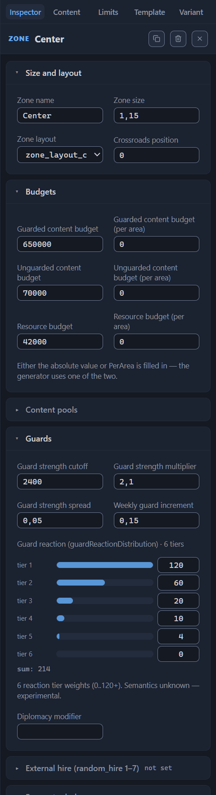

# Zone main objects

The section lists the zone’s anchor points. A main object is a city, a hero spawn point, an abandoned outpost, or an arena: the generator builds the zone around them, and the other settings reference objects by number. Roads start and end at a main object, biome layers can follow it, a city’s faction can copy the faction of another object, and the icons on the canvas show the zone’s arrangement at a glance.

The section stands after “Mandatory content and limits” and is collapsed by default; the header carries a counter like “Main objects (2)”. There may be no cards at all: an empty list is legitimate — the treasure zones of the demo template get by without anchor points. In the file this is the mandatory `mainObjects` array; the zones of stock templates have from one to nine objects.

Numbering runs from zero through the section’s list, and the number serves as the address for references: road ends, the “same as the main object” biome layers, and the “Match” faction selection mode point to the object’s index. Note: deleting a card from the middle shifts the numbers of all the following ones, and the references silently start pointing at the neighbors. After deleting an object, reread the indexes in the roads, the biomes, and the factions, otherwise a road leads to the wrong city.

In the “Overview” mode, the canvas draws an icon of each object on the zone node: a flag in the player color at a hero spawn point, a castle at a city, a pillared building at an abandoned outpost, crossed swords at an arena. The node with a hero spawn point is additionally painted in the player color and grouped in the legend under the name “Players (Spawn)” (the [Canvas: view modes](canvas-modes.md) chapter).

## Object card

Each object occupies its own card. A collapsed card shows a hint line: the type, the player badge at a hero spawn point, the placement and — if set — the guard value, for example “Connection · 30000”. The ✕ button deletes the object immediately and without confirmation; made a mistake — roll the deletion back with Ctrl+Z. An open card lists the fields in order: type, player, placement with arguments, faction, construction preset, banned buildings, owner, guard, win conditions and garrison.

A new object is created by the row under the list: select the type and press “Add”. A fresh object gets a blank:

Hero spawn point
: type `Spawn`, player `Player1`, placement “in the zone center”.

Other types
: placement “in the zone center”, guard chance 1, guard value 10,000.

The card’s numeric fields commit the input on Enter or on loss of focus; the arrows next to a field change the value by a step.

## Object type

The field’s label is “type”; in the file — `type`. The selection list offers four options: “City (City)”, “Player spawn point (Spawn)”, “Abandoned outpost (AbandonedOutpost)”, and “Hell Light Arena (GladiatorArena)”; the type can be changed at any moment. How the types differ:

City
: the zone’s main settlement: it is built per the construction preset, carries a faction, and can have an owner and a guard. The most common type — 676 cities in the sixty stock templates.

Hero spawn point
: the player’s starting position; the details — in the [“Player (spawn)”](#player-spawn) section. In stock templates — 232 objects.

Abandoned outpost
: a rare type — 40 objects in the sixty stock templates.

Arena
: the rarest type — the only stock example, a single object in the Blitz template. A connection of the same-name type opens the entrance to the arena (the [Connections between zones](connections.md) chapter).

## Player (spawn)

The field is called “Player (spawn)”; in the file — `spawn`; it occurs only on an object of type Spawn. The list offers eight values, `Player1`–`Player8`. The choice here sets the canvas coloring: the zone node gets the player color, and the legend collects such nodes into the “Players (Spawn)” group.

The validator controls two errors. “Spawn without spawn=PlayerN” — a hero spawn point without a player; “Player1 is already set in zone Spawn-A” — one player is assigned to two hero spawn points within a single variant.

## Placement

The field is called “Placement”; in the file — `placement`. Four methods; the name in the file is in parentheses:

- “anywhere in the zone (Uniform)” — 685 assignments in stock templates, the most frequent placement;
- “in the zone center (Center)” — 193 assignments;
- “on a specific connection (Connection)” — 63 assignments;
- “near another zone (NearZone)” — 2 assignments.

Two of the methods need clarifications — they are entered in the “Placement arguments” field (in the file — `placementArgs`). The list items are typed comma-separated and committed on loss of focus or on Ctrl+Enter:

Connection
: the name of the connection the object is placed on. A missing connection is caught by the warning “Connection ‘Spawn-A-Center’ from placementArgs not found in the variant”.

NearZone
: the name of the zone the object is placed near. A missing zone is caught by the warning “Nonexistent NearZone zone: ‘X’”.

Uniform and Center
: a trio of the form `[bool, −1..1, 0..4]`. Per the editor’s hint (a hypothesis), this is edge snapping, offset, and side. *Purpose to be confirmed.*

The editor carries a connection or zone rename over into the arguments itself: the names in `placementArgs` update along with the rename.

In the demo template, the second object of the central zone (index 1) uses the “on a specific connection” placement with a single argument — the name of the connection `Spawn-A-Center`.

## Faction selection mode

The field is called “Faction selection mode”; in the file — `faction`. It determines which faction the city gets and offers two modes: “Match (by object)” and “FromList (list)”. The editor’s list includes five factions: human, demon, dungeon, nature, and unfrozen; their biomes are listed in the “Biomes” section of the [Zone: all properties](zone.md#biomes) chapter.

Match (by object)
: the city inherits the faction of another main object. The donor is set by the “Main object” list: its options come from the “Main objects” section of the current zone, and the optional “Zone” field narrows the search to a specific zone — then the list shows its objects. Each option is labeled with a number and a type; the hero spawn point adds the player — for example, “0 · Player spawn point (Spawn) · Player1”. The file records the index of the donor object (`faction.args[0]`) and the zone name (`faction.args[1]`). A value recorded in the file but missing from the list stays as the explicit option “N · outside the object list”. The validator checks only the zone — with the warning “Nonexistent faction Match zone: ‘X’”; the object number is not checked: deleting a card shifts the numbering, and the selection silently starts pointing at the neighbor.

FromList (list)
: the city gets its faction from a list. The chips of the five factions toggle the members of the list, and the “other (differentFrom etc.)” field accepts expressions like “differentFrom: 0 Spawn-A” — part of the faction list, one expression per item, comma-separated. A missing zone in an expression is caught by the warning “Nonexistent faction differentFrom zone: ‘X’”.

Defaults and orientations:

New object
: the field is not set — the city stays without a faction.

Demo template
: the first object of the central zone carries a list of all five factions; the other objects do not have the field.

Stock templates
: 45 files of 60 use the field; “Match” usually inherits the faction of the zone’s starting city.

## Construction preset

The field is called “Construction preset”; in the file — `buildingsConstructionSid`. A preset is a named scheme of the city’s buildings at the start: how many and which buildings are already built by the beginning of the game. The field’s input suggestions offer 60 names from the game’s database — the wealth scale poor, default, medium, rich, extra_rich, ultra_rich, and special families like siege_, army_, full_, and only_mage_guild.

Input is free-form; a badge shows the status. The green “in catalog” — the name is in the database; the red “not in catalog” — the name is not found; the orange “known broken reference (stock)” — the name is not in the database but occurs in stock templates, which the game tolerates silently. Five names are marked orange, for example bank_buildings_construction.

Typos are caught by the warning “Construction preset ‘X’ not found in the catalog (the game tolerates such references silently)”. Pick names from the input suggestions, otherwise a typo stays unnoticed in the template: the game silently tolerates a broken reference, and you can learn about it only from the validator.

Defaults and orientations:

New object
: the field is not set.

Demo template
: `medium_buildings_construction` on the objects of the start zones, `rich_buildings_construction` on the central zone’s first city, and `default_buildings_construction` on the second.

Stock templates
: 57 files of 60, 31 distinct values.

## Banned buildings

The field is called “Banned buildings”; in the file — `buildingsBanSid`. The value is the sid of the list of buildings the city is forbidden to build. The mechanics of the field are the same as the construction preset’s: free-form input, input suggestions from the catalog with 41 names, and the validator warning “Ban list preset ‘X’ not found in the catalog”. There are two badges here — the green “in catalog” and the red “not in catalog”: ban lists have no known exceptions, so the orange “known broken reference (stock)” badge is not shown for this field.

A rare field: the only stock example is the Exodus template, where both start zones are limited by the list `exodus_poor_buildings_banlist`. In the demo template the field is not set.

## Owner

The field is called “Owner”; in the file — `owner`. It is filled in for a pre-captured object: the specified player, `Player1`–`Player4`, owns the object from the very start of the map, without a fight.

The field is free-form input, and the validator does not check it — the only orientation, the field’s hint, lists the allowed values. A typo passes silently, so check the input against the hint.

The orientation — 14 stock files with an owner. When an object gets an owner, its guard can be removed automatically: this is controlled by the “Remove guard when owned” toggle from the next section.

## Object guard

The zone has its own guard value — the “Guards” section of the [Zone: all properties](zone.md#guards) chapter; the five fields of this block relate to the guard of the specific object.

- The “Guard chance” field (`guardChance`) — a number from 0 to 1, the probability that the object gets a guard. The field’s step is 0.05; a value outside the range is caught by the warning “guardChance X outside 0..1”.
- The “Guard strength” field (`guardValue`) — a guard value from 0 to 60,000 in value units, step 100. The validator marks a negative number with the message “Negative guardValue of the object”.
- The “Weekly guard increment” field (`guardWeeklyIncrement`) — a fraction from 0.05 to 0.5 by which the guard value grows each week. Example: 20,000 × 0.2 = 4000 — that much guard is added per week to the central zone’s first city.
- The “Guard strength spread” field (`guardRandomization`) — a number from 0 to 1; in stock templates always 0.2.
- The “Remove guard when owned” toggle (`removeGuardIfHasOwner`) — remove the guard as soon as the object gets an owner. It is a list of three states: “not set”, true, or false; all toggles of the section work this way. In stock templates it is always enabled.

Both cities of the central zone in the demo template are protected: chance 1, guard values 20,000 and 30,000, weekly increment 0.2. The hero spawn points have no guard.

## Win conditions and garrison

Four rare fields tie the object to win conditions and the garrison.

The “City Hold objective” field (`holdCityWinCon`) includes the city in the win condition of the same name; the condition itself is configured in the template root (the [Template settings (root)](root.md) chapter). How exactly the field interacts with the root setting — *Purpose to be confirmed.* In stock templates — five files, seven objects, all enabled.

The “Key object” field (`isKeyObject`), per the editor’s hint (a hypothesis), is related to a win condition on key objects; the only stock example is the Harmony template with two objects enabled. *Purpose to be confirmed.*

The “Initial garrison increment” field (`initialUnitIncrement`) sets the starting increment of garrison units: an integer from zero, step 1. There is a single stock example — the Shamrock template, four centers with the value 2.

The “Weekly garrison increment” field (`enableWeeklyUnitIncrement`) enables the weekly garrison increment; it is the same list of three states as “Remove guard when owned”. In stock templates the field occurs only on the objects of the Shamrock template and is always enabled.

## Next steps

- [Zone: all properties](zone.md) — the zone’s budgets, guards, biomes, and roads: the settings that reference the main objects by number.
- [Connections between zones](connections.md) — the “arena entrance (GladiatorArena)” connection type: the approaches to the arena set by an object of this chapter.
- [Template settings (root)](root.md) — the win conditions that the object fields “City Hold objective” and “Key object” tie into.
- [Canvas: view modes](canvas-modes.md) — the “Overview” mode: the icons of the main objects on the zone nodes and the player colors at the hero spawn points.
