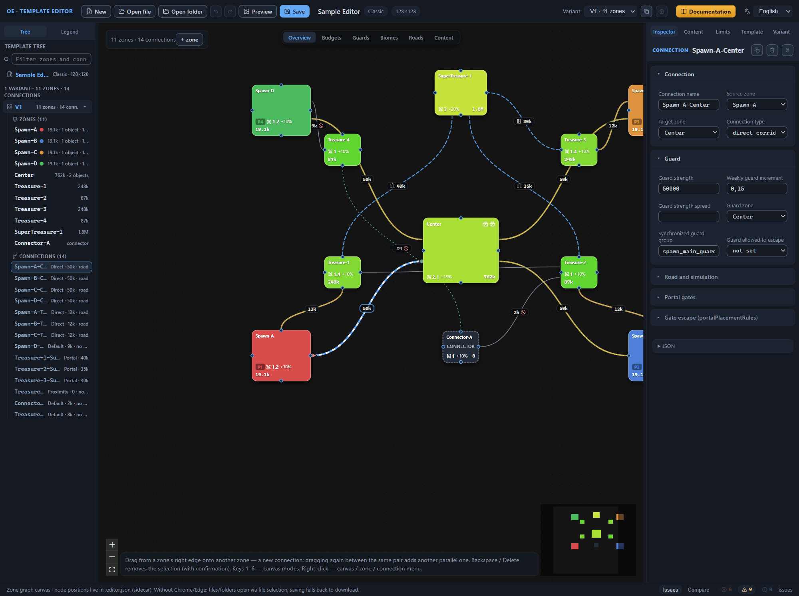
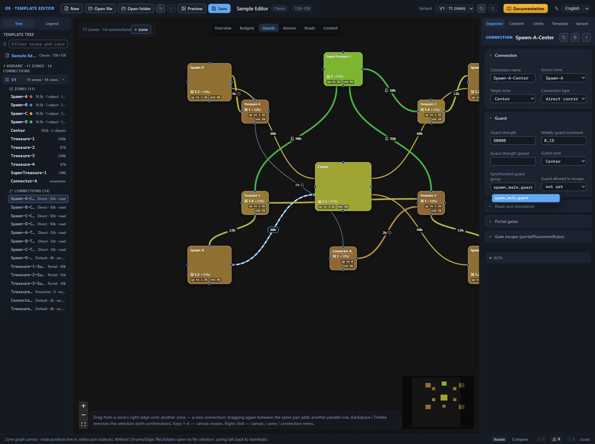
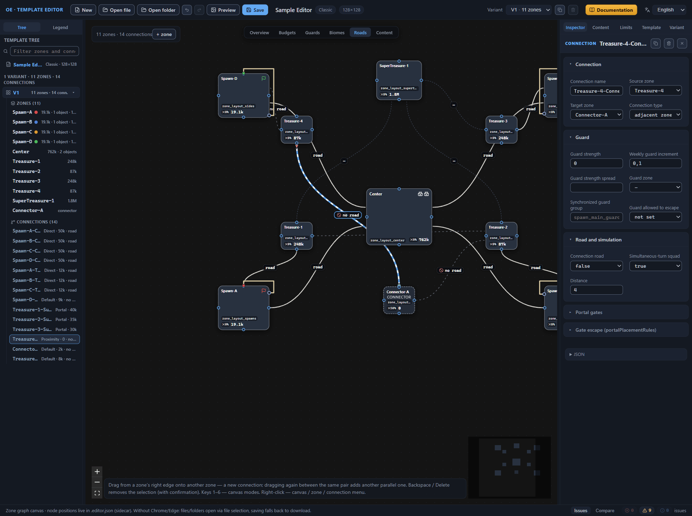
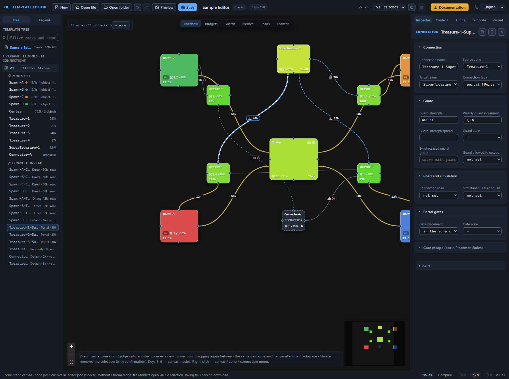
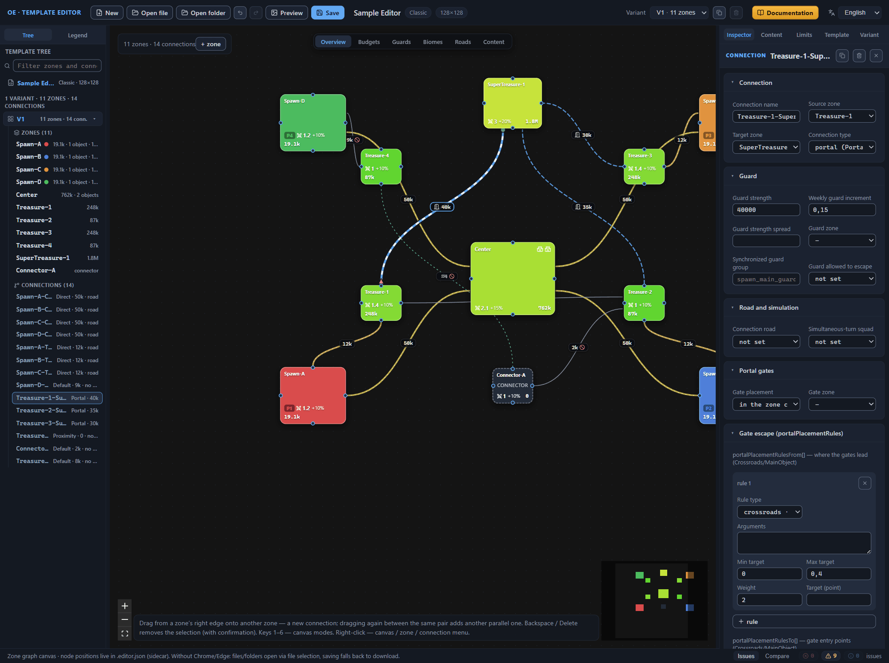

# Connections between zones

A connection is a transition between two zones: a corridor, a portal, or simply the adjacency of zones on the map. Connections live inside a layout variant: every variant has its own `connections` list, and its elements reference the zones of the same variant by name. In stock templates, a variant carries from 5 to 52 connections.

To configure a connection, select it — the line on the canvas or the row in the template tree: the Inspector opens its properties (the [Interface: windows and panels](interface.md) chapter). The Inspector is assembled from the sections “Connection”, “Guard”, “Road and simulation”, “Portal gates”, and “Gate escape (portalPlacementRules)”; “Connection” and “Guard” are expanded by default. How to stretch out a connection and delete it — the [Canvas: graph editing](canvas-editing.md) chapter; how the canvas draws it — the [Canvas: view modes](canvas-modes.md) chapter. This chapter is the reference of the fields.

## Connection

The Inspector’s first section is the address and the kind of the transition: the name, the two zones, the type.

### Connection name

The field “Connection name”, the name in the file `name`. The placeholder suggests the default: “Auto: From-To”. While the field is empty, the connection lives under an auto name assembled from the names of its zones — for example “Spawn-A-Center”. Under this name the connection is visible in the template tree and in the validator’s issues, and the field’s hint phrases the name’s role: “name — referenced by roads and placementArgs”. And so it is: the name serves as the connection’s address inside the template — the road ends of the “Connection (Connection)” kind, the placement of main objects “on a specific connection”, and the arguments of mandatory content rules all reference it.

A new connection is created without a name of its own — that is its default. Stock templates almost always name their connections: 59 files of 60, usually with the same From-To form, and duplicates — with a numeric suffix.

Clearing the field returns the connection to the auto name. Renaming a zone carries the auto name over by a cascade: the editor also rewrites the road ends and the rule arguments that referenced it (the [Canvas: graph editing](canvas-editing.md#connection-name) chapter). A connection with a name of its own does not depend on the zone names — renaming a zone does not touch it. But renaming the connection itself does not rewrite the references: a road or a placement rule keeps the old address, the reference becomes broken, and the validator issues the error “Connection ‘X’ not found in the variant”. Give the name before anything references it, or check the references after a rename.

Stock templates carry several parallel transitions of one pair and distinguish them by suffixes (“…-1”, “…-2”). Add a parallel connection in the editor: by dragging again between the same pair of zones, or with the “Duplicate connection” item of the context menu — the editor gives the name with the suffix itself (the [Canvas: graph editing](canvas-editing.md#connection-duplication) chapter). Two connections of one pair without names of their own would get identical auto names; references to them would become ambiguous, and the validator would mark this with the message “Colliding connection auto-names (From–To without a suffix): …”; from the interface this is unreachable, so the issue occurs in files edited outside the editor.

### Source zone and target zone

The fields “Source zone” and “Target zone”, the names in the file `from` and `to`. Both are required and store the names of the connected zones; the selection lists enumerate the zones of the active variant. Dragging on the canvas does not create a connection of a zone with itself. The direction sets the order of the names in the auto name and, for a portal, which side the gate placement rules belong to; no other consequences of the direction have been found — the pair of names only says which zones the transition connects.

A zone name that the variant does not have is an error-level issue: “Nonexistent from zone: X” or “Nonexistent to zone: X”. From the Inspector this is unreachable: the lists offer only existing zones, and deleting a zone removes its connections along with it. The errors occur in files edited outside the editor. Renaming a zone carries `from` and `to` over by a cascade.

### Connection type

The field “Connection type”, the name in the file `connectionType` — required, one of five values. The list labels the options in pairs: the English description and the name in the file.

- **direct corridor (Direct)**
  : a straight corridor between zones. The workhorse of stock templates: 799 connections of 1509, about 53%.

- **regular connection (Default)**
  : the generator picks the shape of the transition itself. Every fourth stock connection: 382, about 25%.

- **portal (Portal)**
  : not a corridor but a pair of gates between zones. The gate placement is configured in the “Portal gates” and “Gate escape (portalPlacementRules)” sections — later in this chapter. The validator marks a portal without a selected gate placement with the message “Portal without gatePlacement”. Stock templates hold 180 portals, about 12%.

- **adjacent zones (Proximity)**
  : the zones must simply end up next to each other on the map — no corridor between them is generated. The target distance is set by the “Distance” field (`length`) in the “Road and simulation” section; the type without a number gives the issue “Proximity without length”. Stock connections of this type — 146, about 10%.

- **arena entrance (GladiatorArena)**
  : the entrance to the arena. The rarest type — two occurrences across all the stock templates. The arena itself is set by a main object of the same-name type (the [Zone main objects](main-objects.md#object-type) chapter).

A new connection from the canvas is created with the “direct corridor (Direct)” type. On the canvas the five types read differently — the line style, the badges with the guard value and the distance, the door icon of a portal; the decoding — in the [Canvas: view modes](canvas-modes.md) chapter.

## Guard

The guard of a connection is the protection that the generator puts on the transition. The section stands right after “Connection” and is expanded by default. The strength of the protection is set by the guard value — a number in value units, the same notional balance currency as the zone budgets. The zone guards (cutoff, multiplier, reaction) are configured in the zone’s “Guards” section (the [Zone: all properties](zone.md#guards) chapter); the object guards — in their cards (the [Zone main objects](main-objects.md#object-guard) chapter). Here — only the protection of the transition itself. The canvas shows it in two modes: “Overview” puts a badge with the value in the middle of the line, and “Guards” paints the line by strength (the [Canvas: view modes](canvas-modes.md) chapter). The validator’s issues about a connection carry the variant number and the connection name — “V1 · connection Spawn-A-Center”; the issues about groups have their own area — “V1 · guard group spawn_main_guard”. Everything is collected on the “Issues” panel (the [Template validation (validator)](validator.md) chapter).

### Guard strength

The field “Guard strength”, the name in the file `guardValue`. The hint immediately gives the orientations: “guardValue — −10000…5,000,000; negative values (−10000…−2000) occur on secondary passages — semantics unknown, experimental”. The field accepts any number; the arrows change it in steps of 100; there is no hard input limit. A new connection gets 8000; the demo template carries 50,000 on the main start-to-center passages and 9000–12,000 on the side ones, toward the treasure zones.

Every stock connection has a guard value. The editor does not insist: a connection without a value produces no issues; the canvas simply does not draw a badge on it.

Negative values are an experimental technique: seven stock templates carry from −2000 to −10,000 on secondary passages — from the start to the treasures, in connector zones, at portals. The validator marks each one with the warning “Negative guardValue (−2000) — semantics unclear, please check”, and the badge on the canvas takes a warning color and a “?” sign before the number. *Purpose to be confirmed.* Do not experiment with negative numbers unless you need to: the generator’s behavior on them is not described, and instead of a weakened passage you can get an unpredictable guard.

Within a synchronized guard group, the strength is kept the same for all members — more on the group below.

### Weekly guard increment

The field “Weekly guard increment”, the name in the file `guardWeeklyIncrement` — “the fraction by which the guard grows each week”, as the hint phrases it. The arrows change the value in steps of 0.05; there is no hard input limit; the stock orientation is 0.05–0.25. A new connection gets 0.1; the demo template sets 0.15 for the main start-to-center passages and the portals to the supertreasure zone, and 0.1 for the other transitions.

The value reads the same way as for the zone guards: an increment of 0.15 adds fifteen percent of the strength per week — a guard of 50,000 strength grows by 7500 over the first week. Every stock connection has the increment filled in; the editor tolerates a connection without the increment and raises no issues. Within a synchronized guard group, the increment matches.

### Guard strength spread

The field “Guard strength spread”, the name in the file `guardRandomization` — the spread of the connection guard’s strength. The arrows change the value in steps of 0.05 and do not go outside the 0–1 bounds, but there is no hard input limit; the stock values are 0.1–0.25. The field is rare: it is present in only 11 files of 60, and in a new connection it is empty. Within a synchronized guard group, the spread is the third value the validator compares.

### Guard zone

The field “Guard zone”, the name in the file `guardZone`. The list enumerates the zones of the active variant; the empty “—” line means the field is not set. The hint says “which zone the guard is taken from (by default — in the middle)”: when the field is not set, the guard stands in the middle of the transition.

The field is optional: it is present in 15 files of 60, and the values in stock templates are the names of the central zones — Center (210 occurrences) and Center-A (10). The demo template sets “Center” for all four main passages. A nonexistent zone gives the warning “Nonexistent guard zone: X”. Renaming a zone carries the field over by a cascade — the editor rewrites it together with the connection’s endpoints.

### Synchronized guard group

The field “Synchronized guard group”, the name in the file `guardMatchGroup` — a named group of symmetric guards. The hint phrases the rule: “guardMatchGroup — a named group of symmetric guards (guardValue/guardWeeklyIncrement/guardRandomization must match within the group)”. The connections of one group get the same guard — this is the main tool of symmetry for equal starts, the same technique as identical sizes of zones and connections. Four stock-template files use the field — 52 occurrences in total, names like spawn_main_guard and spawn_side_guard; parallel groups carry numeric suffixes.

The field accepts arbitrary text; when you open the line, the input suggestions unfold — the groups that other connections of the same variant already carry. The placeholder suggests the naming convention: “spawn_main_guard_1”.

The demo template shows the group at work. Four connections — “Spawn-A-Center”, “Spawn-B-Center”, “Spawn-C-Center”, and “Spawn-D-Center” — carry the group spawn_main_guard; each has the type “direct corridor (Direct)”, the guard strength 50,000, the increment 0.15, and the guard zone “Center”. The four players walk to the center through equivalent passages, and the same guard meets each of them. Suppose the strength of one connection is raised to 60,000: the validator answers with the warning “In group ‘spawn_main_guard’, guardValue differ (50000 / 60000) — the guards will not be symmetric”, and that player’s road turns out heavier than the others — the symmetry of the start is broken.

The validator compares three fields — the strength, the increment, and the spread — and only by the filled-in values: an empty field on one connection of the group and a number on another do not count as a mismatch. A group of a single connection is meaningless, which the message “Group ‘X’ has a single connection — nothing to synchronize” says.

On the canvas, the group’s connections are recognizable without the Inspector: instead of the type color they carry their own color, computed from the group name, and the legend of the “Guards” mode marks the group with a ◆ icon (the [Canvas: view modes](canvas-modes.md) chapter). Name the groups by their purpose — spawn_main_guard, side_passage_guard — otherwise in a template with several groups you will have to guess which one is responsible for what: neither the editor nor the game deciphers the group name.

### Guard allowed to escape

The field “Guard allowed to escape”, the name in the file `guardEscape` — a list of three positions: “not set”, true, and false. The hint is honest: “guardEscape — hypothesis: allow the guard to leave (guard bypass)? Always false in stock templates; behavior when true is unknown”. The field is present in 41 stock files, and it is false everywhere. *Purpose to be confirmed.*

## Road and simulation

The third section of the connection Inspector, collapsed by default — expand it with a click on the header; the editor remembers the expanded state between sessions. Inside are three fields in order: “Connection road”, “Simultaneous-turn squad”, and “Distance”. The road and the distance configure the path between the zones.

### Connection road

The field “Connection road”, the name in the file `road` — a list of three positions:

- “not set” — the file has no `road` key;
- true — a road is laid along the transition;
- false — the transition stays without a road.

The hint below the field phrases the essence: “road — whether there is a road along the connection”. The flag is present in 41 stock files of 60: true occurs on 706 connections, false — on 239. In the remaining 19 files, no connection has the flag set.

A new connection is created in the true position right away. If the transition needs no road, switch the field to false explicitly, otherwise the template saves a road where you did not plan one.

On the canvas, the flag is watched by the “Roads” mode (the [Canvas: view modes](canvas-modes.md#the-roads-mode) chapter). A connection with a road is drawn as a light thick line with a thin white dashed thread on top; a connection without a road — as a sparsely dashed gray line with a crossed-out circle icon in the badge; not set — as a dark thin muted short-dashed line. The panel’s legend repeats the same three states: “road: true — has a road”, “road: false — no road”, “road — not set”. The white thread and the crossed-out circle are visible in the “Overview” mode as well.

Note: a connection road is not the same thing as a zone road. The `roads` array inside a zone (the [Zone: all properties](zone.md#roads) chapter) describes the routes between objects inside it, while the `road` flag enables a road along the transition between zones.

### Simultaneous-turn squad

The field “Simultaneous-turn squad”, the name in the file `simTurnSquad` — a list of three positions, like the “Connection road” one: “not set”, true, and false. A new connection is created in the “not set” position. About the field’s purpose the hint says only this — “hypothesis: the guard counts in simultaneous turns. Always true in stock templates (48 files)”. The field is present in 48 stock files, and it is true everywhere. *Purpose to be confirmed.*

### Distance

The field “Distance”, the name in the file `length`. It appears in the section only for a connection of the “adjacent zones (Proximity)” type; for the other types the field is hidden. The hint: “length — distance for ‘adjacent zones’ (Proximity)”. The value is an integer: the arrows change it in steps of 1; the field sets no hard bounds. Stock templates use the 0–8 range; the field is present in 25 files of 60.

The distance sets the target distance between the zones. What it is measured in — tiles or fractions of the zone size — is unknown. *Purpose to be confirmed.*

A new connection does not have the field; the validator reminds of it with an info-level issue: “Proximity without length”.

The demo template shows the field at work: the connection “Treasure-4-Connector-A” — the only one of the Proximity type — carries the distance 4; the road along it is disabled, and the guard strength is zero. In the “Overview” mode, this connection’s badge gets the “≈4” suffix; without a distance set, “≈?” stands instead of the number.

## Portal gates

The fourth section of the connection Inspector, collapsed by default — expand it with a click on the header; the editor remembers the expanded state between sessions. The section’s fields answer the question of where the generator will put the gates: a portal is not a corridor but a pair of gates between zones, and this pair must have an address. The section is visible in the Inspector for any connection type, but portals are the ones that need it: gates are a part of a portal; a corridor or a zone adjacency has none.

### Gate placement

The field “Gate placement”, the name in the file `gatePlacement`. A list of three positions:

- “—” — the field is not set; the file has no `gatePlacement` key;
- “in the zone center (Center)” — shared gates in the center;
- “near the specified zone (NearZone)” — gates in the zone that the next field names.

The hint below the field phrases the layout: “gatePlacement — Center: shared gates in the center (stock); NearZone: gates in the specified zone”. In a new connection the field is not set. Stock templates fill it in 19 files of 60: 198 occurrences of Center against four of NearZone. The demo template chooses “in the zone center (Center)” for all three of its portals — “Treasure-1-SuperTreasure-1”, “Treasure-2-SuperTreasure-1”, and “Treasure-3-SuperTreasure-1”, the entrances to the supertreasure zone.

A portal without a placement gives the info-level issue “Portal without gatePlacement”. A value outside the list gives the warning “Unknown gatePlacement ‘X’ (expected Center/NearZone)”; from the Inspector it is unreachable — the list offers two positions and an empty one — and it catches only files edited outside the editor.

### Gate zone

The field “Gate zone”, the name in the file `gatePlacementArgs` — a refinement of the “near the specified zone (NearZone)” placement. The list enumerates the zones of the active variant; the empty “—” line means the field is not set. The hint: “gatePlacementArgs — zone where the gates are placed (with NearZone)”.

The stock example is rare: one file of 60 carries the field — four occurrences, all names like Connector-*. A nonexistent zone gives the warning “Nonexistent gate zone: X”; from the Inspector it is unreachable — the list offers existing zones, and deleting a zone removes its connections along with it. Renaming a zone carries the field over by a cascade, while the connection keeps the “near the specified zone (NearZone)” placement.

## Gate escape (portalPlacementRules)

The fifth section of the Inspector, collapsed by default. The rules refine where exactly in the zone the gates should be placed: not simply “in the center” but, for example, near the crossroads or at a distance from the main object. The section carries two independent lists — “portalPlacementRulesFrom[] — where the gates lead (Crossroads/MainObject)” and “portalPlacementRulesTo[] — gate entry points (Crossroads/MainObject)”: the first answers the question “where the gates lead”, the second — “where the entry points are”. Fill in one list or both. The setting is rare: the fields occur in 6–8 stock files of 60; the demo template does without rules — its portals are content with the “in the zone center (Center)” placement.

The rules’ format is the same as that of the mandatory content placement rules in the root groups (the [Template settings (root)](root.md) chapter): the cards are edited by a shared editor. The list of targets differs: the root rules have five types available; the gates have two.

### Rule card

The “＋ rule” button adds a card — “rule 1”, then “rule 2”; the numbering starts from one. A new card is created with the defaults: the type “crossroads · Crossroads”, empty arguments, the minimum and maximum target 0, the weight 2. The ✕ button in the header line removes the rule at once — Ctrl+Z brings it back; deleting the last rule removes the whole list from the file.

### Rule type and arguments

The field “Rule type”, the name in the file `type`, sets what the gate placement is counted from:

- **crossroads · Crossroads**
  : the point where the zone’s roads meet. It requires no arguments.

- **zone object · MainObject**
  : the zone’s main object — a city, a hero spawn point, an outpost, or an arena (the [Zone main objects](main-objects.md) chapter). It is refined by an argument.

The field “Arguments”, the name in the file `args`, refines the target: for a “zone object” — the index of the main object in the zone’s list, counted from zero; for a “crossroads” it stays empty. The values are typed comma-separated; an empty field removes `args` from the file. The hint “index/name/sid/connection” lists the arguments of all the rule editor’s contexts — the gate rules need the index.

A type outside the list gives the warning “Gate rule with an unknown type ‘X’ (expected Crossroads/MainObject)”; from the editor it is unreachable — the list offers two targets.

### Min and max target

The fields “Min target” and “Max target”, the names in the file `targetMin` and `targetMax`, set the ring of allowed distances to the target. The value is a normalized distance, a fraction of the zone radius; the arrows change the numbers in steps of 0.05; the typical ranges are 0–0.9 for the minimum and 0–2 for the maximum.

The ring reads like this. A “crossroads · Crossroads” rule with the minimum target 0 and the maximum 0.4 admits gates within the nearest four tenths of the zone radius from the crossroads — anything farther the rule does not consider. A minimum target above zero pushes the gates away from the target itself: the 0.2–0.6 ring admits placements at middle distances — neither close to the target nor at the zone’s edge.

The validator watches the typical ranges and warns about going outside the bounds: “targetMin X outside the typical 0..0.9” and “targetMax X outside the typical 0..2”.

### Rule weight

The field “Weight”, the name in the file `weight`. The rules of one list compete, and the weight expresses the preference: a weight of 2 outweighs a weight of 1. The arrows change the value in steps of 0.5; the field’s hint names the 0–10 range. The validator keeps the typical band narrower — 1–2 — and warns “weight X outside the typical 1..2”.

### Target (point)

The field “Target (point)”, the name in the file `target`, sets a point distance instead of a ring. The hint marks the rarity: “target — point distance (rare)” — across all the stock templates there are three occurrences. The exact meaning is not clarified; the hypothesis is a synonym for setting the minimum and maximum target at once. *Purpose to be confirmed.*

## Next steps

- [Zone main objects](main-objects.md) — the city, hero spawn points, outposts, and arenas: the targets that the gate rules are counted from.
- [Zone: all properties](zone.md) — the zone’s crossroads and the other settings the gate rule targets are tied to.
- [Canvas: view modes](canvas-modes.md) — how the canvas draws connections: the line types, the portal’s door icon, the “Guards” mode.
- [Template settings (root)](root.md) — the mandatory content placement rules: the same card format with five targets.
- [Template validation (validator)](validator.md) — the “Issues” panel, the issue levels, and the jumps to the owning connection.
