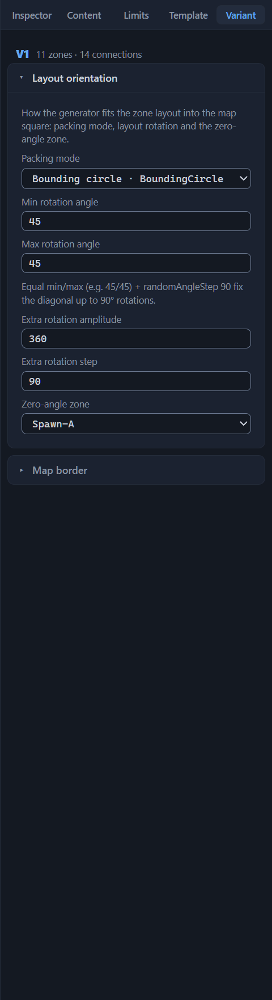
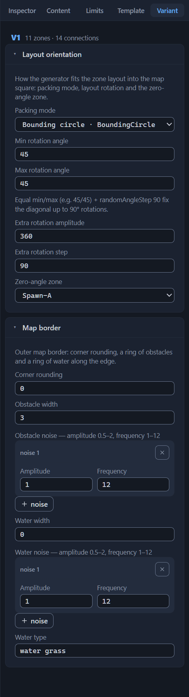

# Variant: orientation and border

A layout variant is not only zones and connections: two more of its properties describe the layout as a whole. Orientation sets how the generator fits the zone diagram into the game map square, and border — what the outer frame of the finished map will be: rounded corners, a ring of obstacles, water along the edge. Both settings belong to the variant: in the file they are the `orientation` and `border` objects inside its `variants[]` element, and every variant has its own. What layout variants are and how to manage them — the [Variants: management and selection](variant-manage.md) chapter; here — the reference of the fields.

Both sections live in the right panel on the “Variant” tab — the fifth one, next to the “Template” tab; you do not need to select anything on the canvas. The panel header names the active variant — “V1” — and the summary “N zones · M connections”. The “Layout orientation” section is expanded by default, “Map border” is collapsed; while the variant has no border, the section header carries the “— not set” mark.

A template created with the “New” button carries neither orientation nor border — all fields are empty. The demo template is configured completely: a circle, the angles 45/45, the extra rotation in steps of 90, a strip of obstacles three tiles wide. The chapter’s sections walk through these values. Among the stock templates, orientation is present in every file; border — not in every one.

## Layout orientation

The section hint phrases its essence: “How the generator fits the zone layout into the map square: packing mode, layout rotation and the zero-angle zone.” There are six fields: the packing mode, two rotation angles, the extra rotation amplitude and step, the zero-angle zone.

### Packing mode

The field “Packing mode”, the name in the file `mode` — the way the zone layout is fit into the map. The list labels the values in pairs “English name · file key”:

- **Minimal bounding square · MinimalBoundingSquare**
  : the layout is fit into the smallest square enclosing the whole zone diagram. This is how most stock templates work: 44 variants.

- **Bounding circle · BoundingCircle**
  : the layout is fit into a circle enclosing the zones of the diagram — 13 variants. The demo template is configured this way too.

The file gets the key; the English label lives only in the interface. The default is “—”, the mode is not set; of the 60 stock files, 51 have the mode filled in. Choosing “—” removes the `mode` key from the file — this is how the mode is reset to not set.

The only validator issue here is “Unknown mode ‘X’”: a warning about any value outside the two keys, including an empty string from files edited outside the editor. From the Inspector it is unreachable — the list offers no third one.

### Min and max rotation angle

The fields “Min rotation angle” and “Max rotation angle”, the names in the file `baseAngleMin` and `baseAngleMax` — the bounds, in degrees, between which the generator picks the base rotation of the whole layout. Both are empty by default; the arrows change the value in steps of 15; there is no hard input limit. The fields are filled in in 24 files of 60; the stock values lie within 0–180 for the minimum and 0–360 for the maximum.

The validator watches the pair with two warnings. The first is “baseAngleMin (60) is greater than baseAngleMax (30)”: the bounds are swapped. The second is “baseAngleMin 400 outside the typical 0–360”: the value has gone beyond a full circle; for the maximum angle the issue is symmetric.

As soon as at least one of the two fields is filled in, a line with a ready recipe appears below them — a rare case of the interface itself suggesting a setting: “Equal min/max (e.g. 45/45) + randomAngleStep 90 fix the diagonal up to 90° rotations.” Take the recipe apart on the demo template’s numbers. Conditions: the minimum and maximum angles are both 45, the extra rotation step is 90. Substitution: the base angle is not random — it is always exactly 45°, and the random extra rotation adds a whole number of quarter turns to it. Conclusion: the layout of every generation lies diagonally — the generator only picks which of the four diagonals (45°, 135°, 225°, 315°) it gets. The stock template Jebus Cross uses the same combination with the same numbers; the recipe has no strict confirmation, but the practice of stock templates does not contradict it.

### Extra rotation amplitude

The field “Extra rotation amplitude”, the name in the file `randomAngleAmplitude` — the span of the random extra rotation that the generator adds to the base angle. The range is 0–360, the arrows change it in steps of 15, the default is not set; the field is filled in in the same 24 stock files as the angles. The demo template sets 360 — the extra rotation is unlimited and is determined only by its step. The validator marks going outside the range with the warning “randomAngleAmplitude 400 outside the typical 0–360”.

### Extra rotation step

The field “Extra rotation step”, the name in the file `randomAngleStep` — the discretization of the random angle: 90 means the extra rotations are multiples of a quarter turn; the field hint uses exactly this number as the example. The range is more modest than the angles’ — 0–180, the arrows change it in steps of 15; the stock values fit inside it. The demo template sets 90 — the very value from the diagonal-fixing recipe. The validator: “randomAngleStep 270 outside the typical 0–180”.

### Zero-angle zone

The field “Zero-angle zone”, the name in the file `zeroAngleZone` — the zone relative to which the zero angle is counted: the hint explains it as the direction the layout “faces”. The list enumerates the zones of the active variant; the “—” value removes the key from the file. Stock templates fill the field in the same 24 files and most often name Spawn-A — as does the demo template.

Renaming a zone carries the field over here by a cascade, together with the other references to it (the [Canvas: graph editing](canvas-editing.md#zone-renaming) chapter). Deleting a zone does not fix the field: the name stays, and the validator warns “zeroAngleZone ‘Treasure-9’ is not a zone of the variant”. If you see the warning, select an existing zone in the field or “—”.

## Map border

The section describes the outer frame of the finished map: “corner rounding, a ring of obstacles and a ring of water along the edge”, as the hint phrases it. In the file it is the `border` object; the section is collapsed by default — expand it with a click on the header. A missing border is a legitimate state: the “— not set” mark in the header, empty fields; 25 of the 60 stock templates have no border, 35 have one.

### Corner rounding

The field “Corner rounding”, the name in the file `cornerRadius` — the rounding of the play area corners; the unit of measure is a fraction of half the map side, the range is 0–0.8, the arrows change it in steps of 0.05. The default is not set. The demo template sets 0: right angles. Going outside the range gives the warning “cornerRadius 0.9 outside the typical 0–0.8”.

### Obstacle width

The field “Obstacle width”, the name in the file `obstaclesWidth` — the width of the ring of impassable obstacles along the map edge, in tiles: 2–6, the arrows change it in steps of 1. The demo template lays a strip three tiles wide. The validator: “obstaclesWidth 8 outside the typical 2–6”.

### Edge noise

The fields “Obstacle noise” and “Water noise”, the names in the file `obstaclesNoise` and `waterNoise` — two paired blocks, each making the edge of its ring ragged instead of an even line. The block header recalls the ranges: “Obstacle noise — amplitude 0.5–2, frequency 1–12”.

A noise is a card numbered “noise 1”, “noise 2”… with two fields: “Amplitude” (`amp`, 0.5–2, step 0.1) and “Frequency” (`freq`, 1–12, step 1). The “noise” button adds a card with amp 1 and freq 12; the ✕ button with the “Delete noise” tooltip removes it at once — Ctrl+Z brings it back. Deleting the last noise removes the whole list from the file.

Stock templates make do with one noise per ring: for obstacles the frequency stays within 6–12, for water the amplitude is always 1. The demo template sets amp 1 and freq 12 for both noises. The validator checks each card separately: “amp 0.3 outside the typical 0.5–2”, “freq 15 outside the typical 1–12”.

### Water width

The field “Water width”, the name in the file `waterWidth` — the width of the water ring along the edge, in tiles: 0–6, the arrows change it in steps of 1. Zero, as the hint phrases it, means “no water along the edge”; the demo template sets exactly that. The validator: “waterWidth 7 outside the typical 0–6”.

### Water type

The field “Water type”, the name in the file `waterType` — a text identifier of the water kind (sid) with the “water grass” placeholder. This is a value from the game database without localization: the field shows it as is, and no other value occurs in all 60 stock templates. The validator marks any other text with an info-level issue — not an error — “waterType ‘water lava’ — always ‘water grass’ in stock templates”. Clearing the field removes the key from the file.

## Common section rules

The Inspector writes each section to the file as a whole object. Clearing all the fields does not delete the objects: the file keeps the empty `orientation: {}` and `border: {}`, and the “— not set” mark disappears from the header after the very first change. The objects can be removed entirely in the root’s JSON block: it shows the variants without zones and connections, and the validator does not let you change the number and order of the variants (the [Direct JSON editing](json-editor.md) chapter).

The rest are the mechanics common to both sections:

- every field change is a step of the undo history: Ctrl+Z brings back the previous value, Ctrl+Shift+Z repeats it (the [Files: opening and saving](files.md#undo-and-redo) chapter);
- duplicating a variant carries both sections over as a copy — the new variant inherits the orientation and the border (the [Variants: management and selection](variant-manage.md) chapter);
- the validator’s issues about these fields belong to the variant as a whole and are marked with the “V1” area; the range checks fire only on filled-in fields — an empty field does not become an issue;
- the comparison mode shows the differences of orientation and border in the “variant fields” group — as paths like `orientation.mode` and `border.waterWidth` (the [Variant comparison](compare.md) chapter).

Ready-made files bring one more surprise: orientation also occurs at the level of the whole template, outside the layout variants. The editor does not show such a field; on opening and saving, it carries it over as is. *Purpose to be confirmed.*

## Next steps

- [Variants: management and selection](variant-manage.md) — switching, duplicating, and deleting layout variants.
- [Variant comparison](compare.md) — how to read the orientation and border differences between variants.
- [.rmg.json format reference](rmg-json.md) — the place of the sections in the template file structure.
- [Direct JSON editing](json-editor.md) — the root’s JSON block and editing objects outside the Inspector.
