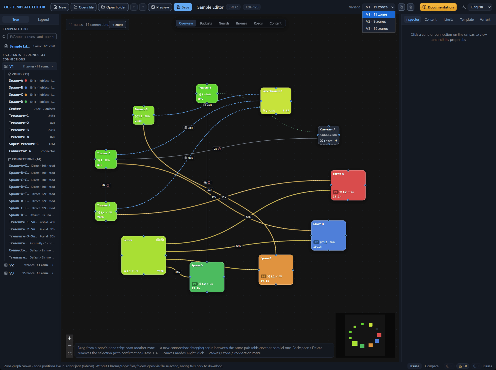
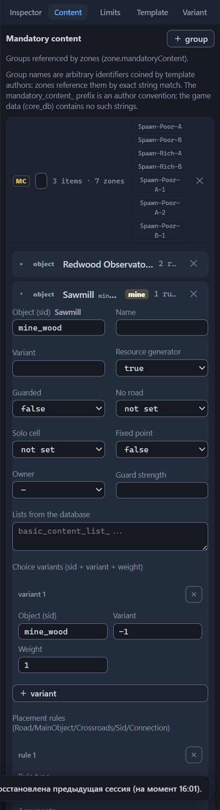

# Variants: management and selection

A layout variant is one diagram of zones and connections inside the template file. In the file, the variants form the `variants[]` list; every element is a full layout: its own zones, its own connections, its own orientation and map border. When the game creates a map, it builds it from a single variant: the generator picks a variant at random — the variants have no weight fields, so they are all equally likely.

Stock templates use the mechanic sparingly: 55 files out of 60 carry a single variant; Arcade, Jebus Outcast, Maze, and Outcast Tournament carry three each, and Anarchy — five, each a separate topology. The variants differ in the number and set of zones: say, Anarchy’s five variants hold 15, 11, 17, 20, and 16 zones, and all three Maze variants hold 28 zones each. The format allows from one to five variants; the “New” button creates a template with a single variant, and opening a file makes the first one active.

## Active variant

The canvas shows one variant at a time — the active one. Its number matches its place in the file’s list: the first element is V1, the second is V2, and so on. All edits — zones, connections, Inspector fields — land in the active variant; the “+ zone” button on the canvas adds a zone to it as well. The header of the “Variant” tab in the Inspector shows the number and the summary: “V1” and “11 zones · 14 connections”.

The minimap in the preview dialog and the PNG image that the editor saves alongside the template are built from the active variant. The validator works differently: it checks all the variants at once and marks every issue with an area, for example “V1”. A click on an issue switches the editor to the owner variant and selects the problem zone or connection — more on this in the [Template validation (validator)](validator.md) chapter.

## Variant switching

If you need to look at another layout or fix it, make the variant active:

1. Expand the “Variant” selector in the top bar.
2. Select a row of the list, for example “V2 · 7 zones”.

The canvas immediately redraws to the diagram of the new variant; the header of the “Variant” tab updates the number and the summary. The selection resets: the Inspector goes empty, neither a zone nor a connection is highlighted.

The selector is not the only way in. A click on a variant row in the template tree makes it active and opens the “Variant” tab of the Inspector; the row of any zone or connection works the same way — it activates the owner variant and selects the element (the [Interface: windows and panels](interface.md) chapter). In the comparison panel, the “A (base)” selector is also bound to the active variant — choosing a new base switches the canvas at the same time (the [Variant comparison](compare.md) chapter).

Each variant remembers its own arrangement of nodes on the canvas: the positions are stored in the sidecar file separately per variant (the [Files: opening and saving](files.md#the-file-pair-template-and-sidecar-file) chapter). Switching does not mix them up — every variant returns to its saved positions.

Note: switching does not land in the undo history. Ctrl+Z does not return you to the previous variant — it rolls back the last change and along with it restores the variant that was active at the moment of that change (the [Files: opening and saving](files.md#undo-and-redo) chapter).

## Variant duplication

A new layout is easier to grow out of an existing one than to build from scratch: duplicate the variant and edit the copy. If you are planning “one more map alongside”, do not rebuild the single variant in place — after saving, the original layout will be lost, and there will be nothing to compare the result against.

1. Make the source variant active.
2. Press the copy button next to the “Variant” selector — its tooltip reads “Duplicate the active variant”.

The copy is added to the end of the list and immediately becomes active: the canvas shows its diagram, and the selector — the last number.

It is a deep copy. The duplicate gets all the zones and connections with all their fields, the orientation and the map border (the [Variant: orientation and border](variant-layout.md) chapter), and also the arrangement of nodes on the canvas — it opens with the same arrangement, not a blank sheet. Further edits of the copy do not touch the original.

The zone names in the copy stay as they are — the editor does not rename them. Two consequences follow. Notes are bound to zones by name and are shared by the same-name zones of all variants (the [Zone: all properties](zone.md#note) chapter). Renaming a zone in the copy renames it in the original and in the other variants as well (the [Canvas: graph editing](canvas-editing.md#zone-renaming) chapter). The same-name zones of two variants are best treated as a single entity referenced by name.

Ctrl+Z undoes the duplication: the number of variants returns to what it was, and the variant that was active before the button press becomes active again. The selected comparison pair survives the duplication — the numbers of the existing variants do not shift.

## Variant deletion

1. Make the variant you are deleting active.
2. Press the trash button next to the selector — its tooltip reads “Delete the active variant”.

Note: the deletion goes through immediately, without a confirmation dialog. Only undo can bring the variant back — miss the Ctrl+Z, and the variant, with all its zones, connections, orientation and border, leaves the file at the next save. While the variant is the only one, the button is unavailable: the format requires the file to have at least one variant.

After the deletion, the variant that took the deleted one’s place in the list becomes active; if no variants remain at that place — you deleted the last one — the new last one becomes active.

The comparison pair, if variant B was selected on the “Compare” tab, resets — the panel shows “Select variant B to compare with the active one.” The variant numbers shift after the deletion, and the former B would already point to a different layout.

The zone notes are not deleted: they are stored by name in the sidecar file and continue to belong to the same-name zones of the remaining variants. Ctrl+Z brings the deleted variant back in full — with its contents, its place in the list, and the previous active variant.

## Variant count and the root’s JSON block

The JSON block of the “Template” tab shows the variants without zones and connections — only the layout’s own fields remain there. The number of list elements cannot be changed through it: a draft with a different number of variants will not apply, and the editor returns the error “variants[] must be present and contain exactly 3 item(s) — zones and connections cannot be added or removed through this section”, where the number matches the current number of variants.

The draft merges with the template by places in the list: the first element of the draft gets the zones and connections of the first variant, the second — those of the second, and so on. Rearranging the elements is therefore not recommended — the check looks only at the count and will let a rearrangement through, but the orientation and the border will end up attached to different layouts.

Variants are added and deleted only by the copy and trash buttons from the sections above; the rest of the block’s rules are collected in the [Direct JSON editing](json-editor.md) chapter.

## “Layout variant” and “Choice variants”

The item cards of the “Content” and “Limits” tabs carry a section with a similar name — “Choice variants (sid + variant + weight)”. The section’s entries in a mandatory content item card enumerate the object variants from which the generator picks when placing: “Object (sid)”, the object variant, and the weight; the weight 0 disables the variant, and −1 in the “Variant” field means “any variant of the object”. The same section occurs in the cards of the “Limits” tab. None of this has anything to do with layout variants: there the talk is about object variants, not zone diagrams. The section’s reference is in the [Template settings (root)](root.md) chapter; “variant” without qualification always means “layout variant” in this chapter.

## Next steps

- [Variant: orientation and border](variant-layout.md) — the two sections of the variant that the duplicate inherits in full.
- [Variant comparison](compare.md) — viewing the differences between two layouts in zones and connections.
- [Interface: windows and panels](interface.md) — the top bar and the template tree: all the ways to switch the variant.
- [Files: opening and saving](files.md) — the sidecar file with the per-variant positions, undo and redo.
- [Direct JSON editing](json-editor.md) — what the root’s JSON block allows and what it blocks.
- [Template settings (root)](root.md) — the reference of the “Choice variants” section.
