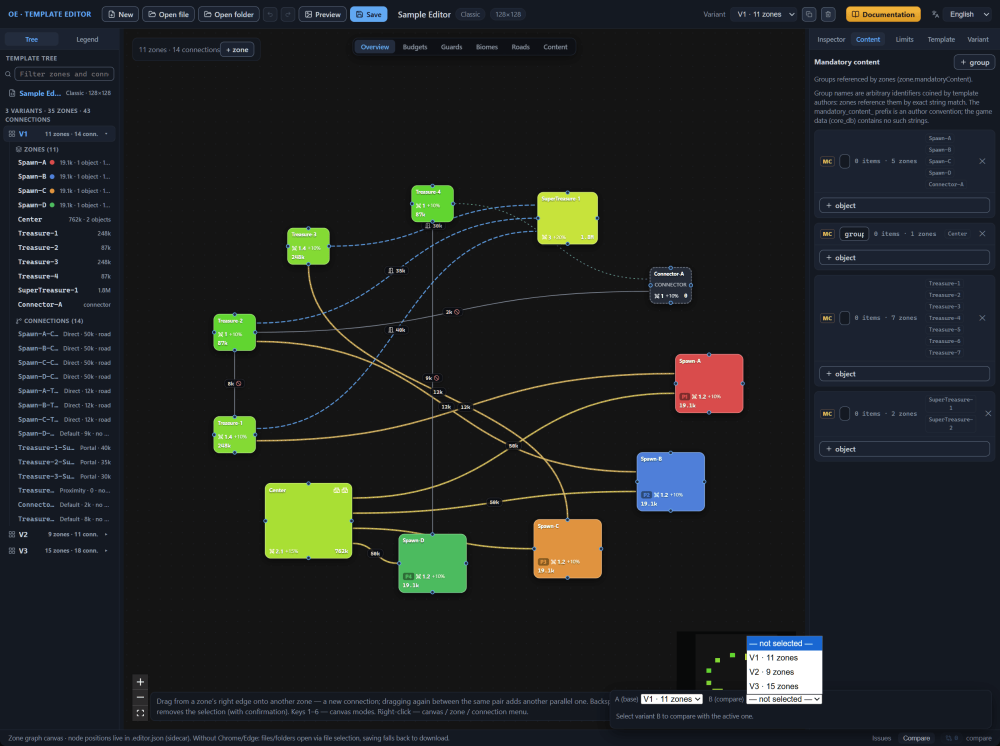
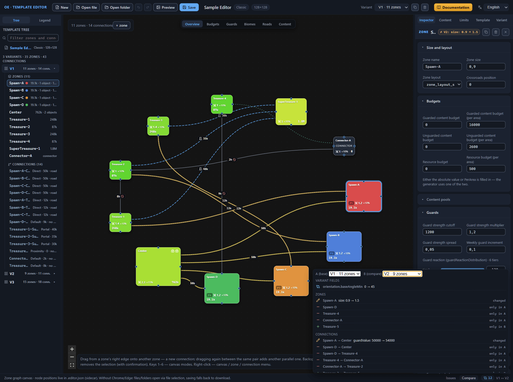

# Variant comparison

One template carries several layout variants — self-contained diagrams of zones and connections (the [Variants: management and selection](variant-manage.md) chapter). Variants diverge in the details: individual zones, connections, the variant’s own fields. The comparison mode finds the differences by itself: it matches two variants and lists the differences in the zones, the connections, and the variant’s own fields — the orientation and the map border.

The mode lives on the “Compare” tab of the window’s bottom panel, next to the “Issues” tab (the [Interface: windows and panels](interface.md#bottom-panel-and-status-bar) chapter). Comparison is a view mode: it does not change the template data, the pair selection does not land in the undo history and is not saved in the files.

## Enabling the A/B comparison mode

The comparison pair is two roles. A is the base variant: the role is firmly bound to the active variant, the one shown on the canvas and receiving the edits. B is the compared variant: it is picked from a list, takes part only in computing the differences, and does not appear on the canvas. The chip — a small counter badge next to the panel’s header — carries a tooltip about the roles: “Variant comparison mode: A — active (base), B — compared”. After you switch to the tab, the panel is collapsed: the “compare” header row hides the selectors and the result.

To enable the mode:

1. Open the “Compare” tab in the bottom panel.
2. Click the “compare” header row — the panel expands and shows two selectors.
3. Pick a variant row in the “B (compare)” selector, for example “V2 · 9 zones” — the row shows the variant’s number and its zone count: the header changes to a pair like “V1 ↔ V2”, and the chip shows the number of differences found.

While B is not selected, its selector shows the “— not selected —” row, and the panel stays in the empty state: the chip is muted and shows zero; the body displays the hint “Select variant B to compare with the active one.” To turn the mode off, return the “— not selected —” row to the B selector.

If there are no differences, the panel’s body reports “The variants are identical.” This message also appears when the active variant itself is selected in B — the variant is compared with itself. For a template with a single variant, the comparison always ends with this message: the B list contains only V1.

The “A (base)” selector shows the active variant and works as a switcher: choosing a new A redraws the canvas to its diagram and resets the selection — the same as the “Variant” selector in the top bar (the [Variants: management and selection](variant-manage.md#variant-switching) chapter). It works in reverse as well: any switch of the active variant — through the top bar, a tree row, or a click on a validator issue — changes the A role, while the selected B stays the same, and the panel recomputes the differences for the new pair.

The editor keeps the comparison pair in memory only: it is not written to the template file or the sidecar file, and its selection does not land in the undo history — Ctrl+Z does not undo the choice of B (the [Files: opening and saving](files.md#undo-and-redo) chapter). Both the “New” button and opening a file return the panel to the empty state. Deleting a variant resets the pair too — the variant numbers shift, and the former B would point to a different diagram; duplication preserves the pair (the [Variants: management and selection](variant-manage.md#variant-deletion) chapter).

## Reading the comparison result

After the pair is selected, the chip shows the number of differences, and the panel’s body lists them row by row. The chip adds up three groups: every changed variant field gives one difference, and every zone and every connection gives one as well, however many fields inside them diverged. If V1 and V2 diverge in two orientation parameters, one zone, and one extra connection, the chip shows 4.

The panel’s body splits the differences into three groups in a fixed order: “variant fields”, “zones”, “connections”. Empty groups are not displayed — when the variants diverge only in zones, the panel shows a single “zones” group.

**Variant fields.** The group contains the layout orientation and the map border (the [Variant: orientation and border](variant-layout.md) chapter). A row shows the field’s path — for example, `orientation.baseAngleMin` — and a value like `0 → 45`. These rows are not clickable: the orientation and the border belong to the variant as a whole and have no separate element on the canvas.

**Zones and connections.** A row starts with a status icon, then comes the label — the zone’s name or the connection as `from → to` — then the diverged fields are listed in a single line, and the status text stands at the end. There are three statuses:

- “changed” — an amber pencil icon: the element is present in both variants and its fields diverged;
- “only in A” — a red minus icon: the element is present in the base variant and absent from the compared one;
- “only in B” — a green plus icon: the element is present only in the compared variant.

The field summary looks like this: `size: 1 → 1.5, roads: 0 → 2`. Numbers and strings appear as an “old value → new value” pair, and a dash stands in place of a missing field: the entry `— → 2` means the field appeared in B, the entry `2 → —` — that it disappeared. The comparison counts the number of list elements: `roads: 0 → 2` — in A the roads list is empty, in B it contains two elements. When the count did not change but the contents did, the same number stands on both sides of the arrow — for example, `3 → 3`. The panel renders structured values such as the biome with the word “changed”: it records the difference but does not reveal the contents. Inside a structured value, the order of keys plays no role — a rearrangement of the keys is not counted as a difference.

The fields in a row are ordered: first the ones known to the format — in a fixed order, then the rest alphabetically. Within a group, the “only in A” and “changed” rows come first — in the order of variant A’s list — and the “only in B” rows close the group — in the order of variant B.

The look of the result depends on how the elements are matched with each other. A zone is matched by name: same-name zones from A and B are compared by fields, and the name itself does not land in the summary. Note: renaming a zone looks like two rows — “only in A” with the old name and “only in B” with the new one — and is not recognized as a change of a single zone. There should be no same-name zones within a variant — the validator catches them, and the comparison takes into account only the first of them. A connection is matched by its pair of ends regardless of direction: swapping `from` and `to` gives one “changed” row whose summary carries both of these fields — not two rows, “only in A” and “only in B”. The connection’s name, unlike the zone’s name, takes part in the comparison: renaming with the same ends adds the field `name: old name → new name` to the summary.

Hovering the cursor over a “changed” row shows a tooltip with the same list of fields — one per line. An “only in A” row has no fields, so its tooltip is the reminder “click a row — focus the element in base variant A”. A click on any of these rows selects the element of variant A: the right panel switches to the “Inspector” tab, and the camera points at the zone’s node or the midpoint of the connection line, keeping the zoom — by the same mechanism as a click on a validator issue (the [Canvas: graph editing](canvas-editing.md#jumping-to-an-element-from-the-panels) chapter). The “only in B” row is not clickable: the element is not present in the base variant, there is nothing to focus.

**The Inspector badge.** When the pair is set, select an element of variant A — a comparison badge appears next to the element’s name in the Inspector’s header. For the “changed” status it is amber, of the form `≠ V3: size: 1 → 1.5, roads: 0 → 2`: the letter V with the number marks the compared variant B, followed by the same field summary. Long badges are truncated with an ellipsis; the hover tooltip carries the full list — one field per line. For an “only in A” element, the badge is reddish — “missing in V3”. The badge disappears when the selection is cleared, no pair is selected, or the same variant is selected in B (the [Interface: windows and panels](interface.md#selected-element-header) chapter).

**What is not compared.** The comparison looks only at the variant’s data: the zones, the connections, the layout orientation, and the map border. Node positions on the canvas and zone notes live in the sidecar file and do not take part in the comparison — you can drag the nodes of the two variants apart however you like, and with matching zone and connection fields the panel will say “The variants are identical.” (the [Files: opening and saving](files.md) chapter). The template’s common settings lie outside the variant and do not land in the result either.

## Next steps

- [Variant: orientation and border](variant-layout.md) — the meaning of the fields that make up the “variant fields” group.
- [Zone: all properties](zone.md) — the meaning of the zone fields listed in the difference rows.
- [Connections between zones](connections.md) — the meaning of the connection fields.
- [Canvas: graph editing](canvas-editing.md) — jumping to an element from the panels and the camera behavior.
- [Files: opening and saving](files.md) — the sidecar file: what is stored outside the template.
