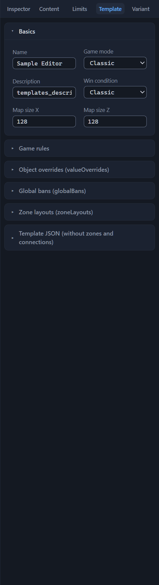
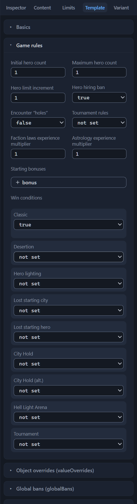
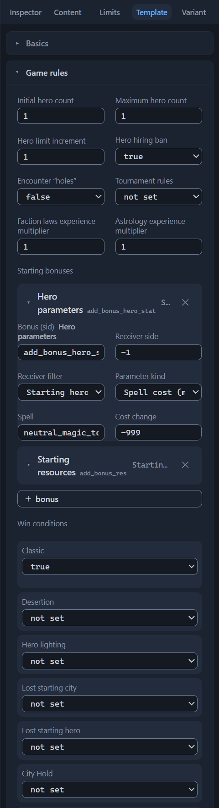
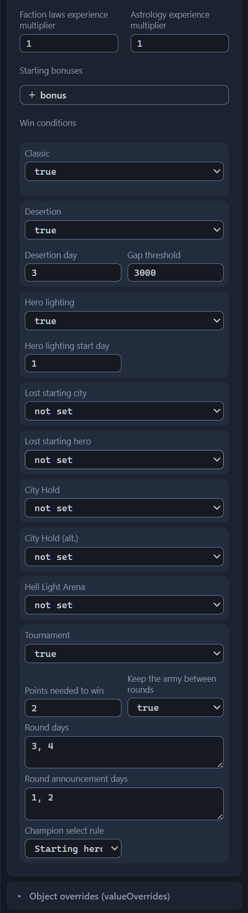
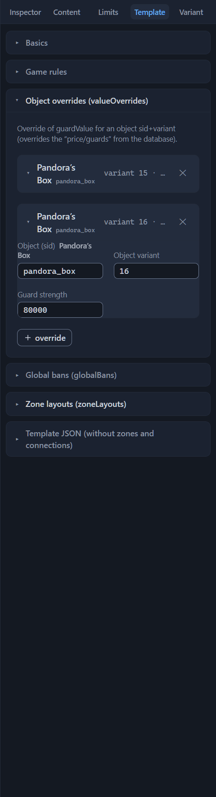
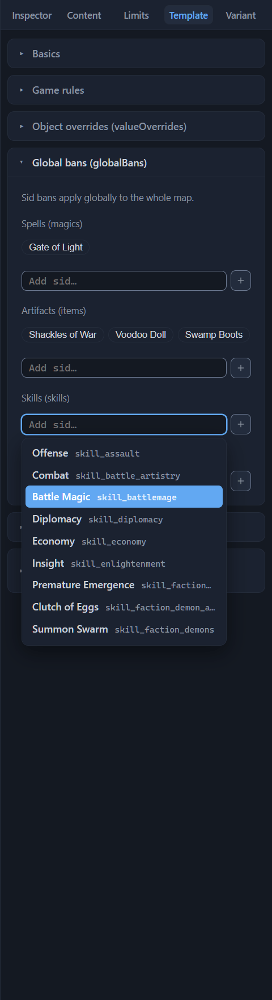
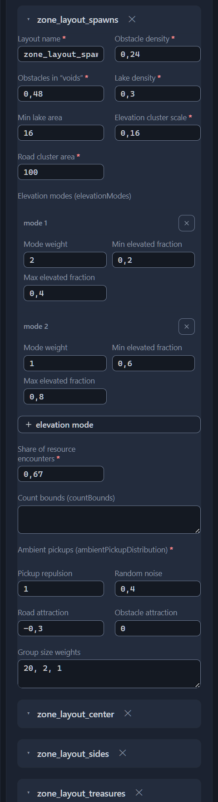
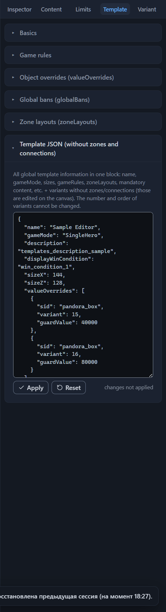
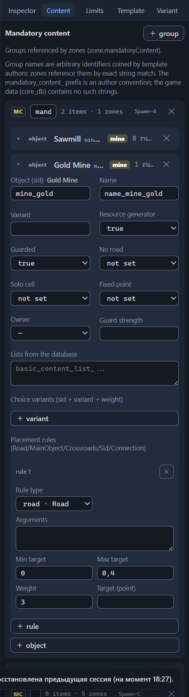
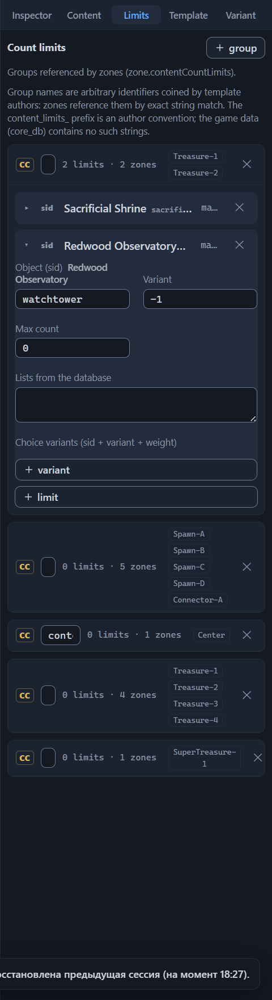

# Template settings (root)

Everything that applies to the template as a whole rather than to an individual zone, connection, or layout variant is configured in the root settings: the name and game mode, the map sizes, the rules and starting bonuses, the win conditions, the object overrides and bans, the zone layouts, the mandatory content groups, and the count limits. In the `.rmg.json` file these are the top-level fields and sections — they lie outside the `variants[]` list and apply to all variants at once.

The root settings occupy three tabs of the right panel: “Template”, “Content”, and “Limits” (an overview of the tabs — the [Interface: windows and panels](interface.md#inspector-tabs) chapter). Nothing has to be selected on the canvas — the tabs are always available. The “Template” tab collects six sections: “Basics”, “Game rules”, “Object overrides (valueOverrides)”, “Global bans (globalBans)”, “Zone layouts (zoneLayouts)”, and “Template JSON (without zones and connections)”. Each section is a collapsible block: click its header to expand or collapse it. “Basics” is open by default, the rest are collapsed; the editor remembers the layout of the expanded sections only for “Template JSON (without zones and connections)”. The “Content” tab carries the “Mandatory content” panel, the “Limits” tab — the “Count limits” panel: groups of objects and restrictions that zones reference.

## Basics

The first section of the “Template” tab is the template’s calling card: the name, the game mode, the description, the displayed win condition, and the map sizes. Text and number fields apply when the field loses focus or on Enter; lists apply immediately after a selection. Every change lands in the undo history: Ctrl+Z returns the previous value (the [Files: opening and saving](files.md#undo-and-redo) chapter).

The editor does not block saving: the files are written with any issues and errors of the “Issues” panel.

A template created with the “New” button has these defaults: the name “New Template”, the mode “Classic”, an empty description, the win condition “Classic”, and the size 128×128. The editor’s demo template is named “Sample Editor” and is configured the same way: “Classic”, 128×128.

### Name

The field “Name”, the name in the file `name` — the name of the template. The game shows it in the lobby; in stock templates it matches the file name. This same name appears in the template info on the editor’s top bar.

The name is also the base name of the saved trio of files: the editor replaces the characters forbidden in file names `\ / : * ? " < > |` with an underscore and builds the names `<Name>.rmg.json`, `<Name>.editor.json`, and `<Name>.png`. If you rename the template, the next save produces a new trio next to the old files; the editor does not delete the old ones (the [Files: opening and saving](files.md#saving) chapter).

In all 60 stock templates the name is non-empty and unique. The editor saves a file with an empty name, but the validator keeps the “Template name is empty” error on the “Issues” panel while the field is not filled in.

### Game mode

The field “Game mode”, the name in the file `gameMode` — the mode of the game. A list of two values without the blank “—” option: the mode is always set. The list shows the English name, and the hint below the field gives the name of the field in the file and the official description of the selected mode:

- **Classic · Classic**
  : “You control multiple heroes.”

- **Single Hero · SingleHero**
  : “If your hero dies, you lose the game.”

Note: there is no third mode — network templates are marked Classic too. In stock files, Classic occurs 37 times, SingleHero — 23.

The mode is chosen together with the game rules: in stock templates, SingleHero has exactly one hero (the minimum and the maximum equal 1), hero hiring is banned, defeat upon losing the starting hero is often enabled, and the starting bonuses go to the starting hero; Classic usually has a hero limit of 3 to 10. The corresponding toggles are collected in the “Game rules” section below.

The list does not let you pick a foreign value. The validator error “Unknown gameMode ‘X’ (expected Classic/SingleHero)” means the file was edited outside the editor (direct editing is described in the [Direct JSON editing](json-editor.md) chapter).

### Description

The field “Description”, the name in the file `description` — the description of the template. The field’s hint formulates the format: “description — localization sid (templates_description_*) or your own text”. Stock templates write a sid here — the key by which the game takes the ready description text from its database; the editor also accepts arbitrary text. The validator does not check the contents of the field.

Clearing the field removes `description` from the file. A new template has an empty description; the demo template has the key `templates_description_sample` written in.

### Win condition

The field “Win condition”, the name in the file `displayWinCondition` — the displayed win condition: what the game shows the players as the goal of the game. A list of the six official conditions; the names and the descriptions are taken verbatim from the English localization of the game, and the hint below the field gives the name of the field in the file and the description of the selected condition:

- **Classic · win_condition_1**
  : “Defeat all enemy heroes and capture every enemy city to win.”

- **Capital Capture · win_condition_2**
  : “Capture the opponent’s starting city to win.”

- **Capital Hold · win_condition_3**
  : “Capture the opponent’s starting city and hold it for a set number of in-game days to win.”

- **Final Battle · win_condition_4**
  : “Face the opponent’s hero in a final battle. The winner claims victory in the game.”

- **City Hold · win_condition_5**
  : “Capture the marked neutral city and hold it for a set number of in-game days to win.”

- **Tournament · win_condition_6**
  : “Face the opponent’s hero in a series of battles. The winner of the set claims victory in the game.”

The displayed condition does not turn on the victory mechanic by itself: the real rules are collected by the toggles of the “Win conditions” block in the “Game rules” section below. Match the displayed condition to the enabled toggles, otherwise the announcement of the game diverges from the actual game.

The “—” value removes `displayWinCondition` from the file, although stock templates always fill the field in: “Classic” — 26 files, “Capital Hold” — 16, “Tournament” — 9, “City Hold” — 5, “Final Battle” — 4. “Capital Capture” did not occur even once. A new template has “Classic”.

### Map sizes

The fields “Map size X” and “Map size Z”, the names in the file `sizeX` and `sizeZ` — the sizes of the map in tiles. The field arrows change the value in steps of 16; there is no hard input limit — the hints “sizeX — 80–240, a multiple of 16, always square” (and the same for Z) and the validator remind you of the allowed values. Clearing a field removes the size from the file.

Maps are always square: `sizeX` equals `sizeZ`. The stock values are 80, 96, 112, 128, 144, 160, 176, 192, and 240; 128×128 occurs most often (12 files), 240×240 the rarest (2 files). A new template has 128×128.

The validator watches the pair with three warnings marked “map size”: “OE maps are always square — the sides differ”, “Sizes are not multiples of 16”, and “Size outside the usual range 80–240”. The last one looks only at the X size, and at Z when X is empty. These are warnings, not errors: the file saves with them. Take the sizes from the stock list and keep both sides equal — then there are no size issues on the “Issues” panel.

## Game rules

The second section of the “Template” tab — “Game rules”: the hero count and hiring, the encounter “holes” mechanic, tournament rules, and two experience multipliers. In the `.rmg.json` file this is the top-level `gameRules` object — it lies outside `variants[]`, so the rules you set apply equally to all layout variants.

The section is arranged like this: first eight fields, below — two blocks. The “Starting bonuses” block keeps the `bonuses` list, the “Win conditions” block — the `winConditions` toggles; they are what set the real victory rules referred to by the “Win condition” field of the “Basics” section.

Number fields apply when the field loses focus or on Enter; the arrows change the value by the field’s step, and keyboard input is not limited by hard bounds. Toggles are lists of three states: “not set”, true, and false. The “not set” state and clearing a number field remove the key from the file: the saved template will not have it at all. Every change lands in the undo history (the [Files: opening and saving](files.md#undo-and-redo) chapter).

In a new template the section is empty — `gameRules: {}` — none of the eight fields is filled in. Stock templates always fill it in, and the validator treats six entries as required: three numbers (`heroCountMin`, `heroCountMax`, `heroCountIncrement`), two toggles (`heroHireBan`, `encounterHoles`), and the `winConditions` object — the “Win conditions” block below. If any of the six is missing, a warning with the list of what is missing appears on the “Issues” panel: “gameRules: missing required fields: heroCountIncrement. They are present in all 60 stock templates; the game’s behavior when they are missing has not been verified — defaults will probably be substituted”. A value of the wrong type counts as missing: the string `"2"` instead of the number 2 lands in the same list. When the file has no `gameRules` key at all, the warning’s list consists of the single word “gameRules” — the check speaks about the whole section.

“Required” here means “present in all 60 stock templates”: what the game does without these entries has not been verified, so the check emits a warning rather than an error, and it does not block saving. A new template comes with it right away — the empty section is conceived that way. The warning goes away when all six entries are filled in.

A separate check watches the values of the section’s three number fields: the validator compares `heroCountMin`, `heroCountMax`, and `heroCountIncrement` against the ranges 0–6, 1–10, and 0–2 — the values of all 60 stock templates fit inside them. The arrows of these fields do not go outside the bounds, but keyboard input is not limited, and direct editing of the file bypasses the interface altogether (the [Direct JSON editing](json-editor.md) chapter) — an out-of-range value is reachable both ways. The validator answers with the warning “gameRules: values outside the ranges observed in all 60 stock templates: heroCountMin: 99 (0–6). The game’s behavior outside the ranges has not been verified — values may be clamped or ignored (hypothesis)”. After the colon comes a “field: value (range)” enumeration separated by semicolons; several out-of-range values are collected into one warning; like the other warnings, it does not block saving. A non-numeric value is not checked against the ranges: it counts as a missing entry and lands in the warning about the six required entries. The validator does not check the ranges of the two experience multipliers.

Issues of root fields land on the “Issues” panel without an area mark, and the issue row does not lead to the field itself: a click on it only opens the “Template” tab of the Inspector. The row shows the path, for example `gameRules.heroCountMin/heroCountMax` (the [Template validation (validator)](validator.md) chapter).

### Initial hero count

The field “Initial hero count”, the name in the file `heroCountMin` — the lower bound of the player’s hero count. The hint gives the name of the key and the range: “heroCountMin — 0–6”.

The arrows change the value in steps of 1 and do not go outside the 0–6 bounds; there is no hard input limit — an out-of-range value is caught by the gameRules range warning. An empty field means the `heroCountMin` key is missing, and its name lands in the warning about the six required entries.

In a new template the field is empty and the file has no `heroCountMin` key; clearing the field removes the key. Stock templates always set the value, and it is tied to the game mode from the “Basics” section: templates of the “Single Hero” mode have the minimum equal to 1, templates of the “Classic” mode usually lie within 0–2.

### Maximum hero count

The field “Maximum hero count”, the name in the file `heroCountMax` — the upper bound of the player’s hero count. The hint: “heroCountMax — 1–10”.

The arrow step is the same — 1, their bounds are 1–10; there is no hard input limit — an out-of-range value is caught by the gameRules range warning. An empty field means the file will have no `heroCountMax` key, and the field’s name will appear in the list of the warning about the six required entries. The stock values follow the game mode: “Classic” templates usually have a limit of 3 to 10, “Single Hero” — exactly 1.

The validator compares the pair of fields and, when the minimum is above the maximum, emits the warning “heroCountMin (3) is greater than heroCountMax (2)” — your values stand in the parentheses. The comparison fires only when both fields are filled in: with an empty minimum or maximum there is no issue. Keep the minimum no higher than the maximum, otherwise the warning stays on the “Issues” panel until the values are reconciled.

### Hero limit increment

The field “Hero limit increment”, the name in the file `heroCountIncrement`. *Purpose to be confirmed.* The field’s hint conveys this state verbatim: “heroCountIncrement — increment of the hero limit (per week/city?); the in-game template description calls it ‘Heroes per City’ (hypothesis)”.

The arrows change the value in steps of 1 and do not go outside the 0–2 bounds; there is no hard input limit — an out-of-range value is caught by the gameRules range warning. In a new template the value is not set — the file has no key, and the name `heroCountIncrement` lands in the warning about the six required entries; stock templates fill the field in.

### Hero hiring ban

The “Hero hiring ban” toggle, the name in the file `heroHireBan`, forbids hiring new heroes. The field’s hint: “heroHireBan — forbids hiring new heroes; enabled in all 23 stock templates of the Single Hero mode, disabled in the other 37”.

The three states are “not set”, true, and false; the “not set” state removes the key from the file. In a new template the toggle is not set — the name `heroHireBan` lands in the warning about the six required entries; stock templates always set the value.

The validator watches the consistency with the maximum hero count: with the ban enabled and `heroCountMax` above 1, the info “heroHireBan is enabled, but heroCountMax allows more than one hero” appears. The same info comes out when the maximum is not filled in at all. Set the maximum hero count to 1 together with the ban, otherwise the info hangs on the “Issues” panel. It does not block saving: it is an info, not an error.

### Encounter “holes”

The “Encounter ‘holes’” toggle, the name in the file `encounterHoles` — the master switch of the “holes” mechanic for the whole template at once. A hole is a gap in an encounter. The field’s hint: “encounterHoles — master switch of the ‘holes’ mechanic (a generation glitch: a pickup slot or tile goes missing in an encounter); enabled only in Anarchy among stock templates; the shares live in zones (encounterHolesSettings)”.

Only true turns the mechanic on: the “not set” and false states leave it off. In stock templates the key is present in all 60 files — true stands only in Anarchy, false in the other 59. The validator sees the difference between these two states: the field is one of the six required entries, so “not set” leaves the name `encounterHoles` in the missing-fields warning, while false closes it.

The shares of the “holes” are set not here but in each zone, in the “Encounter holes” section of the Inspector (the [Zone: all properties](zone.md#encounter-holes) chapter). The enabled master flag activates the zone shares; the disabled one ignores them; if the rule is not enabled (set to false or “not set”) while the zones have shares written in, the validator reminds you with the info “encounterHolesSettings is set, but gameRules.encounterHoles is not enabled — the field is ignored”. Enable the rule together with the shares, otherwise the zone settings stay in the file as dead weight and the generator ignores them.

### Tournament rules

The “Tournament rules” toggle, the name in the file `tournamentRules`. *Purpose to be confirmed.* The editor’s hint: “tournamentRules — tournament rules switch (purpose unclear)”; what exactly the field turns off has not been determined.

The states are the same — “not set”, true, and false; “not set” removes the key from the file. In a new template the toggle is not set; in stock files the key occurs once — in Anarchy with the value false.

The validator checks only the form of the value and emits the warning “tournamentRules: expected true/false, got ‘X’ — the field’s purpose is unclear (hypothesis)” when the key is present with a value of another type. Such a value cannot be entered from the Inspector, so the warning is addressed to files edited directly (the [Direct JSON editing](json-editor.md) chapter).

This is a separate key: the “Win conditions” block of the same section has its own set of tournament fields (`winConditions.tournament*`), and the “Basics” section — the displayed “Tournament” condition (`win_condition_6`).

### Faction laws experience multiplier

The field “Faction laws experience multiplier”, the name in the file `factionLawsExpModifier` — the multiplier applied to the experience from faction laws. The hint gives the range: “factionLawsExpModifier — 0.5–1.5”.

The arrows change the value in steps of 0.05; the field has no bounds, and the validator does not check the range. It is not in the list of the six required entries — an empty multiplier produces no issue. In a new template the field is empty and the file has no key. In stock templates the value occurs in 17 files of 60.

The field itself only sets the multiplier: how the game accrues experience from faction laws is unknown.

### Astrology experience multiplier

The field “Astrology experience multiplier”, the name in the file `astrologyExpModifier` — the multiplier applied to the experience from astrology. The hint: “astrologyExpModifier — 0.25–2”.

The arrow step here is the same — 0.05; the field has no bounds and no validator checks. An empty field means the file has no `astrologyExpModifier` key; in stock templates the value occurs in 21 files of 60.

### Starting bonuses

The first of the two blocks below the eight fields — “Starting bonuses”: the `bonuses` list in `gameRules`. Each entry is a separate bonus granted at the start of the game: a spell or an artifact for the hero, starting resources, a change to the hero’s parameters. Of the 60 stock templates, 26 files have bonuses, from one to five entries per file.

In a new template and in the demo template the block is empty: `gameRules: {}` has no `bonuses` key at all. It is not one of the section’s six required entries, so an empty block produces no issues.

#### Bonus card

The block is built as a list of expanding cards with a “＋ bonus” button at the bottom. The button adds a card to the end of the list with a ready blank: type “Hero parameters”, receiver side −1, filter “Starting hero (start_hero)”, empty parameters. You can rewrite the blank right away or later: all fields of the card are editable.

The card’s header row shows the readable name of the bonus — the editor’s name for the five game bonuses, the sid name from the catalog for the others — with the raw sid in small type next to it. Hovering the mouse over the header brings up the “name · sid” pair. Without a sid the header shows “sid?”; if the sid has no name in the catalog, only the raw value remains. The selected receiver filter is shown as a chip — a small badge with the value, visible even on the collapsed card.

A click on the header row expands the card: “Bonus (sid)”, “Receiver side”, “Receiver filter”, and the parameter fields — their set depends on the type of the bonus and is covered in the sections below.

The ✕ button in the header row deletes the bonus immediately and without confirmation; made a mistake — roll it back with Ctrl+Z: the deletion also lands in the undo history (the [Files: opening and saving](files.md#undo-and-redo) chapter). When the last bonus is deleted, the `bonuses` key disappears from the file altogether: an empty list is not saved.

#### Bonus (sid)

The field “Bonus (sid)”, the name in the file `sid` — the type of the bonus. Clicking the field opens a list: at the top the five game bonuses with the editor’s names, below — the general catalog of all sids with Russian names; typing filters the list, Enter selects the highlighted option, Esc closes the list. The five game bonuses:

`add_bonus_hero_spell`
: “Spell for hero” — gives the hero a spell.

`add_bonus_hero_stat`
: “Hero parameters” — modifies the hero’s parameters.

`add_bonus_res`
: “Starting resources” — grants resources at the start of the game.

`add_bonus_hero_item`
: “Artifact for hero” — gives the hero an artifact.

`add_bonus_hero_unit_multipler`
: “Hero unit multiplier”. *Purpose to be confirmed.*

Below the field’s caption stands the readable name of the selected bonus, and the hint gives either the name from the catalog or the bonus’s purpose and the form of its parameters.

Changing the sid does not touch the already entered `parameters`. If the old list does not match the stock form of the new type, parameter editing switches to the raw list — more in “Bonus parameters” below. Clearing the field leaves the bonus without a type: the card header switches to “sid?”, and the validator keeps the “Bonus without sid” warning (the [Template validation (validator)](validator.md) chapter).

The frequency of the five types in stock templates: `add_bonus_hero_spell` and `add_bonus_hero_stat` — 14 entries each, `add_bonus_res` — 5, `add_bonus_hero_unit_multipler` — 3, `add_bonus_hero_item` — 2.

#### Receiver side

The field “Receiver side”, the name in the file `receiverSide` — the number of the side that gets the bonus. Its hint conveys the meaning: “receiverSide — side number; −1 = all sides”. The field has no bounds, the arrow step is 1; an empty field means the file has no key.

In stock templates the value is always −1: the bonuses go to all sides at once. The validator marks any other number with an info — the softest level of issues: “receiverSide 3 — always −1 in stock templates”, where 3 is your value. It does not block saving.

#### Receiver filter

The field “Receiver filter”, the name in the file `receiverFilter` — who receives the bonus. The list has two values:

`start_hero`
: “Starting hero (start_hero)” — the bonus goes to the starting hero.

`all_heroes`
: “All heroes (all_heroes)” — the bonus goes to all heroes.

The “—” value removes the `receiverFilter` key from the file. The selected filter is visible as a chip in the card’s header row; a non-standard value is shown by the chip as is.

In stock templates `start_hero` occurs 30 times, `all_heroes` — 4; in templates of the “Single Hero” mode the bonuses usually go to the starting hero. The validator does not check the field.

#### Bonus parameters

The `parameters` list is the bonus’s arguments: what exactly it applies. There are from one to four of them, and the field hint gives examples from stock templates: [movementBonus, 0]; [magicCostSidSet, neutral_magic_town_portal, -999, 0] (free cast); [gold, 10000]; [swamp_boots_artifact] (“Swamp Boots”).

In the file, all elements of the list are strings, numbers included: stock templates write ["magicCostSidSet", "neutral_magic_town_portal", "-999", "0"], not the number −999. The editor writes numbers as text the same way, so a hand-built bonus does not differ in form from a stock one.

For the five game bonuses, the parameters are edited with structured fields: their set depends on the type and is covered in the sections below. Changing the type of the bonus rebuilds the parameter fields immediately.

If the list does not match the stock form of the bonus — the length is wrong or the first element is different — instead of the structured fields the block shows a single “Bonus parameters” field: a raw list whose elements are comma-separated. The field applies when it loses focus or on Ctrl+Enter; empty elements are discarded. The hint marks the case: “parameters does not match the stock form of this bonus — edit as a raw list”, and then gives the same examples. As soon as the list returns to the stock form, the structured fields come back.

Note: the raw “Bonus parameters” list also appears for a bonus with a sid outside the list of five — the general catalog of the “Bonus (sid)” field lets you pick any sid of the game — but without the mismatch note: the editor does not know the stock form of such a bonus.

#### Spell for hero

The `add_bonus_hero_spell` bonus gives the hero a spell; the list has one argument — the sid of the spell. The editor shows the “Spell” field: a click opens a list of adventure spells with their official Russian names, typing filters it, and the hint under the field adds the name of the selected spell. Stock templates feature the adventure spells “Town Portal”, “Shadowflight”, “Dimension Door”, and “Primordial Chaos”; for example, ["primal_18_magic_primordial_chaos"] is “Primordial Chaos”.

Clearing the field leaves `parameters` empty.

#### Hero parameters

The `add_bonus_hero_stat` bonus modifies the hero’s parameters. There are two stock forms; the editor distinguishes them by the first element of the list, and you pick the form in the “Parameter kind” field:

`movementBonus`
: “Movement points (movementBonus)”. The selection immediately builds the list ["movementBonus", "0"] and opens the “Value” field with a zero.

`magicCostSidSet`
: “Spell cost (magicCostSidSet)”. The selection builds the list ["magicCostSidSet", "", "-999", "0"]: the spell is still empty, the cost change is −999.

The “—” value clears `parameters`.

In the movement-points form ["movementBonus", value], the value in stock templates is always 0. *Purpose to be confirmed.* The field’s hint conveys the state verbatim: “Always 0 in stock templates; the exact meaning of the value is not confirmed (hypothesis: a bonus to movement points)”.

The cost form is longer: ["magicCostSidSet", spell sid, cost change, 0] — exactly four elements. The editor shows two fields: “Spell” — the same list of adventure spells as in the “Spell for hero” bonus — and “Cost change”. It is a negative number: −999 makes the cast free, −10 or −15 reduce the cost by that number. An example from stock templates: ["magicCostSidSet", "neutral_magic_town_portal", "-999", "0"] — “Town Portal” comes for free.

Note: the trailing zero — the fourth element of the list — has no field of its own; the editor saves it automatically. The “extra” zero in the file or in the raw list is part of the stock form, not an error.

#### Starting resources

The `add_bonus_res` bonus grants resources at the start of the game; the list has two arguments — the resource and the amount. The editor shows the “Resource” field — a list of the seven game resources:

`gold`
: “Gold (gold)”

`wood`
: “Wood (wood)”

`ore`
: “Ore (ore)”

`mercury`
: “Mercury (mercury)”

`crystals`
: “Crystals (crystals)”

`gemstones`
: “Gems (gemstones)”

`alchemicalDust`
: “Alchemical Dust (alchemicalDust)”

Selecting a resource immediately builds the list with a zero amount and opens the “Amount” field — type a number into it. The field’s arrows do not go below 0; keyboard input is not limited. The “—” value in the resource list clears `parameters`. In stock templates the list looks like this: ["gold", "10000"] — ten thousand gold at the start.

#### Artifact for hero

The `add_bonus_hero_item` bonus gives the hero an artifact; the list has one argument — the sid of the artifact. The editor shows the “Artifact” field: a click opens a list of all artifacts of the game with Russian names, typing filters it, and the hint adds the name of the selected artifact. For example, ["swamp_boots_artifact"] is the “Swamp Boots” artifact.

Clearing the field leaves `parameters` empty.

#### Hero unit multiplier

The `add_bonus_hero_unit_multipler` bonus — “Hero unit multiplier”. *Purpose to be confirmed.* The editor’s hint conveys the state verbatim: “Hypothesis: hero unit multiplier (parameters = [2] in stock templates; what exactly it doubles is not confirmed)”.

The list has one argument — the multiplier. The editor shows the “Multiplier” field: the arrows do not go below 0, keyboard input is not limited, clearing the field leaves `parameters` empty. In stock templates the bonus occurs in three files; the multiplier is always 2.

### Win conditions

The second block below the eight fields — “Win conditions”: the `winConditions` object in `gameRules`. Nine toggle rows collect the real victory rules of the game — the “Win condition” field of the “Basics” section only picks the announcement that the game shows the players. The object is one of the section’s six required entries: it is present in all 60 stock templates, while a new template and the demo template have no key at all, and its name lands in the warning about the missing entries.

Each row is a toggle with three states (“not set”, true, false) and, for most rows, arguments: number fields, lists, or a dropdown. A row shows its arguments only in the true state; in “not set” and false the fields are hidden. Turning the toggle off does not erase the entered values: they stay in the file invisibly and return to the screen when the row is enabled again. To remove an argument altogether, clear its field while the toggle is on — the key disappears from the file.

The very first touch of any toggle creates the `winConditions` object in the file. Returning all rows to the “not set” state does not delete the key: the file keeps an empty `winConditions: {}`, and the validator counts such an entry as present — the name `winConditions` disappears from the warning about the six required entries. To remove the key itself, edit the template directly (the [Direct JSON editing](json-editor.md) chapter).

Note: the validator does not check the block’s numeric values. The arrows of each field respect their own bounds — for example, 1–3 for “Defeat day” — but keyboard input is not limited, and there is no range warning here. The block has two checks of its own: a lone “Desertion day” and tournament lists of different lengths — both are covered in the sections below.

#### Classic

The “Classic” toggle, the name in the file `classic` — the classic victory rule. The hint: “classic — defeat all enemy heroes and capture every enemy city”. The row has no arguments, and the wording matches the description of the displayed “Classic” condition of the “Basics” section.

Enabled in all 60 stock templates.

#### Desertion

The “Desertion” toggle, the name in the file `desertion` — the defeat of the side that falls too far behind its rivals. The hint: “desertion — defeat when falling behind by desertionValue by desertionDay”. The row has two arguments:

“Desertion day”
: The name in the file `desertionDay` — the day by which the gap is checked. The hint: “desertionDay — the day by which the gap is checked (= 3 in stock templates)”. The arrows change the value in steps of 1 and do not go below 1.

“Gap threshold”
: The name in the file `desertionValue` — the size of the gap that leads to defeat. The hint: “desertionValue — the size of the gap that leads to defeat (= 3000 in stock templates)”. The arrows change the value in steps of 100. The hint does not say in what units the gap is measured.

All 60 stock templates enable the toggle and keep the same values: day 3, threshold 3000.

The validator watches one case — a lone day: if “Desertion day” holds a number while the toggle is off or returned to “not set”, the info “desertionDay is set, but desertion is disabled” appears on the “Issues” panel. It does not block saving. When turning the toggle off, clear the day field as well, otherwise the info stays on the panel.

#### Hero lighting

The “Hero lighting” toggle, the name in the file `heroLighting`. *Purpose to be confirmed.* The field’s hint conveys this state verbatim: “heroLighting — hypothesis: ‘lighting up’ the opponent’s hero (fog reveal); always true in stock templates”.

The argument “Hero lighting start day”, the name in the file `heroLightingDay` — the day the effect starts. The hint: “heroLightingDay — start day (= 1 in stock templates)”; the arrows do not go below 1. Stock templates — all 60 — enable the toggle and keep the day equal to 1.

#### Lost starting city

The “Lost starting city” toggle, the name in the file `lostStartCity` — defeat upon losing your starting city. The hint: “lostStartCity — defeat upon losing the starting city”.

The argument “Defeat day”, the name in the file `lostStartCityDay`, sets the deadline; its hint: “lostStartCityDay — after how many days losing the city becomes a defeat (1–3)”. The arrows go from 1 to 3.

In stock templates the toggle is enabled in 15 files and disabled in 39. “Defeat day” occurs in 33 files with values from 1 to 3 — including where the toggle is off: the editor hides the argument fields of such a row, but the value lives in the file.

#### Lost starting hero

The “Lost starting hero” toggle, the name in the file `lostStartHero` — defeat upon losing your starting hero. Its hint: “lostStartHero — defeat upon losing the starting hero”. The row has no arguments.

In stock templates the toggle is enabled in 24 files and disabled in 36. It is especially often enabled in templates of the “Single Hero” mode.

#### City Hold

The “City Hold” toggle, the name in the file `cityHold` — victory for holding the marked neutral city. The hint: “cityHold — capture the marked neutral city and hold it for the given number of days”.

The argument “Days to hold for victory”, the name in the file `cityHoldDays` — how many days to hold the city; its hint: “cityHoldDays — 3–7”. The arrows go from 3 to 7.

The toggle does not say which city to hold: the city is marked in the zone, in the “City Hold objective” field of the main object (the [Zone main objects](main-objects.md#win-conditions-and-garrison) chapter). How exactly the object field couples with the root toggle — *Purpose to be confirmed.*

In stock templates the toggle is enabled in 6 files and disabled in 8; “Days to hold for victory” is filled in in all 14 files with the toggle, with values from 3 to 7.

#### City Hold (alt.)

The “City Hold (alt.)” toggle, the name in the file `holdCityWinCon`. *Purpose to be confirmed.* The hint conveys this state verbatim: “holdCityWinCon — hypothesis: an alternative version of cityHold (paired with mainObjects.holdCityWinCon)”. The row has no arguments.

The only stock template that enables the toggle is Zookeeper; false is not set anywhere, and the other 59 files do not contain the key at all. The zone’s main object has a field with the same name, and it occurs more often: five stock files, seven objects (the [Zone main objects](main-objects.md#win-conditions-and-garrison) chapter).

#### Hell Light Arena

The “Hell Light Arena” toggle, the name in the file `gladiatorArena`, enables the battle arena for heroes. The row’s hint conveys the official in-game description of the arena object: “gladiatorArena — a battle arena for heroes: a few days after it is visited, a battle occurs whose winner wins the whole game (official object description)”.

The arena itself is not configured here: it is placed in the zone as a main object of type “Hell Light Arena (GladiatorArena)” (the [Zone main objects](main-objects.md#object-type) chapter), and its approaches are connections of type “arena entrance (GladiatorArena)” (the [Connections between zones](connections.md#connection) chapter). Among stock templates, only Blitz keeps an arena object; the rarest connection type occurs twice across all templates.

The row has four arguments:

“Registration: ‘work’ start”
: The name in the file `gladiatorArenaRegistrationStartWork` — a toggle with three states. *Purpose to be confirmed.* The hint conveys the state verbatim: “gladiatorArenaRegistrationStartWork — hypothesis: arena registration when approaching the ‘worker’”. In stock templates true is not set anywhere: all 10 files with the argument have false.

“Registration: fight start”
: The name in the file `gladiatorArenaRegistrationStartFight` — also a toggle with three states. The hint gives a short explanation: “gladiatorArenaRegistrationStartFight — registration starts with the fight”; what arena registration is and how the two registration modes differ in the game — *Purpose to be confirmed.* The value true occurs in 9 stock files, false — in one.

“Arena start delay”
: The name in the file `gladiatorArenaDaysDelayStart` — the day the arena starts. The hint: “gladiatorArenaDaysDelayStart — the day the arena starts (21–30 in stock templates)”; the arrows go from 1 to 30. In stock templates the field occurs in 8 files, with values from 21 to 30.

“Battle period (days)”
: The name in the file `gladiatorArenaCountDay` — the frequency of battles at the arena. The hint: “gladiatorArenaCountDay — frequency of battles, in days (1–8)”; the arrows go from 1 to 8. The field occurs in 9 stock files with values from 1 to 8.

The toggle itself is enabled in 3 stock templates and disabled in 7.

#### Tournament

The “Tournament” toggle, the name in the file `tournament` — victory in a series of battles with the opponent’s hero. The hint: “tournament — face the opponent’s hero in a series of battles; the winner of several fights wins the match”. Do not confuse it with the two entities covered above: the “Tournament rules” field of the same section and the displayed “Tournament” condition of the “Basics” section. The toggle and its arguments have their own set of keys, `winConditions.tournament*`.

In stock templates the tournament is enabled in 9 files; false is not set anywhere. The row has five arguments:

“Points needed to win”
: The name in the file `tournamentPointsToWin`. The hint gives the range: “tournamentPointsToWin — 2–3”; the arrows go from 2 to 3. In stock templates the field occurs in 9 files with the values 2 or 3.

“Keep the army between rounds”
: The name in the file `tournamentSaveArmy` — a toggle with three states. The hint: “tournamentSaveArmy — keep the army between rounds; true in all 9 stock tournament templates”.

“Round days”
: The name in the file `tournamentDays` — a list of numbers. The hint: “tournamentDays — 3–5 values; displayed in-game as ‘Battle Dates’”. Stock files keep 3–5 values each, for example [4, 4, 4] or [3, 4, 5]. What a single number means — the exact day of a battle or the interval between rounds — *Purpose to be confirmed.*

“Round announcement days”
: The name in the file `tournamentAnnounceDays` — a second list of numbers of the same form. The hint: “tournamentAnnounceDays — 3–5 values”. The second list occurs in 9 stock files, with 3–5 values in each.

“Champion select rule”
: The name in the file `championSelectRule` — a dropdown. The hint: “championSelectRule — the champion is the starting hero (the only value is StartHero)”. Its only option is “Starting hero (StartHero)”; the “—” value removes the key from the file. The field occurs in 11 stock files and is always equal to `StartHero`; the “Tournament” toggle itself, for comparison, is enabled in 9.

Both lists are edited the same way: comma-separated numbers, applied when the field loses focus or on Ctrl+Enter; empty elements are discarded. Clearing the text does not remove the key — the file keeps an empty list `[]`. A non-numeric element turns into `null` on save, and the validator does not catch it: enter only numbers.

The validator compares the lengths of the two lists: when both are present but differ, the warning “tournamentDays ({{days}}) and tournamentAnnounceDays ({{announceDays}}) have different lengths” appears on the “Issues” panel — your list lengths stand in the parentheses. Keep the lists of equal length, otherwise the warning stays on the panel. It does not block saving.

## Object overrides

The third section of the “Template” tab — “Object overrides (valueOverrides)” — edits the `valueOverrides` list in the root of the file, outside `variants[]`. The section’s hint verbatim: “Override of guardValue for an object sid+variant (overrides the ‘price/guards’ from the database).”

The game database sets the object’s usual price and the strength of its guard; a list entry overrides it pointwise — for one object and one of its variants. This is how the template makes an object heavier or lighter than the game intends by default.

An entry has three fields: `sid` — the identifier of the object in the game database, `variant` — the index of the object’s variant, `guardValue` — the guard value in value units. Value is the notional balance currency: content budgets and guards are measured in its units (the [Connections between zones](connections.md) chapter).

In stock templates the list is present in 31 files of 60, with 1 to 8 entries. A new template and the demo template are created with an empty list — the file carries `valueOverrides: []`; deleting the last entry removes the key from the file altogether, an empty list is not saved.

### Override card

The block is built as a list of expanding cards with a “＋ override” button at the bottom. The button adds a card to the end of the list with a ready blank: `sid` empty, `variant` −1 (all variants), `guardValue` 0. You can rewrite the blank right away or later: all three fields of the card are editable.

The header row shows the readable name of the object — in the main typeface, with the raw sid in small type next to it; hovering the mouse over the header brings up the “name · sid” pair. Without a sid the header shows “sid?”; if the sid has no name in the catalog, only the raw value remains. The second half of the header is the summary: “variant all · guard 5000” for an entry with `variant` −1, “variant 15 · guard 40000” for an entry with a specific variant.

A click on the header row expands the card with three fields — “Object (sid)”, “Object variant”, and “Guard strength”; they are covered below. The ✕ button in the header row deletes the entry immediately and without confirmation; made a mistake — roll it back with Ctrl+Z: the deletion also lands in the undo history (the [Files: opening and saving](files.md#undo-and-redo) chapter).

The fields apply the same way as in the “Game rules” section: on loss of focus or on Enter; the arrows change the value by the field’s step; keyboard input is not limited by hard bounds. Clearing a number field removes the key from the entry — the card stays in the list, but `variant` or `guardValue` drops out of the file, and the validator stays silent: it only checks the numbers that are present. Fill in all three fields of the card before saving, otherwise a truncated entry goes into the file.

### Object (sid)

The field “Object (sid)”, the name in the file `sid` — the identifier of the object in the game database. Input is free-form: a click opens a dropdown with popular objects from the editor’s catalog — Pandora’s Boxes, mines, arenas, and others — typing filters the list, Enter selects the highlighted option, Esc closes the list. Below the field, the caption shows the readable name: the editor first looks it up in its own short catalog, and if the sid is not found there — in the game’s official Russian names.

Any sid can land in the field: the validator does not compare the override’s identifier against the catalog and produces no issue for an unknown value. Pick the sid from the list or copy it exactly — a typo does not become a warning, and the mistake stays unnoticed.

Clearing the field removes the sid from the entry: the header turns into “sid?”, and the validator emits the warning “Override without sid”.

Most often, stock templates override the “Point of Balance” (`point_of_balance`) — 25 entries. Six more objects occur with 17 entries each, all from one family of stock templates: “Ritual Pyre” (`ritual_pyre`), “Petrified Memorial” (`petrified_memorial`), “Boreal Call” (`boreal_call`), “Colosseum” (`jousting_range`), “Carrion Pile” (`the_gorge`), “Tomb of Vigilance” (`unforgotten_grave`).

### Object variant

The field “Object variant”, the name in the file `variant`. The hint verbatim: “variant — −1 = all variants”. The value −1 means the entry applies to all variants of the object; a non-negative number — only to the variant with that index. A single sid can have several variants; an entry with a number addresses one specific variant, an entry with −1 — all at once. An example from stock templates: four “Pandora’s Box” (`pandora_box`) entries for tournament prizes — variants 15, 16, 17, and 18 with guard values 40,000, 80,000, 120,000, and 140,000.

The arrows change the variant in steps of 1, and the field has no bounds; in stock files the values run from −1 to 27. For numbers below −1 the validator emits the warning “variant {{variant}} outside the typical range (≥ −1)” — your number stands in the parentheses.

### Guard strength

The field “Guard strength”, the name in the file `guardValue` — the guard value that the entry assigns to the object. The hint verbatim: “guardValue — 1000–1,000,000”; this is the spread of the stock files’ values — the editor sets no hard bound. The arrows change the value in steps of 100.

The blank’s zero lies outside the hinted range: the validator does not catch it, and it goes into the file anyway — replace the zero with a real value right away. A negative number gives the info “Negative guardValue of the override”; what such an entry means for the game has not been determined. The info does not block saving.

### Duplicate entries

The validator catches two entries with the same “object + variant” pair: for each repeat the info “Duplicate entry ‘{{key}}’” appears, where a pair like `pandora_box|15` stands in place of the key. Keep one entry per pair, otherwise the info stays hanging on the “Issues” panel.

Issues of the overrides, like those of the other root fields, land on the “Issues” panel without an area mark, and the issue row does not lead to the field itself: a click on it only opens the “Template” tab of the Inspector. The row shows the path — `valueOverrides[].sid`, `valueOverrides[].variant`, `valueOverrides[].guardValue`, and for a duplicate simply `valueOverrides` (the [Template validation (validator)](validator.md) chapter).

## Global bans

The fourth section of the “Template” tab — “Global bans (globalBans)” — edits the `globalBans` object in the root of the file, outside `variants[]`: the bans apply equally to all layout variants. The section’s hint verbatim: “Sid bans apply globally to the whole map.” Anything that lands in one of the section’s lists is banned on the whole map.

The section has four fields, and each keeps a list of sids — identifiers of the game database entries: “Spells (magics)”, “Artifacts (items)”, “Skills (skills)”, and “Heroes (heroes)”. Do not confuse global bans with count limits: a ban applies to the whole map at once, while a limit group restricts the number of objects only in the zones that reference it, and `maxCount = 0` bans the object completely only in the zones of that group (the zone’s fields are covered in the [Zone: all properties](zone.md#mandatory-content-and-limits) chapter, the limit groups themselves — in the [“Count limits”](#count-limits) section of this chapter).

Stock templates fill the section in 23 files of 60. The artifact list is present in all 23 files (from 3 to 22 artifacts), spells — in 4 files (4–8 entries), skills — in 3 files (1–2 entries), heroes — in 2 files (5–11 entries). A new template is created without the `globalBans` key at all, while the demo template carries an empty section — `globalBans: {}`.

Note: in one stock template the section is duplicated — a copy of `gameRules.globalBans` is nested inside the game rules. The editor neither shows nor edits the copy: on opening and saving it is carried over as is, and the validator does not check it. Everything described below refers to the bans in the root of the file.

### Adding and removing bans

The four fields are built the same way: a row of chips of the already selected sids, and under it — an add row with an input field (the “Add sid…” placeholder) and a “＋” button with the same tooltip.

The chip shows the readable name of the entry: the editor looks it up first in its own short catalog, and if the sid is not found there — in the game’s official Russian names, as in the “Object (sid)” field of the overrides. When the name is in neither place, the chip turns a warning color and shows the raw sid with the “not in catalog” badge. This is the only hint about an unfamiliar value: the validator does not compare the bans against the catalog. Pick the sid from the list or copy it character by character, otherwise the ban silently points at a nonexistent entry.

Hovering the mouse over the chip brings up the tooltip “Remove from bans: {{sid}}” — it shows the raw identifier even when the chip shows a name. A click on the chip removes the ban immediately and without confirmation; made a mistake — bring it back with Ctrl+Z: adding and removing land in the undo history (the [Files: opening and saving](files.md#undo-and-redo) chapter).

To add a ban, type the sid in the add row or pick it from the list: a click on the field opens the candidate list of that field, typing filters it by name and sid, Enter adds the highlighted option, Esc closes the list; in the list rows the official name is shown next to the raw sid. Hand-typed text is added as is: Enter — when no candidate matched, loss of focus — in any case. Spaces at the edges are trimmed; empty input and a sid already in the list are ignored silently. After adding, the field clears, and the focus returns into it if the option was picked from the list — bans are convenient to enter one after another.

An empty list is not written to the file: deleting the last chip removes the corresponding key from `globalBans`, and when no lists remain at all, the key of the whole section disappears from the file.

### Spells (magics)

The field’s hint verbatim: “magics — sids of map adventure spells. In stock templates: neutral_magic_light_gate ‘Gate of Light’, neutral_magic_dimension_door ‘Dimension Door’, neutral_magic_shadow_form ‘Shadowflight’, neutral_magic_pocket_dimension ‘Pocket Dimension’, neutral_magic_town_portal ‘Town Portal’ and others.”

The candidates are the same adventure spells with official Russian names as in the “Spell for hero” bonus (the “Starting bonuses” block above).

In stock bans, “Gate of Light”, “Dimension Door”, and “Shadowflight” occur four times each, “Pocket Dimension” — three times, “Town Portal” — twice, and five more spells — once each: `day_17_magic_clear_view`, `day_18_magic_farsight`, `night_18_magic_nairas_veil`, `space_18_magic_assemble`, `primal_17_magic_groundsight`.

Note: necromancy is present in the list as “Necromancer Will” (`change_use_necromancy`) — that is the spell’s sid. The similar-looking `neutral_magic_necromancy` is not among the candidates: that name belongs to the spell’s application effect.

### Artifacts (items)

The field’s hint verbatim: “items — artifact sids. In stock templates: voodoosh_doll_artifact ‘Voodoo Doll’, flag_of_truce_artifact ‘Flag of Truce’, shackles_of_war_artifact ‘Shackles of War’, swamp_boots_artifact ‘Swamp Boots’, magic_scroll_artifact_<spell> ‘Magic Scroll: …’ and others.”

The candidates are all artifacts from the catalog of the game’s official Russian names, including composite scrolls of the form `magic_scroll_artifact_<spell>` and `enchanted_magic_scroll_artifact_<spell>`.

The artifact list is the most common: it is present in every file with the section, from 3 to 22 entries. “Shackles of War” (`shackles_of_war_artifact`) is banned in all 23 files, “Swamp Boots” — in 11, `seven_league_boots` — in 10, `fallen_angel_wings` — in 3; less common are `magic_key_ring`, `wanderers_way_boots_of_travel`, `wanderers_way_backpack`, `pole_star`, `legions_step`, and two entries of the `ambassadors_word_…` family. Three templates ban the composite scrolls of five spells: clear_view, farsight, nairas_veil, assemble, and groundsight.

### Skills (skills)

The field’s hint verbatim: “skills — hero skill sids. In stock templates: skill_siege ‘Siegecraft’, skill_logistic ‘Logistics’.”

The candidates are all hero skills from the catalog of official names whose names start with `skill_`, except the `skill_pseudo…` entries.

Stock bans use only these two skills: “Siegecraft” (`skill_siege`) — in three files, “Logistics” (`skill_logistic`) — in one.

### Heroes (heroes)

The field’s hint verbatim: “heroes — sids of specific heroes of the form <faction>_hero_<number>. In stock templates: human_hero_8 ‘Lord Edgar’, demon_hero_3 ‘Nor’, unfrozen_hero_14 ‘Tölketh’ and others.”

A ban addresses a specific hero — the list keeps individual sids. The candidates are all names of the form `<…>_hero_<number>` from the catalog of official names: faction, campaign, and tutorial heroes.

Only two stock templates ban heroes: one has 5 entries, the other 11; 15 distinct heroes in total, and only `unfrozen_hero_14` occurs in both files.

### Ban duplicates

A duplicate cannot be entered through the field: the add row silently ignores a sid already in the list. Repeats get into the file only through direct editing (the [Direct JSON editing](json-editor.md) chapter). For each list with repeats the validator emits the info “Duplicates in the ban list ({{count}})” — the number in the parentheses shows how many extra occurrences were found. The path in the issue row is `globalBans.magics`, `globalBans.items`, `globalBans.skills`, or `globalBans.heroes`.

Issues of root fields behave as in the other sections of this chapter: they land on the “Issues” panel without an area mark, and their rows do not lead to the field — a click only opens the “Template” tab of the Inspector (the [Template validation (validator)](validator.md) chapter). The info does not block saving.

## Zone layouts

The fifth section of the “Template” tab — “Zone layouts (zoneLayouts)” — edits the `zoneLayouts` list in the root of the file, outside `variants[]`: the layout parameters apply equally to all layout variants. The section’s hint verbatim: “Zone layout parameters; zones reference the name (zone.layout). In stock templates every layout always has obstaclesFill, obstaclesFillVoid, lakesFill, elevationClusterScale, roadClusterArea, guardedEncounterResourceFractions and ambientPickupDistribution set; minLakeArea and elevationModes are optional.”

A zone layout is a named set of terrain parameters: obstacle and lake density, elevation modes, the road cluster, the share of resource encounters, ambient pickup placement. The zone references the layout by name through the “Zone layout” field of its Inspector — how the reference works and what summary the zone’s list shows is described in the [Zone: all properties](zone.md#zone-layout) chapter. Do not confuse the zone layout with the layout variant: a variant is the arrangement of zones and connections on the map, while a layout is the terrain parameters inside a single zone.

The name of a layout is an arbitrary identifier that the game does not localize: the meaning is given by the set’s parameters. The 60 stock templates count 174 layouts and 18 distinct names: `zone_layout_center` (356 zones in 47 templates), `zone_layout_spawns` (209), `zone_layout_sides` (152), `zone_layout_spawn` (45), `zone_layout_treasures` (41); the other 13 names occur less often. Stock templates keep from two to five layouts; the section itself is present in all 60 files.

A new template is created with a single `zone_layout_default` layout that has only its name filled in — the validator immediately marks it with the warning about the missing required fields (see the [“Required fields”](#required-fields) section). The demo template carries five fully filled layouts: `zone_layout_spawns`, `zone_layout_center`, `zone_layout_sides`, `zone_layout_treasures`, and `zone_layout_supertreasure_zone`.

The fields of the section apply the same way as in “Game rules”: text and number fields — on loss of focus or on Enter; the arrows change the value by the field’s step, and keyboard input is not limited by hard bounds; a decimal comma in a number field is understood as a point. Clearing a number field removes the key from the layout entry. Every change lands in the undo history (the [Files: opening and saving](files.md#undo-and-redo) chapter).

### Required fields

Seven entries of the layout are marked with an asterisk: five number fields covered below, the `guardedEncounterResourceFractions` object, and the `ambientPickupDistribution` object. The asterisk’s tooltip verbatim: “Required field: present in all layouts of all 60 stock templates. If left empty, the validator emits a warning”. The `minLakeArea` field and the `elevationModes` block are optional and carry no asterisk.

The requiredness of the objects is checked in detail: for `guardedEncounterResourceFractions` the validator looks at a non-empty `fractions` list, for `ambientPickupDistribution` — at four numbers (`repulsion`, `noise`, `roadAttraction`, `obstacleAttraction`) and a non-empty `groupSizeWeights` list. Everything missing is collected into one warning per layout: “Layout ‘zone_layout_default’: missing required fields: obstaclesFill, obstaclesFillVoid, lakesFill, elevationClusterScale, roadClusterArea, guardedEncounterResourceFractions, ambientPickupDistribution. They are present in all 174 layouts of the 60 stock templates; without them, terrain generation is unpredictable” — the subobject keys are listed with paths, for example `ambientPickupDistribution.noise`. Fill in the asterisked fields, otherwise the warning stays on the “Issues” panel and terrain generation, per the check’s wording, will be unpredictable. The warning does not block saving: it is not an error.

Issues of the layouts behave as in the other root sections: they land on the “Issues” panel without an area mark, and their rows do not lead to the field — a click only opens the “Template” tab of the Inspector. The row shows the path — `zoneLayouts[]` for the required-fields warning, `zoneLayouts[].name` for the name checks (the [Template validation (validator)](validator.md) chapter).

### Layout card

The section is built as a list of cards with a “＋ layout” button at the bottom. The layout card, unlike the cards of “Starting bonuses” and “Object overrides”, is open right away: the fields are visible without an extra click, and a card in the way is collapsed by a click on its header row. Its header row shows the name of the layout and the ✕ button with the “Delete layout” tooltip.

The “＋ layout” button adds to the end of the list a card with a full set of stock parameters: the name `zone_layout_N` (N is the ordinal number in the list), obstacle density 0.36, obstacles in “voids” 0.36, lake density 0.3, min lake area 16, elevation cluster scale 0.16, one elevation mode (weight 1, fractions 0–0 — a flat zone), road cluster area 80, share of resource encounters 0.5, empty count bounds, ambient pickups 1 / 0.3 / −0.3 / 0 with group size weights 20, 2, 1. The blank passes the validator without warnings — tune the numbers to your idea.

Note: the name of the new card is composed from the length of the list and can coincide with the name of an existing layout — for example, if a middle card was deleted earlier. The validator answers a coincidence with the warning “Duplicate layout names: zone_layout_2” — the duplicate stands in the text in place of the name. Rename the new layout, otherwise the zones’ selection list ends up with two identical entries and the warning stays on the panel.

The ✕ button deletes the layout immediately and without confirmation; made a mistake — roll it back with Ctrl+Z: the deletion also lands in the undo history. Deleting the last card removes the `zoneLayouts` key itself from the file. While at least one named layout remains in the section, the zones that referenced the deleted one get the warning “layout ‘X’ is not declared in the template’s zoneLayouts”; when no names remain at all, the zone references are not checked. Pick a new layout for such zones, otherwise the reference leads to a nonexistent set of parameters (the [Zone: all properties](zone.md#zone-layout) chapter).

### Layout name

The field “Layout name”, the name in the file `name`, is marked with an asterisk. The hint verbatim: “name — an arbitrary key name of the layout, created by the template author in this section (by the game developers in stock templates); the game does not localize it. Zones reference the layout by this name (zone.layout)”.

Renaming a layout does not update the references in the zones: a zone with the old name gets the warning “layout ‘X’ is not declared in the template’s zoneLayouts”. After renaming, go through the zones and pick the layout again in the “Zone layout” list, otherwise the old reference stays a warning on the “Issues” panel.

Clearing the field does not remove the key: the empty name stays in the file, and the validator emits the section’s only error — “Layout without a name”. The header of such a card is empty, and the nameless layout does not reach the zones’ selection list — only entries with a non-empty name are listed there.

### Obstacle density

The field “Obstacle density”, the name in the file `obstaclesFill` — the share of the zone’s area taken by obstacles. The hint: “obstaclesFill — share of the area taken by obstacles (0–1; 0.18–0.8 in stock templates)”. In the zone’s list the value is visible as a percentage: 0.36 turns into the summary “obstacles 36%”.

The arrows change the value in steps of 0.02 within the 0–1 bounds, and the blank of a new layout has 0.36. In the demo template, the values run from 0.24 for `zone_layout_spawns` to 0.4 for `zone_layout_supertreasure_zone`. The field is required.

### Obstacles in “voids”

The field “Obstacles in ‘voids’”, the name in the file `obstaclesFillVoid`. *Purpose to be confirmed.* The hint conveys the state verbatim: “obstaclesFillVoid — hypothesis: obstacle density on the unused remnants of the zone (0.18–0.85)”.

The arrows change the value in steps of 0.02 within the 0–1 bounds, and the blank of a new layout has 0.36. The stock values lie between 0.18 and 0.85; in the demo template the spawns layout has 0.48, the side layout 0.65. The field is required.

### Lake density

The field “Lake density”, the name in the file `lakesFill` — the share of the zone’s area taken by lakes. The hint: “lakesFill — share of the area taken by lakes (0.1–0.45)”. In the zone’s list the value is also visible as a percentage — “lakes 30%”.

The arrows change the value in steps of 0.02 within the 0–0.5 bounds, and the blank of a new layout has 0.3. The field is required.

### Min lake area

The field “Min lake area”, the name in the file `minLakeArea` — the minimum area of a lake in tiles: smaller lakes are not drawn. The hint: “minLakeArea — in tiles (5–16); smaller lakes are not drawn. The field is optional: present in 105 of 174 layouts in stock templates”.

The arrows change the value in steps of 1 and do not go below 1; there is no upper bound; the blank of a new layout has 16. The field is optional: no asterisk, and clearing removes the key from the entry without issues. Stock values run from 5 to 16.

### Elevation cluster scale

The field “Elevation cluster scale”, the name in the file `elevationClusterScale` — the size of the elevation masses: per the hint, “larger = bigger elevation masses (0.04–1)”.

The arrows change the value in steps of 0.02 within the 0–1 bounds, and the blank of a new layout has 0.16. The demo template shows a spread: the side layout `zone_layout_sides` has the maximum 1 — the biggest masses, while the treasure layouts `zone_layout_treasures` and `zone_layout_supertreasure_zone` have 0.08. The field is required.

### Road cluster area

The field “Road cluster area”, the name in the file `roadClusterArea` — the area of the “road cluster” in tiles: the territory along roads is structured into clusters. Its hint: “roadClusterArea — in tiles (50–160); the territory along roads is structured into clusters”. The routes inside the zone itself are set by the zone Inspector’s “Roads” field (the [Zone: all properties](zone.md#roads) chapter).

The arrows change the value in steps of 5 and do not go below 1; there is no upper bound; the blank of a new layout has 80. The stock values run from 50 to 160; in the demo template, from 80 to 100. The field is required.

### Elevation modes (elevationModes)

The “Elevation modes (elevationModes)” block — a weighted selection of a terrain mode. The title’s tooltip verbatim: “elevationModes[] — weighted selection of a terrain mode: 1–3 modes per layout; weight 0 disables a mode. Fraction pairs: 0–0 = flat zone, 0.2–0.4 ≈ hills, 0.6–0.8 ≈ mountains”.

The generator picks one of the modes by weight: the higher the weight, the more often the mode is picked, and a weight of 0 disables it. The selected mode sets the bounds of the zone’s elevated terrain share. Stock layouts keep from one to three modes; the entry itself is optional — the block is present in 59 files of 60, carries no asterisk, and the validator does not check the modes.

The block shows cards titled “mode N” — numbered from one — and a “＋ elevation mode” button. A new mode gets weight 1 and fractions 0–0 — a flat zone. The ✕ button in the mode card (the “Delete mode” tooltip) deletes it immediately; made a mistake — roll it back with Ctrl+Z. Deleting the last mode leaves an empty list `elevationModes: []` in the file.

A mode has three fields:

“Mode weight”
: The name in the file `weight` — the weight of the mode in the selection. The hint: “weight — 0–3; 0 = the mode is disabled”. The arrows change the value in steps of 1 and do not go below 0; a new mode has 1.

“Min elevated fraction”
: The name in the file `minElevatedFraction` — the lower bound of the elevated terrain share. The hint: “minElevatedFraction — lower bound of the elevated terrain share (0 = flat zone; 0.2–0.4 ≈ hills)”. The arrows change the value in steps of 0.05 within the 0–1 bounds.

“Max elevated fraction”
: The name in the file `maxElevatedFraction` — the upper bound of the same share. The hint: “maxElevatedFraction — upper bound (0.6–0.8 ≈ mountains)”. The arrows change the value in steps of 0.05 within the 0–1 bounds.

The modes are easier to read with an example. Conditions: the `zone_layout_center` layout of the demo template has three modes — 0.2–0.4 with weight 2, 0.6–0.8 with weight 1, and 0–0 with weight 0. Substitution: the total weight is 2 + 1 + 0 = 3; the third mode is disabled, so two picks of three go to a hilly zone (20–40% of the area elevated) and one — to a mountainous zone (60–80%). Conclusion: the central zone is more often hilly; the flat mode is kept in the list for the future, and a weight of 1 returns it to the rotation — on par with the mountain mode.

### Share of resource encounters

The asterisked “Share of resource encounters” field edits the first number of the `fractions` list of the `guardedEncounterResourceFractions` object. The hint verbatim: “guardedEncounterResourceFractions.fractions — the share of the zone’s guarded encounters filled from the resource pool. Always a single number 0.5–1 in stock templates (exact semantics unclear)”. *Purpose to be confirmed.*

The arrows change the value in steps of 0.01 within the 0–1 bounds, and the blank of a new layout has 0.5. Stock layouts keep exactly one number in the list — 0.5, 0.6, 0.66, 0.67, 0.9, or 1; in the demo template the spawns layout has 0.67, the others 0.5.

Note: the field is bound to the first number of the list, and changing the value replaces the whole `fractions` with a single number. A stock layout loses nothing from the replacement — it has one element anyway — but a file with several shares, assembled through direct editing, keeps only the first after editing the field. Clearing the field leaves an empty list `fractions: []` in the file: the entry is in place, but `guardedEncounterResourceFractions.fractions` goes into the required-fields warning.

### Count bounds (countBounds)

The “Count bounds (countBounds)” field — the second list of the `guardedEncounterResourceFractions` object. The hint verbatim: “guardedEncounterResourceFractions.countBounds — bounds on the number of encounters the fractions apply to. Always an empty array in stock templates: the fraction applies to all guarded encounters of the zone”. Stock layouts leave the list empty; the field has no asterisk, and the validator does not check its contents.

The list is edited like the tournament number lists in the “Win conditions” block: comma-separated numbers, applied on loss of focus or on Ctrl+Enter; empty elements are discarded. Clearing the text leaves `[]` in the file, and a non-numeric element is written as `null` — the validator does not catch it, so enter only numbers.

### Ambient pickups (ambientPickupDistribution)

The “Ambient pickups (ambientPickupDistribution)” block carries an asterisk in its title: the whole object is required, although the individual fields inside have no marks of their own — the validator still checks each of them. The title’s tooltip verbatim: “ambientPickupDistribution — placement of ambient pickups (small resources along roads). Present in all layouts in stock templates”. An ambient pickup is a small resource that the generator scatters across the zone; five parameters set how the points are placed.

“Pickup repulsion”
: The name in the file `repulsion` — the mutual repulsion of the pickups. The hint: “repulsion — pickups push each other apart (always 1 in stock templates)”. The arrows change the value in steps of 0.1; there are no bounds; the blank of a new layout has 1.

“Random noise”
: The name in the file `noise` — the random scatter of the points. The hint: “noise — random scatter of the points (0.3–0.4 in stock templates)”. The arrows change the value in steps of 0.05; the blank has 0.3.

“Road attraction”
: The name in the file `roadAttraction` — the attraction of the pickups to roads; a negative value pushes them away from roads. The hint: “roadAttraction — attraction to roads; can be negative (−0.3…0.5 in stock templates)”. The arrows change the value in steps of 0.05; the blank has −0.3.

“Obstacle attraction”
: The name in the file `obstacleAttraction` — the attraction of the pickups to obstacles. The hint: “obstacleAttraction — attraction to obstacles (0–0.05 in stock templates)”. The arrows change the value in steps of 0.01; the blank has 0.

“Group size weights”
: The name in the file `groupSizeWeights` — a numeric list of three group weights: by sizes of 1, 2, and 3 items. The hint: “groupSizeWeights — weights of pickup groups by size: 3 numbers for groups of 1/2/3 items (e.g. [20, 2, 1] in stock templates — almost always singles)”. Other stock sets: [4, 1, 1], [12, 1, 0], [1, 0, 0]. The list is edited like “Count bounds” above; the blank of a new layout has 20, 2, 1 — a single pickup comes up 20 times more often than a triple and 10 times more often than a pair. Clearing leaves `[]` in the file, and the name of the list goes into the required-fields warning as `ambientPickupDistribution.groupSizeWeights`.

Clearing any of the four number fields removes the corresponding key from the object, and its name — with the path `ambientPickupDistribution.<key>` — lands in the same warning.

Note: if a layout has no ambient pickups object at all — for example, the file was edited directly — the very first change of any field creates the object with the stock values: repulsion 1, noise 0.3, road attraction −0.3, obstacle attraction 0. The group size weights in the created object stay empty, and the required-fields warning hangs on the panel until the three numbers are entered.

## The root’s JSON block

The sixth and last section of the “Template” tab is called “Template JSON (without zones and connections)”. It shows the whole template as a single JSON object and lets you edit any root key as text. The hint verbatim: “All global template information in one block: name, gameMode, sizes, gameRules, zoneLayouts, mandatory content, etc. + variants without zones/connections (those are edited on the canvas). The number and order of variants cannot be changed.”

The common techniques of working in the JSON editor — the field, the buttons, the hotkeys, the draft — are collected in the [Direct JSON editing](json-editor.md) chapter; here the contents of the root block and its peculiarities are described.

### Block contents

The section’s text is the whole template: `name` and `gameMode`, `description` and `displayWinCondition`, the sizes `sizeX` and `sizeZ`, `valueOverrides`, `gameRules`, `globalBans`, `zoneLayouts`, `mandatoryContent`, `contentCountLimits` — everything edited on the three tabs “Template”, “Content”, and “Limits” — plus the `variants[]` list. Each variant is shown in the text without the `zones` and `connections` arrays: zones and connections are edited on the canvas and in the Inspector, not here. The variant’s other fields — `orientation`, `border`, and any others — stay in place. In a template created with the “New” button, the single variant looks like an empty object `{}` in the block: there are no zones and connections yet, and the orientation and the border are not set.

The text is indented with two spaces; Tab inside the field inserts two spaces instead of leaving the field. The saved file is written with tab indentation: the section’s text and the file on disk differ in formatting but not in content.

The block also carries root keys that have no field in the Inspector — they can only be viewed and fixed here. An example is the root `orientation`, outside `variants[]`: it has no field in the editor. *Purpose to be confirmed.* The key occurs in 1 file of the 60 stock ones; on opening and saving, the editor carries it over unchanged. The `contentPools` and `contentLists` lists behave the same way: they are empty in all 60 stock templates — the generator picks the encounters itself, the template does not reference them. A new template is also created with `contentPools: []` and `contentLists: []`. Any unfamiliar keys that got into the file through editing outside the editor are visible in the block as is and return to the template after applying.

### Draft and application

Text edits live in the draft and reach the template only after you press “Apply”. The states of the field, the “Apply” and “Reset” buttons, Ctrl+Enter, undoing the application in one history step, rejecting external form edits, and the lifetime of the unapplied text are common to the three blocks — they are covered in the [Direct JSON editing](json-editor.md#draft-and-application) chapter. The root block differs in its write mechanics.

Applying merges the text with the template: the parsed variants receive the `zones` and `connections` arrays from the template’s variants by their positions in the list — the first element of the text gets the zones and connections of the first variant, the second — of the second, and so on. Writing `zones` or `connections` into the text by hand is pointless — the editor substitutes the template’s arrays anyway. Two rules of the block follow from the position-based merge.

The number of variants in the text is fixed: the check requires the `variants` list to hold exactly as many elements as the template has variants — adding or removing a variant through the section will not work. Variants are added and removed by the copy and trash buttons on the top bar (the [Variants: management and selection](variant-manage.md#variant-count-and-the-roots-json-block) chapter). If a variant was added or removed while the draft remained unapplied, “Apply” compares the length of the list with the current number of variants and rejects the text with the same message; the template stays as it was, and the message hangs under the field until the text is fixed or “Reset” is pressed (the [Direct JSON editing](json-editor.md#rejected-application) chapter).

The check does not catch the order of the variants, but a permutation breaks the correspondence: the text passes the check, yet the orientation and the border end up attached to other layouts — the `zones` and `connections` arrays do not move on applying. Do not change the order of the variants in the text.

### Block validation

The draft is validated on the fly: while the text differs from the state of the template, the editor parses it after every change. On an error it highlights the field in red, shows the message under it, and dims the “Apply” button — the mechanics are common to the three blocks; the message wordings are collected in the [Direct JSON editing](json-editor.md#text-validation) chapter. The root text has its own requirements:

- `name` — a required field, a non-empty string: the name of the template;
- `variants` — a required list of exactly the current number of elements; the number of the template’s variants is substituted into the error message.

The checks look only at the form of the block; the field values, the references, and the balance of the template are checked by the validator (the [Template validation (validator)](validator.md) chapter).

### Draft error on the “Issues” panel

The error of an unapplied draft also comes out on the “Issues” panel: the row with the error icon stands above the other issues, its area reads “Template JSON”, and at the end stands the “draft not applied” mark. The structure of the row, the error counter, and the blocking of the “Save” button are described in the [Direct JSON editing](json-editor.md#error-row-and-save-lock) chapter; reading the row on the panel — in the [Template validation (validator)](validator.md#json-editor-draft-errors) chapter.

Draft rows are the only ones on the panel that block writing the files: the validator’s issues and errors do not prevent saving (see the [“Basics”](#basics) section). Fix the text or press “Reset” — and the “Save” button becomes active again (the [Files: opening and saving](files.md#saving) chapter).

## Mandatory content

The only panel of the “Content” tab — “Mandatory content”: it edits the root `mandatoryContent` list. It lies outside `variants[]`, so the groups apply equally to all layout variants. The panel’s hint verbatim: “Groups referenced by zones (zone.mandatoryContent).” A second hint — about the names: “Group names are arbitrary identifiers coined by template authors: zones reference them by exact string match. The mandatory_content_ prefix is an author convention; the game data (core_db) contains no such strings.”

Mandatory content is groups of objects that the generator must place on the map. The zone’s budgets collect random content, while a group gives a guarantee: the zone attaches it by name, and the group’s objects land on the map regardless of the budgets. The reference from the zone’s side — the chips, the input suggestions, the broken references — is described in the [Zone: all properties](zone.md#mandatory-content-and-limits) chapter.

The list is two-level: a group carries a name and items. An item is either a concrete object with a `sid` identifier or a choice group without one: its contents are set by lists from the database (`includeLists`) and weighted variants (the nested `content[]` list).

Defaults and orientations:

New template
: no groups at all; the validator keeps the warning “No mandatory content groups (usually 2–13)”.

Demo template
: four groups — `group_spawn`, `group_treasure`, `group_center`, `group_supertreasure`; all are deliberately left empty, each carries the warning “The group is empty”. Eleven zones reference them — one group per zone.

Stock templates
: from 2 to 13 groups; the section is present in all 60 files.

Navigation works both ways. From a zone to a group: a click on the group name in the zone’s section switches the tab, scrolls the list, and highlights the card. From a group to a zone: a click on the zone chip in the card’s header selects it on the canvas and in the template tree. Every change lands in the undo history: Ctrl+Z returns the deleted item or the previous value (the [Files: opening and saving](files.md#undo-and-redo) chapter).

The panel’s issues land on the “Issues” panel in two forms. Root ones — about the number of groups and duplicate names — come without an area mark; their rows do not lead to the field — a click only opens the “Template” tab of the Inspector. Group ones carry an area mark with the group name and a path like `mandatoryContent[].content`; they have no jump to the field either. The checks of the zone references come out in the zone’s area — their list is in the [Zone: all properties](zone.md#broken-references-and-validator-warnings) chapter; the checks of the placement rules are covered in the [“Placement rules”](#placement-rules) section. All of the issues are warnings: they do not block saving (the [Template validation (validator)](validator.md) chapter).

### Group card

The panel is built as a list of group cards; the “＋ group” button stands in its header, next to the title. An empty panel shows the message “No groups — create the first one.” The button adds to the end of the list a card with an empty list of items and the name `group_N` — the number is picked so that the name does not collide with the taken ones. The new group is empty, so the validator immediately marks it with the warning “The group is empty”: add items or delete the group with the ✕ button.

The group card, unlike the item cards, is open by default. The header row carries the “MC” tag, the name field, and the “3 items · 2 zones” summary — the number of items and the number of zones that reference the group. Next to the summary the zones themselves are listed as chip buttons: a click on the “Spawn-A” chip (the “Open zone Spawn-A” tooltip) selects the zone — this is how the jump from a group to a zone works. The header row ends with the ✕ button (the “Delete group” tooltip).

The ✕ button in the header row deletes the whole group — with a confirmation. A click on it does not collapse the card: the “Delete group” window opens, its message spelling out the group’s contents — “You are about to delete group ‘group_2’ (3 items · 2 zones). References to the group will be removed from zones of all variants. Are you sure?” The buttons are “Delete” and “Cancel”; below is the reminder “The action can be undone with Ctrl+Z”. Deleting the last group leaves an empty list `mandatoryContent: []` in the file — the key does not disappear, and the warning “No mandatory content groups (usually 2–13)” returns to the panel.

After the confirmation the group disappears from the list, and the editor itself removes its name from the zones of all variants — the warning “Group ‘X’ not found in the root mandatoryContent” does not appear in any zone. If the group was the zone’s only one, the zone’s `mandatoryContent` key is removed from the file entirely, and the zone is marked with “The zone has no mandatory content (usually ≥1 group)”: add another group to the zone, otherwise it stays on random filling by the budgets without guarantees. Ctrl+Z undoes the deletion in one step — both the group itself and the references in the zones return.

### Group name

The name is edited in place: the input field stands right in the card’s header; its tooltip verbatim: “Group name — referenced by zones (renaming updates the references)”. The value applies when the field loses focus or on Enter.

Renaming cascades: the editor replaces the old name with the new one in the `mandatoryContent` lists of all zones in all layout variants — the references keep working, no issues appear. An empty name and a name already carried by another group are ignored silently: the group keeps its previous name, and there is no hint about it.

Duplicate names are reachable only through direct editing. The validator catches each repeat with the warning “Duplicate mandatory content group names: group_2” — the text carries the duplicate’s name. Rename the copy, otherwise the zone’s reference becomes ambiguous and the warning stays on the panel.

The choice of the name is free: the game does not localize it and does not compare it against the database. Stock authors stick to the `mandatory_content_` prefix — for example `mandatory_content_spawn` — while the demo template gets by with short `group_spawn`. The prefix is a convention, not a rule.

### Item card

The items of a group are a list of collapsible cards with a “＋ object” button at the bottom; an item card is collapsed by default, and a click on the header row expands it.

The “＋ object” button adds to the end of the list an item with a ready blank: object `random_item_legendary`, “Guarded” true, “Resource generator” false, and one placement rule — type “road · Road”, targets 0–0.4, weight 1. The blank passes the validator without issues; rewrite it for your task, otherwise a random legendary item ends up on the map by the road.

The collapsed card’s row shows: the kind chip of the item — “object” for an item with a sid, “choice” for a choice group; the readable name of the object in the main typeface, with the raw sid in small type next to it. The editor looks the name up first in its own short catalog, and if the sid is not found there — in the game’s official Russian names, as in the other sid fields of this chapter. A choice group shows the name of the first database list — readable if the list is in the catalog, raw if there is no translation — and adds an ellipsis at the end when there are several lists; an item without a sid and without lists shows the “choice group” label. With “Resource generator” enabled, the item carries the “mine” badge. The header ends with the “2 rules” summary — the number of placement rules.

The ✕ button in the header row (the “Delete item” tooltip) deletes the item immediately and without confirmation; made a mistake — roll it back with Ctrl+Z. Deleting the last item leaves the group empty, and the warning “The group is empty” returns to the “Issues” panel.

The card’s fields apply the same way as in the other sections of the chapter: text and number fields — on loss of focus or on Enter; the arrows change the value by the field’s step; keyboard input is not limited by hard bounds. The toggles are lists of three states (“not set”, true, false); the “not set” state and clearing a number field remove the key from the item — the saved template will not have it.

### Item object (sid)

The field “Object (sid)”, the name in the file `sid` — the identifier of the object in the game database. The input works as in the object overrides: a click opens a dropdown with popular objects, typing filters it, Enter selects the highlighted option, Esc closes the list; below the field the caption shows the readable name of the object.

The sid sets the kind of the item. With a sid the item becomes a concrete object — the generator places exactly it; clearing the field turns the item into a choice group, and the chip in the header switches to “choice”. The validator does not compare the item’s `sid` against the catalog: an unfamiliar identifier passes silently. Pick the sid from the list or copy it character by character, otherwise a typo points at a nonexistent object without any warning.

Most often in the groups of stock templates: `pandora_box` — 448 items, `mine_gold` — 228, `random_item_legendary` — 134, `alchemy_lab` — 133, `watchtower` — 131, `dragon_utopia` — 111, `mana_well` — 80; 50 distinct sids occur across the 60 files in total.

### Item name

The field “Name”, the name in the file `name` — the local name of an object instance. Its hint verbatim: “name — target for roads and Sid rules”. The field is optional: clearing removes the key, and the unnamed item remains a full object of the group — it simply cannot be referenced.

Two mechanisms reference the name. The zone’s roads: an end of type “Mandatory content item (MandatoryContent)” carries the name in its arguments (the [Zone: all properties](zone.md#mandatory-content-item-mandatorycontent) chapter). Placement rules of type “another object · Sid”: the other item is placed relative to the named one. The generator looks for the named item among the groups attached to the zone.

The scope of the name is the group, not the template. Identical names in different groups are legitimate: of the 28 stock templates with named items, 18 reuse one name across several groups — for example, `name_remote_foothold_1` is declared both in the central group and in each of the side ones, and the mine names `name_mine_crystals`, `name_mine_mercury`, and `name_mine_gemstones` repeat in every spawn group. There is no conflict: a zone sees only the attached groups, and the roads and the rules look for the name within them. The technique is convenient for same-type zones — copy the group together with the roads, and the references stay intact.

Within a single group, keep the names unique. Stock data also contains within-group duplicates: in the Chosen One template the same gold mine named `name_mine_gold` occurs twice, in Massacre the same item occurs three times, but no roads reference the name, and the repeat is harmless. A road aimed at a duplicated name makes the target ambiguous: which of the items the generator picks has not been verified on stock data. The validator does not check the uniqueness of names — there is no warning, and the ambiguity stays unnoticed.

### Variant

The field “Variant”, the name in the file `variant` — the index of the object’s variant. Its hint verbatim: “variant — −1 = any”. The value matters for objects with several variants — first of all the `random_*` family; −1 lets the generator take any.

The arrows change the value in steps of 1, and the field has no bounds; clearing removes the key from the item. The stock values lie between −1 and 45; the field occurs in 32 files. The choice variants have their own “Variant” in each card of the “Choice variants” block below.

### Resource generator

The “Resource generator” toggle, the name in the file `isMine`. Its hint verbatim: “isMine — resource generator”. The true state marks the item as a “mine” — a resource generator; the generator takes this flag into account when arranging objects. The “Content” mode on the canvas outlines the mine’s point with a rectangle (the [Canvas: view modes](canvas-modes.md#mandatory-content-points) chapter).

Stock items always set the field: true — 955 times, false — 66. The “＋ object” blank starts with false; the “mine” badge in the card header appears together with true.

### Guarded

The “Guarded” toggle, the name in the file `isGuarded`. Its hint verbatim: “isGuarded — the object is guarded”. The true state obliges the generator to put a guard at the object; false leaves the object free. In stock templates true — 220 times, false — 512; the “＋ object” blank starts with true.

The guard strength is not set here: it is computed by the zone’s parameters — cutoff, multiplier, spread (the [Zone: all properties](zone.md#guards) chapter) — while the “Guard strength” field of the same card overrides the value for a single instance.

### No road

The “No road” toggle, the name in the file `road`. *Purpose to be confirmed.* The hint conveys the presumed meaning verbatim: “road — do not lay a road”.

The field is rare: it occurs in 5 stock files and is false everywhere.

### Solo cell

The “Solo cell” toggle, the name in the file `soloEncounter`. Its hint verbatim: “soloEncounter — solo cell”. The true state makes the encounter solo: the item occupies the tile by itself and does not mix with the neighboring objects into a shared encounter.

The field occurs in 30 stock files: true — 255 times, false — 47.

### Fixed point

The “Fixed point” toggle, the name in the file `designatedEncounter`. *Purpose to be confirmed.* The hint verbatim: “designatedEncounter — fixed point”.

The field is rare: 4 stock files, true — 6 times, false — 35.

### Owner

The “Owner” list, the name in the file `owner` — the pre-set owner of the object. Its values: “—” and “Player 1”–“Player 8”; the file stores the strings `Player1`–`Player8`, and the “—” value removes the key.

Stock templates use the field in two files — with the values `Player1` and `Player2`.

### Item guard strength

The field “Guard strength”, the name in the file `guardValue` — the override of the guard value for this instance. It is measured in value units — the notional balance currency (the [Connections between zones](connections.md) chapter). Its hint verbatim: “guardValue — override of the guard strength”. The arrows change the value in steps of 100; there are no bounds; clearing removes the key.

Do not confuse the field with the root “Object overrides”: that entry acts on the whole map by the “object + variant” pair, while this one acts on a single instance inside a group. Stock templates apply the instance override once — with the value 15,000.

### Lists from the database

The field “Lists from the database”, the name in the file `includeLists` — a list of names of content lists from the game database; the elements are entered comma-separated. The hint verbatim: “includeLists — lists from the database (for choice groups)”; an empty field shows the sample `basic_content_list_...`. Clearing removes the key from the item.

The lists are the source of a choice group’s contents: the generator collects objects from the union of the listed lists. An item without a sid and without lists is a dead entry: the validator marks it with the warning “Item without sid and includeLists — a dead entry” (the area is the group name).

Stock templates list from one to four lists per item; the field occurs in 36 files. The validator compares each name against the catalog of the database lists: an unfamiliar name gives the warning “List ‘basic_content_list_X’ not found in the catalog”. Take names from the catalog (the [Content pool catalog](pools.md) chapter), otherwise a typo stays a warning on the “Issues” panel.

### Choice variants

The “Choice variants (sid + variant + weight)” block edits the item’s nested `content[]` list — an explicit set of candidates from which the generator picks by weights. It is built as “variant N” cards — numbered from one — with a “＋ variant” button at the bottom; the button adds a card with the sid `pandora_box`. The ✕ button in the card (the “Delete variant” tooltip) deletes the variant immediately; made a mistake — roll it back with Ctrl+Z. Deleting the last variant removes the `content` key from the item.

A variant has three fields:

“Object (sid)”
: The identifier of the candidate object — the same input with a dropdown and the name caption under the field.

“Variant”
: The name in the file `variant` — the index of the object’s variant. The hint verbatim: “variant — −1 = any”.

“Weight”
: The name in the file `weight` — the weight of the candidate in the selection. The hint verbatim: “weight — 0 = disable the variant”. The arrows change the value in steps of 1.

The higher the weight, the more often the variant goes to the generator; a weight of 0 disables the variant but leaves it in the list. Stock weights run from 0 to 75; the block occurs in 5 files, with 39 variant entries in total.

The weights are easier to read with an example. Conditions: the stock template Sand Clover; a mandatory content item has six variants of the `mythic_scroll_box` object — 0 through 5 — with the weights 0, 0, 1, 1, 1, 1. Substitution: the total weight is 0 + 0 + 1 + 1 + 1 + 1 = 4; the zeros disabled the first two variants. Conclusion: the contents are picked with an equal probability of 1/4 from variants 2–5; the author did not delete the unwanted candidates but left them disabled — a weight of 1 returns a variant to the rotation at any moment.

The same block occurs in the count limit cards: the mechanics are the same, but there is no “Weight” field — the difference is described in the “Choice variants” section of [“Count limits”](#count-limits). Do not confuse choice variants with layout variants (the [Variants: management and selection](variant-manage.md) chapter): an entry here picks a variant of the object, not an arrangement of zones.

### Placement rules

The “Placement rules (Road/MainObject/Crossroads/Sid/Connection)” block edits the item’s `rules[]` list — it tells the generator where in the zone to put the object and relative to what. Stock items carry from one to five rules; the “＋ object” blank already contains one.

The block is built as “rule N” cards — numbered from one — with a “＋ rule” button at the bottom that adds a rule blank: type “crossroads · Crossroads”, empty arguments, targets 0–0, weight 2. The ✕ button in the card (the “Delete rule” tooltip) deletes the rule immediately; made a mistake — roll it back with Ctrl+Z. Deleting the last rule removes the `rules` key from the item — there is no issue for an empty block, but no stock item occurs without rules.

A rule card has six fields:

“Rule type”
: The name in the file `type` — what to place the object relative to. A list of five values without a blank state: the type is always set. The values are covered below.

“Arguments”
: The name in the file `args` — the clarification of the target, comma-separated; the hint verbatim: “index/name/sid/connection”. The set depends on the type of the rule; clearing removes the key.

“Min target”
: The name in the file `targetMin` — the lower bound of the target distance. The hint verbatim: “targetMin — 0–0.9”. The arrows change the value in steps of 0.05.

“Max target”
: The name in the file `targetMax` — the upper bound of the same distance. The hint verbatim: “targetMax — 0–2”. The arrows change the value in steps of 0.05.

“Weight”
: The name in the file `weight` — the weight of the rule. The hint verbatim: “weight — 0–10”. The arrows change the value in steps of 0.5.

“Target (point)”
: The name in the file `target` — the point distance. The hint verbatim: “target — point distance (rare)”. *Purpose to be confirmed.* The arrows change the value in steps of 0.05. Stock templates use the field three times, always with the value 0.1; the canvas draws such a rule as a point ring.

Distances are measured in fractions of the zone radius: `targetMin` 0.2 with `targetMax` 0.5 set a band from 20 to 50 percent of the zone radius from the rule’s target — the generator tries to put the object inside it. The “Content” mode on the canvas draws this band as a ring around the target, and an unfound or unfamiliar target — dashed (the [Canvas: view modes](canvas-modes.md#rule-rings) chapter). When there are several rules, they compete for the spot: the weight decides which rule the generator prioritizes.

The five rule types and their arguments:

“road · Road”
: The target is the zone’s roads; the arguments are empty or 0. The most frequent type in stock templates — 837 rules.

“zone object · MainObject”
: The target is the zone’s main object; the arguments can specify an object index from 0 to 8 or be left empty. 461 rules.

“crossroads · Crossroads”
: The target is the zone’s crossroads; the arguments are empty. 297 rules.

“another object · Sid”
: The target is another object: the arguments carry the sid or the `name_*` name of a mandatory content item. 292 rules.

“connection · Connection”
: The target is a connection between zones; the arguments carry the name of the connection. The rarest type — 19 rules.

Typical techniques of stock templates: mines are placed near roads (“road · Road” with targets 0–0.4), the `remote_foothold` outpost — on a specific connection (“connection · Connection” with the connection name in the arguments), and Pandora’s Boxes are pushed away from the zone’s main object (“zone object · MainObject”).

The rules are easier to read with an example. Conditions: the stock template Sprint, the group `mandatory_content_spawn`, the `mine_gold` item with a single rule — “road · Road”, `targetMin` 0, `targetMax` 0.4, weight 3. Substitution: the target is the zone’s roads; the band is from 0 to 40 percent of the zone radius from the road. Conclusion: the gold mine lands in the roadside band; in the “Content” mode the rule is shown as a dashed ring in the center of the zone — the road is built by the generator, so the rule’s target is unknown to the editor.

The editor’s list of types does not let foreign values through; a rule with an unfamiliar `type` gets into the file only through direct editing — the validator emits the warning “Rule with an unknown type ‘X’” for it, in the group’s area. The rest of the rule checks come out in the zone’s area — for every zone that references the group: “targetMin 1.5 outside the typical 0..0.9 (group ‘group_spawn’)”, “targetMax 3 outside the typical 0..2 (…)”, “weight 12 outside the typical 0..10 (…)” — your values stand in place of 1.5, 3, and 12; and also “A rule of group ‘group_spawn’ references connection ‘Spawn-A-Treasure-9’ — not found in the variant” — when the argument of a “connection · Connection” rule matched no connection of that variant. A group attached to zones of several variants is checked in each.

## Count limits

The “Count limits” panel occupies the “Limits” tab of the right panel and keeps groups of upper limits: each group collects several limits, and zones reference the groups by name. A limit restricts the number of objects of one kind or one class in the zones that attached the group; the value 0 bans the object there completely. This is the third and most local tool of content control: global bans apply to the whole map, mandatory content guarantees a minimum of objects in a zone, and count limits restrict the number of objects from above — and only in the zones with a reference to the group.

The panel’s first hint names its purpose: “Groups referenced by zones (zone.contentCountLimits).” In the template file the groups live in the root `contentCountLimits` key — outside `variants[]`, so the set of groups is common to all variants. The second hint explains the names: “Group names are arbitrary identifiers coined by template authors: zones reference them by exact string match. The content_limits_ prefix is an author convention; the game data (core_db) contains no such strings.”

The structure is two-level, like mandatory content’s: group card → limit cards. A group carries a name and a list of limits; each limit has up to four settings (object, variant, max count, lists from the database) and optional choice variants.

Defaults and orientations:

New template
: the `contentCountLimits` list is empty — there are no groups, and the panel shows the message “No groups — create the first one.” The validator emits the warning “No count limit groups (usually 2–25)”.

Demo template
: four groups — `content_limits_spawn`, `content_limits_center`, `content_limits_treasure`, `content_limits_supertreasure` — one per type of zone; all eleven zones reference exactly one group each. The demo groups have no limits: this is an example of attaching, not of filling, and all four groups get the issue “The limit group is empty”.

Stock templates
: the `contentCountLimits` key is present in all 60 files; a template has 2–25 groups, a group has 2–75 limits, a zone has 1–15 references (937 references to groups in total).

Navigation works both ways. The group’s header shows the zone chips: a click on a chip opens the zone in the Inspector. From the zone side, the chips of its “Count limit groups” field work the same way — a click switches the Inspector to the “Limits” tab, expands the group card, scrolls to it, and briefly highlights it.

The panel’s actions land in the undo history: renaming a group and deleting a group together with the cascade of references are undone in one Ctrl+Z step — details in the [Files: opening and saving](files.md#undo-and-redo) chapter.

The validator’s issues divide into two levels. Root ones carry no area mark and have no jump to the field: “No count limit groups (usually 2–25)” and “Duplicate limit group names: …”. Group ones carry an area mark with the group name and a path like `contentCountLimits[].limits`: “The limit group is empty” and “List ‘…’ not found in the catalog” — the latter only when the catalog of stock lists is loaded. Zone issues — a broken reference to a group or an empty list of references — come out in the zone’s area and are covered in the [Zone: all properties](zone.md#broken-references-and-validator-warnings) chapter. All the listed checks are warnings: they do not block saving. The full picture of the checks — in the [Template validation (validator)](validator.md) chapter.

### Group card

The “＋ group” button in the panel’s header creates a group: the editor picks the name `content_limits_N` for it — the number by the count of groups, incremented until the name is free — and adds the card to the end of the list. The group card is open by default and carries the “CC” tag in its header — by it the limit groups differ from the mandatory content groups with the “MC” tag. Next to the name stands the “N limits · M zones” summary: how many limits the group has and how many zones of all variants reference it.

The ✕ button in the header deletes the group — a click on it neither collapses nor expands the card. A “Delete group” window appears with the text “You are about to delete group ‘name’ (N limits · M zones). References to the group will be removed from zones of all variants. Are you sure?” and the “Delete” and “Cancel” buttons; below the text — the reminder “The action can be undone with Ctrl+Z”. The “Delete” button removes both the group and the references to it from the zones of all variants — in one step, which Ctrl+Z undoes entirely. If a zone referenced only this group, its `contentCountLimits` key disappears from the file completely: a missing key is equivalent to an empty list, but an empty list additionally brings the zone the warning “The limit group list is empty”.

After deleting the last group the root key does not disappear — the file keeps `contentCountLimits: []`, and the validator brings back the root warning “No count limit groups (usually 2–25)”.

### Group name

The name is edited inline in the card’s header; the editor commits the change on Enter or on loss of focus. Renaming updates the references in the zones of all variants in the same step — the zones keep pointing at the group under the new name. An empty value, the same name, or an already taken one is ignored silently: the field returns to the previous value. A duplicate can still get into the file through direct JSON editing — then the validator emits the root warning “Duplicate limit group names: …”.

The `content_limits_` prefix is a convention of the stock templates’ authors, not a requirement of the format. Choose the name after the zones the group serves — otherwise in a large template you have to expand every card and look for the zone chips to understand the group’s purpose.

### Limit card

The “＋ limit” button at the end of the group adds a limit blank: object Pandora’s Box (`pandora_box`), variant −1, max count 1. The limit card is collapsed by default — the header is enough to recognize it.

The first element of the header is the kind chip. With the object filled in, the chip shows the literal “sid”: the limit counts one kind of object. Clearing the “Object (sid)” field turns the limit into a class one, and the chip changes to “group”. The main caption of the header depends on the same condition:

- the object is set — the readable name of the object, with the raw sid in small type below (for example, “Ящик Пандоры” and `pandora_box`);
- no object, the lists from the database are filled in — “group · name of the first list”; when the list has a translation in the catalog, the raw name goes to the second line;
- neither object nor lists — “type group”: an empty shell that limits nothing so far.

On the right of the header stand the “max N” summary — the limit’s max count — and the ✕ button (“Delete limit”). The limit is deleted immediately, without a confirmation window; Ctrl+Z brings it back. A group whose limits have all been deleted stays in the file with an empty `limits: []` and gets the group warning “The limit group is empty”.

### Object (sid)

The “Object (sid)” field names the kind of objects that the limit counts. The input comes with a dropdown of sids known to the catalog, and a caption appears below the field — the readable Russian name of the object. Clearing the field turns the limit into the class kind (“group” in the header): it will count the lists from the database and the choice variants.

The editor does not compare the entered sid against the catalog: an unfamiliar string goes into the file without issues — check the spelling yourself. Stock templates use 50 distinct sids in the limits. Most often limited is Pandora’s Box (`pandora_box`) — 2097 limits; then come Dragon Step (`crystal_trail`) — 290, Celestial Spire (`celestial_sphere`) — 289, Tear of Truth (`tear_of_truth`) — 287, Redwood Observatory (`watchtower`) — 254, and Stables (`stables`) — 235.

### Variant

The number field “Variant” narrows the limit to a specific variant of the object; the hint explains: “variant — −1 = all variants”. In stock limits the field takes values from −1 to 27. The field’s arrows do not limit the lower bound — the value −1 stays workable.

### Max count

The “Max count” field (`maxCount`) — the limit’s ceiling: how many of the objects the limit covers the generator places in the zones with a reference to the group. The hint names the special case directly: “maxCount — 0 = ban the object”. The stock values lie in the range 0–99.

Note: the arrows do not go below zero, and clearing the field writes 0 — the `maxCount` key is required and cannot disappear from the file, so an empty field is equivalent to banning the object in the group’s zones.

The difference from a global ban is in the scope (see the [“Global bans”](#global-bans) section): a ban removes the object from the whole map, while `maxCount` = 0 — only in the zones of that group; the other zones keep receiving the object as if nothing had happened.

An example from a stock template. Conditions: the group `content_limits_violet`, two limits — Sacrificial Shrine (`sacrificial_shrine`), variant −1, max count 1; Redwood Observatory (`watchtower`), variant −1, max count 0. Substitution: shrines are counted across all variants with a ceiling of one; observatories are banned. Conclusion: every zone with a reference to `content_limits_violet` gets at most one Sacrificial Shrine and no Redwood Observatory; zones without a reference to the group are untouched by these rules.

### Lists from the database

The “Lists from the database” field (`includeLists`) accepts comma-separated names of stock content lists; the hint summarizes: “includeLists — total limit on the class from the lists”. Together with the choice variants, the lists form a class limit: the max count applies to the sum across the whole class, not to each object separately.

Where the lists come from and what is inside them is told by the [Content pool catalog](pools.md) chapter. The editor compares the entered names against the catalog when it is loaded: a mismatch gives the group warning “List ‘…’ not found in the catalog”. Clearing the field removes the `includeLists` key from the file entirely.

How the total limit works is visible on a stock example. Conditions: a limit with the choice variants Dragon Utopia (`dragon_utopia`), Overgrown Vori Ruins (`unstable_ruins`), Research Laboratory (`research_laboratory`), one database list `basic_content_list_building_guarded_resource_banks_tier_3`, and max count 2. Substitution: the three choice variants plus all objects of the list are counted together; the ceiling is two. Conclusion: a zone with a reference to the group gets at most two “big” guarded objects from this set at once; which ones exactly — the generator picks.

### Choice variants

The “Choice variants” block at the end of the limit card is the same editor as the mandatory content item’s: the block’s mechanics, the “variant N” cards, the “＋ variant” button with its blank, and the ✕ deletion are described in the [“Choice variants”](#choice-variants) section. There is one difference: the limit has no “Weight” field — each variant is configured only by the “Object (sid)” and “Variant” fields. The block’s title still keeps the common signature “Choice variants (sid + variant + weight)”. When the last variant is deleted, the `content` key disappears from the file.

## Next steps

- [Zone: all properties](zone.md) — the zone fields that reference the root groups of mandatory content and count limits.
- [Variants: management and selection](variant-manage.md) — the warning about confusing the “layout variant” and the “choice variants”.
- [Template validation (validator)](validator.md) — the full picture of the checks of the root settings.
- [Direct JSON editing](json-editor.md) — the common techniques of the draft, text validation, and save blocking.
- [Content pool catalog](pools.md) — where the sid names and the lists from the database come from.
- [.rmg.json format reference](rmg-json.md) — the file names of all root fields.
