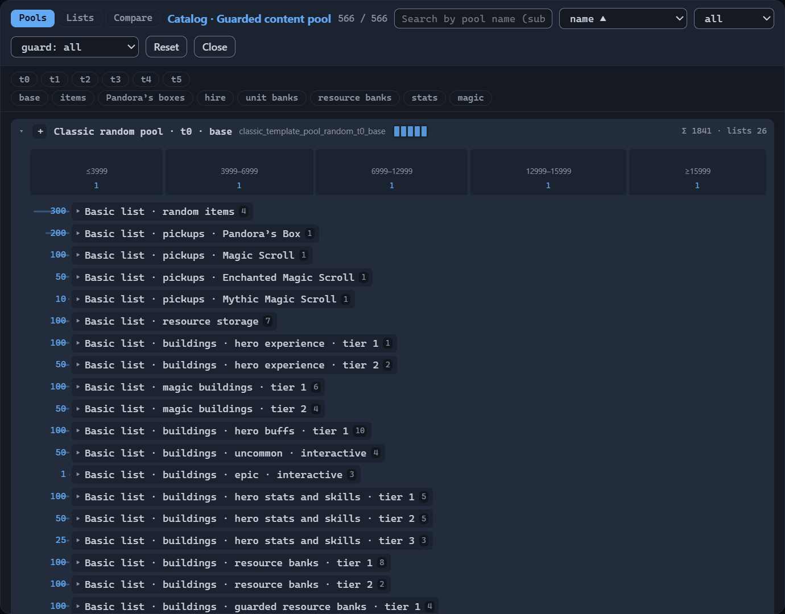
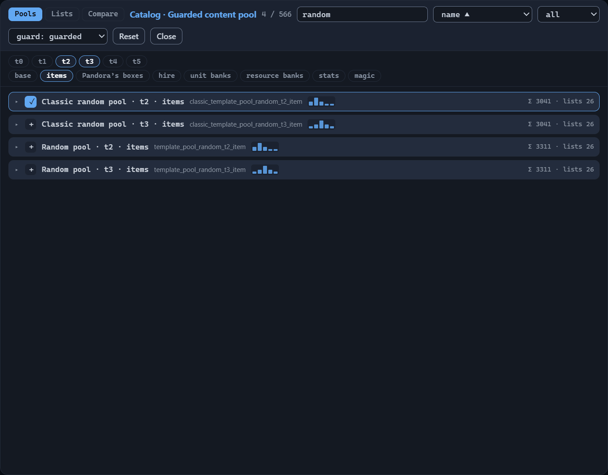
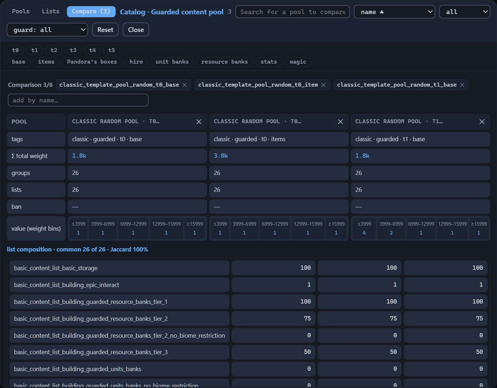
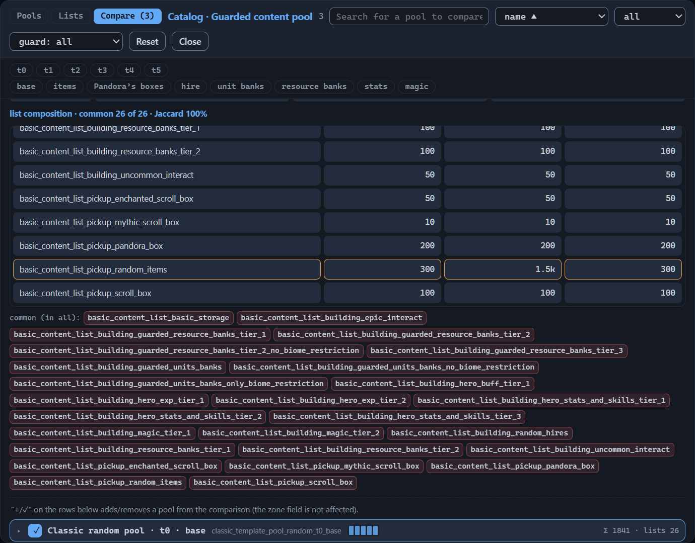
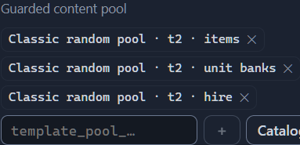

# Content pool catalog

The filling of zones does not come from the template: the template stores only the names of
pools, while the pools and lists themselves live in the game’s database. Three zone fields —
“Guarded content pool”, “Unguarded content pool” and “Resource pool” — reference pools by name;
the structure of the fields is described in the [Zone: all properties](zone.md#content-pools)
chapter. A copy of the database is built into the editor — the catalog of pools and lists. It
opens with the “Catalog” button next to any of the three pool fields; the window’s title repeats
the name of the field, for example “Catalog · Guarded content pool”.

The catalog has three tabs: “Pools”, “Lists” and “Compare”. This chapter is a reference for
the catalog: how pools and lists are structured, what their names mean, and what to look at
when choosing a pool for a zone.

## Pools and lists

- **Content pool**
  : A named set of game objects from which the generator takes the filling of a zone.
- **List**
  : A named enumeration of objects that pools attach to themselves; lists are shared —
    different pools use the same list.

The generator’s path to a concrete object is short: the zone names a pool, the pool holds
groups, the groups have lists attached, the lists — objects. The database has hundreds of
pools and more than two hundred lists. You do not need to memorize them: the names are
assembled like a construction set from recurring tokens, and the editor shows an English label
for most names.

### Pool structure

The generator takes objects from the pool until the zone’s content budget is exhausted. Value
is the notional balance currency in which both content and budgets are measured (the
[Zone: all properties](zone.md#budgets) chapter). A pool consists of a name, groups and — in
most pools — a value distribution; some pools carry bans.

- **Group**
  : A weighted portion of content: the higher the group’s weight, the more often the
    generator picks it. The choice runs in two stages — first a group by weight, then
    an object inside it. A group stores the set of attached lists and the inline
    entries.
- **Inline entry**
  : An object written directly into the group. It overrides the weight of the same object
    coming from the group’s lists. A typical technique is to attach a ready-made list and
    fix up the composition point by point: weight 0 disables an object without deleting it,
    a larger value boosts it. The pool `template_pool_jebus_cross_guarded_center_zone` is
    built this way: its items group zeroes the weight of common items and reassigns the
    weights of the other rarities — 50 for rare and epic, 150 for legendary.
- **Value bins**
  : Four `priceBounds` borders divide the value of objects into five ranges — bins; each has
    its own weight from the `weights` array. Random pools share the same borders: ≤3999,
    3999–6999, 6999–12999, 12999–15999, ≥15999 — the meaning of the bin weights is broken down
    in the [Random pools: tiers and profiles](#random-pools-tiers-and-profiles) section. Not
    every pool has bins: the resource ones, for example, have only groups.
- **Pool ban**
  : A ban on an object at the pool level: a banned sid will not appear in the zone’s filling
    even if it is part of the attached lists.

How exactly the generator applies the bin weights when picking the next object, and which bin
objects with a value exactly on a range border fall into, cannot be established from the data.
*Purpose to be confirmed.*

### List structure

A list is a name and entries. Each entry:

- **sid**
  : The object’s identifier in the game database. Next to most sids the catalog shows the object’s
    official Russian name. The generator has special objects without official names — for example
    `random_item_common` or `random_hire_5`; for them the editor gives its own labels (“Случайный
    обычный предмет”, “Внешний найм · ярус 5” — Russian for “Random common item”, “External hire ·
    tier 5”).
- **Weight**
  : How often the object is picked among the other entries of the list. The default is 1; weight 0
    disables the entry.
- **Biome**
  : An optional restriction: the entry works only in the specified biome. Biome values are written
    in Latin script — the same names as in the zone settings (Grass, Sand, Snow, Lava and the
    rest). The same object can occur in a list twice: with weight 0 and no biome, and with a
    larger weight for a specific biome — this is how the composition is tuned for different
    surfaces.

List names are also assembled from tokens: `basic_content_list_*` — basic sets (resources,
mines, scrolls, buildings by category), `content_list_*` — the general set; some lists are
named after templates — for example, the Jebus Cross pools have their own Pandora’s Box
lists.

### Pool and list names

A pool or list name is an internal identifier: the game never shows it anywhere,
and such names have no official localization. The English labels in the catalog
are the editor’s reconstruction from the contents of the lists. If a name contains
an unfamiliar token, the editor does not invent a translation and shows the name
as is. Template names stay as they are — the game does not translate them either:
Jebus Cross, Blitz, Sprint.

The tokens of a name are separated by underscores, and each has its own role:

- **Kind**
  : The initial tokens set the family. `template_pool_random_*` is a random pool, with
    the `classic_` prefix — its classic version; `template_pool_<template name>_*` is a
    template pool; `content_pool_*` is a content pool; everything else falls into the
    “other” kind. In the label — “random pool”, “classic random pool”, “template
    pool”, “content pool”.
- **Guard**
  : `guarded` / `unguarded` — a pool for guarded or unguarded content; in the label —
    “guarded” / “unguarded”.
- **Tier**
  : `t0`…`t5` — the wealth level of a random pool; in the label it stays as is:
    “t2”.
- **Profile**
  : The final token of a random pool name — a thematic bias: `base` (“base”),
    `item` (“items”), `pandora` (“Pandora’s boxes”), `hire` (“hire”), `unit_bank`
    (“unit banks”), `res_bank` (“resource banks”), `stat` (“stats”), `magic`
    (“magic”).
- **Template name**
  : `jebus_cross`, `sprint`, `blitz`… — which stock template the pool is built
    for.
- **Zone role**
  : `start_zone`, `treasure_zone`, `side_zone`, `center_zone` and the like — what type of
    zones the pool is intended for; in the label — “start zone”, “treasure zone”, “side
    zone”, “center zone”.
- **Wealth**
  : In the names of resource pools — `very_poor`, `poor`, `medium`, `rich`,
    `zero`, `dust_only`: “very poor”, “poor”, “medium”, “rich”, “zero”,
    “dust only”.

Three names in a breakdown:

| Original name | Editor label |
|---|---|
| `classic_template_pool_random_t2_item` | Classic random pool · t2 · items |
| `template_pool_jebus_cross_guarded_start_zone` | Template pool · Jebus Cross · guarded · start zone |
| `content_pool_general_resources_start_zone_medium` | Content pool · general resources · start zone · medium |

The same tags are visible without the catalog: the hover tooltip of a chip in the pool field
shows the original name and the tags — the
[Zone: all properties](zone.md#filling-in-the-field) chapter.

### Random pools: tiers and profiles

Random pools are the most orderly family of the catalog: six tiers, two guard
variants and eight profiles give 96 pools, and the same number of classic versions
with the `classic_` prefix. Their group composition is identical; only the weights
differ.

**Tier** is the wealth level of the zone. All random pools share the same value bin borders;
the tier changes the bin weights:

| Tier | Bin weights, from cheap to expensive | Bias |
|---|---|---|
| t0 | 1 · 1 · 1 · 1 · 1 | none — all bins are equally likely |
| t1 | 4 · 2 · 1 · 1 · 1 | cheap content |
| t2 | 2 · 4 · 2 · 1 · 1 | cheap and medium |
| t3 | 1 · 2 · 4 · 2 · 1 | medium |
| t4 | 1 · 1 · 2 · 4 · 2 | medium and expensive |
| t5 | 1 · 1 · 1 · 2 · 4 | expensive content |

**Profile** is a thematic bias: the weight of “its own” group is several times
higher than in the base pool. In the classic tier-0 pools this is visible in three
examples: in `base`, random items come with weight 300, Pandora’s boxes — 200,
external hire — 20; in the `item` pool items get 1500, in `pandora` Pandora’s
boxes — 1000, in `hire` hire — 100, in each case fivefold. A zone with such a pool
receives items, Pandora’s boxes or external hire buildings first of all; the rest —
in smaller quantities.

**Classic version** — the same pool with the `classic_` prefix; the weights of two groups
in it are an order of magnitude lower, so external hire buildings and unit banks are picked
less often (200 → 20 and 100 → 10 in the base pool, 1000 → 100 and 500 → 50 in the `hire`
and `unit_bank` profiles). Ten stock templates use the classic pools; the regular
`template_pool_random_*` — not a single one.

The author picks tiers and profiles manually by listing names in the zone field. A frequent
technique of stock templates: the start zone gets one base pool of a middle tier, and the
treasure zones and the side ones — a set of seven profile pools of a single tier, one per
profile. How the field itself works — in the [Zone: all properties](zone.md#guarded-content-pool)
chapter.

### Resource pools

The `content_pool_general_resources_*` family — 13 pools; almost every stock
template references them. Each name encodes the zone role (`start_zone`,
`treasure_zone`, `side_zone`) and the wealth. The wealth can be read literally from
the contents:
compared with the medium pool of the same role, the rich one raises the weights of
gold, crystals and treasure chests, the very poor one cuts gold and treasure
chests; `zero` is an empty pool without groups, and `dust_only` leaves a nonzero
weight for alchemical dust alone.

The zone’s “Resource pool” field accepts exactly one such pool name — the structure of the
field and examples are in the [Zone: all properties](zone.md#resource-pool) chapter.

### Service pools

The catalog contains pools that no stock template references: `template_pool_default`, the
`content_pool_default_*` family, six Jebus Cross pools. Per the editor’s data these are the
generator’s fallback for when a template has not set its own pools — a hypothesis.
*Purpose to be confirmed.*

## Browsing the catalog

The catalog window is the same for all three zone fields: tabs and a toolbar on top, rows of
pools or lists below. This section describes what the window shows and how to narrow the list
down to the rows you need.

### Loading and tabs

The catalog loads on the first opening of the window: the editor reads the database
copy separately from the rest of the interface, so for a short while the window
shows the “Loading the catalog…” caption. This is not a failure. Wait for the list —
afterwards the database copy stays in memory, and the next openings of the window
happen instantly. If the load fails, the window shows “Load error” and the reason:
close it and refresh the browser page.

The window’s tabs:

- **Pools**
  : Rows of the database’s pools; expand each one to see the pool’s composition.
- **Lists**
  : Rows of lists: how many entries each has and which pools attach it.
- **Compare**
  : A table of two to six selected pools side by side: the common and unique composition
    of lists, the difference of weights.

The toolbar is almost the same on all tabs: the window’s title, the counter, the search
field, the sorting list, the “Reset” and “Close” buttons. Kind and guard lists stand
only on the “Pools” and “Compare” tabs: they filter pools, and content lists have no
such attributes — on the “Lists” tab both lists are hidden. The title repeats the field
from which the catalog was called — for example “Catalog · Guarded content pool”. Next
to the title, the counter shows two numbers: how many rows are left after the filters
and how many there are in total on the tab; on the “Compare” tab the number is one —
the count of selected pools.

The window closes with the “Close” button, the Escape key or a click on the dimmed area
outside the window. Pressing “Reset” clears the search, the filters, the sorting and the
pools selected for comparison, and brings back the “Pools” tab. “Reset” leaves the values of
the zone fields alone.

### Search and filters

The search field accepts a substring: the match is looked for anywhere in the name, not only
at the start. On the “Pools” tab the query is matched against the pool’s original name and its
English label, so the word “items” finds all the pools with that profile. The “Lists” tab adds
the composition to the name and the label: a query by sid leaves the lists in which such a sid
occurs.

The kind list leaves a single pool family: “all”, “random”, “classic”, “template”, “content”,
“other”. The families are broken down in the [Pool and list names](#pool-and-list-names)
section. Next to it stands the guard list — “guard: all”, “guard: guarded”, “guard:
unguarded”: it leaves the pools with the needed attribute. Some pools have no guard attribute
— the resource ones, for example — and with any value other than “all” they disappear from
the list.

Below the toolbar there are two bands of filter chips: the tiers t0…t5 and the
eight profiles — “base”, “items”, “Pandora’s boxes”, “hire”, “unit banks”,
“resource banks”, “stats”, “magic”. A click on a chip toggles it on and off;
several enabled chips of one band work as “or”. Tiers and profiles exist only for
random and classic pools, so an enabled chip leaves only these two families and
hides template pools and resource pools. The bands are visible on the “Pools” and
“Compare” tabs, and only while the kind list is set to “all”, “random” or
“classic”.

The editor remembers the search, the filters, the sorting and the pools selected
for comparison, and restores them at the next opening of the catalog. If the list
is shorter than you expect, check the search field and the enabled chips: most
likely the previous set of conditions was saved, and the “Reset” button will return
the full list. The “Nothing found” caption only says that not a single row matched
the conditions — before deciding that a pool is not in the database, reset the
filters.

### Sorting

The sorting list stands next to the search field and offers different orders for different
tabs.

The orders on the “Pools” tab — the same on the “Compare” tab:

- **name ▲**
  : Alphabetical by the original names of the pools; the default order.
- **Σ total weight ▼**
  : Descending by the sum of the group weights — the pools with the heaviest groups on top.
- **list count ▼**
  : Descending by the number of lists attached to the pool’s groups.

The orders on the “Lists” tab:

- **name ▲**
  : Alphabetical by the original names of the lists; the default order.
- **usage ▼**
  : Descending by the number of pools that attach the list; at equal numbers —
    alphabetical. Lists without attachments sink to the end.

### Pool row

The collapsed pool row shows, from left to right:

- **Select button**
  : The “+” adds the pool’s name to the zone field from which the catalog was opened and turns
    into “✓”; a repeated click removes the name. Pressing the button does not expand the
    row.
- **Name**
  : The pool’s English label, the original name below it. When the name is not recognized, the
    name itself stands in place of the label, with the translation of the tags below it.
- **Value bin bars**
  : One bar per bin; the height corresponds to the bin’s weight; pools without bins have no
    bars.
- **Hint on the right**
  : The sum of the group weights (Σ) and the number of attached lists — for
    example “Σ 3311 · lists 26”. The sum is shown as is and is not shortened
    to thousands.

The expanded row shows the pool from the inside:

- **Value bins**
  : Bands by the number of bins — each with the bin’s label and its weight; the length of the
    band corresponds to the weight.
- **Pool ban**
  : The “ban:” line with the sids of the banned objects; visible only for pools
    with bans.
- **Groups**
  : One block per group: on the left the group’s weight and a band of its share
    among the groups, on the right the attached lists. Weights of 1000 and above
    are shortened: 3000 is shown as `3k`, 1500 as `1.5k`, 1841 as `1.8k`
    (rounded to tenths). A group without lists shows a dash instead.
- **Group inline entries**
  : A line in square brackets — sid and weight separated by a colon, entries separated by
    commas.

A list inside a group is also an expandable row: the list’s label or name and the number of
entries in it; the expansion shows the composition — sid, weight, biome and the editor’s note
about the object, if there is one. When a list is not in the database copy, its name is shown
as a plain line and does not expand.

### List row

A row on the “Lists” tab shows the name or the label of the list, the number of entries in it
and the “in pools: N” hint, where N is the number of pools that attach this list. The “N sids”
count in the row means the number of entries: each entry of a list is one sid with its own
weight. List rows have no select button: lists are chosen not directly but through the pools
that attach them.

The row’s expansion shows the composition of the list and the “used by:” block with the names
of the pools that attach the list; a list without attachments has no such block.

## Pool comparison

The “Compare” tab places from two to six pools side by side and answers two
questions: how they differ and how similar their compositions are. This is how you
choose between neighboring pools — tiers of one profile, profiles of one family, a
regular pool and a classic one. While fewer than two pools are selected, the tab
shows an invitation: “Select 2–6 pools: the ‘+’ button on a row below or the
‘add by name’ field.” With the second selected pool, the comparison table and the
list matrix appear. As soon as the first pool is selected, the tab’s name gains
their count — “Compare (N)” — and the counter in the toolbar shows the same single
number.

### Pool selection

The selection panel stands above the comparison table: the “Comparison N/6” label — the number
of selected pools out of the six allowed, the chips of the selected pools and the “add by
name…” field. A chip shows the pool’s original name; on hover — the English label and the
name; the “✕” on the chip removes the pool from the comparison.

Pools enter the comparison in two ways:

1. Press the “+” on a pool row below — the button turns into “✓” and the pool joins the
   selection.
2. Type a name or part of it into the “add by name…” field and pick a suggestion or press
   Enter. On focus the field opens the full list of the catalog’s pool names; typing narrows
   it by substring; Escape closes the list.

The field works as a switcher: the name of an already selected pool removes the pool
from the comparison. A name that is not in the catalog is ignored — the field adds
nothing and reports no error, so check the spelling against the “Pools” tab. A
seventh pool will not be added either: the limit is six, and to add a new pool first
remove one of the selected ones.

Note: the “+” and “✓” buttons on this tab work for the comparison and do not touch
the zone field — unlike the “Pools” tab, where they add the pool’s name to the field
(the [Pool row](#pool-row) section). A separate hint stands below the table:
“‘+/✓’ on the rows below adds/removes a pool from the comparison (the zone field is
not affected).”

The rows below the panel are regular pool rows: the search field with the “Search for a pool
to compare (substring)” placeholder, the kind and guard lists, the tier and profile chips and
the sorting act on them the same way as on the “Pools” tab (the
[Search and filters](#search-and-filters) and [Sorting](#sorting) sections). The filters do
not affect the table: the selected pools stay in the comparison even when they do not match
the current conditions.

The editor remembers the selection and restores it at the next opening of the catalog, and
the “Reset” button clears it together with the search, the filters and the sorting (the
[Loading and tabs](#loading-and-tabs) section).

Compare pools of one family: tier with tier, profile with profile, a regular pool with a
classic one. Pools from different families have few lists in common — the matrix will turn
out almost entirely marked with differences, and finding the meaningful ones will be
hard.

### Comparison table

The first cell of the table is labeled “pool”; then one column per selected pool, in the
order of selection. The column header carries the pool’s English label, or the original name
in its absence; a long header is cut with an ellipsis, hovering shows the label and the name
in full; the “✕” in the header removes the pool from the comparison.

The table’s rows:

- **tags**
  : The translated tokens of the pool name, joined by “ · ” — the same ones the
    [Pool and list names](#pool-and-list-names) section breaks down. A dash never
    occurs in this row: a name that the editor did not recognize keeps a single
    tag — the kind “other”.
- **Σ total weight**
  : The sum of the weights of all the pool’s groups.
- **groups**
  : The number of groups.
- **lists**
  : The number of list attachments: the same list attached to two groups counts twice.
    The unique list names — in the matrix below.
- **ban**
  : The sids of the banned objects, comma-separated; a pool without bans gets a dash.
- **value (weight bins)**
  : Bands by value bins: the bin’s label and its weight; the length of the band is
    proportional to the weight; a bin with weight 0 keeps a minimal band — it stays visible
    in the row. Hovering shows the bin’s border and weight. A pool without bins gets a
    dash; the structure of the bins — in the [Pool structure](#pool-structure)
    section.

Weights of 1000 and above in the table and in the matrix below are shortened the same way as
the group weights in the expanded pool row: 3000 — `3k`, 1500 — `1.5k` (the
[Pool row](#pool-row) section).

### List matrix

The matrix lists every list that occurs in at least one selected pool: a row per
list, the rows in alphabetical order, the columns — the pools in the same order as
in the table. A cell shows the weight of the list in that pool — the sum of the
weights of the groups the list is attached to; a missing list is marked with a
dash.

The header above the matrix sums it up: “list composition · common N of M · Jaccard
P%”. N is the number of lists present in all the selected pools, M is the total
number of distinct lists. Jaccard is the similarity coefficient of the compositions:
Jaccard = N / M, as a percentage rounded to a whole number. The higher the value,
the more similar the pools.

For example, three pools are selected; together they give 12 distinct lists, 9 of which are
in each of the three. Jaccard = 9 / 12 = 0.75, and the header reads “list composition ·
common 9 of 12 · Jaccard 75%”.

A row is highlighted when the list is not in all the pools or its weights in the pools are
not equal. Hovering over the list’s name reports the reason: “composition or weight differs
between pools” or “composition and weight match in all pools”.

Note: the matrix counts only the lists attached to groups. The inline entries of groups are
not visible in it and do not affect the weights in the cells (the
[Pool structure](#pool-structure) section).

Below the matrix there are blocks of list chips:

- **“common (in all):”**
  : The lists that are in all the selected pools.
- **“only in ‘label’:”**
  : One block per pool: the lists that occur in that pool alone. The block’s caption carries
    the pool’s English label; hovering over a chip shows the list’s label, or its name in the
    absence of one.

A list that made it into only some of the pools — say, two of three — belongs to no block: it
is visible as a highlighted row of the matrix.

Within the random pool family the comparison comes out the clearest: their group composition
is identical, all the lists are common, Jaccard is 100%, and the differences reduce to the
weights of individual rows. For the pair `classic_template_pool_random_t0_base` and
`classic_template_pool_random_t0_item` a single row is highlighted — the list
`basic_content_list_pickup_random_items`: weight 300 in the base pool and `1.5k` in the item
pool. The mechanics of profiles are broken down in the
[Random pools: tiers and profiles](#random-pools-tiers-and-profiles) section.

## Choosing a pool for a zone

A zone has three pool fields, and the catalog has enough names for any role, tier and wealth.
The choice reduces to three questions: what the name says, whether the pool matches the
field’s budget, and how the candidate differs from the current pool. The mechanics of the
field itself — chips, input, the “＋” and “Catalog” buttons — are described in the
[Zone: all properties](zone.md#filling-in-the-field) chapter.

### Reading the name

A pool name breaks down into tokens, and the editor turns them into English tags;
the token breakdown is given in the
[Pool and list names](#pool-and-list-names) section. Before adding a pool to the
field, read the tags in the hover tooltip of the chip or of the catalog row —
otherwise you will have to guess the purpose from the long original name. The tags
answer three questions.

- **For which field**
  : The “guarded” and “unguarded” tags. Template pools carry the `guarded` /
    `unguarded` token right in the name; random pools never have the “guarded”
    token — the editor reads its absence as “guarded”. In the demo template the
    names with `unguarded` stand in the unguarded content field, and the names
    without it — in the guarded one. Note: the editor does not check the tag against
    the field — formally, any catalog name is allowed in each of the three
    fields.
- **How expensive the content is**
  : The `t0`–`t5` tier of random pools — the bias of the value bins toward cheap or
    expensive finds; the wealth token of resource pools — from “very poor” to
    “rich”.
- **What the theme is**
  : The random pool profile — items, Pandora’s boxes, hire, unit banks, resource
    banks, stats, magic, or base without a bias. Template pools carry the stock
    template’s name in the tags, resource pools — the zone role: start, treasure,
    side, center.

### Tier and zone budget

The budget sets for what total value the generator fills the zone, and the tier — how
expensive the individual finds will be: objects are drawn from the pool until the budget is
exhausted, and the bin weights tilt the choice toward one price range or another. Each of the
three fields works in a pair with its own budget and is configured independently (the
[Zone: all properties](zone.md#budgets) chapter).

The demo template shows a typical ladder — the richer the zone’s role, the higher the
tier:

| Zone | Guarded content budget | Guarded pools |
|---|---|---|
| Spawn-A — start | 16,000 per unit of area | three t2 pools: items, unit banks, hire |
| Treasure-2, Treasure-4 | 70,000 | two t2 pools: items and unit banks |
| Treasure-1, Treasure-3 | 220,000 | two t3 pools: items and unit banks |
| Center | 650,000 | t4 and t5, both items |
| SuperTreasure-1 | 1,600,000 | two t5 pools: items and unit banks |

The independence of the fields is visible nearby: the treasure zones’ unguarded content field
carries a t3 pool at any tier of the guarded field, while the Connector-A zone has zero
budgets and both of its content fields are empty — a name remains only in the resource field.

A rough estimate on the demo template’s numbers. Conditions: the Treasure-2 zone,
the guarded content budget 70,000, the pool tier t2 — the peak of the bin weights at
3999–6999. Substitution: the t2 pools are swapped for tier t5 — the peak moves to
the ≥15999 bin. Conclusion: counting by the bin borders, the same budget gives about
ten medium-price finds (70,000 ÷ 6999 ≈ 10) or roughly four expensive ones
(70,000 ÷ 15999 ≈ 4). The budget did not change, yet instead of a scatter of finds
the zone gets a handful of objects. The opposite mistake costs no less: at a budget
of 1,600,000 and a tier-t1 pool, more than four hundred objects enter the zone even
by the border of the cheap bin (1,600,000 ÷ 3999 ≈ 400).

Match the tier to the field’s budget — otherwise the density and the price of the finds will
diverge from the zone’s role: a treasure zone will give too few finds, and the central zone
will get cluttered with hundreds of cheap ones.

The resource field has no tiers — the pool’s wealth is tied to the resource budget. The
treasure zones of the demo template carry
`content_pool_general_resources_treasure_zone_medium` at a budget of 8000, while Center and
SuperTreasure-1 — `content_pool_general_resources_treasure_zone_rich` at 42,000 and 60,000.

### Verification by comparison

The name hints at the bias but not at the contents: the difference hides in the weights of the
groups and lists. Before replacing a pool in a zone field, select the current and the future
one on the “Compare” tab — otherwise the replacement goes through blind, by the name alone.
The selection is described in the [Pool selection](#pool-selection) section, the table and the
matrix — in the [Comparison table](#comparison-table) and [List matrix](#list-matrix) sections.

Typical pairs:

- **Tier with tier**
  : The composition is identical — all the lists are common, the Jaccard index is 100%. The
    difference is only in the “value (weight bins)” row: the bands shift toward the cheap or
    the expensive bins.
- **Profile with profile**
  : The same tier, but the row of the thematic list is highlighted — its weight grows
    fivefold; the example of 300 against `1.5k` is shown in the
    [List matrix](#list-matrix) section.
- **Regular with classic**
  : In the name — only the `classic_` prefix; in the contents — two group weights: hire and
    unit banks fall tenfold. You cannot guess this by eye from the name; the expanded catalog
    row shows the difference of the weights.
- **“Rich” with “poor”**
  : A pair of resource pools of one role and different wealth. The name does not say what
    exactly will change — the catalog shows where the weights of gold, crystals and treasure
    chests shift, and the comparison places the two neighboring pools side by side (the
    [Resource pools](#resource-pools) section).

### A name outside the catalog

The chip’s label and the name’s presence in the catalog are two independent attributes, and
they are easy to confuse.

The label is built from the tokens of the name and does not depend on the catalog: a name with
an unfamiliar token stays on the chip as is, without an English label (the
[Pool and list names](#pool-and-list-names) section). In the tooltip such a name gets the
single tag “other”. While the catalog is not loaded, the tooltip shows only the original name
— the catalog is lifted into memory lazily, at the first opening of the field’s input or of
the catalog window.

Presence in the catalog shows up differently. The “＋” button and Enter silently discard a name
that is not among the known ones — but only after the load; before it the field accepts any
text. A name that came from an opened file stays in the field in any case: the chip looks like
the others, and the field marks it in no way.

The only reliable indicator is the validator’s warning “Pool ‘X’ not found in the catalog
(total pools: N)” on the “Issues” panel. The check also runs only with the catalog loaded; a
click on the issue selects the problem zone (the
[Template validation (validator)](validator.md) chapter).

When you open someone else’s template, look through the “Issues” panel — otherwise a name
outside the catalog will go unnoticed: the field does not mark it, and a typo or an outdated
name will quietly survive into the saved file.

## Pools in the template file

The template file carries only names: the “Guarded content pool” and “Unguarded content pool”
fields accept from one to seven names, the “Resource pool” — exactly one. Chips, tooltips and
input — in the [Zone: all properties](zone.md#content-pools)
chapter.

The root of the .rmg.json has the `contentPools` and `contentLists` sections — pools and lists
could be stored in them right in the template, but in all stock templates they are empty, and
a new template is created with empty sections. The breakdown of the root block — in the
[Template settings (root)](root.md#the-roots-json-block) chapter.

How the generator handles several names in one field — merges the groups of the pools or picks
one pool per zone — cannot be reliably answered from the data. The division of random pools
into profiles hints at a per-zone pool choice, but there is no confirmation. *Purpose to be
confirmed.*

## Next steps

- [Zone: all properties](zone.md) — the zone’s budgets, filling fields, guards and roads:
  everything the choice of pools is tied to.
- [Template validation (validator)](validator.md) — the “Issues” panel, the issue levels and
  the jumps to zones.
- [Template settings (root)](root.md#the-roots-json-block) — the `contentPools` and
  `contentLists` sections in the template file.
