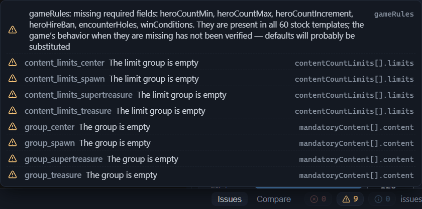
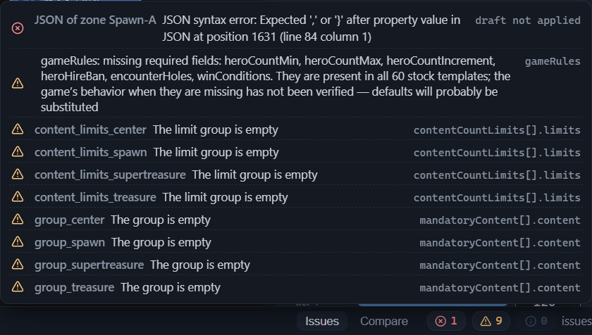

# Template validation (validator)

The validator is the editor’s built-in check of the template. It reviews the current template — the name and the game mode, the map size, the variants, the zones, the connections, the roads, the content groups — and reports what it finds on the “Issues” panel at the bottom of the window (the [Interface: windows and panels](interface.md#bottom-panel-and-status-bar) chapter). The check runs by itself: the “Issues” tab is open together with the editor, and the report is recalculated after every change — there is no separate “check” button. Fix a zone or a setting — the panel updates right after.

Note: the editor loads the catalog of pools and content lists in the background. While the loading has not finished, the editor does not check the names of the pools and lists in the template — such issues appear on the panel a little later.

## Three groups of issues

At the top of the panel stand three chips — small counters: the number of errors, warnings and info notes. Hover the cursor — and the chip tells you its group: “errors”, “warnings”, “info”. A chip with a zero looks muted. The groups differ by severity:

- **Errors** — what will almost certainly break the game or the map generation: an empty template name, the absence of layout variants, a connection without a start or an end. Fix them before installing the template into the game (the [Installing a template into the game](install.md) chapter).
- **Warnings** — suspicious spots: the game may accept them, but the result is hard to predict. An example is a non-square map size or an unknown road type; decide for each warning whether it is intentional or an oversight.
- **Info** — informational notes that require nothing. This is how the validator reports unusual but acceptable techniques.

The list under the chips is sorted by the same principle: first the errors, then the warnings, then the info notes. Within a group, the rows stand in alphabetical order by the text of the area — this way the issues about one element end up next to each other.

If there are no issues at all — not even info ones — the panel shows the “the template is valid” line with a checkmark icon.

## The issue row

By default, the list of issues is collapsed: only the “issues” header row is visible, and its hint is a reminder: “click an issue — jump to the element”. Click the header row — and the list expands.

Each row is a button. In it, from left to right: the severity icon — a cross, a triangle or the letter “i” — the area, the text of the issue, and at the end the path to a field of the .rmg.json file (the [.rmg.json format reference](rmg-json.md) chapter). The path clarifies which field is meant — for example `sizeX` or `gameRules`; hovering the cursor over the text of the issue repeats it in a tooltip.

The area at the start of the row hints at what exactly to look at in the template:

- Issues about the template root have no area — the row starts right away with the icon and the text: the template name, the game mode, the game rules. Such settings are collected on the “Template” tab of the Inspector (the [Template settings (root)](root.md) chapter).
- “map size” — the map size fields.
- “V1” — a layout variant as a whole.
- “V1 · Treasure-2” — the Treasure-2 zone of the first variant.
- “V1 · connection Spawn-A-Center” — a connection under its own name; if it has no name, the auto name based on the end zones stands instead.
- “V1 · guard group spawn_main_guard” — a synchronized guard group (the [Connections between zones](connections.md#synchronized-guard-group) chapter).
- “V1 · Center · road 1” — the first road of the Center zone.
- A lone group name — an issue about a mandatory content group or a count limit group; such groups live in the template root.

Variant and road numbers in the area label count from one.

## Jumping to an issue

The hint of the row reads “go to issue”. A click — and the editor shows the place the validator is talking about:

- An issue about a zone or a connection selects the element and points the camera at it; the camera behavior is described in the [Canvas: graph editing](canvas-editing.md#jumping-to-an-element-from-the-panels) chapter.
- A row from another variant first switches the active variant — the canvas redraws to the needed diagram, and the editor selects the element already on it.
- Since a road is a part of a zone, its issue selects the owning zone.
- The guard group is the exception: the click switches the variant and clears the selection. The group unites several connections at once, and it is easier to look for them on the canvas by the common color in the “Guards” mode (the [Canvas: view modes](canvas-modes.md) chapter).
- A root issue opens the “Template” tab of the Inspector; the field is not highlighted — look for it by the path at the end of the row.

## JSON editor draft errors

The JSON editor is the tool for direct editing of the template text (the [Direct JSON editing](json-editor.md) chapter). While the draft is not applied, the validator does not see it and checks the template without your edits, but the syntax errors and the structure errors of the draft land on the panel immediately. The rows with the error icon stand above the rest of the issues: the area names the block — “Template JSON”, “JSON of zone” with the zone name or “JSON of connection” with the connection name — the text reports the problem, and the end of the row is marked “draft not applied”.

Drafts go into the error counter: while there is at least one, the editor will not save the template — otherwise broken text would end up in the file. The hint of the row suggests the solution: “Error in the JSON editor draft — fix the text or press ‘Reset’”. Fix the error or discard the draft — the row disappears, and saving becomes available again.

## Typical issues and what to do with them

The validator has many checks, but you do not need to memorize the codes: the panel itself shows the exact text of any issue. Below are the frequent and illustrative issues, grouped by cause. Each entry gives the text from the panel — the names and numbers in it are substituted as an example — and after it the probable cause and the way to fix it. Start with the errors, then move on to the warnings: an error will almost certainly break the game or the generation, while a warning may also turn out to be an intentional technique.

### Template name, game mode, sizes

- **“Template name is empty”** (error)
  : The “Name” field was left unfilled — in a new template or after an accidental clearing. Type in the name on the “Template” tab of the Inspector (the [Template settings (root)](root.md#name) chapter).
- **“Unknown gameMode ‘X’ (expected Classic/SingleHero)”** (error)
  : The mode value is not one of the two that the format knows: the file was edited outside the editor. The list in the Inspector does not let you pick a foreign value, so open the “Template” tab and select the mode again — “Classic” or “Single Hero” (the [Template settings (root)](root.md#game-mode) chapter).
- **“OE maps are always square — the sides differ”** (warning)
  : `sizeX` and `sizeZ` do not match. Equalize both sides (the [Template settings (root)](root.md#map-sizes) chapter).
- **“Sizes are not multiples of 16”** and **“Size outside the usual range 80–240”** (warnings)
  : The map size fell out of the accepted grid. Set each side to a value that is a multiple of 16, within 80–240 — for example 144 (the [Template settings (root)](root.md#map-sizes) chapter).

### Variants, zones, names

- **“No layout variants at all”** (error)
  : The template has no variants — an empty start or a cleaned-out `variants` section. Add at least one variant (the [Variants: management and selection](variant-manage.md) chapter).
- **“No zones at all”** (error)
  : The variant has no zones. Draw the zones on the canvas (the [Canvas: graph editing](canvas-editing.md#zone-addition) chapter).
- **“Duplicate zone names: Treasure-2”** (error)
  : Two zones of one variant got the same name — after a renaming or a duplication. Zones and references to them are told apart by name, so a duplicate makes the references ambiguous: rename one of the zones (the [Canvas: graph editing](canvas-editing.md#zone-renaming) chapter).
- **“Player1 is already set in zone Spawn-A”** (error)
  : In one variant, two hero spawn points claim the same player. Leave the player one point and assign the other a different value from `Player2`…`Player8` (the [Zone main objects](main-objects.md#player-spawn) chapter).
- **“Colliding connection auto-names (From–To without a suffix): Center-Treasure-2”** (info)
  : Between one pair of zones, two connections are drawn, and both are signed with one address — the same auto name or a coinciding own name. The editor gives parallel connections suffixed names by itself, so the info comes from files edited outside the editor: give one of the connections its own name (the [Canvas: graph editing](canvas-editing.md#connection-name) chapter), otherwise the issues about two different connections look identical.
- **“The group is empty”** and **“The limit group is empty”** (warnings)
  : A mandatory content group or a count limit group was created but not filled in. Fill in the group or delete it from the root (the [Template settings (root)](root.md#the-roots-json-block) chapter). In the demo template, such groups are intentionally left empty — hence its eight “The group is empty” and “The limit group is empty” warnings.

### Nonexistent references

- **“Nonexistent MatchZone zone: ‘Treasure-9’”** (warning)
  : A zone setting references a name that is no longer in the variant — the zone was renamed or deleted. Other fields go through the same check; the word in the text hints at which one: “differentFrom”, “NearZone”, “MatchMainObject”, “faction Match”, “faction differentFrom”. Open the zone from the issue, find the field by the path at the end of the row and specify an existing zone (the [Zone: all properties](zone.md#biomes) and [Zone main objects](main-objects.md#faction-selection-mode) chapters).
- **“Nonexistent from zone: Treasure-3”** (error) — the text for `to` is the same
  : A connection end points to a zone that is not in the variant. Set the source and the target of the connection anew (the [Connections between zones](connections.md#source-zone-and-target-zone) chapter).
- **“Connection ‘Spawn-A-Center’ from placementArgs not found in the variant”** (warning)
  : The object placement “on a specific connection” lost its address: the connection was deleted or renamed. Select an existing connection in the object card (the [Zone main objects](main-objects.md#placement) chapter).
- **“Group ‘group_treasure’ not found in the root mandatoryContent”** and **“Limit group ‘limits_treasure’ not found in contentCountLimits”** (warnings)
  : The zone references a root group that does not exist — such a reference is called broken. Fix the name or create the group in the root; the “not found” badge on the zone chip shows the same (the [Zone: all properties](zone.md#broken-references-and-validator-warnings) chapter).
- **“layout ‘Wilds’ is not declared in the template’s zoneLayouts”** (warning)
  : The zone layout is missing from the root list. Add a layout with this name or pick a declared one for the zone (the [Template settings (root)](root.md#zone-layouts) chapter).
- **“Pool ‘template_pool_treasure’ not found in the catalog”** (warning) — for lists the text is “List ‘X’ not found in the catalog”
  : The name of the pool or the list is not listed in the generator’s catalog — a typo or an invented name. Check the spelling against the catalog window or pick a name from the input suggestions (the [Content pool catalog](pools.md#a-name-outside-the-catalog) chapter).

### Synchronized guard group

- **“In group ‘center_guard’, guardValue differ (8000 / 12000) — the guards will not be symmetric”** (warning)
  : Guard parameters diverged across the group’s connections; the validator checks three fields — the guard strength, the weekly increment and the strength spread. Bring the values to a common one for all connections of the group (the [Connections between zones](connections.md#synchronized-guard-group) chapter), otherwise the connections of the group are guarded by guards of different strength and the synchronization loses its meaning.
- **“Group ‘solo’ has a single connection — nothing to synchronize”** (info)
  : The group name stands on only one connection. If the group is meant for several connections, add them; for a lone connection, the issue can be ignored.
- **“Negative guardValue (-5000) — semantics unclear, please check”** (warning)
  : The guard strength of the connection is set below zero. How the game reads a negative value is unknown — *Purpose to be confirmed.* If this is not an intentional experiment, return a non-negative number (the [Connections between zones](connections.md#guard-strength) chapter).

### Roads

Roads are broken by graph edits, not by their own fields: deleting an object card shifts the numbers of the rest, and renaming or deleting a connection makes the address of an end broken. The full breakdown of the road issues — in the [Zone: all properties](zone.md#broken-ends-and-validator-warnings) chapter; the frequent ones are here.

- **“MainObject[2] outside the mainObjects range (0..1)”** (error)
  : A road end points to the number of an object that is no longer in the zone. Select an existing number in the end — the numbering runs from zero along the list of the zone’s main objects (the [Zone: all properties](zone.md#road-ends) chapter).
- **“Connection ‘Center-T2’ not found in the variant”** (error)
  : The address of the connection end stopped existing after the connection was renamed or deleted. Reassign the end or return the former name to the connection.
- **“Object ‘X’ not found in the mandatory content groups”** (error)
  : An end of the “mandatory content item” kind references a name that is not in the root groups. Return the former name to the item or point the end at an existing item.
- **“Unknown road type: Grass”** (warning)
  : The road surface is neither `Stone` nor `Dirt`. Select one of the two known surfaces (the [Zone: all properties](zone.md#road-surface) chapter).
- **“The road goes from a point back to the same point”** (warning)
  : Both ends are set to one target — the route leads nowhere. Change one of the ends.

### Zone size and budgets

- **“size must be greater than zero”** (error) and **“size 3 outside the usual range 0.15–2”** (warning)
  : The zone size fell to zero, went negative, or left the familiar bounds. Return the value into the 0.15–2 range (the [Zone: all properties](zone.md#zone-size) chapter).
- **“Negative budget (-1000)”** (warning)
  : One of the zone’s three budgets — guarded content, unguarded content or resources — is set below zero. The text does not name which one: find the field by the path at the end of the row and type in a non-negative value (the [Zone: all properties](zone.md#budgets) chapter).

### Layouts and game rules

- **“Layout without a name”** (error) and **“Duplicate layout names: Default”** (warning)
  : A layout lost its name or two layouts are named the same. Zones reference layouts by name, so put the names in order (the [Template settings (root)](root.md#layout-name) chapter).
- **“Layout ‘Wilds’: missing required fields: obstaclesFill, lakesFill”** (warning)
  : A homemade layout lacks the fields that all layouts of stock templates have; the text of the issue says straight out that terrain generation is unpredictable without them. Fill in the listed fields (the [Template settings (root)](root.md#required-fields) chapter).
- **“gameRules: missing required fields: heroCountMin, winConditions”** (warning)
  : The game rules section is truncated — some of the required records are missing. The game’s behavior when they are missing has not been verified: defaults will probably be substituted, but you should not rely on it. Restore the listed fields (the [Template settings (root)](root.md#game-rules) chapter).

### External hire arrays

- **“randomHireInitialUnitIncrement (numbers, idx = random_hire 1..7): length 5 instead of the expected 7”** (warning) — `randomHireEnableWeeklyUnitIncrement` produces the same text
  : The zone’s external hire array must contain exactly seven values, one per tier. The Inspector’s table always writes seven, so the issue arrives only after editing the file outside the editor. Extend the array to seven values (the [Zone: all properties](zone.md#columns-and-array-lengths) chapter).

## Validator leniency

The game tolerates some of the template’s flaws silently — for example, broken references to construction presets or a string instead of an array in the zone’s count limit list. The validator marks such places anyway, but it is stricter than the game only where it honestly warns: the severity shows how sure the check is (the meaning of the groups — above, in the [Three groups of issues](#three-groups-of-issues) section). Where the knowledge of the game’s behavior ends, the text of the issue admits it straight: “the game tolerates such references silently”, “the game’s parser tolerates it”, “loading by the game not verified”, “the field’s semantics are unknown (hypothesis)”. Below are the places where this leniency is most visible.

### Broken references of stock templates

Five names of construction presets — named schemes of the city’s buildings at the start — occur in stock templates but are missing from the game’s catalog: `bank_buildings_construction`, `bank_and_gm_buildings_construction`, `extra_poor_buildings_construction`, `sprint_green_buildings_construction`, `sprint_orange_buildings_construction`. The game tolerates these references silently. When such a template is opened, the validator issues the warning “Construction preset ‘bank_buildings_construction’ not found in the catalog (the game tolerates such references silently)” — a warning, not an error. The field in the main object card is marked at the same time with the orange “known broken reference (stock)” badge, while an unfamiliar name gets the red “not in catalog” one (the [Zone main objects](main-objects.md#construction-preset) chapter). Note: the text of the warning is the same both for a stock reference and for your own typo — go by the color of the badge. Keeping a known name is appropriate when you reproduce a stock technique; in your own template, pick the preset from the input suggestions: a broken reference will not confuse the game, and you can learn about it only from the validator.

Ban list presets have no known exceptions: an unfamiliar name in the “Banned buildings” field gives the warning “Ban list preset ‘X’ not found in the catalog” and the red “not in catalog” badge.

The same honesty — in the warning “The value is a string instead of an array (a known anomaly of stock templates; the game’s parser tolerates it)”: it arrives for the zone’s count limit list. In stock templates, this field is sometimes written as a single string instead of an array of group names; the game is fine with such a record, and the editor marks the deviation from the usual form (the [Zone: all properties](zone.md#mandatory-content-and-limits) chapter).

### Info notes

When one budget has both the absolute value and the per-area value filled in, the validator answers with an info note, not a warning: “Both the absolute value and PerArea are filled in — half of the official templates do the same, this is acceptable”. Half of the official templates indeed fill in both fields of the pair, but which of the two values the generator picks — *Purpose to be confirmed.* The mechanics of the pair is described in the [Zone: all properties](zone.md#budgets) chapter — there is nothing to fix here.

The root sections `contentPools` and `contentLists` are empty in stock templates, and filled ones get the info notes “Inline pools are set — empty in stock templates (legacy; loading by the game not verified)” and “Inline lists are set — loading by the game not verified”. They are visible only in the root’s JSON block, and the editor admits it straight: what the game will do with inline pools and inline lists is not verified (the [Content pool catalog](pools.md#pools-in-the-template-file) and [Template settings (root)](root.md#the-roots-json-block) chapters).

### Hypothesis notes

For the fields whose semantics could not be established, the validator checks only the form and says so straight in the text. The issues about the “Guard reaction” block word it just so: “the field’s semantics are unknown (hypothesis)”. `guardReactionDistribution` requires an array of six numbers, but the six “tiers” themselves are a conclusion from stock templates, not a known rule of the game (the [Zone: all properties](zone.md#guards) chapter).

A negative guard strength is marked in three places: a warning at the connection (“Negative guardValue (-5000) — semantics unclear, please check”, analyzed above in the [Synchronized guard group](#synchronized-guard-group) section) and info notes at the main object (“Negative guardValue of the object”) and at a record of the “Object overrides” section (“Negative guardValue of the override”, the [Template settings (root)](root.md#object-overrides) chapter). How the game reads a value below zero — *Purpose to be confirmed.*

Experiments with such fields are good when they are intentional: the semantics of the values is unknown, and the result of the generation is hard to predict.

## Next steps

- [Interface: windows and panels](interface.md#bottom-panel-and-status-bar) — what else lives in the bottom panel.
- [Quick start](quick-start.md#validator-issues) — the first pass over the issues on a small template.
- [Canvas: graph editing](canvas-editing.md#jumping-to-an-element-from-the-panels) — the camera behavior when jumping from the panels.
- [Template settings (root)](root.md) — the fields that the root issues point at.
- [Direct JSON editing](json-editor.md) — the drafts of the blocks and the “Reset” button.
- [Installing a template into the game](install.md) — where to put the checked template.
