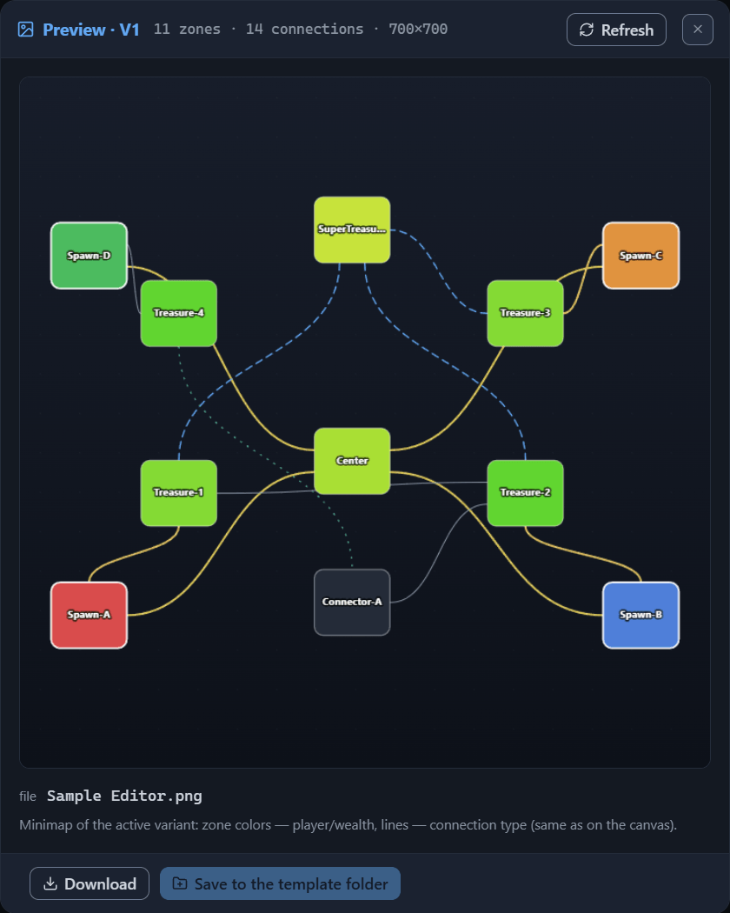
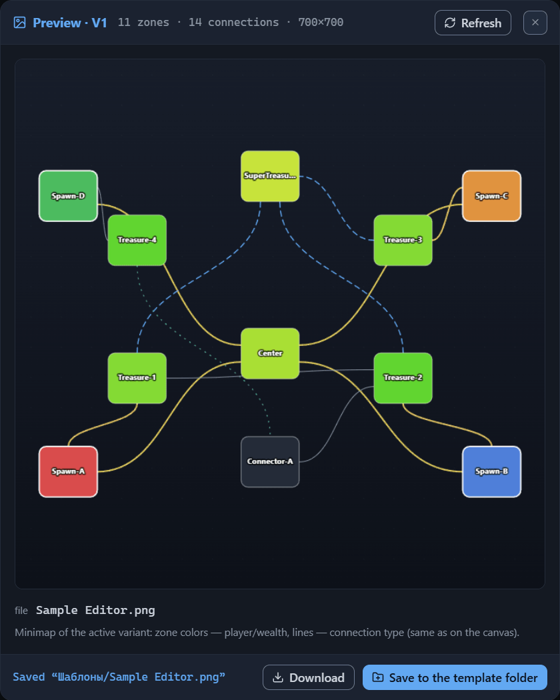

# Preview and PNG

The “Preview” button on the top bar opens a dialog with the minimap of the active variant: a compact picture of the diagram, where the zones’ color tells of the player or the wealth, and the lines — of the connection type. Its tooltip formulates the purpose like this: “Minimap of the active variant → PNG preview”. The dialog solves two tasks at once — to look at the template as a single picture and to take it as a PNG file 700×700 pixels in size: download it to the browser’s downloads folder or write it next to the template.

The [Interface: windows and panels](interface.md#preview) chapter lists the dialog’s contents briefly; here it is broken down in full: what the picture is made of, how it refreshes, and where the PNG files land.

## The preview dialog

The dialog opens over the editor window, and while it is open, the rest of the interface is unavailable. In the header — the “Preview · V1” title, the “11 zones · 14 connections · 700×700” counter, the “Refresh” button, and ✕.

The V1 mark after the word “Preview” is the number of the active variant. When the template has several layout variants, the total count is added to the number: “Preview · V2 / 5” reads as “the second variant of five”. The counter shows the number of zones and connections of the active variant and the picture size in pixels — for the demo template, that is 11 zones and 14 connections. That size is always the same: 700×700.

In the middle of the window is the picture itself; under it, the meta block: the name of the future PNG file (“file Sample Editor.png” for the demo template) and the reading caption: “Minimap of the active variant: zone colors — player/wealth, lines — connection type (same as on the canvas).” The file name is built from the “Name” field by the rule common to all of the template’s files — the [Files: opening and saving](files.md#saving) chapter.

The footer holds two buttons — “Download” and “Save to the template folder”. These are the two ways to take the PNG file; both are covered below. After a write into the folder, a status line appears in the footer.

The dialog closes in three ways: Esc, ✕, or a click on the dimmed backdrop.

The active variant is always what gets drawn — the dialog has no variant switcher. To get the picture of another layout, close the window, make the variant you need active (the [Variants: management and selection](variant-manage.md) chapter), and open “Preview” again.

## Reading the minimap

Note: the preview is the editor’s diagram, not the map that the game will build. The generator places the zones by the layout rules and fills them with content on its own, so the real map will differ from the picture in shape and detail. What the minimap conveys honestly is the structure of the template: which zones exist, how they are connected, and where each player’s start is.

The picture repeats the canvas diagram: the same node positions and the same set of lines. Positions are taken from the sidecar file, and zones without saved positions are placed on a ring. The diagram fits into a square with a small margin around the edges.

Zone colors follow the rules of the “Overview” mode (the [Canvas: view modes](canvas-modes.md#the-overview-mode) chapter): the zone with a hero spawn point gets its player’s color, the connector zone is painted a flat dark color, and the rest are colored by wealth — by the total budget. The outline of a player’s zone is brighter and thicker, so that the starts are distinguishable even on the small picture.

The zone name is drawn at the center of the node; a long name is cut off with an ellipsis. Small nodes have no name — it does not fit. The minimap shows no numbers and no badges: neither budgets, nor guard values, nor object icons — only colors, lines, and names remain.

Connection lines keep the color, thickness, and dash of their type; if a connection belongs to a synchronized guard group, the line gets the color of the group instead of the color of the type. Over a connection marked as a road runs a thin white dashed thread. The “Legend” tab shows the samples of colors and lines — its contents for “Overview” are broken down in the [Canvas: view modes](canvas-modes.md#legend-and-general-principles-of-reading-the-diagram) chapter.

In a variant with no zones there is nothing to draw: only the background remains in the picture — a dark gradient and grid dots.

The dialog’s caption calls its picture a minimap. Another minimap lives in the bottom right corner of the canvas (the [Interface: windows and panels](interface.md#canvas) chapter) — a navigation aid for the diagram, which redraws together with the active view mode. Do not confuse the two: the corner one does not go into the file, while the dialog’s minimap is built by the fixed rules of “Overview”, and it is the one that goes into the PNG.

## Refreshing the picture

The picture is drawn at the moment the dialog opens and then keeps up with changes on its own: while the window is open, the preview redraws on any change to the template or to the node positions. You have few ways to change something without closing the dialog — the editor window is unavailable — but undo and redo work. Press Ctrl+Z, and the picture immediately shows the diagram from before the last change; Ctrl+Shift+Z or Ctrl+Y bring it back. F1 still opens the manual window (the [Interface: windows and panels](interface.md#manual-window) chapter).

The “Refresh” button in the header forces a redraw of the picture from the current template state — its tooltip reads just that: “Redraw from the current template state”. Usually it is not needed: the preview follows the changes anyway.

## The PNG file

The dialog hands over a ready PNG file: the picture of the active variant, 700×700 pixels in size, with the name from the “Name” field. Characters forbidden in file names are replaced with an underscore — the rule common to the whole trio of the template’s files (the [Files: opening and saving](files.md#saving) chapter).

The “Save” button writes the preview automatically: on every save the PNG file lands in the folder next to the template and the sidecar file. It is worth opening the dialog for the picture in two cases — to take it without saving the template, or to overwrite only the image without touching the other files.

The game does not read the contents of the PNG file — the preview’s role is decorative; whether the file’s presence is mandatory for a custom template has not been determined. On every save, the editor writes it. The game’s stock templates ship together with a preview file — keep the picture next to the template.

### Downloading

“Download” works in any browser and does not require a selected folder:

1. Open the “Preview” dialog.
2. Press “Download” — the button’s tooltip reads “Download the PNG to the browser’s downloads folder”.

A file named “Name.png” lands in the browser’s downloads folder. The dialog stays open and shows no message — the result is visible only in the downloads.

The downloaded picture is not tied to the template in any way. If you want to keep the preview next to the template files, move it there yourself or use the write from the next section — otherwise the picture will get lost among the other downloads.

### Writing to the template folder

“Save to the template folder” writes the PNG next to the template files. The button works only if the save folder is selected — via “Open folder” on the top bar or during a save (the [Files: opening and saving](files.md#opening-a-folder) chapter). Without a folder the button is unavailable, and its tooltip explains what is missing: “First select the template folder (the ‘Open folder’ button at the top)”.

1. Open the “Preview” dialog.
2. Press “Save to the template folder” — the tooltip promises “Write Sample Editor.png to ‘Templates’ next to the template”; the file name and the folder name are substituted with your own.

The result appears as a status line in the footer: on success “Saved ‘Templates/Sample Editor.png’”, on failure “Could not write ‘Sample Editor.png’”. Only one PNG file is written — the button does not touch the template or the sidecar file.

In browsers without full file-handling support, a folder cannot be selected at all — there the button changes its label to “Download PNG” and stays unavailable. Take the picture with the “Download” button, then move it into the template folder manually.

## Next steps

- [Files: opening and saving](files.md) — what “Save” writes and how the save folder is remembered.
- [Canvas: view modes](canvas-modes.md) — the colors and lines that the minimap is built from, in detail.
- [Variants: management and selection](variant-manage.md) — how to switch the active variant that the preview is built from.
- [Installing a template into the game](install.md) — where to put the template files together with the preview.
