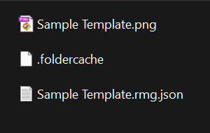
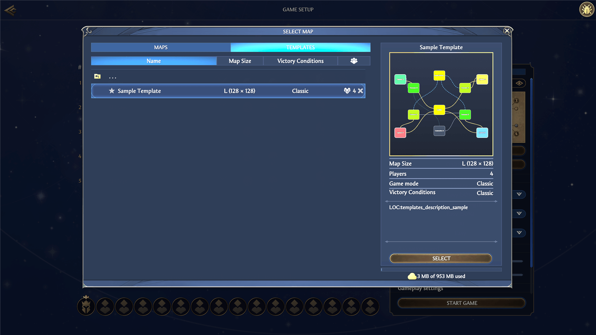

# Installing a template into the game

The editor creates the template files but does not install them into the game: “Save” writes the files to the folder you selected, and the game reads custom templates from its own profile folder. Installation comes down to copying a single file. This chapter breaks down the whole procedure: which files to copy and which the game does not need, what the folder cache does, why to put the preview alongside, and how to make sure the game sees the template.

The short path without explanations is collected in the [Quick start](quick-start.md#installing-the-template-into-the-game) chapter.

## The template folder

The game takes custom templates from a single folder — the profile folder `my_map_templates`. Usually it already exists: the game creates it on first launch. If the folder is missing, launch the game once, and the profile folder appears by itself.

To install a template:

1. Save the template in the editor — with the “Save” button on the top bar (the [Files: opening and saving](files.md#saving) chapter).
2. Open the game’s profile folder in File Explorer:

   `C:\Users\<username>\AppData\LocalLow\Unfrozen\HeroesOldenEra\users\Steam_<id>\my_map_templates\`

   In the path, `<username>` is the Windows user, and `<id>` is the Steam account number. If there are several `Steam_…` folders, find yours by their contents. Instead of clicking through the folder tree, copy the path into the File Explorer address bar and substitute your own values.
3. Copy the template file “Name.rmg.json” into it — the only file the game reads. Put the “Name.png” preview alongside — the reason is explained in the [“The preview next to the template”](#the-preview-next-to-the-template) section.
4. Leave the `.editor.json` sidecar file — the editor’s service data — in the folder where the editor saved the template. The game does not need it.

Copy the files rather than move them: the editor looks for the sidecar file next to the template and uses it to return the diagram’s node positions and the zone notes. If you move the template without its pair, you lose the surroundings on the next opening: the nodes take their places on a ring around the diagram center (the [Files: opening and saving](files.md#the-file-pair-template-and-sidecar-file) chapter).

If you update the template after installation, copy the file again, and the game picks up the update on the next launch.

Note: the profile also contains a `downloads\map_templates` folder — downloads from Steam Workshop land there. Do not put your own template there: `my_map_templates` is the official place for your own files.

Writing files into the game’s installation folder, where the stock templates live, is not recommended: the folder belongs to the game, its contents change with updates, and your additions may not survive. The official path for custom templates is the profile folder.

## The folder cache

Next to the templates in the folder lies the `.foldercache` file — a cache of the folder’s contents. Instead of parsing every template at launch, the game reads a single list file — this way the list of templates loads faster.

You do not need to do anything with the cache. Once you put the template file into the folder, the game itself reconciles the cache with the folder’s contents at launch and rebuilds it on a mismatch. A mismatch is a routine situation: the game takes it in stride even after its own updates.

Do not create, edit, or delete `.foldercache` by hand: its entries are protected by the game’s internal checksums, so a homemade update does not work anyway. A broken or outdated file is not a problem: the game rebuilds it on the next launch.

## The preview next to the template

The game’s stock templates ship together with a preview — a PNG image of the minimap. An identical picture comes from the editor, which writes the PNG on every save and can hand over the image separately from saving (the [Preview and PNG](preview.md#the-png-file) chapter).

The game does not read the contents of the PNG file — the preview’s role is decorative; whether the file’s presence is mandatory for a custom template has not been determined. Copy the picture together with the template: it does no harm, and the template will look like a stock one.

## Checking the template in the game

This manual does not cover the game’s windows — it is about the editor, so the in-game steps are given as a general direction: check the exact names of the items against the game’s screens.

Start with the editor: before installation, fix the errors on the “Issues” tab (the [Template validation (validator)](validator.md) chapter). Errors mark what will almost certainly break the game or the map generation. Warnings and info notes do not interfere with the installation, but they are worth reading.

To check the installation:

1. Launch the game and open random map creation.
2. Find your template in the list of templates: the game shows it under the name from the “Name” field.
3. Compare the name and the description against your expectations — both come from the template settings (the [Template settings (root)](root.md#basics) chapter).
4. Check the player count — it is set by the hero spawn points: main objects of type Spawn bound to players Player1–Player8 (the [Zone main objects](main-objects.md#player-spawn) chapter).

If everything matches, generate a test map: start a game on a random map with your template. The generator builds the map from your zones, connections, and budgets. A finished map is the main criterion: it shows what the editor does not — for example, what the encounter “holes” look like (the [Zone: all properties](zone.md#encounter-holes) chapter).

### Reasons for a missing template

Check in order:

- The file landed in a different folder — the game reads templates only from its own folders: it will not see a `.rmg.json` left in the editor’s working folder or on the desktop. Open the profile folder once more and make sure the file is in place.
- The game was running while you copied the file. Its template folder is processed at launch — restart the game.
- The file is unreadable. Exactly how the game reacts to a file with errors has not been determined, so first check the file in the editor: open it via “Open file” — the editor rejects an unreadable file with a notification — and look at the “Issues” tab.

## Next steps

- [Files: opening and saving](files.md) — how “Save” works and which files the editor writes.
- [Preview and PNG](preview.md) — how to get the preview picture.
- [Template validation (validator)](validator.md) — the issues and what to do with them.
- [Template settings (root)](root.md) — the name, the description, and the game mode: what the game takes from the root settings.
