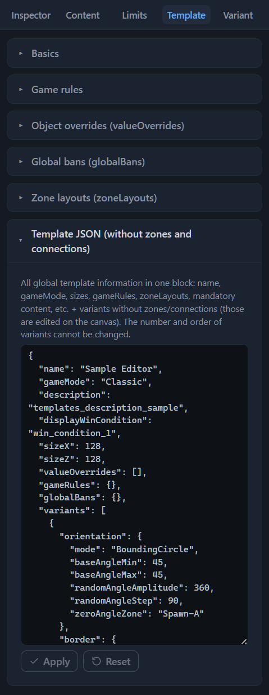
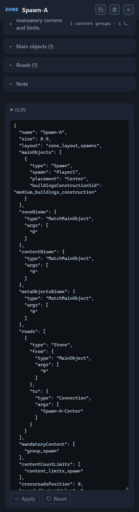

# .rmg.json format reference

One template is one text file with the `.rmg.json` extension: a JSON object whose keys describe the structure of the map — zones, connections between them, budgets, pools, game rules. This chapter is the map of the file: which sections it consists of, where each setting lives, how the sections reference each other, what the editor writes itself and which deviations from the usual form of the file the game accepts. It helps you read ready-made files and understand the paths in the issues of the validator: the issues name the fields with exactly the keys collected here (the [Template validation (validator)](validator.md#the-issue-row) chapter).

The format is declarative: there is no ready-made map in the file. A template sets the rules — which zones are on the map, how they are connected, how much content to put into each — and the game’s generator, at every generation, lays out the zones, draws the roads and fills them within the budgets itself. Object pools, lists, encounters and object values live in the game’s database: the template only references them by name — `sid` — and does not carry them in itself. The structure of pools and lists is described by the [Content pool catalog](pools.md#pool-structure) chapter; the generator picks encounters on its own, the template does not reference them.

Root keys — the global settings shared by all layout variants — and the `variants[]` list form the top level of the file; each item of the list is an independent map layout with its own zones and connections. The sections below take the file’s sections apart from top to bottom; each section names the chapter where the fields of that section are described in detail — with the names in the interface, the hints and the examples.

## File and writing

The game loads templates from the `my_map_templates` folder in its data directory; the preview lies next to the template — a PNG image with the same name (the [Installing a template into the game](install.md#the-template-folder) chapter). When saving, the editor writes three files at once: the template itself, the sidecar file with the editor’s data and the preview (the [Files: opening and saving](files.md#saving) chapter).

For the editor to accept a file as a template, two conditions are needed:

1. The text parses as a JSON object — otherwise you see the notification “The file is not a JSON object”.
2. The object has a `name` key with a string value and a `variants` key with a list — otherwise the editor rejects the file with the notification “The file does not look like .rmg.json: no name / variants[]”.

The editor tolerates everything else. Unknown keys that got into the file during editing outside the editor are not lost: they are visible in the root’s JSON block and return to the saved file as is (the [Template settings (root)](root.md#the-roots-json-block) chapter).

The saved file is written with tab indentation, without a BOM; the order of keys in it follows the order of the file’s fields at the moment of opening. Stock templates are typed in the same style, so the file after the editor is convenient to compare with the original text. The root’s JSON block shows the same data with two-space indentation: the formatting differs, the contents do not.

## File root

The root keys are the global settings of the template: they apply to all layout variants at once. In the editor, they are collected into sections of the right panel — the “Template”, “Content” and “Limits” tabs — and into the root’s JSON block; all fields are described by the [Template settings (root)](root.md) chapter. The sections below go through the keys of the file.

### name

The template name is a string and one of the two keys without which the editor will not open the file. In the lobby, the game shows it; in stock templates it matches the file name, and the editor takes it as the base name of the saved trio of files. The “Name” field — the [Template settings (root)](root.md#name) chapter.

### gameMode

The game mode is the key `Classic` or `SingleHero` (“Single Hero”); the format knows no third value. Among stock templates, Classic occurs in 37 files, SingleHero in 23. The “Game mode” field — the [Template settings (root)](root.md#game-mode) chapter.

### description

The description of the template. Stock templates write here the sid of a localization string of the form `templates_description_*` — the identifier by which the game takes the ready-made text from its database; the editor also accepts arbitrary text. The “Description” field — the [Template settings (root)](root.md#description) chapter.

### displayWinCondition

The displayed win condition is the sid of one of the six official conditions, `win_condition_1`…`win_condition_6`: the announcement that the game shows to the players. By itself it does not enable the mechanic: the real rules are collected by the toggles of the `winConditions` block inside `gameRules`. The “Win condition” field — the [Template settings (root)](root.md#win-condition) chapter.

### sizeX and sizeZ

Map sizes in tiles are two numbers from 80 to 240, multiples of 16; in stock templates the map is always square, `sizeX` equals `sizeZ`. The “Map size X” and “Map size Z” fields — the [Template settings (root)](root.md#map-sizes) chapter.

### valueOverrides

Object overrides are a list of entries of the form `{sid, variant, guardValue}`: for the given object of the game database, the template overrides the guard strength on the whole map. `variant` refines the object’s variant; the value −1 means “any variant”. Overrides are present in 31 of the 60 files, from 1 to 8 entries in each. The “Object overrides” section — the [Template settings (root)](root.md#object-overrides) chapter.

### gameRules

Game rules are an object with the keys of the general rules of the game. The validator considers six entries required: the three hero counts (`heroCountMin`, `heroCountMax`, `heroCountIncrement`), two toggles — the hero hiring ban (`heroHireBan`) and the master switch of encounter “holes” (`encounterHoles`) — and the nested object `winConditions{}`, the mechanic of the win conditions. These six are present in all 60 stock templates; if something is missing, the validator emits a warning, not an error: the game’s behavior when the entries are absent is not verified. All other keys are optional: the experience multipliers from faction laws and from astrology (`factionLawsExpModifier`, `astrologyExpModifier`), tournament rules (`tournamentRules`) and the list of starting bonuses (`bonuses[]`). The “Game rules”, “Win conditions” and “Starting bonuses” sections — the [Template settings (root)](root.md#game-rules) chapter.

### globalBans

Global bans are an object with four lists of sids: `magics` (spells), `items` (artifacts), `skills` (skills), `heroes` (heroes). The listed objects are excluded from the game on the whole map. Bans are present in 23 of the 60 stock files. The “Global bans” section — the [Template settings (root)](root.md#global-bans) chapter.

### zoneLayouts

Zone layouts are a list of named layouts: the obstacle density (`obstaclesFill`) and the obstacles in “voids” (`obstaclesFillVoid`), lakes (`lakesFill`, `minLakeArea`), elevation (`elevationClusterScale`, `elevationModes[]`), the road cluster area (`roadClusterArea`), the share of resource encounters (`guardedEncounterResourceFractions`) and the ambient pickup of objects (`ambientPickupDistribution`). Zones reference a layout by `name`. Stock templates carry from 2 to 5 layouts. The “Zone layouts” section — the [Template settings (root)](root.md#zone-layouts) chapter.

### mandatoryContent

Mandatory content is a list of groups of the form `{name, content[]}`: objects that the generator is guaranteed to place in the zones referencing the group. The group’s items carry the sid of the object, the variant, flags — for example `isMine` (a mine) and `isGuarded` (guarded) — and placement rules (`rules[]`). Instead of a single object, an item can be a choice group: the generator picks one of the nested `content[]` variants by weights, and the circle of candidates is set by references to the database lists `includeLists`. Stock templates carry from 2 to 13 groups. The “Mandatory content” section — the [Template settings (root)](root.md#mandatory-content) chapter.

### contentCountLimits

Count limits are a list of groups of the form `{name, limits[]}`: how many objects of the given kind land in the zones referencing the group. A limit counts either a single object (`sid`, `variant`, `maxCount`) or a whole class — a type group (a nested `content[]` or `includeLists` and a shared `maxCount`); zero in `maxCount` means a ban in the zones of the group. Stock templates carry from 2 to 25 groups. The “Count limits” section — the [Template settings (root)](root.md#count-limits) chapter.

### contentPools and contentLists

Reserved sections of built-in pools and lists. The format allows the template to carry its own pools right in the file, but all 60 stock templates leave both lists empty: the working references lead to the pools and lists of the game database, and the generator picks encounters on its own. A template created with the “New” button also gets empty `contentPools: []` and `contentLists: []`. Which pools and lists the file actually works with — the [Content pool catalog](pools.md#pools-in-the-template-file) chapter.

### orientation outside variants

In one of the 60 stock files, the `orientation` key occurs in the root — outside the `variants[]` list. It has no field in the editor: the key is visible only in the root’s JSON block and is carried through opening and saving unchanged. *Purpose to be confirmed.*

### variants

Layout variants are the largest section of the file. Each item of the list is an independent map layout with its own zones, connections, orientation and border. 55 stock templates make do with one variant, four carry three, one — five. The number and the order of the variants are fixed: the root’s JSON block does not let you change them; the copy and trash buttons live on the top bar (the [Variants: management and selection](variant-manage.md#variant-count-and-the-roots-json-block) chapter).

## Layout variant

A `variants[]` list item is formed by four sections: `zones` — the list of zones, `connections` — the list of connections, `orientation` — the layout orientation, `border` — the map border. The zones and connections belong to the variant: a connection joins only the zones of its own variant, and the zone names must be unique only within it. On the canvas, the editor shows one variant at a time — the active one; switching, duplication and deletion are described by the [Variants: management and selection](variant-manage.md#active-variant) chapter.

### zones

The variant’s zones: from 4 to 48 in stock templates, about 14 per variant on average. A zone is an object with its own sections; their map is in the [“Zone”](#zone) section, the fields — in the [Zone: all properties](zone.md) chapter.

### connections

The connections between the variant’s zones: from 5 to 52 in stock templates. A connection is a pair of zones with a type, a guard and a road flag; its map is in the [“Connection”](#connection) section, the fields — in the [Connections between zones](connections.md) chapter.

### orientation

The layout orientation: how the generator fits the diagram of zones into the square of the game map. Keys: `mode` (the packing mode), `baseAngleMin` and `baseAngleMax` (the bounds of the rotation angle), `randomAngleAmplitude` and `randomAngleStep` (the amplitude and the step of the extra rotation), `zeroAngleZone` (the zero-angle zone). Orientation is present in 51 of the 60 stock files. The fields — the [Variant: orientation and border](variant-layout.md#layout-orientation) chapter.

### border

The map border: the corner rounding (`cornerRadius`), the ring of obstacles (`obstaclesWidth`, `obstaclesNoise[]`), the water along the edge (`waterWidth`, `waterNoise[]`, `waterType`). A border is present in 35 of the 60 stock templates; the absence of a border is a legitimate state. The fields — the [Variant: orientation and border](variant-layout.md#map-border) chapter.

## Zone

A `zones[]` list item. The editor considers seven keys of a zone required: `name`, `size`, `layout`, `mainObjects` and the three biomes — `zoneBiome`, `contentBiome`, `metaObjectsBiome`. All other keys are optional.

### Name, size and layout

`name` is the zone’s name, unique within the variant; stock names are built with a prefix according to the zone’s role: Spawn-, Center-, Treasure-, Side-, Connector-, SuperTreasure-. `size` is the zone’s weight in the arrangement; in stock templates from 0.15 to 2: the larger the weight, the more spacious the zone the generator makes. `layout` is the name of a layout from the root list `zoneLayouts[]`. `crossroadsPosition` is the position of the crossroads — the point where the zone’s roads meet: a number from 0 to 1. *Purpose to be confirmed.* The fields — the [Zone: all properties](zone.md#size-and-layout) chapter.

### Main objects

`mainObjects[]` — from 1 to 9 entries per zone: cities, hero spawn points, abandoned outposts, the arena. Entry keys: `type` (the object type), `spawn` and `owner` (the players), `placement` and `placementArgs` (the placement), `faction` (the faction selection mode), `buildingsConstructionSid` (the construction preset) and `buildingsBanSid` (the banned buildings list), the object’s guard (`guardChance`, `guardValue`, `guardRandomization`, `guardWeeklyIncrement`, `removeGuardIfHasOwner`) and the special keys (`isKeyObject`, `holdCityWinCon`, `initialUnitIncrement`, `enableWeeklyUnitIncrement`). The fields — the [Zone main objects](main-objects.md) chapter.

### Biomes

`zoneBiome`, `contentBiome`, `metaObjectsBiome` are the three biome selectors of the zone. Each is an object of the form `{type, args}`, where `type` takes one of three keys: `MatchMainObject`, `FromList`, `MatchZone`, and `args` stores the selection arguments. The fields — the [Zone: all properties](zone.md#biomes) chapter.

### Budgets and pools

Content budgets are six keys, in pairs for the three kinds of content: `guardedContentValue` and `guardedContentValuePerArea` (guarded content), `unguardedContentValue` and `unguardedContentValuePerArea` (free content), `resourcesValue` and `resourcesValuePerArea` (resources). The number sets the value of the content that the generator places in the zone — absolute or per unit of area. Pools are three lists of names from the game database: `guardedContentPool[]` (1–7 names), `unguardedContentPool[]` (1–7 names), `resourcesContentPool[]` (exactly one in stock zones). The “Budgets” and “Content pools” sections — the [Zone: all properties](zone.md#budgets) chapter; the pool catalog — the [Content pool catalog](pools.md) chapter.

### Guards

The guard parameters of the whole zone: `guardCutoffValue` (the guard strength cutoff), `guardMultiplier` (the guard strength multiplier), `guardRandomization` (the guard strength spread), `guardWeeklyIncrement` (the weekly guard increment), `guardReactionDistribution` (the guard reaction — six weights), `diplomacyModifier` (the diplomacy modifier). Multiplier, spread and increment are described by the [Zone: all properties](zone.md#guards) chapter; for the cutoff, the guard reaction and the diplomacy modifier it gives the editor’s hypotheses. *Purpose to be confirmed.*

### Roads

`roads[]` are the road segments inside the zone: from 1 to 18 per stock zone. The segment’s keys: `type` — the surface, `Stone` or `Dirt` (about a tenth of the stock segments are written without the key), and `from` and `to` — the segment’s ends. An end is an object of the form `{type, args}` of one of four kinds: `MainObject` (the zone’s main object by its index), `Connection` (a connection by name), `Crossroads` (the crossroads, without arguments), `MandatoryContent` (a mandatory content item by name). The “Roads” section — the [Zone: all properties](zone.md#roads) chapter.

### Mandatory content and limits

`mandatoryContent[]` are references by name to groups from the root list of the same name: exactly one reference in stock zones. `contentCountLimits[]` are references to count limit groups, from 1 to 15. Both keys point to the sections of the root and do not carry data inside the zone. The “Mandatory content and limits” section — the [Zone: all properties](zone.md#mandatory-content-and-limits) chapter.

### External hire and “holes”

`randomHireInitialUnitIncrement` is an array of seven numbers, and `randomHireEnableWeeklyUnitIncrement` is an array of seven toggles: the settings of the external hire buildings `random_hire_1`…`random_hire_7`, one entry per tier. `encounterHolesSettings` is an object with two shares, `affectedEncounters` and `twoHoleEncounters`: the zone-level setting of encounter “holes”; the master switch of the “holes” lives in the root `gameRules`. The “External hire” and “Encounter holes” sections — the [Zone: all properties](zone.md#external-hire) chapter.

## Connection

A `connections[]` list item. Three keys are required: `from`, `to`, `connectionType`; the rest are optional.

### Name and ends

`name` is the connection’s name: the editor gives new connections an auto name from the names of the connected zones. In 59 of the 60 files the connections have names, usually built by the same principle. `from` and `to` are the names of the zones of the same variant that the connection joins. The “Connection” section — the [Connections between zones](connections.md#connection) chapter.

### Type and distance

`connectionType` is the key of the connection type: `Direct` (a straight corridor), `Default` (the generator picks the shape itself), `Portal` (a pair of gates), `Proximity` (the zones end up adjacent, no corridor is generated), `GladiatorArena`. `length` is the target distance between the zones for a connection of the `Proximity` type; the editor shows the field only for connections of this type. The fields — the “Connection” and “Road and simulation” sections of the [Connections between zones](connections.md#connection) chapter.

### Guard

`guardValue` is the guard value of the connection in units of value; `guardWeeklyIncrement` is the weekly guard increment; `guardRandomization` is the guard strength spread; `guardZone` is the name of the zone where the connection’s guard will stand; `guardMatchGroup` is the name of the synchronized guard group: the connections of one group get the same army. `guardEscape`. *Purpose to be confirmed.* The rest of the fields — the “Guard” section of the [Connections between zones](connections.md#guard) chapter.

### Road and simulation

`road` is the road flag of the connection: whether to lay a road along it. `simTurnSquad`. *Purpose to be confirmed.* The “Road and simulation” section — the [Connections between zones](connections.md#road-and-simulation) chapter.

### Gates

`gatePlacement` and `gatePlacementArgs` are the placement of the portal’s gates: the key `Center` or `NearZone` with an argument — the name of a zone. `portalPlacementRulesFrom` and `portalPlacementRulesTo` are the lists of the gate escape rules; a rule is built the same way as a mandatory content placement rule. The “Portal gates” and “Gate escape (portalPlacementRules)” sections — the [Connections between zones](connections.md#portal-gates) chapter.

## Field dictionary

Every field of the editor writes its value to a key of the `.rmg.json` file, and every key is visible in a panel field or in a JSON block. The tables of this section are a summary dictionary: the name of the field in the interface and the name of the key in the file. It works in both directions: find the key by a form field, and understand by the key which field the validator is talking about — the issues name the path in the file with exactly these keys (the [Template validation (validator)](validator.md#the-issue-row) chapter).

The tables are grouped by the sections of the panels and follow the order of the sections. In the “Key in the file” column the key is written relative to the section’s object: the container object is named in the line above the table; square brackets `[]` denote a list item. Fields whose effect is not established also enter the dictionary; in the linked chapter they are marked *Purpose to be confirmed.* Keys that have no field in the interface are edited in the JSON blocks (the [Direct JSON editing](json-editor.md) chapter).

### Root keys

The root keys are collected in the sections of the “Template”, “Content” and “Limits” tabs; the root fields are described by the [Template settings (root)](root.md) chapter.

#### Basics

The keys lie directly in the root of the file; the “Basics” section — the [Template settings (root)](root.md#basics) chapter.

| Field in the interface | Key in the file |
| --- | --- |
| “Name” | `name` |
| “Game mode” | `gameMode` |
| “Description” | `description` |
| “Win condition” | `displayWinCondition` |
| “Map size X” | `sizeX` |
| “Map size Z” | `sizeZ` |

#### Game rules

The keys are inside the `gameRules` object; the “Game rules” section of the “Template” tab — the [Template settings (root)](root.md#game-rules) chapter.

| Field in the interface | Key in the file |
| --- | --- |
| “Initial hero count” | `heroCountMin` |
| “Maximum hero count” | `heroCountMax` |
| “Hero limit increment” | `heroCountIncrement` |
| “Hero hiring ban” | `heroHireBan` |
| “Encounter ‘holes’” | `encounterHoles` |
| “Tournament rules” | `tournamentRules` |
| “Faction laws experience multiplier” | `factionLawsExpModifier` |
| “Astrology experience multiplier” | `astrologyExpModifier` |

#### Starting bonuses

The keys are inside a `gameRules.bonuses[]` item; the “Starting bonuses” section of the “Template” tab — the [Template settings (root)](root.md#starting-bonuses) chapter.

| Field in the interface | Key in the file |
| --- | --- |
| “Bonus (sid)” | `sid` |
| “Receiver side” | `receiverSide` |
| “Receiver filter” | `receiverFilter` |
| “Bonus parameters” | `parameters[]` |

The parameter fields of a specific kind of bonus — “Spell”, “Artifact”, “Resource”, “Amount”, “Parameter kind”, “Value”, “Cost change”, “Multiplier” — are also written to the `parameters[]` list.

#### Win conditions

The keys are inside the `gameRules.winConditions` object; the “Win conditions” section of the “Template” tab — the [Template settings (root)](root.md#win-conditions) chapter.

| Field in the interface | Key in the file |
| --- | --- |
| “Classic” | `classic` |
| “Desertion” | `desertion` |
| “Desertion day” | `desertionDay` |
| “Gap threshold” | `desertionValue` |
| “Hero lighting” | `heroLighting` |
| “Hero lighting start day” | `heroLightingDay` |
| “Lost starting city” | `lostStartCity` |
| “Defeat day” | `lostStartCityDay` |
| “Lost starting hero” | `lostStartHero` |
| “City Hold” | `cityHold` |
| “Days to hold for victory” | `cityHoldDays` |
| “City Hold (alt.)” | `holdCityWinCon` |
| “Hell Light Arena” | `gladiatorArena` |
| “Registration: ‘work’ start” | `gladiatorArenaRegistrationStartWork` |
| “Registration: fight start” | `gladiatorArenaRegistrationStartFight` |
| “Arena start delay” | `gladiatorArenaDaysDelayStart` |
| “Battle period (days)” | `gladiatorArenaCountDay` |
| “Tournament” | `tournament` |
| “Points needed to win” | `tournamentPointsToWin` |
| “Keep the army between rounds” | `tournamentSaveArmy` |
| “Round days” | `tournamentDays` |
| “Round announcement days” | `tournamentAnnounceDays` |
| “Champion select rule” | `championSelectRule` |

#### Object overrides

The keys are inside a `valueOverrides[]` item; the “Object overrides” section of the “Template” tab — the [Template settings (root)](root.md#object-overrides) chapter.

| Field in the interface | Key in the file |
| --- | --- |
| “Object (sid)” | `sid` |
| “Object variant” | `variant` |
| “Guard strength” | `guardValue` |

#### Global bans

The keys are inside the `globalBans` object; the “Global bans” section of the “Template” tab — the [Template settings (root)](root.md#global-bans) chapter.

| Field in the interface | Key in the file |
| --- | --- |
| “Spells (magics)” | `magics` |
| “Artifacts (items)” | `items` |
| “Skills (skills)” | `skills` |
| “Heroes (heroes)” | `heroes` |

#### Zone layouts

The keys are inside a `zoneLayouts[]` item; the “Zone layouts” section of the “Template” tab — the [Template settings (root)](root.md#zone-layouts) chapter.

| Field in the interface | Key in the file |
| --- | --- |
| “Layout name” | `name` |
| “Obstacle density” | `obstaclesFill` |
| “Obstacles in ‘voids’” | `obstaclesFillVoid` |
| “Lake density” | `lakesFill` |
| “Min lake area” | `minLakeArea` |
| “Elevation cluster scale” | `elevationClusterScale` |
| “Road cluster area” | `roadClusterArea` |
| “Elevation modes (elevationModes)” | `elevationModes[]` |
| “Mode weight” | `elevationModes[].weight` |
| “Min elevated fraction” | `elevationModes[].minElevatedFraction` |
| “Max elevated fraction” | `elevationModes[].maxElevatedFraction` |
| “Share of resource encounters” | `guardedEncounterResourceFractions.fractions` |
| “Count bounds (countBounds)” | `guardedEncounterResourceFractions.countBounds` |
| “Ambient pickups (ambientPickupDistribution)” | `ambientPickupDistribution` |
| “Pickup repulsion” | `ambientPickupDistribution.repulsion` |
| “Random noise” | `ambientPickupDistribution.noise` |
| “Road attraction” | `ambientPickupDistribution.roadAttraction` |
| “Obstacle attraction” | `ambientPickupDistribution.obstacleAttraction` |
| “Group size weights” | `ambientPickupDistribution.groupSizeWeights` |

#### Mandatory content

The group’s keys — inside a `mandatoryContent[]` item; the item’s keys — inside its `content[]`; the “Content” tab — the [Template settings (root)](root.md#mandatory-content) chapter.

| Field in the interface | Key in the file |
| --- | --- |
| “Group name” | `name` |
| “Object (sid)” | `content[].sid` |
| “Name” | `content[].name` |
| “Variant” | `content[].variant` |
| “Resource generator” | `content[].isMine` |
| “Guarded” | `content[].isGuarded` |
| “No road” | `content[].road` |
| “Solo cell” | `content[].soloEncounter` |
| “Fixed point” | `content[].designatedEncounter` |
| “Owner” | `content[].owner` |
| “Guard strength” | `content[].guardValue` |
| “Lists from the database” | `content[].includeLists` |
| “Choice variants (sid + variant + weight)” | `content[].content[]` |
| “Placement rules (Road/MainObject/Crossroads/Sid/Connection)” | `content[].rules[]` |

Inside “Choice variants” — the same “Object (sid)” `sid` and “Variant” `variant`, and also “Weight” `weight`.

#### Placement rules

Two sections share the rule card: `content[].rules[]` of the mandatory content and `portalPlacementRulesFrom[]` / `portalPlacementRulesTo[]` of the portal’s gate escape. The keys — inside a rule item; the description — the [Template settings (root)](root.md#placement-rules) and [Connections between zones](connections.md#gate-escape-portalplacementrules) chapters.

| Field in the interface | Key in the file |
| --- | --- |
| “Rule type” | `type` |
| “Arguments” | `args` |
| “Min target” | `targetMin` |
| “Max target” | `targetMax` |
| “Weight” | `weight` |
| “Target (point)” | `target` |

#### Count limits

The group’s keys — inside a `contentCountLimits[]` item; the limit’s keys — inside its `limits[]`; the “Limits” tab — the [Template settings (root)](root.md#count-limits) chapter.

| Field in the interface | Key in the file |
| --- | --- |
| “Group name” | `name` |
| “Object (sid)” | `limits[].sid` |
| “Variant” | `limits[].variant` |
| “Max count” | `limits[].maxCount` |
| “Lists from the database” | `limits[].includeLists` |
| “Choice variants (sid + variant + weight)” | `limits[].content[]` |

Inside “Choice variants” — “Object (sid)” `sid` and “Variant” `variant`; the “Weight” field is not shown for limits.

#### Keys without interface fields

These root keys have no fields: they are visible in the root’s JSON block and are carried into the saved file as is.

- `contentPools[]` and `contentLists[]` — the reserved sections, empty both in stock templates and in a new template (see the [“contentPools and contentLists”](#contentpools-and-contentlists) section).
- `orientation` in the root of the file, outside `variants[]` — one file of the 60 stock ones (see the [“orientation outside variants”](#orientation-outside-variants) section). *Purpose to be confirmed.*
- `globalBans` inside `gameRules` — a duplicated copy of the root bans section; occurs in one stock file.

The root’s JSON block — the [Template settings (root)](root.md#the-roots-json-block) chapter.

### Variant keys

The variant’s fields live on the “Variant” tab; the keys are written relative to the variant object — a `variants[]` item. Key dictionaries for `zones[]` and `connections[]` — in the [“Zone keys”](#zone-keys), [“Main object keys”](#main-object-keys) and [“Connection keys”](#connection-keys) sections.

#### Layout orientation

The keys are inside the `orientation` object; the “Layout orientation” section — the [Variant: orientation and border](variant-layout.md#layout-orientation) chapter.

| Field in the interface | Key in the file |
| --- | --- |
| “Packing mode” | `mode` |
| “Min rotation angle” | `baseAngleMin` |
| “Max rotation angle” | `baseAngleMax` |
| “Extra rotation amplitude” | `randomAngleAmplitude` |
| “Extra rotation step” | `randomAngleStep` |
| “Zero-angle zone” | `zeroAngleZone` |

#### Map border

The keys are inside the `border` object; the “Map border” section — the [Variant: orientation and border](variant-layout.md#map-border) chapter.

| Field in the interface | Key in the file |
| --- | --- |
| “Corner rounding” | `cornerRadius` |
| “Obstacle width” | `obstaclesWidth` |
| “Obstacle noise” | `obstaclesNoise[]` |
| “Water width” | `waterWidth` |
| “Water noise” | `waterNoise[]` |
| “Water type” | `waterType` |

Inside the “noise N” card of both lists — “Amplitude” `amp` and “Frequency” `freq` (the “Edge noise” section — the [Variant: orientation and border](variant-layout.md#edge-noise) chapter).

### Zone keys

The zone’s fields live in the zone’s Inspector; the keys are written relative to the zone object — a `variants[].zones[]` item. They are described by the [Zone: all properties](zone.md) chapter.

#### Size and layout

The “Size and layout” section — the [Zone: all properties](zone.md#size-and-layout) chapter.

| Field in the interface | Key in the file |
| --- | --- |
| “Zone name” | `name` |
| “Zone size” | `size` |
| “Zone layout” | `layout` |
| “Crossroads position” | `crossroadsPosition` |

#### Budgets

The “Budgets” section — the [Zone: all properties](zone.md#budgets) chapter.

| Field in the interface | Key in the file |
| --- | --- |
| “Guarded content budget” | `guardedContentValue` |
| “Guarded content budget (per area)” | `guardedContentValuePerArea` |
| “Unguarded content budget” | `unguardedContentValue` |
| “Unguarded content budget (per area)” | `unguardedContentValuePerArea` |
| “Resource budget” | `resourcesValue` |
| “Resource budget (per area)” | `resourcesValuePerArea` |

#### Content pools

The “Content pools” section — the [Zone: all properties](zone.md#content-pools) chapter.

| Field in the interface | Key in the file |
| --- | --- |
| “Guarded content pool” | `guardedContentPool[]` |
| “Unguarded content pool” | `unguardedContentPool[]` |
| “Resource pool” | `resourcesContentPool[]` |

#### Zone guards

The “Guards” section — the [Zone: all properties](zone.md#guards) chapter.

| Field in the interface | Key in the file |
| --- | --- |
| “Guard strength cutoff” | `guardCutoffValue` |
| “Guard strength multiplier” | `guardMultiplier` |
| “Guard strength spread” | `guardRandomization` |
| “Weekly guard increment” | `guardWeeklyIncrement` |
| “Guard reaction (guardReactionDistribution)” | `guardReactionDistribution` |
| “Diplomacy modifier” | `diplomacyModifier` |

#### External hire and encounter holes

The “External hire (random_hire 1–7)” and “Encounter holes” sections — the [Zone: all properties](zone.md#external-hire) chapter.

| Field in the interface | Key in the file |
| --- | --- |
| The “Initial hire” column | `randomHireInitialUnitIncrement[]` |
| The “Weekly increment” column | `randomHireEnableWeeklyUnitIncrement[]` |
| “Share of affected encounters” | `encounterHolesSettings.affectedEncounters` |
| “Share of encounters with two holes” | `encounterHolesSettings.twoHoleEncounters` |

#### Zone biomes

The “Biomes” section — the [Zone: all properties](zone.md#biomes) chapter.

| Field in the interface | Key in the file |
| --- | --- |
| “Zone biome (surface)” | `zoneBiome` |
| “Content biome” | `contentBiome` |
| “Decor biome (meta objects)” | `metaObjectsBiome` |

Each biome is an object `{type, args}`; the selector’s fields are the same for all three biomes. The set of fields depends on the “selection mode”: for “same as another zone” it is “zone (MatchZone)”, for “same as the main object” — the pair “Main object” and “Zone”, for “from list” — the biome chips and the “other” field:

| Field in the interface | Key in the file |
| --- | --- |
| “selection mode” | `type` |
| “zone (MatchZone)” | `args[0]` |
| “Main object” | `args[0]` |
| “Zone” | `args[1]` |
| “other (differentFrom etc.)” | `args` |

#### Content and limit groups

The “Mandatory content and limits” section — the [Zone: all properties](zone.md#mandatory-content-and-limits) chapter.

| Field in the interface | Key in the file |
| --- | --- |
| “Mandatory content groups” | `mandatoryContent[]` |
| “Count limit groups” | `contentCountLimits[]` |

Both keys store the names of groups from the root lists.

#### Zone roads

The keys — inside a `roads[]` item; the “Roads” section — the [Zone: all properties](zone.md#roads) chapter.

| Field in the interface | Key in the file |
| --- | --- |
| “surface” | `type` |
| “From — road end” | `from` |
| “To — road end” | `to` |

A road end is an object `{type, args}`. The end’s “type” field writes `type`: `MainObject`, `Connection`, `Crossroads` or `MandatoryContent`. Its argument depends on the kind of end: “main object” `args[0]` — the index of the zone’s main object, “variant connection” `args[0]` — the connection name, “content item” `args[0]` — the name of the mandatory content item; the crossroads needs no argument.

#### Note

No key in `.rmg.json` belongs to the “Note” field: the note text is stored in the editor’s sidecar file. The “Note” section — the [Zone: all properties](zone.md#note) chapter.

### Main object keys

The fields live in the main object card, in the “Main objects” section of the zone’s Inspector; the keys — inside a `mainObjects[]` item. They are described by the [Zone main objects](main-objects.md) chapter.

#### Object card

The “Object card” section — the [Zone main objects](main-objects.md#object-card) chapter.

| Field in the interface | Key in the file |
| --- | --- |
| “type” | `type` |
| “Player (spawn)” | `spawn` |
| “Placement” | `placement` |
| “Placement arguments” | `placementArgs` |
| “Faction selection mode” | `faction.type` |
| “Main object” | `faction.args[0]` |
| “Zone” | `faction.args[1]` |
| “other (differentFrom etc.)” | `faction.args` |
| “Construction preset” | `buildingsConstructionSid` |
| “Banned buildings” | `buildingsBanSid` |
| “Owner” | `owner` |

The “Main object” and “Zone” fields appear with the “Match (by object)” mode — the [Zone main objects](main-objects.md#faction-selection-mode) chapter.

#### Object guard

The “Object guard” section — the [Zone main objects](main-objects.md#object-guard) chapter.

| Field in the interface | Key in the file |
| --- | --- |
| “Guard chance” | `guardChance` |
| “Guard strength” | `guardValue` |
| “Weekly guard increment” | `guardWeeklyIncrement` |
| “Guard strength spread” | `guardRandomization` |
| “Remove guard when owned” | `removeGuardIfHasOwner` |

#### Win conditions and garrison

The “Win conditions and garrison” section — the [Zone main objects](main-objects.md#win-conditions-and-garrison) chapter.

| Field in the interface | Key in the file |
| --- | --- |
| “City Hold objective” | `holdCityWinCon` |
| “Key object” | `isKeyObject` |
| “Initial garrison increment” | `initialUnitIncrement` |
| “Weekly garrison increment” | `enableWeeklyUnitIncrement` |

### Connection keys

The connection’s fields live in the connection’s Inspector; the keys are written relative to the connection object — a `variants[].connections[]` item. They are described by the [Connections between zones](connections.md) chapter.

#### Name and type

The “Connection” section — the [Connections between zones](connections.md#connection) chapter.

| Field in the interface | Key in the file |
| --- | --- |
| “Connection name” | `name` |
| “Source zone” | `from` |
| “Target zone” | `to` |
| “Connection type” | `connectionType` |

#### Connection guard

The “Guard” section — the [Connections between zones](connections.md#guard) chapter.

| Field in the interface | Key in the file |
| --- | --- |
| “Guard strength” | `guardValue` |
| “Weekly guard increment” | `guardWeeklyIncrement` |
| “Guard strength spread” | `guardRandomization` |
| “Guard zone” | `guardZone` |
| “Synchronized guard group” | `guardMatchGroup` |
| “Guard allowed to escape” | `guardEscape` |

#### Connection road and simulation

The “Road and simulation” section — the [Connections between zones](connections.md#road-and-simulation) chapter.

| Field in the interface | Key in the file |
| --- | --- |
| “Connection road” | `road` |
| “Simultaneous-turn squad” | `simTurnSquad` |
| “Distance” | `length` |

#### Portal gates

The “Portal gates” and “Gate escape (portalPlacementRules)” sections — the [Connections between zones](connections.md#portal-gates) chapter.

| Field in the interface | Key in the file |
| --- | --- |
| “Gate placement” | `gatePlacement` |
| “Gate zone” | `gatePlacementArgs` |
| “portalPlacementRulesFrom[] — where the gates lead (Crossroads/MainObject)” | `portalPlacementRulesFrom[]` |
| “portalPlacementRulesTo[] — gate entry points (Crossroads/MainObject)” | `portalPlacementRulesTo[]` |

The fields of the gate escape rules are the same as those of the mandatory content placement rules: the “Placement rules” table above.

## References between sections

Names, not nesting, link the sections of the file: a zone references the layout and the root groups by name, a connection — the zones, the roads — everything listed at once. The full map of references:

- `layout` of a zone → the `name` of a layout from the root list `zoneLayouts[]`.
- `mandatoryContent[]` of a zone → the names of groups from the root list `mandatoryContent[]`.
- `contentCountLimits[]` of a zone → the names of groups from the root list `contentCountLimits[]`.
- `guardedContentPool[]`, `unguardedContentPool[]`, `resourcesContentPool[]` of a zone and `includeLists[]` of mandatory content items → the names of the pools and lists of the game database.
- `sid` of an object (with the `variant` refinement) in `valueOverrides`, `mandatoryContent` and `contentCountLimits` → an object of the game database.
- `from` and `to` of a connection → the `name` of zones of the same variant.
- `guardZone` of a connection and `zeroAngleZone` of the variant orientation → the `name` of a zone.
- `from` and `to` of a zone road → one of the four kinds of end: the main object by index, the connection by name, the crossroads, the mandatory content item by name.

Renaming a zone in the editor cascades all the references to it (the [Canvas: graph editing](canvas-editing.md#zone-renaming) chapter). A reference that leads nowhere is not lost silently: the validator reports it as a broken reference (the [Template validation (validator)](validator.md) chapter).

## Automatic writing

The editor takes the file’s service properties upon itself — you do not need to think about them while working:

- **The trio of files on save.** The “Save” button writes the `.rmg.json` template, the `.editor.json` sidecar file and the `.png` preview under the name from the “Name” field (the [Files: opening and saving](files.md#saving) chapter). This sidecar file stores the data of the editor itself — the positions of the zone nodes on the canvas, the zone notes, the section layout — and does not get into the template. The game reads only `.rmg.json` (the [Installing a template into the game](install.md#the-template-folder) chapter).
- **Key order and indentation.** The saved file keeps the key order of the file at the moment of opening and is written with tab indentation, without a BOM — in the style of stock templates.
- **Unknown keys.** The keys that the editor does not know are not discarded and are carried into the saved file as is.
- **Starting composition.** A template created with the “New” button already carries empty `contentPools: []` and `contentLists: []` and one variant without zones and connections.

Zones and connections are not edited through the root’s JSON block: written there by hand, on application they are replaced by the arrays of the template’s variants — each variant receives them by its position in the list (the [Template settings (root)](root.md#the-roots-json-block) chapter). Zones and connections are edited on the canvas and in the Inspector, and their JSON blocks are described by the [Direct JSON editing](json-editor.md) chapter.

## Compatibility and edge cases

Stock templates carry deviations from the usual form of the file — and the game accepts them. The editor holds to the same principle: the deviations land in the issues of the validator and do not block saving; from the side of the validation, these places are collected in the “Validator leniency” section of the [Template validation (validator)](validator.md#validator-leniency) chapter. From the side of the file, the sections below look at the same cases: which state of the format is stock, which reaction of the game is known and what remains unverified.

### Map size

The norm of the format is a square map with a side that is a multiple of 16: `sizeX` always equals `sizeZ`, the values of the side lie in the range from 80 to 240 tiles. There is no hard limit on the two numbers: the editor’s fields accept any value, and the validator watches for deviations. Different sides, a side not a multiple of 16 and going outside the 80–240 range produce warnings, not errors — issues of such severity interfere with neither saving nor installing the template (the [Installing a template into the game](install.md#checking-the-template-in-the-game) chapter; the texts of the three warnings — the [Template validation (validator)](validator.md#template-name-game-mode-sizes) chapter). How the generator handles a non-square map or a side not a multiple of 16 is unknown — stock templates contain no examples of deviations. The fields and the hints — the [Template settings (root)](root.md#map-sizes) chapter.

### Inline pools and inline lists

The `contentPools` and `contentLists` sections are the place for the template’s own pools and lists of objects right in the file: the format supports such a mechanism. In practice it is not used: all 60 stock templates keep both lists empty, the working references of the zones lead to the pools and lists of the game database, and a new template also gets empty sections (see the [“contentPools and contentLists”](#contentpools-and-contentlists) section). Non-empty lists produce two info notes of the validator and do not block saving. Whether the game loads inline pools and lists and what the generator does with them is not verified — the texts of the notes admit this directly (the “Info notes” section of the [Template validation (validator)](validator.md#info-notes) chapter; the composition of the working references — the [Content pool catalog](pools.md#pools-in-the-template-file) chapter).

### Known broken references

The references to the records of the game database — the `sid` of objects, the construction presets, the names of pools and lists — cannot be checked inside the file: the records live outside the template. A name that is not in the database can get into the file. In stock templates there are five such names, all among the construction presets; the game tolerates these references silently. The editor answers an unknown name with a warning, not an error, and distinguishes the five known stock names from the other unknown ones with the field badge: the list of names and the badge colors — the “Broken references of stock templates” section of the [Template validation (validator)](validator.md#broken-references-of-stock-templates) chapter and the [Zone main objects](main-objects.md#construction-preset) chapter. Ban lists of banned buildings have no known exceptions: an unknown name gets a warning and the red “not in catalog” badge.

### “Holes” settings without the master switch

The shares of the encounter “holes” are stored in the zone — the `encounterHolesSettings` object with two shares — while the master switch of the mechanic lives in the root key `gameRules.encounterHoles`. This zone-level key works only with the switch at `true`: when the flag is off or not set, the generator ignores the shares of the zone. Maze, a stock template, carries the shares in all 84 zones of the three variants in exactly this state — with the flag off they remain dead weight in the file. The only template with the master switch enabled is Anarchy: there the shares are written in 79 zones of the five variants. All 163 stock occurrences of `encounterHolesSettings` carry the same pair of values: 0.66 and 0.66. The validator answers shares with the master disabled with an info note; the mechanic and the Inspector fields are described by the [Zone: all properties](zone.md#encounter-holes) chapter, the switch — by the “Game rules” section of the [Template settings (root)](root.md#game-rules) chapter.

### A string instead of an array

The usual form of the zone key `contentCountLimits` is an array of the names of count limit groups. In one of the stock zones the value is written differently: a bare string with a single group name. The game’s parser tolerates such a deviation — the text of the validator’s warning says so directly; whether the generator reads the bare string as a full reference is not verified. You cannot create such a value from the Inspector: the zone field writes only an array, so a string instead of an array occurs only in files edited outside the editor (the field and the issue — the [Zone: all properties](zone.md#mandatory-content-and-limits) chapter; the analysis from the side of the validator — the [Template validation (validator)](validator.md#broken-references-of-stock-templates) chapter).

## Next steps

- [Direct JSON editing](json-editor.md) — the JSON blocks for editing the root, the zones and the connections inside the editor.
- [Template settings (root)](root.md) — all fields of the root sections in the Inspector forms.
- [Zone: all properties](zone.md) — the zone fields with values and examples.
- [Connections between zones](connections.md) — the connection fields.
- [Files: opening and saving](files.md) — the trio of template files, opening and writing.
- [Template validation (validator)](validator.md) — the issues with the paths to the fields of the file.
