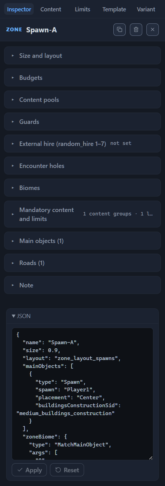
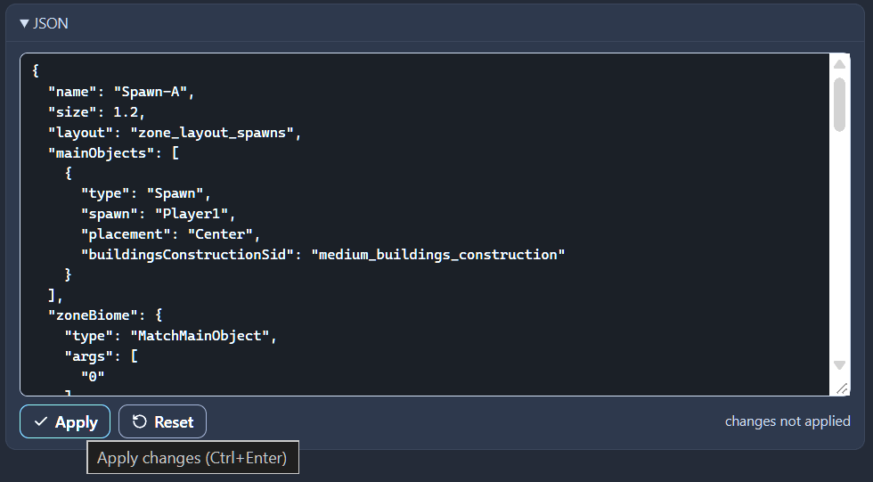
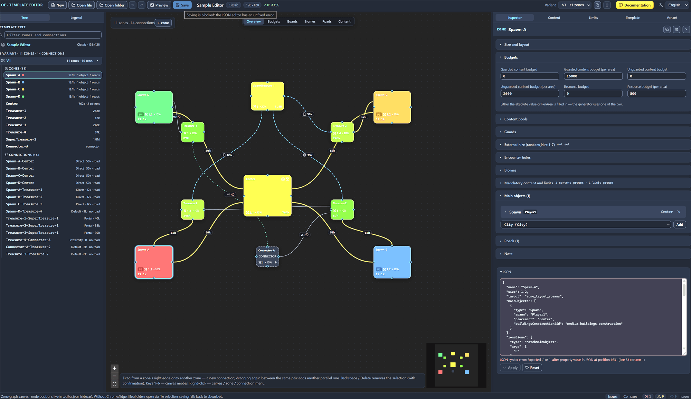

# Direct JSON editing

The editor shows every part of the template as text: the zone, the connection, and the whole template are available as records of the .rmg.json format, and a record can be corrected and returned to the template. This is how keys that have no field in the interface, and whole fragments copied from another template, get into the template.

Editing works as a draft: the typed text does not change the template until you apply it, and the editor validates the text on the fly and does not let you save the template with a broken draft. Below are the common techniques: where the blocks are, how to apply and reset the text, what the editor validates, and how to get out of an error. The contents and the peculiarities of the root block are described in the [Template settings (root)](root.md#the-roots-json-block) chapter; the rows of the “Issues” panel — in the [Template validation (validator)](validator.md#json-editor-draft-errors) chapter.

## Three JSON blocks

The editor has three JSON blocks: the zone’s, the connection’s, and the template’s. They are built the same way — a field with text, the “Apply” and “Reset” buttons, the “changes not applied” status under them — but they show different parts of the template and check different fields.

### Zone block

Select a zone on the canvas or in the template tree and expand the “JSON” block at the very bottom of the “Inspector” tab, below the property sections. The field holds the zone object from the `zones` list of the active variant: the same keys that are broken down in the [Zone: all properties](zone.md) chapter, as a single text with a two-space indent.

The block opens by expanding and does not remember its own state: unlike the property sections, it is not written into the sidecar file, so after switching the Inspector tab or opening the template anew the block is collapsed again.

“Apply” replaces the zone object in the active variant. The same-named zones of the other layout variants keep their contents; the exception is renaming: every same-named zone in all the variants receives the new name.

The block’s checks:

- `name` — a required field, a non-empty string;
- the name is not taken by another zone.

If the text carries a different zone name, the application works as a rename in the “Zone name” field: every zone with the previous name in all the layout variants receives the new name, and along with it the references to the zone, the node position in the sidecar file, and the zone note are carried over. The full list of what is carried over — in the [Canvas: graph editing](canvas-editing.md#zone-renaming) chapter.

Note: the live validation compares the name with the names of the other zones of the active variant, and on application the editor additionally looks through all the layout variants that have a zone with the previous name. A taken name rejects the application with the message “The name ‘X’ is already taken by another zone of the variant”.

### Connection block

Select a connection on the canvas or in the template tree — the “JSON” block appears in the same place, below the property sections of the “Inspector” tab. The field holds the connection object from the `connections` list of the active variant; its fields are broken down in the [Connections between zones](connections.md) chapter.

“Apply” looks the connection up by its name, and when the “Connection name” field is empty — by the “source-target” pair of zones, and replaces the found object in its place in the list. If the text carries a different name (or a name appeared where there was none), the connection receives the new name, and from then on the editor identifies it by that name.

The block’s checks:

- `from` and `to` — required non-empty strings: the names of zones of the same variant;
- `connectionType` — a required non-empty string.

Renaming a connection does not carry the references to it over. Road ends of zones that point to the connection by name stay with the previous name and become broken references — the validator marks them with an error (the [Zone: all properties](zone.md#broken-ends-and-validator-warnings) chapter). The “Connection name” field in the Inspector behaves the same way (the [Connections between zones](connections.md#connection-name) chapter), so after a rename, check the roads of the zones that referenced this connection.

A connection cannot be added as text in this block: the field shows the single selected connection and replaces it. Drag a new connection from the right edge of the node, and add a parallel transition between the same pair of zones by dragging again or with the “Duplicate connection” item of the context menu (the [Canvas: graph editing](canvas-editing.md#connection-creation) chapter). The block is useful for something else — carrying the settings of one connection over to another (the [“Settings from another connection”](#settings-from-another-connection) section).

### Template block

The third block is the root’s JSON block, the sixth section of the “Template” tab, titled “Template JSON (without zones and connections)”. Its field holds the whole template as a single object: the root settings and the `variants` list; every variant is shown with all its fields except `zones` and `connections`. The contents of the block, its keys without interface fields, and the rule of merging the variants are described in the [Template settings (root)](root.md#the-roots-json-block) chapter; here — only the common techniques. Expansion of this section is remembered together with the rest of the Inspector’s sections (the [Files: opening and saving](files.md#the-file-pair-template-and-sidecar-file) chapter).

Zones and connections are not edited through this block: the `zones` and `connections` arrays written by hand are replaced on application by the current arrays of the template — each variant receives them by its position in the list. The number of variants cannot be changed either — the check requires exactly as many elements as the template has. Variants are added and removed by the copy and trash buttons (the [Variants: management and selection](variant-manage.md#variant-count-and-the-roots-json-block) chapter).

“Apply” writes the parsed object as the new template: the root settings and the fields of the variants are replaced by the text, the zones and the connections stay as they were.

The block’s checks:

- `name` — a required field, a non-empty string;
- `variants` — a list of exactly the current number of elements.

## Draft and application

Text in the field of any block is a draft. The template changes only after you press “Apply”, so an edit can be abandoned halfway and the field returned to the current state with a single button.

The states of the draft:

- The text matches the current state of the element — both buttons are unavailable, the “changes not applied” status is not shown.
- The text is edited and parses without errors — the “changes not applied” status appears under the field, “Apply” and “Reset” are active.
- The text is edited and does not pass the validation — the field is highlighted in red with the message under it, “Apply” is unavailable, “Reset” is active.

Applying an edit:

1. Expand the JSON block of the needed element and correct the text.
2. Press “Apply” or Ctrl+Enter (Cmd+Enter on macOS).
3. Check the result: the canvas and the Inspector forms update immediately, the issues on the “Issues” panel are recalculated right away.

After a successful application the text in the field is brought to the written value: the editor lays it out anew with a two-space indent, the “changes not applied” status disappears, the buttons dim. An application is a single step of the change history, so Ctrl+Z returns the element to its previous state together with the Inspector forms (the [Files: opening and saving](files.md#undo-and-redo) chapter).

The Tab key in the field inserts two spaces instead of leaving it — indenting is convenient. Syntax highlighting and autocomplete are absent from the field: a typo is visible only in the validation message, so check the commas and the brackets before applying.

### Draft reset

The “Reset” button returns the text to the current state of the element and removes the error message; the button’s tooltip reads “Revert the text to the current state”. This is not an undo of an action: the reset does not change the template, and the unapplied text is lost for good.

### Draft lifetime

The draft of the zone’s or the connection’s block lives while the “Inspector” tab is open and an element is selected. Switching to another tab, deselecting, “New”, and opening a file remove the block together with the text. The draft of the root’s JSON block is tied to the “Template” tab: selecting a zone or a connection moves the Inspector to another tab, and the text is lost. An unapplied draft does not land in the session backup (the [Files: opening and saving](files.md#session-backup) chapter).

Note: selecting another zone or another connection does not clear the text. What was typed stays in the field and becomes the draft of the new element, and “Apply” writes it into the new element. Apply or reset the draft before selecting another element, otherwise the record of the previous zone or connection lands in the new one: for a zone, such an application is rejected by the taken-name check, and for a connection it passes silently and substitutes the selected transition. Changing the kind of element — from a zone to a connection and back — works differently: the zone block and the connection block are located separately in the Inspector, so the previous block is removed together with the text, and the new one opens clean.

While the draft is not applied, the block does not accept external changes. Edits in the Inspector forms do not land in the text, and on application the draft overwrites the element entirely and erases them. Apply or reset the draft before editing the forms, otherwise the form changes are lost.

## Text validation

The validation is live: as soon as the text stops matching the current state of the element, the editor parses it and runs the block’s checks. On an error it highlights the field in red, shows the message under it, and dims the “Apply” button. The wordings of the messages are the same in the draft and in the row on the “Issues” panel.

Common to the three blocks:

“JSON syntax error: …”
: The text does not parse; after the colon comes the reason reported by the parser.

“Expected a JSON object {…}”
: Parsing succeeded, but the result is not an object: for example, an array, a number, or a string.

Zone block:

“Missing required field name (non-empty string)”
: The `name` key disappeared, became an empty string or a value of another type. The same message appears when the application does not find the zone in the active variant.

“The name ‘X’ is already taken by another zone of the variant”
: The text carries the name of another zone of the same layout variant.

Connection block:

“Missing required fields from/to (non-empty strings)”
: The `from` or `to` key is missing, empty, or not a string.

“Missing required field connectionType”
: The connection type key is missing, empty, or not a string.

“Connection ‘X’ not found in the active variant”
: The application does not find the connection with this id in the active variant — for example, the connection was deleted or renamed while you were editing the text.

The root’s JSON block:

“Missing required field name (non-empty string)”
: The name of the template disappeared from the block or became an empty string.

“variants[] must be present and contain exactly N item(s) — zones and connections cannot be added or removed through this section”
: The variants list disappeared, stopped being a list, or changed its length; N is substituted with the current number of variants of the template.

These checks look only at the form of the block. The field values, the references, and the balance of the template are checked by the validator (the [Template validation (validator)](validator.md) chapter) — after an application, its report is recalculated immediately.

### Rejected application

The block runs the checks once more at the moment “Apply” is pressed: while you were editing the text, the template could have changed. A rejected application shows the same message under the field, leaves the text as it is, and does not dim “Apply” — correct the text or press “Reset”. The template is not damaged: the write does not go through at all.

## Error row and save lock

An unapplied draft error is visible not only in the block itself. On the “Issues” panel it appears as a row with the error icon above the rest of the issues: the area names the block (“Template JSON”, “JSON of zone Spawn-A”, “JSON of connection Center-Spawn-A”), the text matches the message under the field, and the end of the row carries the “draft not applied” mark. The row is not clickable — there is nowhere to jump, the element is already open in the Inspector; its tooltip reads “Error in the JSON editor draft — fix the text or press ‘Reset’”.

Such a row lands in the “errors” counter, so the “the template is valid” line will not appear on the panel even if the rest of the template is clean. The validator itself does not see the unapplied draft and checks the template without your edits (the [Template validation (validator)](validator.md#json-editor-draft-errors) chapter).

While the error is not fixed, the “Save” button on the top bar is unavailable, and its tooltip reads “Saving is blocked: the JSON editor has an unfixed error”. This way the editor does not let a state it could not parse itself be written to disk. The lock cannot be bypassed: the save command checks the drafts itself too, independently of the button’s state.

Getting out of the state:

1. Find the block by the area in the issue row: “Template JSON” — the “Template” tab; “JSON of zone” or “JSON of connection” — the “Inspector” tab with the element selected.
2. Fix the text — the message disappears immediately, “Apply” becomes active, saving becomes available.
3. Press “Reset” if the edit is not needed: the text returns to the current state, and the error is removed together with the row on the panel.

The draft can also be abandoned: leaving the tab removes the block together with the text and the error, and the save lock is lifted. What was typed is lost.

## Cases for direct editing

Direct editing is not the main way of working. Everything that has a field in the Inspector is more convenient to edit through the field: the fields validate the values, substitute the names from the catalog, and do not let you enter anything extra. Text is worth using in the following situations.

### A value from another template

Copying a zone, a connection, a layout, or a mandatory content group from another template is faster than assembling the same from scratch. The fragment is inserted into a JSON block (a zone — into the block of an existing zone; a layout or a group — into the root’s JSON block) or right into the file if the element must be added (see the [“Editing the file outside the editor”](#editing-the-file-outside-the-editor) section).

Note: the names in the copied fragment — pools, lists, layouts, mandatory content and count limit groups — belong to that template. Your template may not have such names, and the references turn out broken: the validator marks them with issues (the [Template validation (validator)](validator.md#nonexistent-references) chapter). Go through the issues before saving, otherwise the template keeps names that exist neither in it nor in the game’s database, and the generator’s behavior on an unknown name is not verified.

### Settings from another connection

The settings of one transition are carried over to another as text — it is faster than repeating the same values in the forms. This is how parallel passages of one pair of zones and identical transitions of different players are set up: the synchronized guard group, the guard zone, and the road arrive together with the text.

1. Select the model connection on the canvas or in the template tree.
2. Copy the text from the connection’s “JSON” block at the bottom of the “Inspector” tab.
3. Select the connection that needs the same settings and paste the text into its block.
4. Correct the `name` field in the text — to the name of the receiving connection — and, when the zones are different, the `from` and `to` fields too.
5. Press “Apply” or Ctrl+Enter and check the Inspector forms against your expectation.

Step 4 is mandatory. “Apply” looks the connection up by the name from the text, and with an empty name — by the pair of zones, and replaces the found record in place. Leave the model’s name — and the receiving connection is renamed and takes over someone else’s ends, while the variant ends up with two transitions under one address: the references to it in the road ends and the placement arguments become ambiguous, and the validator marks this with an info note about matching connection names (the [Template validation (validator)](validator.md#typical-issues-and-what-to-do-with-them) chapter).

Note: the unapplied text is not tied to the connection it was copied from. Select another element — and what was typed becomes its draft, and “Apply” on a connection silently replaces the transition you have just opened. Apply or reset the draft before switching (the [“Draft lifetime”](#draft-lifetime) section).

### A key without an interface field

The JSON block shows the record of the element in full, including the keys that have no field in the Inspector. In the root these are, for example, `contentPools` and `contentLists` (they are empty in all stock templates) and `orientation` outside the variants list (*Purpose to be confirmed.*); in the records of zones and connections — the keys that the format allows but the interface does not show.

A key can be deleted entirely as text: erase the line with the key, and the editor does not bring it back. The forms cannot do this — clearing the fields leaves an empty object in the file (`orientation: {}`, `border: {}`), and it can be removed only in the root’s JSON block (the [Variant: orientation and border](variant-layout.md#common-section-rules) chapter). Before deleting a key, check the [Template settings (root)](root.md#game-rules) chapter: the validator answers the omission of an entry it considers required with a warning.

### Spot audit

Inspector forms show only what has a field and fold the values into the labels of the cards. The JSON block shows the record of the element as it is in the template: all the keys, their values, the order, and the absence of keys. Check a disputed value against the block — for example, which key is actually written after clearing a field, and whether the connection object has the `road` flag.

Zone and connection blocks will not help you compare two layout variants: they show the active variant. The root’s JSON block gives all the variants at once, but without zones and connections, and for a pairwise comparison there is the “Compare” tab (the [Variant comparison](compare.md) chapter).

## Editing the file outside the editor

The JSON blocks edit what is already in the template. They do not let you add or delete zones, connections, and variants: the zone block and the connection block show the single selected element, and the root’s JSON block substitutes the zones and connections arrays with the current ones. Elements are added and deleted by the interface buttons — “+ zone”, dragging a connection, the context menu items; such a change is made as text in the `Name.rmg.json` file itself.

The procedure:

1. Save the template in the editor — a trio of files with a common name appears on disk (the [Files: opening and saving](files.md#saving) chapter).
2. Open `Name.rmg.json` in a text editor.
3. Make the edit, watching the commas and the brackets: the file must stay a JSON object with the `name` key (a string) and the `variants` key (a list).
4. Save the file.
5. Open it in the editor with the “Open file” button and look at the “Issues” panel.

The editor accepts the file only if it is a template: the text must parse as a JSON object, and the object must have `name` as a string and `variants` as a list. Otherwise, instead of the template you see the notification “The file is not a JSON object” or “The file does not look like .rmg.json: no name / variants[]”.

Note: opening a file clears the change history, so you cannot undo an unsuccessful file edit with Ctrl+Z. Keep a copy of the file from before the change, otherwise an error in the text leaves you without the previous version of the template.

Do not rename zones right in the file. Node positions and zone notes are stored in the `.editor.json` sidecar file under the zone names: after a rename that bypasses the editor, the old name stays in the sidecar file, the new one is not found, the node is placed on a ring without a position, and the zone note is lost. Rename the zone in the Inspector — there the rename cascade carries the references over as well (the [Canvas: graph editing](canvas-editing.md#zone-renaming) chapter).

Make pinpoint edits and do not change the formatting of the whole file. The file saved by the editor is written with tab indentation and keeps the keys in the order of the file at the moment of opening; the next save returns the same style (the [.rmg.json format reference](rmg-json.md#automatic-writing) chapter). Reformatting turns one meaningful edit into changes in every line of the file, and comparing it with the previous version becomes hard.

After opening the edited file, go through the issues. Editing the file bypasses the restrictions of the interface — the arrows of the number fields, the catalog lists, the name checks — so values outside the ranges and unknown names land in the template unhindered; the validator answers them with warnings and info notes (the [Template validation (validator)](validator.md#typical-issues-and-what-to-do-with-them) chapter).

## Next steps

- [Template settings (root)](root.md#the-roots-json-block) — the contents of the root block and its peculiarities.
- [Template validation (validator)](validator.md#json-editor-draft-errors) — how the draft error row on the “Issues” panel reads.
- [.rmg.json format reference](rmg-json.md#field-dictionary) — the names of the interface fields and the keys of the file.
- [Files: opening and saving](files.md#undo-and-redo) — the change history and undoing an application.
- [Canvas: graph editing](canvas-editing.md#connection-creation) — adding zones and connections without text, duplicating a transition.
- [Connections between zones](connections.md#connection-name) — connection names and parallel transitions.
