# My first template

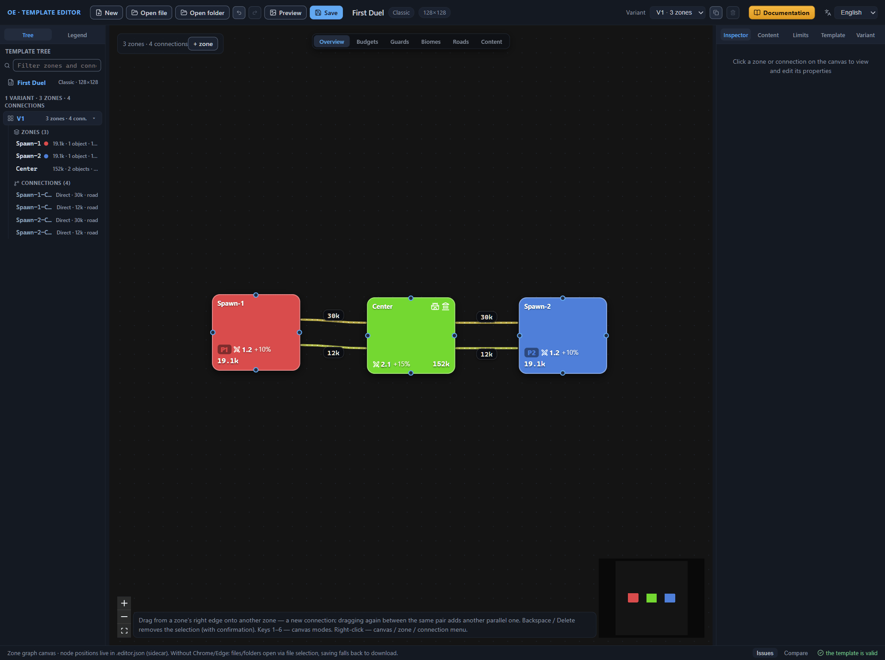

In this chapter we build the “First Duel” template from scratch — a random map for two players. Its basis is three zones and four connections: two player start zones, a shared center, and two passages between each start and the center. A zone is a part of the map with its own settings for content, biome, guards, and objects; a connection is a transition between two zones. On the way we go through the main operations of a template author — creating and filling zones, duplicating zones and connections, the symmetric guard, transferring settings through the JSON block, and roads — and finish the exercise with a check: the editor shows the “the template is valid” line. Let us be honest: “First Duel” is a tutorial template, not a model of balance; its numbers are the author’s example, and for the reference ranges see the reference chapters as needed. The chapter is written for a reader who has completed [Quick start](quick-start.md): the common steps are not repeated here and are given by links.

**Features**:

- Three zones: two start zones for the players and a shared central one.
- Four connections: two passages between each start and the center — the main one and a weaker secondary.
- Symmetry of the starts: identical passages get identical guard. It is held by a synchronized guard group — a named group of connections in which the guard strength and increment are equal.
- The second player’s zone is a duplicate of the first, and its passage to the center is a duplicate of the first player’s passage. Connection duplication creates the secondary passages, and their settings are transferred as text through the JSON block — the field for direct editing of the element’s record.
- One layout variant V1 — the only diagram of zones and connections; all the actions happen in the active variant.
- Mandatory content (objects the generator places with a guarantee) and count limits (the ceiling on the number of objects).

## The exercise map

### Conditions of the example

The template is built from “New” to the “the template is valid” line. Let us fix the conditions: the following sections stick to these values exactly.

- **Template name**
  : “First Duel”.
- **Zones**
  : `Spawn-1` and `Spawn-2` — the player starts; `Center` — the shared center.
- **Connections**
  : `Spawn-1-Center` and `Spawn-2-Center` — the main passages; `Spawn-1-Center-1` and `Spawn-2-Center-1` — the secondary ones. The first player’s passage has no name of its own and is addressed by an auto name — an address built from the names of its zones; the second player’s passage gets an explicit name on duplication, and the editor itself gives the secondary copies a name with the `-1` suffix.
- **Content budget**
  : how much value the generator must place in the zone. Value is the notional balance currency in which both content and guard are expressed. The starts get a “per area” budget: 16,000 guarded, 2600 unguarded, 500 resources; the center — absolute values: 120,000, 20,000, 12,000.
- **Content pool**
  : a named set of game objects the generator draws content from. The starts — tier t2 pools, the center — t4 and t5: the higher the tier, the larger the share of expensive objects in the pool.
- **Guard**
  : the protection of content and passages in value units. The main passages — 30,000, the secondary — 12,000; the zone guard strength multiplier — 1.2 at the starts and 2.1 at the center.
- **Layout variant**
  : one — V1; all the actions happen in the active variant.
- **Map size**
  : 128×128 tiles — the default value; we do not change it.

The numbers here are the template author’s example, not a norm of the game. The meaning of each field and the stock ranges — in the [Zone: all properties](zone.md), [Connections between zones](connections.md), and [Template settings (root)](root.md) chapters.

### Order of work

The sections do not come in an arbitrary order: the sequence of steps affects the result.

1. The first player’s zone: creation, the hero spawn point, and filling — budgets, content pools, biomes (the zone’s terrain type), and guards.
2. The second player’s zone is a duplicate of the first. Make the copy before connections and roads appear: duplication copies the zone in full — together with the main objects and the roads. Copy it later — the road ends of the copy will point at the original zone’s connections.
3. The central zone: the city, the abandoned outpost, and filling.
4. The first player’s “start — center” connection and its guard.
5. The second player’s connection is a duplicate of the first: the copy carries over the guard and the synchronized guard group; only the source zone and the name need replacing.
6. The secondary passages: connection duplication, then transferring the settings through the JSON block. The copy immediately carries the filled-in fields, and the synchronized guard group arrives together with the text.
7. Roads inside zones — after the connections have got their final names: road ends reference connections by name, and renaming a connection does not carry the references over. A stale name turns a road end into a validator error.
8. Mandatory content, count limits, the zone layout (the rules by which the generator builds the terrain inside a zone), and the game rules.
9. Validation: the “Issues” panel and the “the template is valid” line.

### The template blank

1. Press “New” on the top bar. The editor creates an empty template: one layout variant, zero zones, a 128×128 map (the [Quick start](quick-start.md#empty-template) chapter). If the editor opens the “Unsaved changes” dialog, confirm with “Continue” — the exercise starts from a clean slate.
2. Leave the map size at the default: 128×128 tiles are enough for three zones and four connections.
3. Switch to the “Template” tab of the right panel.
4. In the “Basics” section, type “First Duel” into the “Name” field and press Enter. The new name appears immediately on the top bar and in the template tree — under it, the template lands in the game’s template list and in the file name when you save.

## The first player’s zone

### Creation and the hero spawn point

The practice starts with the first player’s start zone: we create a zone and add its first main object — the hero spawn point. Main objects are the zone’s key objects; the template has four types of them: the city, the player spawn point, the abandoned outpost, and the Hell Light Arena.

1. Press “+ zone” in the panel at the top left corner of the canvas. A zone blank appears — with the working name `Zone-1` and the default values; the details are in the [Canvas: graph editing](canvas-editing.md#zone-addition) chapter.
2. Open the “Inspector” tab on the right panel — it holds the properties of the selected zone: the “ZONE Zone-1” header and the list of sections.
3. In the “Size and layout” section, type `Spawn-1` into the “Zone name” field and press Enter. The new name appears immediately in the Inspector header, in the template tree, and on the canvas node; the renaming procedure is described in the [Canvas: graph editing](canvas-editing.md#zone-renaming) chapter.
4. Expand the “Main objects” section. The section has an add row: a type dropdown and the “Add” button.
5. In the add row, select the “Player spawn point (Spawn)” type and press “Add”. A Spawn card appears in the section, and the header becomes “Main objects (1)”.
6. Check the card’s fields: the editor substituted “Player (spawn)” — `Player1` and “Placement” — “in the zone center (Center)”. If the values are different, select them in the dropdowns.
7. Leave the “Placement arguments” field and the guard fields empty: the hero spawn point gets no guard configured.

Note: number fields apply on Enter or when the focus moves to another field.

The zone gets a meaningful name right away, before connections and roads appear. Its name serves as an address for references: connection ends, the guard zone, placement arguments, and road ends point at zones by name. Renaming carries the existing references over in a cascade, but while there are no references there is nothing to carry, and giving the name now is simpler than fixing it later. The generator sees only an address in the name, and the `Spawn-` prefix of the start zones is a practice of stock templates.

The hero spawn point sets the zone’s player. Together with the `Player1` object, the canvas node gets the color of player 1 and the “P1” label, and in the “Overview” mode a flag in the player color is added to it; the canvas legend decodes the colors — the “Legend” tab on the left panel, the “Players (Spawn)” group. The “in the zone center” placement brings the hero to a predictable point — the zone’s center, not a random spot. The meaning of the spawn point’s fields is described in the [Zone main objects](main-objects.md#player-spawn) chapter; the object placement modes are collected in the [Zone main objects](main-objects.md#placement) chapter.

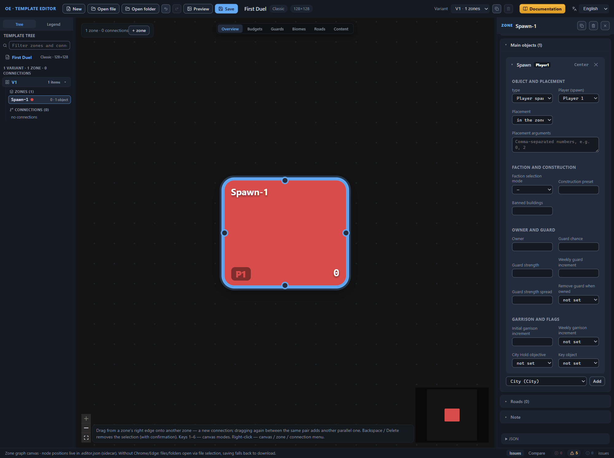

### Filling the zone

The zone has an owner; now we fill it with content. The settings fall into four groups: the budget — the value of the future content, the pools — where the generator takes the objects from, the biome — the zone’s look, the guards — the strength of the protection around the content.

1. Fill in the “Budgets” section: type 16,000 into the “Guarded content budget (per area)” field, 2600 into “Unguarded content budget (per area)”, and 500 into “Resource budget (per area)”. Leave the same-name fields without the “(per area)” addition empty.
2. Expand the “Content pools” section — it has three fields: “Guarded content pool”, “Unguarded content pool”, and “Resource pool”.
3. Press “Catalog” by the “Guarded content pool” field — the catalog dialog opens. Type `random_t2` into the search field and mark three rows with the “+” button: “Classic random pool · t2 · items” (`classic_template_pool_random_t2_item`), “Classic random pool · t2 · hire” (`classic_template_pool_random_t2_hire`), “Classic random pool · t2 · unit banks” (`classic_template_pool_random_t2_unit_bank`). Press “Close” — three chips of the selected pools appear in the field.
4. Add the unguarded pool the same way: “Catalog” by the “Unguarded content pool” field, search for `unguarded_t2`, mark the row “Classic random pool · unguarded · t2 · base” (`classic_template_pool_random_unguarded_t2_base`) and press “Close” — one chip in the field.
5. Repeat the technique for the “Resource pool”: search for `general_resources_start`, the row “Content pool · general resources · start zone · medium” (`content_pool_general_resources_start_zone_medium`), “Close” — the fifth chip is in place.
6. Expand the “Biomes” section. It has three layers: “Zone biome (surface)”, “Content biome”, and “Decor biome (meta objects)”.
7. In each layer, select the “same as the main object (MatchMainObject)” option in the “selection mode” list, and the row “0 · Player spawn point (Spawn) · Player1” in the “Main object” list. Leave the “Zone” field empty — “—”.
8. In the “Guards” section, fill in three fields: “Guard strength multiplier” — 1.2, “Guard strength spread” — 0.05, “Weekly guard increment” — 0.1. Leave the “Guard strength cutoff” and “Diplomacy modifier” fields empty, and do not touch “Guard reaction (guardReactionDistribution)” — for a new zone it is already filled with six ones, and that is normal.

A “(per area)” budget grows together with the zone’s area — otherwise a large zone would stretch the same value over a bigger area and end up poorer than its neighbor. The absolute value and the “(per area)” value form a pair: one of the two is filled in, and the generator uses the one filled in. The canvas shows the result immediately: in the “Overview” mode, the total budget `19.1k` is visible on the `Spawn-1` node — the sum of the three components, and the “Budgets” mode adds the breakdown `G16k` guarded, `U2.6k` unguarded, `R500` resources. The budget fields are described in the [Zone: all properties](zone.md#budgets) chapter; the canvas modes — in the [Canvas: view modes](canvas-modes.md#the-budgets-mode) chapter.

Pools with similar names stand next to each other in the catalog: the “classic” and the regular ones of the same tier differ only by the name prefix. Pick the row whose original name matches the exercise’s task — it is shown right in the catalog row. The chip in the field shows the pool’s English label, and the “✕” button removes it. Pool names are not typed by hand: a typo creates a name outside the catalog, and the validator warns about it. The start zone takes pools of the second tier (t2); the central zone later — of the fourth and fifth (t4, t5). The structure of the catalog dialog is described in the [Quick start](quick-start.md#the-first-content-pool) chapter; the rules for choosing pools — in the [Content pool catalog](pools.md#choosing-a-pool-for-a-zone) chapter.

The “same as the main object” mode makes all three layers inherit the biome of the zone’s main object — the spawn point, object number 0. Whatever biome the spawn point gets, the surface, the content, and the decor will match — the zone looks cohesive; in the editor’s demo template, the start zones are configured the same way. Check the setting on the canvas: switch the mode to “Biomes” — the node gets the “MO #0” label, the biome from main object number 0 — and return to the “Overview” mode. The biome selection modes and their arguments are described in the [Zone: all properties](zone.md#biomes) chapter; the canvas modes — in the [Canvas: view modes](canvas-modes.md#the-biomes-mode) chapter.

The strength multiplier raises the guards along with the budget: the more valuable the zone’s content, the stronger the protection that guards it. A spread of 0.05 is the stock value: with a larger spread, the guard of identical zones differs noticeably from map to map. The weekly increment of 0.1 adds a tenth of the guard strength every week. The meaning of the fields is collected in the [Zone: all properties](zone.md#guards) chapter.

Leave the “External hire” and “Encounter holes” sections untouched: the exercise does not use them. The properties of all the zone’s sections are listed in the [Zone: all properties](zone.md) chapter.

The zone is filled. In the “Overview” mode, the `Spawn-1` node shows the name, the player label `P1`, the guard strength multiplier `1.2`, the weekly increment `+10%`, and the total budget `19.1k`. The validator reports not a single error; the remaining warnings concern the template’s common settings — the game rules, the layout, and the content groups — and the zone: “The zone has no mandatory content” for `Spawn-1`. All of them disappear at the end of the exercise.

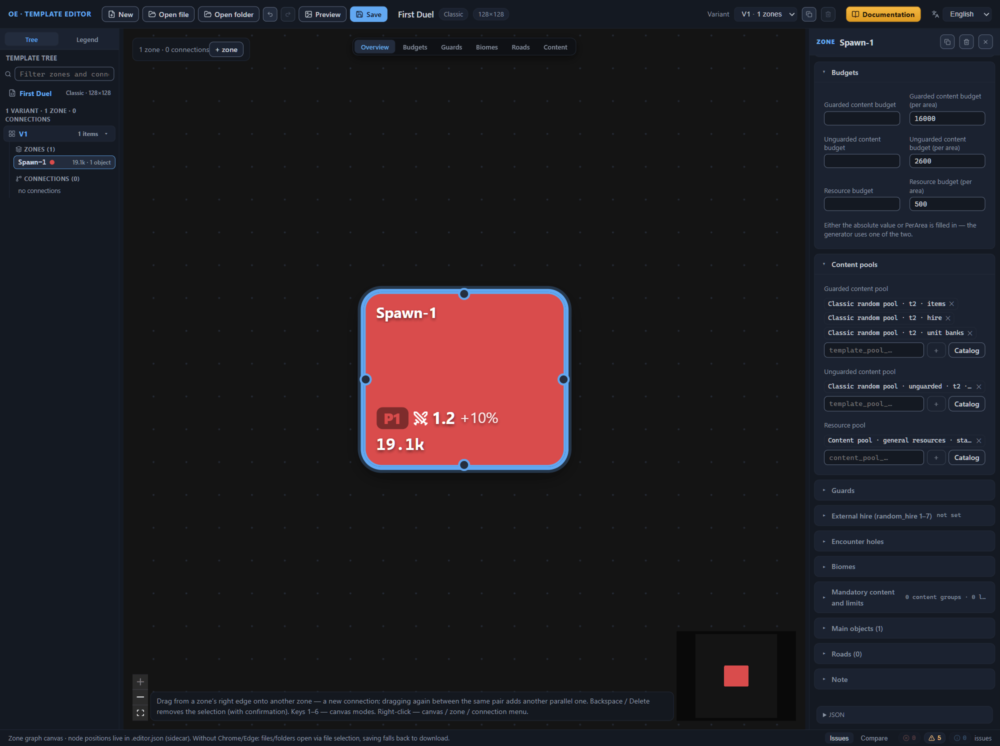

## The second player’s zone

### Zone duplication

The second start zone is built exactly like the first: the same budgets, pools, biome and guard settings. There is no need to assemble them again — the finished zone is copied, and two values are changed in the copy: the name and the player. Make the copy before connections and roads appear: a zone with roads will drag along the road ends that point at the original zone’s connections. The validator stays silent — such connections do exist in the variant — but you would have to hunt down the foreign addresses in the copy’s road by hand.

1. Select the `Spawn-1` node on the canvas — the Inspector shows the zone’s properties.
2. In the Inspector header, next to the zone name, press the button with the copy icon (the tooltip “Duplicate zone (copy without connections)”) — the copy appears on the canvas to the right and below the original zone and is selected immediately. The copy inherits all the settings: budgets, pools, biomes, guards, main objects, mandatory content and count limit groups. Only the connections and the zone note are not copied. The editor gives the copy the first free name in the Zone-N series — `Zone-1` in our example. The duplication techniques are described in the [Canvas: graph editing](canvas-editing.md#zone-duplication) chapter.
3. In the “Size and layout” section, replace the “Zone name” with `Spawn-2` and press Enter — the new name appears in the Inspector header, in the tree, and on the canvas node. The details — in the [Canvas: graph editing](canvas-editing.md#zone-renaming) chapter.
4. Expand the “Main objects” section, open the Spawn card, and select the value `Player2` in the “Player (spawn)” list — the node is repainted in the color of player 2, and the label changes to `P2`. The meaning of the field is described in the [Zone main objects](main-objects.md#player-spawn) chapter.
5. Do not change the copy’s biomes: the selection in the “Main object” list already points at the copy’s own spawn point — it is in place.

One player is set by one spawn point per variant: while the copy’s point belongs to `Player1`, the validator reports the error about an already set player — changing the value in step 4 removes it. Duplication, like any action in the editor, is undone with Ctrl+Z.

The second player’s zone is ready. In the “Overview” mode, the canvas has two nodes: `Spawn-1` with the `P1` label in the color of player 1 and `Spawn-2` with the `P2` label in the color of player 2; both show the guard strength multiplier `1.2`, the increment `+10%`, and the budget `19.1k`. The validator reports no errors; the “The zone has no mandatory content” warning now concerns both start zones and disappears at the end of the exercise.

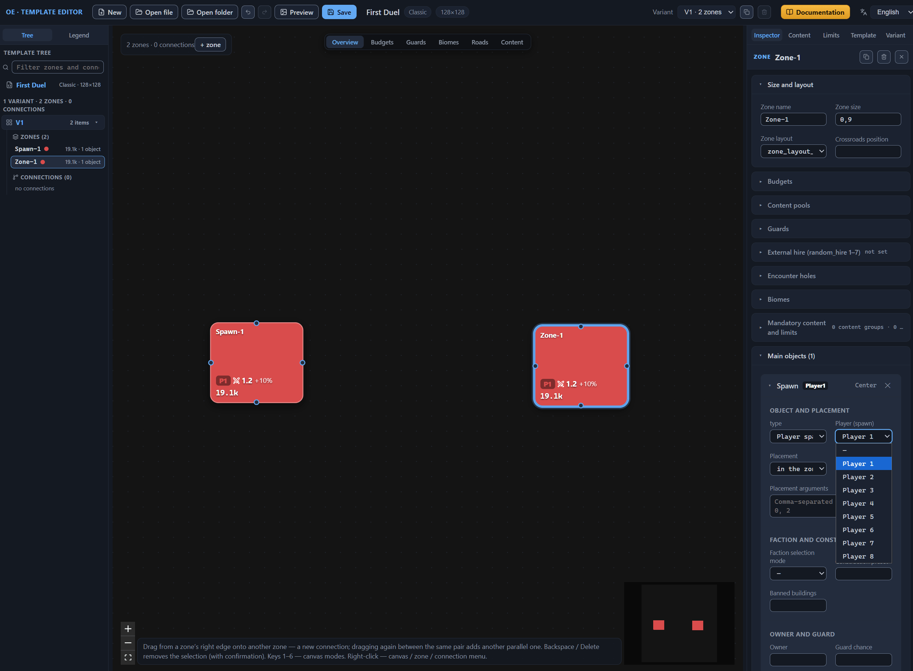

## The central zone

### City and abandoned outpost

The third zone is the center of the map, the place both players strive for. It is bigger than the start zones and is filled more richly. First we create the blank:

1. Press “+ zone” on the canvas — a new zone appears; the editor gives it the first free name `Zone-1`.
2. In the “Size and layout” section, replace the “Zone name” with `Center` and press Enter — the new name appears in the Inspector header, in the tree, and on the canvas node.
3. Type 1.5 into the “Zone size” field and press Enter. The size is a relative weight of the area: a zone with the weight 1.5 next to zones with the weight 0.9 claims roughly twice as large a share of the map area. The meaning of the field is explained in the [Zone: all properties](zone.md#zone-size) chapter.

The center has two main objects: the city — the goal of the struggle and the source of the zone’s faction — and the abandoned outpost, a second point of interest. The outpost’s guard is weaker than the city’s (12,000 against 20,000), so it is easier to capture — the outpost opens to the players before the city.

4. Expand the “Main objects” section, select the “City (City)” type in the add row and press “Add” — a City card appears in the section, and the header changes to “Main objects (1)”. The editor already filled in “Placement” — “in the zone center (Center)” — and “Guard chance” — 1. The meaning of the card’s fields is explained in the [Zone main objects](main-objects.md#object-type) chapter.
5. In the City card, open “Faction selection mode” and select “FromList (list)” — a row of faction chips appears under the field: `human`, `demon`, `dungeon`, `nature`, `unfrozen`. Click the `human`, `demon`, and `dungeon` chips — the selected chips get a checkmark. The generator picks the city’s faction from these three, so in every game the center turns out different. The modes are described in the [Zone main objects](main-objects.md#faction-selection-mode) chapter.
6. Type the name `rich_buildings_construction` into the “Construction preset” field — the “in catalog” badge appears next to the name: the name is recognized. The preset sets the city’s development level. The details — in the [Zone main objects](main-objects.md#construction-preset) chapter.
7. Fill in the guard fields of the City card: “Guard strength” — 20,000, “Weekly guard increment” — 0.2; press Enter after each value. The meaning of the guard fields is collected in the [Zone main objects](main-objects.md#object-guard) chapter.
8. In the add row, select the “Abandoned outpost (AbandonedOutpost)” type and press “Add” — a second card appears, and the header changes to “Main objects (2)”. “Guard chance” already stands at 1; in the “Placement” field, select “anywhere in the zone (Uniform)”, and leave the “Placement arguments” field empty.
9. In the AbandonedOutpost card, fill in “Guard strength” — 12,000 and “Weekly guard increment” — 0.1. Leave the “Owner” field empty: the outpost stays neutral.

A main object’s number is an address for references: road ends, “same as the main object” biomes, and the “Match” faction selection mode point at objects by number, counting from zero. The order of the cards in the section sets the number, so deleting a card from the middle of the list shifts the numbering, and the references silently start pointing at the neighbors.

Do not touch the card fields whose purpose is not established: leave “Banned buildings”, toggles like “Remove guard when owned”, and the rest in the blank’s state.

The central zone is ready: size 1.5, two main objects — the city (placement in the center, three factions to choose from, a construction preset, guard 1 / 20,000 / 0.2) and the abandoned outpost (placement anywhere in the zone, guard 1 / 12,000 / 0.1). The validator reports no errors; the “The zone has no mandatory content” warning now extends to the central zone as well.

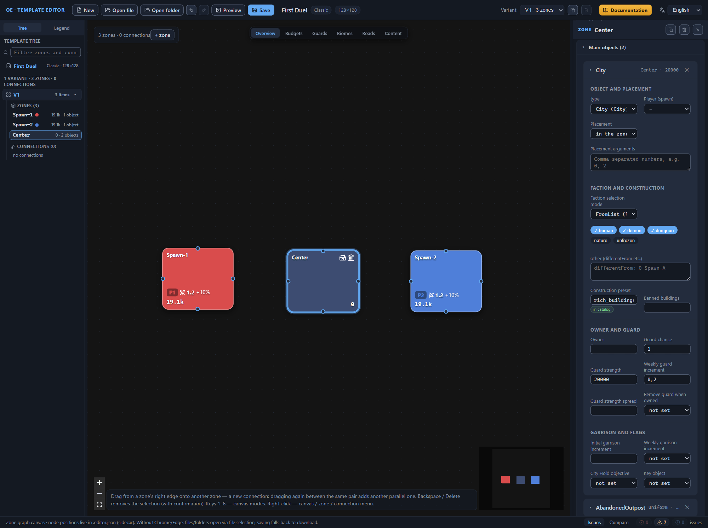

### Filling the central zone

The central zone is filled by the same four groups of settings as the start one: budget, pools, biomes, guards. The techniques are shown in the “Filling the zone” section above; only the values and the differences are given here.

1. In the “Budgets” section, fill in the fields without the “(per area)” addition: “Guarded content budget” — 120,000, “Unguarded content budget” — 20,000, “Resource budget” — 12,000. Leave the “(per area)” fields empty. The start budget grows with the area, but there is only one center of the map: its wealth is set by an absolute value and does not depend on the area the generator ends up giving the zone. About the pair of fields — in the [Zone: all properties](zone.md#budgets) chapter.
2. Add the pools with the “Catalog” button: `classic_template_pool_random_t4_item` and `classic_template_pool_random_t5_item` into “Guarded content pool”, `classic_template_pool_random_unguarded_t4_base` into “Unguarded content pool”, and `content_pool_general_resources_treasure_zone_rich` into “Resource pool”. Tiers four and five instead of two: the center’s content is bigger than the start one — otherwise it is not worth fighting for. The link between the tier and the zone’s budget is explained in the [Content pool catalog](pools.md#tier-and-zone-budget) chapter.
3. In the “Biomes” section, leave the selection mode “from list (FromList)” for all three layers and click the `Sand` chip in each layer — the selected chip gets a checkmark. A single chip fixes the biome choice: this is how stock templates set a desert center. With an empty list, the generator picks the biome itself. The mode is described in the [Zone: all properties](zone.md#from-list-fromlist) chapter.
4. In the “Guards” section, fill in three fields: “Guard strength multiplier” — 2.1, “Guard strength spread” — 0.05, “Weekly guard increment” — 0.15. Leave “Guard strength cutoff” and “Diplomacy modifier” empty; do not touch “Guard reaction (guardReactionDistribution)”. The multiplier 2.1 raises the defense along with the budget; the increment adds 15 percent of strength to the guard every week. The meaning of the fields is collected in the [Zone: all properties](zone.md#guards) chapter.

Compare the result on the canvas: in the “Budgets” mode, the central node shows `152k` and the breakdown `G120k`, `U20k`, `R12k`, while the start nodes stay at `19.1k` — the center’s budget is roughly eight times the start one. In the “Biomes” mode, the central node is marked `Sand`, the start ones — `MO #0`: the center’s biome is fixed; the start zones’ is inherited from the spawn point. Return the canvas to the “Overview” mode. About the canvas modes — in the [Canvas: view modes](canvas-modes.md#the-budgets-mode) chapter.

Filling the central zone is finished. The validator reports no errors; of the seven warnings, three are the zone ones — “The zone has no mandatory content”; they disappear at the end of the exercise.

## Passages to the center

### Connection creation and passage guard

The zones are ready, and it remains to connect them with passages. There will be two main passages: from each start zone to the central one. We create the first player’s passage by dragging and configure its guard right away: the connection blank carries a default guard — strength 8000 and weekly increment 0.1. Then we replace its values with the exercise’s numbers and give the connection a synchronized guard group — later the second player’s passage joins the same group. We get the second passage by duplicating the finished one — the copy carries over all the settings.

1. Hover the cursor over the right edge of the `Spawn-1` node — an attachment point appears. Drag the point to the `Center` node and release the mouse button on it: the connection is created, it is selected, and the Inspector opened its properties with the “CONNECTION” header. The technique is described in detail in the [Canvas: graph editing](canvas-editing.md#connection-creation) chapter.
2. Find the “Guard” section in the Inspector — it is expanded by default, right after the “Connection” section. If the selection was lost, click the connection line on the canvas or the `Spawn-1-Center` row in the template tree.
3. Type 30,000 into the “Guard strength” field and press Enter. This is an example of a passage that the players do not open on the first day; the guard strength is measured in the same notional value currency as the zone budgets. The guard of the transition and its fields are described in the [Connections between zones](connections.md#guard) chapter.
4. Set “Weekly guard increment” to 0.15 and press Enter. The increment is the fraction by which the guard grows every week: at 0.15, a guard of strength 30,000 grows by 4500 in the first week.
5. Leave the “Guard strength spread” field empty.
6. In the “Guard zone” list, select `Center` — the guard is taken from the central zone. An empty field would leave the guard in the middle of the transition. The meaning of the field — in the [Connections between zones](connections.md#guard-zone) chapter.
7. Type the name `spawn_main_guard` into “Synchronized guard group” and press Enter. The field suggests the names of groups already carried by other connections of the same variant; the first connection has no suggestions yet — we type the name ourselves. The group is described in the [Connections between zones](connections.md#synchronized-guard-group) chapter.

The type and the road stayed as in the blank: “direct corridor (Direct)”, the connection road enabled — the exercise does not require changing them. Dragging again between the same pair of zones adds another, parallel connection; a connection of a zone with itself is not created. The Inspector shows the transition’s ends in the “Source zone” — `Spawn-1` and “Target zone” — `Center` fields; the “Connection name” field stayed empty, and its placeholder reads “Auto: From-To” — the connection lives under the auto name `Spawn-1-Center`, built from the names of its zones. Leave the auto name as it is: road ends inside zones reference the connection by name, and renaming a connection does not carry the references over — broken ends become a validator error. Rename a connection before anything references it, or do not rename it at all. The connection name and the renaming rules are described in the “Connection name” section of the [Canvas: graph editing](canvas-editing.md#connection-name) chapter, the drag direction and the roles of the source and the target — in its “Connection creation” section ([Canvas: graph editing](canvas-editing.md#connection-creation)); the meaning of the connection’s fields is collected in the [Connections between zones](connections.md#connection) chapter.

The synchronized guard group is the main tool of symmetry for equal starts: the connections of one group get identical protection. The validator compares three fields within the group — the guard strength, the weekly increment, and the spread — and only by the filled-in values: an empty “Guard strength spread” does not count as a mismatch. If the values diverge — for example, the strength was changed for only one connection — the warning names the group and shows the diverging values: the guards “will not be symmetric”. A group of a single connection gets the “nothing to synchronize” info note — it disappears when the second main passage joins the group.

The group is visible on the canvas without the Inspector: switch to the “Guards” mode — the passage is painted in a color computed from the group name, and the badge in the middle of the line shows the guard value `30k`; in the legend, the group is marked with the ◆ icon. After checking, return to the “Overview” mode. About the canvas modes — in the [Canvas: view modes](canvas-modes.md#the-guards-mode) chapter.

Note: the validator’s issues about a connection carry the variant number and the connection name — “V1 · connection Spawn-1-Center”, and the issues about groups get their own area — “V1 · guard group spawn_main_guard”. The “Distance” field appears only for connections of the “adjacent zones (Proximity)” type — a direct corridor does not have it. Negative guard strength values are not used in the exercise: this is an experiment with unknown semantics. Leave the rest of the “Guard” section’s fields as they are.

The guard of the main passage is ready: the connection carries 30,000 / 0.15, the guard zone `Center`, and the group `spawn_main_guard`. In the template tree, a “Connections” group appeared with one entry, and the counter on the canvas shows “3 zones · 1 connection”. The validator reports no errors; the seven previous warnings are joined by an info note about the single-connection group — it disappears in the next section, and the warnings — at the end of the exercise. The secondary passages will have their own group `spawn_side_guard` — two groups hold two identical sets of passages, and the symmetry is preserved separately for the main routes and separately for the secondary ones.

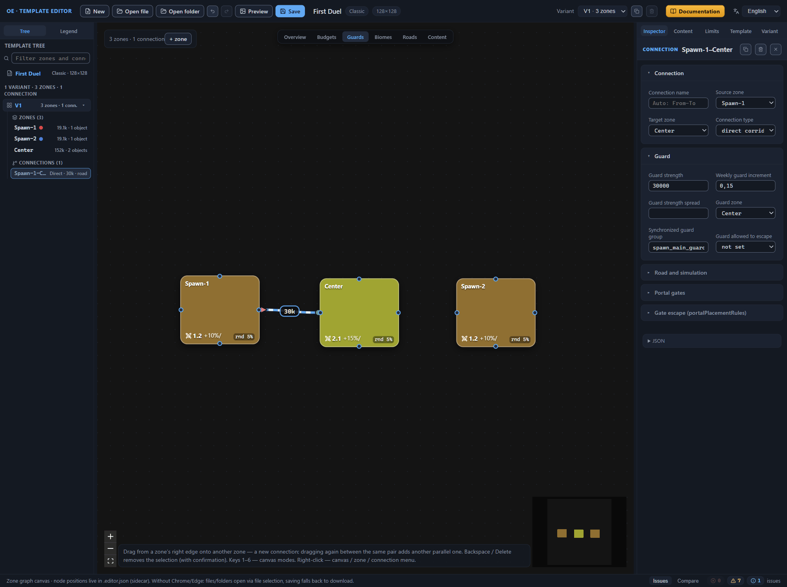

### The second player’s connection by duplication

The second main passage is built exactly like the first: the same type, connection road, guard, and group. There is no need to enter the values a second time — the finished connection is copied, and two fields are changed in the copy.

1. Select the `Spawn-1-Center` connection: click its line on the canvas or the row with the same name in the template tree.
2. In the Inspector header, next to the connection name, press the button with the copy icon — it is the same here as for the zone, and the tooltip reads “Duplicate connection”. The editor gives the copy the name `Spawn-1-Center-1`, places it in the tree right after the original connection, and selects it. The copy inherits all of the connection’s fields in full: the type, the connection road, the guard strength and weekly increment, the guard zone, and the synchronized guard group. The same “Duplicate connection” item is in the context menu — on a right click on the canvas line or on the connection’s row in the tree. The details — in the [Canvas: graph editing](canvas-editing.md#connection-duplication) chapter.
3. In the “Source zone” list, select `Spawn-2` — the line’s end moves to the second start zone. “Target zone” stays `Center`.
4. In the “Connection name” field, replace `Spawn-1-Center-1` with `Spawn-2-Center` and press Enter — the new name appears in the Inspector header and in the template tree.

Without the rename, the passage would stay `Spawn-1-Center-1`: the ends already point at `Spawn-2` and `Center`, but the name still remembers the first pair. The name is an address for references: road ends inside zones point at the connection by name, and later the road of the `Spawn-2` zone will look in the list for exactly `Spawn-2-Center`. Renaming the connection now is safe — nothing references it yet, there is nothing to carry over.

The copy brought the guard and the group with it: the second passage carries the same 30,000 / 0.15, the guard zone `Center`, and the group `spawn_main_guard` — the symmetry of the starts holds without manual input. In the group there are now two connections, and the “nothing to synchronize” info note is gone. The template tree shows two entries in the “Connections” group — `Spawn-1-Center` and `Spawn-2-Center` — and the counter on the canvas shows “3 zones · 2 connections”. The validator reports no errors; the seven previous warnings are still there.

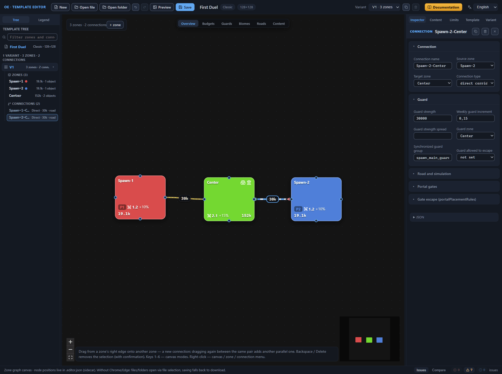

### Secondary passages

The secondary passages are built by duplicating the main ones: the copy inherits the finished settings, and only the numbers and the group remain to change. No one configures the second secondary passage from scratch — it differs from the first only in its ends, while the guard strength, the increment, the guard zone, the group, and the road are the same for both — so its settings are transferred as text through the JSON block: the field for direct editing of the element’s record at the bottom of the “Inspector” tab. The block does not add a new connection — the text replaces the selected connection, which is why the copy is created first by duplication. The benefit of the transfer: the synchronized guard group, the guard zone, and the road arrive together with the text, and the symmetry of the secondary passages is assembled without manual input. The techniques are described in the [Canvas: graph editing](canvas-editing.md#connection-duplication) and [Direct JSON editing](json-editor.md#settings-from-another-connection) chapters.

1. Right-click the `Spawn-1-Center` line on the canvas and select “Duplicate connection” in the context menu. The editor itself gives the copy the name `Spawn-1-Center-1`, places it in the tree right after the original connection, and selects it.
2. In the copy’s “Guard” section, type “Guard strength” 12,000 and “Weekly guard increment” 0.1.
3. In the “Synchronized guard group” field, replace the inherited name `spawn_main_guard` with `spawn_side_guard` and press Enter; “Guard zone” stays `Center`. While the group has a single connection, the validator issues the info note “Group ‘spawn_side_guard’ has a single connection — nothing to synchronize” — it disappears after the settings are transferred to the second copy. The meaning of the group — in the [Connections between zones](connections.md#synchronized-guard-group) chapter.
4. Duplicate the `Spawn-2-Center` line the same way — the copy `Spawn-2-Center-1` appears. Do not touch its fields: the transferred text of the JSON block replaces them.
5. Select the `Spawn-1-Center-1` connection and expand the “JSON” block at the bottom of the “Inspector” tab — the field shows the object of this connection. Copy the whole text of the block; the block’s structure — in the [Direct JSON editing](json-editor.md#connection-block) chapter.
6. Open the `Spawn-2-Center-1` connection and paste the copied text into its “JSON” block. The “changes not applied” status appears under the field, and the “Apply” and “Reset” buttons become active: the text in the field is a draft; it does not change the template yet (the [Direct JSON editing](json-editor.md#draft-and-application) chapter).
7. Correct two fields in the text: `"name"` — to `"Spawn-2-Center-1"`, `"from"` — to `"Spawn-2"`. The `"to"` value stays `"Center"`.
8. Press “Apply” or Ctrl+Enter. The Inspector forms update immediately: “Guard strength” — 12,000, “Weekly guard increment” — 0.1, “Guard zone” — `Center`, “Synchronized guard group” — `spawn_side_guard`. The text in the field returns to the written state; the buttons dim.
9. Check the “Issues” panel: the info note “Group ‘spawn_side_guard’ has a single connection — nothing to synchronize” is gone — the group now has two connections, and there are no errors.

Duplication copies the connection in full, including the group — hence the mandatory group check in step 3. If the copy of the main passage keeps the name `spawn_main_guard` with new numbers, the validator warns about the guard strength mismatch in the group, and the symmetry of the starts is lost. That is why the secondary passage is moved to its own group `spawn_side_guard`. Two passages per pair of zones are justified by the practice of the game: the players do not open the main one, at 30,000, on the first day, while the secondary one, at 12,000, gives a second route earlier; the set of passages stays the same for both starts.

Step 7 cannot be skipped. “Apply” looks the connection up by the name from the text, and with an empty name — by the “source-target” pair, and replaces the found record in place. Leave the name and the ends of the model — and the editor renames the selected connection to `Spawn-1-Center-1` and gives it someone else’s ends: the variant ends up with two indistinguishable passages, and the references by name — road ends and placement arguments — become ambiguous.

Connections with the `-N` suffix are better not renamed: road ends reference connections by name, and renaming does not carry the references over. Dragging again between the same pair of zones also creates a parallel connection, but it gives an empty blank (8000 / 0.1) instead of the copy’s finished settings. “Delete connection” removes exactly one connection. Duplication is also triggered by the copy button in the Inspector header — the one described in the “The second player’s connection by duplication” section; the result of both ways is the same.

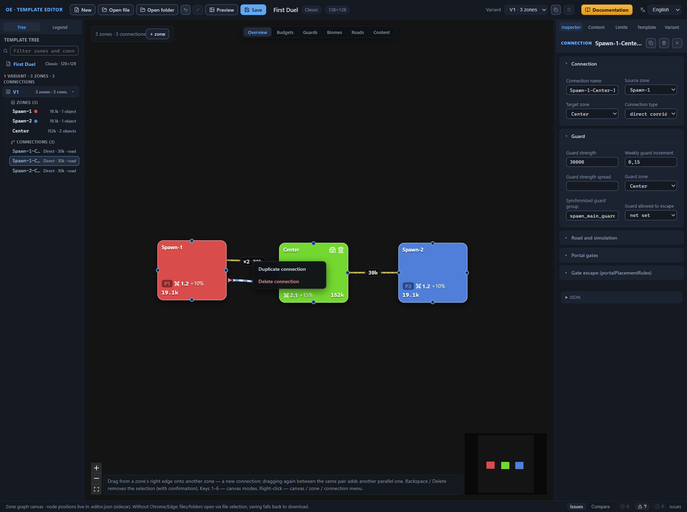

Note: an unapplied draft is not tied to the connection it was copied from. Selecting another element does not clear the text — what was typed becomes the new element’s draft, and “Apply” silently replaces the open transition. Apply or reset the draft before changing the selection (the [Direct JSON editing](json-editor.md#draft-lifetime) chapter). An error in the draft is also visible on the “Issues” panel: its row lands in the “errors” counter, the “the template is valid” line disappears, and the “Save” button stays unavailable until the text is fixed (the [Direct JSON editing](json-editor.md#error-row-and-save-lock) chapter). Until the application, the template does not change, and edits of the forms do not land in the draft’s text; the application is one history step — Ctrl+Z returns the connection together with the forms. “Reset” destroys the typed text for good.

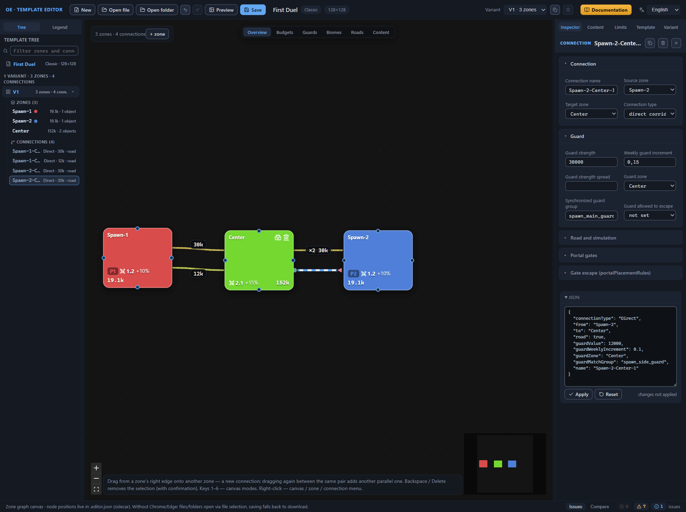

The secondary passages are ready: the tree and the canvas have four connections (“3 zones · 4 connections”), and the tree rows show “Direct · 12k · road” for each copy. In the canvas’s “Guards” mode, both secondary lines are painted in one color from the group name `spawn_side_guard`, and the two main passages — in another; the badges in the middle of the lines show `30k` for the main ones and `12k` for the secondary ones. Return to the “Overview” mode — read about the canvas modes in the [Canvas: view modes](canvas-modes.md#the-guards-mode) chapter. The validator reports no errors; the seven previous warnings are still there — they disappear at the end of the exercise.

## Roads inside zones

The passages are ready; it remains to show the generator how to get from the zone’s main objects to the exits. A zone road is a route inside the zone: the generator lays the road network along such routes. Do not confuse it with the connection road — the `road` flag, which is enabled for all four passages. In the exercise, each zone gets exactly one stone road: from the main object to the exit through the main passage. About the structure of roads — the [Zone: all properties](zone.md#roads) chapter; about the connection flag — the [Connections between zones](connections.md#road-and-simulation) chapter.

1. Select the `Spawn-1` row in the tree and expand the “Roads” section. It shows the hint “The zone has no roads — add the first one.” Press the “road” button — a road card appears, and the header changes to “Roads (1)”.
2. Check the card’s fields. “surface” is set to “stone · Stone”; “From — road end” — type “zone object · MainObject”, value `Spawn [0] · Player1`; “To — road end” — type “connection · Connection”, value `Spawn-1-Center`. The blank describes the “object → zone exit” link and lands exactly on the main passage — do not change anything.
3. Add a road to the `Spawn-2` zone and look at “To”: the blank substituted the variant’s first connection — `Spawn-1-Center`. In the “variant connection” list, select `Spawn-2-Center`.
4. For the `Center` zone, do not correct the card: “From” — `City [0]` (object number zero is the city), “To” — `Spawn-1-Center`.

The editor creates the road record in the road list of the zone being edited — the road of `Spawn-2` stays the road of `Spawn-2`. `Spawn-1-Center` in “To” is only the default reference to a connection of the variant: a connection joins two zones and belongs to neither of them, so a road with such an address is not created “in someone else’s zone”. The blank always substitutes the variant’s first connection and this zone’s object number zero. For `Spawn-1` and `Center` it hit the mark; for `Spawn-2` — it did not: check both ends of every road and change the address by hand if needed (about the end selectors — the [Zone: all properties](zone.md#road-ends) chapter).

Switch the canvas to the “Roads” mode. Three orthogonal routes appear over the nodes — one for each zone; the ends carry markers: ■ — a main object, at the spawn point it is painted in the player color; ◯ — a connection. All four connections are drawn with a light thick line with a thin white dashed thread; their badges read “road”. Return to the “Overview” mode (the [Canvas: view modes](canvas-modes.md#the-roads-mode) chapter).

Note: each zone has one road, although the pair has two passages — the secondary one got no route of its own. Changing the type of an end clears its argument — pick the point’s address anew. The ✕ button on the card deletes the road without confirmation; Ctrl+Z brings it back; deleting the last road removes the road list from the file entirely. Renaming a connection does not update the road ends — which is exactly why roads appear after the connections’ final names; our order of work respects this. The generator looks for a “mandatory content item (MandatoryContent)” end only among the groups attached to the zone; the exercise does not need such ends — the groups appear closer to the finale of the exercise.

The roads added no new issues: the “Issues” panel still has no errors and carries the same seven warnings — they disappear in the next section.

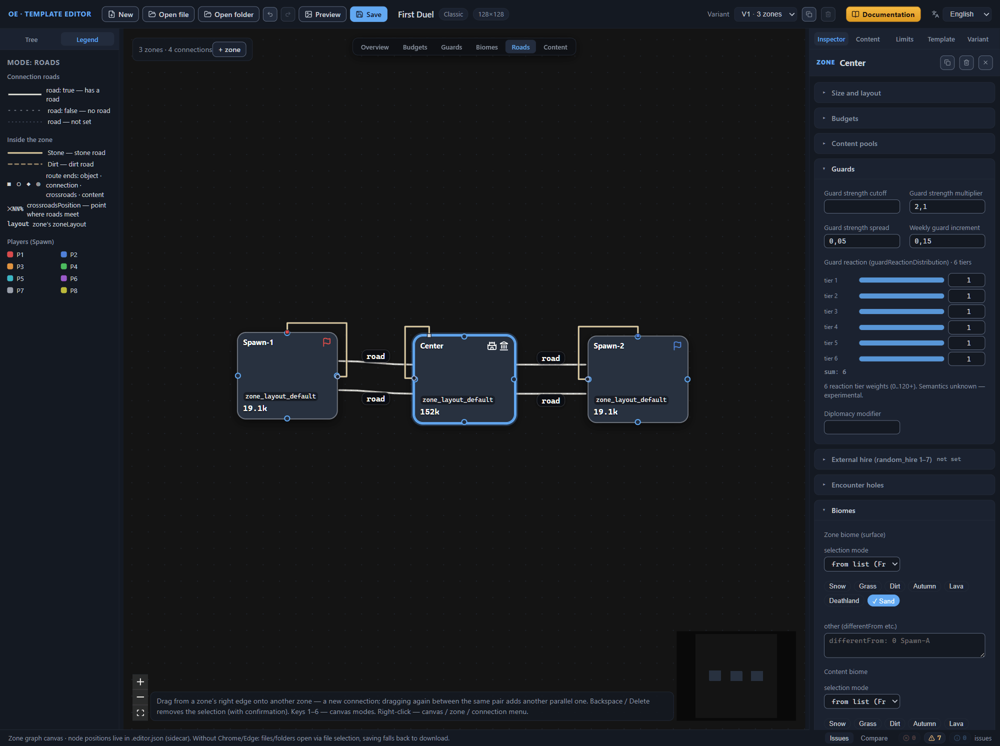

## Root settings

The zones, the connections, and the roads are ready. What remains lives outside the arrangement of zones: the mandatory content and count limit groups, the zone layout, and the game rules. The groups of both panels lie in the root of the file, outside the variants list, so they act the same in all layout variants, and the zones attach them by name.

### Mandatory content groups

Mandatory content is objects that the generator places with a guarantee, independently of the zone’s budgets. It is stored in groups: a group gets a name, and zones reference that name. The exercise has two groups, because the start zones and the center have different compositions: a single shared group would not let their roles be distinguished.

1. Open the “Content” tab of the right panel — it holds the “Mandatory content” panel. While there are no groups, the panel shows the message “No groups — create the first one.” and the hint “Groups referenced by zones (zone.mandatoryContent).”
2. Press “＋ group” in the panel header: an expanded card appears with the “MC” tag and the name `group_1`. An empty group immediately gets the “The group is empty” warning — it goes away together with the first item.
3. Type `group_spawn` into the header’s name field and press Enter. The name applies on Enter or on loss of focus; zones reference the group by an exact string match, so the name is given before the attachments.
4. Press “＋ object” in the group card: an item blank is added — a random legendary item (`random_item_legendary`), guarded, with one placement rule by the road (type “road · Road”, target band 0–0.4 — a fraction of the zone radius, weight 1; the structure of the rules — in the [Template settings (root)](root.md#placement-rules) chapter). The “The group is empty” warning goes out; the header summary shows “1 items · 0 zones”.
5. Repeat steps 2–4 for the second group: the name `group_center`, the same item blank.
6. Select the `Spawn-1` zone in the template tree — the Inspector opens its properties.
7. Expand the “Mandatory content and limits” section in the Inspector: by default it is collapsed and carries the summary “0 content groups · 0 limit groups”.
8. Type the name `group_spawn` into the “Mandatory content groups” field and press Enter — the field suggests the root groups not yet attached to the zone, and the entered name becomes a chip: a plate with the group’s readable name and the “1 items” summary. Empty input and duplicates are silently ignored.
9. Attach the same group to the `Spawn-2` zone, and the `group_center` group to the `Center` zone.

The chip’s tooltip lists the group’s contents line by line — “group_spawn / Случайный легендарный предмет (random_item_legendary)”. Clicking the chip’s name jumps to the group card: the editor switches the tab of the root panel, scrolls the list, and highlights the card, while the ✕ button removes the name from the zone’s list. Type the name exactly or take it from the suggestions: the editor does not check the input against the root while you type, and a chip with an unfamiliar name gets the “not found” badge, and the validator — a warning about a broken reference: that is what they call a name that is not among the root’s groups.

The attachment is visible in three places. In the zone section, the collapsed summary counts both lists: “0 content groups · 0 limit groups” gives way to the number of attached groups. Zone chips with the “Open zone …” tooltip land on the group card, with the summary “1 items · 2 zones” for `group_spawn` and “1 items · 1 zones” for `group_center`. The three “The zone has no mandatory content (usually ≥1 group)” warnings leave the “Issues” panel; the root’s “No mandatory content groups (usually 2–13)” goes out even earlier — with the first created group. The composition of the groups and the structure of the cards are described in the [Template settings (root)](root.md#mandatory-content) chapter; the reference from the zone’s side — in the [Zone: all properties](zone.md#mandatory-content-and-limits) chapter.

Check the result on the canvas: switch the mode to “Content”. Each zone gets an item dot with a caption, a dashed placement-rule ring, and a dashed thread between them, and at the node’s foot — the names of the attached groups and the sum of the group items (“1 items”). Return to the “Overview” mode; about the canvas modes — the [Canvas: view modes](canvas-modes.md#the-content-mode) chapter.

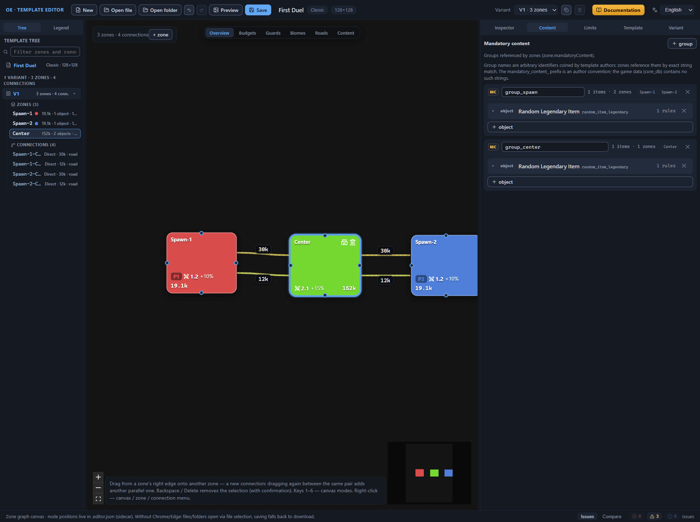

### Count limit groups

Count limits restrain the number of objects from above: the ceiling keeps the generator from seeding the zones with a single find. The structure is the same as for mandatory content — groups in the root and references by name from the zones; the card tag (“CC” instead of “MC”) and the summary (“N limits · M zones”) differ.

1. Open the “Limits” tab of the right panel — it holds the “Count limits” panel.
2. Press “＋ group” in the panel header: the group `content_limits_1` appears.
3. Rename it to `content_limits_spawn` the same way as the content group’s name.
4. Press “＋ limit”: a limit blank is added — Pandora’s Box (`pandora_box`), variant −1 (all variants of the object), max count 1. The header summary shows “1 limits · 0 zones”.
5. Create the second group `content_limits_center` with the same limit the same way.
6. Attach the groups to the zones by the technique of the section above, in the “Count limit groups” field of the same section: `Spawn-1` and `Spawn-2` — `content_limits_spawn`, `Center` — `content_limits_center`. The limit chips carry the “1 limits” summary, and the tooltip lists the bounds: “content_limits_spawn / Ящик Пандоры (pandora_box): no more than 1”.

The “The limit group list is empty” issue did not occur in the exercise and will not: it is issued for a zone whose group list exists and is empty, while the created zones had no list at all — the key appears in the file only together with the first name. The root’s “No count limit groups (usually 2–25)” goes out with the first group, just like the one for mandatory content, and the zone section’s summary reads the second list as well: “1 content groups · 1 limit groups”. The meaning of the limits and the structure of the cards — in the [Template settings (root)](root.md#count-limits) chapter.

### Zone layout and game rules

The last two warnings concern the zone layout and the game rules. Both steps are already described in the [Quick start](quick-start.md#zone-layout-fields) chapter: take the layout values from its table, and fill in the game rules by the “Game rules” section of the same chapter ([Quick start](quick-start.md#game-rules)) — the values are not repeated here. The zones already carry the `zone_layout_default` layout: the editor assigns a new zone the first layout of the list, so on the “Template” tab, in the “Zone layouts (zoneLayouts)” section, fill in the fields of the single card and do not create a new one.

After these two steps, the “Issues” panel empties and shows the “the template is valid” line — not a single issue is left. “Valid” means the absence of validation issues, not a verdict on balance; the review of this exercise’s typical issues and the finale of the exercise — in the next section. The meaning of the layout and game rules fields is collected in the [Template settings (root)](root.md#zone-layouts) chapter.

## Validation and finale

By this section, the exercise has arrived with an empty list of issues: each went out along the way — the content and limit groups closed the zone and root issues, the layout and the game rules — the last two. Open the “Issues” tab of the bottom panel: the counters of errors, warnings, and info stand at zero, and instead of the issue list the panel shows the “the template is valid” line. “Valid” means the absence of validation issues, not a verdict on balance: how much value to leave in the zones and where to put the guard, the check does not decide for you (the [Quick start](quick-start.md#the-template-is-valid-line) chapter). The panel’s structure and the behavior of a click on an issue are described in the [Quick start](quick-start.md#validator-issues) and [Template validation (validator)](validator.md) chapters.

### Typical issues of this exercise

Let us collect into one list the misses that happen most often on this route — with the reason and the fix. The issue texts are given verbatim, as the panel shows them; the severity and the area of the row — in the panel’s words too.

- **“Player1 is already set in zone Spawn-1”** — an error, area “V1 · Spawn-2”.
  : Reason — the spawn point in the zone copy stayed with the first player, and one player is set by one point per variant. Fix — select `Player2` in the copy’s Spawn card, as in the “The second player’s zone” section.
- **“In group ‘spawn_main_guard’, guardValue differ (29000 / 30000) — the guards will not be symmetric”** — a warning, area “V1 · guard group spawn_main_guard”.
  : Reason — the duplicated secondary passage stayed in the main passage’s group with different numbers. Fix — move the copy to the `spawn_side_guard` group or equalize the numbers within the group.
- **“In group ‘spawn_side_guard’, guardValue differ (12000 / 30000) — the guards will not be symmetric”** — a warning, area “V1 · guard group spawn_side_guard”.
  : Reason — the text transferred through the JSON block was not applied to the second secondary passage, and it carries the main one’s numbers. Fix — press “Apply” in the connection’s block or enter the numbers in the forms.
- **“Group ‘spawn_main_guard’ has a single connection — nothing to synchronize”** — an info note, area “V1 · guard group spawn_main_guard”.
  : Reason — the group is set for only one passage: the second name was not entered yet, or the duplication did not happen. Fix — nothing urgent: the info note goes out when a second connection joins the group.
- **“Colliding connection auto-names (From–To without a suffix): Spawn-1-Center-1”** — an info note, area “V1”.
  : Reason — the `name` was not corrected in the transferred JSON text, and two connections of the variant got one name. Fix — correct the name in the text and apply it again.
- **“Connection ‘Spawn-1-Center’ not found in the variant”** — an error, area “V1 · Spawn-1 · road 1”; a second identical row comes for the `Center` zone.
  : Reason — a road end points at a connection that is not in the variant: the connection was renamed or deleted after the roads. Fix — return the connection’s former name or select an existing connection in the road end.
- **“Pool ‘…’ not found in the catalog (total pools: …)”** — a warning, the area of the zone with the typo.
  : Reason — the pool name was typed by hand with a typo. Fix — remove the chip with the ✕ button and add the name from the catalog.
- **“The zone has no mandatory content (usually ≥1 group)”** — a warning, the area of the zone without a group.
  : Reason — no mandatory content group was attached to the zone, or the name chip was removed with the cross. Fix — type the group name into the “Mandatory content groups” field of the “Mandatory content and limits” section.

### Finale: saving and installation

The exercise is finished: the “First Duel” template is assembled and validated in the editor. It remains to save it: the “Save” button on the top bar is active, and its tooltip reads “Pick a folder and save .rmg.json + .editor.json + PNG preview” — the editor asks for a folder and puts three files there at once. The game needs two of them: copy the template file and the preview picture into the custom templates folder (the [Installing a template into the game](install.md#the-template-folder) chapter). The game does not need the sidecar file, but keep it next to the template: it holds the diagram’s node positions and the zone notes (the [Files: opening and saving](files.md#the-file-pair-template-and-sidecar-file) chapter).

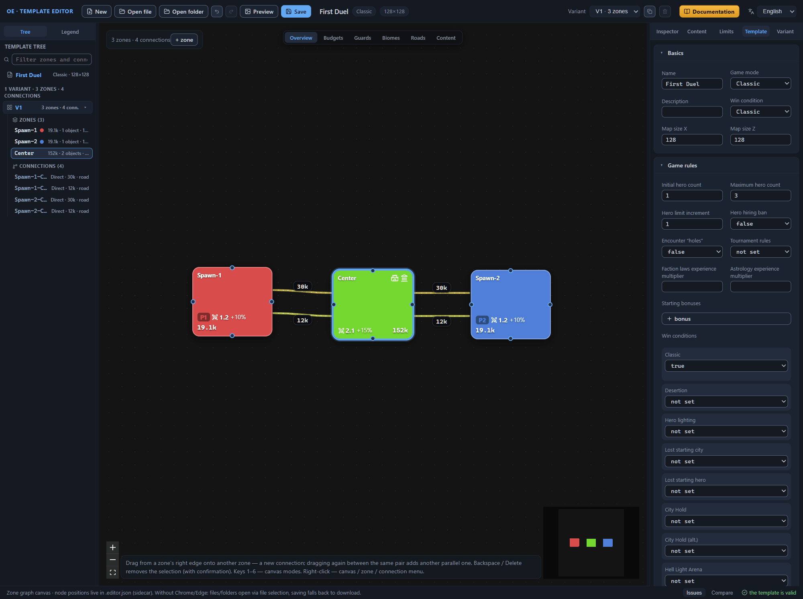

## Next steps

- [Canvas: graph editing](canvas-editing.md) — techniques for rebuilding the diagram: zones, connections, duplication, the context menu.
- [Zone: all properties](zone.md) — the reference of the zone’s fields: budgets, pools, biomes, guards, roads.
- [Connections between zones](connections.md) — the reference of the connection’s fields: types, guard, synchronized guard groups, roads and portals.
- [Template validation (validator)](validator.md) — the full catalog of issues and their reasons.
- [Files: opening and saving](files.md) — the template’s file pair, save folders, undo, and the session backup.
- [Installing a template into the game](install.md) — the custom templates folder and checking the map in the game.
