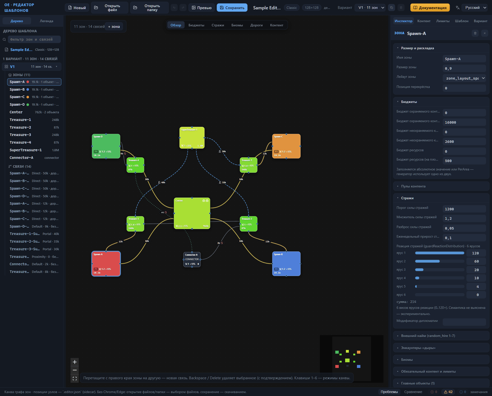

# Обзор редактора

*Актуально для редактора на 29.09.2026.*

Перед вами мануал веб-редактора шаблонов случайных карт для игры Heroes of Might and Magic: Olden Era. Редактор рисует схему будущей карты, помогает настроить её экономику и правила, проверяет шаблон и сохраняет файл, который читает игра. Мануал написан для автора шаблонов и не требует подготовки: каждый термин объясняется при первом упоминании, а к ручному набору JSON прибегать не обязательно. Эта глава — входная точка: сначала общая картина «что такое шаблон», затем карта самого мануала.

## Что такое шаблон случайной карты

Случайная карта не рисуется клетка за клеткой. Автор готовит шаблон — файл `.rmg.json`, который описывает макет будущей карты. Карта делится на зоны — части со своими настройками контента и стражи; зоны соединены связями — коридорами, порталами и другими переходами. Шаблон определяет, какие у зон биомы (типы окружения), сколько в них контента и стражи — охраны, прикрывающей контент и переходы. Отдельно задаются правила игры и условие победы. Размер карты — в клетках, от 80 до 240, кратно 16; карта всегда квадратная.

Формат декларативный: в шаблоне вы описываете, «что и сколько» должно получиться, а не «где именно» это стоит. Где пройдёт дорога и в какую точку зоны ляжет конкретный объект — решает генератор игры при создании карты.

Один файл — один шаблон. Если вы хотите, чтобы игра иногда собирала карту по другой раскладке зон, добавьте в тот же файл ещё один вариант раскладки: при генерации игра случайным образом выберет один из них.

## Три слоя генерации карты

Работу генератора удобно представлять тремя слоями.

1. **Шаблон** отвечает на вопрос «что и сколько»: зоны, связи, бюджеты наполнения, стража, правила игры.
2. **Пулы контента** — именованные наборы объектов игры — отвечают на вопрос «чем заполнять». Пулы лежат в базе игры, а шаблон ссылается на них по имени.
3. **Энкаунтеры** — готовые «микрокарты» из объектов и стражей — отвечают на вопрос «как оформить». Генератор подбирает энкаунтеры сам, по типу и размеру; шаблон на них не ссылается.

Из этой картины следует главное: вам достаточно настроить зоны, связи и бюджеты. Заполнять карту конкретными предметами не нужно — генератор набирает объекты из пулов, пока не исчерпает бюджет, и упаковывает их в энкаунтеры.

Баланс карты измеряется ценностью — условной валютой, в которой пересчитаны и контент, и стража. Бюджет наполнения зоны говорит генератору, сколько ценности контента разместить в зоне; значение охраны — какой силы стража защищает контент или переход между зонами.

## Возможности редактора

Редактор — это окно браузера. Схема зон и связей живёт на канве — центральной области окна; свойства выбранной зоны, связи или всего шаблона — в инспекторе справа; структура шаблона — в дереве слева. Схему можно читать в шести режимах отображения: обзор, бюджеты, стражи, биомы, дороги, обязательный контент — каждый режим перекрашивает узлы и связи под свою задачу.

Ошибки редактор ловит сам: встроенный валидатор проверяет шаблон и собирает замечания на панели «Проблемы». Рядом — каталог пулов контента с фильтрами, режим сравнения вариантов раскладки и превью — PNG-мини-карта активного варианта размером 700×700 пикселей. Правки шаблона откатываются и повторяются историей изменений.

Шаблон сохраняется парой файлов. `.rmg.json` читает игра; sidecar-файл `.editor.json` — служебный, в нём редактор держит позиции узлов схемы, заметки зон и раскладку секций, чтобы при следующем открытии всё оказалось на своих местах. Вместе с парой редактор пишет и превью PNG.

Полная работа с папками — открыть папку шаблонов и сохранять в неё — доступна в браузерах Chrome и Edge. В остальных браузерах редактор работает в облегчённом режиме: открытие — выбором файлов, сохранение — скачиванием.

Файлы игры редактор не трогает. Готовый шаблон устанавливается копированием в папку профиля игры `my_map_templates`, а служебный кэш перестраивается самой игрой — вручную править его не нужно. Подробности — в главе [Установка шаблона в игру](install.md).

## Устройство мануала

### Типы глав

Главы делятся на четыре типа. Учебные главы ведут за руку от нуля до результата. Практические решают одну конкретную задачу: сохранить, проверить, сравнить. Справочники описывают каждое поле без шагов — это материал для чтения по мере необходимости. Объяснения, к которым относится и эта глава, отвечают на вопрос «как это устроено».

Если в практической главе нет перечня всех полей, а в справочнике нет пошаговых инструкций — так задумано: главы не дублируют друг друга.

### С чего начать

Начните с главы [Быстрый старт](quick-start.md): за один проход она проводит от пустого окна редактора до установленной в игру карты — это самый короткий способ понять, подходит ли инструмент под ваши задачи. Продолжите главами [Интерфейс: окна и панели](interface.md) и [Канва: режимы отображения](canvas-modes.md): с ними любая кнопка окна перестаёт быть загадкой. Дальше открывайте справочники по мере необходимости — сначала нужный раздел, потом глава целиком.

### Карта глав

**Начало работы**

- [Быстрый старт](quick-start.md) — первый шаблон от создания до установки в игру.
- [Интерфейс: окна и панели](interface.md) — верхняя панель, дерево, инспектор, строка состояния, диалоги.
- [Канва: режимы отображения](canvas-modes.md) — шесть режимов чтения схемы и легенда.
- [Канва: правка графа](canvas-editing.md) — добавление, переименование и удаление зон и связей, горячие клавиши.

**Файлы**

- [Файлы: открытие и сохранение](files.md) — пара файлов `.rmg.json` и `.editor.json`, сценарии сохранения, отмена действий.
- [Превью и PNG](preview.md) — мини-карта варианта и выгрузка PNG.
- [Установка шаблона в игру](install.md) — папка профиля, кэш игры, проверка в лобби.

**Справочник по элементам шаблона**

- [Зона: все свойства](zone.md) — имя, размеры, бюджеты, биомы, стража и остальные настройки зоны.
- [Главные объекты зоны](main-objects.md) — город, точки появления героя, аванпосты и арены в карточках зоны.
- [Связи между зонами](connections.md) — типы переходов, стража связи, дороги и врата портала.
- [Вариант: ориентация и граница](variant-layout.md) — как генератор вписывает схему в карту и как устроена внешняя граница.
- [Варианты: управление и выбор](variant-manage.md) — переключение, дублирование и удаление вариантов раскладки.
- [Сравнение вариантов](compare.md) — режим сравнения двух вариантов и чтение отличий.
- [Настройки шаблона (корень)](root.md) — имя, режим игры, правила, бонусы, баны, лэйауты зон.

**Контент и проверка**

- [Каталог пулов контента](pools.md) — просмотр и выбор пулов для зон.
- [Проверка шаблона (валидатор)](validator.md) — панель «Проблемы» и типовые замечания.
- [Прямая правка JSON](json-editor.md) — черновик JSON, когда он оправдан.

**Формат и термины**

- [Справочник формата .rmg.json](rmg-json.md) — структура файла и словарь полей.
- [Глоссарий](glossary.md) — термины мануала в одном месте.

## Ограничения документации и честные оговорки

### Поля с невыясненным назначением

Формат `.rmg.json` исследуется по файлам игры, и назначение части полей пока не подтверждено. Такие места мануал помечает одинаково: *Назначение уточняется.* Пометка не означает ошибки в редакторе: поле честно показывается в интерфейсе и сохраняется в файл, но предсказать его влияние на карту заранее нельзя. Относитесь к таким настройкам как к экспериментальным.

### Нелокализованные значения

В интерфейсе редактора встречаются «сырые» технические идентификаторы объектов — sid, например `random_hire_3`. Редактор показывает их как есть и рядом подписывает официальное русское имя объекта, когда оно ему известно. Английские термины отдельных селекторов — это названия из формата, а не недоработка перевода: мануал раскрывает их по мере знакомства с соответствующими полями. Документация не переводит и не додумывает смысл таких значений — только показывает, что редактор с ними делает.

Обе ситуации нормальны и безопасны: шаблон с помеченными или нелокализованными значениями — обычный рабочий файл, а не сломанный.

### Демо-шаблон в примерах

Справочные главы разбирают значения полей на демо-шаблоне «Sample Editor». Это учебный пример: он не поставляется с редактором и игрой, искать его у себя не нужно. Числа иллюстрируют механику полей, а не задают норму: те же поля вы увидите, открыв любой официальный шаблон, — значения будут другие, смысл настроек тот же.
