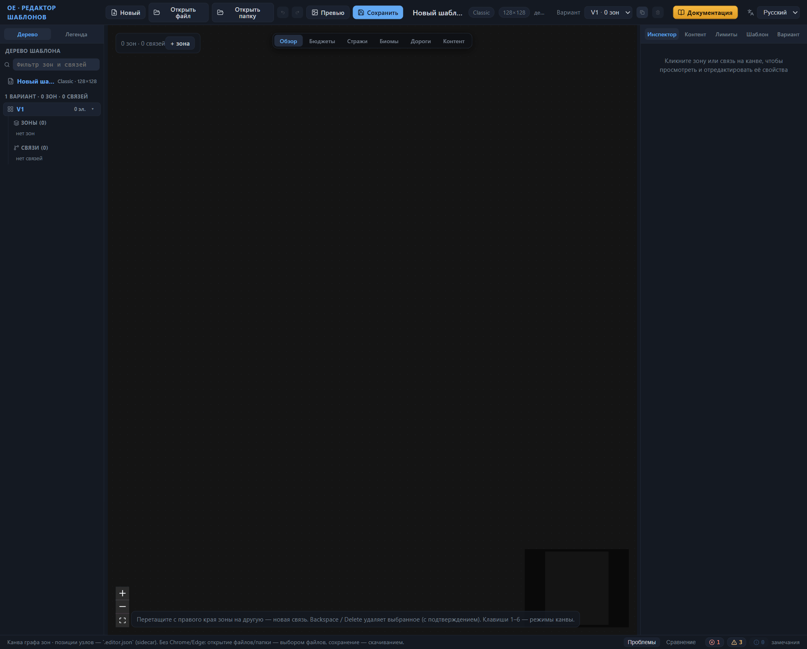
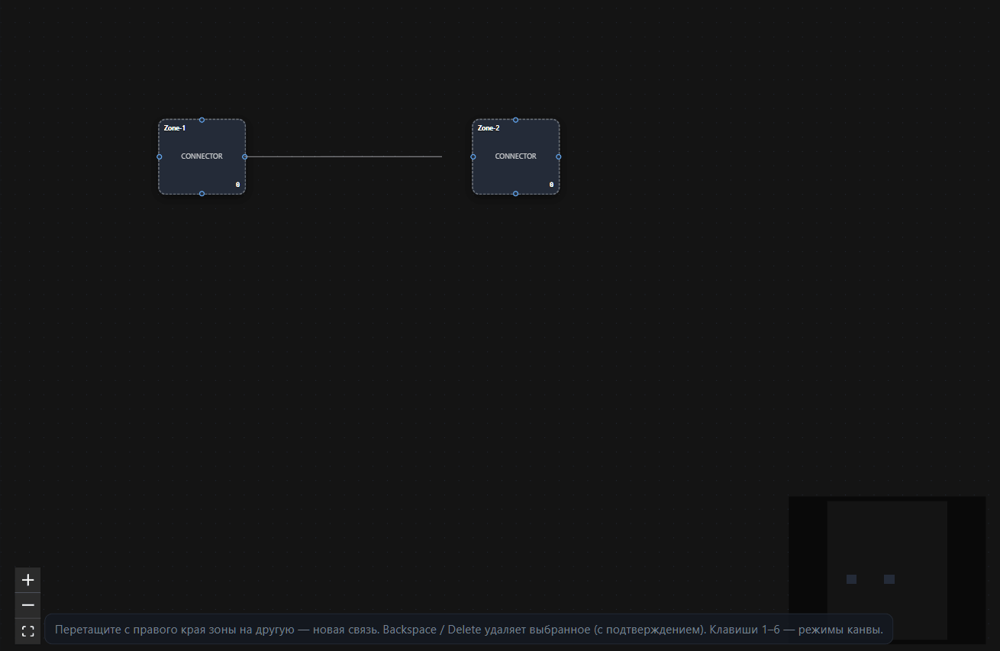
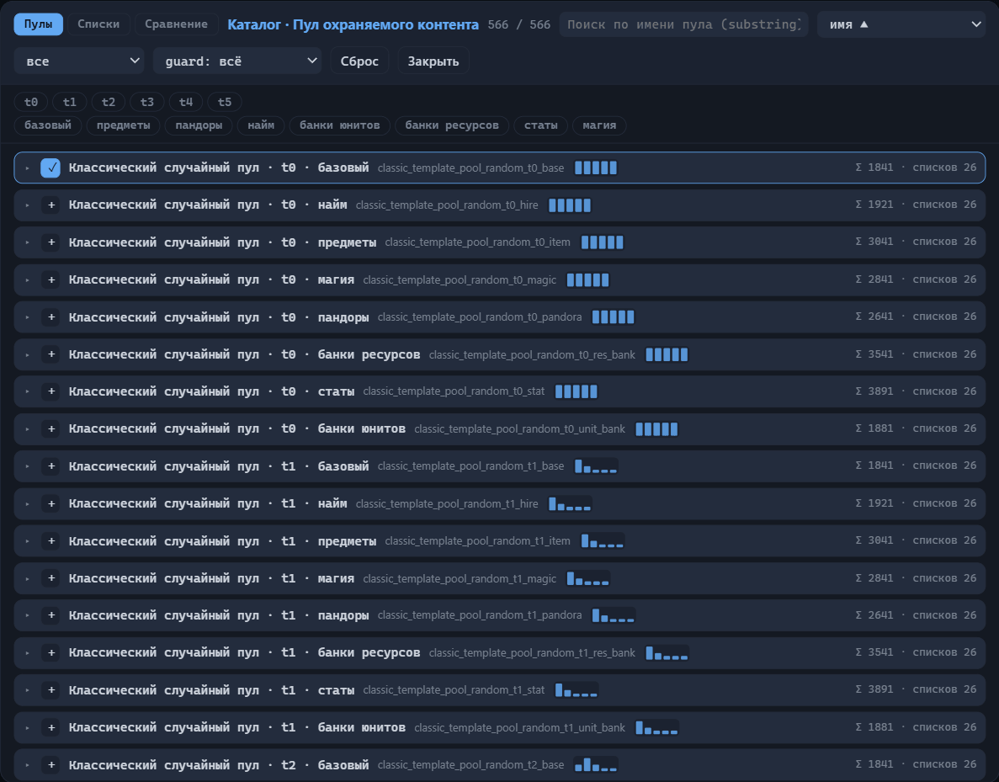
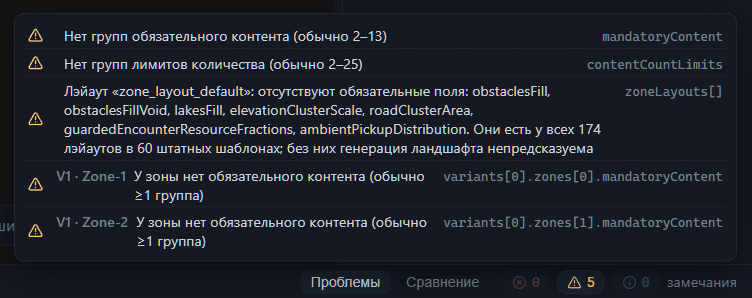
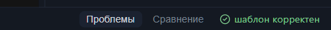

# Быстрый старт

В этой главе — один сквозной маршрут: пустое окно редактора, первый шаблон из двух зон, проверка без замечаний и готовая карта в игре. Каждое окно и поле по пути объясняется ровно в том объёме, который нужен для шага; полный разбор свойств — в справочных главах, ссылки стоят рядом с шагами.

Для работы понадобится браузер: в Chrome и Edge редактор умеет сохранять файлы прямо в выбранную папку, в остальных браузерах сохранение идёт скачиванием. Для последнего раздела нужна установленная игра Heroes of Might and Magic: Olden Era.

## Первый шаблон

### Пустой шаблон

1. Откройте редактор в браузере.
2. Нажмите «Новый» на верхней панели. Редактор создаст пустой шаблон: карту 128×128 клеток, один вариант раскладки и ни одной зоны.

Вариант раскладки — это одна схема зон и связей. Игра при создании карты собирает карту по одному варианту; пока схема пустая — вы наполните её в следующих шагах.

3. Осмотритесь. Схема живёт на канве — центральной области окна; слева — дерево шаблона, справа — инспектор свойств, внизу — панель «Проблемы». Подробный разбор окна — в главе [Интерфейс: окна и панели](interface.md).

### Две зоны и дорога между ними

Зона — часть карты со своим наполнением; связь — переход между зонами. Минимальная рабочая схема — две зоны и одна связь.

1. Нажмите «+ зона» на канве. Появится первая зона, и инспектор сразу откроет её свойства.
2. Нажмите «+ зона» ещё раз — на канве станет две зоны.
3. Перетащите с правого края первой зоны на вторую. Между зонами появится связь: дорога со стражей — охраной, прикрывающей переход. Значения стражи пока оставьте по умолчанию.

Кликните связь — инспектор покажет её свойства: тип перехода, стражу и прирост стражи. Настройка связей — тема главы [Связи между зонами](connections.md); для первого прохода подойдут значения по умолчанию.

### Название и размер карты

1. Перейдите на вкладку «Шаблон» в инспекторе.
2. В секции «Основное» впишите «Название» — например, «Моя первая карта». Это имя окажется в списке шаблонов игры и станет именем файлов при сохранении.
3. Поля «Размер карты X» и «Размер карты Z» пока не трогайте: значение по умолчанию 128 клеток — разумный старт. Размер задаётся в клетках от 80 до 240, всегда кратен 16, карта — квадратная.

### Первый пул контента

Наполнение зоны задаётся двумя вещами. Пул контента — именованный набор объектов игры, откуда генератор берёт находки. Бюджет наполнения — сколько «ценности» (условной валюты баланса, в которой пересчитаны и контент, и стража) генератор должен разместить в зоне. Подробно — в главе [Зона: все свойства](zone.md).

1. Кликните первую зону на канве и откройте вкладку «Инспектор».
2. В секции «Пулы контента» найдите поле «Пул охраняемого контента» и нажмите «Каталог».
3. Выберите в каталоге любой пул (ориентиры — суммарная ценность Σ и число списков у строки) и нажмите «+». Кнопка сменится галочкой: пул добавлен.
4. Закройте каталог кнопкой «Закрыть». Имя пула встанет в поле зоны.

Поиск, фильтры и чтение каталога — в главе [Каталог пулов контента](pools.md).

Рядом, в секции «Бюджеты», лежат поля «Бюджет охраняемого контента (на площадь)», «Бюджет неохраняемого контента» и «Бюджет ресурсов». Заполняется абсолютное значение или вариант «на площадь» (PerArea) — генератор использует одно из двух. Значения для своего баланса вы подберёте по справочнику зоны; пустые бюджеты проверка не запрещает, и первый шаблон можно закончить без них.

## Проверка и сохранение

### Замечания валидатора

Валидатор — встроенная проверка шаблона. Откройте внизу вкладку «Проблемы». Одно замечание вы уже закрыли: ошибка «Нет ни одной зоны» гаснет сама, как только на канве появляются зоны. Остались другие:

- «Нет групп обязательного контента (обычно 2–13)»;
- «Нет групп лимитов количества (обычно 2–25)»;
- «У зоны нет обязательного контента (обычно ≥1 группа)» — у каждой из двух зон;
- «Лэйаут «zone_layout_default»: отсутствуют обязательные поля…» — про генерацию рельефа;
- «gameRules: отсутствуют обязательные поля: heroCountMin, heroCountMax, heroCountIncrement, heroHireBan, encounterHoles, winConditions…» — про правила игры: число героев, «дыры» в энкаунтерах и условия победы.

Клик по замечанию о зоне или связи переносит выделение на проблемный элемент схемы. Замечания о настройках шаблона ведут себя иначе: щелчок открывает в инспекторе вкладку «Шаблон», а конкретное поле не подсвечивает — ищите его по пути в конце строки замечания. Разберём замечания по очереди — и к концу раздела список опустеет.

### Поля лэйаута зоны

Лэйаут зоны — правила, по которым генератор строит внутри зон рельеф: препятствия, озёра, дороги и разброс находок. У свежего шаблона эти поля пусты, и проверка просит их заполнить: без них генерация ландшафта непредсказуема.

1. Откройте вкладку «Шаблон» и найдите панель «Лэйауты зон (zoneLayouts)».
2. Заполните поля рабочими значениями из таблицы. Все числа лежат внутри диапазонов, которые подсказки полей показывают по данным штатных шаблонов игры.

| Поле | Значение |
|---|---|
| Плотность препятствий | 0.5 |
| Препятствия в «пустотах» | 0.5 |
| Плотность озёр | 0.3 |
| Масштаб кластеров высот | 0.5 |
| Площадь дорожного кластера | 100 |
| Доля ресурсных энкаунтеров | 0.7 |
| Отталкивание подборов | 1 |
| Случайный шум | 0.35 |
| Притяжение к дорогам | 0 |
| Притяжение к препятствиям | 0.02 |
| Веса размеров групп | 20 · 2 · 1 |

Поля с седьмого по одиннадцатое собраны в секции «Фоновые подборы». Поле «Мин. площадь озера» оставьте пустым — оно необязательное. Смысл каждого поля и точные границы — в главе [Настройки шаблона (корень)](root.md).

### Группа обязательного контента

Обязательный контент — объекты, которые генератор размещает гарантированно, независимо от бюджетов. Хранится он группами: группе дают имя, а зоны ссылаются на неё.

1. На вкладке «Контент» найдите панель «Обязательный контент» и нажмите «группа». Появится группа с именем `group_1`.
2. Нажмите «объект» — в группу добавится готовая заготовка: случайный легендарный предмет (sid `random_item_legendary`) под охраной.
3. Выберите первую зону, откройте вкладку «Инспектор» и в секции «Обязательный контент и лимиты» впишите `group_1` в поле «Группы обязательного контента».
4. Повторите для второй зоны.

В рабочих шаблонах групп обычно несколько — подсказка валидатора называет ориентир от 2 до 13. Для первого прохода достаточно одной.

### Группа лимитов количества

Лимиты количества — потолок числа объектов: они не дают генератору насесть какой-нибудь находкой на всю карту.

1. На вкладке «Лимиты» найдите панель «Лимиты количества» и нажмите «группа». Появится группа `content_limits_1`.
2. Нажмите «лимит» — добавится заготовка: не больше одного объекта `pandora_box` на всю карту.
3. Впишите `content_limits_1` в поле «Группы лимитов количества» обеим зонам — туда же, в секцию «Обязательный контент и лимиты».

### Правила игры

Последнее предупреждение — о секции «Правила игры»: шесть её записей заполнены во всех штатных шаблонах игры, и проверка напоминает о пропуске. Для первой карты возьмите значения классического режима.

1. Откройте вкладку «Шаблон» и раскройте секцию «Правила игры».
2. Впишите числа: «Начальное количество героев» — 1, «Максимальное количество героев» — 3, «Прирост лимита героев» — 1; назначение последнего поля уточняется, допустимые значения — от 0 до 2. Игрок начинает с одним героем и держит до трёх одновременно.
3. В списках «Запрет найма героев» и «„Дыры“ в энкаунтерах» выберите `false`: найм героев остаётся разрешённым, а механика «дыр» — выключенной. Состояние «не задано» предупреждение не снимает — нужен явный ответ.
4. В блоке «Условия победы» ниже выберите `true` в строке «Классическое». Правило совпадёт с отображаемым условием победы из секции «Основное»: партия заканчивается победой над всеми вражескими героями и захватом всех вражеских городов.

Числа применяются по Enter или когда поле теряет фокус — клик по следующему списку сохраняет значение сам. Предупреждение о шести записях гаснет, и список замечаний пустеет. Смысл каждого поля и его диапазоны — в главе [Настройки шаблона (корень)](root.md#правила-игры).

### Строка «шаблон корректен»

Вернитесь на вкладку «Проблемы». Замечаний не осталось ни одного, и панель показывает строку «шаблон корректен» — ваш шаблон дошёл до этого состояния.

Обратите внимание: «корректен» — это отсутствие замечаний проверки, а не приговор балансу. Сколько ценности оставить в зонах и где поставить стражу — вопросы дизайна карты, проверка их за вас не решает. Каталог типовых замечаний — в главе [Проверка шаблона (валидатор)](validator.md).

### Сохранение

1. Нажмите «Сохранить» на верхней панели.
2. Если редактор попросит указать папку (так происходит в Chrome и Edge при первом сохранении) — выберите пустую папку или создайте новую. Папка запомнится, и следующие сохранения пойдут в неё без диалога.
3. Посмотрите в папку: там лежат три файла — «Моя первая карта.rmg.json», «Моя первая карта.editor.json» и «Моя первая карта.png».

Первый файл — сам шаблон, его читает игра. Второй — sidecar-файл редактора: служебные данные схемы, позиции узлов и заметки; он нужен, чтобы при следующем открытии всё оказалось на своих местах. Третий — превью, PNG-мини-карта активного варианта. Если Chrome или Edge недоступны и вы работаете в другом браузере, те же три файла скачаются в папку загрузок. Подробно о сценариях — в главе [Файлы: открытие и сохранение](files.md).

## Установка шаблона в игру

1. Откройте в проводнике папку профиля игры:
   `C:\Users\<имя пользователя>\AppData\LocalLow\Unfrozen\HeroesOldenEra\users\Steam_<id>\my_map_templates\`
   Здесь `<id>` — номер аккаунта Steam; если папок `Steam_…` несколько, ищите свою по содержимому.
2. Скопируйте в неё файл «Моя первая карта.rmg.json». PNG-превью можно положить рядом — игре оно не мешает; sidecar-файл `.editor.json` игре не нужен.
3. Файл `.foldercache` в папке профиля не трогайте: игра сама сверит шаблоны с кэшем и перестроит его.
4. Запустите игру и начните создание случайной карты: «Моя первая карта» появится в списке пользовательских шаблонов — под именем из поля «Название».

Подробно о папке профиля, кэше и проверке установки — в главе [Установка шаблона в игру](install.md).

## Куда дальше

- [Зона: все свойства](zone.md) — бюджеты, биомы, стража и остальные настройки зоны.
- [Связи между зонами](connections.md) — типы переходов и стража на дорогах.
- [Каталог пулов контента](pools.md) — поиск, фильтры и выбор пулов для зон.
- [Настройки шаблона (корень)](root.md) — все корневые панели, включая лэйауты.
- [Проверка шаблона (валидатор)](validator.md) — полный список замечаний и их причины.
