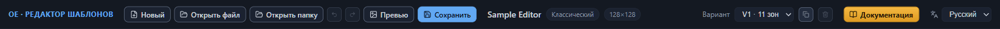
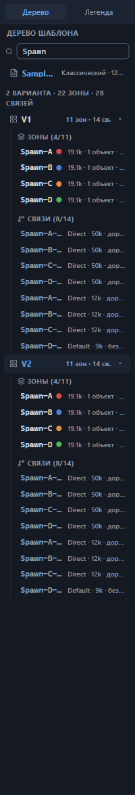
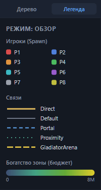
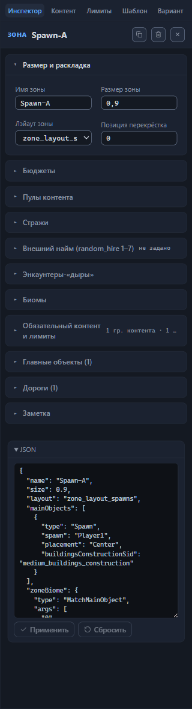
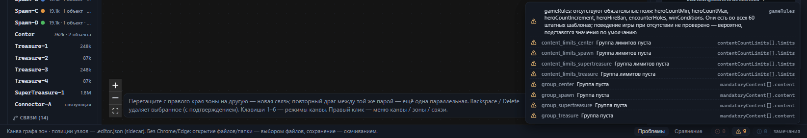
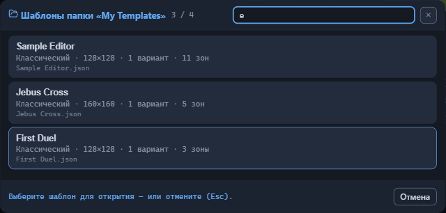
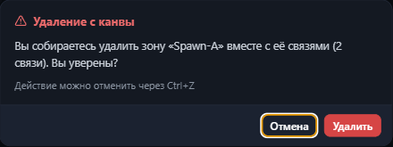
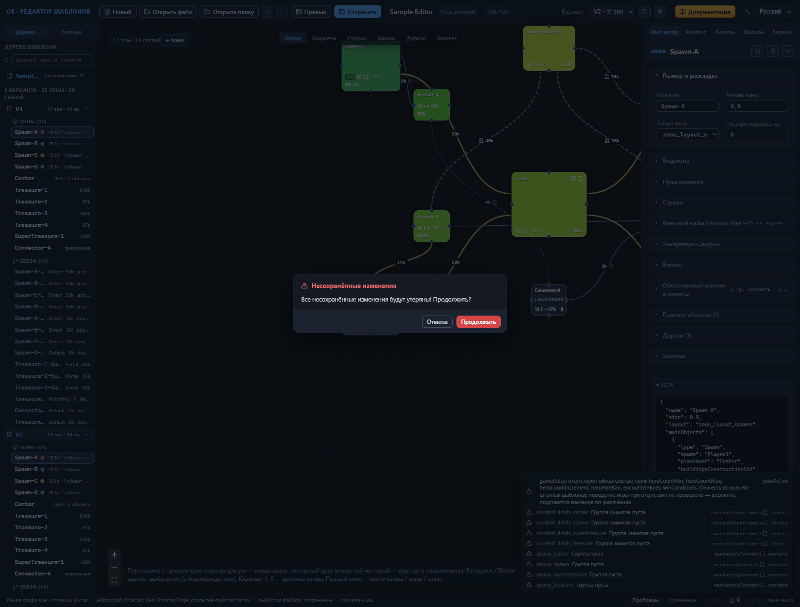

# Интерфейс: окна и панели

Окно редактора собрано из шести областей: верхняя панель с кнопками и сведениями о шаблоне, левая панель с деревом структуры и легендой, канва со схемой в центре, правая панель с инспектором, нижняя панель с проверкой и строка состояния вдоль нижнего края. Поверх них по мере надобности открываются диалоги: выбор шаблона из папки, превью, подтверждение удаления, встроенный мануал. Глава — справочник: для каждой области описано, что в ней находится и как ведёт себя каждая деталь. Смысл конкретных полей здесь не разбирается — для него отведены справочники [Зона: все свойства](zone.md), [Связи между зонами](connections.md) и [Настройки шаблона (корень)](root.md).

## Верхняя панель

Верхняя панель тянется по верхней кромке окна. Слева направо в ней стоят: имя редактора, кнопки работы с шаблоном, сведения об открытом шаблоне, селектор варианта раскладки, кнопка «Документация» и выбор языка интерфейса.

### Кнопки работы с шаблоном

У каждой кнопки есть всплывающая подсказка: наведите курсор, и редактор объяснит, что кнопка делает.

- **«Новый»** — подсказка «Создать шаблон с нуля». Заменяет текущий шаблон пустым: один вариант раскладки, ни одной зоны и связи. История изменений при этом сбрасывается, и кнопки отмены прежнее состояние не вернут. При несохранённых изменениях редактор сначала открывает окно «Несохранённые изменения» (см. раздел [«Диалоги и уведомления»](#диалоги-и-уведомления)), а после «Продолжить» правки теряются безвозвратно.
- **«Открыть файл»** — открывает диалог выбора файла `.rmg.json`; вместе с ним в том же диалоге выбирают служебный файл `.editor.json` этого шаблона. Файл, который не читается как шаблон, редактор отклоняет с уведомлением «Файл — не JSON-объект» или «Файл не похож на .rmg.json: нет name / variants[]».
- **«Открыть папку»** — указывает папку с шаблонами как рабочую. Один найденный шаблон открывается сразу, несколько — открывают диалог выбора из папки, ни одного — приводят к уведомлению «В выбранной папке не найдено .rmg.json файлов.». В браузерах с полной поддержкой работы с файлами выбранная папка становится местом сохранения.
- **«Превью»** — подсказка «Мини-карта активного варианта → PNG-превью». Открывает диалог превью.
- **«Сохранить»** — основная кнопка панели; её сценарии разобраны в разделе [«Сохранение»](#сохранение).

### Отмена и повтор

Кнопки с закруглёнными стрелками отменяют и повторяют изменения: «Отменить (Ctrl+Z)» и «Повторить (Ctrl+Shift+Z / Ctrl+Y)». Каждое изменение шаблона попадает в историю глубиной 100 шагов; шаги старше вытесняются новыми. Кнопка неактивна и подсвечена серым, когда откатывать или повторять нечего, — состояние видно ещё до нажатия. Сочетания клавиш действуют, пока фокус не в поле ввода: внутри поля Ctrl+Z правит набранный текст, а к истории шаблона обращается после ухода из поля.

### Сохранение

Подсказка кнопки «Сохранить» меняется вместе со сценарием работы с файлами:

- папка выбрана — «Сохранить в „Имя-папки“ (+ PNG превью)»;
- папка не выбрана, браузер с полной поддержкой файлов — «Выбрать папку и сохранить .rmg.json + .editor.json + PNG превью»;
- папка не выбрана, другой браузер — «Папка не выбрана — скачать .rmg.json + .editor.json + PNG превью».

Всегда пишется тройка файлов: шаблон `.rmg.json`, служебный `.editor.json` и превью `.png`. Что из себя представляет каждый из них и чем отличаются сценарии — тема главы [Файлы: открытие и сохранение](files.md).

Блокировка кнопки связана с JSON-черновиком. Пока в черновике JSON выбранного элемента остаётся неисправленная ошибка, «Сохранить» недоступна, а подсказка сменяется на «Сохранение заблокировано: в редакторе JSON есть неисправленная ошибка» — сначала примените или сбросите черновик, иначе редактор не сможет записать состояние, понятное игре. Правилам работы с черновиком посвящена глава [Прямая правка JSON](json-editor.md).

### Сведения о шаблоне

Рядом с кнопками выводится блок сведений: имя шаблона, режим игры и размер в клетках. После каждого сохранения в блоке появляется отметка с галочкой и временем; её подсказка повторяет, куда попали файлы, — «Сохранено в папку „Имя-папки“» либо «Скачано в папку загрузок браузера». По отметке удобно сверяться, доведены ли последние правки до файла.

### Вариант

Селектор «Вариант» перечисляет варианты раскладки — запасные схемы зон и связей, из которых игра при генерации карты выбирает одну, — строками вида «V2 · 7 зон». Выбор переключает активный вариант: тот, что показан на канве и принимает правки. Справа от селектора две кнопки. Копия с подсказкой «Дублировать активный вариант» добавляет копию в конец списка и делает её активной; корзина «Удалить активный вариант» удаляет активный вариант и недоступна, пока он единственный.

Обратите внимание: удаление варианта проходит сразу, без подтверждения. Вернуть его способна только кнопка отмены — пропустите откат, и вариант со всеми зонами и связями уйдёт из файла при следующем сохранении. Управлению вариантами посвящена глава [Варианты: управление и выбор](variant-manage.md).

### Документация и язык интерфейса

Кнопка «Документация» (подсказка «Мануал редактора (F1)») открывает встроенный мануал — окно, частью которого является этот текст. F1 срабатывает и из полей ввода, где остальные сочетания клавиш не действуют. Рядом стоит селектор «Язык интерфейса»; список языков — «Русский» и «English».

## Левая панель

Левая панель делится на две вкладки: «Дерево» со структурой шаблона (подсказка вкладки — «Структура шаблона: варианты, зоны, связи») и «Легенда» с расшифровкой текущего режима канвы («Легенда текущего режима канвы»). Ширину панели можно менять — как именно, рассказано в разделе [«Ширина боковых панелей»](#ширина-боковых-панелей).

### Вкладка «Дерево»

Заголовок вкладки — «Дерево шаблона», под ним поле «Фильтр зон и связей». Фильтр отбирает зоны по подстроке имени, связи — по подстроке идентификатора; у связи без собственного имени идентификатором служит пара имён зон «откуда–куда».

Корневая строка дерева повторяет имя шаблона с режимом игры и размером; подсказка «Открыть корневые настройки шаблона» не обещает лишнего — клик открывает вкладку «Шаблон» в инспекторе. Ниже стоит сводка по всему файлу: суммарное число вариантов, зон и связей.

Каждый вариант — отдельная ветка «V1» со своей сводкой «7 зон · 9 св.» и шевроном с подсказкой «Свернуть» либо «Развернуть». Ветка, внутри которой лежит выделенный элемент, раскрывается сама, а строка выделения дополнительно прокручивается в видимую часть; ветка, свёрнутая вручную, остаётся свёрнутой. Внутри ветки две группы — «Зоны» и «Связи». При работающем фильтре у заголовка группы появляется счётчик «найдено из общего числа», а пустые группы подписаны «нет зон» и «нет связей».

Строка зоны показывает имя и цветную точку игрока, если в зоне есть точка появления героя: цвет соответствует игроку Player1–Player8, подсказка точки — вида «Player1 · Spawn». Рядом стоят метки: суммарный бюджет наполнения зоны, то есть сколько ценности контента полагается разместить в зоне (у связующих зон его заменяет пометка «connector»), число объектов вида «3 объект(ов)» и число дорог вида «2 дор.».

Связь показана идентификатором — собственным именем или парой «откуда–куда» — и метками: тип связи из набора Direct, Default, Portal, Proximity, GladiatorArena; значение охраны в единицах ценности; «дорога» либо «без дороги».

Клик по строке зоны или связи делает её вариант активным и выделяет элемент на канве и в инспекторе. Правый клик по строке открывает контекстное меню: для зоны — «Дублировать зону» и «Удалить зону», для связи — «Дублировать связь» и «Удалить связь» (глава [Канва: правка графа](canvas-editing.md#контекстное-меню)). Клик по строке варианта открывает вкладку «Вариант» инспектора.

### Вкладка «Легенда»

Заголовок вкладки — «Режим: Обзор» или другой текущий режим, ниже — расшифровка цветов, линий и значков, которыми канва рисует схему именно в этом режиме. Набор разделов меняется вместе с режимом: игроки и типы связей — в «Обзоре», суммы бюджета — в «Бюджетах», цвета стражи — в «Стражах», биомы и их переключатели — в «Биомах», дороги — в «Дорогах», точки обязательного контента — в «Контенте». Держите легенду открытой, пока осваиваете новый режим, иначе часть обозначений на схеме останется нечитаемой. Режимы переключаются кнопками над канвой и клавишами 1–6; разбор каждого — в главе [Канва: режимы отображения](canvas-modes.md).

## Правая панель (инспектор)

Инспектор занимает правую панель и показывает свойства выбранного: зоны, связи, корня шаблона или активного варианта. Вкладок пять, набор не зависит от выделения — меняется только содержимое вкладки «Инспектор».

### Вкладки инспектора

| Вкладка | Что показывает | Где разобрано |
|---|---|---|
| «Инспектор» | свойства выбранной зоны или связи | [Зона: все свойства](zone.md), [Связи между зонами](connections.md) |
| «Контент» | панель «Обязательный контент» | [Настройки шаблона (корень)](root.md) |
| «Лимиты» | панель «Лимиты количества» | [Настройки шаблона (корень)](root.md) |
| «Шаблон» | корневые настройки шаблона | [Настройки шаблона (корень)](root.md) |
| «Вариант» | настройки активного варианта раскладки | [Вариант: ориентация и граница](variant-layout.md) |

### Заголовок выбранного элемента

Пока ничего не выбрано, вкладка «Инспектор» показывает подсказку «Кликните зону или связь на канве, чтобы просмотреть и отредактировать её свойства». После выбора появляется заголовок: тип «ЗОНА» или «СВЯЗЬ» и имя элемента (у связи без имени — пара «откуда–куда»).

В заголовке — кнопки действий. У зоны их три: копия с подсказкой «Дублировать зону (копия без связей)» создаёт копию зоны рядом с исходной (глава [Канва: правка графа](canvas-editing.md#дублирование-зоны)), корзина «Удалить зону (и связанные связи)» и ✕. У связи две кнопки: корзина «Удалить связь» и ✕. Корзина удаляет элемент немедленно и без диалога — не так, как удаление с канвы. Откат — кнопка отмены или Ctrl+Z; пропустите откат, и элемент исчезнет из файла при сохранении. ✕ сбрасывает выделение и возвращает подсказку.

Под заголовком идут секции свойств выбранного элемента, а замыкает вкладку раскрывающийся блок «JSON» с черновиком JSON: черновик можно отредактировать и применить либо сбросить к текущему состоянию. Правила безопасной работы с ним собраны в главе [Прямая правка JSON](json-editor.md).

В режиме сравнения рядом с именем появляется бейдж «≠ V3: …» — сокращённый список отличающихся полей, а для элемента, которого в сравниваемом варианте нет, — «нет в V3»; полная подсказка бейджа перечисляет все отличия. Буква V с номером — метка сравниваемого варианта. Сам режим описан в главе [Сравнение вариантов](compare.md).

## Канва

Канва — центральная область окна: схема зон и связей активного варианта. Над схемой по центру стоят шесть кнопок режимов отображения — «Обзор», «Бюджеты», «Стражи», «Биомы», «Дороги», «Контент»; те же режимы переключаются клавишами 1–6. В режимах «Бюджеты» и «Биомы» рядом с кнопками появляются дополнительные переключатели: метрика бюджета и слои биомов. Слева сверху — счётчик зон и связей активного варианта и кнопка «+ зона» с подсказкой «Добавить зону в активный вариант». В нижнем левом углу живёт строка-подсказка о приёмах редактирования, в нижнем правом — мини-карта, по которой перемещается вид схемы. Правый клик по канве, зоне или связи открывает контекстное меню с действиями (глава [Канва: правка графа](canvas-editing.md#контекстное-меню)). Чтению схемы посвящена глава [Канва: режимы отображения](canvas-modes.md), правке — [Канва: правка графа](canvas-editing.md).

## Нижняя панель и строка состояния

Нижняя панель несёт две вкладки: «Проблемы» — замечания валидатора, встроенной проверки шаблона (глава [Проверка шаблона (валидатор)](validator.md)), и «Сравнение» — отличия двух вариантов раскладки (глава [Сравнение вариантов](compare.md)).

Вдоль нижнего края тянется строка состояния. Она напоминает, что позиции узлов канвы хранятся в `.editor.json`, а в браузерах без полной поддержки работы с файлами открытие идёт выбором файлов, а сохранение — скачиванием. Sidecar-файл `.editor.json` — служебный файл рядом с шаблоном: редактор держит в нём позиции узлов схемы, заметки зон и раскладку секций, чтобы при следующем открытии всё оказалось на своих местах. Подробности — в главе [Файлы: открытие и сохранение](files.md).

## Диалоги и уведомления

Поверх основного окна открываются диалоги: выбор шаблона из папки, превью, подтверждение удаления с канвы, несохранённые изменения, встроенный мануал. События о файлах редактор сообщает уведомлениями в углу окна. Расклад у всех диалогов один: зачем нужны, как вызываются, что внутри и как их подтвердить или отменить.

### Выбор шаблона из папки

Диалог появляется, когда «Открыть папку» находит в папке больше одного шаблона и выбор нельзя сделать за пользователя. Заголовок — «Шаблоны папки „Имя-папки“», под ним поиск «Поиск по имени…», который ищет и по имени шаблона, и по имени файла, и счётчик найденного. Каждая строка списка — имя шаблона, сводка «режим игры · размер · число вариантов · число зон» и имя файла. Открытие — клик по строке; отмена — кнопка «Отмена», Esc, ✕ или клик по затемнённой подложке, о чём напоминает подпись «Выберите шаблон для открытия — или отмените (Esc).». Пустой результат подписан «Ничего не найдено.»

### Превью

Диалог превью открывает кнопка «Превью» на верхней панели. Внутри — заголовок «Превью» с меткой активного варианта, счётчик «N зон · M связей · 700×700», сама мини-карта и подпись о чтении: цвет зон — игрок или бюджет, линии — тип связи, как на канве. Кнопка «Обновить» перерисовывает картинку по текущему состоянию шаблона, «Скачать» уносит PNG в папку загрузок браузера, а «Сохранить в папку шаблона» записывает PNG-файл рядом с файлами шаблона. Без выбранной папки последняя кнопка недоступна — подсказка предлагает «Сначала выберите папку шаблона (кнопка „Открыть папку“ вверху)»; в браузерах без полной поддержки файлов её место занимает «Скачать PNG». Закрытие — Esc, ✕ или клик по подложке. В варианте без зон на картинке остаётся только фон — тёмный градиент и точки сетки. Глава [Превью и PNG](preview.md) разбирает его целиком.

### Подтверждение удаления с канвы

Удаление выделенного с канвы — клавишами Backspace или Delete — открывает диалог «Удаление с канвы». Сообщение называет, что именно уйдёт: зону, зону вместе с её связями и их число, связь между двумя зонами, а при множественном выделении — число выбранных элементов. Кнопки — «Удалить» и «Отмена»; под ними приписка «Действие можно отменить через Ctrl+Z». Esc и клик по подложке работают как отмена, а фокус сразу стоит на «Отмене», поэтому случайный Enter ничего не удалит. Корзина в инспекторе и пункты удаления контекстного меню это окно не вызывают — там удаление проходит сразу, и рассчитывать остаётся только на отмену.

### Окно «Несохранённые изменения»

Окно открывается при нажатии «Новый», «Открыть файл» и «Открыть папку», если в текущем шаблоне есть несохранённые изменения. Сообщение читается так: «Все несохранённые изменения будут утеряны! Продолжить?» Кнопок две — «Отмена» и «Продолжить», вторая выделена цветом как опасная. Фокус сразу стоит на «Отмене», поэтому случайный Enter не отбросит работу; Esc и клик по затемнённой подложке работают как отмена.

«Продолжить» выполняет задуманное действие: шаблон заменяется, история очищается, правки теряются безвозвратно — резервная копия сессии сразу перезаписывается новым состоянием (механика копии — в главе [Файлы: открытие и сохранение](files.md#резервная-копия-сессии)). После успешного сохранения подтверждение не спрашивается — кнопки работают сразу.

### Окно мануала

Окно открывают кнопка «Документация» и клавиша F1. Слева в нём — «Содержание» со списком глав, справа — текст главы со скриншотами; клик по скриншоту разворачивает его на всё окно, Esc закрывает мануал. Ненаписанные места окно не прячет: глава без текста подписана «Глава ещё не написана», кадр без скриншота — «Скриншот появится позже».

### Уведомления

Уведомления собираются стопкой в углу окна и не исчезают сами: каждое закрывается кликом, подсказка при наведении — «Закрыть уведомление». Ошибки помечены значком тревоги, сведения — значком „i“. Типовые тексты: «Не удалось записать „Имя.rmg.json“», «Не удалось записать „Имя.png“ — превью не сохранено», «В выбранной папке не найдено .rmg.json файлов.», «Не удалось сохранить резервную копию сессии: хранилище браузера недоступно или переполнено. Сохраните шаблон на диск вручную.», «Файлы сохранены в папку „Имя-папки“». Последнее приходит при первом сохранении во вновь выбранную папку; повторные сохранения в ту же папку уведомлением не сопровождаются.

### Ширина боковых панелей

Между канвой и боковыми панелями стоят вертикальные разделители. Перетаскивание меняет ширину панели, двойной клик возвращает стандартную — подсказки разделителей так и говорят: «Потяните, чтобы изменить ширину левой панели (двойной клик — сброс)» и «Потяните, чтобы изменить ширину инспектора (двойной клик — сброс)». Выбранные ширины запоминаются между сеансами: настроенный один раз экран сохранится и после перезапуска редактора.

## Куда дальше

- [Канва: режимы отображения](canvas-modes.md) — шесть режимов чтения схемы и легенда.
- [Канва: правка графа](canvas-editing.md) — добавление и удаление зон и связей, горячие клавиши.
- [Файлы: открытие и сохранение](files.md) — пара файлов шаблона и сценарии сохранения.
- [Проверка шаблона (валидатор)](validator.md) — панель «Проблемы» и работа с замечаниями.
