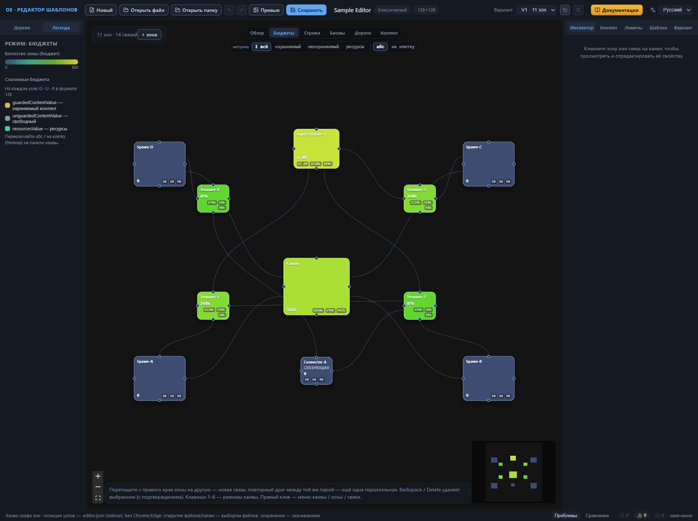
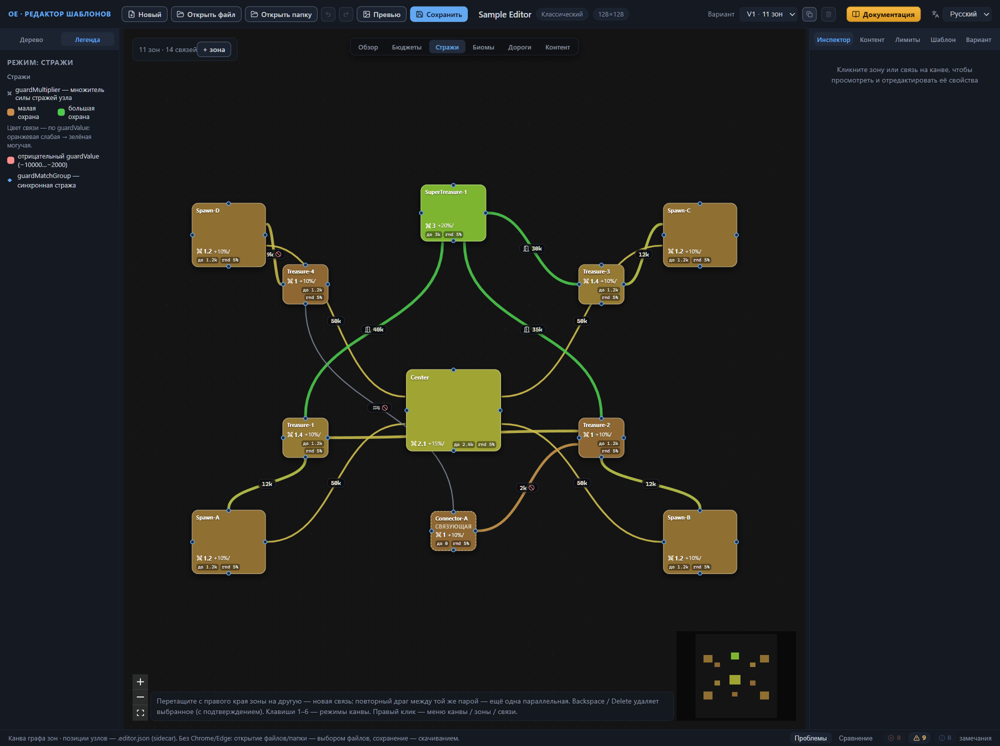
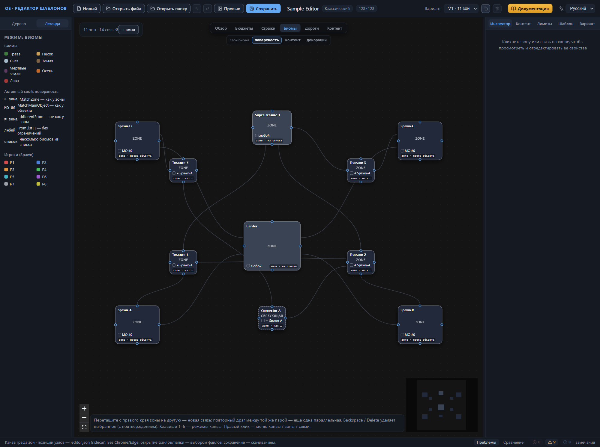
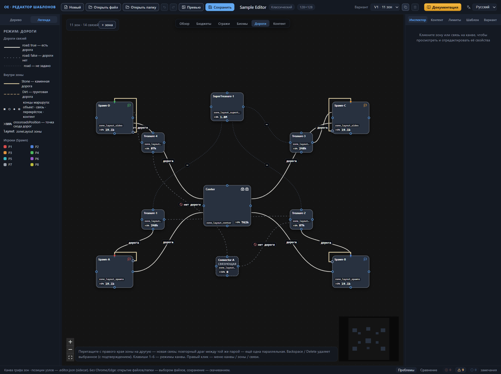
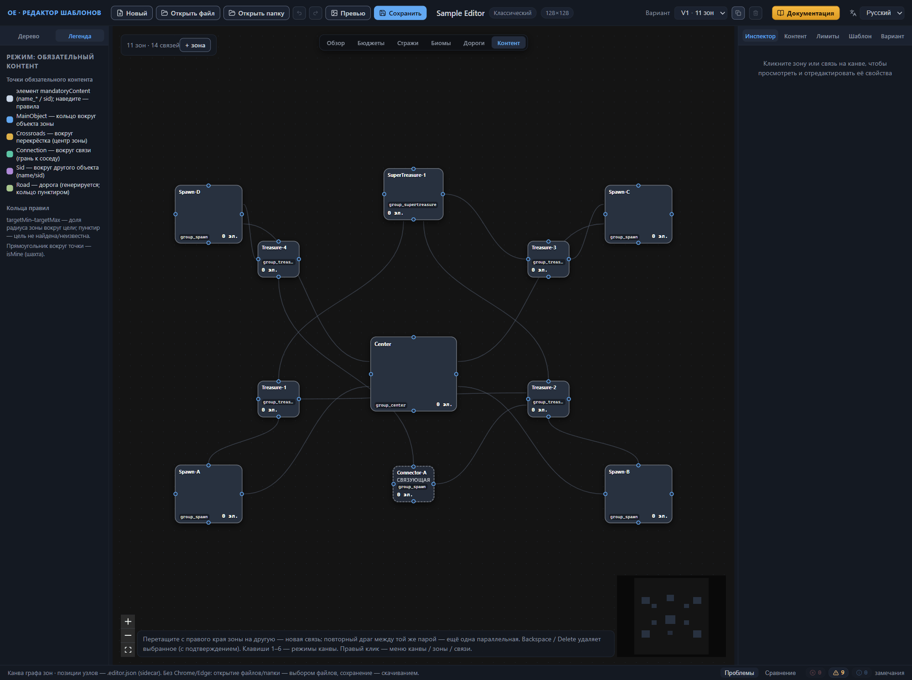
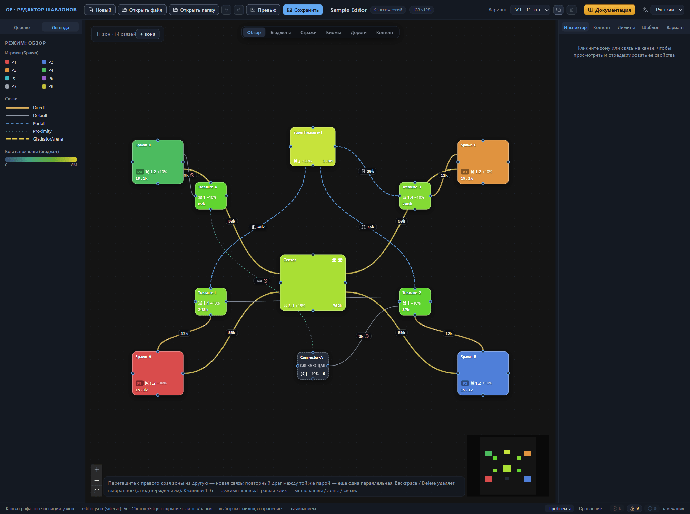

# Канва: режимы отображения

Схема на канве всегда одна — зоны и связи активного варианта раскладки, — а раскрасок у неё шесть: режим отображения выбирает, какую сторону шаблона показывать цветом. Кнопки режимов стоят над схемой по центру: «Обзор», «Бюджеты», «Стражи», «Биомы», «Дороги», «Контент». Клавиши 1–6 переключают режимы в порядке кнопок: 1 — «Обзор», 2 — «Бюджеты», 3 — «Стражи», 4 — «Биомы», 5 — «Дороги», 6 — «Контент»; пока фокус в поле ввода, цифры набираются в текст и режим не трогают. Легенда в левой панели перестраивается под активный режим, а мини-карта в правом нижнем углу канвы красит зоны теми же цветами. Переключайте режимы свободно: меняется только отображение, данные шаблона остаются нетронутыми.

## Режим «Обзор»

«Обзор» — режим по умолчанию: в нём канва встречает вас после открытия редактора. Подсказка кнопки собирает содержание режима в строку «Игроки · богатство · основные поля», и это лучшая точка старта: с одного взгляда видно, где чьи точки появления героев, насколько зоны наполнены и как они соединены.

### Узлы

Имя зоны — заголовок узла, а рядом с именем стоят значки главных объектов: флаг у точки появления героя (в цвете игрока), замок у города, здание у заброшенного аванпоста, скрещённые мечи у арены. Значки видны в «Обзоре» и «Дорогах»; остальные режимы их скрывают, оставляя узлы чисто текстовыми.

Цвет узла назначается по приоритету. В зоне есть точка появления героя — узел залит цветом этого игрока, тем же, что у метки «P1»–«P8» в нижней строке узла и у цветового образца в легенде. Точки нет, но зона связующая — без бюджетов и главных объектов, либо с именем, начинающимся на «Connector», — узел красится ровным тёмным и помечается словом connector. В остальных случаях работает шкала богатства: логарифмическая градация от глубокого синего у пустых зон к янтарному у богатых, крайние деления подписаны «0» и «8M».

Нижняя строка узла — сводка, в которой показывается только заданное: метка игрока «P1»–«P8»; множитель силы стражей со значком мечей (guardMultiplier); еженедельный прирост стражи вида «+10%»; суммарный бюджет зоны одной цифрой. Суммарный бюджет — сумма трёх бюджетов наполнения: охраняемого, неохраняемого и ресурсного контента; для каждого слагаемого канва берёт абсолютное значение, если оно задано и больше нуля, иначе — значение на площадь. Числа сжимаются до компактного вида: 9500 → «9.5k», 12345 → «12.3k», 250000 → «250k», 2500000 → «2.5M». Что кладётся в каждый бюджет — тема главы [Зона: все свойства](zone.md).

### Связи

Вид линии кодирует тип связи:

- Direct — плотная золотистая линия, самый заметный на схеме переход;
- Default — тонкая серая сплошная линия;
- Portal — синяя линия штрихом;
- Proximity — зеленоватая линия коротким штрихом;
- GladiatorArena — янтарная линия длинным штрихом.

Образцы линий с теми же именами лежат в легенде, смысл типов — в главе [Связи между зонами](connections.md).

Бейдж посреди линии появляется, когда связи есть что показать: значение охраны, если оно не ноль, — в тех же единицах ценности и том же компактном формате, что и бюджеты; значок двери у портала; «≈N» — дистанция у связи Proximity; перечёркнутый круг — дорога вдоль связи явно запрещена. Отрицательное значение охраны цвет линии не меняет — она остаётся в цвете типа связи, — но бейдж получает предупреждающий цвет и знак «?» перед числом. *Назначение уточняется.* Вдоль связи с проложенной дорогой идёт тонкая белая штриховая нить — та же дорога, что в режиме «Дороги». Несколько параллельных связей одной пары зон с одинаковым ненулевым значением охраны делят один бейдж: «×N значение» стоит на средней линии пучка.

Связь из группы синхронной стражи (guardMatchGroup) вместо цвета типа окрашивается собственным цветом группы — ровным, вычисляемым из имени группы; подробности о группах — в главе [Связи между зонами](connections.md).

Легенда режима показывает цвета игроков под заголовком «Игроки (Spawn)», образцы линий пяти типов и шкалу «Богатство зоны (бюджет)».

## Режим «Бюджеты»

«Бюджеты» показывает наполнение зон: сколько ценности контента полагается каждой зоне и из каких слагаемых оно складывается. Подсказка кнопки называет слагаемые и их поля: «охраняемый / неохраняемый / ресурсы (guardedContentValue · unguardedContentValue · resourcesValue; abs · PerArea)».

### Переключатели метрики

Под кнопками режимов появляются два переключателя. «Метрика» выбирает слагаемое: «Σ всё» — сумма трёх бюджетов (умолчание), «охраняемый» — бюджет охраняемого контента, «неохраняемый» — бюджет неохраняемого контента, «ресурсы» — бюджет ресурсов. Подписи чипов — по-русски; техническое имя поля каждого чипа всплывает в подсказке при наведении: guardedContentValue / guardedContentValuePerArea у «охраняемого», unguardedContentValue / unguardedContentValuePerArea у «неохраняемого», resourcesValue / resourcesValuePerArea у «ресурсов» и «Сумма: guardedContentValue + unguardedContentValue + resourcesValue» у «Σ всё». Второй переключатель выбирает вид значения: «абс» — абсолютное (умолчание) или «на клетку» — значение на площадь (PerArea). Правило показа симметрично: «абс» берёт абсолютное значение, а если у зоны задано только значение на площадь — показывает его; «на клетку» поступает наоборот.

### Узлы

Большая цифра узла — выбранная метрика в выбранном виде. Под ней идёт строка слагаемых G · U · R: G — охраняемый контент, U — неохраняемый (свободный), R — ресурсы; каждое слагаемое показывается в выбранном виде и в формате 12k. Цвет узла — та же шкала богатства, что в «Обзоре», но пересчитанная по выбранной метрике.

Обратите внимание: задать абсолютное значение и значение на площадь одновременно можно — подсказка редактора формулирует это как «Заполняется абсолютное значение или PerArea — генератор использует одно из двух». Какое именно из двух использует генератор — *Назначение уточняется.*

### Связи

Связи в этом режиме приглушены: тонкие серые линии без бейджей. Режим сосредоточен на зонах, и схема не отвлекает от чисел.

Легенда режима повторяет шкалу «Богатство зоны (бюджет)» и добавляет раздел «Слагаемые бюджета»: подсказку «На каждом узле: G · U · R в формате 12k» и три точки-образца — guardedContentValue (охраняемый контент), unguardedContentValue (свободный), resourcesValue (ресурсы). Там же напоминание «Переключайте абс / на клетку (PerArea) на панели канвы.».

## Режим «Стражи»

«Стражи» собирает на одной схеме охранные настройки: множители зон и значения охраны связей. Подсказка кнопки перечисляет поля: «guardMultiplier · guardValue связей · guardMatchGroup».

### Узлы

Цвет узла берётся из множителя силы стражей (guardMultiplier): шкала ведёт от красно-оранжевого края «малой охраны» к зелёному краю «большой». Множитель не задан — тон вычисляется по guardCutoffValue; нет и его — узел красится средним тоном.

Нижняя строка узла — охранные метки, снова только заданные: множитель со значком мечей; «+10%/» — еженедельный прирост стражи; «до 2k» — guardCutoffValue; «rnd 15%» — разброс силы стражи (guardRandomization); «дип −0.3» — diplomacyModifier. У guardCutoffValue и diplomacyModifier смысл не подтверждён источниками: *Назначение уточняется.*

### Связи

Цвет линии определяется значением охраны. Ноль рисуется серой линией обычной толщины. Положительное значение — от оранжевой у слабой охраны к зелёной у могучей; толщина растёт по логарифмической шкале и достигает максимума примерно к 4000 единиц ценности. Отрицательное значение даёт светло-красную линию и знак «?» в бейдже; легенда приводит встреченный диапазон −10000…−2000. *Назначение уточняется.*

Группа синхронной стражи (guardMatchGroup) перекрашивает свои связи в цвет, вычисленный из имени группы, и уплотняет линии — такие стражи ищут на схеме по одинаковому цвету, в легенде группа помечена значком ◆. Бейджи на связях те же, что в «Обзоре»: значение охраны, «?» у отрицательных, и пучок одинаковых параллельных связей собирается в один бейдж «×N значение». Требования к совпадению настроек внутри группы — в главе [Связи между зонами](connections.md).

Легенда режима показывает значок мечей с подписью «guardMultiplier — множитель силы стражей узла», пару точек «малая охрана» → «большая охрана», светло-красную точку отрицательного guardValue и значок ◆ синхронной стражи.

## Режим «Биомы»

«Биомы» перекрашивают схему по биомам зон: заливка узла показывает, какой биом получает зона на готовой карте. Подсказка кнопки перечисляет три слоя: «zoneBiome / contentBiome / metaObjectsBiome».

### Слой биома

Под кнопками режимов появляется переключатель «слой биома» — он выбирает, какую из трёх биомных настроек зоны показывает канва. Чипы переключателя подписаны по-русски: «поверхность» — `zoneBiome`, биом поверхности, умолчание; «контент» — `contentBiome`, биом, из которого зона берёт объекты контента; «декорации» — `metaObjectsBiome`, биом декораций окружения, мета-объектов. Техническое имя поля каждого чипа всплывает в подсказке при наведении. Так же по-русски называет активный слой легенда: заголовок «Активный слой: …» несёт имя поля в подсказке. Слой меняет заливку узлов, строки на них и заголовок легенды, но данных шаблона не трогает.

### Узлы

Заливка узла — цвет биома, разрешённого для активного слоя. Семь биомов несут постоянные цвета: «Трава» — зелёный, «Песок» — песочный, «Снег» — снежно-голубой, «Земля» — коричневый, «Мёртвые земли» — багрово-фиолетовый, «Осень» — рыжий, «Лава» — красноватый; те же семь образцов лежат в легенде. Имена биомов интерфейс показывает по-русски, а в файле хранятся латинские значения — `Grass`, `Sand`, `Snow`, `Dirt`, `Deathland`, `Autumn`, `Lava` (глава [Зона: все свойства](zone.md#биомы)). Когда конкретного биома нет, узел красится одним из трёх состояний: «любой» — ограничения сняты, пустой список выражений, — тёмно-синим серым; «список» и «?» — почти чёрным, а различают их строки на узле: «список» означает несколько допустимых биомов, «?» — биом не задан или не разрешается.

Первая строка узла начинается цветовым образцом-квадратиком, за ним идут имя разрешённого биома, если он конкретный, и селекторная строка — способ, которым биом выбран:

- «Трава» — фиксированный биом, единственное конкретное имя в списке;
- «← ИмяЗоны» — MatchZone, как у другой зоны;
- «MO #N» — MatchMainObject, после главного объекта; если у селектора задана и зона поиска — поле «Зона» в инспекторе, второй аргумент в файле, — строка дописывает её: «MO #2 ← Center»;
- «≠ ИмяЗоны» — differentFrom: биома указанной зоны здесь не будет;
- «список» — несколько допустимых биомов;
- «любой» — пустой список, ограничений нет;
- «?» — биом не задан или не разрешается.

Вторая строка — короткая метка активного слоя и способ выбора: «zone · как зона», «cont · из списка», «meta · после объекта»; селектора у зоны нет — способ читается как «нет». Наведите курсор на строку — подсказка покажет селектор как он записан в файле: тип и аргументы через запятую, например «MatchMainObject · 2, Center», либо «нет селектора». В середине узла, если зона не связующая, стоит короткая метка активного слоя: zone, cont или meta.

Разрешает биом канва, а не данные шаблона. Список FromList с именем биома даёт фиксированный цвет; пустой список или единственный нераспознанный аргумент — «любой»; несколько нераспознанных аргументов — строку «список» с тёмной заливкой. Выражение differentFrom исключает из списка биом указанной зоны и биом её главного объекта №0; как генератор выбирает из оставшихся биомов — *Назначение уточняется.* Канва красит такой узел биомом зоны-эталона: получается наглядный ориентир «какого биома здесь не будет». Полнее — в главе [Зона: все свойства](zone.md). MatchZone рекурсивно берёт биом зоны-цели того же слоя; зона не найдена — «?». MatchMainObject с заданной зоной поиска берёт биом этой зоны: биом самого объекта канва не вычисляет, это приближение; без зоны — снова тёмное «?». Не пугайтесь таких «?»: в штатных шаблонах MatchMainObject — самый частый способ выбора биома, и обычно он несёт только индекс объекта, поэтому тёмная заливка на узлах зон с точкой появления героя — обычная картина, а не ошибка данных. Циклические ссылки — MatchZone или differentFrom, замкнутые по кругу, — тоже дают «?»; канва сама разрывает такие цепочки.

### Связи

Связи приглушены: тонкие серые полупрозрачные линии без бейджей. Режим занят зонами, и переходы не спорят с цветами биомов.

Легенда режима держит секцию «Биомы» с семью образцами и секцию «Активный слой: …» с расшифровкой селекторных строк: «← зона» — MatchZone, как у зоны; «MO #0» — MatchMainObject, как у объекта; «≠ зона» — differentFrom, не как у зоны; «любой» — FromList [], без ограничений; «список» — несколько биомов из списка. Ниже — цвета игроков из «Игроки (Spawn)». Где задаются биомы зоны и их селекторы — глава [Зона: все свойства](zone.md).

## Режим «Дороги»

«Дороги» собирают на схеме всё дорожное: флаги дорог у связей, маршруты внутри зон, лэйауты и точки схода. Подсказка кнопки перечисляет: «road флаги связей · маршруты zone.roads · layout · crossroads».

### Узлы

Заливка узлов нейтральная тёмная — дорожные дела не перекрашивают зоны, — а значки объектов остаются видны, как в «Обзоре».

Первая строка узла — имя лэйаута зоны (zone.layout), именованного набора параметров рельефа из настроек шаблона; «layout?» означает, что лэйаут не задан. Вторая строка открывает метку «✕NN%» — точку схода дорог (crossroadsPosition), когда поле задано, — и следом показывает суммарный бюджет зоны в том же компактном формате, что в «Обзоре». Процент — округлённое значение поля: 0.5 превращается в «✕50%». Само поле — одно число 0–1, нормализованная позиция точки схода внутри зоны; что значат края шкалы, подсказка редактора формулирует как гипотезу: 0 — сход у центра, 1 — у края. В штатных шаблонах встречаются значения 0 и 0.5. Подсказки на строках называют поля: лэйаут — «zoneLayout зоны», метка схода — «crossroadsPosition — точка схода дорог», бюджет — «суммарный бюджет зоны».

### Связи

Вид линии кодирует флаг road:

- «дорога» — светлая плотная линия, поверх которой идёт тонкая белая штриховая нить: дорога проложена;
- «нет дороги» — серая линия редкого штриха, в бейдже значок перечёркнутого круга;
- «—» — тёмная тонкая приглушённая линия короткого штриха: флаг не задан.

«Не задано» — легитимное состояние, а не ошибка: в 19 из 60 штатных шаблонов флага road нет ни у одной связи. Бейдж стоит у каждой связи, и параллельные связи его не делят: бейджи разносятся вдоль линий, и пучок, собиравшийся в «Обзоре» в один «×N», здесь читается построчно.

### Маршруты внутри зон

Поверх узлов рисуются ортогональные ломаные с тёмным ореолом — маршруты zone.roads: они показывают, какие точки зоны соединяет дорога. Поверхность маршрута задаёт вид линии: Stone — каменная, светлая сплошная; Dirt — грунтовая, коричневатая штриховая. Поверхность не задана — нейтрально-бежевая сплошная. В штатных шаблонах большинство дорог каменные, грунтовых примерно одна на пятнадцать; встречаются и дороги вовсе без покрытия.

Концы маршрута несут маркеры целей: ■ светлый квадратик — главный объект, в цвете игрока, если это точка появления героя; ◯ кружок с ободком — связь; ◆ золотой ромб — перекрёсток зоны; ◎ зелёное пустое кольцо — элемент обязательного контента. Ломаная огибает узел с отступом наружу: объекты причаливают к верхней грани узла, связи — к грани в сторону зоны-соседа, перекрёсток стоит в центре, контент — у нижней грани. Маркеры держат постоянный экранный размер: при уменьшении масштаба они не мельчают, и концы маршрутов остаются различимы.

Легенда режима показывает секцию «Дороги связей» с тремя образцами линий — road: true, road: false и road не задано — и секцию «Внутри зоны»: образцы каменной и грунтовой поверхностей, строку маркеров «■ ◯ ◆ ◎» — концы маршрута: объект · связь · перекрёсток · контент, метку «✕NN%» — crossroadsPosition, точка схода дорог, и «layout» — zoneLayout зоны. Ниже — «Игроки (Spawn)». Флаг road и его поле — глава [Связи между зонами](connections.md); как устроен список roads зоны — [Зона: все свойства](zone.md).

## Режим «Контент»

«Контент» показывает обязательный контент шаблона: группы объектов, которые генератор обязан разместить на карте. Каждый элемент группы, привязанной к зоне, рисуется точкой рядом с узлом, а его правила размещения — цветными кольцами. В легенде режим назван «Обязательный контент». Подсказка кнопки: «mandatoryContent: точки объектов · правила размещения (targetMin/Max кольцом)». Связи в этом режиме приглушены: тонкие серые полупрозрачные линии без бейджей, всё внимание — зонам.

### Узлы

Заливка узлов нейтральная тёмная, у связующих зон чуть темнее; пометка connector сохраняется, как в прочих режимах, а значки объектов скрыты. Имя зоны остаётся на месте. Первая строка — имена групп обязательного контента, привязанных к зоне, через « · »; «—» — групп нет, «имя?» — группа с таким именем в списке обязательного контента шаблона не найдена (подсказка строки — «группы mandatoryContent»). Вторая строка — счётчик «N эл.»: сумма элементов тех привязанных групп, которые в шаблоне нашлись; битая ссылка даёт в сумму ноль (подсказка — «сумма элементов групп»).

### Точки обязательного контента

Каждый элемент каждой найденной привязанной группы получает точку рядом с узлом; элементы ненайденных групп не рисуются. Подпись точки — name_* элемента; имени нет — sid; нет ни того, ни другого — «элемент N», где N — порядковый номер элемента в группе, счёт с нуля. Длинные подписи усекаются многоточием. Обод точки окрашен в цвет типа первого правила с заданным расстоянием — того, что рисует первое кольцо у точки; колец нет вовсе — обод нейтральный светло-серый. Наведите курсор на точку — подсказка перечислит подпись, sid, имя группы и все правила элемента вида «Тип [аргументы] r мин–макс», включая правила без колец; часть «r …» у них отсутствует.

Прямоугольник вокруг точки — isMine: элемент помечен как шахта. В карточке элемента, в разделе «Обязательный контент» корневых настроек шаблона, этот переключатель называется «Ресурсный генератор».

### Кольца правил

Правила с расстоянием рисуются кольцом вокруг цели: кольцевая полоса между targetMin и targetMax — доля радиуса зоны; на канве радиус отсчитывается как половина меньшей стороны прямоугольника узла. Задана только одна из двух границ или точечный target — полоса вырождается в тонкую окружность. Цвет кольца — тип правила: MainObject — синий, Crossroads — золотой, Sid — фиолетовый, Connection — бирюзовый, Road — зелёный.

Центр кольца — цель правила. У Crossroads это центр узла; у MainObject — якорь объекта у верхней грани узла, аргумент правила выбирает объект по индексу; у Connection — точка на грани в сторону зоны-соседа, связь ищется по её имени, а без имени — по паре зон-источника и зоны-приёмника; у Sid — позиция другого элемента той же зоны, найденного по name_* или sid; у Road — центр зоны, и такое кольцо всегда пунктирное: дорогу строит генератор, цель не разрешается.

Пунктирное бледное кольцо — цель не найдена или неизвестна: битый индекс объекта, несуществующая связь, неразрешимые имя или sid. Неразрешённое кольцо рисуется в центре зоны — привязаться больше не к чему. Сплошное насыщенное — цель разрешена. От точки к центру её первого кольца тянется тонкая пунктирная нить — связка «элемент — цель»; колец нет — нить ведёт к цели размещения, которую редактор вычислил по правилу. Ни кольца, ни разрешимой цели у точки нет — нити не будет.

Позиции точек вычисляет редактор — по первому правилу, которое удалось разрешить: Crossroads ставит точку на расстоянии правила от центра зоны, MainObject — у якоря объекта, Connection — на луче от грани к центру зоны. Первое правило — Sid, его цель нашлась в зоне — точка переезжает к целевому элементу. Road точку не перемещает. Когда ни одно правило не разрешается, точки распределяются равномерно по окружности с центром в узле. Это схема-приближение для чтения шаблона, а не игровое размещение: где именно встанет объект, решит генератор.

В штатных шаблонах правила Road встречаются чаще всего — 837 вхождений на 60 файлов; затем MainObject (461), Crossroads (297) и Sid (292); Connection — редкость (19).

Легенда режима держит секцию «Точки обязательного контента»: нейтральная точка — элемент mandatoryContent с подписью name_* или sid, наведите курсор — правила; пять цветных строк расшифровывают кольца: MainObject — вокруг объекта зоны, Crossroads — вокруг перекрёстка, центра зоны, Connection — вокруг связи, грань к соседу, Sid — вокруг другого объекта по name/sid, Road — дорога, генерируется, кольцо пунктиром. Секция «Кольца правил» поясняет: targetMin–targetMax — доля радиуса зоны вокруг цели, пунктир — цель не найдена или неизвестна; прямоугольник вокруг точки — isMine, шахта. Как задаются группы, элементы и правила — глава [Настройки шаблона (корень)](root.md); как зона привязывается к группам — [Зона: все свойства](zone.md).

## Легенда и общие принципы чтения схемы

Разделы выше разбирали режимы по одному; этот собирает общее — где искать расшифровку схемы и по каким правилам схема читается в любом режиме.

### Вкладка «Легенда»

Легенда делит левую панель с деревом шаблона: сверху стоят две вкладки — «Дерево» и «Легенда», подсказка второй звучит как «Легенда текущего режима канвы». После открытия редактора панель показывает дерево; щёлкните вкладку «Легенда» — его место займёт расшифровка схемы. Вкладки — только взгляды на шаблон: переключение между ними не трогает ни данные, ни выделение.

Заголовок легенды — «Режим: …» — называет активный режим теми же именами, что кнопки над канвой, с одним исключением: кнопка «Контент» в легенде раскрыта полным именем «Обязательный контент». При смене режима легенда перестраивается целиком: у каждого режима свой набор секций, от прежнего ничего не остаётся. Мини-карта в правом нижнем углу канвы перекрашивается вместе со схемой и читается по той же легенде.

### Состав легенды по режимам

- «Обзор» — секции «Игроки (Spawn)» (цвета P1–P8), «Связи» (образцы линий пяти типов), «Богатство зоны (бюджет)» (шкала от 0 до 8M).
- «Бюджеты» — «Богатство зоны (бюджет)», «Слагаемые бюджета»: подсказка о строке G · U · R, три точки-образца слагаемых, напоминание о переключателях «абс / на клетку».
- «Стражи» — «Стражи»: значок мечей с guardMultiplier, пара точек «малая охрана» → «большая охрана», подсказка о цвете связей по значению охраны, светло-красная точка отрицательного значения, значок ◆ синхронной стражи.
- «Биомы» — «Биомы» (семь образцов цветов), «Активный слой: …» (расшифровка селекторных строк), «Игроки (Spawn)».
- «Дороги» — «Дороги связей» (три образца линий), «Внутри зоны» (поверхности, маркеры концов маршрута, метки «✕NN%» и layout), «Игроки (Spawn)».
- «Обязательный контент» — «Точки обязательного контента» (строка элемента и пять цветных строк колец), «Кольца правил» (подсказки о полосе targetMin–targetMax и прямоугольнике шахты).

Секцию «Игроки (Spawn)» держат три легенды — «Обзор», «Биомы» и «Дороги». Подробная расшифровка каждой секции — в разделе своего режима выше.

### Принципы чтения схемы

Схема одна во всех режимах: узлы — зоны активного варианта раскладки, линии — связи между ними. Режим отображения меняет раскраску и подписи, но не данные: переключение режимов ничего не правит в шаблоне.

Узлы и связи показывают только заданное. Нет у зоны множителя стражи — значка мечей не будет; нет у связи значения охраны — бейдж не появится. Отсутствие метки — тоже информация: поле не задано.

Числа на схеме сжаты в компактный формат: 9500 → «9.5k», 2500000 → «2.5M»; формат один и тот же у бюджетов, охраны и счётчиков.

Наводите курсор, когда нужна точность: шкала цвета передаёт диапазон, а подсказка — точное значение. Строки узлов в «Биомах» раскрывают полный селектор, точки в «Контенте» — sid, группу и правила, кнопки режимов — перечень полей режима.

Эта глава — про чтение. Как схему меняют — добавляют и удаляют зоны и связи, переименовывают, двигают узлы — описано в главе [Канва: правка графа](canvas-editing.md).

### Легенда и дерево вместе

Дерево называет, канва показывает, легенда расшифровывает. Строки дерева несут текстом часть того, что канва кодирует цветом: у связи — тип, значение охраны и флаг дороги; у зоны — признак connector, суммарный бюджет зоны, число объектов и дорог. Когда нужен список по именам, а не картина по цветам, дерево незаменимо: фильтр сужает его до совпадающих строк.

Щелчок по строке дерева выбирает элемент и наводит камеру канвы на него — у связи камера встаёт на середину между зонами; элемент из другого варианта раскладки заодно переключает активный вариант. Дальше элемент читается в любом режиме, а цвета сверяются с легендой. Подробно о дереве шаблона — глава [Интерфейс: окна и панели](interface.md).

## Куда дальше

- [Канва: правка графа](canvas-editing.md) — правка схемы: зоны, связи, горячие клавиши.
- [Зона: все свойства](zone.md) — бюджеты наполнения и настройки стражи зоны в инспекторе.
- [Связи между зонами](connections.md) — типы связей, значение охраны, синхронная стража.
- [Интерфейс: окна и панели](interface.md) — остальные области окна редактора.
