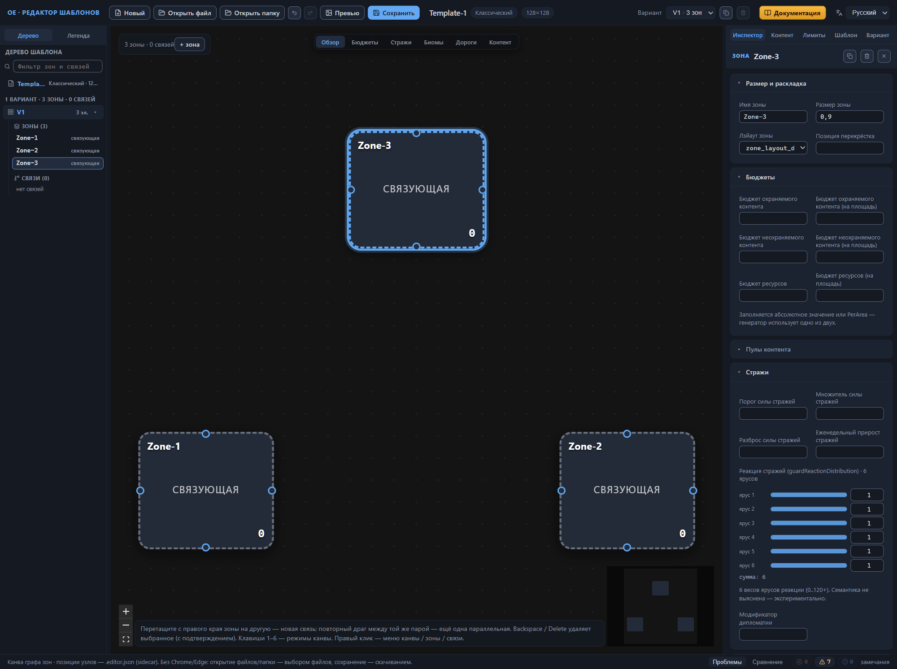
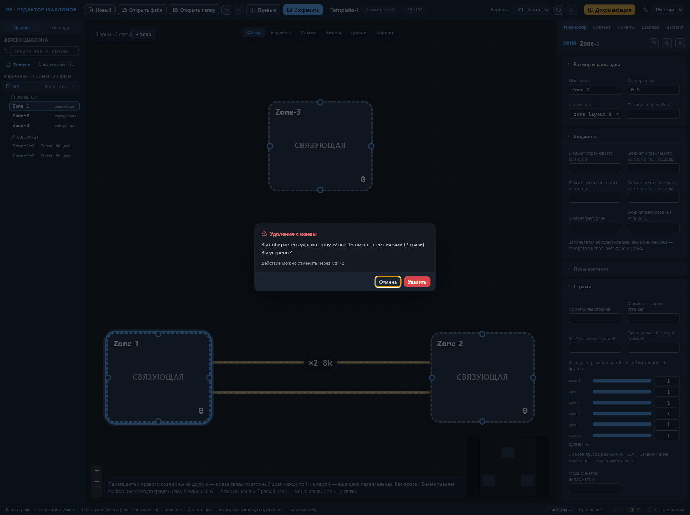
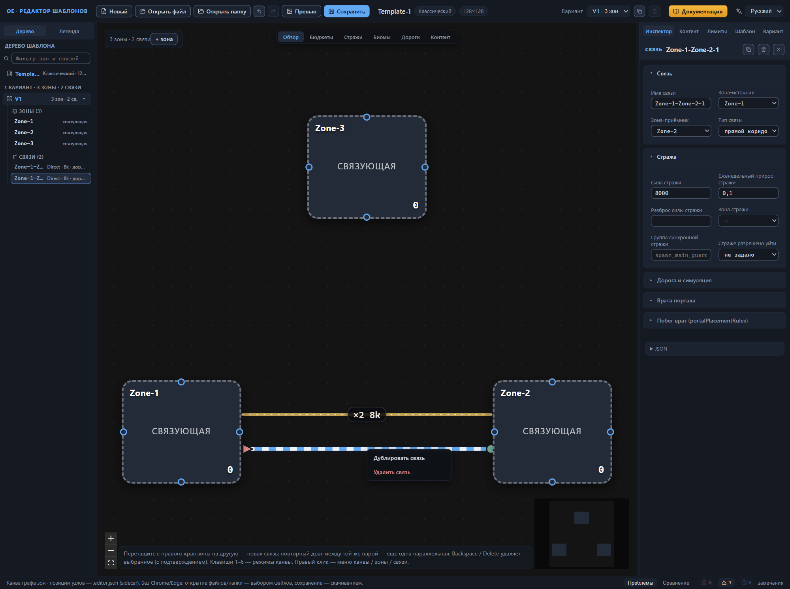
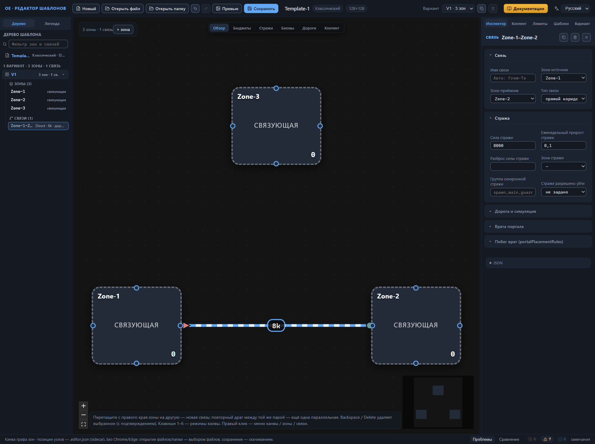
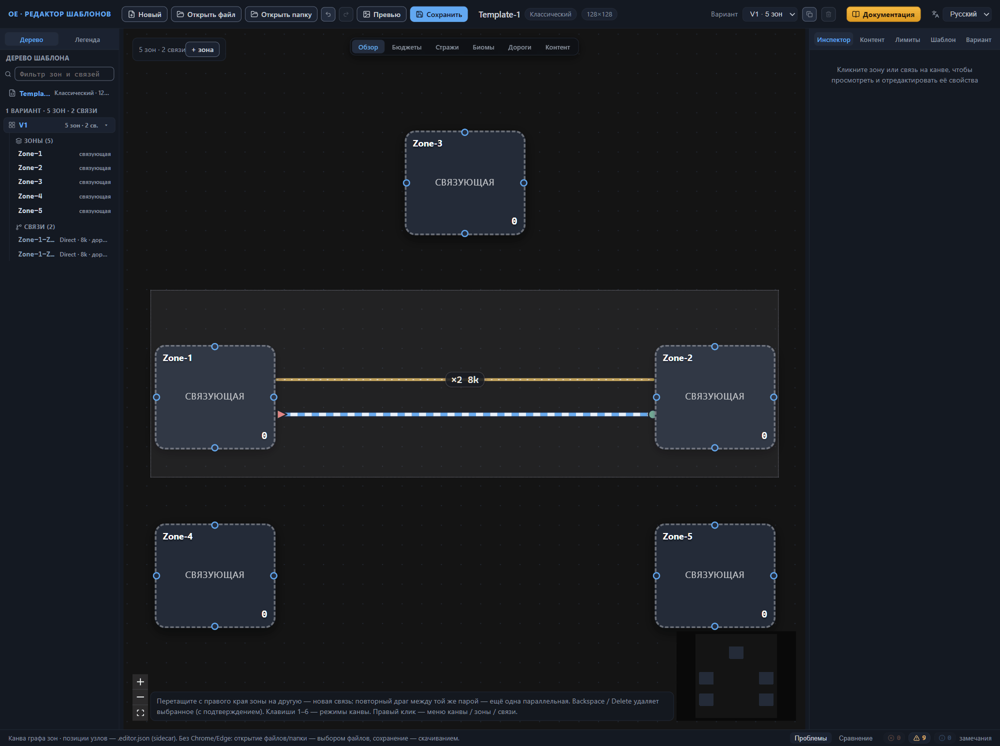

# Канва: правка графа

Канва показывает схему активного варианта раскладки — и там же эта схема правится: зоны добавляются, дублируются, переименовываются и удаляются, связи тянутся между зонами и убираются. Каждая операция попадает в историю изменений, поэтому ошибочный шаг откатывается нажатием Ctrl+Z. Как читать схему — цвета, режимы, легенда — рассказано в главе [Канва: режимы отображения](canvas-modes.md); эта глава — про изменение схемы.

## Добавление, дублирование, переименование и удаление зоны

### Добавление зоны

1. Нажмите кнопку «+ зона» в панели у левого верхнего угла канвы, рядом со счётчиком зон и связей.
2. Осмотрите результат: зона появится правее середины текущей схемы, выделится, и инспектор справа откроет её свойства. На пустой канве первая зона встанет в центр.

Подсказка кнопки — «Добавить зону в активный вариант» — задаёт правило: зона появляется только в активном варианте раскладки. Нужна схема в другом варианте — переключите его в селекторе «Вариант» на верхней панели и добавьте зоны там.

Новая зона — готовая заготовка, которую остаётся настроить в инспекторе:

- имя — первое свободное из ряда Zone-1, Zone-2, …;
- размер — 0.9, относительный вес площади зоны;
- лэйаут — первый лэйаут из списка лэйаутов шаблона;
- биомы — все три (зоны, контента, декораций) в значении «любой»;
- главные объекты — отсутствуют.

Второй путь — контекстное меню: правый клик по пустому месту канвы открывает меню с пунктом «Создать зону», и новая зона встаёт точно в точку клика (раздел [Контекстное меню](#контекстное-меню)).

### Дублирование зоны

Дублирование — быстрый способ получить зону с готовыми настройками: вместо пустой заготовки на схеме появляется копия существующей зоны. Запустите дублирование любым из трёх способов:

- кнопкой-копией в заголовке инспектора выбранной зоны — подсказка на ней читается как «Дублировать зону (копия без связей)»;
- пунктом «Дублировать зону» контекстного меню узла зоны на канве;
- тем же пунктом контекстного меню строки зоны в дереве шаблона.

Копия получает первое свободное имя из ряда Zone-1, Zone-2, … и встаёт на схему рядом с исходной зоной — чуть правее и ниже. Настройки зоны копируются целиком; два исключения — связи и заметка зоны: они остаются у исходной. Копия выделяется, инспектор открывает её свойства. Ctrl+Z отменяет дублирование.

### Переименование зоны

Имя зоны — её адрес в шаблоне: по нему связи держат концы, дороги и правила обязательного контента находят цели, дерево шаблона показывает строку зоны. Переименовывайте зону через поле инспектора — редактор перепишет все ссылки сам.

1. Щёлкните узел зоны на канве или строку зоны в дереве шаблона — инспектор покажет свойства зоны.
2. В секции «Размер и раскладка» исправьте поле «Имя зоны».
3. Имя применяется сразу, с каждым изменением поля — отдельной кнопки подтверждения нет. Подсказка поля напоминает: «Уникальное имя в варианте; связи, биомы и ссылки обновятся автоматически».

Редактор отклонит два варианта имени, показав сообщение на месте подсказки поля: пустое («Имя зоны не может быть пустым») и занятое («Имя «X» уже занято другой зоной»). В обоих случаях прежнее имя остаётся в силе.

Каскад переименования затрагивает всё, что ссылается на зону:

- концы связей (зона-источник и зона-приёмник), зону стражи и зону размещения врат;
- зону отсчёта угла в ориентации макета варианта;
- селекторы биомов и фракций — строки «как у другой зоны» и выражения «не как у зоны»;
- аргументы размещения главных объектов — «возле другой зоны» и «на конкретной связи»;
- авто-имена связей вида From-To, а вместе с ними — концы дорог и правила обязательного контента, ссылающиеся на эти имена;
- позицию узла и заметку зоны в sidecar-файле .editor.json.

Зона, встречающаяся в нескольких вариантах раскладки, переименуется везде сразу. Настраивать это не нужно: каскад — главная страховка при правке схемы, и потому править имена зон вручную в файле не стоит — одна пропущенная ссылка уведёт дорогу или правило размещения не к той зоне.

### Удаление зоны

Удаление запускается тремя путями. С канвы: выберите узел зоны и нажмите Backspace или Delete — редактор спросит подтверждение. Без вопроса удаляют кнопка корзины в заголовке инспектора с подсказкой «Удалить зону (и связанные связи)» и пункт «Удалить зону» контекстного меню — узла зоны на канве или строки зоны в дереве шаблона.

Диалог подтверждения называется «Удаление с канвы». Если у зоны есть связи, сообщение предупредит о них целиком: «Вы собираетесь удалить зону «X» вместе с её связями (N). Вы уверены?»; зоны без связей удаляются с сообщением «Вы собираетесь удалить зону «X». Вы уверены?». Кнопки — «Удалить» и «Отмена»; фокус стоит на «Отмене», поэтому случайный Enter безопасен, а Esc и щелчок по фону за окном тоже закрывают диалог без удаления. Под кнопками — приписка «Действие можно отменить через Ctrl+Z».

Вместе с зоной удаляются её связи, позиция узла на схеме и заметка зоны из sidecar-файла. Передумали — жмите Ctrl+Z сразу после удаления: вернутся и зона, и её связи, и заметка.

## Создание, дублирование и удаление связи

### Создание связи

Связь — переход между двумя зонами. На канве она тянется перетаскиванием: подсказка вдоль нижнего края канвы звучит как «Перетащите с правого края зоны на другую — новая связь; повторный драг между той же парой — ещё одна параллельная».

1. Наведите курсор на правый край узла-зоны — появится точка-крепление.
2. Тяните точку к другой зоне: за курсором протянется резиновая линия.
3. Отпустите кнопку мыши на целевой зоне. Связь создастся, выделится, и инспектор откроет её свойства с заголовком «СВЯЗЬ».

Откуда тянули — то зона-источник, куда отпустили — зона-приёмник; направление задаёт авто-имя связи и порядок имён в подсказках инспектора.

Новая связь — тоже заготовка:

- тип — прямой коридор (Direct);
- дорога по связи — есть;
- значение охраны — 8000 в единицах ценности;
- еженедельный прирост стражи — 0.1;
- имя — авто, из имён зон (см. ниже).

Ничем не заканчивается только одно действие: связь зоны с самой собой не создаётся.

Повторный драг между той же парой зон добавляет ещё один переход — параллельную связь. Штатные шаблоны несут по несколько параллельных переходов одной пары и различают их суффиксами в именах, а редактор берёт выдачу имён на себя. Первую связь пары он оставляет безымянной — та живёт под авто-именем из имён зон. Каждой следующей связи того же направления он сразу выдаёт имя с числовым суффиксом: «Zone-1-Zone-2-1», затем «Zone-1-Zone-2-2». Переименовывать такие связи не нужно: суффикс уже делает имя уникальным, и ссылки на него в концах дорог и аргументах размещения остаются целыми. Драг в обратную сторону даёт связь с собственным авто-именем из другой пары имён — «Zone-2-Zone-1»; редактор различает переходы по направлению.

Параллельную связь с готовыми настройками даёт дублирование (раздел [«Дублирование связи»](#дублирование-связи)): повторный драг создаёт пустую заготовку со значением охраны 8000, а копия наследует все поля исходного перехода.

### Имя связи

Инспектор связи начинается полем «Имя связи» с плейсхолдером «Авто: From-To». Пока поле пусто, связь живёт под авто-именем из имён своих зон — например, «Zone-1-Zone-2»; под этим именем связь видна в дереве шаблона, и на него ссылаются концы дорог и аргументы размещения «на конкретной связи».

Собственное имя впишите в то же поле — подсказка формулирует его роль так: «name — на него ссылаются дороги и placementArgs». Обратите внимание: переименование связи не каскадирует. Ссылки на старое имя — авто или ручное — сами не перепишутся: дорога или правило размещения не найдёт цель, и ссылка останется битой. Переименовывайте связь до того, как на неё сослались, либо проверьте ссылки после переименования.

### Дублирование связи

Дублирование — быстрый способ получить второй проход между той же парой зон с готовыми настройками. Запустите его любым из трёх способов:

- кнопкой-копией в заголовке инспектора выбранной связи — подсказка на ней читается как «Дублировать связь»;
- пунктом «Дублировать связь» контекстного меню линии связи на канве;
- тем же пунктом контекстного меню строки связи в дереве шаблона.

Копия наследует все поля исходного перехода: тип связи, дорогу по связи, силу стражи, еженедельный прирост, разброс, зону стражи, группу синхронной стражи и правила врат. Имя она получает новое — первое свободное из ряда «Исходное-имя-1», «Исходное-имя-2», … В список копия встаёт сразу за исходной связью, на канве ложится рядом с ней, выделение переходит на копию, а инспектор открывает её свойства. Ctrl+Z отменяет дублирование.

Проверьте в копии группу синхронной стражи. Группа требует одинаковых значений силы стражи, прироста и разброса у всех своих связей, а копия приходит в группу исходного перехода вместе с её числами. Поменяли силу стражи и оставили группу прежней — валидатор ответит предупреждением о расхождении, и симметрии проходов, ради которой группу заводили, не получится. Запасному проходу дают собственную группу или убирают её вовсе (глава [Связи между зонами](connections.md#группа-синхронной-стражи)).

### Удаление связи

Порядок тот же, что у зоны. Выберите линию связи на канве (или её строку в дереве шаблона) и нажмите Backspace или Delete — откроется диалог «Удаление с канвы» с сообщением «Вы собираетесь удалить связь между зонами «A» и «B». Вы уверены?»; кнопка «Удалить» завершает, «Отмена», Esc и щелчок по фону — нет. Сразу, без диалога, связь убирают корзина в заголовке инспектора с подсказкой «Удалить связь» и пункт «Удалить связь» контекстного меню — линии связи на канве или её строки в дереве. Возврат — Ctrl+Z.

## Контекстное меню

Правый клик открывает в точке курсора контекстное меню — список действий для места, по которому кликнули. Строка-подсказка канвы называет этот приём так: «Правый клик — меню канвы / зоны / связи».

| Место правого клика | Пункты меню |
|---|---|
| пустое место канвы | «Создать зону» — новая зона встаёт точно в точку клика |
| узел зоны на канве | «Дублировать зону», «Удалить зону» |
| линия связи на канве | «Дублировать связь», «Удалить связь» |
| строка зоны в дереве шаблона | «Дублировать зону», «Удалить зону» |
| строка связи в дереве шаблона | «Дублировать связь», «Удалить связь» |

Пункты удаления выделены красным как опасные. Меню закрывается выбором пункта, клавишей Esc или щелчком мимо него.

Обратите внимание: действия меню выполняются сразу, без диалога подтверждения — в отличие от Backspace и Delete, которые удаление сперва спрашивают. Страховка та же, что у корзины инспектора: Ctrl+Z.

Дерево шаблона показывает строки всех вариантов раскладки, а действия меню применяются к активному варианту. Выберите пункт для строки из другого варианта — редактор сначала сделает тот вариант активным, а затем выполнит действие; так же работает и выбор строки кликом.

## Перемещение узлов и порядок на схеме

### Перетаскивание узлов

1. Захватите узел зоны щелчком и тяните по канве.
2. Отпустите кнопку. Узел останется на новом месте, а связи перестроятся: линии выйдут к цели кратчайшим путём — с той стороны зоны, что обращена к соседу; если у зоны несколько связей, их концы равномерно расходятся точками крепления по стороне, и параллельные переходы не сливаются в одну линию.

Держите связанные зоны рядом, а несвязанные разносите — иначе линии протянутся через всю схему, и разбирать её станет тяжело. Самому шаблону порядок безразличен: позиции узлов не входят в файл `.rmg.json`, игра их не увидит, так что двигайте смело. Перетаскивание всё равно попадает в историю изменений — Ctrl+Z вернёт узел или группу узлов на прежние места.

Несколько узлов переезжают одним жестом. Удерживайте Shift и протяните рамку по пустому месту канвы — узлы под рамкой выделятся. Тяните любой из выделенных, остальные последуют за ним; в историю такой жест записывается один раз.

### Позиции узлов и sidecar-файл

Позиции узлов — часть схемы редактора, а не шаблона. Кнопка «Сохранить» записывает их в sidecar-файл `.editor.json` рядом с шаблоном — вместе с заметками зон и раскладкой секций инспектора, поэтому наведённый порядок переживает закрытие редактора. Sidecar-файл всегда пишется полным: в него попадают позиции всех зон каждого варианта раскладки — и переставленные вручную, и поставленные самим редактором. Сценарии сохранения и правила пары файлов — тема главы [Файлы: открытие и сохранение](files.md).

У каждого варианта раскладки собственная расстановка узлов: селектор «Вариант» на верхней панели переключает не только зоны и связи, но и их расположение на схеме.

Нет сохранённой позиции — канва ставит зону на кольцо вокруг центра схемы, в порядке следования зон в варианте. Так выглядит шаблон, открытый без sidecar-файла: перенесли один `.rmg.json` без пары — схема соберётся заново на кольце, зоны и связи останутся целы. Подвиньте узлы как удобнее и сохраните: sidecar-файл запишет позиции всех зон варианта — и переставленных, и оставшихся на кольце, — и раскладка переживёт следующее открытие.

Кнопки автоматической расстановки в редакторе нет. Кольцо — стартовая расстановка на случай потери позиций, остальной порядок на схеме — ручная работа.

### Масштаб и обзор

Просторная схема целиком в окно не помещается — обзор держат три инструмента.

1. Колесо мыши приближает и отдаляет вид; перетаскивание пустого места канвы сдвигает его.
2. Столбик кнопок в левом нижнем углу канвы приближает, отдаляет и одной кнопкой вписывает всю схему в окно — она возвращает полный обзор после серии приближений.
3. Мини-карта в правом нижнем углу повторяет схему целиком: щёлкните по ней или протяните курсор — вид переместится к выбранному месту.

При открытии шаблона канва сама вписывает схему в окно, вручную обзор нужен только после приближения.

## Горячие клавиши и переход к элементу

### Клавиши редактора

Строка-подсказка в левом нижнем углу канвы повторяет главные приёмы: «Перетащите с правого края зоны на другую — новая связь; повторный драг между той же парой — ещё одна параллельная. Backspace / Delete удаляет выбранное (с подтверждением). Клавиши 1–6 — режимы канвы. Правый клик — меню канвы / зоны / связи». Полный список сведён в таблицу.

| Клавиши | Действие | Где работает |
|---|---|---|
| 1–6 | переключить режим отображения канвы | в любом месте окна; не срабатывает с зажатыми Ctrl, Cmd, Alt или Shift и внутри полей ввода |
| Backspace, Delete | удалить выбранное — с подтверждением | канва: при выбранной зоне, связи или нескольких элементах |
| Ctrl+Z | отменить последний шаг | в любом месте окна, кроме полей ввода |
| Ctrl+Shift+Z, Ctrl+Y | повторить отменённый шаг | в любом месте окна, кроме полей ввода |
| F1 | открыть мануал редактора | везде, включая поля ввода |
| Esc | закрыть диалог, окно или контекстное меню; диалогу удаления равносильно «Отмена» | диалоги редактора, контекстное меню |

На macOS вместо Ctrl работает Cmd — редактор понимает обе клавиши. История изменений вмещает до 100 шагов, глубже откат не пойдёт.

### Переход к элементу из панелей

Три панели наводят камеру канвы на элемент — искать узел вручную не придётся.

**Дерево шаблона.** Щёлкните строку зоны или связи: элемент выделится, инспектор откроет его свойства, а камера плавно наведётся на узел; для связи целью служит середина между её зонами. Правый клик по строке открывает контекстное меню с действиями (раздел [Контекстное меню](#контекстное-меню)). Строка из другого варианта раскладки сначала переключит активный вариант и лишь затем наведёт камеру.

**Панель «Проблемы».** Замечание валидатора — кнопка с подсказкой «перейти к замечанию». Щелчок выбирает названную в замечании зону или связь и наводит камеру; замечание о другом варианте сначала переключит вариант. Замечание о корне шаблона камерой не фокусируется — щелчок открывает вкладку «Шаблон» инспектора.

**Панель «Сравнение».** Строка отличия «изменено» или «только в A» наводит камеру на элемент базового варианта A — тем же механизмом, что и валидатор. Строка «только в B» некликабельна: элемента в варианте A нет, фокусировать нечего.

Масштаб вида при любом переходе сохраняется — камера наводится без приближения и отдаления.

## Куда дальше

- [Зона: все свойства](zone.md) — чем наполнить зону: бюджеты, биомы, стража, объекты.
- [Связи между зонами](connections.md) — типы переходов, значение охраны, дороги и врата.
- [Варианты: управление и выбор](variant-manage.md) — переключение, копирование и удаление вариантов раскладки.
- [Файлы: открытие и сохранение](files.md) — пара файлов шаблона и сценарии сохранения.
- [Проверка шаблона (валидатор)](validator.md) — чтение панели «Проблемы» и работа с замечаниями.
