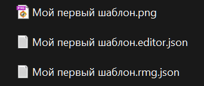
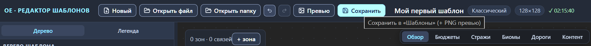

# Файлы: открытие и сохранение

На диске шаблон живёт парой файлов: сам шаблон в `.rmg.json` и sidecar-файл `.editor.json`, в котором редактор держит свои служебные данные; каждое сохранение дописывает рядом PNG-превью. Эта глава — про всю файловую механику: как устроена пара, как открыть шаблон из файла или из папки, что именно делает кнопка «Сохранить», как работу страхует резервная копия сессии и как работает отмена действий.

Сценарии немного зависят от браузера. В Chrome и Edge доступна полная поддержка работы с файлами: редактор читает и пишет выбранную папку напрямую. В остальных браузерах открытие идёт выбором файлов, а сохранение — скачиванием; текущий режим всегда напоминает строка состояния вдоль нижнего края окна.

## Пара файлов: шаблон и sidecar-файл

Сохранение всегда пишет три файла с одним базовым именем — оно берётся из поля «Название» шаблона:

- `Название.rmg.json` — шаблон целиком: зоны, связи, бюджеты, правила игры. Единственный файл пары, который читает игра.
- `Название.editor.json` — sidecar-файл, служебные данные редактора: позиции узлов схемы по каждому варианту раскладки, заметки зон и раскладка свёрнутых секций инспектора.
- `Название.png` — превью, мини-карта активного варианта размером 700×700 пикселей. Игра не читает содержимое PNG-файла — у превью декоративная роль; обязательно ли присутствие файла для пользовательского шаблона, не выяснено. Редактор пишет его всегда.

В sidecar попадает только то, что нельзя восстановить из шаблона: позиции узлов, заметки зон, привычная раскладка секций. Позиции записываются всегда целиком — по всем зонам каждого варианта раскладки: и переставленные вручную узлы, и расставленные редактором на кольцо попадают в файл одинаково, и sidecar хранит раскладку ровно такой, какой вы её видели на канве. Пустые блоки в файл не записываются — шаблон без заметок получает sidecar из одних позиций.

Файлы пары связаны базовым именем: при открытии редактор ищет sidecar рядом с шаблоном, по тому же имени с расширением `.editor.json`. Переименовывайте и переносите пару целиком. Оставите sidecar под старым именем — редактор его не найдёт, и всё служебное пропадёт.

Открытие одного `.rmg.json` без пары безопасно для шаблона: зоны, связи и настройки целы. Пострадает только обстановка: узлы встанут на кольцо вокруг центра схемы (эта стартовая расстановка описана в главе [Канва: правка графа](canvas-editing.md#позиции-узлов-и-sidecar-файл)), заметки исчезнут, а секции инспектора примут ваши локальные настройки браузера.

## Открытие файла

1. Нажмите «Открыть файл» на верхней панели.
2. Выберите в диалоге файл `.rmg.json` — фильтр файлов подписан «RMG-шаблоны (можно выбрать вместе с .editor.json)». Необязательно: добавьте к выделению и `.editor.json` этого шаблона — оба файла пары одним выделением, и служебные данные вернутся вместе с шаблоном.
3. Подтвердите выбор. Редактор загрузит шаблон и покажет первый вариант раскладки.

Sidecar без шаблона не открывается: если выделен только `.editor.json`, загрузки не произойдёт.

Выбрали лишь один `.rmg.json` — редактор уведомлением подсказывает, что пара не восстановилась. Если папка не открыта или пары в ней нет, уведомление общее: «Шаблон открыт без парного файла .editor.json: узлы встали на кольцо. Если рядом с шаблоном есть его пара — выберите при открытии оба файла.» Показывается оно один раз до перезагрузки страницы: есть ли у шаблона пара, редактор не знает, и повторами не досаждает.

Если у редактора открыта папка — выбранная через «Открыть папку» или при прошлом сохранении, — он ищет пару в ней. Нашёл читаемый `.editor.json` с тем же базовым именем — приходит точное уведомление: «В открытой папке «Имя-папки» есть парный файл «Имя.editor.json». Откройте шаблон вместе с ним — вернутся позиции узлов, заметки и раскладка секций.» В отличие от общего, оно приходит при каждом одиночном открытии. Обратите внимание: пару из папки редактор сам не подгружает — откройте файл повторно и добавьте `.editor.json` к выделению.

Сценарий «Открыть папку» этих подсказок не показывает: sidecar-файлы подхватываются сами, по совпадающим именам.

Нечитаемые файлы редактор отклоняет уведомлением: «Файл — не JSON-объект», «Файл не похож на .rmg.json: нет name / variants[]», а если не открылось само окно выбора — «Не удалось открыть окно выбора файла».

Загрузка очищает историю правок текущего шаблона: отменить замену нельзя; об истории — в разделе [«Отмена и повтор действий»](#отмена-и-повтор-действий). При несохранённых изменениях редактор сначала спрашивает подтверждение: открывается окно «Несохранённые изменения» (разбор — в главе [Интерфейс: окна и панели](interface.md#окно-несохранённые-изменения)), и диалог выбора файла появляется только после «Продолжить»; «Отмена» оставляет всё как есть. Подтверждённая замена теряет правки безвозвратно — резервная копия сессии сразу перезаписывается загруженным состоянием (см. раздел [«Резервная копия сессии»](#резервная-копия-сессии)).

Место сохранения «Открыть файл» не трогает: папка, выбранная раньше через «Открыть папку» или при прошлом сохранении, продолжает действовать — её имя видно в подсказке кнопки «Сохранить».

## Открытие папки

«Открыть папку» рассчитано на папку, где лежит несколько шаблонов.

1. Нажмите «Открыть папку» на верхней панели.
2. Выберите папку. Редактор соберёт шаблоны из файлов `.rmg.json` в самой папке — подпапки не проверяются, нечитаемые файлы пропускаются молча; sidecar-файлы подхватываются по совпадающим именам.
3. Дождитесь результата. Один шаблон загрузится сразу; несколько откроют диалог выбора шаблона из папки с поиском и счётчиками вариантов и зон — его разбор в главе [Интерфейс: окна и панели](interface.md#выбор-шаблона-из-папки); ни одного — придёт уведомление «В выбранной папке не найдено .rmg.json файлов.».

В браузерах с полной поддержкой работы с файлами выбранная папка становится местом сохранения: подсказка кнопки «Сохранить» меняется на «Сохранить в „Имя-папки“ (+ PNG превью)», и следующие сохранения идут туда без диалога. Проверяйте эту подсказку перед сохранением: запись в запомненную папку идёт без дополнительных вопросов. Выбор папки живёт до перезагрузки страницы — после неё редактор при сохранении спросит папку заново.

В браузерах без полной поддержки выбор папки заменяется выбором файлов, а место сохранения не меняется: сохранение по-прежнему идёт скачиванием.

## Сохранение

1. Нажмите «Сохранить» на верхней панели.
2. Если папка ещё не выбрана, а браузер поддерживает работу с файлами, выберите папку в открывшемся диалоге — она запомнится до перезагрузки страницы. Отмена диалога останавливает сохранение: не записывается ни один файл.
3. Проверьте папку: там появятся или обновятся три файла — шаблон `.rmg.json`, sidecar-файл `.editor.json` и превью `.png` активного варианта.

Имена всех трёх файлов собираются из поля «Название»: запрещённые в именах файлов символы `\ / : * ? " < > |` заменяются подчёркиванием. Изменили «Название» — при следующем сохранении рядом со старыми файлами появится новая тройка под новым именем; старые файлы редактор не удаляет.

Файлы с совпадающими именами перезаписываются без вопросов. Храните шаблоны в разных папках или под разными названиями — иначе сохранение одного шаблона затрёт файлы другого.

После каждого сохранения рядом с блоком сведений появляется отметка с галочкой и временем; её подсказка повторяет, куда попали файлы, — «Сохранено в папку „Имя-папки“». Уведомление «Файлы сохранены в папку „Имя-папки“» приходит один раз: когда папка выбрана прямо в диалоге сохранения. Повторные сохранения в ту же папку проходят тихо — о них говорит только отметка времени.

Об ошибках записи редактор сообщает уведомлениями: «Не удалось записать „Имя.rmg.json“» — сохранение прервано, шаблон остался несохранённым; «Не удалось записать „Имя.png“ — превью не сохранено» — шаблон и sidecar уже записаны.

В браузерах без полной поддержки файлов «Сохранить» скачивает те же три файла в папку загрузок браузера; отметка с галочкой напоминает об этом подсказкой «Скачано в папку загрузок браузера». Скачанную пару держите вместе — почему, рассказано в разделе [«Пара файлов: шаблон и sidecar-файл»](#пара-файлов-шаблон-и-sidecar-файл).

Пока в черновике JSON остаётся неисправленная ошибка, кнопка «Сохранить» недоступна, а её подсказка читается: «Сохранение заблокировано: в редакторе JSON есть неисправленная ошибка». Как применять и сбрасывать черновик — в главе [Прямая правка JSON](json-editor.md).

## Резервная копия сессии

Независимо от кнопки «Сохранить» редактор ведёт резервную копию сессии — последнее состояние работы в хранилище браузера. Закрытие вкладки или всего браузера, случайная перезагрузка страницы не сбрасывают правки: при следующем запуске редактор молча восстанавливает копию, и работа продолжается, как будто не прерывалась. Подтверждения при закрытии браузер не спрашивает — защиту от потери обеспечивает именно копия.

В копию попадают шаблон в текущем состоянии, позиции узлов на канве, заметки зон, раскладка секций инспектора и активный вариант. Запись идёт с небольшой задержкой после каждого изменения: быстрая серия правок сливается в одну запись; перед закрытием вкладки или уходом на другую вкладку копия обновляется сразу. Копия одна: каждое новое состояние перезаписывает прежнее, история версий не накапливается. Шаблон попадает в копию в любом промежуточном состоянии — замечания валидатора записи не мешают.

Не восстанавливаются после перезапуска:

- история правок — в копию она не записывается: после восстановления Ctrl+Z не откатит изменения, сделанные до закрытия;
- папка сохранения — редактор спросит её заново при следующем сохранении;
- выделение, режим отображения канвы, пара сравнения и неприменённый черновик JSON — возвращаются в исходные состояния.

Обратите внимание: копия живёт в хранилище браузера и не прикладывается к файлам шаблона. Она видна только в том же браузере; на другом компьютере, в другом браузере и для игры существует лишь один экземпляр шаблона — сохранённый на диске. Относитесь к копии как к аварийной страховке, а не как к замене сохранения.

Если хранилище браузера недоступно или переполнено, редактор один раз предупреждает уведомлением «Не удалось сохранить резервную копию сессии: хранилище браузера недоступно или переполнено. Сохраните шаблон на диск вручную.» Получили такое предупреждение — сохраняйтесь на диск после каждой серии правок, иначе перезагрузка страницы вернёт работу к последнему сохранению. Битая или несовместимая копия молча отбрасывается — редактор стартует пустым «Новым шаблоном», как обычно.

Флаг «есть несохранённые изменения» тоже входит в копию и возвращается вместе с ней. После успешного сохранения «Новый», «Открыть файл» и «Открыть папку» выполняются сразу; при несохранённых изменениях сначала открывается окно «Несохранённые изменения» — его разбор в главе [Интерфейс: окна и панели](interface.md#окно-несохранённые-изменения). «Продолжить» отбрасывает правки безвозвратно: копия сразу перезаписывается новым состоянием.

## Отмена и повтор действий

Кнопки отмены и повтора на верхней панели ведут историю правок шаблона. Один шаг истории — одно завершённое действие:

- правка любого поля в инспекторе: свойства зоны, связи, настройки шаблона или варианта;
- добавление, переименование и удаление зон и связей;
- перемещение узлов — перетаскивание узла или целой рамки выделения записывается одним шагом;
- правка заметки зоны;
- дублирование и удаление варианта раскладки;
- применённый черновик JSON.

Всё, что шаблон не меняет, в историю не попадает: переключение варианта, режим отображения канвы с его переключателями, режим сравнения, вкладки, раскладка секций, ширины панелей. Это взгляд на шаблон, а не правки — откатывать их не нужно.

История вмещает 100 шагов; шаги старше вытесняются новыми. Отменили несколько правок и сделали новую — ветка повтора сотрётся, и вернуть отменённое будет нельзя.

Отмена возвращает не только шаблон, но и обстановку правки: активный вариант раскладки и выделение станут теми же, какими были в момент шага. Правили второй вариант, а уже ушли на первый — отмена сама вернёт вас ко второму.

Обратите внимание: история живёт только внутри одного шаблона и в резервную копию сессии не записывается. «Новый», «Открыть файл» и «Открыть папку» очищают её целиком — отменить замену шаблона нельзя; при несохранённых изменениях редактор сначала спрашивает подтверждение в окне «Несохранённые изменения». После перезагрузки страницы редактор восстановит работу из копии, но история вернётся пустой: Ctrl+Z не откатит правки, сделанные до закрытия.

Клавиши повторяют кнопки: Ctrl+Z отменяет, Ctrl+Shift+Z и Ctrl+Y повторяют; на macOS вместо Ctrl работает Cmd. Пока курсор находится в поле ввода, глобальные сочетания не срабатывают — там действует обычная отмена текста. Полная таблица клавиш — в главе [Канва: правка графа](canvas-editing.md#клавиши-редактора).

## Куда дальше

- [Прямая правка JSON](json-editor.md) — черновики JSON и их влияние на сохранение.
- [Зона: все свойства](zone.md) — заметка зоны, которая хранится в sidecar-файле.
- [Превью и PNG](preview.md) — что рисует превью и как забрать PNG без сохранения.
- [Установка шаблона в игру](install.md) — какой из файлов пары нужен игре и куда его положить.
