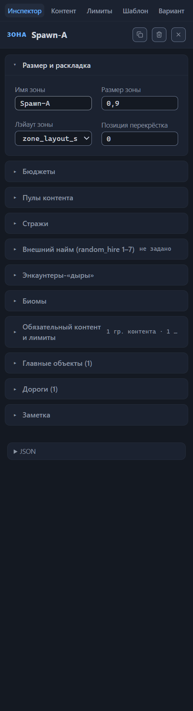
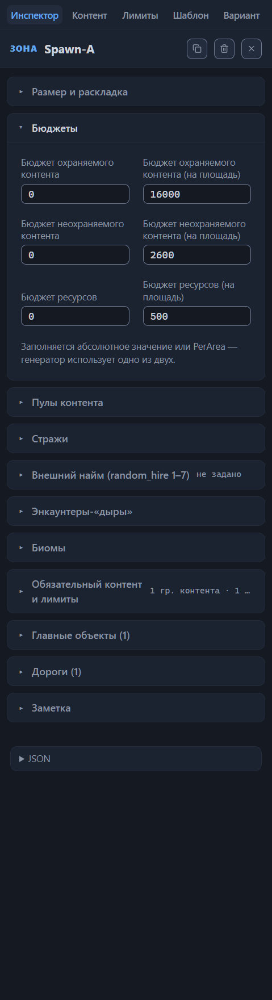
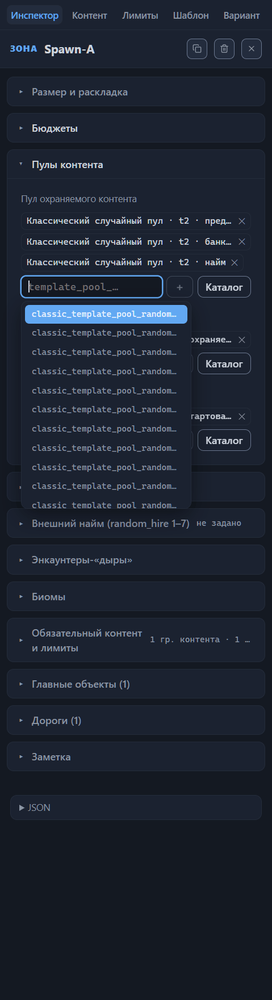
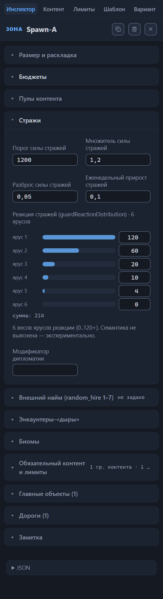
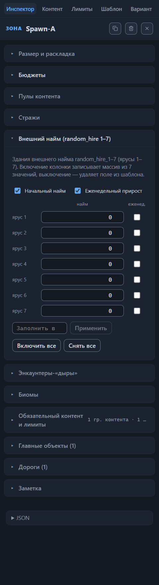
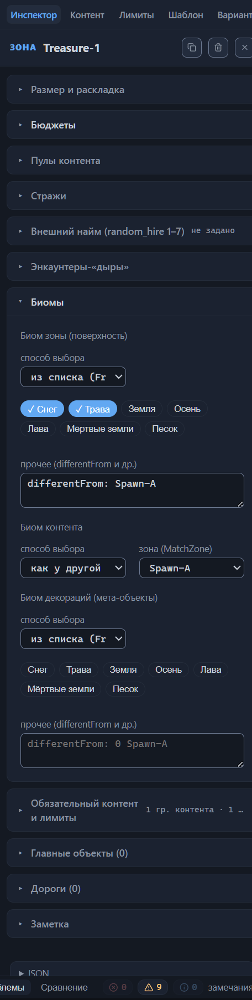
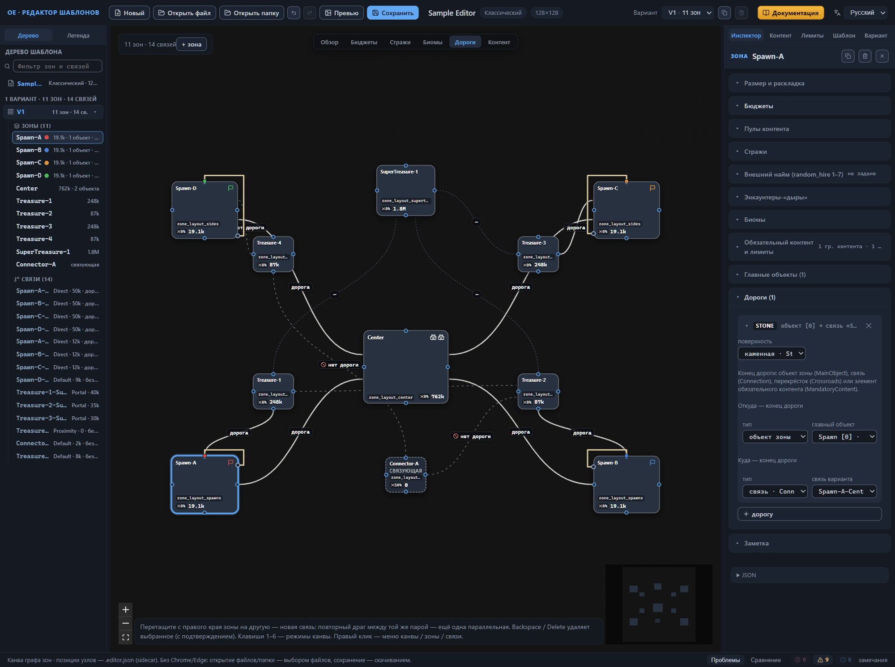

# Зона: все свойства

Зона — часть будущей карты со своими настройками: именем, размером, лэйаутом рельефа, бюджетами наполнения, биомами, стражей и дорогами. Все свойства зоны собраны в инспекторе — правой панели, которая открывается выбором узла зоны на канве либо строки зоны в дереве шаблона. Глава — справочник: секции инспектора разбираются по полям, каждое поле — по единой схеме (название в интерфейсе и имя в файле, что делает, допустимые значения, умолчание, ограничения). Практические приёмы работы со схемой — добавление, переименование, удаление зон — собраны в главе [Канва: правка графа](canvas-editing.md).

Зона принадлежит варианту раскладки: в каждом варианте — собственный список зон, и правки затрагивают только активный вариант. Зона, встречающаяся в нескольких вариантах под одним именем, переименовывается каскадом везде сразу — это делает редактор, вручную ссылки переносить не нужно.

## Размер и раскладка

Первая секция инспектора зоны отвечает за идентификацию и форму: имя, вес площади, лэйаут рельефа и позицию перекрёстка.

### Имя зоны

Имя в файле — `name`. Это адрес зоны в шаблоне: по нему связи держат свои концы, селекторы биомов и фракций находят «другую зону», дороги и правила обязательного контента — свои цели, дерево шаблона показывает строку зоны. Поле хранит произвольный текст; игра это имя не локализует и не показывает игроку.

Допустимое значение — непустая строка, уникальная в пределах варианта. У новой зоны редактор подставляет первое свободное имя из ряда Zone-1, Zone-2, …; в штатных шаблонах сложилась практика осмысленных префиксов — Spawn-, Center-, Treasure-, Side-, SuperTreasure-, Connector-: префикс не обязан ничего значить, но имя, начинающееся на «Connector», распознаётся редактором как признак связующей зоны, и канва красит такой узел ровной тёмной заливкой с пометкой connector.

Редактор отклоняет два варианта имени, сообщая прямо в подсказке поля: пустое — «Имя зоны не может быть пустым», занятое — «Имя «X» уже занято другой зоной»; в обоих случаях прежнее имя остаётся в силе. Валидатор дополняет контроль ошибкой «Пустое имя зоны» — она касается зон с пустым `name` в самом файле. Переименование через инспектор каскадирует по всем ссылкам и всем вариантам; правьте имя только так, иначе одна пропущенная ссылка уведёт дорогу или правило размещения не к той зоне (состав каскада — в главе [Канва: правка графа](canvas-editing.md)).

### Размер зоны

Имя в файле — `size`. Это относительный вес площади зоны, а не размер в клетках: генератор раскладывает зоны на карте соразмерно весам, нормируя их сумму под площадь карты. Читайте поле как соотношение с соседями: зона весом 1.8 рядом с зоной весом 0.9 претендует примерно на вдвое большую долю площади, а абсолютная площадь обеих зависит от размера карты, заданного в настройках шаблона.

Поле принимает числа 0.15–2 с шагом 0.05. Умолчание новой зоны — 0.9; оно же возвращается, если очистить поле. Валидатор следит за двумя границами: значение 0 и меньше — ошибка «size должен быть больше нуля», значение вне диапазона — предупреждение вида «size 2.5 вне обычного диапазона 0.15–2»; выход за диапазон не запрещён, но в штатных шаблонах не встречается.

### Лэйаут зоны

Имя в файле — `layout`. Это ссылка на один из лэйаутов шаблона — именованных наборов параметров рельефа из секции «Лэйауты зон» на вкладке «Шаблон». Имя лэйаута (например, `zone_layout_center`) — произвольный технический идентификатор, который игра не локализует; смысл зададают параметры набора — плотность препятствий, плотность озёр, режимы рельефа. Как их настраивать — тема главы [Настройки шаблона (корень)](root.md).

Список выбора показывает сводку параметров рядом с каждым именем: «препятствия 36% · озёра 30% · рельеф: 2 режима» для набора с несколькими режимами высот, «плоский рельеф» для набора без них, «параметры не заданы» для пустого набора — по сводке удобно выбирать лэйаут, не открывая панель шаблона. Умолчание новой зоны — первый лэйаут из списка шаблона; если лэйаутов ещё нет, подставляется техническое имя `zone_layout_empty`. Пустого значения в списке нет: у зоны всегда выбран какой-то лэйаут.

Валидатор сверяет ссылку со списком: имя, которого нет среди лэйаутов шаблона, даёт предупреждение «layout «X» не объявлен в zoneLayouts шаблона» — ссылка ведёт к набору параметров, которого в шаблоне нет. На канве имя лэйаута видно первой строкой узла в режиме «Дороги»; метка «layout?» означает, что лэйаут не задан (глава [Канва: режимы отображения](canvas-modes.md)).

### Позиция перекрёстка

Имя в файле — `crossroadsPosition`. Это одно число 0–1, а не пара координат: нормализованная позиция перекрёстка — точки, где сходятся дороги зоны. Что означают концы шкалы, подсказка редактора формулирует как гипотезу: 0 — перекрёсток у центра зоны, 1 — у края; в штатных шаблонах встречаются значения 0 и 0.5. *Назначение уточняется.*

Поле принимает числа 0–1 с шагом 0.05. У новой зоны оно пусто — значение появится, когда вы его зададите. Заданное значение канва показывает меткой «✕NN%» в режиме «Дороги»: 0.5 превращается в «✕50%». Перекрёсток — один из четырёх видов концов маршрута дороги зоны; дорогам зоны посвящён отдельный раздел ниже.

## Бюджеты

Вторая секция инспектора отвечает за наполнение зоны: сколько контента и какого рода генератор разместит внутри неё. Бюджетов наполнения три — охраняемый, неохраняемый и ресурсный контент; каждый задаётся двумя способами, абсолютным значением или значением «на площадь» (PerArea), поэтому полей в секции шесть, парами по виду контента.

Валюта бюджетов — ценность: условная валюта баланса, в которой пересчитаны и контент, и стража. Бюджет отвечает только на вопрос «сколько»: генератор набирает объекты из пулов контента зоны, пока не исчерпает его. Что именно попадёт в зону, определяют пулы — их поля разобраны ниже по главе, а каталог и приёмы выбора — в главе [Каталог пулов контента](pools.md).

Правило пары сформулировано в подсказке под полями: «Заполняется абсолютное значение или PerArea — генератор использует одно из двух.» Абсолютное значение назначает зоне фиксированную ценность независимо от её площади. Значение «на площадь» задаёт ценность в расчёте на единицу площади: чем крупнее зона, тем больше суммарного контента она наберёт при том же числе в поле. Какое из двух значений генератор использует, когда заполнены оба, — *Назначение уточняется.*

На схеме три бюджета складываются в суммарный бюджет зоны — цифру в нижней строке узла в режиме «Обзор». Формула чтения: суммарный бюджет = охраняемый + неохраняемый + ресурсы, причём для каждого слагаемого канва берёт абсолютное значение, если оно задано и больше нуля, иначе — значение на площадь. Подстановка на зоне сокровищ демо-шаблона: 70000 + 9000 + 8000 = 87000 — узел показывает «87k»; центральная зона того же шаблона даёт 650000 + 70000 + 42000 = 762000, то есть «762k». Зоны старта показывают вторую ветку правила: абсолютные поля — нули, канва читает значения на площадь, 16000 + 2600 + 500 = 19100 → «19.1k». Раздельный просмотр слагаемых и выбор вида значений — в режиме «Бюджеты» канвы (глава [Канва: режимы отображения](canvas-modes.md#режим-бюджеты)).

### Бюджет охраняемого контента

Имена в файле — `guardedContentValue` у поля «Бюджет охраняемого контента» и `guardedContentValuePerArea` у поля «Бюджет охраняемого контента (на площадь)». Число — ценность охраняемого контента зоны: находок, которые генератор размещает под стражей.

Поле принимает любое число; стрелки поля меняют его шагом 1000, жёсткой границы редактор не ставит. Ориентир дают штатные шаблоны: абсолютные значения укладываются в диапазон 0–8 000 000, значения на площадь — в 0–40 000. Отрицательное абсолютное значение даёт предупреждение валидатора вида «Отрицательный бюджет (−5000)»; в штатных шаблонах бюджеты неотрицательны.

У новой зоны оба поля пусты; очистка поля делает значение незаданным, ноль — легитимное значение. Оба способа показаны в демо-шаблоне: зоны старта оставляют абсолютное поле нулём и заполняют поле на площадь (16000 у охраняемого контента), зона сокровищ настроена наоборот — 70000 в абсолютном поле и ноль на площадь.

### Бюджет неохраняемого контента

Имена в файле — `unguardedContentValue` и `unguardedContentValuePerArea`; поля называются «Бюджет неохраняемого контента» и «Бюджет неохраняемого контента (на площадь)». Число — ценность свободного контента: находок без стражи; легенда канвы подписывает неохраняемый контент словом «свободный».

Правила общие с охраняемым бюджетом, отличаются ориентиры штатных шаблонов: 0–350 000 у абсолютного значения, 0–5 000 у значения на площадь. Умолчание — пустые поля, отрицательный абсолют — предупреждение валидатора. Зона сокровищ в демо-шаблоне получает 9000.

### Бюджет ресурсов

Имена в файле — `resourcesValue` и `resourcesValuePerArea`; поля — «Бюджет ресурсов» и «Бюджет ресурсов (на площадь)». Число — ценность ресурсного контента: куч ресурсов на карте. Ориентиры штатных шаблонов: 0–300 000 у абсолютного значения, 0–1 200 у значения на площадь; умолчание и предупреждение об отрицательном значении — как у остальных пар. В демо-шаблоне зона сокровищ получает 8000, центральная зона — 42000.

### Заполнение пары значений

Оба поля одной пары, заполненные одновременно, — не ошибка. Валидатор отвечает справкой на панели «Проблемы»: «Заполнены и абсолютное значение, и PerArea — половина официальных шаблонов делает так же, это допустимо». Половина официальных шаблонов действительно заполняет оба поля; какое из двух значений генератор выберет — *Назначение уточняется.*

Пустые бюджеты валидатор не запрещает, но зона без бюджетов не получит наполнения из пулов — в ней останется только обязательный контент: объекты, которые генератор размещает гарантированно, независимо от бюджетов. Так настроены связующие зоны демо-шаблона: все шесть полей — нули.

Если наполнение должно расти вместе с площадью зоны, задавайте значение «на площадь»; иначе крупная зона с фиксированным абсолютным бюджетом растянет ту же ценность на бо́льшую площадь, и наполнение окажется реже, чем в маленькой зоне с тем же числом.

## Пулы контента

Бюджеты отвечают на вопрос «сколько», пулы — на вопрос «что именно»: пока бюджет не исчерпан, генератор набирает наполнение из пулов, записанных в зоне. Секция «Пулы контента» в инспекторе свёрнута по умолчанию — раскройте её по заголовку. Внутри три поля, и каждое работает в паре с одноимённым бюджетом: «Пул охраняемого контента» — с бюджетом охраняемого контента, «Пул неохраняемого контента» — с бюджетом неохраняемого, «Пул ресурсов» — с бюджетом ресурсов.

Сами пулы живут в базе игры, шаблон хранит только их имена — идентификаторы вида `classic_template_pool_random_t2_item`. Держать идентификаторы в голове не нужно: редактор показывает для каждого пула короткую подпись и собирает её сам, ведь официальных русских имён у пулов нет; если имя редактору не знакомо, подпись просто повторяет его. Что лежит внутри пулов и как выбрать подходящий — тема главы [Каталог пулов контента](pools.md); здесь — устройство полей и приёмы работы с ними.

### Заполнение поля

Выбранные пулы показаны плашками — небольшими блоками с подписью пула и кнопкой ✕, которая убирает его из поля. Всплывающая подсказка плашки показывает исходное имя и теги, разобранные из него: вид пула (например, «случайный» или «классический»), охраняемость, профиль наполнения (например, «предметы» или «найм»); отдельные метки вроде `t2` выводятся как есть.

Новое имя вводится с клавиатуры. При открытии строки — фокусом, кликом или стрелкой вниз — раскрывается список подсказок: сначала весь каталог пулов, по мере набора он сужается до совпадений. Enter или клик вне поля добавляет набранный текст как есть, Escape закрывает список, а кнопка «＋» добавляет набранный текст отдельным действием. Пустое имя и дубликат поле пропускает без реакции.

Обратите внимание: каталог подгружается при первом открытии поля, поэтому подсказки появляются с короткой задержкой. До загрузки поле принимает любое имя, после — молча пропускает имена вне каталога: опечатка не попадёт в список, и поле об этом не сообщит. Сомнительное имя проверяйте кнопкой «Каталог» — в диалоге работает поиск по всему каталогу пулов.

Кнопка «Каталог» открывает диалог с заголовком «Каталог · Пул охраняемого контента» — название поля подставляется в шаблон заголовка. На вкладке «Пулы» кнопка «+» у строки добавляет пул в поле зоны, у выбранных строк она превращается в «✓», повторный клик убирает пул. Вкладка «Списки» предназначена только для просмотра, кнопок выбора у неё нет. Вкладка «Сравнение (N)» поле зоны не затрагивает: её кнопки «+» и «✓» собирают пулы для сравнения внутри диалога, о чём напоминает подсказка внизу вкладки.

Имена, уже записанные в шаблон, проверяет валидатор: пул, которого нет в каталоге, отмечается предупреждением «Пул „имя“ не найден в каталоге (всего пулов: …)». Проверка выполняется, когда каталог загружен.

### Пул охраняемого контента

Имя в файле — `guardedContentPool`.

Из этого пула генератор берёт объекты, пока не исчерпает бюджет охраняемого контента зоны. Значение — список имён пулов; ориентиры штатных шаблонов — от одного до семи имён. В демо-шаблоне зоны старта указывают три пула: `classic_template_pool_random_t2_item`, `classic_template_pool_random_t2_unit_bank` и `classic_template_pool_random_t2_hire`; центральная зона — два: `classic_template_pool_random_t4_item` и `classic_template_pool_random_t5_item`.

### Пул неохраняемого контента

Имя в файле — `unguardedContentPool`.

Источник для бюджета неохраняемого контента: пока бюджет не исчерпан, генератор достаёт объекты из этого пула. Ориентиры штатных шаблонов те же — от одного до семи имён. В демо-шаблоне зоны старта указывают `classic_template_pool_random_unguarded_t2_base`, зоны сокровищ — `classic_template_pool_random_unguarded_t3_base`, центральная зона — `classic_template_pool_random_unguarded_t4_base`.

### Пул ресурсов

Имя в файле — `resourcesContentPool`.

Источник для бюджета ресурсов. В отличие от двух соседних полей, здесь в штатных шаблонах стоит ровно одно имя, как правило из семейства `content_pool_general_resources_*`. Демо-шаблон указывает `content_pool_general_resources_start_zone_medium` в зонах старта, `content_pool_general_resources_treasure_zone_medium` — в зонах сокровищ, `content_pool_general_resources_treasure_zone_rich` — в центральной зоне и у сверхсокровищ. Связующие зоны держат все бюджеты на нуле, но пул ресурсов всё равно задают — `content_pool_general_resources_side_zone_poor`.

## Стражи

Пока бюджеты и пулы определяют, сколько добра и какого попадёт в зону, эта секция назначает цену доступа к нему: её поля управляют стражей — охраной, которую генератор ставит на находки и объекты зоны. Секция «Стражи» раскрыта по умолчанию, как и две первые, и стоит в инспекторе сразу после пулов контента. Стража отдельного перехода между зонами настраивается не здесь, а в свойствах связи — тема главы [Связи между зонами](connections.md).

Из шести полей секции у новой зоны заполнено одно — «Реакция стражей» с шестью единичными весами; остальные пусты, значения появятся, когда вы их зададите.

### Порог силы стражей

Имя в файле — `guardCutoffValue`. Предполагаемая роль поля — отсекать мелочь: по подсказке редактора (гипотеза) это минимальная ценность, ниже которой объект не ставится со стражей, — слишком дешёвая находка остаётся без охраны. *Назначение уточняется.*

Поле принимает любые числа, стрелки меняют значение шагом 100. Ориентир дают штатные шаблоны: значения укладываются в диапазон 0–3500, выхода за него редактор не запрещает. Ноль — легитимное значение, которым настроены связующие зоны демо-шаблона; в нём порог растёт вместе с богатством зоны — 1200 у зон старта и сокровищ, 2400 у центральной, 3000 у зоны сверхсокровищ SuperTreasure-1.

Заданное значение канва показывает меткой «до N» в режиме «Стражи»: порог 1200 читается как «до 1.2k» (глава [Канва: режимы отображения](canvas-modes.md#режим-стражи)).

### Множитель силы стражей

Имя в файле — `guardMultiplier`. Число показывает, во сколько раз усиливается стража зоны.

Поле ограничено вводом диапазоном 0–10, стрелки меняют значение шагом 0.1; ориентир штатных шаблонов — 0.1–5. У новой зоны поле пусто. Демо-шаблон выстраивает множитель лесенкой вслед за богатством зоны: 1 у сокровищ нижнего яруса и связующих зон, 1.2 у зон старта, 1.4 у сокровищ верхнего яруса, 2.1 у центральной зоны и 3 у зоны сверхсокровищ. Ту же лесенку показывают два похожих штатных шаблона с одинаковой геометрией: у одного стартовые, боковые и центральная зоны несут 1.05, 1.35 и 1.7, у другого — 1.0, 1.3 и 1.6, то есть второй сдержаннее по охране всюду.

Поднимайте множитель вслед за бюджетом зоны; иначе богатейшая зона окажется под самой слабой охраной — игрок вычистит её без сопротивления, и напряжение карты просядет. На канве значение видно в режиме «Стражи»: значок мечей и число множителя рядом с именем зоны.

### Разброс силы стражей

Имя в файле — `guardRandomization`. Доля случайной добавки: насколько сгенерированная сила стражи отклоняется от расчётной. В штатных шаблонах поле всегда равно 0.05, что подсказка редактора читает как ±5% к силе стражи.

Поле ограничено вводом диапазоном 0–1, стрелки меняют значение шагом 0.05. У новой зоны поле пусто; в демо-шаблоне все зоны держат штатные 0.05, и метка режима «Стражи» показывает «rnd 5%».

Держитесь штатного значения: при большем разбросе одинаковые по настройкам зоны получают заметно разную охрану — одним игрокам достанутся крепкие стражи, другим ослабленные, и равенство условий нарушится.

### Еженедельный прирост стражей

Имя в файле — `guardWeeklyIncrement`. Доля, на которую стража зоны усиливается каждую игровую неделю: карта стареет, и охрана растёт вместе с ней.

Поле принимает любые числа, стрелки меняют значение шагом 0.05. Ориентир штатных шаблонов — 0.05–0.2; демо-шаблон проходит диапазон целиком: 0.1 у зон старта, сокровищ и связующих, 0.15 у центральной, 0.2 у зоны сверхсокровищ. Чтение значения: прирост 0.1 добавляет страже десятую часть её силы за неделю — стража силой 5000 к концу первой недели усиливается на 500. Метка «+10%/» в режиме «Стражи» показывает это же значение на канве.

Сверяйте прирост с темпом развития игроков, иначе к поздним неделям стража перерастёт их армии и перекроет доступ к добыче.

### Реакция стражей

Имя в файле — `guardReactionDistribution`, подпись блока — «Реакция стражей (guardReactionDistribution) · 6 ярусов». Значение — шесть весов, по одному на ярус реакции. Что такое ярус, не выяснено: подсказка блока прямо сообщает «6 весов ярусов реакции. Семантика не выяснена — экспериментально». *Назначение уточняется.*

Веса вводятся построчно: строка «ярус N» содержит число и полосу, длина которой показывает вес относительно самого тяжёлого яруса. Под строками выводится сумма весов, нулевая сумма подписана «не задано». Вес — целое неотрицательное число: дробная часть отбрасывается, отрицательное и нечисловое значение поле сбрасывает к прежнему, запятая в десятичной записи допустима. Обнуление всех шести весов снимает поле со зоны целиком.

У новой зоны все шесть весов равны единице. Штатные шаблоны используют целые веса от 0 до 120 и выше; частые наборы — `[120, 60, 20, 10, 4, 0]`, `[3, 2, 0, 0, 0, 0]` и `[1, 1, 4, 4, 2, 1]`. Демо-шаблон ставит `[120, 60, 20, 10, 4, 0]` зонам старта, центра и сверхсокровищ, `[40, 40, 20, 10, 4, 0]` — зонам сокровищ, `[3, 2, 0, 0, 0, 0]` — связующим.

Валидатор проверяет только форму массива, и любое нарушение — предупреждение вида «guardReactionDistribution: длина 5 вместо ожидаемых 6 «ярусов»», «…все 6 значений должны быть числами…». Из инспектора такие замечания не получить: они встречаются у шаблонов, изменённых мимо редактора.

### Модификатор дипломатии

Имя в файле — `diplomacyModifier`. Значение всегда отрицательное; поле заполнено в половине штатных шаблонов (30 файлов из 60), значения лежат в диапазоне −0.5…−0.25. Назначение подсказка редактора формулирует как гипотезу: вероятность присоединения армий в зоне. *Назначение уточняется.*

Поле принимает любые числа, стрелки меняют значение шагом 0.05. У новой зоны поле пусто, в демо-шаблоне его нет ни у одной зоны. Режим «Стражи» канвы показывает заданное значение меткой «дип N»: модификатор −0.3 читается как «дип −0.3».

## Внешний найм

Секция «Внешний найм (random_hire 1–7)» стоит в инспекторе сразу после «Стражей» и свёрнута по умолчанию — раскройте её по заголовку. Она настраивает здания внешнего найма — объекты игры random_hire_1…random_hire_7, по одному на каждый из семи ярусов: зона задаёт каждому ярусу два параметра, начальный прирост найма и включение еженедельного прироста. Сами здания секция не размещает: это обычные объекты игры, в подсказках полей sid они подписаны «Внешний найм · ярус N» и встречаются в том числе среди объектов групп обязательного контента — тема главы [Настройки шаблона (корень)](root.md).

Свёрнутое состояние не прячет настройку: заголовок секции несёт сводку — «нач.: 2×7 · еженед.: все», а без настроек — «не задано». Обе колонки необязательны: у новой зоны они выключены, в демо-шаблоне секция не заполнена ни у одной зоны, среди штатных — заполнена у 8 шаблонов из 60, это 40 зон. Значения штатных шаблонов — малые целые числа, например [3, 3, 3, 3, 3, 3, 3] или [6, 5, 5, 4, 4, 3, 3].

### Колонки и длина массивов

Значения вводятся таблицей: семь строк — ярусы, две колонки — параметры. Колонки включаются независимо: над таблицей стоят два переключателя с их именами, «Начальный найм» и «Еженедельный прирост». Включение колонки записывает в шаблон массив ровно из семи значений — семь нулей у чисел, семь снятых флагов у «еженедельного прироста»; выключение колонки удаляет поле из шаблона целиком, поля строк колонки становятся неактивными.

Порядок элементов массива повторяет нумерацию зданий: элемент с индексом 0 настраивает random_hire_1, элемент с индексом 6 — random_hire_7, поэтому длина обоих массивов — ровно семь. Валидатор следит за длиной и отвечает предупреждением вида «randomHireInitialUnitIncrement (числа, idx = random_hire 1..7): длина 5 вместо ожидаемых 7»; у флагов замечание то же, с именем randomHireEnableWeeklyUnitIncrement. Из инспектора такие массивы не получить — они встречаются у шаблонов, изменённых мимо редактора.

Массив неверной длины редактор показывает как есть и предупреждает прямо в секции: «Начальный найм: в файле массив из 5 — при правке нормализуется до 7». Первая же правка колонки нормализует длину: недостающие элементы дополняются нулём у чисел и снятым флагом у переключателей, лишние отбрасываются. Не меняйте длину этих массивов в JSON-черновике — иначе первая правка в инспекторе молча дополнит или обрежет значения до семи, и подмену вы не заметите.

### Начальный найм

Имя в файле — `randomHireInitialUnitIncrement`. Числа задают начальный прирост найма по ярусам: значение строки «ярус N» настраивает здание random_hire_N. Всплывающая подсказка у подписи строки показывает имя здания.

Значение — семь целых неотрицательных чисел. Поле строки фиксирует ввод по Enter или потере фокуса; дробная часть отбрасывается — 3,7 превращается в 3, запятая допустима как десятичный разделитель. Пустое, отрицательное или нечисловое значение поле сбрасывает к прежнему. Умолчание только что включённой колонки — семь нулей.

Массовое заполнение собрано в поле «Заполнить все» с кнопкой «Применить»: число из поля записывается сразу во все семь ярусов. Кнопка неактивна, пока поле пусто или содержит отрицательное либо нечисловое значение; Enter в поле делает то же, что кнопка.

Свёрнутая секция показывает значения прямо в заголовке: одинаковая семёрка чисел читается компактно — «нач.: 3×7», различные значения выводятся списком — «нач.: 6,5,5,4,4,3,3». Так настроен один из штатных шаблонов: центральная зона получает по 2 на каждый ярус («нач.: 2×7»), боковые — по 3; там же включён еженедельный прирост.

### Еженедельный прирост

Имя в файле — `randomHireEnableWeeklyUnitIncrement`. Флаги включают еженедельный прирост найма по ярусам: установленный флажок строки «ярус N» включает еженедельный прирост здания random_hire_N.

Значение — семь флагов; клик по флажку строки переключает его. Умолчание включённой колонки — все флаги сняты. Кнопки под таблицей управляют списком целиком: «Включить все» устанавливает все семь флагов, «Снять все» — снимает.

Заголовок свёрнутой секции считает флаги: семь из семи читаются «еженед.: все», в остальных случаях выводится число включённых — «еженед.: 4 из 7». Предупреждение валидатора о неверной длине — общее с колонкой «Начальный найм» (см. раздел [«Колонки и длина массивов»](#колонки-и-длина-массивов)).

## Энкаунтеры-«дыры»

Секция «Энкаунтеры-«дыры»» стоит в инспекторе сразу после «Внешнего найма» и свёрнута по умолчанию — раскройте её по заголовку. Её механика — дыры: сбои генерации, которые автор шаблона закладывает намеренно. Дыра — пропуск внутри энкаунтера, готовой микрокарты из объектов и стражей, которую генератор подбирает автоматически по типу и размеру. Пропуск возникает на месте «съеденного» слота подбора — там, где должен был появиться подбираемый объект, — или тайла энкаунтера. На правила игры и баланс дыры не влияют — это параметр раскладки контента: он решает, какая часть содержимого энкаунтеров не попадёт на карту.

Механика собирается из двух настроек разного уровня. Уровень шаблона — переключатель «„Дыры“ в энкаунтерах» во вкладке «Шаблон» инспектора, секция «Правила игры» (имя в файле — `gameRules.encounterHoles`): он включает механику сразу для всего шаблона. У переключателя три состояния — «не задано», true и false, — и любое, кроме true, оставляет механику выключенной. Уровень зоны — доли этой секции: какой части энкаунтеров зоны достанется дыра и какой части — две дыры. Включайте правило вместе с долями, иначе настройки зоны останутся в файле мёртвым грузом, и генератор их проигнорирует — валидатор напоминает об этом справкой «encounterHolesSettings задан, но gameRules.encounterHoles не включён — поле игнорируется»; заметка появляется и при выключенном правиле, и при состоянии «не задано». Полная справка секции «Правила игры» — в главе [Настройки шаблона (корень)](root.md).

У новой зоны оба поля секции пусты; демо-шаблон не заполняет секцию ни у одной зоны — настройка появляется в файле только тогда, когда вы её зададите. Штатные шаблоны используют механику редко. Правило записано во всех 60 файлах, а включено только в Anarchy — единственном, чьё официальное описание обещает игроку «…отсутствие ограничений и ошибки генерации карты…». Там доли прописаны каждой зоне — всего 79 зонам пяти вариантов. Те же настройки встречаются и в Maze — 84 зоны трёх вариантов, — но правило там выключено, и доли остаются мёртвыми. Все 163 настройки в двух шаблонах одинаковы: 0.66 и 0.66.

### Доля затронутых энкаунтеров

Имя в файле — `affectedEncounters`, внутри объекта `encounterHolesSettings` зоны. Число — доля энкаунтеров зоны, которым достаётся дыра: 0 — дыр нет, 1 — дыра у каждого энкаунтера. Конкретные энкаунтеры шаблон не перечисляет — генератор подбирает их сам; доля распространяется на подобранные для зоны. Подстановка: 0.66 — примерно две трети, из десятка энкаунтеров зоны дыру получат около семи.

Поле задумано числом от 0 до 1: стрелки меняют значение шагом 0.01 и за границы не выходят, однако жёсткого ограничения ввода нет. Фиксация — по Enter или потере фокуса, запятая допустима как десятичный разделитель, нечисловой ввод возвращает поле к прежнему значению. Значение вне диапазона попадает в файл, а валидатор отвечает предупреждением вида «Доля affectedEncounters (1.2) вне 0..1»: формат предусматривает долю от 0 до 1, поведение генератора за пределами диапазона не описано. Очистка поля убирает значение, а очистка обоих полей секции удаляет `encounterHolesSettings` из зоны целиком.

### Доля энкаунтеров с двумя дырами

Имя в файле — `twoHoleEncounters`, внутри того же объекта `encounterHolesSettings`. Число — доля энкаунтеров, которым вместо одной дыры достаются две. База отсчёта не выяснена: доля считается от всех энкаунтеров зоны или только от затронутых первой долей — в штатных данных оба значения равны 0.66, и разница не видна. *Назначение уточняется.*

Правила ввода, пустое умолчание новой зоны и предупреждение валидатора о значении вне диапазона — общие с долей затронутых энкаунтеров.

Как дыра выглядит на готовой карте — *Назначение уточняется.* Известен только механизм: слот подбора внутри энкаунтера генератор способен «съесть», а часть тайлов энкаунтера изначально помечена как дыры; отдельной сущности «дыра» в игре нет. Результат оценивайте визуально по готовой карте — как её получить, описано в главе [Установка шаблона в игру](install.md).

## Биомы

Секция «Биомы» связывает зону с биомами. Биом — тип ландшафта готовой карты; биомов семь: «Снег» (`Snow`), «Трава» (`Grass`), «Земля» (`Dirt`), «Осень» (`Autumn`), «Лава» (`Lava`), «Мёртвые земли» (`Deathland`) и «Песок» (`Sand`). Чипы каждого способа выбора перечисляют семь русских имён в том же порядке; в файле хранятся латинские значения. У зоны три независимые настройки — три слоя биома, каждая задаётся собственным селектором с общим списком «способ выбора»:

- **Биом зоны (поверхность)** — `zoneBiome`: биом поверхности — то, как выглядит сама зона на готовой карте.
- **Биом контента** — `contentBiome`: биом, из которого зона берёт объекты контента.
- **Биом декораций (мета-объекты)** — `metaObjectsBiome`: биом декораций окружения — мета-объектов.

Слои не зависят друг от друга: зона может строиться в «Снеге», а контент брать из «Травы». У новой зоны все три селектора — «из списка» с пустым списком: ограничения сняты, на канве это состояние подписано «любой». В файле поля обязательны, редактор создаёт их у каждой зоны.

Посмотреть биомы всей схемы можно режимом «Биомы» канвы с переключателем «слой биома»: заливка узла показывает выбранный биом, строка рядом — способ выбора (глава [Канва: режимы отображения](canvas-modes.md#режим-биомы)). Смена способа в инспекторе сохраняет уже заданные аргументы — после переключения проверьте, что они подходят новому способу. Инспектор предлагает ровно три способа, поэтому предупреждение валидатора «Неизвестный тип биом-селектора: «X»» встречается только у шаблонов, изменённых мимо инспектора.

### Из списка (FromList)

Имя типа в файле — `FromList`, пункт списка «способ выбора» — «из списка (FromList)». Способ перечисляет допустимые биомы: генератор строит зону в одном из названных. Пустой список снимает ограничения — состояние «любой», умолчание новой зоны.

Биомы задаются чипами: клик добавляет или убирает имя, включённый чип отмечается галочкой «✓» (подсказки «Добавить в список» и «Убрать из списка»). Строки вне семи имён вводятся полем «прочее (differentFrom и др.)» через запятую; поле применяется при потере фокуса или по Ctrl+Enter. На канве список из нескольких имён подписан «список», единственный чип даёт фиксированный биом — узел подписан его русским именем.

Поле «прочее» принимает выражения differentFrom — техническую нотацию файла, которую редактор показывает как есть. Запись вида `differentFrom: Spawn-A` исключает из списка биом зоны Spawn-A и биом её главного объекта №0; между двоеточием и именем зоны допустим индекс объекта — `differentFrom: 0 Spawn-A`. Как генератор выбирает биом из оставшихся — *Назначение уточняется.* На канве узел с таким выражением красится биомом зоны-эталона с пометкой «≠ зона».

Валидатор проверяет каждую differentFrom-строку: зона с таким именем не найдена — предупреждение «Несуществующая зона differentFrom: «Spawn-C»». Так разводят биомы по карте: зоны сокровищ и боковые зоны в штатных шаблонах несут строки `differentFrom: Spawn-A`, `differentFrom: Spawn-B` и далее — иначе зона может получить тот же биом, что и стартовая. Закрепить характер зоны можно единственным чипом: фиксированный «Песок» в штатных задаёт пустынный центр. В демо-шаблоне у зон сокровищ биом поверхности — список из одной строки `differentFrom: Spawn-A`, биомы контента и декораций — «любой».

### Как у другой зоны (MatchZone)

Имя типа в файле — `MatchZone`, пункт списка «способ выбора» — «как у другой зоны (MatchZone)». Поле «зона (MatchZone)» предлагает зоны текущего варианта, подсказка поля — «Имя зоны, чей биом использовать». Зона берёт биом указанной зоны; на канве селекторная строка читается «← ИмяЗоны».

Частая цель — стартовая зона: в штатных шаблонах MatchZone чаще всего указывает на Spawn-A или Spawn-B, чтобы зона следовала за биомом игрока. В демо-шаблоне так настроена связующая зона: биом поверхности берётся у Spawn-A, биомы контента и декораций остаются «любой».

Валидатор сверяет имя зоны: не найдена — предупреждение «Несуществующая зона MatchZone: «X»». Переименование цели обновляет ссылку каскадом, вручную переносить её не нужно (глава [Канва: правка графа](canvas-editing.md)). Цепочки ссылок канва размыкает сама: зона, берущая биом у зоны, которая берёт у неё же, отображается тёмным «?».

### Как у главного объекта (MatchMainObject)

Имя типа в файле — `MatchMainObject`, пункт списка «способ выбора» — «как у главного объекта (MatchMainObject)». Способ берёт биом у главного объекта зоны (глава [Главные объекты зоны](main-objects.md)) — города, точки появления героя, заброшенного аванпоста или арены. Ссылку задают два списка:

- **Главный объект** — объект, чей биом взять. Варианты — список из секции «Главные объекты»: пока поле «Зона» пустое, это объекты текущей зоны, а когда зона задана — объекты указанной зоны. Каждый вариант подписан номером и типом, у точки появления героя добавлен игрок — например, «0 · Точка спауна игрока (Spawn) · Player1». Объекты нумеруются с нуля, обычно берут первый; в файле номер записан индексом объекта (`args[0]`), пустое значение показано как «—». Значение, записанное в файле, но отсутствующее в списке, остаётся явным вариантом «N · вне списка объектов» — выбор не теряется молча.
- **Зона** — необязательная зона, в чьих «Главных объектах» искать объект; без неё список ведётся от текущей зоны. Список предлагает зоны текущего варианта, пустое значение показано как «—». Назначение пары «объект + зона» — гипотеза: предполагается ссылка на объект другой зоны, когда в своей его нет.

Обратите внимание: в разделе «Дороги» есть селектор с похожим названием — «главный объект»; это другое поле, его варианты подписаны иначе — «Spawn [0] · Player1» (раздел [Дороги](#дороги)).

На канве селекторная строка читается «MO #N» с индексом объекта, а при выбранной зоне дополняется «← ИмяЗоны». Биом самого объекта канва не вычисляет: с зоной узел показывает биом указанной зоны, без неё — тёмное «?»; это приближение, точный биом покажет готовая карта.

Валидатор проверяет зону — «Несуществующая зона MatchMainObject: «X»»; номер объекта не проверяется. Список оберегает от опечатки, но не от удаления карточки: удаление объекта сдвигает нумерацию, и выбор молча начинает указывать на соседа. После удаления объекта заново проверьте выбор в «Биомах», иначе биом возьмётся не у того объекта.

Так настраивают зоны старта: биом следует за фракцией главного объекта, а фракции соответствуют свои биомы — «Трава» у human, «Земля» у dungeon, «Осень» у nature, «Лава» у demon, «Снег» у unfrozen, «Мёртвые земли» у undead. Соответствие фракций и биомов взято из базы игры; чипа undead селектор фракций редактора не предлагает, зато соответствующий биом выбирается наравне с остальными. Без фракции остаётся только «Песок». В демо-шаблоне у всех зон старта все три слоя — «как у главного объекта» с выбранным объектом 0 — точкой появления героя: поверхность, контент и декорации следуют за ней.

## Обязательный контент и лимиты

Секция привязывает зону к группам из корня шаблона. Обязательный контент — группы объектов, которые генератор обязан разместить на карте; лимиты количества — группы ограничений на число объектов. Состав групп задаётся в корневых панелях: «Обязательный контент» на вкладке «Контент» и «Лимиты количества» на вкладке «Лимиты» (глава [Настройки шаблона (корень)](root.md)). Зона хранит только имена групп: одну и ту же группу подключают нескольким зонам, а правка её состава действует для всех ссылающихся зон.

Секция стоит после «Биомов» и по умолчанию свёрнута. Свёрнутый заголовок несёт сводку вида «1 гр. контента · 1 гр. лимитов» — по одной цифре на каждый список; у пустой зоны сводка выглядит как «0 гр. контента · 0 гр. лимитов».

### Группы обязательного контента

Поле называется «Группы обязательного контента», в файле — `mandatoryContent`. Значение — массив имён групп: каждая строка посимвольно совпадает с полем `name` корневой группы. Подключённая группа — гарантия генератору: её объекты попадут на карту независимо от бюджетов зоны.

Выбранные имена показываются чипами. Чип несёт оригинальное имя группы — тот самый идентификатор, что записан в файле .rmg.json, — и сводку «N эл.» с числом элементов группы; кнопка ✕ убирает имя из списка. Имя группы редактор показывает как есть и на русский не переводит: игра ищет группу точным совпадением строки, а префиксы вроде `mandatory_content_` и `content_limits_` — лишь конвенция именования штатных шаблонов. Подсказка чипа повторяет имя группы и построчно перечисляет её содержимое: имя элемента, русское название объекта и его идентификатор — например «Ящик Пандоры (pandora_box)», — признак шахты, варианты выбора из списка.

Клик по имени чипа переносит к карточке группы: редактор переключает вкладку корневой панели, прокручивает список к нужной группе и подсвечивает её. Новое имя вводится полем «имя группы»: подсказки перечисляют группы корня, ещё не подключённые зоне. Enter, выбор подсказки или кнопка «＋» добавляют имя; пустой ввод и дубликаты игнорируются молча.

Умолчание и ориентиры:

Новая зона
: поля `mandatoryContent` нет; валидатор помечает зону предупреждением «У зоны нет обязательного контента (обычно ≥1 группа)».

Демо-шаблон
: по одной группе на каждую из одиннадцати зон — `group_spawn` у зон старта и связующей зоны, `group_treasure` у зон сокровищ, `group_center` у центра, `group_supertreasure` у суперсокровища.

Штатные шаблоны
: ровно одна группа обязательного контента у каждой зоны.

Элементы внутри групп могут носить имена, и эти имена видны дорогам и правилам размещения зоны: генератор ищет именованный элемент среди групп, подключённых зоне, поэтому состав списка определяет, какие цели доступны дорогам. Точки обязательного контента на канве показывает режим «Контент» (глава [Канва: режимы отображения](canvas-modes.md)).

### Группы лимитов количества

Поле называется «Группы лимитов количества», в файле — `contentCountLimits`. Механика списка та же: массив имён групп, чипы, подсказки ввода, переход к карточке по клику. Отличается сводка чипа — «N лим.» — и подсказка чипа: построчные пределы вида «имя объекта: не более 2» и вложенные группы.

Отличается и смысл. Обязательный контент гарантирует появление объектов, лимиты сдерживают их количество: группа лимитов задаёт потолок числа объектов одного вида для зоны.

Умолчание и ориентиры:

Новая зона
: поля нет — и предупреждения нет: «Список групп лимитов пуст» ставится зоне, у которой список групп существует и пуст.

Демо-шаблон
: по одной группе на зону — `content_limits_spawn`, `content_limits_treasure`, `content_limits_center`, `content_limits_supertreasure` в соответствии с ролями зон.

Штатные шаблоны
: от 1 до 15 групп у зоны.

### Битые ссылки и предупреждения валидатора

Оба поля принимают любое непустое имя. Обратите внимание: редактор не сверяет ввод с корнем шаблона в момент набора — имя, которого нет среди групп, добавится как есть. Игра переносит такие ссылки молча, поэтому контроль остаётся за валидатором; ссылку на несуществующую группу называют битой.

Битую ссылку видно по бейджу «не найдена» на чипе. Подсказка такого чипа советует проверить имя или создать группу в панели «Шаблон»; кнопки перехода у него нет.

Валидатор напоминает о секции пятью предупреждениями:

- «У зоны нет обязательного контента (обычно ≥1 группа)» — список `mandatoryContent` пуст;
- «Группа «X» не найдена в корневом mandatoryContent» — имя из списка зоны отсутствует среди корневых групп;
- «Список групп лимитов пуст» — список `contentCountLimits` пуст;
- «Группа лимитов «X» не найдена в contentCountLimits» — имя группы лимитов отсутствует среди корневых групп;
- «Значение — строка вместо массива (известная аномалия штатных шаблонов; парсер игры терпит)» — лимиты записаны строкой вместо массива; из редактора такое недостижимо, предупреждение встречается только в шаблонах, правленных мимо редактора.

Добавляйте имена из подсказок ввода, иначе опечатка останется в шаблоне незамеченной: чип будет помечен «не найдена», а валидатор — показывать предупреждение до исправления. Создание групп и первое подключение показаны в главе [Быстрый старт](quick-start.md); состав и устройство самих групп — в главе [Настройки шаблона (корень)](root.md).

## Главные объекты

Опорные точки зоны — город, точка появления героя, заброшенный аванпост и арена — разобраны в главе [Главные объекты зоны](main-objects.md). Другие настройки зоны ссылаются на объекты по номеру — индексу в списке секции, отсчитываемому с нуля: концы дорог, слой биома «как у главного объекта» и способ выбора фракции «Match». Удаление объекта из середины списка сдвигает номера последующих — перечитайте индексы в дорогах, биомах и фракциях, иначе дорога уведёт не к тому городу.

## Дороги

Секция перечисляет маршруты дорог внутри зоны. Дорога зоны — отрезок пути между двумя точками: генератор прокладывает по ним дорожную сеть, соединяя главные объекты, выходы из зоны и перекрёсток. Дорога вдоль перехода к соседней зоне — отдельная настройка: её включает флаг связи `road` (глава [Связи между зонами](connections.md)).

Секция стоит после «Главных объектов», перед «Заметкой», и по умолчанию свёрнута; в заголовке живёт счётчик вида «Дороги (1)». Имя в файле — `roads`: массив записей, у каждой три ключа — покрытие `type` и два конца, `from` и `to`. Конец — объект-селектор вида `{ type, args }`, где `type` называет вид точки, а первый элемент `args` хранит её адрес: номер главного объекта, id связи или имя элемента обязательного контента. У зоны без дорог секция показывает подсказку «У зоны нет дорог — добавьте первую.».

Умолчание и ориентиры:

Новая зона
: поля `roads` нет — маршрутов нет.

Демо-шаблон
: по одной каменной дороге у каждой из четырёх зон старта — от точки появления героя (объект [0]) к связи, ведущей в центр; у остальных семи зон список пуст.

Штатные шаблоны
: поле есть у 937 зон из 938, зона без дорог — единственное исключение; у зоны от одного до восемнадцати маршрутов, всего на шестидесяти шаблонах 2291 дорога.

Готовые маршруты рисует режим «Дороги» канвы: ортогональная ломаная поверх узлов с маркерами концов — ■ главный объект, ◯ связь, ◆ перекрёсток, ◎ элемент обязательного контента (глава [Канва: режимы отображения](canvas-modes.md#режим-дороги)). На то, как ветвится сеть внутри зоны, влияет и лэйаут: его параметр `roadClusterArea` задаёт площадь «кластера» дорог, а состав лэйаутов разбирает глава [Настройки шаблона (корень)](root.md).

### Карточка дороги

Каждая дорога занимает собственную карточку. Свёрнутая строка показывает покрытие — или прочерк, если оно не задано, — описание концов и кнопку ✕ с подсказкой «Удалить дорогу»: у дороги демо-шаблона это «Stone» и «объект [0] → связь «Spawn-A-Center»». Концы подписаны по виду — «объект [N]», «связь «имя»», «контент «имя»»; перекрёсток редактор подписывает техническим именем `Crossroads`, перевода у этой подписи нет.

Кнопка ✕ удаляет дорогу сразу, без подтверждения, и не раскрывает карточку; ошиблись — откатывайте удаление сочетанием Ctrl+Z. Удаление последней дороги убирает поле `roads` из файла целиком, и секция снова показывает подсказку пустого списка.

Кнопка «дорогу» под списком добавляет маршрут с заготовкой:

Покрытие
: каменная (Stone).

Начало
: главный объект [0]; если объектов в зоне нет, аргумент остаётся пустым — валидатор попросит индекс.

Конец
: первая связь варианта; если связей в варианте нет — перекрёсток.

Заготовка описывает простую связку «объект → выход из зоны»; остальные маршруты соберите в полях раскрытой карточки. Карточка перечисляет их по порядку: поверхность, подсказка о видах концов, блоки «Откуда — конец дороги» и «Куда — конец дороги».

### Поверхность дороги

Подпись поля — «поверхность», в файле — `type` у записи дороги. Список предлагает три значения: «каменная · Stone», «грунтовая · Dirt» и «не задано». Формат описывает поле как тип покрытия дороги — визуальное оформление и проходимость; как именно покрытие сказывается на игре, *Назначение уточняется.*

Значение «не задано» убирает ключ `type` из записи: дорога остаётся в файле без покрытия. Подсказка поля сообщает, что такие дороги встречаются и в штатных шаблонах, — примерно каждая десятая. Остальные делятся так: 1935 каменных против 130 грунтовых, то есть примерно пятнадцать каменных на одну грунтовую. Различие видно на канве: каменная нить — светлая сплошная, грунтовая — коричневатая штриховая, дорога без покрытия — нейтрально-бежевая сплошная.

Значение вне пары Stone/Dirt даёт предупреждение валидатора «Неизвестный тип дороги: X». Из списка выбора такое недостижимо — предупреждение встречается только в файлах, правленных мимо редактора.

### Концы дороги

Блоки «Откуда — конец дороги» и «Куда — конец дороги» устроены одинаково. Подсказка секции перечисляет виды точек: «Конец дороги: объект зоны (MainObject), связь (Connection), перекрёсток (Crossroads) или элемент обязательного контента (MandatoryContent).»

Селектор «тип» выбирает вид точки; варианты подписаны парами — «объект зоны · MainObject», «связь · Connection», «перекрёсток · Crossroads», «элемент обязательного контента · MandatoryContent», вид не выбран — прочерк. Обратите внимание: смена типа очищает аргументы конца, поэтому адрес точки выбирайте заново. Второй селектор появляется только у видов с адресом и подписан по виду — «главный объект», «связь варианта», «элемент контента». Списки для него редактор собирает из самого шаблона: объекты — из секции «Главные объекты» этой зоны, связи — из связей активного варианта, имена контента — из всех групп обязательного контента шаблона. Перекрёстку второй селектор не нужен: вместо него стоит подсказка «Перекрёсток зоны — аргументы не нужны.».

Штатные шаблоны показывают привычные сочетания видов: главный объект чаще начинает маршрут, связь чаще его заканчивает, перекрёсток встречается с обеих сторон, а элемент обязательного контента — редкость. Смысл направления — какой конец «откуда», а какой «куда», — *Назначение уточняется.*

#### Объект зоны (MainObject)

Адрес конца — номер главного объекта зоны, тот же индекс, что показывает секция «Главные объекты» (глава [Главные объекты зоны](main-objects.md)); нумерация с нуля. Селектор «главный объект» подписывает варианты типом и номером — «City [0]», «Spawn [0] · Player1» (у точки появления героя добавлен игрок), подсказка поля формулирует правило: «Индекс в mainObjects зоны». Штатные дороги ссылаются на объекты 0–8 — по числу объектов в зоне; чаще этот вид начинает маршрут (1732 начала против 264 концов).

Такой адрес хрупкий: вместо имени точки здесь стоит номер, и удаление карточки объекта из середины списка сдвигает нумерацию — дорога начинает указывать на соседа. После удаления или перестановки объектов перечитайте дороги зоны, иначе маршрут уедет не к тому городу.

Валидатор контролирует адрес двумя ошибками: «MainObject-конец без корректного индекса (args[0])» — аргумент пуст, не целое число или отрицательный; «MainObject[9] вне диапазона mainObjects (0..8)» — номер больше последнего объекта, границы в сообщении считаются по списку зоны.

На канве маркеры главных объектов распределены вдоль верхней грани узла: каждый номер получает собственную точку, и два маршрута к разным объектам не сливаются в одну линию. У точки появления героя маркер ■ окрашен цветом игрока.

#### Связь (Connection)

Адрес конца — id связи варианта: собственное имя связи, а пока поле «Имя связи» пусто — авто-имя из имён зон вида From-To. Селектор «связь варианта» перечисляет id всех связей активного варианта, а подсказка поля напоминает формат: «id связи: name или From-To». Штатные шаблоны связи почти всегда именуют — 59 файлов из 60, обычно тем же видом From-To с суффиксом у дубликатов, — и дороги ссылаются на это имя.

Выход из зоны — самая частая цель маршрута: 1712 концов против 218 начал. На канве маркер ◯ стоит на грани узла в сторону зоны-соседа; если связь с таким id в варианте не находится, нить уходит в сторону центра схемы.

Переименование связи и её удаление адрес в дорогах не обновляют — подробности и порядок проверки в разделе [«Битые концы и предупреждения валидатора»](#битые-концы-и-предупреждения-валидатора).

#### Перекрёсток (Crossroads)

Конец без адреса: точка одна — перекрёсток зоны, позицию которого задаёт поле «Позиция перекрёстка» из раздела [«Размер и раскладка»](#размер-и-раскладка). Второй селектор у этого вида не появляется, вместо него подсказка «Перекрёсток зоны — аргументы не нужны.»; в файле `args` пуст. Свёрнутая карточка подписывает конец техническим именем `Crossroads`.

Лишние аргументы у перекрёстка валидатор отмечает справкой «Crossroads-конец с лишними аргументами»; из инспектора такое недостижимо — смена типа очищает `args`, а поля ввода у вида нет.

На канве маркер ◆ стоит в центре узла зоны. Штатные шаблоны ставят перекрёсток с обеих сторон маршрута — 329 начал и 206 концов.

#### Элемент обязательного контента (MandatoryContent)

Адрес конца — имя элемента обязательного контента: те самые `name_*`, которыми группы корня помечают отдельные объекты. Штатные примеры имён — `name_mine_gold`, `name_remote_foothold_1`, `name_mana_well`, `watchtower_1`. Селектор «элемент контента» перечисляет имена всех именованных элементов всех групп шаблона, подсказка поля — «name_* в группах обязательного контента». Состав групп и имена элементов настраиваются в панели «Обязательный контент» на вкладке «Контент» (глава [Настройки шаблона (корень)](root.md)), а зона подключает группы списком «Группы обязательного контента» (см. раздел [«Обязательный контент и лимиты»](#обязательный-контент-и-лимиты)).

Обратите внимание: генератор ищет имя среди групп, подключённых зоне, а не по всему шаблону, тогда как редактор и валидатор сверяют аргумент с полным набором имён шаблона. Имя из группы, которой у зоны нет, пройдёт проверку, но цели в зоне не найдётся. Подключите зоне группу с этим именем, иначе конец дороги останется без точки.

Отсутствующее имя ловит ошибка «Объект «X» не найден в группах обязательного контента». На канве маркер ◎ стоит у нижней грани узла; в штатных шаблонах вид редкий — 12 начал и 109 концов.

### Битые концы и предупреждения валидатора

Валидатор разбирает каждую дорогу и помечает замечание вариантом, зоной и порядковым номером — «V1 · Spawn-A · дорога 2»; номер считается по порядку с единицы. Замечания делятся на три уровня.

Ошибки:

- «Некорректный селектор конца дороги» — конец не объект; из инспектора недостижимо;
- «MainObject-конец без корректного индекса (args[0])» — аргумент пуст, не целое число или отрицательный;
- «MainObject[N] вне диапазона mainObjects (0..M)» — номер больше последнего объекта зоны;
- «Связь «X» не найдена в варианте» — id конца-связи отсутствует среди связей активного варианта;
- «Объект «X» не найден в группах обязательного контента» — имени нет среди именованных элементов корневых групп.

Предупреждения:

- «Неизвестный тип дороги: X» — покрытие вне пары Stone/Dirt;
- «Неизвестный тип конца дороги: «X»» — вид конца вне четырёх известных;
- «Дорога идёт из одной и той же точки в неё же» — оба конца совпадают, маршрут никуда не ведёт.

Справка:

- «Crossroads-конец с лишними аргументами».

Концы «связь» и «элемент обязательного контента» с пустым аргументом замечаний не дают: валидатор сверяет адрес, только когда он заполнен. Пустой адрес цели не имеет — на канве нить конца-связи уходит в сторону центра схемы, конец-элемент рисуется у нижней грани узла.

Дороги ломаются правками графа, а не собственными полями. Переименование зоны концы переносит: редактор переписывает аргументы концов-связей, которые ссылаются на авто-имя связи переименованной зоны, во всех вариантах сразу. У связи с собственным именем id от имён зон не зависит — такие ссылки переименование зоны не ломает. Переименование связи через поле «Имя связи» аргументы концов не обновляет, удаление связи их не чистит: адрес становится битым, и появляется ошибка «Связь «X» не найдена в варианте» (глава [Канва: правка графа](canvas-editing.md#имя-связи)). Номера главных объектов и имена элементов контента каскад не переписывает — они от имён зон не зависят, но нумерацию объектов сдвигает удаление карточки.

После правок графа просмотрите замечания о дорогах на вкладке «Проблемы», иначе битый адрес останется в файле: маршрут потеряет точку, и узнаете вы об этом только из валидатора. Порядок проверки и разбор панели — в главе [Проверка шаблона (валидатор)](validator.md).

## Заметка

Последняя секция инспектора зоны, после «Дорог»; по умолчанию свёрнута. Название в интерфейсе — «Заметка». Имени в файле нет: это единственное свойство зоны, которое не записывается в шаблон. Заметка — произвольный текст, который автор оставляет себе в помощь: пометки о роли зоны в раскладке, напоминания, черновики идей. Игра заметку не видит; редактор хранит её в sidecar-файле `.editor.json`, рядом с позициями узлов и раскладкой секций (глава [Файлы: открытие и сохранение](files.md#пара-файлов-шаблон-и-sidecar-файл)).

Умолчания:

Новая зона
: заметки нет — поле пустое.

Демо-шаблон
: заметок нет ни у одной зоны.

Файл
: в `.rmg.json` заметок не бывает; в sidecar-файле их собирает блок `notes` — записи вида «имя зоны → текст». Пока заметок нет, блок в файл не пишется.

### Поле и запись

В секции одно многострочное поле без подписи. Плейсхолдер в пустом поле подсказывает: «Произвольный текст или маркдаун — только для вас, в .rmg.json не попадает»; всплывающая подсказка поля: «Заметка хранится в sidecar-файле .editor.json и восстанавливается при открытии пары файлов».

Поле принимает любой текст — с переносами строк и разметкой маркдауна. Разметку редактор не рендерит и превью не показывает: заметка хранится и отображается простым текстом, а форматирование служит мнемоникой автора. Канва и дерево шаблона заметку не показывают — она видна только в инспекторе выбранной зоны.

Текст записывается, когда фокус уходит из поля, либо по Ctrl+Enter (⌘+Enter на macOS); обычный Enter переносит строку. Ошибочно затёртый текст верните сочетанием Ctrl+Z: запись попадает в историю отмен отдельным шагом, как остальные правки (глава [Файлы: открытие и сохранение](files.md#отмена-и-повтор-действий)). Очистка поля удаляет заметку: текст из одних пробелов считается пустым, и запись исчезает из хранилища и из sidecar-файла.

### Хранение и восстановление

Хранилище заметок ключуется именем зоны и одно на весь шаблон. Зона с тем же именем в другом варианте раскладки показывает тот же текст: заметка не привязана к варианту.

Сохранение записывает sidecar-файл в обоих режимах — в выбранную папку, а в браузерах без полной поддержки работы с файлами — скачиванием `<Название>.editor.json` вместе с шаблоном и превью (глава [Файлы: открытие и сохранение](files.md#сохранение)).

Заметка возвращается только вместе с парой: откройте шаблон вместе с sidecar-файлом — и текст восстановится; откроете один `.rmg.json` — и заметки исчезнут. Держите пару файлов под общим базовым именем и переносите её целиком, иначе авторские пометки к зонам пропадут безвозвратно (глава [Файлы: открытие и сохранение](files.md#открытие-файла)). Кнопка «Новый» очищает хранилище, загрузка шаблона — заменяет заметки прочитанными из его sidecar-файла. При чтении sidecar-файла редактор сохраняет только непустые текстовые записи: ключи со значением не-текстом или из одних пробелов игнорируются — это имеет значение для sidecar-файлов, правленных руками.

Заметка следует за зоной при операциях с графом:

- переименование зоны переносит заметку на новое имя — и через поле инспектора, и через блок «JSON»; так как ключ — имя зоны, перенос действует сразу во всех вариантах раскладки (глава [Канва: правка графа](canvas-editing.md#переименование-зоны));
- удаление зоны убирает заметку вместе со связями и позицией узла; Ctrl+Z сразу после удаления возвращает зону вместе с заметкой (глава [Канва: правка графа](canvas-editing.md#удаление-зоны)).

Валидатор и сравнение вариантов заметку не трогают: это не данные шаблона, проверять и сравнивать в `.rmg.json` нечего (глава [Сравнение вариантов](compare.md)).
