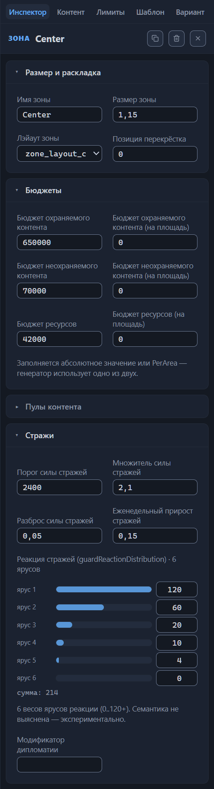

# Главные объекты зоны

Секция перечисляет опорные точки зоны. Главный объект — это город, точка появления героя, заброшенный аванпост или арена: генератор строит зону вокруг них, а остальные настройки ссылаются на объекты по номеру. Дороги начинаются и заканчиваются у главного объекта, слои биома умеют следовать за ним, фракция города может копировать фракцию другого объекта, а значки на канве показывают раскладку зоны с одного взгляда.

Секция стоит после «Обязательного контента и лимитов» и по умолчанию свёрнута; в заголовке живёт счётчик вида «Главные объекты (2)». Карточек может не быть вовсе: пустой список легитимен — зоны сокровищ демо-шаблона обходятся без опорных точек. В файле это обязательный массив `mainObjects`; у зон штатных шаблонов бывает от одного до девяти объектов.

Нумерация идёт с нуля по списку секции, и номер служит адресом для ссылок: концы дорог, слои биомов «как у главного объекта» и способ выбора фракции «Match» указывают индекс объекта. Обратите внимание: удаление карточки из середины сдвигает номера всех последующих, и ссылки молча начинают указывать на соседей. После удаления объекта перечитайте индексы в дорогах, биомах и фракциях, иначе дорога уведёт не к тому городу.

В режиме «Обзор» канва рисует значок каждого объекта на узле зоны: флаг цвета игрока у точки появления героя, замок у города, здание с колоннами у заброшенного аванпоста, скрещённые мечи у арены. Узел с точкой появления героя вдобавок окрашен цветом игрока и сгруппирован в легенде под именем «Игроки (Spawn)» (глава [Канва: режимы отображения](canvas-modes.md)).

## Карточка объекта

Каждый объект занимает собственную карточку. Свёрнутая карточка показывает строку-подсказку: тип, бейдж игрока у точки появления героя, размещение и — если задано — значение охраны, например «Connection · 30000». Кнопка ✕ удаляет объект сразу и без подтверждения; ошиблись — откатывайте удаление сочетанием Ctrl+Z. Раскрытая карточка перечисляет поля по порядку: тип, игрок, размещение с аргументами, фракция, пресет застройки, запрещённые здания, владелец, стража, условия победы и гарнизон.

Новый объект создаёт строка под списком: выберите тип и нажмите «Добавить». Свежий объект получает заготовку:

Точка появления героя
: тип `Spawn`, игрок `Player1`, размещение «в центре зоны».

Остальные типы
: размещение «в центре зоны», шанс стражи 1, значение охраны 10000.

Числовые поля карточки фиксируются по Enter или потере фокуса; стрелки рядом с полем меняют значение на шаг.

## Тип объекта

Подпись поля — «тип», в файле — `type`. Список выбора предлагает четыре варианта: «Город (City)», «Точка спауна игрока (Spawn)», «Заброшенный аванпост (AbandonedOutpost)» и «Арена адского пламени (GladiatorArena)»; тип можно сменить в любой момент. Чем различаются типы:

Город
: главный населённый пункт зоны: строится по пресету застройки, носит фракцию, может иметь владельца и стражу. Самый распространённый тип — 676 городов в шестидесяти штатных шаблонах.

Точка появления героя
: стартовая позиция игрока, подробности — в разделе [«Игрок (spawn)»](#игрок-spawn). В штатных шаблонах — 232 объекта.

Заброшенный аванпост
: редкий тип — 40 объектов в шестидесяти штатных шаблонах.

Арена
: редчайший тип — единственный штатный пример, один объект в шаблоне Blitz. Вход на арену открывает связь одноимённого типа (глава [Связи между зонами](connections.md)).

## Игрок (spawn)

Поле называется «Игрок (spawn)», в файле — `spawn`, и встречается только у объекта типа Spawn. Список предлагает восемь значений `Player1`–`Player8`. Выбор здесь задаёт раскраску канвы: узел зоны получает цвет игрока, а легенда собирает такие узлы в группу «Игроки (Spawn)».

Валидатор контролирует две ошибки. «Spawn без spawn=PlayerN» — точка появления героя без игрока; «Player1 уже задан в зоне Spawn-A» — один игрок назначен двум точкам появления в пределах одного варианта.

## Размещение

Поле называется «Размещение», в файле — `placement`. Четыре способа, в скобках — имя в файле:

- «где угодно в зоне (Uniform)» — 685 назначений в штатных шаблонах, самое частое размещение;
- «в центре зоны (Center)» — 193 назначения;
- «на конкретной связи (Connection)» — 63 назначения;
- «возле другой зоны (NearZone)» — 2 назначения.

Двум способам нужны уточнения — их вводят полем «Аргументы размещения» (в файле — `placementArgs`). Элементы списка набирают через запятую и фиксируют по потере фокуса или сочетанием Ctrl+Enter:

Connection
: имя связи, на которую встаёт объект. Отсутствующую связь ловит предупреждение «Связь «Spawn-A-Center» из placementArgs не найдена в варианте».

NearZone
: имя зоны, возле которой встаёт объект. Отсутствующую зону ловит предупреждение «Несуществующая зона NearZone: «X»».

Uniform и Center
: тройка вида `[bool, −1..1, 0..4]`. По подсказке редактора (гипотеза) это прижим к краю, смещение и сторона. *Назначение уточняется.*

Переименование связи или зоны редактор переносит в аргументы сам: имена в `placementArgs` обновляются вслед за переименованием.

В демо-шаблоне второй объект центра (индекс 1) использует размещение «на конкретной связи» с единственным аргументом — именем связи `Spawn-A-Center`.

## Способ выбора фракции

Поле называется «Способ выбора фракции», в файле — `faction`. Оно определяет, какая фракция достанется городу, и предлагает два способа: «Match (по объекту)» и «FromList (список)». Список редактора включает пять фракций: human, demon, dungeon, nature и unfrozen; их биомы перечислены в разделе «Биомы» главы [Зона: все свойства](zone.md#биомы).

Match (по объекту)
: город наследует фракцию другого главного объекта. Донора задаёт список «Главный объект»: его варианты — из секции «Главные объекты» текущей зоны, а необязательное поле «Зона» сужает поиск конкретной зоной — тогда список показывает её объекты. Каждый вариант подписан номером и типом, у точки появления героя добавлен игрок — например, «0 · Точка спауна игрока (Spawn) · Player1». В файле записаны индекс объекта-донора (`faction.args[0]`) и имя зоны (`faction.args[1]`). Значение, записанное в файле, но отсутствующее в списке, остаётся явным вариантом «N · вне списка объектов». Валидатор проверяет только зону — предупреждением «Несуществующая зона faction Match: «X»»; номер объекта не проверяется: удаление карточки сдвигает нумерацию, и выбор молча начинает указывать на соседа.

FromList (список)
: город получает фракцию из списка. Чипы пяти фракций переключают членов списка, а поле «прочее (differentFrom и др.)» принимает выражения вида «differentFrom: 0 Spawn-A» — часть списка фракций, по одному выражению на элемент через запятую. Отсутствующую зону в выражении ловит предупреждение «Несуществующая зона faction differentFrom: «X»».

Умолчание и ориентиры:

Новый объект
: поле не задано — город остаётся без фракции.

Демо-шаблон
: первый объект центра несёт список из всех пяти фракций; у остальных объектов поля нет.

Штатные шаблоны
: 45 файлов из 60 используют поле; «Match» обычно наследует фракцию стартового города зоны.

## Пресет застройки

Поле называется «Пресет застройки», в файле — `buildingsConstructionSid`. Пресет — именованная схема зданий города на старте: сколько и каких зданий уже построено к началу игры. Подсказки поля предлагают 60 имён из базы игры — шкала богатства poor, default, medium, rich, extra_rich, ultra_rich и специальные семейства вроде siege_, army_, full_ и only_mage_guild.

Ввод свободный, статус показывает бейдж. Зелёный «в каталоге» — имя есть в базе; красный «не в каталоге» — имя не находится; оранжевый «известная битая ссылка (штатные)» — имени нет в базе, но оно встречается в штатных шаблонах, которые игра переносит молча. Пять имён помечены оранжевым, например bank_buildings_construction.

Опечатки подхватывает предупреждение «Пресет застройки «X» не найден в каталоге (игра переносит такие ссылки молча)». Выбирайте имена из подсказок, иначе опечатка останется в шаблоне незамеченной: игра молча переносит битую ссылку, и узнать о ней можно только из валидатора.

Умолчание и ориентиры:

Новый объект
: поле не задано.

Демо-шаблон
: `medium_buildings_construction` у объектов зон старта, `rich_buildings_construction` у первого города центра и `default_buildings_construction` у второго.

Штатные шаблоны
: 57 файлов из 60, 31 разных значений.

## Запрещённые здания

Поле называется «Запрещённые здания», в файле — `buildingsBanSid`. Значение — sid списка зданий, которые городу строить запрещено. Механика поля та же, что у пресета застройки: свободный ввод, подсказки из каталога на 41 имя и предупреждение валидатора «Пресет банлиста «X» не найден в каталоге». Бейджей здесь два — зелёный «в каталоге» и красный «не в каталоге»: известных исключений у банлистов нет, поэтому оранжевый бейдж «известная битая ссылка (штатные)» у этого поля не показывается.

Редкое поле: единственный штатный пример — шаблон Exodus, где списком `exodus_poor_buildings_banlist` ограничены обе зоны старта. В демо-шаблоне поле не задано.

## Владелец

Поле называется «Владелец», в файле — `owner`. Заполняют его для заранее захваченного объекта: указанный игрок `Player1`–`Player4` владеет объектом с самого старта карты, без боя.

Поле свободного ввода, и валидатор его не проверяет — единственный ориентир, подсказка поля, перечисляет допустимые значения. Опечатка пройдёт молча, поэтому сверьте ввод с подсказкой.

Ориентир — 14 штатных файлов с владельцем. Когда объект получает владельца, стражу с него можно снять автоматически: этим управляет переключатель «Убирать стражу у владельца» из следующего раздела.

## Стража объекта

У зоны есть собственное значение охраны — раздел «Стражи» главы [Зона: все свойства](zone.md#стражи); пять полей этого блока относятся к страже конкретного объекта.

- Поле «Шанс стражи» (`guardChance`) — число от 0 до 1, вероятность, что у объекта будет стража. Шаг поля 0.05; значение вне диапазона ловит предупреждение «guardChance X вне 0..1».
- Поле «Сила стражи» (`guardValue`) — значение охраны от 0 до 60 000 в единицах ценности, шаг 100. Отрицательное число валидатор помечает сообщением «Отрицательный guardValue объекта».
- Поле «Еженедельный прирост стражи» (`guardWeeklyIncrement`) — доля от 0.05 до 0.5, на которую значение охраны растёт каждую неделю. Пример: 20000 × 0.2 = 4000 — столько охраны прибавится за неделю первому городу центра.
- Поле «Разброс силы стражи» (`guardRandomization`) — число от 0 до 1; в штатных шаблонах всегда 0.2.
- Переключатель «Убирать стражу у владельца» (`removeGuardIfHasOwner`) — снять стражу, как только объект получает владельца. Это список из трёх состояний: «не задано», true или false; так устроены все переключатели секции. В штатных шаблонах всегда включён.

Оба города центра в демо-шаблоне защищены: шанс 1, значения охраны 20000 и 30000, еженедельный прирост 0.2. У точек появления героя стражи нет.

## Условия победы и гарнизон

Четыре редких поля связывают объект с условиями победы и гарнизоном.

Поле «Цель „удержания города“» (`holdCityWinCon`) включает город в одноимённое условие победы; само условие настраивается в корне шаблона (глава [Настройки шаблона (корень)](root.md)). Как именно поле сопрягается с корневой настройкой — *Назначение уточняется.* В штатных шаблонах — пять файлов, семь объектов, все включены.

Поле «Ключевой объект» (`isKeyObject`), по подсказке редактора (гипотеза), связано с условием победы по ключевым объектам; единственный штатный пример — шаблон Harmony с двумя включёнными объектами. *Назначение уточняется.*

Поле «Начальный прирост гарнизона» (`initialUnitIncrement`) задаёт стартовый прирост отрядов гарнизона: целое от нуля, шаг 1. Штатный пример один — шаблон Shamrock, четыре центра со значением 2.

Поле «Еженедельный прирост гарнизона» (`enableWeeklyUnitIncrement`) включает еженедельный прирост гарнизона; это тот же список из трёх состояний, что у «Убирать стражу у владельца». В штатных шаблонах поле встречается только у объектов шаблона Shamrock и всегда включено.

## Куда дальше

- [Зона: все свойства](zone.md) — бюджеты, стражи, биомы и дороги зоны: настройки, которые ссылаются на главные объекты по номеру.
- [Связи между зонами](connections.md) — тип связи «вход на арену (GladiatorArena)»: подходы к арене, заданной объектом этой главы.
- [Настройки шаблона (корень)](root.md) — условия победы, с которыми связывают объектные поля «Цель „удержания города“» и «Ключевой объект».
- [Канва: режимы отображения](canvas-modes.md) — режим «Обзор»: значки главных объектов на узлах зон и цвета игроков у точек появления героя.
