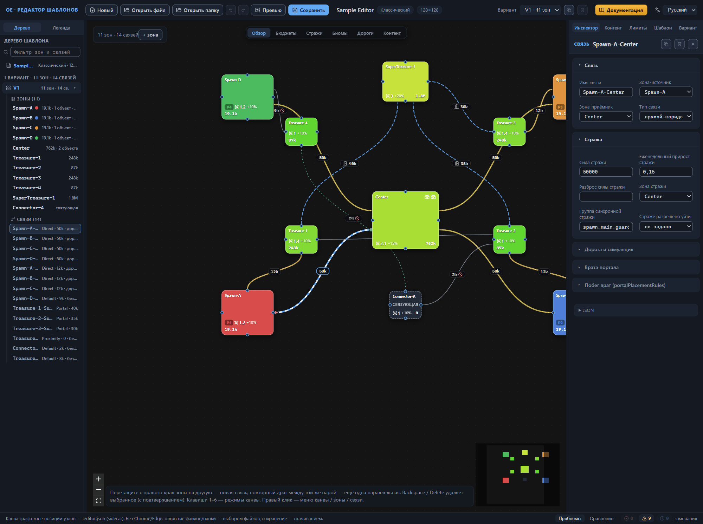
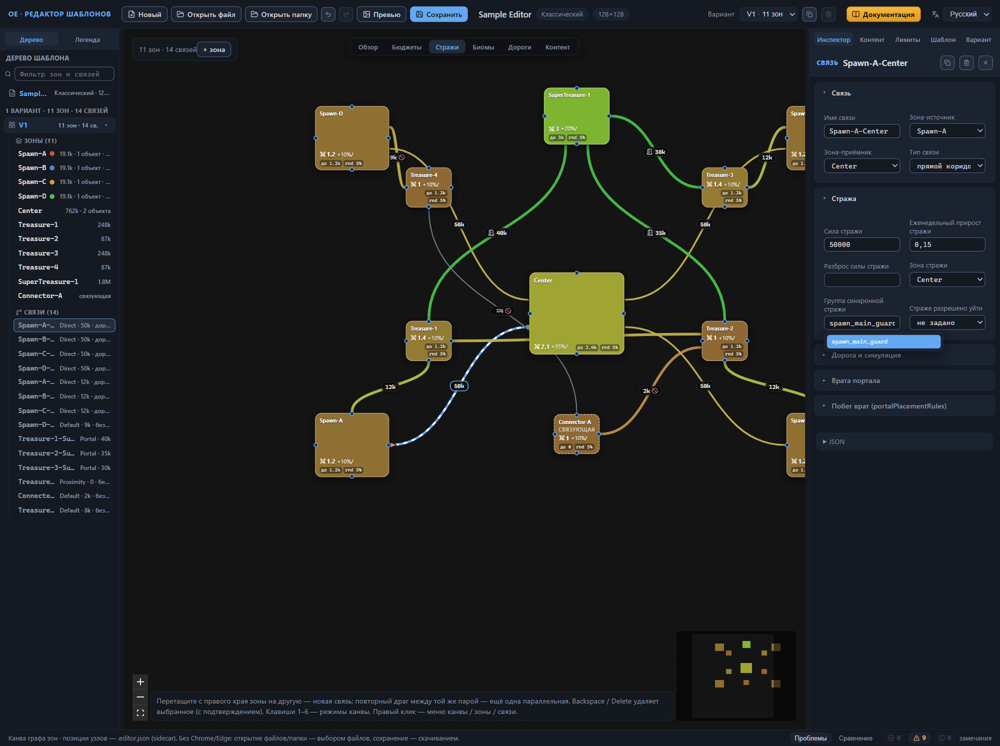
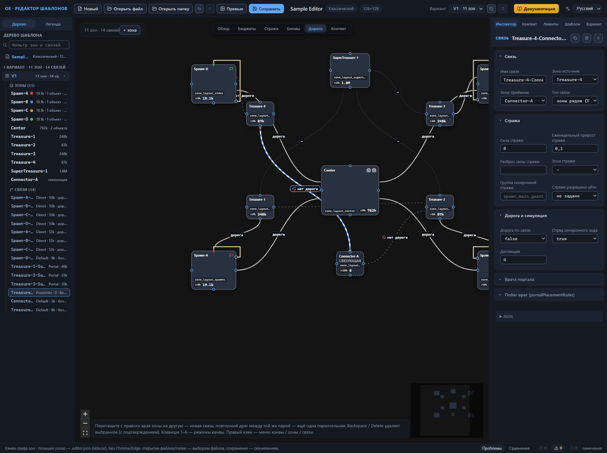
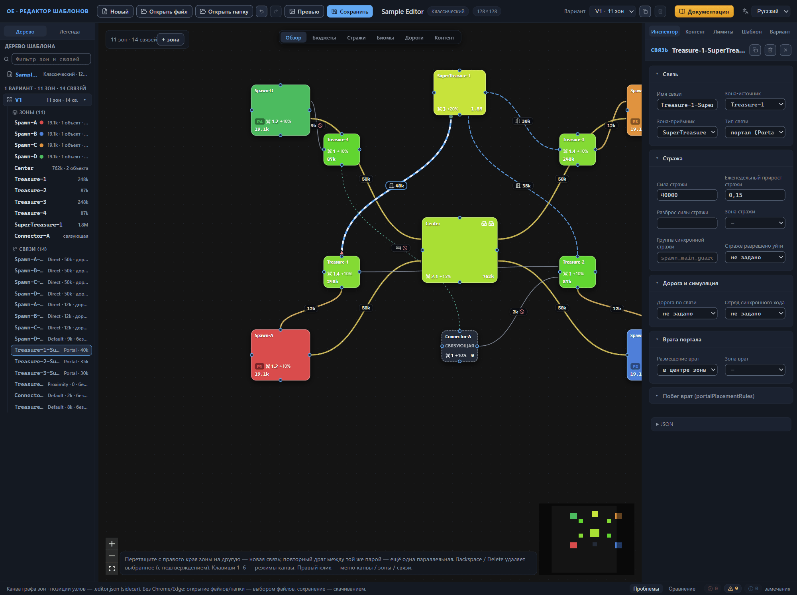
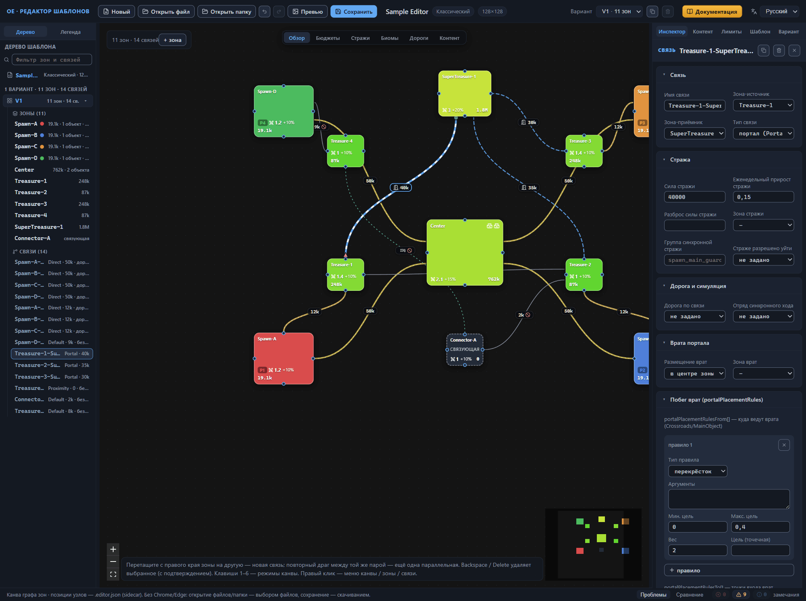

# Связи между зонами

Связь — переход между двумя зонами: коридор, портал или просто соседство зон на карте. Связи живут внутри варианта раскладки: у каждого варианта собственный список `connections`, а его элементы ссылаются на зоны того же варианта по именам. В штатных шаблонах на вариант приходится от 5 до 52 связей.

Чтобы настроить связь, выберите её — линию на канве или строку в дереве шаблона: инспектор откроет её свойства (глава [Интерфейс: окна и панели](interface.md)). Инспектор собирают секции «Связь», «Стража», «Дорога и симуляция», «Врата портала» и «Побег врат (portalPlacementRules)»; «Связь» и «Стража» раскрыты по умолчанию. Как связь протянуть и удалить — глава [Канва: правка графа](canvas-editing.md); как канва её рисует — глава [Канва: режимы отображения](canvas-modes.md). Эта глава — справочник полей.

## Связь

Первая секция инспектора — адрес и вид перехода: имя, две зоны, тип.

### Имя связи

Поле «Имя связи», имя в файле `name`. Плейсхолдер подсказывает умолчание: «Авто: From-To». Пока поле пусто, связь живёт под авто-именем, собранным из имён её зон, — например «Spawn-A-Center». Под этим именем связь видна в дереве шаблона и в замечаниях валидатора, а подсказка поля формулирует роль имени: «name — на него ссылаются дороги и placementArgs». Так и есть: имя служит адресом связи внутри шаблона — на него ссылаются концы дорог вида «связь (Connection)», размещение главных объектов «на конкретной связи» и аргументы правил обязательного контента.

Новая связь создаётся без собственного имени — это её умолчание. Штатные шаблоны связи почти всегда именуют: 59 файлов из 60, обычно тем же видом From-To, а у дубликатов — с числовым суффиксом.

Очистка поля возвращает связь к авто-имени. Переименование зоны переносит авто-имя каскадом: редактор заодно переписывает концы дорог и аргументы правил, которые на него ссылались (глава [Канва: правка графа](canvas-editing.md#имя-связи)). Связь с собственным именем от имён зон не зависит — переименование зоны её не трогает. Зато переименование самой связи ссылки не переписывает: дорога или правило размещения сохраняют прежний адрес, ссылка становится битой, и валидатор выдаёт ошибку «Связь «X» не найдена в варианте». Давайте имя до того, как на него сослались, либо проверяйте ссылки после переименования.

Штатные шаблоны несут по несколько параллельных переходов одной пары и различают их суффиксами («…-1», «…-2»). Параллельную связь добавляют в редакторе: повторным перетаскиванием между той же парой зон или пунктом «Дублировать связь» контекстного меню — имя с суффиксом редактор выдаёт сам (глава [Канва: правка графа](canvas-editing.md#дублирование-связи)). Две связи одной пары без собственных имён получили бы одинаковые авто-имена, ссылки на них стали бы неоднозначными, и валидатор отметил бы это сообщением «Совпадающие авто-имена связей (From–To без суффикса): …»; из интерфейса такое недостижимо, поэтому справка всплывает на файлах, правленных мимо редактора.

### Зона-источник и зона-приёмник

Поля «Зона-источник» и «Зона-приёмник», имена в файле `from` и `to`. Оба обязательны и хранят имена связываемых зон; списки выбора перечисляют зоны активного варианта. Связь зоны с самой собой перетаскиванием на канве не создаётся. Направление задаёт порядок имён в авто-имени, а у портала — какой стороне принадлежат правила размещения врат; других последствий у направления не выявлено — пара имён говорит лишь, какие зоны связывает переход.

Имя зоны, которого в варианте нет, — замечание уровня ошибки: «Несуществующая зона from: X» или «Несуществующая зона to: X». Из инспектора такое недостижимо: списки предлагают только живые зоны, а удаление зоны убирает её связи вместе с ней. Ошибки всплывают в файлах, правленных мимо редактора. Переименование зоны переносит `from` и `to` каскадом.

### Тип связи

Поле «Тип связи», имя в файле `connectionType` — обязательное, одно из пяти значений. Список подписывает варианты парами: русская расшифровка и имя в файле.

- **прямой коридор (Direct)**
  : прямой коридор между зонами. Рабочая лошадка штатных шаблонов: 799 связей из 1509, около 53%.

- **обычная связь (Default)**
  : форму перехода генератор выбирает сам. Каждая четвёртая штатная связь: 382, около 25%.

- **портал (Portal)**
  : не коридор, а пара врат между зонами. Размещение врат настраивается в секциях «Врата портала» и «Побег врат (portalPlacementRules)» — дальше в этой главе. Портал без выбранного размещения врат валидатор отмечает сообщением «Portal без gatePlacement». В штатных шаблонах 180 порталов, около 12%.

- **зоны рядом (Proximity)**
  : зоны должны просто оказаться рядом на карте — коридор между ними не генерируется. Целевое расстояние задаёт поле «Дистанция» (`length`) в секции «Дорога и симуляция»; тип без числа даёт замечание «Proximity без length». Штатных связей типа — 146, около 10%.

- **вход на арену (GladiatorArena)**
  : вход на арену. Редчайший тип — два вхождения на все штатные шаблоны. Саму арену задаёт главный объект одноимённого типа (глава [Главные объекты зоны](main-objects.md#тип-объекта)).

Новая связь с канвы создаётся типом «прямой коридор (Direct)». На канве пять типов читаются по-разному — вид линии, бейджи со значением охраны и дистанцией, значок двери у портала; расшифровка — в главе [Канва: режимы отображения](canvas-modes.md).

## Стража

Стража связи — охрана, которую генератор ставит на переходе. Секция стоит сразу после «Связи» и раскрыта по умолчанию. Силу охраны задаёт значение охраны — число в единицах ценности, той же условной валюте баланса, что и бюджеты зон. Стража зон (порог, множитель, реакция) настраивается в секции зоны «Стражи» (глава [Зона: все свойства](zone.md#стражи)), стража объектов — в их карточках (глава [Главные объекты зоны](main-objects.md#стража-объекта)). Здесь — только охрана самого перехода. Канва показывает её в двух режимах: «Обзор» ставит посреди линии бейдж со значением, «Стражи» красит линию по силе (глава [Канва: режимы отображения](canvas-modes.md)). Замечания валидатора о связи несут номер варианта и имя связи — «V1 · связь Spawn-A-Center»; у замечаний о группах собственная область — «V1 · группа стражей spawn_main_guard». Собирается всё на панели «Проблемы» (глава [Проверка шаблона (валидатор)](validator.md)).

### Сила стражи

Поле «Сила стражи», имя в файле `guardValue`. Подсказка сразу даёт ориентиры: «guardValue — −10000…5 000 000; отрицательные (−10000…−2000) встречаются на второстепенных проходах — семантика не выяснена, экспериментально». Поле принимает любое число, стрелки меняют его шагом 100, жёсткого ограничения ввода нет. У новой связи — 8000; демо-шаблон несёт 50000 на главных проходах «старт — центр» и 9000–12000 на боковых, к зонам сокровищ.

Значение охраны есть у всех штатных связей. Редактор не настаивает: связь без значения замечаний не даёт, канва просто не рисует на ней бейдж.

Отрицательные значения — экспериментальный приём: семь штатных шаблонов несут от −2000 до −10000 на второстепенных проходах — от старта к сокровищам, в связующих зонах, у порталов. Валидатор помечает каждое предупреждением «Отрицательный guardValue (−2000) — семантика неясна, проверьте», а бейдж на канве — предупреждающим цветом и знаком «?» перед числом. *Назначение уточняется.* Без нужды не экспериментируйте с отрицательными числами: поведение генератора на них не описано, и вместо ослабленного прохода можно получить непредсказуемую охрану.

Внутри группы синхронной стражи силу держат одинаковой у всех участников — о группе ниже.

### Еженедельный прирост стражи

Поле «Еженедельный прирост стражи», имя в файле `guardWeeklyIncrement` — «доля, на которую стража растёт каждую неделю», как формулирует подсказка. Стрелки меняют значение шагом 0.05, жёсткого ограничения ввода нет, штатный ориентир — 0.05–0.25. Новая связь получает 0.1; демо-шаблон задаёт 0.15 главным проходам «старт — центр» и порталам к зоне сверхсокровищ, 0.1 — остальным переходам.

Читается значение так же, как у стражей зон: прирост 0.15 добавляет за неделю пятнадцать процентов силы — стража силой 50000 за первую неделю вырастает на 7500. Прирост заполнен у всех штатных связей; редактор связь без прироста терпит и замечаний не даёт. Внутри группы синхронной стражи прирост совпадает.

### Разброс силы стражи

Поле «Разброс силы стражи», имя в файле `guardRandomization` — разброс силы стража связи. Стрелки меняют значение шагом 0.05 и за границы 0–1 не выходят, однако жёсткого ограничения ввода нет; штатные значения — 0.1–0.25. Поле редкое: оно есть лишь в 11 файлах из 60, а у новой связи пусто. Внутри группы синхронной стражи разброс — третье значение, которое сравнивает валидатор.

### Зона стражи

Поле «Зона стражи», имя в файле `guardZone`. Список перечисляет зоны активного варианта; пустая строка «—» означает, что поле не задано. Подсказка говорит «из какой зоны берётся стража (по умолчанию — посередине)»: когда поле не задано, стража стоит посередине перехода.

Поле необязательное: оно есть в 15 файлах из 60, а значения в штатных шаблонах — имена центральных зон, Center (210 вхождений) и Center-A (10). Демо-шаблон ставит «Center» всем четырём главным проходам. Несуществующая зона даёт предупреждение «Несуществующая зона стража: X». Переименование зоны переносит поле каскадом — редактор переписывает его вместе с концами связи.

### Группа синхронной стражи

Поле «Группа синхронной стражи», имя в файле `guardMatchGroup` — именованная группа симметричных стражей. Подсказка формулирует правило: «guardMatchGroup — именованная группа симметричных стражей (в группе должны совпадать guardValue/guardWeeklyIncrement/guardRandomization)». Связи одной группы получают одинаковую стражу — это главный инструмент симметрии равных стартов, тот же приём, что и одинаковые размеры зон и связей. Четыре файла штатных шаблонов используют поле — всего 52 вхождения, имена вида spawn_main_guard и spawn_side_guard, у параллельных групп — с числовыми суффиксами.

Поле принимает произвольный текст; при открытии строки раскрывается список подсказок — группы, которые уже носят другие связи того же варианта. Плейсхолдер подсказывает соглашение об именах: «spawn_main_guard_1».

Демо-шаблон показывает группу в работе. Четыре связи — «Spawn-A-Center», «Spawn-B-Center», «Spawn-C-Center» и «Spawn-D-Center» — несут группу spawn_main_guard, у каждой тип «прямой коридор (Direct)», сила стражи 50000, прирост 0.15 и зона стражи «Center». Четверо игроков идут к центру равноценными проходами, и каждого встречает одна и та же стража. Допустим, силу одной связи подняли до 60000: валидатор отвечает предупреждением «В группе «spawn_main_guard» guardValue различаются (50000 / 60000) — стражи не будут симметричны», а дорога этого игрока оказывается тяжелее прочих — симметрия старта сломана.

Сравнивает валидатор три поля — силу, прирост и разброс — и только по заполненным значениям: пустое поле у одной связи группы и число у другой расхождением не считаются. Группа из одной связи бессмысленна, о чём говорит сообщение «Группа «X» из одной связи — синхронизировать некого».

На канве связи группы узнаются без инспектора: вместо цвета типа они несут собственный цвет, вычисленный из имени группы, а легенда режима «Стражи» помечает группу значком ◆ (глава [Канва: режимы отображения](canvas-modes.md)). Называйте группы по назначению — spawn_main_guard, side_passage_guard, — иначе в шаблоне с несколькими группами придётся гадать, какая за что отвечает: ни редактор, ни игра имя группы не расшифровывают.

### Страже разрешено уйти

Поле «Страже разрешено уйти», имя в файле `guardEscape` — список из трёх положений: «не задано», true и false. Подсказка честна: «guardEscape — гипотеза: разрешить страже уйти (обход стражи?). В штатных всегда false; поведение при true неизвестно». Поле есть в 41 штатном файле, и везде оно false. *Назначение уточняется.*

## Дорога и симуляция

Третья секция инспектора связи, свёрнута по умолчанию — раскройте её щелчком по заголовку; редактор запоминает состояние раскрытия между сеансами. Внутри три поля в порядке следования: «Дорога по связи», «Отряд синхронного хода» и «Дистанция». Дорога и дистанция настраивают путь между зонами.

### Дорога по связи

Поле «Дорога по связи», имя в файле `road` — список из трёх положений:

- «не задано» — ключа `road` в файле нет;
- true — вдоль перехода прокладывается дорога;
- false — переход остаётся без дороги.

Подсказка под полем формулирует суть: «road — есть ли дорога по связи». Флаг есть в 41 штатном файле из 60: положение true встречается у 706 связей, false — у 239. В оставшихся 19 файлах флаг не задан ни у одной связи.

Новая связь создаётся сразу в положении true. Дорога вдоль перехода не нужна — переведите поле в false явно, иначе шаблон сохранит дорогу там, где вы её не планировали.

На канве за флагом следит режим «Дороги» (глава [Канва: режимы отображения](canvas-modes.md#режим-дороги)). Связь с дорогой рисуется светлой плотной линией с белой штриховой нитью поверх; связь без дороги — серой линией редкого штриха со значком перечёркнутого круга на бейдже; не задано — тёмной тонкой приглушённой линией короткого штриха. Легенда панели повторяет те же три состояния: «road: true — есть дорога», «road: false — дороги нет», «road — не задано». Белая нить и значок запрета видны и в режиме «Обзор».

Обратите внимание: дорога по связи — не то же, что дорога зоны. Массив `roads` внутри зоны (глава [Зона: все свойства](zone.md#дороги)) описывает маршруты между объектами внутри неё, а флаг `road` включает дорогу вдоль перехода между зонами.

### Отряд синхронного хода

Поле «Отряд синхронного хода», имя в файле `simTurnSquad` — список из трёх положений, как у «Дороги по связи»: «не задано», true и false. Новая связь создаётся в положении «не задано». О назначении поля подсказка говорит лишь — «гипотеза: страж учитывается в одновременных ходах. В штатных всегда true (48 файлов)». Поле есть в 48 штатных файлах, и везде оно true. *Назначение уточняется.*

### Дистанция

Поле «Дистанция», имя в файле `length`. Оно появляется в секции только у связи типа «зона рядом (Proximity)»; для остальных типов поле скрыто. Подсказка: «length — расстояние для «зоны рядом» (Proximity)». Значение — целое число: стрелки меняют его с шагом 1, жёстких границ поле не задаёт. Штатные шаблоны используют диапазон 0–8, поле есть в 25 файлах из 60.

Дистанция задаёт целевое расстояние между зонами. В чём оно измеряется — в клетках или долях размера зоны, — неизвестно. *Назначение уточняется.*

У новой связи поля нет; валидатор напоминает о нём замечанием уровня «информация»: «Proximity без length».

Демо-шаблон показывает поле в работе: связь «Treasure-4-Connector-A» — единственная с типом Proximity — несёт дистанцию 4, дорога по ней отключена, сила стражи нулевая. В режиме «Обзор» бейдж этой связи получает суффикс «≈4»; без заданной дистанции вместо числа стоит «≈?».

## Врата портала

Четвёртая секция инспектора связи, свёрнута по умолчанию — раскройте её щелчком по заголовку; редактор запоминает состояние раскрытия между сеансами. Поля секции отвечают на вопрос, где генератор поставит врата: портал — не коридор, а пара врат между зонами, и у этой пары должен быть адрес. Секция видна в инспекторе при любом типе связи, но нужна порталам: врата — часть портала, у коридора или соседства зон их нет.

### Размещение врат

Поле «Размещение врат», имя в файле `gatePlacement`. Список из трёх положений:

- «—» — поле не задано, ключа `gatePlacement` в файле нет;
- «в центре зоны (Center)» — общие врата в центре;
- «возле указанной зоны (NearZone)» — врата в зоне, которую называет следующее поле.

Подсказка под полем формулирует раскладку: «gatePlacement — Center: общие врата в центре (штатно); NearZone: врата в указанной зоне». У новой связи поле не задано. Штатные шаблоны заполняют его в 19 файлах из 60: 198 вхождений Center против четырёх NearZone. Демо-шаблон выбирает «в центре зоны (Center)» всем трём своим порталам — «Treasure-1-SuperTreasure-1», «Treasure-2-SuperTreasure-1» и «Treasure-3-SuperTreasure-1», входам в зону сверхсокровищ.

Портал без размещения — замечание уровня «информация» «Portal без gatePlacement». Значение вне списка даёт предупреждение «Неизвестный gatePlacement «X» (ожидается Center/NearZone)»; из инспектора оно недостижимо — список предлагает два положения и пустое, — и ловит только файлы, правленные мимо редактора.

### Зона врат

Поле «Зона врат», имя в файле `gatePlacementArgs`, — уточнение к размещению «возле указанной зоны (NearZone)». Список перечисляет зоны активного варианта, пустая строка «—» означает, что поле не задано. Подсказка: «gatePlacementArgs — зона размещения врат (при NearZone)».

Штатный пример редок: поле несёт один файл из 60 — четыре вхождения, все имена вида Connector-*. Несуществующая зона даёт предупреждение «Несуществующая зона врат: X»; из инспектора оно недостижимо — список предлагает живые зоны, а удаление зоны убирает её связи вместе с ней. Переименование зоны переносит поле каскадом, пока у связи стоит размещение «возле указанной зоны (NearZone)».

## Побег врат (portalPlacementRules)

Пятая секция инспектора, свёрнута по умолчанию. Правила уточняют, где именно в зоне поставить врата: не просто «в центре», а, например, возле перекрёстка или в отдалении от главного объекта. Секция несёт два независимых списка — «portalPlacementRulesFrom[] — куда ведут врата (Crossroads/MainObject)» и «portalPlacementRulesTo[] — точки входа врат (Crossroads/MainObject)»: первый отвечает на вопрос «куда ведут врата», второй — «где точки входа». Заполнить можно один список или оба. Настройка редкая: поля встречаются в 6–8 штатных файлах из 60, демо-шаблон обходится без правил — его порталам хватает размещения «в центре зоны (Center)».

Формат правил тот же, что у правил размещения обязательного контента в корневых группах (глава [Настройки шаблона (корень)](root.md)): карточки редактируются общим редактором. Различается список целей: корневым правилам доступно пять типов, у врат их два.

### Карточка правила

Кнопка «＋ правило» добавляет карточку — «правило 1», затем «правило 2»; нумерация идёт с единицы. Новая карточка создаётся с умолчаниями: тип «перекрёсток · Crossroads», аргументы пусто, минимальная и максимальная цель 0, вес 2. Кнопка ✕ в строке заголовка убирает правило сразу — вернуть его можно Ctrl+Z; удаление последнего правила убирает весь список из файла.

### Тип правила и аргументы

Поле «Тип правила», имя в файле `type`, задаёт, относительно чего отсчитывается размещение врат:

- **перекрёсток · Crossroads**
  : точка, где сходятся дороги зоны. Аргументов не требует.

- **объект зоны · MainObject**
  : главный объект зоны — город, точка появления героя, аванпост или арена (глава [Главные объекты зоны](main-objects.md)). Уточняется аргументом.

Поле «Аргументы», имя в файле `args`, уточняет цель: у «объекта зоны» — индекс главного объекта в списке зоны, отсчитываемый с нуля; у «перекрёстка» остаётся пустым. Значения набираются через запятую, пустое поле убирает `args` из файла. Подсказка «индекс/имя/sid/связь» перечисляет аргументы всех контекстов редактора правил — правилам врат нужен индекс.

Тип вне списка даёт предупреждение «Правило врат с незнакомым type «X» (ожидается Crossroads/MainObject)»; из редактора оно недостижимо — список предлагает две цели.

### Минимальная и максимальная цель

Поля «Мин. цель» и «Макс. цель», имена в файле `targetMin` и `targetMax`, задают кольцо допустимых расстояний до цели. Значение — нормированное расстояние, доля от радиуса зоны; стрелки меняют числа шагом 0.05, типовые диапазоны — 0–0.9 у минимума и 0–2 у максимума.

Читается кольцо так. Правило «перекрёсток · Crossroads» с минимальной целью 0 и максимальной 0.4 допускает врата в ближних четырёх десятых радиуса зоны от перекрёстка — всё, что дальше, правило не рассматривает. Минимальная цель больше нуля отодвигает врата от самой цели: кольцо 0.2–0.6 допускает размещение в средних дистанциях, не вплотную к цели и не на краю зоны.

Валидатор следит за типовыми диапазонами и предупреждает о выходе за границы: «targetMin X вне типового 0..0.9» и «targetMax X вне типового 0..2».

### Вес правила

Поле «Вес», имя в файле `weight`. Правила одного списка конкурируют, и вес выражает предпочтение: вес 2 перевешивает вес 1. Стрелки меняют значение шагом 0.5, подсказка поля называет диапазон 0–10. Валидатор держит типовую вилку уже — 1–2 — и предупреждает «weight X вне типового 1..2».

### Цель (точечная)

Поле «Цель (точечная)», имя в файле `target`, задаёт точечное расстояние вместо кольца. Подсказка маркирует редкость: «target — точечное расстояние (редко)» — на все штатные шаблоны приходится три вхождения. Точный смысл не выяснен; гипотеза — синоним одновременного задания минимальной и максимальной цели. *Назначение уточняется.*

## Куда дальше

- [Главные объекты зоны](main-objects.md) — город, точки появления героя, аванпосты и арены: цели, относительно которых отсчитываются правила врат.
- [Зона: все свойства](zone.md) — перекрёсток зоны и остальные настройки, к которым привязаны цели правил врат.
- [Канва: режимы отображения](canvas-modes.md) — как канва рисует связи: типы линий, значок двери у портала, режим «Стражи».
- [Настройки шаблона (корень)](root.md) — правила размещения обязательного контента: тот же формат карточек с пятью целями.
- [Проверка шаблона (валидатор)](validator.md) — панель «Проблемы», уровни замечаний и переходы к владеющей связи.
