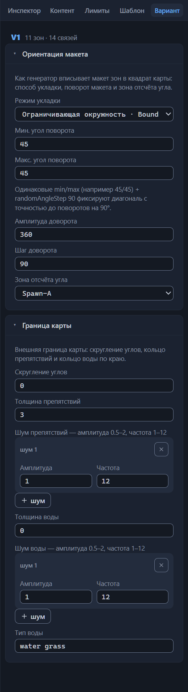

# Вариант: ориентация и граница

Вариант раскладки — это не только зоны и связи: макет целиком описывают ещё два его свойства. Ориентация задаёт, как генератор впишет схему зон в квадрат игровой карты, а граница — какой получится внешняя рамка готовой карты: скруглённые углы, кольцо препятствий, вода по краю. Обе настройки принадлежат варианту: в файле это объекты `orientation` и `border` внутри его элемента `variants[]`, и у каждого варианта они свои. Что такое варианты раскладки и как ими управлять — глава [Варианты: управление и выбор](variant-manage.md); здесь — справочник полей.

Обе секции живут в правой панели на вкладке «Вариант» — пятой, рядом со вкладкой «Шаблон»; выделять что-то на канве не нужно. Шапка панели называет активный вариант — «V1» — и сводку «N зон · M связей». Секция «Ориентация макета» раскрыта по умолчанию, «Граница карты» свёрнута; пока у варианта нет границы, заголовок секции дополняется пометкой «— не задана».

Шаблон, созданный кнопкой «Новый», не несёт ни ориентации, ни границы — все поля пусты. Демо-шаблон настроен полностью: окружность, углы 45/45, доворот с шагом 90, полоса препятствий в три клетки. Разделы главы разбирают эти значения. Среди штатных шаблонов ориентация есть во всех файлах, граница — не у каждого.

## Ориентация макета

Подсказка секции формулирует её суть: «Как генератор вписывает макет зон в квадрат карты: способ укладки, поворот макета и зона отсчёта угла». Полей шесть: режим укладки, два угла поворота, амплитуда и шаг доворота, зона отсчёта.

### Режим укладки

Поле «Режим укладки», имя в файле `mode`, — способ вписания макета зон в карту. Список подписывает значения парами «русское имя · ключ файла»:

- **Минимальный ограничивающий квадрат · MinimalBoundingSquare**
  : макет вписывается в наименьший квадрат, охватывающий всю схему зон. Так работают большинство штатных шаблонов: 44 варианта.

- **Ограничивающая окружность · BoundingCircle**
  : макет вписывается в окружность, охватывающую зоны схемы, — 13 вариантов. Так настроен и демо-шаблон.

В файл попадает ключ, русская подпись живёт только в интерфейсе. Умолчание — «—», режим не задан; из 60 штатных файлов режим заполнен в 51. Значение «—» убирает ключ `mode` из файла — так режим сбрасывают до не заданного.

Единственное замечание валидатора здесь — «Неизвестный mode «X»»: предупреждение о любом значении вне двух ключей, включая пустую строку из файлов, правленных мимо редактора. Из инспектора оно недостижимо — список не предлагает третьего.

### Мин. и макс. угол поворота

Поля «Мин. угол поворота» и «Макс. угол поворота», имена в файле `baseAngleMin` и `baseAngleMax`, — границы, между которыми генератор выбирает базовый поворот всего макета, в градусах. Оба пусты по умолчанию; стрелки меняют значение шагом 15, жёсткого ограничения ввода нет. Поля заполнены в 24 файлах из 60, штатные значения лежат в пределах 0–180 у минимума и 0–360 у максимума.

Валидатор следит за парой двумя предупреждениями. Первое — «baseAngleMin (60) больше baseAngleMax (30)»: границы перепутаны местами. Второе — «baseAngleMin 400 вне типового 0–360»: значение вырвалось за пределы полного круга; для максимального угла замечание симметрично.

Стоит заполнить хотя бы одно из двух полей, под ними появляется строка с готовым рецептом — редкий случай, когда интерфейс сам советует настройку: «Одинаковые min/max (например 45/45) + randomAngleStep 90 фиксируют диагональ с точностью до поворотов на 90°». Разберите рецепт на числах демо-шаблона. Условия: минимальный и максимальный углы равны 45, шаг доворота — 90. Подстановка: базовый угол не случаен — он всегда ровно 45°, а случайный доворот добавляет к нему целое число четвертей круга. Вывод: макет каждой генерации ложится диагонально — генератор лишь выбирает, какая из четырёх диагоналей (45°, 135°, 225°, 315°) достанется. Ту же связку с теми же числами использует штатный шаблон Jebus Cross; строгого подтверждения у рецепта нет, но практика штатных шаблонов ему не противоречит.

### Амплитуда доворота

Поле «Амплитуда доворота», имя в файле `randomAngleAmplitude`, — размах случайного доворота, который генератор добавляет к базовому углу. Диапазон 0–360, стрелки шагом 15, умолчание — не задано; поле заполнено в тех же 24 штатных файлах, что и углы. Демо-шаблон ставит 360 — доворот не ограничен и определяется только своим шагом. Выход за диапазон валидатор отмечает предупреждением «randomAngleAmplitude 400 вне типового 0–360».

### Шаг доворота

Поле «Шаг доворота», имя в файле `randomAngleStep`, — дискретность случайного угла: 90 означает, что довороты кратны четверти круга; подсказка поля приводит именно это число как пример. Диапазон скромнее углов — 0–180, стрелки шагом 15; штатные значения умещаются в него. Демо-шаблон ставит 90, то самое значение из рецепта фиксации диагонали. Валидатор: «randomAngleStep 270 вне типового 0–180».

### Зона отсчёта угла

Поле «Зона отсчёта угла», имя в файле `zeroAngleZone`, — зона, относительно которой отсчитывается нулевой угол: подсказка объясняет её как «куда смотрит» макет. Список перечисляет зоны активного варианта, значение «—» убирает ключ из файла. Штатные шаблоны заполняют поле в тех же 24 файлах и чаще всего указывают Spawn-A — как и демо-шаблон.

Переименование зоны переносится сюда каскадом вместе с остальными ссылками на неё (глава [Канва: правка графа](canvas-editing.md#переименование-зоны)). Удаление зоны поле не чинит: имя остаётся, и валидатор предупреждает «zeroAngleZone «Treasure-9» не является зоной варианта». Увидели предупреждение — выберите в поле живую зону или «—».

## Граница карты

Секция описывает внешнюю рамку готовой карты: «скругление углов, кольцо препятствий и кольцо воды по краю», как формулирует подсказка. В файле это объект `border`; секция свёрнута по умолчанию — раскройте её щелчком по заголовку. Отсутствие границы — легитимное состояние: пометка «— не задана» в заголовке, пустые поля; в 25 из 60 штатных шаблонов границы нет, в 35 есть.

### Скругление углов

Поле «Скругление углов», имя в файле `cornerRadius`, — скругление углов игровой области; единица измерения — доля от половины стороны карты, диапазон 0–0.8, стрелки шагом 0.05. Умолчание — не задано. Демо-шаблон ставит 0: прямые углы. Выход за диапазон — предупреждение «cornerRadius 0.9 вне типового 0–0.8».

### Толщина препятствий

Поле «Толщина препятствий», имя в файле `obstaclesWidth`, — толщина кольца непроходимых препятствий вдоль края карты, в клетках: 2–6, стрелки шагом 1. Демо-шаблон кладёт полосу в три клетки. Валидатор: «obstaclesWidth 8 вне типового 2–6».

### Шум кромки

Поля «Шум препятствий» и «Шум воды», имена в файле `obstaclesNoise` и `waterNoise`, — два парных блока, каждый делает кромку своего кольца рваной вместо ровной линии. Заголовок блока напоминает диапазоны: «Шум препятствий — амплитуда 0.5–2, частота 1–12».

Шум — карточка с номером «шум 1», «шум 2»… и двумя полями: «Амплитуда» (`amp`, 0.5–2, шаг 0.1) и «Частота» (`freq`, 1–12, шаг 1). Кнопка «шум» добавляет карточку с amp 1 и freq 12; кнопка ✕ с подсказкой «Удалить шум» убирает её — сразу, с возвратом по Ctrl+Z. Удаление последнего шума убирает из файла весь список.

Штатные шаблоны обходятся одним шумом на кольцо: у препятствий частота держится 6–12, у воды амплитуда всегда 1. Демо-шаблон ставит обоим шумам amp 1 и freq 12. Валидатор проверяет каждую карточку отдельно: «amp 0.3 вне типового 0.5–2», «freq 15 вне типового 1–12».

### Толщина воды

Поле «Толщина воды», имя в файле `waterWidth`, — толщина водного кольца по краю, в клетках: 0–6, стрелки шагом 1. Ноль, как формулирует подсказка, — «без воды по краю»; демо-шаблон ставит именно его. Валидатор: «waterWidth 7 вне типового 0–6».

### Тип воды

Поле «Тип воды», имя в файле `waterType`, — текстовый идентификатор вида воды (sid) с плейсхолдером «water grass». Это значение из базы игры без локализации: поле показывает его как есть, и других значений во всех 60 штатных шаблонах нет. Отличный от него текст валидатор помечает справкой — не ошибкой — «waterType «water lava» — в штатных всегда «water grass»». Очистка поля убирает ключ из файла.

## Общие правила секций

Инспектор пишет каждую секцию в файл объектом целиком. Очистка всех полей не удаляет объекты: в файле остаются пустые `orientation: {}` и `border: {}`, а пометка «— не задана» исчезнет с заголовка после первого же изменения. Полностью убрать объекты можно в JSON-секции корня: она показывает варианты без зон и связей, а валидатор не даёт менять число и порядок вариантов (глава [Прямая правка JSON](json-editor.md)).

Остальное — общие механики обеих секций:

- каждое изменение поля — шаг истории отмен: Ctrl+Z вернёт прежнее значение, Ctrl+Shift+Z повторит (глава [Файлы: открытие и сохранение](files.md#отмена-и-повтор-действий));
- дублирование варианта переносит обе секции копией — новый вариант наследует ориентацию и границу (глава [Варианты: управление и выбор](variant-manage.md));
- замечания валидатора по этим полям относятся к варианту целиком и помечаются областью «V1»; диапазонные проверки срабатывают только по заполненным полям — пустое поле замечанием не становится;
- режим сравнения показывает различия ориентации и границы в группе «поля варианта» — путями вида `orientation.mode` и `border.waterWidth` (глава [Сравнение вариантов](compare.md)).

Готовые файлы приносят ещё одну неожиданность: ориентация встречается и на уровне всего шаблона, вне вариантов раскладки. Редактор такое поле не показывает, при открытии и сохранении переносит его как есть. *Назначение уточняется.*

## Куда дальше

- [Варианты: управление и выбор](variant-manage.md) — переключение, дублирование и удаление вариантов раскладки.
- [Сравнение вариантов](compare.md) — как читаются отличия ориентации и границы между вариантами.
- [Справочник формата .rmg.json](rmg-json.md) — место секций в структуре файла шаблона.
- [Прямая правка JSON](json-editor.md) — JSON-секция корня и правка объектов вне инспектора.
