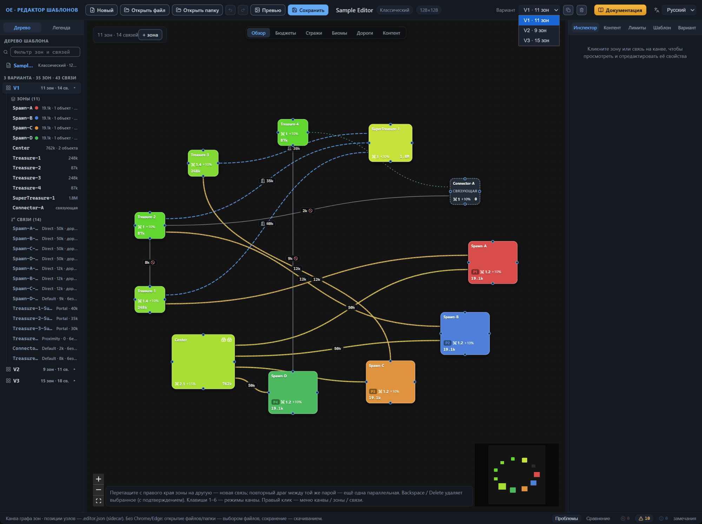
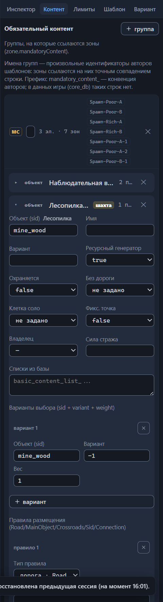

# Варианты: управление и выбор

Вариант раскладки — одна схема зон и связей внутри файла шаблона. В файле варианты образуют список `variants[]`, каждый элемент — полноценная раскладка: собственные зоны, собственные связи, свои ориентация и граница карты. Игра при создании карты собирает её по одному варианту: генератор выбирает вариант случайно — полей веса у вариантов нет, поэтому все они равновероятны.

Штатные шаблоны пользуются механикой сдержанно: в 55 файлах из 60 вариант один, по три варианта несут Arcade, Jebus Outcast, Maze и Outcast Tournament, а Anarchy — пять, и каждая отдельная топология. Варианты различаются числом и набором зон: скажем, у Anarchy в пяти вариантах 15, 11, 17, 20 и 16 зон, у Maze все три варианта по 28 зон. Формат допускает от одного до пяти вариантов; кнопка «Новый» создаёт шаблон с одним вариантом, а открытие файла делает активным первый.

## Активный вариант

Канва показывает один вариант за раз — активный. Его номер совпадает с местом в списке файла: первый элемент — V1, второй — V2 и так далее. Все правки — зоны, связи, поля инспектора — попадают в активный вариант, кнопка «+ зона» на канве тоже добавляет зону в него. Шапка вкладки «Вариант» в инспекторе показывает номер и сводку: «V1» и «11 зон · 14 связей».

Мини-карта в окне превью и PNG-картинка, которую редактор сохраняет вместе с шаблоном, строятся по активному варианту. Валидатор устроен иначе: он проверяет сразу все варианты и помечает каждое замечание областью, например «V1». Клик по замечанию переключает редактор на вариант-владелец и выделяет проблемную зону или связь — об этом подробнее в главе [Проверка шаблона (валидатор)](validator.md).

## Переключение вариантов

Нужно посмотреть другую раскладку или поправить её — сделайте вариант активным:

1. Раскройте селектор «Вариант» в верхней панели.
2. Выберите строку списка, например «V2 · 7 зон».

Канва сразу перерисовывается на схему нового варианта, шапка вкладки «Вариант» обновляет номер и сводку. Выделение сбрасывается: инспектор пустеет, ни зона, ни связь не подсвечены.

Селектор — не единственный вход. Клик по строке варианта в «Дереве шаблона» делает его активным и открывает вкладку «Вариант» инспектора; строка любой зоны или связи работает так же — активирует вариант-владелец и выделяет элемент (глава [Интерфейс: окна и панели](interface.md)). В панели сравнения селектор «A (базовый)» тоже привязан к активному варианту — выбор нового базового одновременно переключает канву (глава [Сравнение вариантов](compare.md)).

Раскладку узлов на канве каждый вариант помнит свою: позиции хранятся в sidecar-файле отдельно по вариантам (глава [Файлы: открытие и сохранение](files.md#пара-файлов-шаблон-и-sidecar-файл)). Переключение её не путает — каждый вариант возвращается к сохранённым положениям.

Обратите внимание: переключение не попадает в историю отмен. Ctrl+Z не возвращает к предыдущему варианту — он откатывает последнее изменение и заодно восстанавливает вариант, который был активным на момент того изменения (глава [Файлы: открытие и сохранение](files.md#отмена-и-повтор-действий)).

## Дублирование варианта

Новую раскладку проще вырастить из существующей, чем строить с нуля: продублируйте вариант и правьте копию. Не перестраивайте единственный вариант на месте, если задумали «ещё одну карту рядом», — после сохранения исходная раскладка окажется потерянной, и сравнивать результат будет не с чем.

1. Сделайте исходный вариант активным.
2. Нажмите кнопку-копию рядом с селектором «Вариант» — подсказка на ней читается как «Дублировать активный вариант».

Копия добавляется в конец списка и сразу становится активной: канва показывает её схему, а селектор — последний номер.

Копия глубокая. Ей достаются все зоны и связи со всеми полями, ориентация и граница карты (глава [Вариант: ориентация и граница](variant-layout.md)), а также расположение узлов на канве — дубль открывается той же раскладкой, а не чистым листом. Дальнейшие правки копии оригинал не задевают.

Имена зон у копии остаются прежними — редактор их не переименовывает. Отсюда два следствия. Заметки привязаны к зонам по имени и общие у одноимённых зон всех вариантов (глава [Зона: все свойства](zone.md#заметка)). Переименование зоны в копии переименует её и в оригинале, и в остальных вариантах (глава [Канва: правка графа](canvas-editing.md#переименование-зоны)). Одноимённые зоны двух вариантов стоит считать одной сущностью, на которую ссылаются по имени.

Ctrl+Z отменяет дублирование: число вариантов возвращается к прежнему, активным снова становится вариант, который был активен до нажатия кнопки. Выбранная пара сравнения дублирование переживает — номера существующих вариантов не смещаются.

## Удаление варианта

1. Сделайте удаляемый вариант активным.
2. Нажмите кнопку-корзину рядом с селектором — подсказка на ней читается как «Удалить активный вариант».

Обратите внимание: удаление проходит сразу, без диалога подтверждения. Вернуть вариант способна только отмена — пропустите Ctrl+Z, и вариант со всеми зонами, связями, ориентацией и границей уйдёт из файла при следующем сохранении. Пока вариант единственный, кнопка неактивна: формат требует от файла хотя бы одного варианта.

Активным после удаления становится вариант, занявший место удалённого в списке; если на этом месте вариантов не осталось — вы удаляли последний, — активным становится новый последний.

Пара сравнения, если во вкладке «Сравнение» был выбран вариант B, сбрасывается — панель показывает «Выберите вариант B для сравнения с активным.» Номера вариантов после удаления смещаются, и прежний B указывал бы уже на другую раскладку.

Заметки зон не удаляются: они хранятся по имени в sidecar-файле и продолжают принадлежать одноимённым зонам оставшихся вариантов. Ctrl+Z возвращает удалённый вариант целиком — с содержимым, местом в списке и прежним активным вариантом.

## Число вариантов и JSON-секция корня

JSON-секция вкладки «Шаблон» показывает варианты без зон и связей — от раскладки там остаются только собственные поля. Число элементов списка через неё не меняется: черновик с другим количеством вариантов не применится, а редактор вернёт ошибку «variants[] должен присутствовать и содержать ровно 3 элемент(ов) — зоны и связи нельзя добавлять или удалять через эту секцию», где число совпадает с текущим числом вариантов.

Слияние черновика с шаблоном идёт по местам в списке: первому элементу черновика достаются зоны и связи первого варианта, второму — второго и так далее. Переставлять элементы местами поэтому не стоит — проверка смотрит только на количество, перестановку она пропустит, но ориентация и граница окажутся прикреплены к другим раскладкам.

Добавляют и удаляют варианты только кнопки-копия и корзина из разделов выше; остальные правила секции собраны в главе [Прямая правка JSON](json-editor.md).

## «Вариант раскладки» и «Варианты выбора»

В карточках элементов вкладок «Контент» и «Лимиты» есть секция со схожим названием — «Варианты выбора (sid + variant + weight)». Записи секции в карточке элемента обязательного контента перечисляют варианты объектов, из которых генератор выбирает при расстановке: «Объект (sid)», вариант объекта и вес; вес 0 выключает вариант, а −1 в поле «Вариант» означает «любой вариант объекта». В карточках вкладки «Лимиты» встречается та же секция. К вариантам раскладки всё это отношения не имеет: там речь о вариантах объектов, а не о схемах зон. Справка по секции — в главе [Настройки шаблона (корень)](root.md); «вариант» без уточнения в этой главе всегда означает «вариант раскладки».

## Куда дальше

- [Вариант: ориентация и граница](variant-layout.md) — две секции варианта, которые дубль наследует целиком.
- [Сравнение вариантов](compare.md) — посмотреть различия двух раскладок по зонам и связям.
- [Интерфейс: окна и панели](interface.md) — верхняя панель и «Дерево шаблона»: все способы переключить вариант.
- [Файлы: открытие и сохранение](files.md) — sidecar-файл с позициями по вариантам, отмена и повтор действий.
- [Прямая правка JSON](json-editor.md) — что разрешает и что блокирует JSON-секция корня.
- [Настройки шаблона (корень)](root.md) — справка по секции «Варианты выбора».
