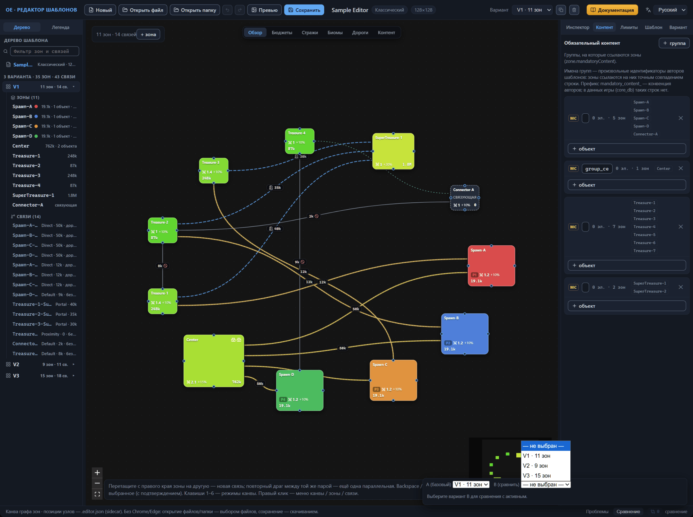
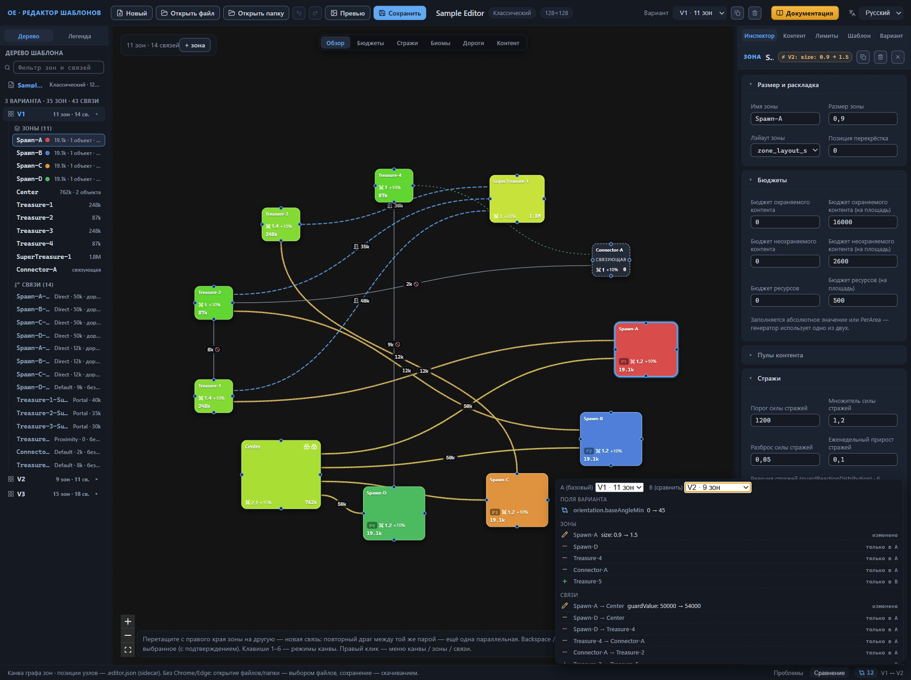

# Сравнение вариантов

Один шаблон несёт несколько вариантов раскладки — самостоятельных схем зон и связей (глава [Варианты: управление и выбор](variant-manage.md)). Варианты расходятся в деталях: отдельные зоны, связи, поля самого варианта. Режим сравнения находит отличия сам: сопоставляет два варианта и перечисляет различия в зонах, связях и собственных полях варианта — ориентации и границе карты.

Режим работает на вкладке «Сравнение» нижней панели окна, рядом с вкладкой «Проблемы» (глава [Интерфейс: окна и панели](interface.md#нижняя-панель-и-строка-состояния)). Сравнение — режим просмотра: оно не меняет данные шаблона, выбор пары не попадает в историю отмен и не сохраняется в файлах.

## Включение режима сравнения A/B

Пара сравнения — это две роли. A — базовый вариант: роль жёстко привязана к активному варианту, который показан на канве и принимает правки. B — сравниваемый вариант: его выбирают из списка, он участвует только в расчёте отличий и на канве не появляется. Чип — маленькая плашка-счётчик рядом с заголовком панели — несёт подсказку о ролях: «Режим сравнения вариантов: A — активный (базовый), B — сравниваемый». После перехода на вкладку панель свёрнута: строка-заголовок «сравнение» прячет селекторы и результат.

Чтобы включить режим:

1. Откройте вкладку «Сравнение» в нижней панели.
2. Кликните строку-заголовок «сравнение» — панель раскроется и покажет два селектора.
3. Выберите в селекторе «B (сравнить)» строку варианта, например «V2 · 9 зон» — строка показывает номер варианта и число его зон: заголовок сменится парой вида «V1 ↔ V2», а чип покажет число найденных отличий.

Пока B не выбран, в его селекторе стоит строка «— не выбран —», а панель остаётся в пустом состоянии: чип приглушён и показывает ноль, в теле выводится подсказка «Выберите вариант B для сравнения с активным.» Чтобы выключить режим, верните в селектор B строку «— не выбран —».

Если отличий нет, тело панели сообщает «Варианты идентичны.» Такое сообщение появляется и когда в B выбран сам активный вариант, — вариант сравнивается с собой. У шаблона с единственным вариантом сравнение всегда заканчивается этим сообщением: список B содержит только V1.

Селектор «A (базовый)» показывает активный вариант и работает как переключатель: выбор нового A перерисовывает канву на его схему и сбрасывает выделение — так же, как переключатель вариантов в верхней панели (глава [Варианты: управление и выбор](variant-manage.md#переключение-вариантов)). Обратное тоже верно: любое переключение активного варианта — через верхнюю панель, строку дерева или клик по замечанию валидатора — меняет роль A, а выбранный B остаётся прежним, и панель пересчитывает отличия для новой пары.

Редактор хранит пару сравнения только в памяти: в файл шаблона и sidecar-файл она не записывается, а её выбор не попадает в историю отмен — Ctrl+Z выбор B не отменяет (глава [Файлы: открытие и сохранение](files.md#отмена-и-повтор-действий)). Кнопка «Новый» и открытие файла возвращают панель в пустое состояние. Удаление варианта тоже сбрасывает пару — номера вариантов смещаются, и прежний B указывал бы на другую схему; дублирование пару сохраняет (глава [Варианты: управление и выбор](variant-manage.md#удаление-варианта)).

## Чтение результата сравнения

После выбора пары чип показывает число отличий, а тело панели перечисляет их построчно. Чип складывает три группы: каждое изменившееся поле варианта даёт одно отличие, каждая зона и каждая связь — тоже одно, сколько бы полей внутри них ни разошлось. Если V1 и V2 расходятся в двух параметрах ориентации, одной зоне и одной лишней связи, чип покажет 4.

Тело панели разбивает отличия на три группы в фиксированном порядке: «поля варианта», «зоны», «связи». Пустые группы не выводятся — когда варианты расходятся только зонами, в панели будет одна группа «зоны».

**Поля варианта.** Группа содержит ориентацию макета и границу карты (глава [Вариант: ориентация и граница](variant-layout.md)). Строка показывает путь поля — например, `orientation.baseAngleMin` — и значение вида `0 → 45`. Эти строки некликабельны: ориентация и граница принадлежат варианту целиком, отдельного элемента на канве у них нет.

**Зоны и связи.** Строка начинается значком статуса, затем идёт подпись — имя зоны или связь в виде `откуда → куда`, — потом одной строкой перечислены разошедшиеся поля, а в конце стоит текст статуса. Статусов три:

- «изменено» — янтарный значок-карандаш: элемент есть в обоих вариантах, и его поля разошлись;
- «только в A» — красный значок-минус: элемент есть в базовом варианте и отсутствует в сравниваемом;
- «только в B» — зелёный значок-плюс: элемент есть только в сравниваемом варианте.

Сводка полей выглядит так: `size: 1 → 1.5, roads: 0 → 2`. Числа и строки предстают парой «старое значение → новое значение», а вместо отсутствующего поля стоит прочерк: запись `— → 2` означает, что поле появилось в B, запись `2 → —` — что исчезло. Сравнение считает число элементов списка: `roads: 0 → 2` — в A список дорог пуст, в B содержит два элемента. Когда количество не изменилось, а содержимое да, по обе стороны стрелки стоит одно и то же число — например, `3 → 3`. Панель выводит структурированные значения вроде биома словом «изменено»: фиксирует различие, но не раскрывает содержимое. Порядок ключей внутри структурированного значения роли не играет — перестановка ключей отличием не считается.

Поля в строке упорядочены: сначала известные формату — в фиксированном порядке, затем остальные по алфавиту. Внутри группы первыми идут строки «только в A» и «изменено» — в порядке списка варианта A, а замыкают группу строки «только в B» — в порядке варианта B.

На вид результата влияет то, как элементы сопоставляются друг с другом. Зона сопоставляется по имени: одноимённые зоны из A и B сравниваются по полям, а само имя в сводку не попадает. Обратите внимание: переименование зоны выглядит двумя строками — «только в A» со старым именем и «только в B» с новым — и не распознаётся как изменение одной зоны. Одноимённых зон внутри варианта быть не должно — их ловит валидатор, а сравнение учитывает только первую из них. Связь сопоставляется по паре концов вне зависимости от направления: перестановка `from` и `to` местами даёт одну строку «изменено», в сводке которой стоят оба этих поля, — а не две строки «только в A» и «только в B». Имя связи, в отличие от имени зоны, участвует в сравнении: переименование при тех же концах добавляет в сводку поле `name: старое имя → новое имя`.

Наведение курсора на строку «изменено» показывает подсказку с тем же списком полей — по одному в строке. У строки «только в A» полей нет, поэтому её подсказка — напоминание «клик по строке — фокус на элементе базового варианта A». Клик по любой из этих строк выбирает элемент варианта A: правая панель переходит на вкладку «Инспектор», а камера наводится на узел зоны или на середину линии связи, сохраняя масштаб, — тем же механизмом, что и клик по замечанию валидатора (глава [Канва: правка графа](canvas-editing.md#переход-к-элементу-из-панелей)). Строка «только в B» некликабельна: в базовом варианте элемента нет, фокусировать нечего.

**Бейдж инспектора.** Выберите элемент варианта A, когда пара задана, — рядом с именем элемента в заголовке инспектора появится бейдж сравнения. Для статуса «изменено» он янтарный, вида `≠ V3: size: 1 → 1.5, roads: 0 → 2`: буква V с номером — метка сравниваемого варианта B, дальше та же сводка полей. Длинные бейджи обрезаются многоточием, полный список уводит всплывающая подсказка — по одному полю в строке. Для элемента «только в A» бейдж красноватый — «нет в V3». Бейдж пропадает, когда снято выделение, пара не выбрана или в B выбран тот же вариант (глава [Интерфейс: окна и панели](interface.md#заголовок-выбранного-элемента)).

**Что не сравнивается.** Сравнение смотрит только на данные варианта: зоны, связи, ориентацию макета и границу карты. Позиции узлов на канве и заметки зон живут в sidecar-файле и в сравнении не участвуют — узлы двух вариантов можно растащить как угодно, и при совпадающих полях зон и связей панель скажет «Варианты идентичны.» (глава [Файлы: открытие и сохранение](files.md)). Общие настройки шаблона лежат вне варианта и в результат тоже не попадают.

## Куда дальше

- [Вариант: ориентация и граница](variant-layout.md) — смысл полей, из которых состоит группа «поля варианта».
- [Зона: все свойства](zone.md) — смысл полей зоны, перечисляемых в строках отличий.
- [Связи между зонами](connections.md) — смысл полей связи.
- [Канва: правка графа](canvas-editing.md) — переход к элементу из панелей и поведение камеры.
- [Файлы: открытие и сохранение](files.md) — sidecar-файл: что хранится вне шаблона.
