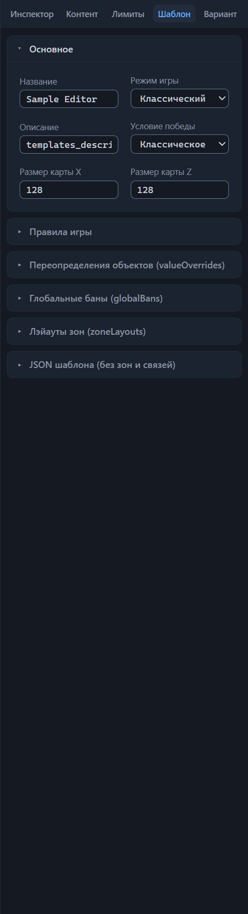
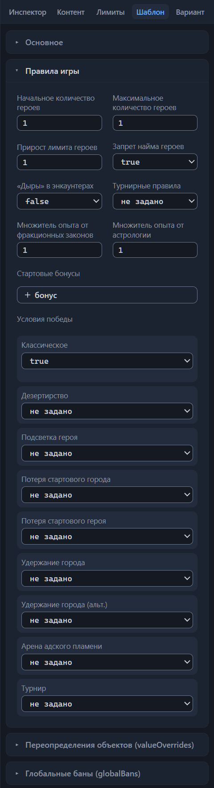
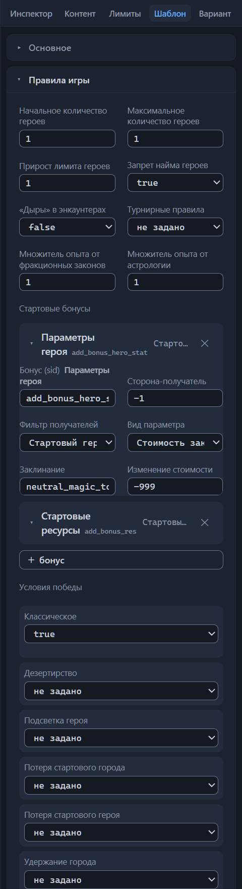
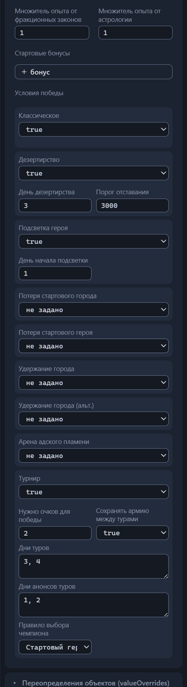
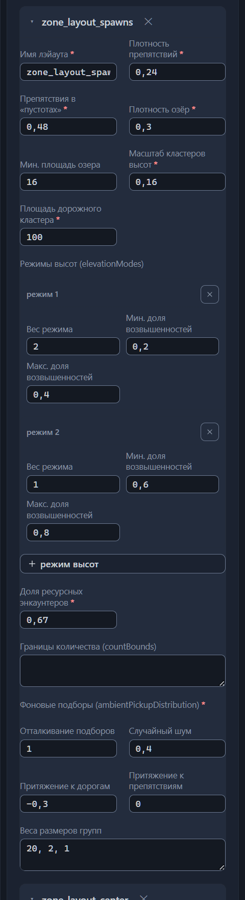
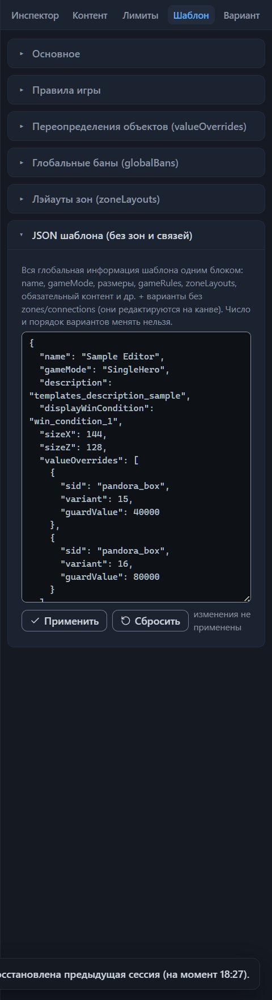
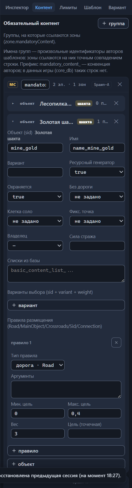
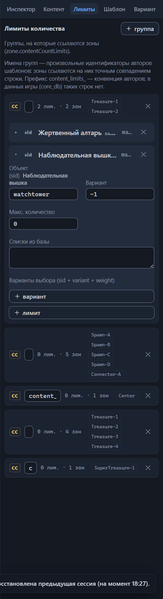

# Настройки шаблона (корень)

Всё, что относится к шаблону целиком, а не к отдельной зоне, связи или варианту раскладки, настраивается в корневых настройках: имя и режим игры, размеры карты, правила и стартовые бонусы, условия победы, переопределения объектов и баны, лэйауты зон, группы обязательного контента и лимиты количества. В файле `.rmg.json` это поля и секции верхнего уровня — они лежат вне списка `variants[]` и действуют сразу для всех вариантов.

Корневые настройки занимают три вкладки правой панели: «Шаблон», «Контент» и «Лимиты» (обзор вкладок — глава [Интерфейс: окна и панели](interface.md#вкладки-инспектора)). Выделять что-то на канве не нужно — вкладки доступны всегда. На вкладке «Шаблон» собраны шесть секций: «Основное», «Правила игры», «Переопределения объектов (valueOverrides)», «Глобальные баны (globalBans)», «Лэйауты зон (zoneLayouts)» и «JSON шаблона (без зон и связей)». Каждая секция — раскрывающийся блок: щёлкните по заголовку, чтобы развернуть или свернуть её. «Основное» раскрыто по умолчанию, остальные свёрнуты; раскладку раскрытых секций редактор запоминает только у «JSON шаблона (без зон и связей)». Вкладка «Контент» несёт панель «Обязательный контент», вкладка «Лимиты» — панель «Лимиты количества»: группы объектов и ограничений, на которые ссылаются зоны.

## Основное

Первая секция вкладки «Шаблон» — визитная карточка шаблона: название, режим игры, описание, отображаемое условие победы и размеры карты. Поля текстовые и числовые применяются, когда фокус уходит из поля либо по Enter; списки — сразу после выбора. Любое изменение попадает в историю отмен: Ctrl+Z вернёт прежнее значение (глава [Файлы: открытие и сохранение](files.md#отмена-и-повтор-действий)).

Сохранение редактор не блокирует: файлы записываются при любых замечаниях и ошибках панели «Проблемы».

У шаблона, созданного кнопкой «Новый», значения по умолчанию такие: название «Новый шаблон», режим «Классический», описание пустое, условие победы «Классическое», размеры 128×128. Демо-шаблон редактора называется «Sample Editor» и настроен так же: «Классический», 128×128.

### Название

Поле «Название», имя в файле `name`, — имя шаблона. Игра показывает его в лобби; в штатных шаблонах оно совпадает с именем файла. То же имя стоит в сведениях о шаблоне на верхней панели редактора.

Название — ещё и базовое имя сохранённой тройки файлов: редактор заменяет запрещённые в именах файлов символы `\ / : * ? " < > |` подчёркиванием и собирает имена `<Название>.rmg.json`, `<Название>.editor.json` и `<Название>.png`. Переименовали шаблон — при следующем сохранении рядом со старыми файлами появится новая тройка, старые редактор не удалит (глава [Файлы: открытие и сохранение](files.md#сохранение)).

Во всех 60 штатных шаблонах имя непустое и уникальное. Файл с пустым названием редактор сохранит, но валидатор будет держать ошибку «Имя шаблона пустое» на панели «Проблемы», пока поле не заполнено.

### Режим игры

Поле «Режим игры», имя в файле `gameMode`, — режим партии. Список из двух значений без пустой опции «—»: режим задан всегда. В списке видно русское название, а подсказка под полем приводит имя поля в файле и официальное описание выбранного режима:

- **Классический · Classic**
  : «Вы можете управлять несколькими героями.»

- **Один герой · SingleHero**
  : «Смерть вашего героя приведёт к поражению.»

Обратите внимание: третьего режима не существует — сетевые шаблоны тоже помечены Classic. В штатных файлах Classic встречается 37 раз, SingleHero — 23.

Режим выбирают заодно с правилами игры: в штатных шаблонах SingleHero героев ровно один (минимум и максимум равны 1), найм героев запрещён, часто включено поражение при потере стартового героя, а стартовые бонусы выдаются стартовому герою; у Classic лимит героев обычно от 3 до 10. Соответствующие переключатели собраны в секции «Правила игры» ниже.

Список не даёт выбрать постороннее значение. Ошибка валидатора «Неизвестный gameMode «X» (ожидается Classic/SingleHero)» означает, что файл правили мимо редактора (прямая правка описана в главе [Прямая правка JSON](json-editor.md)).

### Описание

Поле «Описание», имя в файле `description`, — описание шаблона. Подсказка поля формулирует формат: «description — sid локализации (templates_description_*) или свой текст». Штатные шаблоны пишут здесь sid — ключ, по которому игра берёт готовый текст описания из своей базы; редактор принимает и произвольный текст. Содержимое поля валидатор не проверяет.

Очистка поля удаляет `description` из файла. У нового шаблона описание пустое; в демо-шаблоне вписан ключ `templates_description_sample`.

### Условие победы

Поле «Условие победы», имя в файле `displayWinCondition`, — отображаемое условие победы: что игра показывает игрокам как цель партии. Список из шести официальных условий; названия и описания взяты из русской локализации игры, подсказка под полем приводит имя поля в файле и описание выбранного условия:

- **Классическое · win_condition_1**
  : «Победите всех вражеских героев и захватите все вражеские города.»

- **Захват столицы · win_condition_2**
  : «Захватите начальный город противника, чтобы одержать победу.»

- **Удержание столицы · win_condition_3**
  : «Захватите начальный город противника и удерживайте его в течение заданного числа игровых дней, чтобы одержать победу.»

- **Решающая битва · win_condition_4**
  : «Проведите решающее сражение с героем противника. Победивший в этом бою выиграет матч.»

- **Удержание города · win_condition_5**
  : «Захватите указанный нейтральный город и удержите его в течение заданного числа игровых дней, чтобы одержать победу.»

- **Турнир · win_condition_6**
  : «Проведите серию сражений с героем противника. Победивший в нескольких боях выиграет матч.»

Отображаемое условие не включает механику победы само по себе: настоящие правила собирают включатели в блоке «Условия победы» секции «Правила игры» ниже. Согласуйте отображаемое условие с включёнными переключателями, иначе анонс партии разойдётся с фактической игрой.

Значение «—» убирает `displayWinCondition` из файла, хотя штатные шаблоны поле всегда заполняют: «Классическое» — 26 файлов, «Удержание столицы» — 16, «Турнир» — 9, «Удержание города» — 5, «Решающая битва» — 4. «Захват столицы» не встретился ни разу. У нового шаблона стоит «Классическое».

### Размеры карты

Поля «Размер карты X» и «Размер карты Z», имена в файле `sizeX` и `sizeZ`, — размеры карты в клетках. Стрелки полей меняют значение шагом 16, жёсткого ограничения ввода нет — о допустимых значениях напоминают подсказки «sizeX — 80–240, кратно 16, всегда квадрат» (и так же для Z) и валидатор. Очистка поля удаляет размер из файла.

Карты всегда квадратные: `sizeX` равен `sizeZ`. Штатные значения — 80, 96, 112, 128, 144, 160, 176, 192 и 240; чаще других встречается 128×128 (12 файлов), реже всего 240×240 (2 файла). У нового шаблона — 128×128.

Валидатор следит за парой тремя предупреждениями с пометкой «размер карты»: «Карты OE всегда квадратные — стороны различаются», «Размеры не кратны 16» и «Размер вне обычного диапазона 80–240». Последнее смотрит только на размер X, а при пустом X — на Z. Это предупреждения, а не ошибки: файл с ними сохранится. Берите размеры из штатного списка и держите обе стороны равными — тогда замечаний о размерах на панели «Проблемы» не будет.

## Правила игры

Вторая секция вкладки «Шаблон» — «Правила игры»: число героев и найм, механика «дыр» в энкаунтерах, турнирные правила и два множителя опыта. В файле `.rmg.json` это объект `gameRules` верхнего уровня — он лежит вне `variants[]`, поэтому заданные правила действуют одинаково для всех вариантов раскладки.

Секция устроена так: сначала восемь полей, ниже — два блока. Блок «Стартовые бонусы» хранит список бонусов `bonuses`, блок «Условия победы» — включатели `winConditions`; именно они и задают настоящие правила победы, о которых говорит поле «Условие победы» секции «Основное».

Числовые поля применяются, когда фокус уходит из поля либо по Enter; стрелки меняют значение шагом поля, а ввод с клавиатуры жёсткими границами не ограничен. Переключатели — списки из трёх состояний: «не задано», true и false. Состояние «не задано» и очистка числового поля убирают ключ из файла: в сохранённом шаблоне его не будет вовсе. Каждое изменение попадает в историю отмен (глава [Файлы: открытие и сохранение](files.md#отмена-и-повтор-действий)).

У нового шаблона секция пустая — `gameRules: {}`, ни одно из восьми полей не заполнено. Штатные шаблоны заполняют её всегда, и шесть записей валидатор считает обязательными: три числа (`heroCountMin`, `heroCountMax`, `heroCountIncrement`), два переключателя (`heroHireBan`, `encounterHoles`) и объект `winConditions` — блок «Условия победы» ниже. Если чего-то из шести не хватает, на панели «Проблемы» появляется предупреждение со списком недостающего: «gameRules: отсутствуют обязательные поля: heroCountIncrement. Они есть во всех 60 штатных шаблонах; поведение игры при отсутствии не проверено — вероятно, подставятся значения по умолчанию». Значение не того типа считается отсутствием: строка `"2"` вместо числа 2 попадёт в тот же список. Когда ключа `gameRules` в файле нет вовсе, список предупреждения состоит из одного слова «gameRules» — проверка говорит про раздел целиком.

«Обязательные» здесь означает «есть во всех 60 штатных шаблонах»: что сделает игра без этих записей, не проверено, поэтому проверка выдаёт предупреждение, а не ошибку, и сохранению оно не мешает. Новый шаблон выходит с ним сразу — пустая секция задумана так. Предупреждение пропадает, когда все шесть записей заполнены.

За значениями трёх числовых полей секции следит отдельная проверка: валидатор сравнивает `heroCountMin`, `heroCountMax` и `heroCountIncrement` с диапазонами 0–6, 1–10 и 0–2 — в них укладываются значения всех 60 штатных шаблонов. Стрелки этих полей за границы не выходят, зато ввод с клавиатуры не ограничен, а прямая правка файла минует интерфейс вовсе (глава [Прямая правка JSON](json-editor.md)) — значение вне диапазона достижимо обоими путями. Валидатор отвечает предупреждением «gameRules: значения вне диапазонов, наблюдаемых во всех 60 штатных шаблонах: heroCountMin: 99 (0–6). Поведение игры вне диапазонов не проверено — значения могут быть ограничены или проигнорированы (гипотеза)». После двоеточия — перечень «поле: значение (диапазон)» через точку с запятой, в одно предупреждение собираются несколько выходов сразу; сохранению оно, как и другие предупреждения, не мешает. Нечисловое значение диапазонами не проверяется: оно считается отсутствием записи и попадает в предупреждение о шести обязательных записях. Диапазоны двух множителей опыта валидатор не проверяет.

Замечания корневых полей попадают на панель «Проблемы» без пометки области, а строка замечания к самому полю не ведёт: щелчок по ней лишь открывает вкладку «Шаблон» инспектора. В строке виден путь, например `gameRules.heroCountMin/heroCountMax` (глава [Проверка шаблона (валидатор)](validator.md)).

### Начальное количество героев

Поле «Начальное количество героев», имя в файле `heroCountMin`, — нижняя граница числа героев игрока. Подсказка приводит имя ключа и диапазон: «heroCountMin — 0–6».

Стрелки меняют значение шагом 1 и за границы 0–6 не выходят; жёсткого ограничения ввода нет, выход за диапазон ловит предупреждение о диапазонах gameRules. Пустое поле — это отсутствие ключа `heroCountMin`, и его имя попадает в предупреждение о шести обязательных записях.

У нового шаблона поле пустое, ключа `heroCountMin` в файле нет; очистка поля убирает ключ. Штатные шаблоны значение задают всегда, и оно связано с режимом игры из секции «Основное»: у шаблонов с режимом «Один герой» минимум равен 1, с режимом «Классический» обычно лежит в пределах 0–2.

### Максимальное количество героев

Поле «Максимальное количество героев», имя в файле `heroCountMax`, — верхняя граница числа героев игрока. Подсказка: «heroCountMax — 1–10».

Шаг стрелок тот же — 1, их границы — 1–10; жёсткого ограничения ввода нет, выход за диапазон ловит предупреждение о диапазонах gameRules. Пустое поле означает, что ключа `heroCountMax` в файле не будет, а имя поля — в списке предупреждения о шести обязательных записях. Штатные значения следуют за режимом игры: у шаблонов «Классический» лимит обычно от 3 до 10, у «Один герой» — ровно 1.

Валидатор сравнивает пару полей и при минимуме выше максимума выдаёт предупреждение «heroCountMin (3) больше heroCountMax (2)» — в скобках стоят ваши значения. Сравнение срабатывает только когда оба поля заполнены: при пустом минимуме или максимуме замечания не будет. Держите минимум не выше максимума, иначе предупреждение останется на панели «Проблемы», пока значения не согласованы.

### Прирост лимита героев

Поле «Прирост лимита героев», имя в файле `heroCountIncrement`. *Назначение уточняется.* Подсказка поля передаёт это состояние дословно: «heroCountIncrement — прирост лимита героев (за неделю/город?); в игровом описании шаблона — «Героев за город» (гипотеза)».

Стрелки меняют значение шагом 1 и за границы 0–2 не выходят; жёсткого ограничения ввода нет, выход за диапазон ловит предупреждение о диапазонах gameRules. У нового шаблона значение не задано — ключа в файле нет, и имя `heroCountIncrement` попадает в предупреждение о шести обязательных записях; штатные шаблоны поле заполняют.

### Запрет найма героев

Переключатель «Запрет найма героев», имя в файле `heroHireBan`, запрещает нанимать новых героев. Подсказка поля: «heroHireBan — запрет нанимать новых героев; в штатных включён у всех 23 шаблонов режима «Один герой», в остальных 37 — выключен».

Три состояния — «не задано», true и false; состояние «не задано» убирает ключ из файла. У нового шаблона переключатель не задан — имя `heroHireBan` попадает в предупреждение о шести обязательных записях; штатные шаблоны значение задают всегда.

Валидатор следит за согласованностью с максимальным числом героев: при включённом запрете и `heroCountMax` больше 1 появляется справка «heroHireBan включён, но heroCountMax разрешает более одного героя». Та же справка выходит, когда максимум не заполнен вовсе. Ставьте вместе с запретом максимальное число героев равным 1, иначе справка будет висеть на панели «Проблемы». Сохранению она не мешает: это справка, а не ошибка.

### «Дыры» в энкаунтерах

Переключатель «„Дыры“ в энкаунтерах», имя в файле `encounterHoles`, — мастер-включатель механики «дыр» сразу для всего шаблона. Дыра — пропуск в энкаунтере. Подсказка поля: «encounterHoles — мастер-включатель механики «дыр» (сбой генерации: в энкаунтере пропадает слот подбора или тайл); в штатных включён только в Anarchy; доли — в зонах (encounterHolesSettings)».

Механику включает только true: состояния «не задано» и false оставляют её выключенной. В штатных шаблонах ключ присутствует во всех 60 файлах — true стоит только в Anarchy, в остальных 59 — false. Разницу между этими двумя состояниями видит валидатор: поле входит в шесть обязательных записей, поэтому «не задано» оставляет имя `encounterHoles` в предупреждении о недостающих полях, а false его закрывает.

Доли «дыр» задаются не здесь, а в каждой зоне, в секции «Энкаунтеры-„дыры“» инспектора (глава [Зона: все свойства](zone.md#энкаунтеры-дыры)). Включённый мастер-флаг активирует зональные доли, выключенный — игнорирует их; если правило не включено (стоит false или «не задано»), а доли в зонах прописаны, валидатор напоминает справкой «encounterHolesSettings задан, но gameRules.encounterHoles не включён — поле игнорируется». Включайте правило вместе с долями, иначе настройки зон останутся в файле мёртвым грузом и генератор их проигнорирует.

### Турнирные правила

Переключатель «Турнирные правила», имя в файле `tournamentRules`. *Назначение уточняется.* Подсказка редактора: «tournamentRules — выключатель турнирных правил (назначение неясно)»; что именно выключает поле, не выяснено.

Состояния те же — «не задано», true и false; «не задано» убирает ключ из файла. У нового шаблона переключатель не задан, в штатных файлах ключ встречается один раз — в Anarchy со значением false.

Валидатор проверяет только форму значения и выдаёт предупреждение «tournamentRules: ожидается true/false, получено «X» — назначение поля неясно (гипотеза)», когда ключ присутствует со значением другого типа. Из инспектора такое значение не ввести, поэтому предупреждение адресовано файлам, которые правили напрямую (глава [Прямая правка JSON](json-editor.md)).

Это отдельный ключ: у блока «Условия победы» той же секции — свой набор полей турнира (`winConditions.tournament*`), а у секции «Основное» — отображаемое условие «Турнир» (`win_condition_6`).

### Множитель опыта от фракционных законов

Поле «Множитель опыта от фракционных законов», имя в файле `factionLawsExpModifier`, — множитель, применяемый к опыту от фракционных законов. Подсказка приводит диапазон: «factionLawsExpModifier — 0.5–1.5».

Стрелки меняют значение шагом 0.05; границ у поля нет, диапазон валидатор не проверяет. В список шести обязательных записей поле не входит — пустой множитель замечания не даёт. У нового шаблона поле пустое, ключа в файле нет. В штатных шаблонах значение встречается в 17 файлах из 60.

Само поле задаёт только множитель: как игра начисляет опыт от фракционных законов, неизвестно.

### Множитель опыта от астрологии

Поле «Множитель опыта от астрологии», имя в файле `astrologyExpModifier`, — множитель, применяемый к опыту от астрологии. Подсказка: «astrologyExpModifier — 0.25–2».

Шаг стрелок здесь тот же — 0.05, границ и проверок валидатора у поля нет. Пустое поле означает отсутствие ключа `astrologyExpModifier` в файле; в штатных шаблонах значение встречается в 21 файле из 60.

### Стартовые бонусы

Первый из двух блоков ниже восьми полей — «Стартовые бонусы»: список `bonuses` в `gameRules`. Каждая запись — отдельный бонус, который игра выдаёт в начале партии: заклинание или артефакт герою, стартовые ресурсы, изменение параметров героя. Из 60 штатных шаблонов бонусы есть в 26 файлах, от одной до пяти записей в файле.

У нового шаблона и у демо-шаблона блок пуст: ключа `bonuses` в `gameRules: {}` нет вовсе. В шесть обязательных записей секции он не входит, поэтому пустой блок замечаний не даёт.

#### Карточка бонуса

Блок устроен как список раскрывающихся карточек с кнопкой «+ бонус» внизу. Кнопка добавляет карточку в конец списка с готовой заготовкой: тип «Параметры героя», сторона-получатель −1, фильтр «Стартовый герой (start_hero)», параметры пусты. Заготовку тут же или позже легко переписать: редактируются все поля карточки.

В строке шапки карточки видно читаемое имя бонуса — у пяти игровых бонусов имя редактора, у остальных — имя sid из каталога, — а рядом мелким шрифтом сырой sid. При наведении мыши на шапку всплывает пара «имя · sid». Без sid шапка показывает «sid?»; если имени в каталоге у sid нет, остаётся только сырое значение. Выбранный фильтр получателей выводится чипом — небольшой плашкой со значением, которую видно и у свёрнутой карточки.

Клик по строке шапки раскрывает карточку: «Бонус (sid)», «Сторона-получатель», «Фильтр получателей» и поля параметров — их состав зависит от типа бонуса и разобран ниже по разделам.

Кнопка ✕ в строке шапки удаляет бонус сразу и без подтверждения; ошиблись — откатывайте Ctrl+Z, удаление тоже попадает в историю отмен (глава [Файлы: открытие и сохранение](files.md#отмена-и-повтор-действий)). Когда удалён последний бонус, ключ `bonuses` пропадает из файла вовсе: пустой список не сохраняется.

#### Бонус (sid)

Поле «Бонус (sid)», имя в файле `sid`, — тип бонуса. Клик по полю открывает список: сверху пять игровых бонусов с именами редактора, ниже — общий каталог всех sid с русскими именами; набор текста фильтрует список, Enter выбирает подсвеченный вариант, Esc закрывает список. Пять игровых бонусов:

`add_bonus_hero_spell`
: «Заклинание герою» — дать герою заклинание.

`add_bonus_hero_stat`
: «Параметры героя» — изменить параметры героя.

`add_bonus_res`
: «Стартовые ресурсы» — выдать ресурсы в начале партии.

`add_bonus_hero_item`
: «Артефакт герою» — дать герою артефакт.

`add_bonus_hero_unit_multipler`
: «Множитель отрядов героя». *Назначение уточняется.*

Под подписью поля стоит читаемое имя выбранного бонуса, а подсказка приводит либо имя из каталога, либо назначение бонуса и форму его параметров.

Смена sid уже введённые `parameters` не трогает. Если старый список не совпадает со штатной формой нового типа, редактирование параметров переключается на сырой список — подробнее в «Параметрах бонуса» ниже. Очистка поля оставляет бонус без типа: шапка карточки переключается на «sid?», а валидатор держит предупреждение «Бонус без sid» (глава [Проверка шаблона (валидатор)](validator.md)).

Частота пяти типов в штатных шаблонах: `add_bonus_hero_spell` и `add_bonus_hero_stat` — по 14 записей, `add_bonus_res` — 5, `add_bonus_hero_unit_multipler` — 3, `add_bonus_hero_item` — 2.

#### Сторона-получатель

Поле «Сторона-получатель», имя в файле `receiverSide`, — номер стороны, которой достаётся бонус. Подсказка передаёт смысл: «receiverSide — номер стороны; −1 = всем сторонам». Границ у поля нет, шаг стрелок — 1; пустое поле означает отсутствие ключа в файле.

В штатных шаблонах значение всегда −1: бонусы достаются всем сторонам сразу. Любое другое число валидатор отмечает справкой — самым мягким уровнем замечаний: «receiverSide 3 — у штатных всегда −1», где 3 — ваше значение. Сохранению она не мешает.

#### Фильтр получателей

Поле «Фильтр получателей», имя в файле `receiverFilter`, — кому выдавать бонус. В списке два значения:

`start_hero`
: «Стартовый герой (start_hero)» — бонус выдаётся стартовому герою.

`all_heroes`
: «Все герои (all_heroes)» — бонус выдаётся всем героям.

Состояние «—» убирает ключ `receiverFilter` из файла. Выбранный фильтр виден чипом в строке шапки карточки; нестандартное значение чип показывает как есть.

В штатных шаблонах `start_hero` встречается 30 раз, `all_heroes` — 4; у шаблонов режима «Один герой» бонусы обычно достаются стартовому герою. Валидатор поле не проверяет.

#### Параметры бонуса

Список `parameters` — аргументы бонуса: что именно он применяет. Их от одного до четырёх, а подсказка поля приводит примеры из штатных шаблонов: [movementBonus, 0]; [magicCostSidSet, neutral_magic_town_portal, -999, 0] (бесплатный каст); [gold, 10000]; [swamp_boots_artifact] («Болотники»).

В файле все элементы списка — строки, числа тоже: штатные шаблоны пишут ["magicCostSidSet", "neutral_magic_town_portal", "-999", "0"], а не число −999. Редактор записывает числа текстом так же, поэтому вручную собранный бонус не отличается по форме от штатного.

Для пяти игровых бонусов параметры правятся структурными полями: их состав зависит от типа и разобран в разделах ниже. Смена типа бонуса сразу перестраивает поля параметров.

Если список не соответствует штатной форме бонуса — длина не та или первый элемент другой, — вместо структурных полей блок показывает одно поле «Параметры бонуса»: сырой список, элементы которого перечисляются через запятую. Поле применяется, когда фокус уходит из него, либо по Ctrl+Enter; пустые элементы отбрасываются. Подсказка помечает случай: «parameters не соответствует штатной форме этого бонуса — правка сырым списком», а дальше приводит те же примеры. Как только список возвращается к штатной форме, структурные поля приходят обратно.

Обратите внимание: сырой список «Параметры бонуса» появляется и у бонуса с sid вне списка пяти — общий каталог поля «Бонус (sid)» позволяет выбрать любой sid игры, — но уже без пометки о несовпадении: штатную форму такого бонуса редактор не знает.

#### Заклинание герою

Бонус `add_bonus_hero_spell` даёт герою заклинание; в списке один аргумент — sid заклинания. Редактор показывает поле «Заклинание»: клик открывает список приключенческих заклинаний с официальными русскими названиями, набор текста фильтрует его, а подсказка под полем добавляет имя выбранного заклинания. В штатных шаблонах встречаются приключенческие заклинания — «Портал в город», «Полёт теней», «Дверь измерений», «Первозданный хаос»; например, ["primal_18_magic_primordial_chaos"] — это «Первозданный хаос».

Очистка поля оставляет `parameters` пустым.

#### Параметры героя

Бонус `add_bonus_hero_stat` изменяет параметры героя. Штатных форм две; редактор различает их по первому элементу списка, а вы выбираете форму в поле «Вид параметра»:

`movementBonus`
: «Очки движения (movementBonus)». Выбор сразу составляет список ["movementBonus", "0"] и открывает поле «Значение» с нулём.

`magicCostSidSet`
: «Стоимость заклинания (magicCostSidSet)». Выбор составляет список ["magicCostSidSet", "", "-999", "0"]: заклинание пока пустое, изменение стоимости −999.

Состояние «—» очищает `parameters`.

У формы с очками движения ["movementBonus", значение] значение в штатных шаблонах всегда 0. *Назначение уточняется.* Подсказка поля передаёт состояние дословно: «В штатных всегда 0; точный смысл значения не подтверждён (гипотеза: бонус к очкам движения)».

Форма со стоимостью длиннее: ["magicCostSidSet", sid заклинания, изменение стоимости, 0] — ровно четыре элемента. Редактор показывает два поля: «Заклинание» — тот же список приключенческих заклинаний, что у бонуса «Заклинание герою», — и «Изменение стоимости». Изменение — отрицательное число: −999 делает каст бесплатным, −10 или −15 удешевляют стоимость на это число. Пример из штатных шаблонов: ["magicCostSidSet", "neutral_magic_town_portal", "-999", "0"] — «Портал в город» достаётся бесплатно.

Обратите внимание: завершающий ноль — четвёртый элемент списка — своего поля не имеет, редактор сохраняет его автоматически. «Лишний» ноль в файле или в сыром списке — часть штатной формы, а не ошибка.

#### Стартовые ресурсы

Бонус `add_bonus_res` выдаёт ресурсы в начале партии; в списке два аргумента — ресурс и количество. Редактор показывает поле «Ресурс» — список семи игровых ресурсов:

`gold`
: «Золото (gold)»

`wood`
: «Дерево (wood)»

`ore`
: «Руда (ore)»

`mercury`
: «Ртуть (mercury)»

`crystals`
: «Кристаллы (crystals)»

`gemstones`
: «Драгоценные камни (gemstones)»

`alchemicalDust`
: «Алхимическая пыль (alchemicalDust)»

Выбор ресурса сразу составляет список с нулевым количеством и открывает поле «Количество» — впишите туда число. Стрелки поля ниже 0 не идут, ввод с клавиатуры не ограничен. Состояние «—» в списке ресурсов очищает `parameters`. В штатных шаблонах список выглядит так: ["gold", "10000"] — десять тысяч золота на старте.

#### Артефакт герою

Бонус `add_bonus_hero_item` даёт герою артефакт; в списке один аргумент — sid артефакта. Редактор показывает поле «Артефакт»: клик открывает список всех артефактов игры с русскими названиями, набор текста фильтрует его, а подсказка добавляет имя выбранного артефакта. Например, ["swamp_boots_artifact"] — артефакт «Болотники».

Очистка поля оставляет `parameters` пустым.

#### Множитель отрядов героя

Бонус `add_bonus_hero_unit_multipler` — «Множитель отрядов героя». *Назначение уточняется.* Подсказка редактора передаёт состояние дословно: «Гипотеза: множитель отрядов героя (в штатных parameters = [2]; что именно удваивает, не подтверждено)».

В списке один аргумент — множитель. Редактор показывает поле «Множитель»: стрелки ниже 0 не идут, ввод с клавиатуры не ограничен, очистка поля оставляет `parameters` пустым. В штатных шаблонах бонус встречается в трёх файлах, множитель всегда равен 2.

### Условия победы

Второй блок ниже восьми полей — «Условия победы»: объект `winConditions` в `gameRules`. Девять строк-переключателей собирают настоящие правила победы в партии — поле «Условие победы» из секции «Основное» лишь выбирает анонс, который игра показывает игрокам. Объект входит в шесть обязательных записей секции: он есть во всех 60 штатных шаблонах, а у нового шаблона и у демо-шаблона ключа нет вовсе, и его имя попадает в предупреждение о недостающих записях.

Каждая строка — переключатель с тремя состояниями («не задано», true, false) и, у большинства строк, аргументы: числовые поля, списки или выпадающий список. Строка показывает аргументы только в состоянии true; при «не задано» и false поля скрыты. Выключение переключателя не стирает введённые значения: они остаются в файле невидимками и возвращаются на экран, когда строку снова включают. Чтобы убрать аргумент совсем, очистите его поле, пока переключатель включён, — ключ пропадёт из файла.

Первое же касание любого переключателя создаёт объект `winConditions` в файле. Возврат всех строк в состояние «не задано» ключ не удаляет: в файле остаётся пустой `winConditions: {}`, и валидатор считает такую запись присутствующей — имя `winConditions` из предупреждения о шести обязательных записях пропадает. Чтобы убрать сам ключ, правьте шаблон напрямую (глава [Прямая правка JSON](json-editor.md)).

Обратите внимание: числовые значения блока валидатор не проверяет. Стрелки каждого поля соблюдают собственные границы — например, 1–3 у «Дня поражения», — но ввод с клавиатуры не ограничен, и предупреждения о диапазонах здесь не будет. Собственных проверок у блока две: одинокий «День дезертирства» и списки разной длины у турнира — обе разобраны в разделах ниже.

#### Классическое

Переключатель «Классическое», имя в файле `classic`, — классическое правило победы. Подсказка: «classic — победите всех вражеских героев и захватите все вражеские города». Аргументов у строки нет, а формулировка совпадает с описанием отображаемого условия «Классическое» из секции «Основное».

Включён во всех 60 штатных шаблонах.

#### Дезертирство

Переключатель «Дезертирство», имя в файле `desertion`, — поражение стороны, которая слишком сильно отстаёт от соперников. Подсказка: «desertion — поражение при отставании на desertionValue к desertionDay». У строки два аргумента:

«День дезертирства»
: Имя в файле `desertionDay` — день, к которому проверяется отставание. Подсказка: «desertionDay — день, к которому проверяется отставание (в штатных = 3)». Стрелки меняют значение шагом 1 и ниже 1 не идут.

«Порог отставания»
: Имя в файле `desertionValue` — величина отставания, ведущая к поражению. Подсказка: «desertionValue — величина отставания, ведущая к поражению (в штатных = 3000)». Стрелки меняют значение шагом 100. В каких единицах измеряется величина отставания, подсказка не говорит.

Все 60 штатных шаблонов переключатель включают, а значения держат одинаковые: день 3, порог 3000.

Валидатор следит за одним случаем — одиноким днём: если «День дезертирства» хранит число, а переключатель выключен или возвращён в «не задано», на панели «Проблемы» появляется справка «desertionDay задан, а desertion выключено». Сохранению она не мешает. Выключая переключатель, очистите и поле дня, иначе справка останется на панели.

#### Подсветка героя

Переключатель «Подсветка героя», имя в файле `heroLighting`. *Назначение уточняется.* Подсказка поля передаёт это состояние дословно: «heroLighting — гипотеза: «подсветка» героя противника (раскрытие тумана); в штатных всегда true».

Аргумент «День начала подсветки», имя в файле `heroLightingDay`, — день начала действия. Подсказка: «heroLightingDay — день начала (в штатных = 1)»; стрелки ниже 1 не идут. Штатные шаблоны — все 60 — переключатель включают и день держат равным 1.

#### Потеря стартового города

Переключатель «Потеря стартового города», имя в файле `lostStartCity`, — поражение при потере своего стартового города. Подсказка: «lostStartCity — поражение при потере стартового города».

Аргумент «День поражения», имя в файле `lostStartCityDay`, задаёт срок. Подсказка: «lostStartCityDay — через сколько дней потеря города становится поражением (1–3)»; стрелки идут от 1 до 3.

В штатных шаблонах переключатель включён в 15 файлах и выключен в 39. «День поражения» встречается в 33 файлах со значениями от 1 до 3 — в том числе там, где переключатель выключен: редактор скрывает поля аргументов такой строки, но значение живёт в файле.

#### Потеря стартового героя

Переключатель «Потеря стартового героя», имя в файле `lostStartHero`, — поражение при потере своего стартового героя. Подсказка: «lostStartHero — поражение при потере стартового героя». Аргументов у строки нет.

В штатных шаблонах переключатель включён в 24 файлах и выключен в 36. Особенно часто он включён у шаблонов режима «Один герой».

#### Удержание города

Переключатель «Удержание города», имя в файле `cityHold`, — победа за удержание указанного нейтрального города. Подсказка: «cityHold — захватите указанный нейтральный город и удержите его заданное число дней».

Аргумент «Дней удержания для победы», имя в файле `cityHoldDays`, — сколько дней держать город. Подсказка: «cityHoldDays — 3–7»; стрелки идут от 3 до 7.

Какой именно город удерживать, переключатель не говорит: город отмечается в зоне, полем «Цель „удержания города“» главного объекта (глава [Главные объекты зоны](main-objects.md#условия-победы-и-гарнизон)). Как именно объектное поле сопрягается с корневым переключателем — *Назначение уточняется.*

В штатных шаблонах переключатель включён в 6 файлах и выключен в 8; «Дней удержания для победы» заполнено во всех 14 файлах с переключателем, значения от 3 до 7.

#### Удержание города (альт.)

Переключатель «Удержание города (альт.)», имя в файле `holdCityWinCon`. *Назначение уточняется.* Подсказка передаёт это состояние дословно: «holdCityWinCon — гипотеза: альтернативная версия cityHold (в связке с mainObjects.holdCityWinCon)». Аргументов у строки нет.

Единственный штатный шаблон, который включает переключатель, — Zookeeper; false не стоит нигде, а остальные 59 файлов ключ вовсе не содержат. Поле с тем же именем есть у главного объекта зоны, и оно встречается чаще: пять штатных файлов, семь объектов (глава [Главные объекты зоны](main-objects.md#условия-победы-и-гарнизон)).

#### Арена адского пламени

Переключатель «Арена адского пламени», имя в файле `gladiatorArena`, включает боевую арену героев. Подсказка строки передаёт официальное игровое описание объекта-арены: «gladiatorArena — боевая арена героев: через несколько дней после посещения пройдёт битва, победитель которой выиграет всю партию (официальное описание объекта)».

Сама арена настраивается не здесь: её размещают в зоне главным объектом типа «Арена адского пламени (GladiatorArena)» (глава [Главные объекты зоны](main-objects.md#тип-объекта)), а подходы к ней — связи типа «вход на арену (GladiatorArena)» (глава [Связи между зонами](connections.md#связь)). Среди штатных шаблонов объект-арену держит один Blitz; редчайший тип связи встречается дважды на все шаблоны.

У строки четыре аргумента:

«Регистрация: старт „работы“»
: Имя в файле `gladiatorArenaRegistrationStartWork` — переключатель с тремя состояниями. *Назначение уточняется.* Подсказка передаёт состояние дословно: «gladiatorArenaRegistrationStartWork — гипотеза: регистрация на арене при подходе к «работнику»». В штатных шаблонах true не стоит нигде: во всех 10 файлах с аргументом — false.

«Регистрация: старт боя»
: Имя в файле `gladiatorArenaRegistrationStartFight` — тоже переключатель с тремя состояниями. Подсказка даёт короткую расшифровку: «gladiatorArenaRegistrationStartFight — регистрация стартует с боем»; что такое регистрация арены и чем два режима регистрации различаются в игре — *Назначение уточняется.* Значение true встречается в 9 штатных файлах, false — в одном.

«Задержка старта арены»
: Имя в файле `gladiatorArenaDaysDelayStart` — день старта арены. Подсказка: «gladiatorArenaDaysDelayStart — день старта арены (в штатных 21–30)»; стрелки идут от 1 до 30. В штатных шаблонах поле встречается в 8 файлах, значения от 21 до 30.

«Период боёв (дней)»
: Имя в файле `gladiatorArenaCountDay` — периодичность боёв на арене. Подсказка: «gladiatorArenaCountDay — периодичность боёв, дней (1–8)»; стрелки идут от 1 до 8. Поле встречается в 9 штатных файлах со значениями от 1 до 8.

Сам переключатель включён в 3 штатных шаблонах и выключен в 7.

#### Турнир

Переключатель «Турнир», имя в файле `tournament`, — победа в серии сражений с героем противника. Подсказка: «tournament — проведите серию сражений с героем противника; победивший в нескольких боях выиграет матч». Не путайте его с двумя сущностями, разобранными выше: полем «Турнирные правила» той же секции и отображаемым условием «Турнир» секции «Основное». У переключателя и его аргументов — собственный набор ключей `winConditions.tournament*`.

В штатных шаблонах турнир включён в 9 файлах; false не стоит нигде. У строки пять аргументов:

«Нужно очков для победы»
: Имя в файле `tournamentPointsToWin`. Подсказка приводит диапазон: «tournamentPointsToWin — 2–3»; стрелки идут от 2 до 3. В штатных шаблонах поле встречается в 9 файлах со значениями 2 или 3.

«Сохранять армию между турами»
: Имя в файле `tournamentSaveArmy` — переключатель с тремя состояниями. Подсказка: «tournamentSaveArmy — сохранять армию между турами; во всех 9 штатных турнирных шаблонах — true».

«Дни туров»
: Имя в файле `tournamentDays` — список чисел. Подсказка: «tournamentDays — 3–5 значений; в игре отображается как «Даты сражений»». Штатные файлы хранят по 3–5 значений, например [4, 4, 4] или [3, 4, 5]. Что означает отдельное число — точный день сражения или интервал между турами, — *Назначение уточняется.*

«Дни анонсов туров»
: Имя в файле `tournamentAnnounceDays` — второй список чисел той же формы. Подсказка: «tournamentAnnounceDays — 3–5 значений». Второй список встречается в 9 штатных файлах, по 3–5 значений в каждом.

«Правило выбора чемпиона»
: Имя в файле `championSelectRule` — выпадающий список. Подсказка: «championSelectRule — чемпион = стартовый герой (единственное значение StartHero)». Единственная опция списка — «Стартовый герой (StartHero)»; состояние «—» убирает ключ из файла. Поле встречается в 11 штатных файлах и всегда равно `StartHero`; сам переключатель «Турнир» для сравнения включён в 9.

Оба списка правятся одинаково: числа через запятую, применяются при уходе фокуса из поля либо по Ctrl+Enter, пустые элементы отбрасываются. Очистка текста ключ не убирает — в файле остаётся пустой список `[]`. Нечисловой элемент при сохранении превращается в `null`, и валидатор это не ловит: вписывайте только числа.

Валидатор сравнивает длину двух списков: когда оба присутствуют, но различаются, на панели «Проблемы» появляется предупреждение «tournamentDays ({{days}}) и tournamentAnnounceDays ({{announceDays}}) разной длины» — в скобках стоят длины ваших списков. Держите списки равной длины, иначе предупреждение останется на панели. Сохранению оно не мешает.

## Переопределения объектов

Третья секция вкладки «Шаблон» — «Переопределения объектов (valueOverrides)» — правит список `valueOverrides` в корне файла, вне `variants[]`. Подсказка секции дословно: «Переопределение guardValue для sid+варианта объекта (переопределяет «цену/стражей» из базы).»

Обычную цену объекта и силу его стражи задаёт база игры; запись списка переопределяет её точечно — для одного объекта и одного его варианта. Так шаблон делает объект тяжелее или легче, чем он задуман в игре по умолчанию.

У записи три поля: `sid` — идентификатор объекта в базе игры, `variant` — индекс варианта объекта, `guardValue` — значение охраны в единицах ценности. Ценность — условная валюта баланса: бюджеты наполнения и охрана измеряются в её единицах (глава [Связи между зонами](connections.md)).

В штатных шаблонах список есть в 31 файле из 60, от 1 до 8 записей. Новый шаблон и демо-шаблон создаются с пустым списком — в файле стоит `valueOverrides: []`; удаление последней записи убирает ключ из файла вовсе, пустой список не сохраняется.

### Карточка переопределения

Блок устроен как список раскрывающихся карточек с кнопкой «+ переопределение» внизу. Кнопка добавляет карточку в конец списка с готовой заготовкой: `sid` пустой, `variant` −1 (все варианты), `guardValue` 0. Заготовку легко переписать тут же или позже: редактируются все три поля карточки.

В строке шапки видно читаемое имя объекта — основным шрифтом, а рядом мелким шрифтом сырой sid; при наведении мыши на шапку всплывает пара «имя · sid». Без sid шапка показывает «sid?»; если имени в каталоге у sid нет, остаётся только сырое значение. Вторая половина шапки — сводка: «вариант все · страж 5000» у записи с `variant` −1, «вариант 15 · страж 40000» у записи с конкретным вариантом.

Клик по строке шапки раскрывает карточку с тремя полями — «Объект (sid)», «Вариант объекта» и «Сила стража»; они разобраны ниже. Кнопка ✕ в строке шапки удаляет запись сразу и без подтверждения; ошиблись — откатывайте Ctrl+Z, удаление тоже попадает в историю отмен (глава [Файлы: открытие и сохранение](files.md#отмена-и-повтор-действий)).

Поля применяются так же, как в секции «Правила игры»: при уходе фокуса либо по Enter, стрелки меняют значение шагом поля, ввод с клавиатуры жёсткими границами не ограничен. Очистка числового поля убирает ключ из записи — карточка остаётся в списке, но `variant` или `guardValue` из файла выпадает, и валидатор молчит: он проверяет только те числа, которые присутствуют. Заполняйте все три поля карточки до сохранения, иначе в файл уедет обрезанная запись.

### Объект (sid)

Поле «Объект (sid)», имя в файле `sid`, — идентификатор объекта в базе игры. Ввод свободный: клик открывает выпадающий список популярных объектов из каталога редактора — ящики Пандоры, шахты, арены и другие, — набор текста фильтрует список, Enter выбирает подсвеченный вариант, Esc закрывает список. Под полем подпись показывает читаемое имя: сначала редактор ищет его в собственном коротком каталоге, а если sid там не нашёлся — в официальных русских названиях игры.

В поле попадает любой sid: валидатор не сверяет идентификатор переопределения с каталогом и замечания на неизвестное значение не даёт. Выбирайте sid из списка или копируйте точно — опечатка предупреждением не станет, и ошибка останется незамеченной.

Очистка поля убирает sid из записи: шапка превращается в «sid?», а валидатор выдаёт предупреждение «Переопределение без sid».

Чаще всего штатные шаблоны переопределяют «Точку равновесия» (`point_of_balance`) — 25 записей. Ещё шесть объектов встречаются по 17 записей каждый, все из одного семейства штатных шаблонов: «Ритуальный костёр» (`ritual_pyre`), «Памятник окаменевшим» (`petrified_memorial`), «Борейский призыв» (`boreal_call`), «Колизей» (`jousting_range`), «Гора мяса» (`the_gorge`), «Гробница неупокоенных» (`unforgotten_grave`).

### Вариант объекта

Поле «Вариант объекта», имя в файле `variant`. Подсказка дословно: «variant — −1 = все варианты». Значение −1 означает, что запись действует на все варианты объекта; неотрицательное число — что только на вариант с этим индексом. У одного sid вариантов бывает несколько; запись с числом адресует один конкретный вариант, запись с −1 — все сразу. Пример из штатных шаблонов: четыре записи «Ящик Пандоры» (`pandora_box`) для турнирных призов — варианты 15, 16, 17 и 18 со значениями охраны 40000, 80000, 120000 и 140000.

Стрелки меняют вариант шагом 1, границ у поля нет; в штатных файлах значения от −1 до 27. На числа меньше −1 валидатор выдаёт предупреждение «variant {{variant}} вне типового диапазона (≥ −1)» — в скобках стоит ваше число.

### Сила стража

Поле «Сила стража», имя в файле `guardValue`, — значение охраны, которое запись назначает объекту. Подсказка дословно: «guardValue — 1000–1 000 000»; это разброс значений штатных файлов, жёсткой границы редактор не ставит. Стрелки меняют значение шагом 100.

Ноль заготовки лежит вне подсказанного диапазона: валидатор его не ловит, и в файл он всё равно попадёт — сразу заменяйте ноль настоящим значением. Отрицательное число даёт справку «Отрицательный guardValue переопределения»; что такая запись значит для игры, не выяснено. Справка сохранению не мешает.

### Дубликаты записей

Две записи с одинаковой парой «объект + вариант» ловит валидатор: на каждый повтор появляется справка «Дубликат записи «{{key}}»», где вместо ключа стоит пара вида `pandora_box|15`. Держите одну запись на пару, иначе справка останется висеть на панели «Проблемы».

Замечания переопределений, как и других корневых полей, попадают на панель «Проблемы» без пометки области, а строка замечания к самому полю не ведёт: щелчок по ней лишь открывает вкладку «Шаблон» инспектора. В строке виден путь — `valueOverrides[].sid`, `valueOverrides[].variant`, `valueOverrides[].guardValue`, а у дубликата просто `valueOverrides` (глава [Проверка шаблона (валидатор)](validator.md)).

## Глобальные баны

Четвёртая секция вкладки «Шаблон» — «Глобальные баны (globalBans)» — правит объект `globalBans` в корне файла, вне `variants[]`: баны действуют одинаково для всех вариантов раскладки. Подсказка секции дословно: «Баны sid применяются глобально ко всей карте.» Всё, что попало в один из списков секции, запрещено на всей карте.

Полей в секции четыре, и каждое хранит список sid — идентификаторов записей базы игры: «Заклинания (magics)», «Артефакты (items)», «Навыки (skills)» и «Герои (heroes)». Не путайте глобальные баны с лимитами количества: бан действует сразу на всю карту, а группа лимитов ограничивает число объектов только в тех зонах, которые на неё ссылаются, и `maxCount = 0` полностью запрещает объект лишь в зонах этой группы (поля зоны разобраны в главе [Зона: все свойства](zone.md#обязательный-контент-и-лимиты), сами группы лимитов — в разделе [«Лимиты количества»](#лимиты-количества) этой главы).

Штатные шаблоны заполняют секцию в 23 файлах из 60. Список артефактов есть во всех 23 файлах (от 3 до 22 артефактов), заклинания — в 4 файлах (4–8 записей), навыки — в 3 файлах (1–2 записи), герои — в 2 файлах (5–11 записей). Новый шаблон создаётся вовсе без ключа `globalBans`, а демо-шаблон несёт пустую секцию — `globalBans: {}`.

Обратите внимание: в одном штатном шаблоне секция продублирована — копия `gameRules.globalBans` вложена внутрь правил игры. Редактор копию не показывает и не правит: при открытии и сохранении она переносится как есть, валидатор её не проверяет. Всё описанное ниже относится к банам в корне файла.

### Добавление и удаление банов

Четыре поля устроены одинаково: строка чипов уже выбранных sid, а под ней — строка добавления с полем ввода (плейсхолдер «Добавить sid…») и кнопкой «+» с той же подсказкой.

На чипе видно читаемое имя записи: редактор ищет его сначала в собственном коротком каталоге, а если sid там не нашёлся — в официальных русских названиях игры, как и в поле «Объект (sid)» переопределений. Когда имени нет ни там, ни там, чип становится предупреждающего цвета и показывает сырой sid с бейджем «нет в каталоге». Это единственная подсказка о незнакомом значении: с каталогом валидатор баны не сверяет. Выбирайте sid из списка или копируйте символ в символ, иначе бан молча укажет на несуществующую запись.

При наведении мыши на чип всплывает подсказка «Убрать из банов: {{sid}}» — в ней виден сырой идентификатор, даже когда чип показывает имя. Клик по чипу убирает бан сразу и без подтверждения; ошиблись — верните Ctrl+Z: добавление и удаление попадают в историю отмен (глава [Файлы: открытие и сохранение](files.md#отмена-и-повтор-действий)).

Чтобы добавить бан, наберите sid в строке добавления или выберите его из списка: клик по полю открывает список кандидатов своего поля, набор текста фильтрует его по имени и sid, Enter добавляет подсвеченный вариант, Esc закрывает список; в строках списка официальное имя показано рядом с сырым sid. Набранный вручную текст добавляется как есть: Enter — когда ни один кандидат не подошёл, уход фокуса — в любом случае. Пробелы по краям обрезаются, пустой ввод и sid уже из списка молча игнорируются. После добавления поле очищается, а фокус возвращается в него, если вариант выбирали из списка, — баны удобно вводить один за другим.

Пустой список в файл не пишется: удаление последнего чипа убирает соответствующий ключ из `globalBans`, а когда списков не осталось вовсе, ключ всей секции пропадает из файла.

### Заклинания (magics)

Подсказка поля дословно: «magics — sid приключенческих заклинаний карты. В штатных: neutral_magic_light_gate «Врата света», neutral_magic_dimension_door «Дверь измерений», neutral_magic_shadow_form «Полёт теней», neutral_magic_pocket_dimension «Карманное измерение», neutral_magic_town_portal «Портал в город» и др.»

Кандидаты — те же приключенческие заклинания с официальными русскими названиями, что у бонуса «Заклинание герою» (блок «Стартовые бонусы» выше).

В штатных банах «Врата света», «Дверь измерений» и «Полёт теней» встречаются по четыре раза, «Карманное измерение» — трижды, «Портал в город» — дважды, ещё пять заклинаний — по одному разу: `day_17_magic_clear_view`, `day_18_magic_farsight`, `night_18_magic_nairas_veil`, `space_18_magic_assemble`, `primal_17_magic_groundsight`.

Обратите внимание: некромантия присутствует в списке как «Воля некроманта» (`change_use_necromancy`) — это и есть sid заклинания. Похожего на него `neutral_magic_necromancy` среди кандидатов нет: такое имя носит эффект применения заклинания.

### Артефакты (items)

Подсказка поля дословно: «items — sid артефактов. В штатных: voodoosh_doll_artifact «Кукла вуду», flag_of_truce_artifact «Флаг перемирия», shackles_of_war_artifact «Кандалы войны», swamp_boots_artifact «Болотники», magic_scroll_artifact_<заклинание> «Магический свиток: …» и др.»

Кандидаты — все артефакты из каталога официальных русских названий игры, включая составные свитки вида `magic_scroll_artifact_<заклинание>` и `enchanted_magic_scroll_artifact_<заклинание>`.

Список артефактов — самый ходовой: он есть в каждом файле с секцией, от 3 до 22 записей. «Кандалы войны» (`shackles_of_war_artifact`) забанены во всех 23 файлах, «Болотники» — в 11, `seven_league_boots` — в 10, `fallen_angel_wings` — в 3; реже встречаются `magic_key_ring`, `wanderers_way_boots_of_travel`, `wanderers_way_backpack`, `pole_star`, `legions_step` и две записи семейства `ambassadors_word_…`. Три шаблона банят составные свитки пяти заклинаний: clear_view, farsight, nairas_veil, assemble и groundsight.

### Навыки (skills)

Подсказка поля дословно: «skills — sid навыков героев. В штатных: skill_siege «Осадное дело», skill_logistic «Логистика».»

Кандидаты — все навыки героев из каталога официальных названий, чьи имена начинаются с `skill_`, кроме записей `skill_pseudo…`.

Штатные баны используют только два этих навыка: «Осадное дело» (`skill_siege`) — в трёх файлах, «Логистика» (`skill_logistic`) — в одном.

### Герои (heroes)

Подсказка поля дословно: «heroes — sid конкретных героев вида <фракция>_hero_<номер>. В штатных: human_hero_8 «Лорд Эдгар», demon_hero_3 «Нор», unfrozen_hero_14 «Тёлхет» и др.»

Бан адресует конкретного героя — список хранит отдельные sid. Кандидаты — все имена вида `<…>_hero_<номер>` из каталога официальных названий: фракционные, кампанийные и обучающие герои.

Героев банят лишь два штатных шаблона: в одном 5 записей, в другом 11; всего 15 разных героев, и только `unfrozen_hero_14` встречается в обоих файлах.

### Дубли банов

Через поле дубликат не ввести: строка добавления молча игнорирует sid, который уже есть в списке. Повторы попадают в файл только прямой правкой (глава [Прямая правка JSON](json-editor.md)). На каждый список с повторами валидатор выдаёт справку «Дубли в списке банов ({{count}})» — число в скобках показывает, сколько лишних вхождений нашлось. Путь в строке замечания — `globalBans.magics`, `globalBans.items`, `globalBans.skills` или `globalBans.heroes`.

Замечания корневых полей ведут себя как в других секциях этой главы: попадают на панель «Проблемы» без пометки области, а их строки к полю не ведут — щелчок лишь открывает вкладку «Шаблон» инспектора (глава [Проверка шаблона (валидатор)](validator.md)). Сохранению справка не мешает.

## Лэйауты зон

Пятая секция вкладки «Шаблон» — «Лэйауты зон (zoneLayouts)» — правит список `zoneLayouts` в корне файла, вне `variants[]`: параметры лэйаутов действуют одинаково для всех вариантов раскладки. Подсказка секции дословно: «Параметры лэйаута зон; на name ссылаются зоны (zone.layout). В штатных у каждого лэйаута всегда заданы obstaclesFill, obstaclesFillVoid, lakesFill, elevationClusterScale, roadClusterArea, guardedEncounterResourceFractions и ambientPickupDistribution; minLakeArea и elevationModes — опциональны.»

Лэйаут зоны — именованный набор параметров рельефа: плотность препятствий и озёр, режимы высот, дорожный кластер, доля ресурсных энкаунтеров, размещение фоновых подборов. Зона ссылается на лэйаут по имени через поле «Лэйаут зоны» своего инспектора — как устроена ссылка и какую сводку показывает список зоны, описано в главе [Зона: все свойства](zone.md#лэйаут-зоны). Не путайте лэйаут зоны с вариантом раскладки: вариант — это раскладка зон и связей на карте, а лэйаут — параметры рельефа внутри одной зоны.

Имя лэйаута — произвольный идентификатор, который игра не локализует: смысл задают параметры набора. В 60 штатных шаблонах насчитывается 174 лэйаута и 18 разных имён: `zone_layout_center` (356 зон в 47 шаблонах), `zone_layout_spawns` (209), `zone_layout_sides` (152), `zone_layout_spawn` (45), `zone_layout_treasures` (41); остальные 13 имён встречаются реже. Штатные шаблоны держат от двух до пяти лэйаутов, сама секция присутствует во всех 60 файлах.

Новый шаблон создаётся с единственным лэйаутом `zone_layout_default`, у которого заполнено одно имя, — валидатор сразу отмечает его предупреждением о недостающих обязательных полях (см. раздел [«Обязательные поля»](#обязательные-поля)). Демо-шаблон несёт пять полностью заполненных лэйаутов: `zone_layout_spawns`, `zone_layout_center`, `zone_layout_sides`, `zone_layout_treasures` и `zone_layout_supertreasure_zone`.

Поля секции применяются так же, как в «Правилах игры»: текстовые и числовые — при уходе фокуса либо по Enter, стрелки меняют значение шагом поля, а ввод с клавиатуры жёсткими границами не ограничен; десятичная запятая в числовом поле понимается как точка. Очистка числового поля убирает ключ из записи лэйаута. Каждое изменение попадает в историю отмен (глава [Файлы: открытие и сохранение](files.md#отмена-и-повтор-действий)).

### Обязательные поля

Звёздочкой помечены семь записей лэйаута: пять числовых полей, разобранных ниже, объект `guardedEncounterResourceFractions` и объект `ambientPickupDistribution`. Подсказка звёздочки дословно: «Обязательное поле: присутствует у всех лэйаутов во всех 60 штатных шаблонах. Если оставить пустым, валидатор выдаст предупреждение». Поля `minLakeArea` и блок `elevationModes` опциональны и звёздочки не несут.

Обязательность объектов проверяется детально: у `guardedEncounterResourceFractions` валидатор смотрит на непустой список `fractions`, у `ambientPickupDistribution` — на четыре числа (`repulsion`, `noise`, `roadAttraction`, `obstacleAttraction`) и непустой список `groupSizeWeights`. Всё недостающее собирается в одно предупреждение на лэйаут: «Лэйаут «zone_layout_default»: отсутствуют обязательные поля: obstaclesFill, obstaclesFillVoid, lakesFill, elevationClusterScale, roadClusterArea, guardedEncounterResourceFractions, ambientPickupDistribution. Они есть у всех 174 лэйаутов в 60 штатных шаблонах; без них генерация ландшафта непредсказуема» — ключи подобъектов перечисляются с путями, например `ambientPickupDistribution.noise`. Заполняйте поля со звёздочкой, иначе предупреждение останется на панели «Проблемы», а генерация ландшафта, по формулировке проверки, будет непредсказуемой. Сохранению предупреждение не мешает: это не ошибка.

Замечания лэйаутов ведут себя как у других корневых секций: попадают на панель «Проблемы» без пометки области, а их строки к полю не ведут — щелчок лишь открывает вкладку «Шаблон» инспектора. В строке виден путь — `zoneLayouts[]` у предупреждения об обязательных полях, `zoneLayouts[].name` у проверок имени (глава [Проверка шаблона (валидатор)](validator.md)).

### Карточка лэйаута

Секция устроена как список карточек с кнопкой «+ лэйаут» внизу. Карточка лэйаута, в отличие от карточек «Стартовых бонусов» и «Переопределений объектов», раскрыта сразу: поля видны без дополнительного клика, а мешающую карточку сворачивают щелчком по строке шапки. В строке шапки показаны имя лэйаута и кнопка ✕ с подсказкой «Удалить лэйаут».

Кнопка «+ лэйаут» добавляет в конец списка карточку с полным набором штатных параметров: имя `zone_layout_N` (N — порядковый номер в списке), плотность препятствий 0.36, препятствия в «пустотах» 0.36, плотность озёр 0.3, минимальная площадь озера 16, масштаб кластеров высот 0.16, один режим высот (вес 1, доли 0–0 — плоская зона), площадь дорожного кластера 80, доля ресурсных энкаунтеров 0.5, пустые границы количества, фоновые подборы 1 / 0.3 / −0.3 / 0 с весами размеров групп 20, 2, 1. Заготовка проходит валидатор без предупреждений — подстройте числа под свою идею.

Обратите внимание: имя новой карточки составляется из длины списка и может совпасть с именем уже существующего лэйаута — например, если среднюю карточку ранее удалили. На совпадение валидатор отвечает предупреждением «Дубли имён лэйаутов: zone_layout_2» — вместо имени в тексте стоит дубль. Переименуйте новый лэйаут, иначе в списке выбора у зон окажутся две одинаковые записи, а предупреждение останется на панели.

Кнопка ✕ удаляет лэйаут сразу и без подтверждения; ошиблись — откатывайте Ctrl+Z, удаление тоже попадает в историю отмен. Удаление последней карточки убирает из файла сам ключ `zoneLayouts`. Пока в секции остаётся хотя бы один лэйаут с именем, зоны, которые ссылались на удалённый, получают предупреждение «layout «X» не объявлен в zoneLayouts шаблона»; когда имён не осталось вовсе, ссылки зон не проверяются. Выберите таким зонам новый лэйаут, иначе ссылка ведёт к несуществующему набору параметров (глава [Зона: все свойства](zone.md#лэйаут-зоны)).

### Имя лэйаута

Поле «Имя лэйаута», имя в файле `name`, помечено звёздочкой. Подсказка дословно: «name — произвольное ключевое имя лэйаута, которое автор шаблона создаёт в этой секции (в штатных шаблонах — разработчики игры); игра его не локализует. Зоны ссылаются на лэйаут по этому имени (zone.layout)».

Переименование лэйаута не обновляет ссылки в зонах: зона со старым именем получает предупреждение «layout «X» не объявлен в zoneLayouts шаблона». После переименования пройдитесь по зонам и выберите лэйаут заново в списке «Лэйаут зоны», иначе прежняя ссылка останется предупреждением на панели «Проблемы».

Очистка поля ключ не убирает: пустое имя остаётся в файле, а валидатор выдаёт единственную ошибку секции — «Лэйаут без имени». Шапка такой карточки пуста, а в список выбора у зон лэйаут без имени не попадает — там перечислены только записи с непустым именем.

### Плотность препятствий

Поле «Плотность препятствий», имя в файле `obstaclesFill`, — доля площади зоны под препятствиями. Подсказка: «obstaclesFill — доля площади под препятствия (0–1; в штатных 0.18–0.8)». В списке зоны значение видно процентом: 0.36 превращается в сводку «препятствия 36%».

Стрелки меняют значение шагом 0.02 в границах 0–1. У заготовки нового лэйаута стоит 0.36; демо-шаблон держит от 0.24 у `zone_layout_spawns` до 0.4 у `zone_layout_supertreasure_zone`. Поле обязательное.

### Препятствия в «пустотах»

Поле «Препятствия в «пустотах»», имя в файле `obstaclesFillVoid`. *Назначение уточняется.* Подсказка передаёт состояние дословно: «obstaclesFillVoid — гипотеза: плотность препятствий на неиспользуемых остатках зоны (0.18–0.85)».

Стрелки меняют значение шагом 0.02 в границах 0–1; у заготовки нового лэйаута стоит 0.36. Штатные значения лежат между 0.18 и 0.85; в демо-шаблоне у лэйаута спавнов 0.48, у бокового лэйаута 0.65. Поле обязательное.

### Плотность озёр

Поле «Плотность озёр», имя в файле `lakesFill`, — доля площади зоны под озёрами. Подсказка: «lakesFill — доля площади под озёра (0.1–0.45)». В списке зоны значение тоже видно процентом — «озёра 30%».

Стрелки меняют значение шагом 0.02 в границах 0–0.5; у заготовки нового лэйаута стоит 0.3. Поле обязательное.

### Мин. площадь озера

Поле «Мин. площадь озера», имя в файле `minLakeArea`, — минимальная площадь озера в клетках: озёра меньше не рисуются. Подсказка: «minLakeArea — в клетках (5–16); озёра меньше не рисуются. Поле опционально: в штатных у 105 из 174 лэйаутов».

Стрелки меняют значение шагом 1 и ниже 1 не идут, верхней границы нет; у заготовки нового лэйаута стоит 16. Поле опциональное: звёздочки нет, очистка убирает ключ из записи без замечаний. Штатные значения — от 5 до 16.

### Масштаб кластеров высот

Поле «Масштаб кластеров высот», имя в файле `elevationClusterScale`, — размер массивов рельефа: по подсказке, «больше = крупнее массивы рельефа (0.04–1)».

Стрелки меняют значение шагом 0.02 в границах 0–1; у заготовки нового лэйаута стоит 0.16. Демо-шаблон показывает разброс: у бокового лэйаута `zone_layout_sides` максимум 1 — самые крупные массивы, у сокровищных `zone_layout_treasures` и `zone_layout_supertreasure_zone` — 0.08. Поле обязательное.

### Площадь дорожного кластера

Поле «Площадь дорожного кластера», имя в файле `roadClusterArea`, — площадь «дорожного кластера» в клетках: территория вдоль дорог структурируется кластерами. Подсказка: «roadClusterArea — в клетках (50–160); территория вдоль дорог структурируется кластерами». Сами маршруты внутри зоны задаёт поле «Дороги» инспектора зоны (глава [Зона: все свойства](zone.md#дороги)).

Стрелки меняют значение шагом 5 и ниже 1 не идут, верхней границы нет; у заготовки нового лэйаута стоит 80. Штатные значения — от 50 до 160, в демо-шаблоне от 80 до 100. Поле обязательное.

### Режимы высот (elevationModes)

Блок «Режимы высот (elevationModes)» — взвешенный выбор режима рельефа. Подсказка заголовка дословно: «elevationModes[] — взвешенный выбор режима рельефа: 1–3 режима на лэйаут; weight 0 выключает режим. Пары долей: 0–0 = плоская зона, 0.2–0.4 ≈ холмы, 0.6–0.8 ≈ горы».

Генератор выбирает один из режимов по весу: чем больше вес, тем чаще достаётся режим, а вес 0 выключает его. Выбранный режим задаёт границы доли возвышенного рельефа зоны. Штатные лэйауты держат от одного до трёх режимов; сама запись опциональна — блок есть в 59 файлах из 60, звёздочки не несёт, и валидатор режимы не проверяет.

Блок показывает карточки с заголовком «режим N» — нумерация с единицы — и кнопку «+ режим высот». Новый режим получает вес 1 и доли 0–0 — плоскую зону. Кнопка ✕ в карточке режима (подсказка «Удалить режим») удаляет его сразу; ошиблись — откатывайте Ctrl+Z. Удаление последнего режима оставляет в файле пустой список `elevationModes: []`.

У режима три поля:

«Вес режима»
: Имя в файле `weight` — вес режима в выборе. Подсказка: «weight — 0–3; 0 = режим выключен». Стрелки меняют значение шагом 1 и ниже 0 не идут; у нового режима стоит 1.

«Мин. доля возвышенностей»
: Имя в файле `minElevatedFraction` — нижняя граница доли поднятого рельефа. Подсказка: «minElevatedFraction — нижняя граница доли поднятого рельефа (0 = плоская зона; 0.2–0.4 ≈ холмы)». Стрелки меняют значение шагом 0.05 в границах 0–1.

«Макс. доля возвышенностей»
: Имя в файле `maxElevatedFraction` — верхняя граница той же доли. Подсказка: «maxElevatedFraction — верхняя граница (0.6–0.8 ≈ горы)». Стрелки меняют значение шагом 0.05 в границах 0–1.

Читать режимы проще на примере. Условия: у лэйаута `zone_layout_center` демо-шаблона три режима — 0.2–0.4 с весом 2, 0.6–0.8 с весом 1 и 0–0 с весом 0. Подстановка: суммарный вес 2 + 1 + 0 = 3, третий режим выключен, поэтому два выбора из трёх достаются холмистой зоне (возвышено 20–40% площади) и один — гористой (60–80%). Вывод: центральная зона чаще холмистая; плоский режим оставлен в списке на будущее, и вес 1 вернёт его в ротацию — наравне с горным режимом.

### Доля ресурсных энкаунтеров

Поле «Доля ресурсных энкаунтеров» со звёздочкой правит первое число списка `fractions` объекта `guardedEncounterResourceFractions`. Подсказка дословно: «guardedEncounterResourceFractions.fractions — доля охраняемых энкаунтеров зоны, наполняемых ресурсным пулом. В штатных всегда одно число 0.5–1 (точная семантика неясна)». *Назначение уточняется.*

Стрелки меняют значение шагом 0.01 в границах 0–1; у заготовки нового лэйаута стоит 0.5. Штатные лэйауты держат в списке ровно одно число — 0.5, 0.6, 0.66, 0.67, 0.9 или 1; в демо-шаблоне у лэйаута спавнов 0.67, у остальных 0.5.

Обратите внимание: поле привязано к первому числу списка, и изменение значения заменяет весь `fractions` одним числом. Штатному лэйауту замена ничего не теряет — элемент и так один, — а вот файл с несколькими долями, собранный прямой правкой, после правки поля сохранит только первую. Очистка поля оставляет в файле пустой список `fractions: []`: запись на месте, но `guardedEncounterResourceFractions.fractions` уходит в предупреждение об обязательных полях.

### Границы количества (countBounds)

Поле «Границы количества (countBounds)» — второй список объекта `guardedEncounterResourceFractions`. Подсказка дословно: «guardedEncounterResourceFractions.countBounds — границы количества энкаунтеров, к которым применяются доли. В штатных всегда пустой массив: доля применяется ко всем охраняемым энкаунтерам зоны». Штатные лэйауты список оставляют пустым; звёздочки у поля нет, содержимое валидатор не проверяет.

Список правится как числовые списки турнира в блоке «Условия победы»: числа через запятую, применение при уходе фокуса либо по Ctrl+Enter, пустые элементы отбрасываются. Очистка текста оставляет в файле `[]`, а нечисловой элемент записывается как `null` — валидатор его не ловит, поэтому вписывайте только числа.

### Фоновые подборы (ambientPickupDistribution)

Блок «Фоновые подборы (ambientPickupDistribution)» несёт звёздочку в заголовке: обязателен объект целиком, хотя отдельные поля внутри своих отметок не имеют — валидатор при этом проверяет каждое. Подсказка заголовка дословно: «ambientPickupDistribution — размещение фоновых подборов (мелкие ресурсы у дорог). В штатных присутствует у всех лэйаутов». Фоновый подбор — мелкий ресурс, который генератор разбрасывает по зоне; пять параметров задают, как точки размещаются.

«Отталкивание подборов»
: Имя в файле `repulsion` — взаимное отталкивание подборов. Подсказка: «repulsion — отталкивание подборов друг от друга (в штатных всегда 1)». Стрелки меняют значение шагом 0.1, границ нет; у заготовки нового лэйаута стоит 1.

«Случайный шум»
: Имя в файле `noise` — случайный разброс точек. Подсказка: «noise — случайный разброс точек (в штатных 0.3–0.4)». Стрелки меняют значение шагом 0.05; у заготовки стоит 0.3.

«Притяжение к дорогам»
: Имя в файле `roadAttraction` — притяжение подборов к дорогам; отрицательное значение отталкивает их от дорог. Подсказка: «roadAttraction — притяжение к дорогам; может быть отрицательным (в штатных −0.3…0.5)». Стрелки меняют значение шагом 0.05; у заготовки стоит −0.3.

«Притяжение к препятствиям»
: Имя в файле `obstacleAttraction` — притяжение подборов к препятствиям. Подсказка: «obstacleAttraction — притяжение к препятствиям (в штатных 0–0.05)». Стрелки меняют значение шагом 0.01; у заготовки стоит 0.

«Веса размеров групп»
: Имя в файле `groupSizeWeights` — числовой список из трёх весов групп: по размерам 1, 2 и 3 предмета. Подсказка: «groupSizeWeights — веса групп подборов по размерам: 3 числа для групп из 1/2/3 предметов (в штатных напр. [20, 2, 1] — почти всегда одиночные)». Другие штатные наборы: [4, 1, 1], [12, 1, 0], [1, 0, 0]. Список правится как «Границы количества» выше; у заготовки нового лэйаута стоит 20, 2, 1 — одиночный подбор достаётся в 20 раз чаще тройного и в 10 раз чаще парного. Очистка оставляет в файле `[]`, и имя списка уходит в предупреждение об обязательных полях как `ambientPickupDistribution.groupSizeWeights`.

Очистка любого из четырёх числовых полей убирает соответствующий ключ из объекта, а его имя — с путём `ambientPickupDistribution.<ключ>` — попадает в то же предупреждение.

Обратите внимание: если у лэйаута вовсе нет объекта фоновых подборов — например, файл правили напрямую, — первое же изменение любого поля создаёт объект со штатными значениями: отталкивание 1, шум 0.3, притяжение к дорогам −0.3, притяжение к препятствиям 0. Веса размеров групп в созданном объекте остаются пустыми, и предупреждение об обязательных полях висит на панели, пока три числа не вписаны.

## JSON-секция корня

Шестая, последняя секция вкладки «Шаблон» называется «JSON шаблона (без зон и связей)». Она показывает весь шаблон одним JSON-объектом и позволяет править любой корневой ключ как текст. Подсказка дословно: «Вся глобальная информация шаблона одним блоком: name, gameMode, размеры, gameRules, zoneLayouts, обязательный контент и др. + варианты без zones/connections (они редактируются на канве). Число и порядок вариантов менять нельзя.»

Общие приёмы работы в JSON-редакторе — поле, кнопки, горячие клавиши, черновик — собраны в главе [Прямая правка JSON](json-editor.md); здесь описан состав корневого блока и его особенности.

### Состав блока

Текст секции — это весь шаблон: `name` и `gameMode`, `description` и `displayWinCondition`, размеры `sizeX` и `sizeZ`, `valueOverrides`, `gameRules`, `globalBans`, `zoneLayouts`, `mandatoryContent`, `contentCountLimits` — всё, что правится на трёх вкладках «Шаблон», «Контент» и «Лимиты», — плюс список `variants[]`. Каждый вариант показан в тексте без массивов `zones` и `connections`: зоны и связи правятся на канве и в инспекторе, а не здесь. Остальные поля варианта — `orientation`, `border` и любые другие — остаются на месте. У шаблона, созданного кнопкой «Новый», единственный вариант выглядит в блоке как пустой объект `{}`: зон и связей ещё нет, а ориентация с границей не заданы.

Текст набран с отступом в два пробела; Tab внутри поля вставляет два пробела вместо ухода из поля. Сохранённый файл записывается с отступом-табуляцией: текст секции и файл на диске различаются оформлением, но не содержимым.

В блок попадают и корневые ключи, у которых нет поля в инспекторе, — просмотреть и поправить их можно только здесь. Пример — корневой `orientation`, вне `variants[]`: поля в редакторе у него нет. *Назначение уточняется.* Ключ встречается в 1 файле из 60 штатных; при открытии и сохранении редактор переносит его без изменений. Так же ведут себя списки `contentPools` и `contentLists`: во всех 60 штатных шаблонах они пустые — энкаунтеры генератор подбирает самостоятельно, шаблон на них не ссылается. Новый шаблон тоже создаётся с `contentPools: []` и `contentLists: []`. Любые незнакомые ключи, попавшие в файл при правке мимо редактора, видны в блоке как есть и после применения возвращаются в шаблон.

### Черновик и применение

Правки текста живут в черновике и попадают в шаблон только после того, как вы нажмёте «Применить». Состояния поля, кнопки «Применить» и «Сбросить», Ctrl+Enter, отмена применения одним шагом истории, отказ от внешних правок форм и срок жизни неприменённого текста общие для трёх блоков — они разобраны в главе [Прямая правка JSON](json-editor.md#черновик-и-применение). Корневой блок отличается механикой записи.

Применение сливает текст с шаблоном: разобранные варианты получают массивы `zones` и `connections` из вариантов шаблона по местам в списке — первому элементу текста достаются зоны и связи первого варианта, второму — второго и так далее. Вписывать `zones` или `connections` в текст вручную бесполезно — редактор всё равно подставит массивы шаблона. Из слияния по местам следуют два правила блока.

Число вариантов в тексте постоянно: проверка требует в списке `variants` ровно столько элементов, сколько вариантов в шаблоне, — добавить или удалить вариант через секцию не выйдет. Варианты добавляют и удаляют кнопки-копия и корзина на верхней панели (глава [Варианты: управление и выбор](variant-manage.md#число-вариантов-и-json-секция-корня)). Если вариант добавили или удалили, пока черновик оставался неприменённым, «Применить» сверит длину списка с текущим числом вариантов и отклонит текст тем же сообщением; шаблон при этом остаётся прежним, а сообщение висит под полем, пока текст не исправлен или не нажат «Сбросить» (глава [Прямая правка JSON](json-editor.md#отклонённое-применение)).

Порядок вариантов проверка не ловит, но перестановка ломает соответствие: текст пройдёт проверку, а ориентация и граница окажутся прикреплены к другим раскладкам — массивы `zones` и `connections` при применении не переезжают. Не меняйте порядок вариантов в тексте.

### Проверка блока

Черновик проверяется на лету: пока текст отличается от состояния шаблона, редактор разбирает его после каждого изменения. При ошибке он подсвечивает поле красным, выводит под ним сообщение и гасит кнопку «Применить» — механика общая для трёх блоков, формулировки сообщений собраны в главе [Прямая правка JSON](json-editor.md#проверка-текста). К составу корневого текста свои требования:

- `name` — обязательное поле, непустая строка: имя шаблона;
- `variants` — обязательный список ровно из текущего числа элементов; в сообщение об ошибке подставляется число вариантов шаблона.

Проверки смотрят только на форму блока; значения полей, ссылки и баланс шаблона проверяет валидатор (глава [Проверка шаблона (валидатор)](validator.md)).

### Ошибка черновика на панели «Проблемы»

Ошибка неприменённого черновика выходит и на панель «Проблемы»: строка со значком ошибки стоит выше остальных замечаний, место в ней читается как «JSON шаблона», а в конце стоит пометка «черновик не применён». Устройство строки, счётчик ошибок и блокировка кнопки «Сохранить» описаны в главе [Прямая правка JSON](json-editor.md#строка-ошибки-и-блокировка-сохранения), чтение строки на панели — в главе [Проверка шаблона (валидатор)](validator.md#ошибки-черновика-json-редактора).

Строки черновиков — единственные на панели, которые мешают записи файлов: замечания и ошибки валидатора сохранению не препятствуют (см. раздел [«Основное»](#основное)). Исправьте текст или нажмите «Сбросить» — и кнопка «Сохранить» снова станет активной (глава [Файлы: открытие и сохранение](files.md#сохранение)).

## Обязательный контент

Единственная панель вкладки «Контент» — «Обязательный контент»: она правит корневой список `mandatoryContent`. Список лежит вне `variants[]`, поэтому группы действуют одинаково для всех вариантов раскладки. Подсказка панели дословно: «Группы, на которые ссылаются зоны (zone.mandatoryContent).» Вторая подсказка — про имена: «Имена групп — произвольные идентификаторы авторов шаблонов: зоны ссылаются на них точным совпадением строки. Префикс mandatory_content_ — конвенция авторов; в данных игры (core_db) таких строк нет.»

Обязательный контент — группы объектов, которые генератор обязан разместить на карте. Бюджеты зоны набирают случайное содержимое, а группа даёт гарантию: зона подключает её по имени, и объекты группы попадают на карту независимо от бюджетов. Ссылка со стороны зоны — чипы, подсказки ввода, битые ссылки — описана в главе [Зона: все свойства](zone.md#обязательный-контент-и-лимиты).

Список двухуровневый: группа несёт имя и элементы. Элемент — либо конкретный объект с идентификатором `sid`, либо группа-выбор без `sid`: её содержимое задают списки из базы (`includeLists`) и взвешенные варианты (вложенный список `content[]`).

Умолчания и ориентиры:

Новый шаблон
: групп нет вовсе; валидатор держит предупреждение «Нет групп обязательного контента (обычно 2–13)».

Демо-шаблон
: четыре группы — `group_spawn`, `group_treasure`, `group_center`, `group_supertreasure`; все намеренно оставлены пустыми, на каждой висит предупреждение «Группа пуста». Одиннадцать зон ссылаются на них — по одной группе на зону.

Штатные шаблоны
: от 2 до 13 групп; секция есть во всех 60 файлах.

Навигация работает в обе стороны. От зоны к группе: клик по имени группы в секции зоны переключает вкладку, прокручивает список и подсвечивает карточку. От группы к зоне: клик по чипу зоны в шапке карточки выделяет её на канве и в дереве шаблона. Каждое изменение попадает в историю отмен: Ctrl+Z вернёт удалённый элемент или прежнее значение (глава [Файлы: открытие и сохранение](files.md#отмена-и-повтор-действий)).

Замечания панели попадают на панель «Проблемы» в двух видах. Корневые — про число групп и дубли имён — идут без пометки области; их строки к полю не ведут — щелчок лишь открывает вкладку «Шаблон» инспектора. Групповые несут пометку области с именем группы и путь вида `mandatoryContent[].content`, перехода к полю у них тоже нет. Проверки ссылок зон выходят в области зоны — их перечень есть в главе [Зона: все свойства](zone.md#битые-ссылки-и-предупреждения-валидатора); проверки правил размещения разобраны в разделе [«Правила размещения»](#правила-размещения). Все замечания — предупреждения: сохранению они не мешают (глава [Проверка шаблона (валидатор)](validator.md)).

### Карточка группы

Панель устроена как список карточек групп; кнопка «+ группа» стоит в её шапке, рядом с названием. У пустой панели видно сообщение «Групп нет — создайте первую.» Кнопка добавляет в конец списка карточку с пустым списком элементов и именем `group_N` — номер подбирается так, чтобы имя не совпало с занятыми. Новая группа пуста, поэтому валидатор сразу отмечает её предупреждением «Группа пуста»: добавьте элементы или удалите группу кнопкой ✕.

Карточка группы, в отличие от карточек элементов, раскрыта по умолчанию. В строке шапки стоят тег «MC», поле имени и сводка «3 эл. · 2 зон» — число элементов и число зон, которые ссылаются на группу. Рядом со сводкой перечислены сами зоны — чипами-кнопками: клик по чипу «Spawn-A» (подсказка «Открыть зону Spawn-A») выделяет зону — так работает переход от группы к зоне. Заканчивается строка шапки кнопкой ✕ (подсказка «Удалить группу»).

Кнопка ✕ в строке шапки удаляет всю группу — с подтверждением. Клик по ней не сворачивает карточку: открывается окно «Удаление группы», в сообщении которого проговорён состав группы — «Вы собираетесь удалить группу «group_2» (3 эл. · 2 зон). Ссылки на группу будут убраны из зон всех вариантов. Вы уверены?» Кнопки — «Удалить» и «Отмена», ниже напоминание «Действие можно отменить через Ctrl+Z». Удаление последней группы оставляет в файле пустой список `mandatoryContent: []` — ключ не пропадает, и предупреждение «Нет групп обязательного контента (обычно 2–13)» возвращается на панель.

После подтверждения группа исчезает из списка, а её имя редактор сам убирает из зон всех вариантов — предупреждение «Группа «X» не найдена в корневом mandatoryContent» ни в одной зоне не появится. Если группа была у зоны единственной, ключ `mandatoryContent` зоны убирается из файла целиком, и её отмечает «У зоны нет обязательного контента (обычно ≥1 группа)»: добавьте зоне другую группу, иначе она останется на случайном наполнении бюджетами без гарантий. Ctrl+Z отменяет удаление одним шагом — возвращаются и сама группа, и ссылки в зонах.

### Имя группы

Имя правится на месте: поле ввода стоит прямо в шапке карточки, подсказка поля дословно: «Имя группы — на него ссылаются зоны (переименование обновляет ссылки)». Значение применяется при уходе фокуса из поля либо по Enter.

Переименование каскадное: редактор заменяет старое имя новым в списках `mandatoryContent` всех зон во всех вариантах раскладки — ссылки остаются рабочими, замечания не появляются. Пустое имя и имя, которое уже носит другая группа, молча игнорируются: группа сохраняет прежнее имя, подсказки об этом не будет.

Дубли имён достижимы только прямой правкой. Валидатор ловит каждый повтор предупреждением «Дубли имён групп обязательного контента: group_2» — в тексте стоит имя дубля. Переименуйте копию, иначе ссылка зоны станет неоднозначной, а предупреждение останется на панели.

Выбор имени свободный: игра его не локализует и не сверяет с базой. Штатные авторы придерживаются префикса `mandatory_content_` — например `mandatory_content_spawn`, — демо-шаблон обходится короткими `group_spawn`. Префикс — конвенция, а не правило.

### Карточка элемента

Элементы группы — список сворачивающихся карточек с кнопкой «+ объект» внизу; карточка элемента свёрнута по умолчанию, клик по строке шапки раскрывает её.

Кнопка «+ объект» добавляет в конец списка элемент с готовой заготовкой: объект `random_item_legendary`, «Охраняется» true, «Ресурсный генератор» false и одно правило размещения — тип «дорога · Road», цели 0–0.4, вес 1. Заготовка проходит валидатор без замечаний; перепишите её под свою задачу, иначе на карте окажется случайный легендарный предмет у дороги.

В строке свёрнутой карточки видны: чип рода элемента — «объект» у элемента с `sid`, «выбор» у группы-выбора; читаемое имя объекта основным шрифтом, а рядом мелким шрифтом сырой sid. Имя редактор ищет сначала в собственном коротком каталоге, а если sid там не нашёлся — в официальных русских названиях игры, как и в других sid-полях этой главы. Группа-выбор показывает имя первого списка из базы — читаемое, если список есть в каталоге, и сырое, если перевода нет, — а при нескольких списках добавляет многоточие на конце; элемент без sid и без списков показывает надпись «группа-выбор». Элемент с включённым «Ресурсным генератором» несёт бейдж «шахта». Замыкает шапку сводка «2 прав.» — число правил размещения.

Кнопка ✕ в строке шапки (подсказка «Удалить элемент») удаляет элемент сразу и без подтверждения; ошиблись — откатывайте Ctrl+Z. Удаление последнего элемента оставляет группу пустой, и предупреждение «Группа пуста» возвращается на панель «Проблемы».

Поля карточки применяются так же, как в других секциях главы: текстовые и числовые — при уходе фокуса либо по Enter, стрелки меняют значение шагом поля, ввод с клавиатуры жёсткими границами не ограничен. Переключатели — списки из трёх состояний («не задано», true, false); состояние «не задано» и очистка числового поля убирают ключ из элемента — в сохранённом шаблоне его не будет.

### Объект элемента (sid)

Поле «Объект (sid)», имя в файле `sid`, — идентификатор объекта в базе игры. Ввод устроен как в переопределениях объектов: клик открывает выпадающий список популярных объектов, набор текста фильтрует его, Enter выбирает подсвеченный вариант, Esc закрывает список; под полем подпись показывает читаемое имя объекта.

Sid задаёт род элемента. С sid элемент становится конкретным объектом — генератор разместит именно его; очистка поля превращает элемент в группу-выбор, и чип в шапке переключается на «выбор». Валидатор не сверяет `sid` элемента с каталогом: незнакомый идентификатор пройдёт молча. Выбирайте sid из списка или копируйте символ в символ, иначе опечатка укажет на несуществующий объект без всякого предупреждения.

Чаще всего в группах штатных шаблонов встречаются `pandora_box` — 448 элементов, `mine_gold` — 228, `random_item_legendary` — 134, `alchemy_lab` — 133, `watchtower` — 131, `dragon_utopia` — 111, `mana_well` — 80; всего в 60 файлах встречается 50 разных sid.

### Имя элемента

Поле «Имя», имя в файле `name`, — локальное имя экземпляра объекта. Подсказка дословно: «name — цель для дорог и Sid-правил». Поле необязательное: очистка убирает ключ, а безымянный элемент остаётся полноправным объектом группы — сослаться на него просто не получится.

Ссылаются на имя два механизма. Дороги зоны: конец типа «Элемент обязательного контента (MandatoryContent)» несёт это имя в аргументах (глава [Зона: все свойства](zone.md#элемент-обязательного-контента-mandatorycontent)). Правила размещения типа «другой объект · Sid»: другой элемент ставится относительно именованного. Генератор ищет именованный элемент среди групп, подключённых зоне.

Область видимости имени — группа, а не шаблон. Одинаковые имена в разных группах легитимны: из 28 штатных шаблонов с именованными элементами 18 повторно используют одно имя в нескольких группах — например `name_remote_foothold_1` объявлен и в центральной группе, и в каждой из боковых, а имена шахт `name_mine_crystals`, `name_mine_mercury` и `name_mine_gemstones` повторяются в каждой спавн-группе. Конфликта нет: зона видит только подключённые группы, и дороги с правилами ищут имя внутри них. Приём удобен для однотипных зон — копируйте группу вместе с дорогами, и ссылки останутся целы.

Внутри одной группы держите имена уникальными. Штатные данные содержат и внутригрупповые дубли: в шаблоне Chosen One одинаковая золотая шахта с именем `name_mine_gold` встречается дважды, в Massacre такой же элемент — трижды, но дороги на это имя не ссылаются, и повтор безвреден. Дорога, нацеленная на продублированное имя, сделает цель неоднозначной: какой из элементов выберет генератор, на штатных данных не проверено. Валидатор уникальность имён не проверяет — предупреждения не будет, и неоднозначность останется незамеченной.

### Вариант

Поле «Вариант», имя в файле `variant`, — индекс варианта объекта. Подсказка дословно: «variant — −1 = любой». Значение важно для объектов с несколькими вариантами — прежде всего семейства `random_*`; −1 разрешает генератору взять любой.

Стрелки меняют значение шагом 1, границ у поля нет; очистка убирает ключ из элемента. Штатные значения лежат между −1 и 45; поле встречается в 32 файлах. У вариантов выбора — собственный «Вариант» в каждой карточке блока «Варианты выбора» ниже.

### Ресурсный генератор

Переключатель «Ресурсный генератор», имя в файле `isMine`. Подсказка дословно: «isMine — ресурсный генератор». Состояние true помечает элемент «шахтой» — ресурсным генератором; этот признак генератор учитывает при раскладке объектов. Режим «Контент» на канве обводит точку шахты прямоугольником (глава [Канва: режимы отображения](canvas-modes.md#точки-обязательного-контента)).

Штатные элементы задают поле всегда: true — 955 раз, false — 66. Заготовка «+ объект» стартует с false; бейдж «шахта» в шапке карточки появляется вместе с true.

### Охраняется

Переключатель «Охраняется», имя в файле `isGuarded`. Подсказка дословно: «isGuarded — объект охраняется». Состояние true обязывает генератор поставить у объекта стражу, false оставляет объект свободным. В штатных шаблонах true — 220 раз, false — 512; заготовка «+ объект» стартует с true.

Сила стражи здесь не задаётся: её считают параметры зоны — порог, множитель, разброс (глава [Зона: все свойства](zone.md#стражи)), — а поле «Сила стража» той же карточки переопределяет значение для одного экземпляра.

### Без дороги

Переключатель «Без дороги», имя в файле `road`. *Назначение уточняется.* Подсказка передаёт предполагаемый смысл дословно: «road — не прокладывать дорогу».

Поле редкое: оно встречается в 5 штатных файлах и везде стоит false.

### Клетка соло

Переключатель «Клетка соло», имя в файле `soloEncounter`. Подсказка дословно: «soloEncounter — клетка соло». Состояние true делает энкаунтер одиночным: элемент занимает клетку сам и не смешивается с соседними объектами в общий энкаунтер.

Поле встречается в 30 штатных файлах: true — 255 раз, false — 47.

### Фикс. точка

Переключатель «Фикс. точка», имя в файле `designatedEncounter`. *Назначение уточняется.* Подсказка дословно: «designatedEncounter — фиксированная точка».

Поле редкое: 4 штатных файла, true — 6 раз, false — 35.

### Владелец

Список «Владелец», имя в файле `owner`, — предустановленный владелец объекта. Значения списка: «—» и «Player 1»–«Player 8»; в файле хранятся строки `Player1`–`Player8`, состояние «—» убирает ключ.

Штатные шаблоны используют поле в двух файлах — со значениями `Player1` и `Player2`.

### Сила стража элемента

Поле «Сила стража», имя в файле `guardValue`, — переопределение значения охраны для этого экземпляра; значение измеряется в единицах ценности — условной валюте баланса (глава [Связи между зонами](connections.md)). Подсказка дословно: «guardValue — переопределение силы стража». Стрелки меняют значение шагом 100, границ нет; очистка убирает ключ.

Не путайте поле с корневыми «Переопределениями объектов»: та запись действует на всю карту по паре «объект + вариант», а эта — на один экземпляр внутри группы. Штатные шаблоны применяют переопределение экземпляра один раз — со значением 15000.

### Списки из базы

Поле «Списки из базы», имя в файле `includeLists`, — перечень имён списков контента из базы игры; элементы вводятся через запятую. Подсказка дословно: «includeLists — списки из базы (для групп-выбора)»; пустое поле показывает образец `basic_content_list_...`. Очистка убирает ключ из элемента.

Списки — источник содержимого группы-выбора: генератор набирает объекты из объединения перечисленных списков. Элемент без sid и без списков — мёртвая запись: валидатор отмечает её предупреждением «Элемент без sid и includeLists — мёртвая запись» (область — имя группы).

Штатные шаблоны перечисляют от одного до четырёх списков на элемент; поле встречается в 36 файлах. Валидатор сверяет каждое имя с каталогом списков базы: незнакомое имя даёт предупреждение «Список «basic_content_list_X» не найден в каталоге». Берите имена из каталога (глава [Каталог пулов контента](pools.md)), иначе опечатка останется предупреждением на панели «Проблемы».

### Варианты выбора

Блок «Варианты выбора (sid + variant + weight)» правит вложенный список элемента `content[]` — явный набор кандидатов, из которого генератор выбирает по весам. Блок устроен как карточки «вариант N» — нумерация с единицы — с кнопкой «+ вариант» внизу; кнопка добавляет карточку с sid `pandora_box`. Кнопка ✕ в карточке (подсказка «Удалить вариант») удаляет вариант сразу; ошиблись — откатывайте Ctrl+Z. Удаление последнего варианта убирает ключ `content` из элемента.

У варианта три поля:

«Объект (sid)»
: Идентификатор объекта-кандидата — тот же ввод с выпадающим списком и подписью-именем под полем.

«Вариант»
: Имя в файле `variant` — индекс варианта объекта. Подсказка дословно: «variant — −1 = любой».

«Вес»
: Имя в файле `weight` — вес кандидата в выборе. Подсказка дословно: «weight — 0 = выключить вариант». Стрелки меняют значение шагом 1.

Чем выше вес, тем чаще вариант достаётся генератору; вес 0 выключает вариант, но оставляет его в списке. Штатные веса — от 0 до 75; блок встречается в 5 файлах, всего 39 записей вариантов.

Читать веса проще на примере. Условия: штатный шаблон Sand Clover, у элемента обязательного контента шесть вариантов объекта `mythic_scroll_box` — с 0-го по 5-й — с весами 0, 0, 1, 1, 1, 1. Подстановка: суммарный вес 0 + 0 + 1 + 1 + 1 + 1 = 4, нули выключили первые два варианта. Вывод: содержимое выбирается с равной вероятностью 1/4 из вариантов 2–5; автор не удалил неугодных кандидатов, а оставил их выключенными — вес 1 в любой момент вернёт вариант в ротацию.

Тот же блок встречается в карточках лимитов количества: механика одинаковая, но поля «Вес» нет — отличие описано в разделе «Варианты выбора» главы [«Лимиты количества»](#лимиты-количества). Не путайте варианты выбора с вариантами раскладки (глава [Варианты: управление и выбор](variant-manage.md)): запись здесь выбирает вариант объекта, а не раскладку зон.

### Правила размещения

Блок «Правила размещения (Road/MainObject/Crossroads/Sid/Connection)» правит список элемента `rules[]` — он говорит генератору, где в зоне поставить объект и относительно чего. Штатные элементы несут от одного до пяти правил; заготовка «+ объект» уже содержит одно.

Блок устроен как карточки «правило N» — нумерация с единицы — с кнопкой «+ правило» внизу. Кнопка добавляет правило-заготовку: тип «перекрёсток · Crossroads», аргументы пустые, цели 0–0, вес 2. Кнопка ✕ в карточке (подсказка «Удалить правило») удаляет правило сразу; ошиблись — откатывайте Ctrl+Z. Удаление последнего правила убирает ключ `rules` из элемента — замечания на пустой блок нет, но штатный элемент без правил не встречается.

У карточки правила шесть полей:

«Тип правила»
: Имя в файле `type` — относительно чего размещать объект. Список из пяти значений без пустого состояния: тип задан всегда. Значения разобраны ниже.

«Аргументы»
: Имя в файле `args` — уточнение цели через запятую; подсказка дословно: «индекс/имя/sid/связь». Набор зависит от типа правила; очистка убирает ключ.

«Мин. цель»
: Имя в файле `targetMin` — нижняя граница целевого расстояния. Подсказка дословно: «targetMin — 0–0.9». Стрелки меняют значение шагом 0.05.

«Макс. цель»
: Имя в файле `targetMax` — верхняя граница того же расстояния. Подсказка дословно: «targetMax — 0–2». Стрелки меняют значение шагом 0.05.

«Вес»
: Имя в файле `weight` — вес правила. Подсказка дословно: «weight — 0–10». Стрелки меняют значение шагом 0.5.

«Цель (точечная)»
: Имя в файле `target` — точечное расстояние. Подсказка дословно: «target — точечное расстояние (редко)». *Назначение уточняется.* Стрелки меняют значение шагом 0.05. Штатные шаблоны используют поле трижды, всегда со значением 0.1; канва рисует такое правило точечным кольцом.

Расстояния измеряются в долях радиуса зоны: `targetMin` 0.2 при `targetMax` 0.5 задают полосу от 20 до 50 процентов радиуса зоны от цели правила — генератор старается поставить объект внутри неё. Режим «Контент» на канве рисует эту полосу кольцом вокруг цели, а ненайденную или незнакомую цель — пунктиром (глава [Канва: режимы отображения](canvas-modes.md#кольца-правил)). Когда правил несколько, они конкурируют за место: вес решает, какому правилу генератор отдаст приоритет.

Пять типов правил и их аргументы:

«дорога · Road»
: Цель — дороги зоны; аргументы пусты либо 0. Самый частый тип штатных шаблонов — 837 правил.

«объект зоны · MainObject»
: Цель — главный объект зоны; в аргументах можно указать индекс объекта от 0 до 8 или оставить пусто. 461 правило.

«перекрёсток · Crossroads»
: Цель — перекрёсток зоны; аргументы пусты. 297 правил.

«другой объект · Sid»
: Цель — другой объект: в аргументах стоит sid или имя `name_*` элемента обязательного контента. 292 правила.

«связь · Connection»
: Цель — связь между зонами; в аргументах стоит имя связи. Самый редкий тип — 19 правил.

Типовые приёмы штатных шаблонов: шахты ставят возле дорог («дорога · Road» с целями 0–0.4), заставу `remote_foothold` — на конкретной связи («связь · Connection» с именем связи в аргументах), а ящики Пандоры отодвигают от главного объекта зоны («объект зоны · MainObject»).

Читать правила проще на примере. Условия: штатный шаблон Sprint, группа `mandatory_content_spawn`, элемент `mine_gold` с единственным правилом — «дорога · Road», `targetMin` 0, `targetMax` 0.4, вес 3. Подстановка: цель — дороги зоны, полоса — от 0 до 40 процентов радиуса зоны от дороги. Вывод: золотая шахта встанет в придорожной полосе; в режиме «Контент» правило показано пунктирным кольцом в центре зоны — дорогу строит генератор, поэтому цель правила редактору неизвестна.

Список типов редактора не пропускает посторонние значения; правило с незнакомым `type` попадает в файл только прямой правкой — на него валидатор выдаёт предупреждение «Правило с незнакомым type «X»» в области группы. Остальные проверки правил выходят в области зоны — у каждой зоны, которая ссылается на группу: «targetMin 1.5 вне типового 0..0.9 (группа «group_spawn»)», «targetMax 3 вне типового 0..2 (…)», «weight 12 вне типового 0..10 (…)» — вместо 1.5, 3 и 12 стоят ваши значения; а также «Правило группы «group_spawn» ссылается на связь «Spawn-A-Treasure-9» — не найдена в варианте» — когда аргумент правила «связь · Connection» не совпал ни с одной связью этого варианта. Группа, подключённая зонам нескольких вариантов, проверяется в каждом.

## Лимиты количества

Панель «Лимиты количества» занимает вкладку «Лимиты» правой панели и хранит группы ограничений сверху: каждая группа собирает несколько лимитов, а зоны ссылаются на группы по имени. Лимит ограничивает число объектов одного вида или одного класса в тех зонах, которые подключили группу; значение 0 полностью запрещает объект там. Это третий и самый локальный инструмент управления контентом: глобальные баны действуют на всю карту, обязательный контент гарантирует минимум объектов в зоне, а лимиты количества ограничивают число объектов сверху — и только в зонах со ссылкой на группу.

Первая подсказка панели называет её назначение: «Группы, на которые ссылаются зоны (zone.contentCountLimits).» В файле шаблона группы живут в корневом ключе `contentCountLimits` — вне `variants[]`, поэтому набор групп общий для всех вариантов. Вторая подсказка объясняет имена: «Имена групп — произвольные идентификаторы авторов шаблонов: зоны ссылаются на них точным совпадением строки. Префикс content_limits_ — конвенция авторов; в данных игры (core_db) таких строк нет.»

Структура двухуровневая, как у обязательного контента: карточка группы → карточки лимитов. Группа несёт имя и список лимитов; каждый лимит — до четырёх настроек (объект, вариант, максимальное количество, списки из базы) и необязательные варианты выбора.

Умолчания и ориентиры:

Новый шаблон
: Список `contentCountLimits` пуст — групп нет, панель показывает сообщение «Групп нет — создайте первую.» Валидатор выдаёт предупреждение «Нет групп лимитов количества (обычно 2–25)».

Демо-шаблон
: Четыре группы — `content_limits_spawn`, `content_limits_center`, `content_limits_treasure`, `content_limits_supertreasure` — по одной на тип зон; все одиннадцать зон ссылаются ровно на одну группу каждая. Лимитов в демо-группах нет: это пример подключения, а не наполнения, и все четыре группы получают замечание «Группа лимитов пуста».

Штатные шаблоны
: Ключ `contentCountLimits` есть во всех 60 файлах; групп в шаблоне 2–25, лимитов в группе 2–75, ссылок у зоны 1–15 (всего 937 ссылок на группы).

Навигация работает в обе стороны. В шапке группы видны чипы зон: клик по чипу открывает зону в инспекторе. Со стороны зоны так же работают чипы её поля «Группы лимитов количества» — клик переключает инспектор на вкладку «Лимиты», раскрывает карточку группы, прокручивает к ней и кратко подсвечивает её.

Действия панели попадают в историю отмен: переименование группы и удаление группы вместе с каскадом ссылок отменяются одним шагом Ctrl+Z — детали в главе [Файлы: открытие и сохранение](files.md#отмена-и-повтор-действий).

Замечания валидатора делятся на два уровня. Корневые не несут пометки области и перехода к полю нет: «Нет групп лимитов количества (обычно 2–25)» и «Дубли имён групп лимитов: …». Групповые несут пометку области с именем группы и путь вида `contentCountLimits[].limits`: «Группа лимитов пуста» и «Список «…» не найден в каталоге» — последнее только при загруженном каталоге штатных списков. Зонные замечания — битая ссылка на группу или пустой список ссылок — выходят в области зоны и разобраны в главе [Зона: все свойства](zone.md#битые-ссылки-и-предупреждения-валидатора). Все перечисленные проверки — предупреждения: сохранению они не мешают. Полная картина проверок — в главе [Проверка шаблона (валидатор)](validator.md).

### Карточка группы

Кнопка «+ группа» в шапке панели создаёт группу: редактор подбирает ей имя `content_limits_N` — номер по числу групп, увеличивая его, пока имя не окажется свободным, — и добавляет карточку в конец списка. Карточка группы раскрыта по умолчанию и несёт в шапке тег «CC» — по нему группы лимитов отличаются от групп обязательного контента с тегом «MC». Рядом с именем стоит сводка «N лим. · M зон»: сколько лимитов в группе и сколько зон всех вариантов на неё ссылаются.

Кнопка ✕ в шапке удаляет группу — клик по ней не сворачивает и не раскрывает карточку. Появляется окно «Удаление группы» с текстом «Вы собираетесь удалить группу «имя» (N лим. · M зон). Ссылки на группу будут убраны из зон всех вариантов. Вы уверены?» и кнопками «Удалить» и «Отмена»; под текстом — напоминание «Действие можно отменить через Ctrl+Z». Кнопка «Удалить» убирает и группу, и ссылки на неё из зон всех вариантов — одним шагом, который Ctrl+Z отменяет целиком. Если зона ссылалась только на эту группу, её ключ `contentCountLimits` исчезает из файла полностью: отсутствующий ключ равносилен пустому списку, но пустой список дополнительно приносит зоне предупреждение «Список групп лимитов пуст».

После удаления последней группы корневой ключ не исчезает — в файле остаётся `contentCountLimits: []`, и валидатор возвращает корневое предупреждение «Нет групп лимитов количества (обычно 2–25)».

### Имя группы

Имя правится инлайн в шапке карточки; редактор фиксирует изменение по Enter или при потере фокуса. Переименование обновляет ссылки в зонах всех вариантов тем же шагом — зоны продолжают указывать на группу под новым именем. Пустое значение, то же самое имя или уже занятое молча игнорируются: поле возвращается к прежнему варианту. Дубль всё же может попасть в файл прямой правкой JSON — тогда валидатор выдаёт корневое предупреждение «Дубли имён групп лимитов: …».

Префикс `content_limits_` — конвенция авторов штатных шаблонов, а не требование формата. Имя выбирайте по зонам, которые обслуживает группа, — иначе в большом шаблоне придётся раскрывать каждую карточку и искать чипы зон, чтобы понять назначение группы.

### Карточка лимита

Кнопка «+ лимит» в конце группы добавляет лимит-заготовку: объект Ящик Пандоры (`pandora_box`), вариант −1, максимальное количество 1. Карточка лимита свёрнута по умолчанию — опознать её хватает шапки.

Первый элемент шапки — чип рода. При заполненном объекте чип показывает литерал «sid»: лимит считает один вид объектов. Если поле «Объект (sid)» очистить, лимит становится классовым и чип меняется на «группа». Основная подпись шапки зависит от того же условия:

- объект задан — читаемое имя объекта, ниже мелким шрифтом сырой sid (например, «Ящик Пандоры» и `pandora_box`);
- объекта нет, списки из базы заполнены — «группа · имя первого списка»; когда у списка есть перевод в каталоге, сырое имя уходит во вторую строку;
- ни объекта, ни списков — «группа-тип»: пустая оболочка, которая пока ничего не ограничивает.

Справа в шапке стоят сводка «max N» — максимальное количество лимита — и кнопка ✕ («Удалить лимит»). Лимит удаляется сразу, без окна подтверждения; возвращает его Ctrl+Z. Группа, из которой удалены все лимиты, остаётся в файле с пустым `limits: []` и получает групповое предупреждение «Группа лимитов пуста».

### Объект (sid)

Поле «Объект (sid)» называет вид объектов, который считает лимит. Ввод сопровождается выпадающим списком sid, известных каталогу, а под полем появляется подсказка — читаемое русское имя объекта. Очистка поля переводит лимит в классовый род («группа» в шапке): считать он будет списки из базы и варианты выбора.

Введённый sid редактор по каталогу не сверяет: незнакомая строка уходит в файл без замечаний — проверяйте написание сами. Штатные шаблоны используют в лимитах 50 разных sid. Чаще всего ограничивают Ящик Пандоры (`pandora_box`) — 2097 лимитов; затем идут След дракона (`crystal_trail`) — 290, Шпиль небесный (`celestial_sphere`) — 289, Слеза истины (`tear_of_truth`) — 287, Наблюдательная вышка (`watchtower`) — 254 и Конюшни (`stables`) — 235.

### Вариант

Числовое поле «Вариант» сужает лимит до конкретного варианта объекта; подсказка поясняет: «variant — −1 = все варианты». В штатных лимитах поле принимает значения от −1 до 27. Стрелки поля нижнюю границу не ограничивают — значение −1 остаётся рабочим.

### Макс. количество

Поле «Макс. количество» (`maxCount`) — потолок лимита: сколько объектов, которые покрывает лимит, генератор разместит в зонах со ссылкой на группу. Подсказка называет особый случай прямо: «maxCount — 0 = бан объекта». Штатные значения лежат в диапазоне 0–99.

Обратите внимание: стрелки не опускаются ниже нуля, а очистка поля записывает 0 — ключ `maxCount` обязателен и исчезнуть из файла не может, поэтому пустое поле равносильно бану объекта в зонах группы.

Отличие от глобального бана — в области действия (см. раздел [«Глобальные баны»](#глобальные-баны)): бан убирает объект со всей карты, а `maxCount` = 0 — только в зонах этой группы; остальные зоны продолжают получать объект как ни в чём не бывало.

Пример из штатного шаблона. Условия: группа `content_limits_violet`, два лимита — Жертвенный алтарь (`sacrificial_shrine`), вариант −1, максимальное количество 1; Наблюдательная вышка (`watchtower`), вариант −1, максимальное количество 0. Подстановка: алтари считаются по всем вариантам с потолком один, вышки запрещены. Вывод: каждая зона со ссылкой на `content_limits_violet` получит не больше одного Жертвенного алтаря и ни одной Наблюдательной вышки; зоны без ссылки на группу эти правила не затрагивают.

### Списки из базы

Поле «Списки из базы» (`includeLists`) принимает через запятую имена штатных списков контента; подсказка резюмирует: «includeLists — суммарный лимит на класс из списков». Вместе с вариантами выбора списки образуют классовый лимит: максимальное количество действует на сумму по всему классу, а не на каждый объект по отдельности.

Откуда берутся списки и что внутри, рассказывает глава [Каталог пулов контента](pools.md). Редактор сверяет введённые имена с каталогом, когда тот загружен: несовпадение даёт групповое предупреждение «Список «…» не найден в каталоге». Очистка поля убирает ключ `includeLists` из файла целиком.

Как устроен суммарный лимит, видно на штатном примере. Условия: лимит с вариантами выбора Утопия драконов (`dragon_utopia`), Заросшие руины вори (`unstable_ruins`), Исследовательская лаборатория (`research_laboratory`), одним списком из базы `basic_content_list_building_guarded_resource_banks_tier_3` и максимальным количеством 2. Подстановка: три варианта выбора плюс все объекты списка считаются вместе, потолок — два. Вывод: зона со ссылкой на группу получит не более двух «больших» охраняемых объектов из этого набора сразу; какие именно — выберет генератор.

### Варианты выбора

Блок «Варианты выбора» в конце карточки лимита — тот же редактор, что и у элемента обязательного контента: механика блока, карточки «вариант N», кнопка «+ вариант» с заготовкой и удаление крестиком описаны в разделе [«Варианты выбора»](#варианты-выбора). Отличие одно: поля «Вес» в лимите нет — каждый вариант настраивается только полями «Объект (sid)» и «Вариант». Заголовок блока при этом сохраняет общую подпись «Варианты выбора (sid + variant + weight)». Когда последний вариант удалён, ключ `content` исчезает из файла.

## Куда дальше

- [Зона: все свойства](zone.md) — поля зоны, которые ссылаются на корневые группы обязательного контента и лимитов количества.
- [Варианты: управление и выбор](variant-manage.md) — предупреждение о путанице «варианта раскладки» и «вариантов выбора».
- [Проверка шаблона (валидатор)](validator.md) — полная картина проверок корневых настроек.
- [Прямая правка JSON](json-editor.md) — общие приёмы черновика, проверки текста и блокировки сохранения.
- [Каталог пулов контента](pools.md) — откуда берутся имена sid и списки из базы.
- [Справочник формата .rmg.json](rmg-json.md) — файловые имена всех корневых полей.
