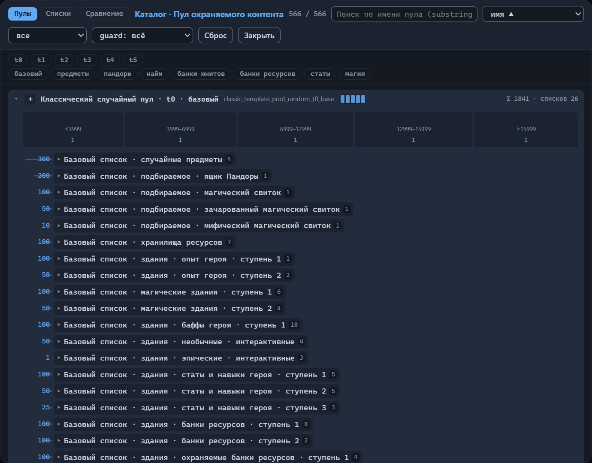
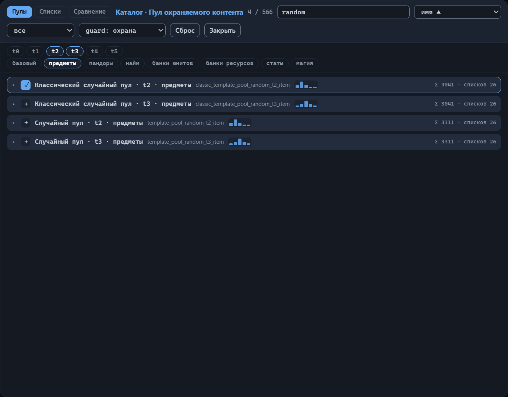
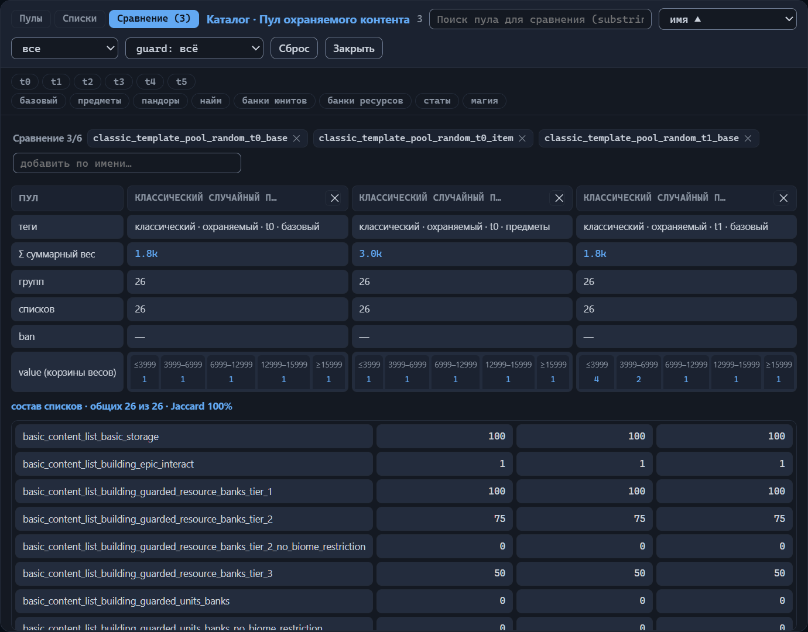
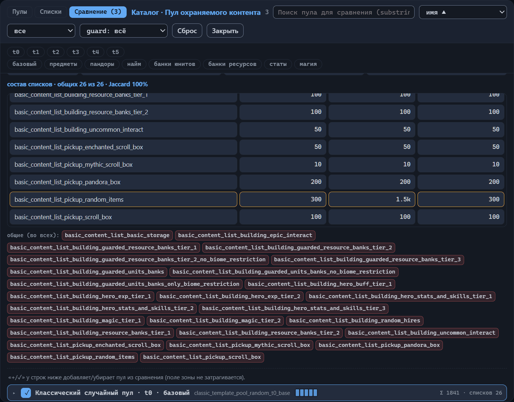
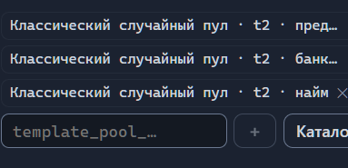

# Каталог пулов контента

Наполнение зон берётся не из шаблона: шаблон хранит только имена пулов, а сами
пулы и списки живут в базе игры. Три поля зоны — «Пул охраняемого контента»,
«Пул неохраняемого контента» и «Пул ресурсов» — ссылаются на пулы по имени;
устройство полей описано в главе [Зона: все свойства](zone.md#пулы-контента).
Копия базы встроена в редактор — это каталог пулов и списков. Он открывается
кнопкой «Каталог» рядом с любым из трёх полей пулов; заголовок окна повторяет
имя поля, например «Каталог · Пул охраняемого контента».

В каталоге три вкладки: «Пулы», «Списки» и «Сравнение». Эта глава — справочник
по каталогу: как устроены пулы и списки, что означают их имена и на что
смотреть при выборе пула для зоны.

## Пулы и списки

- **Пул контента**
  : Именованный набор объектов игры, из которого генератор берёт наполнение зоны.
- **Список**
  : Именованный перечень объектов, который пулы подключают к себе; списки общие —
    один и тот же список используют разные пулы.

Путь генератора до конкретного объекта короткий: зона называет пул, в пуле —
группы, к группам подключены списки, в списках — объекты. Пулов в базе сотни,
списков больше двух сотен. Запоминать их не требуется: имена собраны как
конструктор из повторяющихся токенов, а редактор для большинства имён показывает
русскую подпись.

### Устройство пула

Генератор берёт объекты из пула, пока не исчерпан бюджет наполнения зоны.
Ценность — условная валюта баланса, в которой измеряются и контент, и бюджеты
(глава [Зона: все свойства](zone.md#бюджеты)). Пул состоит из имени, групп
и, у большинства пулов, распределения ценности; часть пулов несёт баны.

- **Группа**
  : Взвешенная порция контента: чем больше вес группы, тем чаще генератор
    выбирает именно её. Выбор идёт в два этапа — сначала группа по весу, затем
    объект внутри неё. Группа хранит перечень подключённых списков и инлайновые
    записи.
- **Инлайновая запись**
  : Объект, вписанный прямо в группу. Она переопределяет вес такого же объекта,
    пришедшего из списков группы. Типичный приём — подключить готовый список
    и точечно поправить состав: вес 0 выключает объект, не удаляя его, большее
    значение — усиливает. Так устроен пул `template_pool_jebus_cross_guarded_center_zone`:
    группа предметов обнуляет вес обычных предметов и переназначает веса
    остальным редкостям — 50 редким и эпическим, 150 легендарным.
- **Корзины ценности**
  : Четыре границы `priceBounds` делят ценность объектов на пять диапазонов —
    корзин; у каждой свой вес из массива `weights`. У случайных пулов границы
    одинаковые: ≤3999, 3999–6999, 6999–12999, 12999–15999, ≥15999 — смысл
    весов корзин разобран в разделе [«Случайные пулы: ступени и профили»](#случайные-пулы-ступени-и-профили).
    Корзины есть не у всех пулов: у ресурсных, например, только группы.
- **Бан пула**
  : Запрет объекта на уровне пула: запрещённый sid не появится в наполнении
    зоны, даже если входит в подключённые списки.

Как именно генератор применяет веса корзин при подборе очередного объекта и в
какую корзину попадают объекты с ценностью ровно на границе диапазонов, по
данным не установить. *Назначение уточняется.*

### Устройство списка

Список — это имя и записи. Каждая запись:

- **sid**
  : Идентификатор объекта в базе игры. Рядом с большинством sid каталог
    показывает официальное русское имя объекта. У генератора есть особые
    объекты без официальных имён — например `random_item_common` или
    `random_hire_5`; для них редактор приводит собственные подписи
    («Случайный обычный предмет», «Внешний найм · ярус 5»).
- **Вес**
  : Как часто объект выбирается среди других записей списка. По умолчанию — 1;
    вес 0 выключает запись.
- **Биом**
  : Необязательное ограничение: запись действует только в указанном биоме.
    Значения биомов пишутся латиницей — теми же именами, что и в настройках
    зон (Grass, Sand, Snow, Lava и остальные). Один объект может встречаться
    в списке дважды: с весом 0 без биома и с большим весом для конкретного
    биома — так состав настраивают под разные поверхности.

Имена списков тоже складываются из токенов: `basic_content_list_*` — базовые
наборы (ресурсы, шахты, свитки, здания по категориям), `content_list_*` —
общий набор, отдельные списки названы по шаблонам — например, свои списки
пандор у пулов Jebus Cross.

### Имена пулов и списков

Имя пула или списка — внутренний идентификатор: игра нигде его не показывает,
официальной русской локализации у таких имён нет. Русские подписи в каталоге —
реконструкция редактора по содержимому списков. Если в имени встречается
незнакомый токен, редактор не выдумывает перевод и показывает имя как есть.
Названия шаблонов остаются латиницей — игра их тоже не переводит: Jebus Cross,
Blitz, Sprint.

Токены имени разделены подчёркиваниями, и у каждого своя роль:

- **Вид**
  : Начальные токены задают семейство. `template_pool_random_*` — случайный
    пул, с префиксом `classic_` — его классическая версия;
    `template_pool_<имя шаблона>_*` — пул шаблона; `content_pool_*` —
    контент-пул; прочее попадает в вид «прочее». В подписи — «случайный пул»,
    «классический случайный пул», «пул шаблона», «контент-пул».
- **Охрана**
  : `guarded` / `unguarded` — пул для охраняемого или неохраняемого контента;
    в подписи — «охраняемый» / «неохраняемый».
- **Ступень**
  : `t0`…`t5` — уровень богатства случайного пула; в подписи остаётся как есть:
    «t2».
- **Профиль**
  : Заключительный токен имени случайного пула — тематический уклон: `base`
    («базовый»), `item` («предметы»), `pandora` («пандоры»), `hire` («найм»),
    `unit_bank` («банки юнитов»), `res_bank` («банки ресурсов»), `stat`
    («статы»), `magic` («магия»).
- **Имя шаблона**
  : `jebus_cross`, `sprint`, `blitz`… — для какого штатного шаблона построен
    пул.
- **Роль зоны**
  : `start_zone`, `treasure_zone`, `side_zone`, `center_zone` и похожие —
    для зон какого типа предназначен пул; в подписи — «стартовая зона»,
    «зона сокровищ», «боковая зона», «центральная зона».
- **Богатство**
  : В именах ресурсных пулов — `very_poor`, `poor`, `medium`, `rich`, `zero`,
    `dust_only`: «очень бедная», «бедная», «средняя», «богатая», «нулевая»,
    «только пыль».

Три имени в разборе:

| Исходное имя | Подпись редактора |
|---|---|
| `classic_template_pool_random_t2_item` | Классический случайный пул · t2 · предметы |
| `template_pool_jebus_cross_guarded_start_zone` | Пул шаблона · Jebus Cross · охраняемый · стартовая зона |
| `content_pool_general_resources_start_zone_medium` | Контент-пул · общие ресурсы · стартовая зона · средняя |

Те же теги видны и без каталога: всплывающая подсказка плашки в поле пулов
показывает исходное имя и теги — глава
[Зона: все свойства](zone.md#заполнение-поля).

### Случайные пулы: ступени и профили

Случайные пулы — самое упорядоченное семейство каталога: шесть ступеней, два
варианта охраны и восемь профилей дают 96 пулов, и столько же классических
версий с префиксом `classic_`. Состав групп у них одинаковый, различаются
только веса.

**Ступень** — уровень богатства зоны. Границы корзин ценности у всех случайных
пулов общие, ступень меняет веса корзин:

| Ступень | Веса корзин, от дешёвой к дорогой | Перекос |
|---|---|---|
| t0 | 1 · 1 · 1 · 1 · 1 | нет — все корзины равновероятны |
| t1 | 4 · 2 · 1 · 1 · 1 | дешёвый контент |
| t2 | 2 · 4 · 2 · 1 · 1 | дешёвый и средний |
| t3 | 1 · 2 · 4 · 2 · 1 | средний |
| t4 | 1 · 1 · 2 · 4 · 2 | средний и дорогой |
| t5 | 1 · 1 · 1 · 2 · 4 | дорогой контент |

**Профиль** — тематический уклон: вес «своей» группы в разы выше, чем у
базового пула. У классических пулов ступени 0 это видно на трёх примерах:
в `base` случайные предметы идут с весом 300, пандоры — 200, внешний найм —
20; в пуле `item` предметы получают 1500, в `pandora` пандоры — 1000, в
`hire` найм — 100, в каждом случае впятеро. Зона с таким пулом получает в
первую очередь предметы, пандоры или здания внешнего найма, остальное — в
меньших количествах.

**Классическая версия** — тот же пул с префиксом `classic_`; вес двух групп
в нём на порядок ниже, поэтому здания внешнего найма и банки юнитов выпадают
реже (200 → 20 и 100 → 10 в базовом пуле, 1000 → 100 и 500 → 50 в профилях
`hire` и `unit_bank`). Классические пулы используют десять штатных шаблонов;
обычные `template_pool_random_*` — ни один.

Ступени и профили автор подбирает вручную, перечисляя имена в поле зоны.
Частый приём штатных шаблонов: стартовая зона получает один базовый пул
средней ступени, а зоны сокровищ и боковые — набор из семи профильных пулов
одной ступени, по профилю на каждый. Работа самого поля — в главе
[Зона: все свойства](zone.md#пул-охраняемого-контента).

### Ресурсные пулы

Семейство `content_pool_general_resources_*` — 13 пулов, на них ссылается
почти каждый штатный шаблон. В имени зашифрованы роль зоны (`start_zone`,
`treasure_zone`, `side_zone`) и богатство. Богатство читается по содержимому
буквально:
по сравнению со средним пулом той же роли богатый поднимает веса золота,
кристаллов и сундуков, очень бедный — урезает золото и сундуки; `zero` —
пустой пул без групп, а `dust_only` оставляет ненулевой вес одной
алхимической пыли.

Поле зоны «Пул ресурсов» принимает ровно одно имя такого пула — устройство
поля и примеры в главе [Зона: все свойства](zone.md#пул-ресурсов).

### Служебные пулы

В каталоге встречаются пулы, на которые не ссылается ни один штатный шаблон:
`template_pool_default`, семейство `content_pool_default_*`, шесть пулов
Jebus Cross. По данным редактора это запасной вариант генератора на случай,
когда шаблон не задал собственные пулы, — гипотеза. *Назначение уточняется.*

## Просмотр каталога

Окно каталога одинаково для всех трёх полей зоны: сверху вкладки и строка
инструментов, ниже — строки пулов или списков. Этот раздел описывает, что
показывает окно и как сузить список до нужных строк.

### Загрузка и вкладки

Каталог подгружается при первом открытии окна: редактор читает копию базы
отдельно от остального интерфейса, поэтому на короткое время окно показывает
надпись «Загрузка каталога…». Это не сбой. Дождитесь списка — дальше копия
базы остаётся в памяти, и следующие открытия окна происходят сразу. Если
загрузка не удалась, окно показывает «Ошибка загрузки» и причину: закройте
его и обновите страницу браузера.

Вкладки окна:

- **Пулы**
  : Строки пулов базы; каждую раскрывают, чтобы увидеть состав пула.
- **Списки**
  : Строки списков: сколько в каждом записей и какие пулы его подключают.
- **Сравнение**
  : Таблица двух–шести отобранных пулов рядом: общий и уникальный состав
    списков, разница весов.

Строка инструментов почти одинакова на всех вкладках: заголовок окна,
счётчик, поле поиска, список сортировки, кнопки «Сброс» и «Закрыть». Списки
вида и охраны стоят только на вкладках «Пулы» и «Сравнение»: они фильтруют
пулы, а у списков таких признаков нет — на вкладке «Списки» оба списка
скрыты. Заголовок повторяет поле, из которого вызван каталог, — например
«Каталог · Пул охраняемого контента». Счётчик рядом с заголовком показывает
две цифры: сколько строк осталось после фильтров и сколько их всего на
вкладке; на вкладке «Сравнение» цифра одна — число отобранных пулов.

Окно закрывается кнопкой «Закрыть», клавишей Escape или щелчком по
затемнённой области вне окна. Кнопка «Сброс» очищает поиск, фильтры,
сортировку и пулы, отобранные для сравнения, и возвращает вкладку «Пулы».
Значений полей зоны «Сброс» не касается.

### Поиск и фильтры

Поле поиска принимает подстроку: совпадение ищется в любом месте имени,
а не только в начале. На вкладке «Пулы» запрос сравнивается с исходным
именем пула и с его русской подписью, поэтому слово «предметы» находит все
пулы с этим профилем. Вкладка «Списки» к имени и подписи добавляет состав:
запрос по sid оставляет списки, в которых такой sid встречается.

Список вида оставляет одно семейство пулов: «все», «случайный»,
«классический», «шаблон», «контент», «прочее». Семейства разобраны в разделе
[Имена пулов и списков](#имена-пулов-и-списков). Рядом стоит список охраны —
«guard: всё», «guard: охрана», «guard: без охраны»: он оставляет пулы
с нужным признаком. У части пулов признака охраны нет, например у ресурсных,
и при любом значении, кроме «всё», они исчезают из списка.

Под строкой инструментов находятся две полосы меток фильтра: ступени
t0…t5 и восемь профилей — «базовый», «предметы», «пандоры», «найм», «банки
юнитов», «банки ресурсов», «статы», «магия». Щелчок по метке включает
и выключает её, несколько включённых меток одной полосы работают как «или».
Ступени и профили есть только у случайных и классических пулов, поэтому
включённая метка оставляет лишь эти два семейства и скрывает пулы шаблонов
и ресурсные пулы. Полосы видны на вкладках «Пулы» и «Сравнение» и только
тогда, когда в списке вида стоит «все», «случайный» или «классический».

Редактор запоминает поиск, фильтры, сортировку и отобранные для сравнения
пулы и восстанавливает их при следующем открытии каталога. Если список
короче, чем вы ожидаете, проверьте поле поиска и включённые метки: скорее
всего, сохранился прошлый набор условий, и кнопка «Сброс» вернёт полный
список. Надпись «Ничего не найдено» говорит лишь о том, что под условия не
подошла ни одна строка, — прежде чем решить, что пула нет в базе, сбросьте
фильтры.

### Сортировка

Список сортировки стоит рядом с полем поиска и предлагает разные порядки
для разных вкладок.

Порядки на вкладке «Пулы» — они же на вкладке «Сравнение»:

- **имя ▲**
  : По алфавиту исходных имён пулов; порядок по умолчанию.
- **Σ суммарный вес ▼**
  : По убыванию суммы весов групп — вверху пулы с самыми тяжёлыми группами.
- **кол-во списков ▼**
  : По убыванию числа списков, подключённых к группам пула.

Порядки на вкладке «Списки»:

- **имя ▲**
  : По алфавиту исходных имён списков; порядок по умолчанию.
- **использование ▼**
  : По убыванию числа пулов, которые подключают список, при равном числе —
    по алфавиту. Списки без подключений опускаются в конец.

### Строка пула

Свёрнутая строка пула показывает слева направо:

- **Кнопка отбора**
  : «+» добавляет имя пула в поле зоны, из которого открыт каталог,
    и превращается в «✓»; повторный щелчок убирает имя. Строку кнопка
    не раскрывает.
- **Имя**
  : Русская подпись пула, под ней исходное имя. Когда имя не распознано,
    на месте подписи стоит само имя, а под ним — перевод тегов.
- **Столбики корзин ценности**
  : По столбику на корзину, высота соответствует весу корзины; у пулов
    без корзин столбиков нет.
- **Подсказка справа**
  : Сумма весов групп (Σ) и число подключённых списков — например
    «Σ 3311 · списков 26». Сумма показывается как есть, к тысячам
    не сокращается.

Раскрытая строка показывает пул изнутри:

- **Корзины ценности**
  : Полосы по числу корзин — у каждой подпись корзины и её вес, длина
    полосы соответствует весу.
- **Бан пула**
  : Строка «ban:» с sid запрещённых объектов; видна только у пулов
    с банами.
- **Группы**
  : По блоку на группу: слева вес группы и полоса его доли среди групп,
    справа подключённые списки. Веса от 1000 сокращаются: 3000 показывается
    как `3k`, 1500 — как `1.5k`, 1841 — как `1.8k` (округление до десятых).
    У группы без списков вместо них прочерк.
- **Инлайновые записи группы**
  : Строка в квадратных скобках — sid и вес через двоеточие, записи
    через запятую.

Список внутри группы — тоже раскрывающаяся строка: подпись или имя списка
и число записей в нём, а в раскрытии состав — sid, вес, биом и пояснение
редактора к объекту, если оно есть. Когда списка нет в копии базы, его имя
показывается простой строкой и не раскрывается.

### Строка списка

Строка на вкладке «Списки» показывает имя или подпись списка, число записей
в нём и подсказку «в пулах: N», где N — число пулов, подключающих этот
список. Сокращение «з/sid» в строке означает число записей: каждая запись
списка — это один sid со своим весом. Кнопки отбора у строк списков нет:
списки выбирают не напрямую, а через пулы, которые их подключают.

В раскрытии строки — состав списка и блок «используют:» с именами пулов,
подключающих список; у списка без подключений блока нет.

## Сравнение пулов

Вкладка «Сравнение» ставит рядом от двух до шести пулов и отвечает на два
вопроса: чем они различаются и насколько похожи их составы. Так выбирают между
соседними пулами — ступенями одного профиля, профилями одного семейства,
обычным пулом и классическим. Пока в отборе меньше двух пулов, вкладка
показывает приглашение: «Выберите 2–6 пула: кнопка «+» у строки ниже или поле
«добавить по имени».» Со вторым отобранным пулом появляются таблица сравнения
и матрица списков. Как только отобран первый пул, к названию вкладки
добавляется их число — «Сравнение (N)», — и ту же одну цифру показывает
счётчик в строке инструментов.

### Отбор пулов

Панель отбора стоит над таблицей сравнения: метка «Сравнение N/6» — число
отобранных пулов из шести допустимых, чипы отобранных пулов и поле «добавить
по имени…». Чип показывает исходное имя пула, при наведении — русскую подпись
и имя; «✕» на чипе убирает пул из сравнения.

Пулы попадают в сравнение двумя способами:

1. Нажмите «+» у строки пула ниже — кнопка превратится в «✓», а пул добавится
   в отбор.
2. Введите имя или его часть в поле «добавить по имени…» и выберите подсказку
   либо нажмите Enter. При фокусе поле открывает полный список имён пулов
   каталога, при вводе сужает его по подстроке; Escape закрывает список.

Поле работает как переключатель: имя уже отобранного пула убирает пул
из сравнения. Имя, которого нет в каталоге, игнорируется — поле ничего
не добавляет и об ошибке не сообщает, поэтому сверяйте написание по вкладке
«Пулы». Седьмой пул тоже не добавится: предел — шесть, и для нового пула
сначала уберите один из отобранных.

Обратите внимание: кнопки «+» и «✓» на этой вкладке работают на сравнение
и поле зоны не трогают — в отличие от вкладки «Пулы», где они добавляют имя
пула в поле (раздел [Строка пула](#строка-пула)). Под таблицей стоит отдельная
подсказка: ««+/✓» у строк ниже добавляет/убирает пул из сравнения (поле зоны
не затрагивается).»

Строки под панелью — обычные строки пулов: поиск с подсказкой «Поиск пула для
сравнения (substring)», списки вида и охраны, метки ступеней и профилей
и сортировка действуют на них так же, как на вкладке «Пулы» (разделы
[Поиск и фильтры](#поиск-и-фильтры) и [Сортировка](#сортировка)). На таблицу
фильтры не влияют: отобранные пулы остаются в сравнении, даже когда не
подходят под текущие условия.

Отбор редактор запоминает и восстанавливает при следующем открытии каталога,
а кнопка «Сброс» очищает его вместе с поиском, фильтрами и сортировкой
(раздел [Загрузка и вкладки](#загрузка-и-вкладки)).

Сравнивайте пулы одного семейства: ступень со ступенью, профиль с профилем,
обычный пул с классическим. У пулов из разных семейств мало общих списков —
матрица почти целиком окажется размечена различиями, и найти содержательные
будет трудно.

### Таблица сравнения

Первая ячейка таблицы подписана «пул», дальше по столбцу на каждый отобранный
пул в порядке отбора. В заголовке столбца стоит русская подпись пула, а при её
отсутствии — исходное имя; длинный заголовок обрезается многоточием, наведение
показывает подпись и имя целиком; «✕» в заголовке убирает пул из сравнения.

Строки таблицы:

- **теги**
  : Переведённые токены имени пула через « · » — те же, что разбирает раздел
    [Имена пулов и списков](#имена-пулов-и-списков). Прочерк в этой строке
    не встречается: у имени, которое редактор не разобрал, остаётся один
    тег — вид «прочее».
- **Σ суммарный вес**
  : Сумма весов всех групп пула.
- **групп**
  : Число групп.
- **списков**
  : Число подключений списков: один и тот же список, подключённый к двум
    группам, считается дважды. Уникальные имена списков — в матрице ниже.
- **ban**
  : sid запрещённых объектов через запятую; у пула без банов — прочерк.
- **value (корзины весов)**
  : Полосы по корзинам ценности: подпись корзины и её вес, длина полосы
    пропорциональна весу, у корзины с весом 0 остаётся минимальная полоса —
    она видна в строке. Наведение показывает границу корзины и вес. У пула без
    корзин — прочерк; устройство корзин — в разделе
    [Устройство пула](#устройство-пула).

Веса от 1000 в таблице и в матрице ниже сокращаются так же, как веса групп
в раскрытой строке пула: 3000 — `3k`, 1500 — `1.5k` (раздел
[Строка пула](#строка-пула)).

### Матрица списков

Матрица перечисляет все списки, которые встречаются хотя бы у одного
отобранного пула: строка на список, строки по алфавиту, столбцы — пулы в том
же порядке, что и в таблице. Ячейка показывает вес списка в этом пуле — сумму
весов групп, к которым список подключён; у отсутствующего списка стоит
прочерк.

Заголовок над матрицей подводит итог: «состав списков · общих N из M ·
Jaccard P%». N — число списков, которые есть во всех отобранных пулах, M —
общее число разных списков. Jaccard — коэффициент похожести составов:
Jaccard = N / M, в процентах с округлением до целого. Чем выше значение, тем
похоже пулы.

Например, отобраны три пула; вместе они дают 12 разных списков, из них 9 есть
в каждом из трёх. Jaccard = 9 / 12 = 0.75, и заголовок читается как «состав
списков · общих 9 из 12 · Jaccard 75%».

Строка подсвечивается, когда список есть не во всех пулах или его веса
в пулах не равны. Наведение на имя списка сообщает причину: «состав или вес
различается между пулами» либо «состав и вес совпадают во всех пулах».

Обратите внимание: матрица учитывает только списки, подключённые к группам.
Инлайновые записи групп в ней не видны и на веса в ячейках не влияют (раздел
[Устройство пула](#устройство-пула)).

Под матрицей стоят блоки чипов со списками:

- **«общие (во всех):»**
  : Списки, которые есть во всех отобранных пулах.
- **«только в «подпись»:»**
  : По блоку на пул: списки, которые встречаются ровно в нём. В подписи блока
    — русская подпись пула; наведение на чип показывает подпись списка, а при
    её отсутствии — его имя.

Список, который попал лишь в часть пулов — скажем, в два из трёх, — не входит
ни в один блок: он виден подсвеченной строкой матрицы.

Внутри семейства случайных пулов сравнение получается самым наглядным: состав
групп у них одинаковый, все списки общие, Jaccard — 100%, а различия сводятся
к весам отдельных строк. У пары `classic_template_pool_random_t0_base`
и `classic_template_pool_random_t0_item` подсвечена одна строка списка
`basic_content_list_pickup_random_items`: вес 300 у базового пула и `1.5k`
у пула предметов. Механика профилей разобрана в разделе
[Случайные пулы: ступени и профили](#случайные-пулы-ступени-и-профили).

## Выбор пула для зоны

Полей пулов у зоны три, а имён в каталоге хватает на любую роль, ступень и
богатство. Выбор сводится к трём вопросам: что говорит имя, согласуется ли пул
с бюджетом поля и чем кандидат отличается от текущего пула. Механика самого
поля — плашки, ввод, кнопки «＋» и «Каталог» — описана в главе
[Зона: все свойства](zone.md#заполнение-поля).

### Чтение имени

Имя пула разбирается на токены, а редактор превращает их в русские теги;
разбор токенов приведён в разделе
[Имена пулов и списков](#имена-пулов-и-списков). Перед добавлением пула
в поле прочитайте теги во всплывающей подсказке плашки или строки каталога —
иначе о назначении придётся гадать по длинному латинскому имени. Теги отвечают
на три вопроса.

- **Для какого поля**
  : Теги «охраняемый» и «неохраняемый». У пулов шаблонов токен `guarded` /
    `unguarded` стоит прямо в имени; у случайных пулов токена «охраняемый»
    не бывает — его отсутствие редактор читает как «охраняемый». В демо-шаблоне
    имена с `unguarded` стоят в поле неохраняемого контента, а имена без него —
    в охраняемом. Обратите внимание: соответствие тега полю редактор
    не проверяет — формально в каждом из трёх полей допустимо любое имя
    каталога.
- **Насколько дорогой контент**
  : Ступень `t0`–`t5` у случайных пулов — перекос корзин ценности к дешёвым
    или дорогим находкам; токен богатства у ресурсных пулов — от «очень
    бедной» до «богатой».
- **Какая тематика**
  : Профиль случайного пула — предметы, пандоры, найм, банки юнитов, банки
    ресурсов, статы, магия или база без уклона. Пулы шаблонов несут в тегах
    имя штатного шаблона, ресурсные — роль зоны: стартовая, сокровищ, боковая,
    центральная.

### Ступень и бюджет зоны

Бюджет задаёт, на какую сумму ценности генератор наполнит зону, а ступень —
насколько дорогими будут отдельные находки: объекты набираются из пула, пока
бюджет не исчерпан, и веса корзин наклоняют выбор к тому или иному диапазону
цен. Каждое из трёх полей работает в паре со своим бюджетом и настраивается
независимо (глава [Зона: все свойства](zone.md#бюджеты)).

Демо-шаблон показывает типичную лестницу — чем богаче роль зоны, тем выше
ступень:

| Зона | Бюджет охраняемого контента | Охраняемые пулы |
|---|---|---|
| Spawn-A — старт | 16000 на единицу площади | три пула t2: предметы, банки юнитов, найм |
| Treasure-2, Treasure-4 | 70000 | два пула t2: предметы и банки юнитов |
| Treasure-1, Treasure-3 | 220000 | два пула t3: предметы и банки юнитов |
| Center | 650000 | t4 и t5, оба — предметы |
| SuperTreasure-1 | 1600000 | два пула t5: предметы и банки юнитов |

Независимость полей видна рядом: у зон сокровищ поле неохраняемого контента
несёт пул t3 при любой ступени охраняемого поля, а у зоны Connector-A бюджеты
нулевые и оба контентных поля пустые — имя остаётся только в поле ресурсов.

Прикидка на числах демо-шаблона. Условия: зона Treasure-2, бюджет охраняемого
контента 70000, ступень пула t2 — пик весов корзин на 3999–6999. Подстановка:
пулы t2 меняют на ступень t5 — пик уезжает на корзину ≥15999. Вывод: если
считать по границам корзин, тот же бюджет даёт около десяти находок средней
цены (70000 ÷ 6999 ≈ 10) или примерно четыре дорогих (70000 ÷ 15999 ≈ 4).
Бюджет не изменился, а вместо россыпи находок зона получает горстку объектов.
Обратная ошибка стоит не дешевле: при бюджете 1600000 и пуле ступени t1
в зону войдёт больше четырёхсот объектов даже по границе дешёвой корзины
(1600000 ÷ 3999 ≈ 400).

Соотносите ступень с бюджетом поля — иначе плотность и цена находок разойдутся
с ролью зоны: зона сокровищ даст слишком мало находок, а центральная зона
мельчит сотнями дешёвых.

У поля ресурсов ступеней нет — богатство пула привязывают к бюджету ресурсов.
Зоны сокровищ демо-шаблона несут `content_pool_general_resources_treasure_zone_medium`
при бюджете 8000, а Center и SuperTreasure-1 —
`content_pool_general_resources_treasure_zone_rich` при 42000 и 60000.

### Сверка сравнением

Имя подсказывает уклон, но не содержимое: разница прячется в весах групп
и списков. Перед заменой пула в поле зоны отберите текущий и будущий на
вкладке «Сравнение» — иначе замена пройдёт вслепую, по одному имени. Отбор
описан в разделе [Отбор пулов](#отбор-пулов), таблица и матрица — в разделах
[Таблица сравнения](#таблица-сравнения) и [Матрица списков](#матрица-списков).

Типичные пары:

- **Ступень со ступенью**
  : Состав идентичен — все списки общие, индекс Жаккара 100%. Различие только
    в строке «value (корзины весов)»: полосы смещаются к дешёвым или дорогим
    корзинам.
- **Профиль с профилем**
  : Та же ступень, а подсвечена строка тематического списка — его вес растёт
    впятеро; пример 300 против `1.5k` показан в разделе
    [Матрица списков](#матрица-списков).
- **Обычный с классическим**
  : В имени — только префикс `classic_`, в содержимом — два веса групп: найм
    и банки юнитов падают в десять раз. На глаз по имени это не угадать,
    раскрытая строка каталога показывает разницу весов.
- **«Богатая» с «бедной»**
  : Пара ресурсных пулов одной роли и разного богатства. Имя не говорит, что
    именно изменится — каталог показывает, где смещаются веса золота,
    кристаллов и сундуков, а сравнение ставит два соседних пула рядом
    (раздел [Ресурсные пулы](#ресурсные-пулы)).

### Имя вне каталога

Подпись плашки и присутствие имени в каталоге — два независимых признака,
и их легко перепутать.

Подпись строится из токенов имени и от каталога не зависит: имя
с незнакомым токеном остаётся на плашке как есть, без русской подписи
(раздел [Имена пулов и списков](#имена-пулов-и-списков)). В подсказке такое
имя получает единственный тег «прочее». Пока каталог не загружен, подсказка
показывает только исходное имя — каталог поднимается в память лениво, при
первом открытии ввода поля или окна каталога.

Присутствие в каталоге проявляется иначе. Кнопка «＋» и Enter молча отбрасывают
имя, которого нет среди известных, — но только после загрузки; до неё поле
принимает любой текст. Имя, пришедшее из открытого файла, остаётся в поле
в любом случае: плашка выглядит как остальные, и поле ничем её не помечает.

Единственный надёжный признак — предупреждение валидатора «Пул «X» не найден
в каталоге (всего пулов: N)» на панели «Проблемы». Проверка тоже выполняется
только при загруженном каталоге; щелчок по замечанию выбирает проблемную зону
(глава [Проверка шаблона (валидатор)](validator.md)).

Открыв чужой шаблон, просмотрите панель «Проблемы» — иначе имя вне каталога
останется незамеченным: поле его не помечает, и опечатка или устаревшее имя
спокойно доживут до сохранённого файла.

## Пулы в файле шаблона

Файл шаблона несёт только имена: поля «Пул охраняемого контента» и «Пул
неохраняемого контента» принимают от одного до семи имён, «Пул ресурсов» —
ровно одно. Плашки, подсказки и ввод — в главе
[Зона: все свойства](zone.md#пулы-контента).

В корне .rmg.json есть секции `contentPools` и `contentLists` — в них пулы
и списки могли бы храниться прямо в шаблоне, но во всех штатных шаблонах они
пустые, и новый шаблон создаётся с пустыми секциями. Разбор корневого блока —
в главе [Настройки шаблона (корень)](root.md#json-секция-корня).

Как генератор распоряжается несколькими именами в одном поле — объединяет
группы пулов или выбирает один пул на зону, — по данным надёжно не ответить.
Разделение случайных пулов на профили намекает на выбор пула под зону, но
подтверждения нет. *Назначение уточняется.*

## Куда дальше

- [Зона: все свойства](zone.md) — бюджеты, поля наполнения, стражи и дороги
  зоны: всё, к чему привязан выбор пулов.
- [Проверка шаблона (валидатор)](validator.md) — панель «Проблемы», уровни
  замечаний и переходы к зонам.
- [Настройки шаблона (корень)](root.md#json-секция-корня) — секции
  `contentPools` и `contentLists` в файле шаблона.
