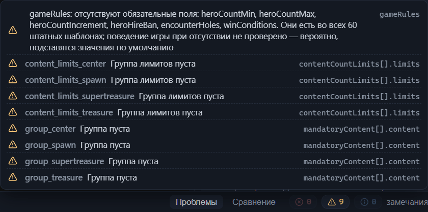
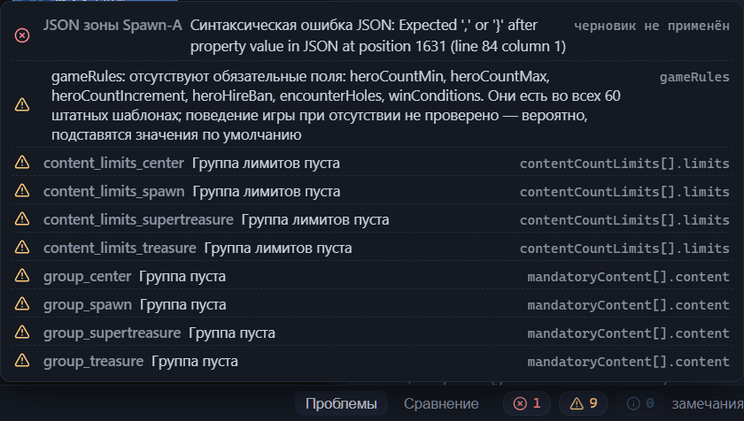

# Проверка шаблона (валидатор)

Валидатор — встроенная проверка шаблона редактором. Он просматривает текущий шаблон — имя и игровой режим, размер карты, варианты, зоны, связи, дороги, группы контента — и сообщает о найденном на панели «Проблемы» в нижней части окна (глава [Интерфейс: окна и панели](interface.md#нижняя-панель-и-строка-состояния)). Проверка запускается сама: вкладка «Проблемы» открыта вместе с редактором, а отчёт пересчитывается после каждого изменения — отдельной кнопки «проверить» нет. Поправили зону или настройку — панель обновилась следом.

Обратите внимание: каталог пулов и списков контента редактор подгружает в фоне. Пока загрузка не завершилась, редактор не проверяет имена пулов и списков в шаблоне — такие замечания появятся на панели чуть позже.

## Три группы замечаний

Вверху панели стоят три чипа — маленькие плашки-счётчики: число ошибок, предупреждений и справочных заметок. Наведите курсор — и чип подскажет свою группу: «ошибки», «предупреждения», «справка». Чип с нулём выглядит приглушённым. Группы различаются серьёзностью:

- **Ошибки** — то, что почти наверняка сломает игру или генерацию карты: пустое имя шаблона, отсутствие вариантов раскладки, связь без начала или конца. Исправляйте их до установки шаблона в игру (глава [Установка шаблона в игру](install.md)).
- **Предупреждения** — подозрительные места: игра может их принять, но результат трудно предсказать. Пример — неквадратный размер карты или неизвестный тип дороги; решайте по каждому предупреждению, намеренное оно или это недосмотр.
- **Справка** — информационные заметки, которые ничего не требуют. Так валидатор сообщает о необычных, но допустимых приёмах.

Список под чипами отсортирован по тому же принципу: сначала ошибки, затем предупреждения, потом справочные заметки. Внутри группы строки стоят по алфавиту текста места — так замечания об одном элементе оказываются рядом.

Если замечаний нет вовсе — даже справочных, — панель показывает строку «шаблон корректен» со значком-галочкой.

## Строка замечания

По умолчанию список замечаний свёрнут: видна только строка-заголовок «замечания», подсказка которой напоминает «клик по замечанию — переход к элементу». Кликните строку-заголовок — список раскроется.

Каждая строка — кнопка. В ней слева направо: значок серьёзности — крестик, треугольник или буква «i», — место, текст замечания и в конце путь к полю файла .rmg.json (глава [Справочник формата .rmg.json](rmg-json.md)). Путь уточняет, о каком поле речь, — например `sizeX` или `gameRules`; наведение курсора на текст замечания повторяет его во всплывающей подсказке.

Место в начале строки подсказывает, что именно смотреть в шаблоне:

- У замечаний о корне шаблона места нет — строка начинается сразу со значка и текста: это имя шаблона, игровой режим, правила игры. Такие настройки собраны на вкладке «Шаблон» инспектора (глава [Настройки шаблона (корень)](root.md)).
- «размер карты» — поля размера карты.
- «V1» — вариант раскладки целиком.
- «V1 · Treasure-2» — зона Treasure-2 первого варианта.
- «V1 · связь Spawn-A-Center» — связь под своим именем; если имени нет, вместо него стоит автоимя по зонам-концам.
- «V1 · группа стражей spawn_main_guard» — группа синхронной стражи (глава [Связи между зонами](connections.md#группа-синхронной-стражи)).
- «V1 · Center · дорога 1» — первая дорога зоны Center.
- Одно только имя группы — замечание о группе обязательного контента или лимитов количества; такие группы живут в корне шаблона.

Номера вариантов и дорог в подписи места считаются от единицы.

## Переход к замечанию

Подсказка строки гласит «перейти к замечанию». Щелчок — и редактор показывает место, о котором говорит валидатор:

- Замечание о зоне или связи выбирает элемент и наводит на него камеру; поведение камеры описано в главе [Канва: правка графа](canvas-editing.md#переход-к-элементу-из-панелей).
- Строка из другого варианта сначала переключает активный вариант — канва перерисовывается на нужную схему, и редактор выбирает элемент уже на ней.
- Дорога — часть зоны, поэтому её замечание выбирает зону-владельца.
- Группа стражей — исключение: щелчок переключает вариант и сбрасывает выделение. Группа объединяет сразу несколько связей, и искать их проще на канве по общему цвету в режиме «Стражи» (глава [Канва: режимы отображения](canvas-modes.md)).
- Корневое замечание открывает в инспекторе вкладку «Шаблон»; поле не подсвечивается — ищите его по пути в конце строки.

## Ошибки черновика JSON-редактора

JSON-редактор — инструмент прямой правки текста шаблона (глава [Прямая правка JSON](json-editor.md)). Пока черновик не применён, валидатор его не видит и проверяет шаблон без ваших правок, зато синтаксические ошибки и ошибки структуры черновика попадают на панель сразу. Строки со значком ошибки стоят выше остальных замечаний: место называет раздел — «JSON шаблона», «JSON зоны» с именем зоны или «JSON связи» с именем связи, — текст сообщает о проблеме, а конец строки помечен «черновик не применён».

Черновики идут в счётчик ошибок: пока есть хотя бы одна, редактор не сохранит шаблон — иначе в файл попал бы сломанный текст. Подсказка строки предлагает решение: «Ошибка в черновике JSON-редактора — исправьте текст или нажмите «Сбросить»». Исправьте ошибку или откажитесь от черновика — строка пропадёт, а сохранение снова станет доступно.

## Типовые замечания и что с ними делать

Проверок у валидатора много, но заучивать коды не нужно: точный текст любого замечания панель показывает сама. Ниже собраны частые и показательные замечания, сгруппированные по причинам. Каждая запись приводит текст панели — имена и числа в нём подставлены для примера, — а следом вероятную причину и способ исправить. Начинайте с ошибок, потом переходите к предупреждениям: ошибка почти наверняка сломает игру или генерацию, а предупреждение может оказаться и намеренным приёмом.

### Имя шаблона, режим игры, размеры

- **«Имя шаблона пустое»** (ошибка)
  : Поле «Название» осталось незаполненным — у нового шаблона или после случайной очистки. Впишите имя на вкладке «Шаблон» инспектора (глава [Настройки шаблона (корень)](root.md#название)).
- **«Неизвестный gameMode «X» (ожидается Classic/SingleHero)»** (ошибка)
  : Значение режима — не из двух, которые знает формат: файл правили мимо редактора. Список в инспекторе постороннее значение выбрать не даёт, поэтому откройте вкладку «Шаблон» и перевыберите режим — «Классический» или «Один герой» (глава [Настройки шаблона (корень)](root.md#режим-игры)).
- **«Карты OE всегда квадратные — стороны различаются»** (предупреждение)
  : `sizeX` и `sizeZ` не совпадают. Выровняйте обе стороны (глава [Настройки шаблона (корень)](root.md#размеры-карты)).
- **«Размеры не кратны 16»** и **«Размер вне обычного диапазона 80–240»** (предупреждения)
  : Размер карты выпал из принятой сетки. Задайте каждой стороне значение, кратное 16, в пределах 80–240 — например 144 (глава [Настройки шаблона (корень)](root.md#размеры-карты)).

### Варианты, зоны, имена

- **«Нет ни одного варианта раскладки»** (ошибка)
  : У шаблона нет вариантов — пустой старт или вычищенная секция `variants`. Добавьте хотя бы один вариант (глава [Варианты: управление и выбор](variant-manage.md)).
- **«Нет ни одной зоны»** (ошибка)
  : В варианте нет зон. Нарисуйте зоны на канве (глава [Канва: правка графа](canvas-editing.md#добавление-зоны)).
- **«Дубли имён зон: Treasure-2»** (ошибка)
  : Две зоны одного варианта получили одинаковое имя — после переименования или копирования. Зоны и ссылки на них различаются по имени, поэтому дубль делает ссылки неоднозначными: переименуйте одну из зон (глава [Канва: правка графа](canvas-editing.md#переименование-зоны)).
- **«Player1 уже задан в зоне Spawn-A»** (ошибка)
  : Две точки появления героя в одном варианте претендуют на одного игрока. Оставьте игроку одну точку, а второй назначьте другое значение из `Player2`…`Player8` (глава [Главные объекты зоны](main-objects.md#игрок-spawn)).
- **«Совпадающие авто-имена связей (From–To без суффикса): Center-Treasure-2»** (справка)
  : Между одной парой зон проведены две связи, и обе подписываются одним адресом — одинаковым авто-именем или совпавшим собственным именем. Редактор выдаёт параллельным связям имена с суффиксом сам, поэтому справка приходит из файлов, правленных мимо редактора: дайте одной из связей своё имя (глава [Канва: правка графа](canvas-editing.md#имя-связи)), иначе замечания о двух разных связях выглядят одинаково.
- **«Группа пуста»** и **«Группа лимитов пуста»** (предупреждения)
  : Группа обязательного контента или группа лимитов количества создана, но не заполнена. Наполните группу или удалите её из корня (глава [Настройки шаблона (корень)](root.md#json-секция-корня)). В демо-шаблоне такие группы намеренно оставлены пустыми — отсюда его восемь предупреждений «Группа пуста» и «Группа лимитов пуста».

### Несуществующие ссылки

- **«Несуществующая зона MatchZone: «Treasure-9»»** (предупреждение)
  : Настройка зоны ссылается на имя, которого в варианте больше нет, — зону переименовали или удалили. Ту же проверку проходят другие поля; слово в тексте подсказывает, какое именно: «differentFrom», «NearZone», «MatchMainObject», «faction Match», «faction differentFrom». Откройте зону из замечания, найдите поле по пути в конце строки и укажите существующую зону (главы [Зона: все свойства](zone.md#биомы) и [Главные объекты зоны](main-objects.md#способ-выбора-фракции)).
- **«Несуществующая зона from: Treasure-3»** (ошибка) — у `to` текст такой же
  : Конец связи указывает на зону, которой в варианте нет. Задайте источник и приёмник связи заново (глава [Связи между зонами](connections.md#зона-источник-и-зона-приёмник)).
- **«Связь «Spawn-A-Center» из placementArgs не найдена в варианте»** (предупреждение)
  : Размещение объекта «на конкретной связи» потеряло адрес: связь удалили или переименовали. Выберите в карточке объекта существующую связь (глава [Главные объекты зоны](main-objects.md#размещение)).
- **«Группа «group_treasure» не найдена в корневом mandatoryContent»** и **«Группа лимитов «limits_treasure» не найдена в contentCountLimits»** (предупреждения)
  : Зона ссылается на корневую группу, которой нет, — такую ссылку называют битой. Поправьте имя или создайте группу в корне; бейдж «не найдена» на чипе зоны показывает то же самое (глава [Зона: все свойства](zone.md#битые-ссылки-и-предупреждения-валидатора)).
- **«layout «Wilds» не объявлен в zoneLayouts шаблона»** (предупреждение)
  : Лэйаут зоны отсутствует в корневом списке. Добавьте лэйаут с таким именем или выберите зоне объявленный (глава [Настройки шаблона (корень)](root.md#лэйауты-зон)).
- **«Пул «template_pool_treasure» не найден в каталоге»** (предупреждение) — для списков текст «Список «X» не найден в каталоге»
  : Имя пула или списка не значится в каталоге генератора — опечатка либо придуманное имя. Сверьте написание с окном каталога или выберите имя из подсказок ввода (глава [Каталог пулов контента](pools.md#имя-вне-каталога)).

### Группа синхронной стражи

- **«В группе «center_guard» guardValue различаются (8000 / 12000) — стражи не будут симметричны»** (предупреждение)
  : Параметры стражи у связей группы разошлись; валидатор сверяет три поля — силу стражи, еженедельный прирост и разброс силы. Приведите значения к общим для всех связей группы (глава [Связи между зонами](connections.md#группа-синхронной-стражи)), иначе связи группы охраняются стражей разной силы и синхронность теряет смысл.
- **«Группа «solo» из одной связи — синхронизировать некого»** (справка)
  : Имя группы стоит лишь на одной связи. Если группа задумана для нескольких связей, добавьте их; для одиночной связи замечание можно не учитывать.
- **«Отрицательный guardValue (-5000) — семантика неясна, проверьте»** (предупреждение)
  : Сила стражи связи задана ниже нуля. Как игра читает отрицательное значение, неизвестно — *назначение уточняется*. Если это не намеренный эксперимент, верните неотрицательное число (глава [Связи между зонами](connections.md#сила-стражи)).

### Дороги

Дороги ломаются правками графа, а не собственными полями: удаление карточки объекта сдвигает номера остальных, а переименование или удаление связи делает адрес конца битым. Полный разбор замечаний о дорогах — в главе [Зона: все свойства](zone.md#битые-концы-и-предупреждения-валидатора); здесь частые.

- **«MainObject[2] вне диапазона mainObjects (0..1)»** (ошибка)
  : Конец дороги указывает на номер объекта, которого в зоне больше нет. Выберите в конце существующий номер — нумерация идёт с нуля по списку главных объектов зоны (глава [Зона: все свойства](zone.md#концы-дороги)).
- **«Связь «Center-T2» не найдена в варианте»** (ошибка)
  : Адрес конца-связи перестал существовать после переименования или удаления связи. Переназначьте конец или верните связи прежнее имя.
- **«Объект «X» не найден в группах обязательного контента»** (ошибка)
  : Конец вида «элемент обязательного контента» ссылается на имя, которого нет в корневых группах. Дайте элементу прежнее имя или укажите конец на существующий элемент.
- **«Неизвестный тип дороги: Grass»** (предупреждение)
  : Покрытие дороги — не `Stone` и не `Dirt`. Выберите одно из двух известных покрытий (глава [Зона: все свойства](zone.md#поверхность-дороги)).
- **«Дорога идёт из одной и той же точки в неё же»** (предупреждение)
  : Оба конца настроены на одну цель — маршрут никуда не ведёт. Измените один из концов.

### Размер и бюджеты зоны

- **«size должен быть больше нуля»** (ошибка) и **«size 3 вне обычного диапазона 0.15–2»** (предупреждение)
  : Размер зоны упал до нуля, ушёл в минус или вышел за привычные границы. Верните значение в диапазон 0.15–2 (глава [Зона: все свойства](zone.md#размер-зоны)).
- **«Отрицательный бюджет (-1000)»** (предупреждение)
  : Один из трёх бюджетов зоны — охраняемого контента, неохраняемого контента или ресурсов — задан ниже нуля. Текст не называет, какой именно: найдите поле по пути в конце строки и впишите неотрицательное значение (глава [Зона: все свойства](zone.md#бюджеты)).

### Лэйауты и правила игры

- **«Лэйаут без имени»** (ошибка) и **«Дубли имён лэйаутов: Default»** (предупреждение)
  : Лэйаут потерял имя или два лэйаута названы одинаково. Зоны ссылаются на лэйауты по имени, поэтому приведите имена в порядок (глава [Настройки шаблона (корень)](root.md#имя-лэйаута)).
- **«Лэйаут «Wilds»: отсутствуют обязательные поля: obstaclesFill, lakesFill»** (предупреждение)
  : Самодельному лэйауту не хватает полей, которые есть у всех лэйаутов штатных шаблонов; текст замечания прямо говорит, что без них генерация ландшафта непредсказуема. Заполните перечисленные поля (глава [Настройки шаблона (корень)](root.md#обязательные-поля)).
- **«gameRules: отсутствуют обязательные поля: heroCountMin, winConditions»** (предупреждение)
  : Секция правил игры усечена — части обязательных записей нет. Поведение игры при отсутствии не проверено: вероятно, подставятся значения по умолчанию, но полагаться на это не стоит. Восстановите перечисленные поля (глава [Настройки шаблона (корень)](root.md#правила-игры)).

### Массивы внешнего найма

- **«randomHireInitialUnitIncrement (числа, idx = random_hire 1..7): длина 5 вместо ожидаемых 7»** (предупреждение) — у `randomHireEnableWeeklyUnitIncrement` текст такой же
  : Массив внешнего найма зоны должен содержать ровно семь значений, по одному на ярус. Таблица инспектора всегда записывает семь, поэтому замечание приходит только после правки файла мимо редактора. Допишите массив до семи значений (глава [Зона: все свойства](zone.md#колонки-и-длина-массивов)).

## Мягкость валидатора

Часть недостатков шаблона игра переносит молча — например, битые ссылки на пресеты застройки или строку вместо массива в списке лимитов зоны. Валидатор такие места всё равно отмечает, но строже игры он лишь там, где честно предупреждает: серьёзность показывает, насколько проверка уверена (смысл групп — выше в разделе [Три группы замечаний](#три-группы-замечаний)). Там, где знания о поведении игры заканчиваются, текст замечания прямо это признаёт: «игра переносит такие ссылки молча», «парсер игры терпит», «загрузка игрой не проверена», «семантика поля неизвестна (гипотеза)». Ниже собраны места, где такая мягкость заметнее всего.

### Битые ссылки штатных шаблонов

Пять имён пресетов застройки — именованных схем зданий города на старте — встречаются в штатных шаблонах, но в каталоге игры отсутствуют: `bank_buildings_construction`, `bank_and_gm_buildings_construction`, `extra_poor_buildings_construction`, `sprint_green_buildings_construction`, `sprint_orange_buildings_construction`. Игра переносит эти ссылки молча. При открытии такого шаблона валидатор выдаёт предупреждение «Пресет застройки «bank_buildings_construction» не найден в каталоге (игра переносит такие ссылки молча)» — предупреждение, а не ошибку. Поле в карточке главного объекта помечено при этом оранжевым бейджем «известная битая ссылка (штатные)», тогда как незнакомое имя получает красный «не в каталоге» (глава [Главные объекты зоны](main-objects.md#пресет-застройки)). Обратите внимание: текст предупреждения одинаков и для штатной ссылки, и для собственной опечатки — ориентируйтесь на цвет бейджа. Сохранять известное имя уместно, когда вы воспроизводите штатный приём; в своём шаблоне выбирайте пресет из подсказок ввода: игру битая ссылка не смутит, и узнать о ней получится только из валидатора.

У пресетов банлистов известных исключений нет: незнакомое имя в поле «Запрещённые здания» даёт предупреждение «Пресет банлиста «X» не найден в каталоге» и красный бейдж «не в каталоге».

Та же честность — в предупреждении «Значение — строка вместо массива (известная аномалия штатных шаблонов; парсер игры терпит)»: оно приходит на список лимитов количества зоны. В штатных шаблонах это поле иногда записано одной строкой вместо массива имён групп; игру такая запись устраивает, а редактор отмечает отклонение от обычной формы (глава [Зона: все свойства](zone.md#обязательный-контент-и-лимиты)).

### Справочные заметки

Когда у одного бюджета заполнены и абсолютное значение, и значение на площадь, валидатор отвечает справочной заметкой, а не предупреждением: «Заполнены и абсолютное значение, и PerArea — половина официальных шаблонов делает так же, это допустимо». Половина официальных шаблонов действительно заполняет оба поля пары, а вот какое из двух значений выбирает генератор — *Назначение уточняется.* Механика пары описана в главе [Зона: все свойства](zone.md#бюджеты) — исправлять здесь нечего.

Корневые секции `contentPools` и `contentLists` у штатных шаблонов пустые, а заполненные получают справочные заметки «Инлайн-пулы заданы — у штатных шаблонов пусто (legacy; загрузка игрой не проверена)» и «Инлайн-списки заданы — загрузка игрой не проверена». Секции видны только в JSON-блоке корня, и редактор прямо признаёт: что игра сделает с инлайн-пулами и инлайн-списками, не проверено (главы [Каталог пулов контента](pools.md#пулы-в-файле-шаблона) и [Настройки шаблона (корень)](root.md#json-секция-корня)).

### Заметки-гипотезы

У полей, чью семантику установить не удалось, валидатор проверяет только форму и прямо говорит об этом в тексте. Замечания о блоке «Реакция стражей» так и формулируют: «семантика поля неизвестна (гипотеза)». От `guardReactionDistribution` требуется массив из шести чисел, но сами шесть «ярусов» — вывод из штатных шаблонов, а не известное правило игры (глава [Зона: все свойства](zone.md#стражи)).

Отрицательная сила стражи отмечается в трёх местах: предупреждением у связи («Отрицательный guardValue (-5000) — семантика неясна, проверьте», разобрано выше в разделе [Группа синхронной стражи](#группа-синхронной-стражи)) и справочными заметками у главного объекта («Отрицательный guardValue объекта») и у записи секции «Переопределения объектов» («Отрицательный guardValue переопределения», глава [Настройки шаблона (корень)](root.md#переопределения-объектов)). Как игра читает значение ниже нуля — *Назначение уточняется.*

Эксперименты с такими полями хороши, когда они намеренные: семантика значений неизвестна, и результат генерации трудно предсказать.

## Куда дальше

- [Интерфейс: окна и панели](interface.md#нижняя-панель-и-строка-состояния) — что ещё живёт в нижней панели.
- [Быстрый старт](quick-start.md#замечания-валидатора) — первый проход по замечаниям на маленьком шаблоне.
- [Канва: правка графа](canvas-editing.md#переход-к-элементу-из-панелей) — поведение камеры при переходе из панелей.
- [Настройки шаблона (корень)](root.md) — поля, на которые указывают корневые замечания.
- [Прямая правка JSON](json-editor.md) — черновики разделов и кнопка «Сбросить».
- [Установка шаблона в игру](install.md) — куда положить проверенный шаблон.
