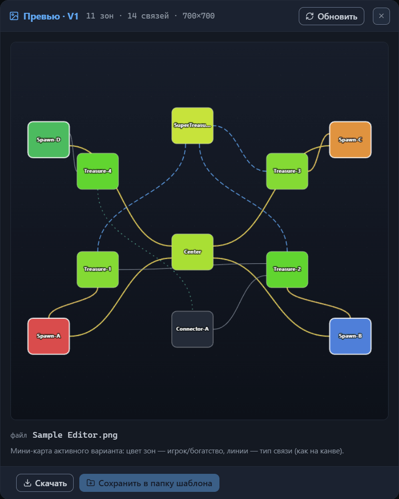
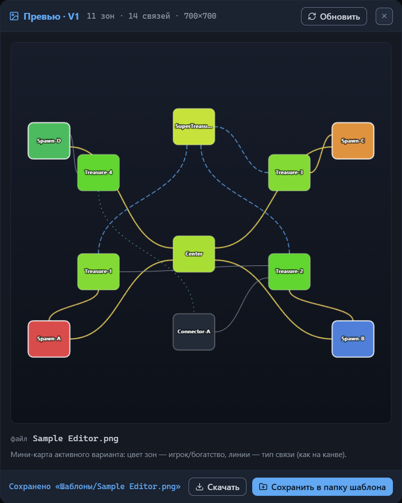

# Превью и PNG

Кнопка «Превью» на верхней панели открывает диалог с мини-картой активного варианта: компактной картинкой схемы, где цвет зон говорит об игроке или богатстве, а линии — о типе связи. Подсказка кнопки формулирует назначение так: «Мини-карта активного варианта → PNG-превью». Диалог решает две задачи сразу — посмотреть на шаблон одной картинкой и забрать её как PNG-файл размером 700×700 пикселей: скачать в папку загрузок браузера или записать рядом с шаблоном.

Глава [Интерфейс: окна и панели](interface.md#превью) перечисляет состав диалога коротко; здесь он разобран целиком: из чего складывается картинка, как она обновляется и куда попадают PNG-файлы.

## Диалог превью

Диалог открывается поверх окна редактора, и пока он открыт, остальной интерфейс недоступен. В шапке — заголовок «Превью · V1», счётчик «11 зон · 14 связей · 700×700», кнопка «Обновить» и ✕.

Метка V1 после слова «Превью» — номер активного варианта. При нескольких раскладках в шаблоне к номеру добавляется общее количество: «Превью · V2 / 5» читается как «второй вариант из пяти». Счётчик показывает число зон и связей активного варианта и размер картинки в пикселях — у демо-шаблона это 11 зон и 14 связей. Размер всегда один и тот же: 700×700.

В середине окна — сама картинка, под ней мета-блок: имя будущего PNG-файла («файл Sample Editor.png» у демо-шаблона) и подсказка чтения: «Мини-карта активного варианта: цвет зон — игрок/богатство, линии — тип связи (как на канве).» Имя файла собирается из поля «Название» по общему для всех файлов шаблона правилу — глава [Файлы: открытие и сохранение](files.md#сохранение).

В футере две кнопки — «Скачать» и «Сохранить в папку шаблона». Это два способа забрать PNG-файл; оба разобраны ниже. После записи в папку в футере появляется строка статуса.

Закрывается диалог тремя способами: Esc, ✕ или клик по затемнённому фону.

Рисуется всегда активный вариант — переключателя вариантов в диалоге нет. Чтобы получить картинку другой раскладки, закройте окно, сделайте нужным вариант (глава [Варианты: управление и выбор](variant-manage.md)) и откройте «Превью» снова.

## Чтение мини-карты

Обратите внимание: превью — схема из редактора, а не карта, которую соберёт игра. Генератор расставляет зоны по правилам лэйаута и наполняет их контентом сам, поэтому настоящая карта будет отличаться от картинки формой и деталями. Что мини-карта передаёт честно — структуру шаблона: какие зоны есть, как они соединены и где чей старт.

Картинка повторяет схему канвы: те же позиции узлов и тот же набор линий. Позиции берутся из sidecar-файла, а зоны без сохранённых позиций раскладываются по кругу. Схема вписывается в квадрат с небольшой кромкой по краям.

Цвет зон подчиняется правилам режима «Обзор» (глава [Канва: режимы отображения](canvas-modes.md#режим-обзор)): зона с точкой появления героя получает цвет своего игрока, связующая зона закрашена ровным тёмным цветом, остальные окрашены по богатству — по суммарному бюджету. Обводка зоны игрока ярче и толще, чтобы старты различались даже на небольшой картинке.

Имя зоны рисуется в центре узла; длинное имя обрезается многоточием. У мелких узлов имени нет — оно не помещается. Чисел и бейджей мини-карта не показывает: ни бюджетов, ни значений охраны, ни значков объектов — остаются только цвета, линии и имена.

Линии связей сохраняют цвет, толщину и штрих своего типа; если связь входит в группу синхронной стражи, линия получает цвет группы вместо цвета типа. Поверх связи, отмеченной как дорога, тянется тонкая белая пунктирная нить. Образцы цветов и линий показывает вкладка «Легенда» — её состав для «Обзора» разобран в главе [Канва: режимы отображения](canvas-modes.md#легенда-и-общие-принципы-чтения-схемы).

В варианте без зон рисовать нечего: на картинке остаётся только фон — тёмный градиент и точки сетки.

Подсказка диалога называет свою картинку мини-картой. У канвы есть собственная мини-карта в нижнем правом углу (глава [Интерфейс: окна и панели](interface.md#канва)) — средство навигации по схеме, которое перерисовывается вместе с активным режимом отображения. Не путайте две: угловая в файл не попадает, а мини-карта диалога строится по фиксированным правилам «Обзора», и именно она уходит в PNG.

## Обновление картинки

Картинка рисуется в момент открытия диалога и дальше успевает за изменениями сама: пока окно открыто, превью перерисовывается при любом изменении шаблона или позиций узлов. Способов менять что-то, не закрывая диалог, немного — окно редактора недоступно, — но отмена и повтор работают. Нажмите Ctrl+Z, и картинка тут же покажет схему до последнего изменения; Ctrl+Shift+Z или Ctrl+Y вернут его обратно. F1 по-прежнему открывает окно мануала (глава [Интерфейс: окна и панели](interface.md#окно-мануала)).

Кнопка «Обновить» в шапке перерисовывает картинку по текущему состоянию шаблона принудительно — её подсказка так и читается: «Перерисовать по текущему состоянию шаблона». Обычно она не нужна: превью и так следит за изменениями.

## Файл PNG

Диалог отдаёт готовый PNG-файл: картинку активного варианта размером 700×700 пикселей с именем из поля «Название». Запрещённые в именах файлов символы заменяются подчёркиванием — правило общее для всей тройки файлов шаблона (глава [Файлы: открытие и сохранение](files.md#сохранение)).

Кнопка «Сохранить» пишет превью автоматически: при каждом сохранении PNG-файл попадает в папку рядом с шаблоном и sidecar-файлом. В диалог за картинкой стоит заходить в двух случаях — забрать её, не сохраняя шаблон, или перезаписать только изображение, не трогая остальные файлы.

Игра не читает содержимое PNG-файла — у превью декоративная роль; обязательно ли присутствие файла для пользовательского шаблона, не выяснено. Редактор пишет его при каждом сохранении. Штатные шаблоны игры поставляются вместе с файлом превью — держите картинку рядом с шаблоном.

### Скачивание

«Скачать» работает в любом браузере и не требует выбранной папки:

1. Откройте диалог «Превью».
2. Нажмите «Скачать» — подсказка кнопки читается как «Скачать PNG в папку загрузок браузера».

Файл с именем «Название.png» попадает в папку загрузок браузера. Диалог остаётся открытым и никакого сообщения не показывает — результат виден только в загрузках.

Скачанная картинка никак не привязана к шаблону. Хотите держать превью рядом с файлами шаблона — перенесите его туда сами или воспользуйтесь записью из следующего раздела, иначе картинка потеряется среди других загрузок.

### Запись в папку шаблона

«Сохранить в папку шаблона» записывает PNG рядом с файлами шаблона. Работает кнопка, только если выбрана папка сохранения — через «Открыть папку» на верхней панели или во время сохранения (глава [Файлы: открытие и сохранение](files.md#открытие-папки)). Без папки кнопка неактивна, а её подсказка объясняет, чего не хватает: «Сначала выберите папку шаблона (кнопка „Открыть папку“ вверху)».

1. Откройте диалог «Превью».
2. Нажмите «Сохранить в папку шаблона» — подсказка обещает «Записать Sample Editor.png в „Шаблоны“ рядом с шаблоном»; имя файла и имя папки подставляются свои.

Результат появляется строкой статуса в футере: при успехе «Сохранено „Шаблоны/Sample Editor.png“», при неудаче «Не удалось записать „Sample Editor.png“». Пишется только один PNG-файл — шаблон и sidecar-файл кнопка не трогает.

В браузерах без полной поддержки работы с файлами папку выбрать нельзя в принципе — там кнопка меняет подпись на «Скачать PNG» и остаётся неактивной. Картинку забирайте кнопкой «Скачать», а затем переносите её в папку шаблона вручную.

## Куда дальше

- [Файлы: открытие и сохранение](files.md) — что пишет «Сохранить» и как запоминается папка сохранения.
- [Канва: режимы отображения](canvas-modes.md) — цвета и линии, из которых строится мини-карта, подробно.
- [Варианты: управление и выбор](variant-manage.md) — как переключить активный вариант, по которому строится превью.
- [Установка шаблона в игру](install.md) — куда положить файлы шаблона вместе с превью.
