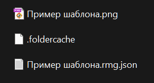
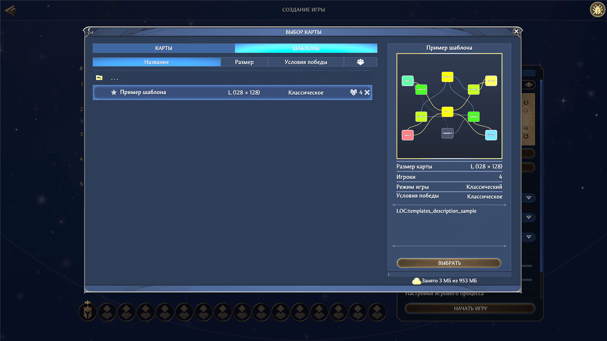

# Установка шаблона в игру

Редактор создаёт файлы шаблона, но не устанавливает их в игру: «Сохранить» пишет файлы в выбранную вами папку, а игра читает пользовательские шаблоны из собственной папки профиля. Установка сводится к копированию одного файла. Эта глава разбирает всю процедуру: какие файлы копировать и какие игре не нужны, что делает кэш папки, зачем класть рядом превью и как убедиться, что игра увидела шаблон.

Короткий путь без объяснений собран в главе [Быстрый старт](quick-start.md#установка-шаблона-в-игру).

## Папка для шаблонов

Игра берёт пользовательские шаблоны из одной папки — папки профиля `my_map_templates`. Обычно она уже существует: игра создаёт её при первом запуске. Папки нет — запустите игру один раз, и папка профиля появится сама.

Чтобы установить шаблон:

1. Сохраните шаблон в редакторе — кнопкой «Сохранить» на верхней панели (глава [Файлы: открытие и сохранение](files.md#сохранение)).
2. Откройте в проводнике папку профиля игры:

   `C:\Users\<имя пользователя>\AppData\LocalLow\Unfrozen\HeroesOldenEra\users\Steam_<id>\my_map_templates\`

   В пути `<имя пользователя>` — пользователь Windows, а `<id>` — номер аккаунта Steam. Папок `Steam_…` несколько — ищите свою по содержимому. Вместо того чтобы прощёлкивать дерево папок, скопируйте путь в адресную строку проводника и подставьте свои значения.
3. Скопируйте в неё файл шаблона «Название.rmg.json» — единственный файл, который читает игра. Рядом положите превью «Название.png» — зачем, рассказано в разделе [«Превью рядом с шаблоном»](#превью-рядом-с-шаблоном).
4. Sidecar-файл `.editor.json` — служебные данные редактора — оставьте в папке, куда редактор сохранил шаблон. Игре он не нужен.

Файлы копируйте, а не переносите: редактор ищет sidecar-файл рядом с шаблоном и по нему возвращает позиции узлов схемы и заметки зон. Перенесли шаблон без пары — при следующем открытии потеряете обстановку: узлы встанут на кольцо вокруг центра схемы (глава [Файлы: открытие и сохранение](files.md#пара-файлов-шаблон-и-sidecar-файл)).

Обновляли шаблон после установки — скопируйте файл заново, и игра подхватит обновление при следующем запуске.

Обратите внимание: в профиле есть ещё папка `downloads\map_templates` — туда попадают загрузки из Steam Workshop. Свой шаблон класть туда не нужно: `my_map_templates` — официальное место для собственных файлов.

Записывать файлы в установочную папку игры, где лежат штатные шаблоны, не рекомендуется: папка принадлежит игре, её содержимое меняется с обновлениями, и ваши дополнения могут не сохраниться. Официальный путь для пользовательских шаблонов — папка профиля.

## Кэш папки

Рядом с шаблонами в папке лежит файл `.foldercache` — кэш содержимого папки. Вместо разбора каждого шаблона при запуске игра читает единый файл-список — так перечень шаблонов загружается быстрее.

С кэшем не нужно ничего делать. Положили файл шаблона в папку — при запуске игра сама сверит кэш с содержимым папки и перестроит его при расхождении. Расхождение — штатная ситуация: игра спокойно переживает его даже после собственных обновлений.

Не создавайте, не правьте и не удаляйте `.foldercache` вручную: записи в нём защищены внутренними контрольными суммами игры, поэтому самодельное обновление всё равно не сработает. Битый или устаревший файл — не проблема: игра перестроит его при следующем запуске.

## Превью рядом с шаблоном

Штатные шаблоны игры поставляются вместе с превью — PNG-изображением мини-карты. Редактор делает такую же картинку: пишет PNG при каждом сохранении и умеет отдать изображение отдельно от сохранения (глава [Превью и PNG](preview.md#файл-png)).

Игра не читает содержимое PNG-файла — у превью декоративная роль; обязательно ли присутствие файла для пользовательского шаблона, не выяснено. Копируйте картинку вместе с шаблоном: вреда она не принесёт, а шаблон будет выглядеть как штатный.

## Проверка шаблона в игре

Окна игры этот мануал не разбирает — он про редактор, поэтому игровые шаги даны общим направлением: точные названия пунктов сверяйте по экранам игры.

Начните с редактора: перед установкой устраните ошибки на вкладке «Проблемы» (глава [Проверка шаблона (валидатор)](validator.md)). Ошибки помечают то, что почти наверняка сломает игру или генерацию карты. Предупреждения и справки установке не мешают, но прочитать их стоит.

Чтобы проверить установку:

1. Запустите игру и откройте создание случайной карты.
2. Найдите свой шаблон в списке шаблонов: игра показывает его под именем из поля «Название».
3. Сверьте имя и описание с ожиданиями — оба берутся из настроек шаблона (глава [Настройки шаблона (корень)](root.md#основное)).
4. Проверьте число игроков — его задают точки появления героя: главные объекты типа Spawn с привязкой к игрокам Player1–Player8 (глава [Главные объекты зоны](main-objects.md#игрок-spawn)).

Всё совпало — сгенерируйте пробную карту: начните игру на случайной карте со своим шаблоном. Генератор соберёт карту по вашим зонам, связям и бюджетам. Готовая карта — главный критерий: на ней видно то, чего редактор не показывает, например как выглядят «дыры» в энкаунтерах (глава [Зона: все свойства](zone.md#энкаунтеры-дыры)).

### Причины отсутствия шаблона

Проверьте по порядку:

- Файл попал в другую папку. Игра читает шаблоны только из собственных папок: `.rmg.json`, оставленный в рабочей папке редактора или на рабочем столе, она не увидит. Откройте папку профиля ещё раз и убедитесь, что файл на месте.
- Игра была запущена, пока вы копировали файл. Папка шаблонов обрабатывается при запуске — перезапустите игру.
- Файл не читается. Как именно игра реагирует на файл с ошибками, не выяснено, поэтому первым делом проверьте файл в редакторе: откройте его через «Открыть файл» — нечитаемый файл редактор отклоняет уведомлением — и посмотрите на вкладку «Проблемы».

## Куда дальше

- [Файлы: открытие и сохранение](files.md) — как работает «Сохранить» и какие файлы пишет редактор.
- [Превью и PNG](preview.md) — как получить картинку превью.
- [Проверка шаблона (валидатор)](validator.md) — замечания и что с ними делать.
- [Настройки шаблона (корень)](root.md) — название, описание и режим игры: то, что игра берёт из корневых настроек.
