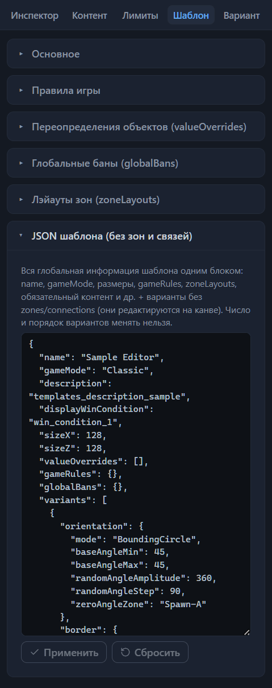
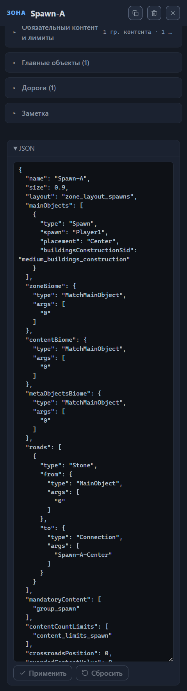

# Справочник формата .rmg.json

Один шаблон — это один текстовый файл с расширением `.rmg.json`: объект в формате JSON, ключи которого описывают устройство карты — зоны, связи между ними, бюджеты, пулы, правила игры. Эта глава — карта файла: из каких секций он состоит, где живёт каждая настройка, как секции ссылаются друг на друга, что редактор записывает сам и какие отклонения от обычной формы файла игра принимает. Она помогает читать готовые файлы и понимать пути в замечаниях валидатора: замечания называют поля ровно теми ключами, которые собраны здесь (глава [Проверка шаблона (валидатор)](validator.md#строка-замечания)).

Формат декларативный: готовой карты в файле нет. Шаблон задаёт правила — какие на карте зоны, как они связаны, сколько контента в каждую положить, — а генератор игры при каждой генерации сам раскладывает зоны, проводит дороги и заполняет их в пределах бюджетов. Пулы объектов, списки, энкаунтеры и значения объектов живут в базе игры: шаблон лишь ссылается на них по имени — `sid`, — а не несёт их в себе. Устройство пулов и списков описывает глава [Каталог пулов контента](pools.md#устройство-пула); энкаунтеры генератор подбирает самостоятельно, шаблон на них не ссылается.

Верхний уровень файла образуют корневые ключи — глобальные настройки, общие для всех вариантов раскладки, — и список `variants[]`, где каждый элемент — самостоятельный макет карты со своими зонами и связями. Разделы ниже разбирают секции сверху вниз; каждый раздел называет главу, в которой поля этой секции описаны подробно — с именами в интерфейсе, подсказками и примерами.

## Файл и запись

Игра загружает шаблоны из папки `my_map_templates` в каталоге своих данных; рядом с шаблоном лежит превью — PNG-изображение с тем же именем (глава [Установка шаблона в игру](install.md#папка-для-шаблонов)). Редактор при сохранении пишет сразу три файла: сам шаблон, sidecar-файл с данными редактора и превью (глава [Файлы: открытие и сохранение](files.md#сохранение)).

Чтобы редактор принял файл за шаблон, нужны два условия:

1. Текст разбирается как JSON-объект — иначе вы увидите уведомление «Файл — не JSON-объект».
2. В объекте есть ключ `name` со строковым значением и ключ `variants` со списком — иначе редактор отклонит файл с уведомлением «Файл не похож на .rmg.json: нет name / variants[]».

Всё остальное редактор переносит терпимо. Незнакомые ключи, попавшие в файл при правке мимо редактора, не теряются: они видны в JSON-секции корня и возвращаются в сохранённый файл как есть (глава [Настройки шаблона (корень)](root.md#json-секция-корня)).

Сохранённый файл записывается с отступом-табуляцией, без BOM; порядок ключей в нём следует порядку полей файла на момент открытия. Штатные шаблоны набраны в том же стиле, поэтому файл после редактора удобно сравнивать с исходным текстом. JSON-секция корня показывает те же данные с отступом в два пробела: оформление отличается, содержимое — нет.

## Корень файла

Корневые ключи — глобальные настройки шаблона: они действуют сразу для всех вариантов раскладки. Редактор собирает их в секции правой панели — вкладки «Шаблон», «Контент» и «Лимиты» — и в JSON-секцию корня; все поля описаны главой [Настройки шаблона (корень)](root.md). Разделы ниже идут по ключам файла.

### name

Имя шаблона — строка и один из двух ключей, без которых редактор не откроет файл. Игра показывает его в лобби; в штатных шаблонах оно совпадает с именем файла, а редактор берёт его базовым именем сохранённой тройки файлов. Поле «Название» — глава [Настройки шаблона (корень)](root.md#название).

### gameMode

Режим игры — ключ `Classic` («Классический») либо `SingleHero` («Один герой»); третьего значения формат не знает. Среди штатных шаблонов Classic встречается в 37 файлах, SingleHero — в 23. Поле «Режим игры» — глава [Настройки шаблона (корень)](root.md#режим-игры).

### description

Описание шаблона. Штатные шаблоны пишут здесь sid строки локализации вида `templates_description_*` — идентификатор, по которому игра берёт готовый текст из своей базы; редактор принимает и произвольный текст. Поле «Описание» — глава [Настройки шаблона (корень)](root.md#описание).

### displayWinCondition

Отображаемое условие победы — sid одного из шести официальных условий, `win_condition_1`…`win_condition_6`: анонс, который игра показывает игрокам. Механику он сам по себе не включает: настоящие правила собирают включатели блока `winConditions` внутри `gameRules`. Поле «Условие победы» — глава [Настройки шаблона (корень)](root.md#условие-победы).

### sizeX и sizeZ

Размеры карты в клетках — два числа от 80 до 240, кратные 16; в штатных шаблонах карта всегда квадратная, `sizeX` равен `sizeZ`. Поля «Размер карты X» и «Размер карты Z» — глава [Настройки шаблона (корень)](root.md#размеры-карты).

### valueOverrides

Переопределения объектов — список записей вида `{sid, variant, guardValue}`: для указанного объекта базы игры шаблон переопределяет силу стража на всей карте. `variant` уточняет вариант объекта, значение −1 означает «любой вариант». Переопределения есть в 31 файле из 60, от 1 до 8 записей в каждом. Секция «Переопределения объектов» — глава [Настройки шаблона (корень)](root.md#переопределения-объектов).

### gameRules

Правила игры — объект с ключами общих правил матча. Шесть записей валидатор считает обязательными: три числа героев (`heroCountMin`, `heroCountMax`, `heroCountIncrement`), два переключателя — запрет найма героев (`heroHireBan`) и мастер-включатель энкаунтеров-«дыр» (`encounterHoles`) — и вложенный объект `winConditions{}`, механика условий победы. Все шесть есть во всех 60 штатных шаблонах; если чего-то не хватает, валидатор выдаёт предупреждение, а не ошибку: поведение игры при отсутствии записей не проверено. Остальные ключи необязательны: множители опыта от фракционных законов и от астрологии (`factionLawsExpModifier`, `astrologyExpModifier`), турнирные правила (`tournamentRules`) и список стартовых бонусов (`bonuses[]`). Секции «Правила игры», «Условия победы» и «Стартовые бонусы» — глава [Настройки шаблона (корень)](root.md#правила-игры).

### globalBans

Глобальные баны — объект с четырьмя списками sid: `magics` (заклинания), `items` (артефакты), `skills` (навыки), `heroes` (герои). Перечисленные объекты исключаются из игры на всей карте. Баны есть в 23 штатных файлах из 60. Секция «Глобальные баны» — глава [Настройки шаблона (корень)](root.md#глобальные-баны).

### zoneLayouts

Лэйауты зон — список именованных лэйаутов: плотность препятствий (`obstaclesFill`) и препятствия в «пустотах» (`obstaclesFillVoid`), озёра (`lakesFill`, `minLakeArea`), высоты (`elevationClusterScale`, `elevationModes[]`), площадь дорожного кластера (`roadClusterArea`), доля ресурсных энкаунтеров (`guardedEncounterResourceFractions`) и фоновый подбор объектов (`ambientPickupDistribution`). Зоны ссылаются на лэйаут по `name`. Штатные шаблоны несут от 2 до 5 лэйаутов. Секция «Лэйауты зон» — глава [Настройки шаблона (корень)](root.md#лэйауты-зон).

### mandatoryContent

Обязательный контент — список групп вида `{name, content[]}`: объекты, которые генератор гарантированно размещает в зонах, ссылающихся на группу. Элементы группы несут sid объекта, вариант, флаги — например `isMine` (шахта) и `isGuarded` (охраняется), — и правила размещения (`rules[]`). Вместо одного объекта элемент может быть группой-выбором: генератор выберет один из вложенных вариантов `content[]` по весам, а круг кандидатов задают ссылки на списки базы `includeLists`. Штатные шаблоны несут от 2 до 13 групп. Секция «Обязательный контент» — глава [Настройки шаблона (корень)](root.md#обязательный-контент).

### contentCountLimits

Лимиты количества — список групп вида `{name, limits[]}`: сколько объектов данного рода попадёт в зоны, ссылающиеся на группу. Лимит считает либо один объект (`sid`, `variant`, `maxCount`), либо целый класс — группу-тип (вложенный `content[]` или `includeLists` и общий `maxCount`); ноль в `maxCount` означает запрет в зонах группы. Штатные шаблоны несут от 2 до 25 групп. Секция «Лимиты количества» — глава [Настройки шаблона (корень)](root.md#лимиты-количества).

### contentPools и contentLists

Зарезервированные секции встроенных пулов и списков. Формат разрешает шаблону нести собственные пулы прямо в файле, однако все 60 штатных шаблонов оставляют оба списка пустыми: действующие ссылки ведут на пулы и списки базы игры, а энкаунтеры генератор подбирает самостоятельно. Шаблон, созданный кнопкой «Новый», тоже получает пустые `contentPools: []` и `contentLists: []`. С какими пулами и списками файл работает на самом деле — глава [Каталог пулов контента](pools.md#пулы-в-файле-шаблона).

### orientation вне вариантов

В одном файле из 60 штатных ключ `orientation` встречается в корне — вне списка `variants[]`. Поля в редакторе у него нет: ключ виден только в JSON-секции корня, при открытии и сохранении переносится без изменений. *Назначение уточняется.*

### variants

Варианты раскладки — самая крупная секция файла. Каждый элемент списка — самостоятельный макет карты со своими зонами, связями, ориентацией и границей. 55 штатных шаблонов обходятся одним вариантом, четыре несут три, один — пять. Число и порядок вариантов постоянны: JSON-секция корня менять их не даёт, кнопки-копия и корзина живут на верхней панели (глава [Варианты: управление и выбор](variant-manage.md#число-вариантов-и-json-секция-корня)).

## Вариант раскладки

Элемент списка `variants[]` образуют четыре секции: `zones` — список зон, `connections` — список связей, `orientation` — ориентация макета, `border` — граница карты. Зоны и связи принадлежат варианту: связь соединяет только зоны своего варианта, и имена зон обязаны быть уникальными лишь в его пределах. Канва редактора показывает один вариант за раз — активный; переключение, дублирование и удаление описаны главой [Варианты: управление и выбор](variant-manage.md#активный-вариант).

### zones

Зоны варианта: от 4 до 48 в штатных шаблонах, в среднем около 14 на вариант. Зона — объект с собственными секциями; их карта — в разделе [«Зона»](#зона), поля — в главе [Зона: все свойства](zone.md).

### connections

Связи между зонами варианта: от 5 до 52 в штатных шаблонах. Связь — пара зон с типом, стражей и флагом дороги; её карта — в разделе [«Связь»](#связь), поля — в главе [Связи между зонами](connections.md).

### orientation

Ориентация макета: как генератор вписывает схему зон в квадрат игровой карты. Ключи: `mode` (режим укладки), `baseAngleMin` и `baseAngleMax` (границы угла поворота), `randomAngleAmplitude` и `randomAngleStep` (амплитуда и шаг доворота), `zeroAngleZone` (зона отсчёта угла). Ориентация есть в 51 штатном файле из 60. Поля — глава [Вариант: ориентация и граница](variant-layout.md#ориентация-макета).

### border

Граница карты: скругление углов (`cornerRadius`), кольцо препятствий (`obstaclesWidth`, `obstaclesNoise[]`), вода по краю (`waterWidth`, `waterNoise[]`, `waterType`). Граница есть в 35 штатных шаблонах из 60; отсутствие границы — легитимное состояние. Поля — глава [Вариант: ориентация и граница](variant-layout.md#граница-карты).

## Зона

Элемент списка `zones[]`. Обязательных ключей у зоны редактор считает семь: `name`, `size`, `layout`, `mainObjects` и три биома — `zoneBiome`, `contentBiome`, `metaObjectsBiome`. Остальные ключи необязательны.

### Имя, размер и лэйаут

`name` — имя зоны, уникальное в пределах варианта; штатные имена строятся с префиксом по роли зоны: Spawn-, Center-, Treasure-, Side-, Connector-, SuperTreasure-. `size` — вес зоны при раскладке, в штатных шаблонах от 0.15 до 2: чем больше вес, тем просторнее зону сделает генератор. `layout` — имя лэйаута из корневого списка `zoneLayouts[]`. `crossroadsPosition` — позиция перекрёстка, точки, где сходятся дороги зоны: число от 0 до 1. *Назначение уточняется.* Поля — глава [Зона: все свойства](zone.md#размер-и-раскладка).

### Главные объекты

`mainObjects[]` — от 1 до 9 записей на зону: города, точки появления героев, заброшенные аванпосты, арена. Ключи записи: `type` (тип объекта), `spawn` и `owner` (игроки), `placement` и `placementArgs` (размещение), `faction` (способ выбора фракции), `buildingsConstructionSid` (пресет застройки) и `buildingsBanSid` (список запрещённых зданий), стража объекта (`guardChance`, `guardValue`, `guardRandomization`, `guardWeeklyIncrement`, `removeGuardIfHasOwner`) и особые ключи (`isKeyObject`, `holdCityWinCon`, `initialUnitIncrement`, `enableWeeklyUnitIncrement`). Поля — глава [Главные объекты зоны](main-objects.md).

### Биомы

`zoneBiome`, `contentBiome`, `metaObjectsBiome` — три селектора биома зоны. Каждый — объект вида `{type, args}`, где `type` принимает один из трёх ключей: `MatchMainObject`, `FromList`, `MatchZone`, — а `args` хранит аргументы выбора. Поля — глава [Зона: все свойства](zone.md#биомы).

### Бюджеты и пулы

Бюджеты наполнения — шесть ключей, парами на три вида контента: `guardedContentValue` и `guardedContentValuePerArea` (охраняемый контент), `unguardedContentValue` и `unguardedContentValuePerArea` (свободный контент), `resourcesValue` и `resourcesValuePerArea` (ресурсы). Число задаёт ценность контента, который генератор разместит в зоне, — абсолютную либо в расчёте на единицу площади. Пулы — три списка имён из базы игры: `guardedContentPool[]` (1–7 имён), `unguardedContentPool[]` (1–7 имён), `resourcesContentPool[]` (в штатных зонах ровно одно). Секции «Бюджеты» и «Пулы контента» — глава [Зона: все свойства](zone.md#бюджеты); каталог пулов — глава [Каталог пулов контента](pools.md).

### Стражи

Параметры стражи всей зоны: `guardCutoffValue` (порог силы стражей), `guardMultiplier` (множитель силы стражей), `guardRandomization` (разброс силы стражей), `guardWeeklyIncrement` (еженедельный прирост стражей), `guardReactionDistribution` (реакция стражей — шесть весов), `diplomacyModifier` (модификатор дипломатии). Множитель, разброс и прирост описаны главой [Зона: все свойства](zone.md#стражи); про порог, реакцию стражей и модификатор дипломатии она приводит гипотезы редактора. *Назначение уточняется.*

### Дороги

`roads[]` — участки дорог внутри зоны: от 1 до 18 на штатную зону. Ключи участка: `type` — покрытие, `Stone` либо `Dirt` (около десятой части штатных участков записаны без ключа), — а также `from` и `to` — концы участка. Конец — объект вида `{type, args}` одного из четырёх видов: `MainObject` (главный объект зоны по его порядковому номеру), `Connection` (связь по имени), `Crossroads` (перекрёсток, без аргументов), `MandatoryContent` (элемент обязательного контента по имени). Секция «Дороги» — глава [Зона: все свойства](zone.md#дороги).

### Обязательный контент и лимиты

`mandatoryContent[]` — ссылки по имени на группы из корневого списка того же имени: в штатных зонах ровно одна ссылка. `contentCountLimits[]` — ссылки на группы лимитов количества, от 1 до 15. Оба ключа указывают на секции корня, а не несут данные внутри зоны. Секция «Обязательный контент и лимиты» — глава [Зона: все свойства](zone.md#обязательный-контент-и-лимиты).

### Внешний найм и «дыры»

`randomHireInitialUnitIncrement` — массив из семи чисел и `randomHireEnableWeeklyUnitIncrement` — массив из семи переключателей: настройки зданий внешнего найма `random_hire_1`…`random_hire_7`, по записи на ярус. `encounterHolesSettings` — объект с двумя долями, `affectedEncounters` и `twoHoleEncounters`: зональная настройка энкаунтеров-«дыр»; мастер-включатель «дыр» живёт в корневом `gameRules`. Секции «Внешний найм» и «Энкаунтеры-«дыры»» — глава [Зона: все свойства](zone.md#внешний-найм).

## Связь

Элемент списка `connections[]`. Обязательных ключей три: `from`, `to`, `connectionType`; остальные необязательны.

### Имя и концы

`name` — имя связи: редактор даёт новым связям автоматическое имя из имён соединённых зон. В 59 файлах из 60 у связей есть имена, обычно собранные по тому же принципу. `from` и `to` — имена зон того же варианта, которые связь соединяет. Секция «Связь» — глава [Связи между зонами](connections.md#связь).

### Тип и дистанция

`connectionType` — ключ типа связи: `Direct` (прямой коридор), `Default` (форму генератор выбирает сам), `Portal` (пара врат), `Proximity` (зоны оказываются рядом, коридор не генерируется), `GladiatorArena`. `length` — целевое расстояние между зонами для связи типа `Proximity`; редактор показывает поле только у связей этого типа. Поля — секции «Связь» и «Дорога и симуляция» главы [Связи между зонами](connections.md#связь).

### Стража

`guardValue` — значение охраны связи в единицах ценности; `guardWeeklyIncrement` — еженедельный прирост стражей; `guardRandomization` — разброс силы стражей; `guardZone` — имя зоны, в которой встанет страж связи; `guardMatchGroup` — имя группы синхронной стражи: связи одной группы получают одинаковую армию. `guardEscape`. *Назначение уточняется.* Остальные поля — секция «Стража» главы [Связи между зонами](connections.md#стража).

### Дорога и симуляция

`road` — флаг дороги по связи: прокладывать ли вдоль неё дорогу. `simTurnSquad`. *Назначение уточняется.* Секция «Дорога и симуляция» — глава [Связи между зонами](connections.md#дорога-и-симуляция).

### Врата

`gatePlacement` и `gatePlacementArgs` — размещение врат портала: ключ `Center` либо `NearZone` с аргументом — именем зоны. `portalPlacementRulesFrom` и `portalPlacementRulesTo` — списки правил побега врат; правило устроено так же, как правило размещения обязательного контента. Секции «Врата портала» и «Побег врат (portalPlacementRules)» — глава [Связи между зонами](connections.md#врата-портала).

## Словарь полей

Каждое поле редактора записывает значение в ключ файла `.rmg.json`, и каждый ключ виден в поле панели или в JSON-блоке. Таблицы этого раздела — сводный словарь: название поля в интерфейсе и имя ключа в файле. Словарь работает в обе стороны: по полю формы найти ключ и по ключу понять, о каком поле говорит валидатор, — замечания называют путь в файле ровно этими ключами (глава [Проверка шаблона (валидатор)](validator.md#строка-замечания)).

Таблицы сгруппированы по секциям панелей и следуют порядку секций. В колонке «Ключ в файле» ключ записан относительно объекта секции: объект-контейнер назван в строке над таблицей, квадратные скобки `[]` обозначают элемент списка. Поля, чьё действие не установлено, в словарь тоже входят; в главе по ссылке они помечены *Назначение уточняется.* Ключи, у которых поля в интерфейсе нет, правят в JSON-блоках (глава [Прямая правка JSON](json-editor.md)).

### Ключи корня

Корневые ключи собраны в секциях вкладок «Шаблон», «Контент» и «Лимиты»; поля корня описаны главой [Настройки шаблона (корень)](root.md).

#### Основное

Ключи лежат прямо в корне файла; секция «Основное» — глава [Настройки шаблона (корень)](root.md#основное).

| Поле в интерфейсе | Ключ в файле |
| --- | --- |
| «Название» | `name` |
| «Режим игры» | `gameMode` |
| «Описание» | `description` |
| «Условие победы» | `displayWinCondition` |
| «Размер карты X» | `sizeX` |
| «Размер карты Z» | `sizeZ` |

#### Правила игры

Ключи внутри объекта `gameRules`; секция «Правила игры» вкладки «Шаблон» — глава [Настройки шаблона (корень)](root.md#правила-игры).

| Поле в интерфейсе | Ключ в файле |
| --- | --- |
| «Начальное количество героев» | `heroCountMin` |
| «Максимальное количество героев» | `heroCountMax` |
| «Прирост лимита героев» | `heroCountIncrement` |
| «Запрет найма героев» | `heroHireBan` |
| ««Дыры» в энкаунтерах» | `encounterHoles` |
| «Турнирные правила» | `tournamentRules` |
| «Множитель опыта от фракционных законов» | `factionLawsExpModifier` |
| «Множитель опыта от астрологии» | `astrologyExpModifier` |

#### Стартовые бонусы

Ключи внутри элемента `gameRules.bonuses[]`; секция «Стартовые бонусы» вкладки «Шаблон» — глава [Настройки шаблона (корень)](root.md#стартовые-бонусы).

| Поле в интерфейсе | Ключ в файле |
| --- | --- |
| «Бонус (sid)» | `sid` |
| «Сторона-получатель» | `receiverSide` |
| «Фильтр получателей» | `receiverFilter` |
| «Параметры бонуса» | `parameters[]` |

Поля параметров конкретного вида бонуса — «Заклинание», «Артефакт», «Ресурс», «Количество», «Вид параметра», «Значение», «Изменение стоимости», «Множитель» — тоже записываются в список `parameters[]`.

#### Условия победы

Ключи внутри объекта `gameRules.winConditions`; секция «Условия победы» вкладки «Шаблон» — глава [Настройки шаблона (корень)](root.md#условия-победы).

| Поле в интерфейсе | Ключ в файле |
| --- | --- |
| «Классическое» | `classic` |
| «Дезертирство» | `desertion` |
| «День дезертирства» | `desertionDay` |
| «Порог отставания» | `desertionValue` |
| «Подсветка героя» | `heroLighting` |
| «День начала подсветки» | `heroLightingDay` |
| «Потеря стартового города» | `lostStartCity` |
| «День поражения» | `lostStartCityDay` |
| «Потеря стартового героя» | `lostStartHero` |
| «Удержание города» | `cityHold` |
| «Дней удержания для победы» | `cityHoldDays` |
| «Удержание города (альт.)» | `holdCityWinCon` |
| «Арена адского пламени» | `gladiatorArena` |
| «Регистрация: старт «работы»» | `gladiatorArenaRegistrationStartWork` |
| «Регистрация: старт боя» | `gladiatorArenaRegistrationStartFight` |
| «Задержка старта арены» | `gladiatorArenaDaysDelayStart` |
| «Период боёв (дней)» | `gladiatorArenaCountDay` |
| «Турнир» | `tournament` |
| «Нужно очков для победы» | `tournamentPointsToWin` |
| «Сохранять армию между турами» | `tournamentSaveArmy` |
| «Дни туров» | `tournamentDays` |
| «Дни анонсов туров» | `tournamentAnnounceDays` |
| «Правило выбора чемпиона» | `championSelectRule` |

#### Переопределения объектов

Ключи внутри элемента `valueOverrides[]`; секция «Переопределения объектов» вкладки «Шаблон» — глава [Настройки шаблона (корень)](root.md#переопределения-объектов).

| Поле в интерфейсе | Ключ в файле |
| --- | --- |
| «Объект (sid)» | `sid` |
| «Вариант объекта» | `variant` |
| «Сила стража» | `guardValue` |

#### Глобальные баны

Ключи внутри объекта `globalBans`; секция «Глобальные баны» вкладки «Шаблон» — глава [Настройки шаблона (корень)](root.md#глобальные-баны).

| Поле в интерфейсе | Ключ в файле |
| --- | --- |
| «Заклинания (magics)» | `magics` |
| «Артефакты (items)» | `items` |
| «Навыки (skills)» | `skills` |
| «Герои (heroes)» | `heroes` |

#### Лэйауты зон

Ключи внутри элемента `zoneLayouts[]`; секция «Лэйауты зон» вкладки «Шаблон» — глава [Настройки шаблона (корень)](root.md#лэйауты-зон).

| Поле в интерфейсе | Ключ в файле |
| --- | --- |
| «Имя лэйаута» | `name` |
| «Плотность препятствий» | `obstaclesFill` |
| «Препятствия в «пустотах»» | `obstaclesFillVoid` |
| «Плотность озёр» | `lakesFill` |
| «Мин. площадь озера» | `minLakeArea` |
| «Масштаб кластеров высот» | `elevationClusterScale` |
| «Площадь дорожного кластера» | `roadClusterArea` |
| «Режимы высот (elevationModes)» | `elevationModes[]` |
| «Вес режима» | `elevationModes[].weight` |
| «Мин. доля возвышенностей» | `elevationModes[].minElevatedFraction` |
| «Макс. доля возвышенностей» | `elevationModes[].maxElevatedFraction` |
| «Доля ресурсных энкаунтеров» | `guardedEncounterResourceFractions.fractions` |
| «Границы количества (countBounds)» | `guardedEncounterResourceFractions.countBounds` |
| «Фоновые подборы (ambientPickupDistribution)» | `ambientPickupDistribution` |
| «Отталкивание подборов» | `ambientPickupDistribution.repulsion` |
| «Случайный шум» | `ambientPickupDistribution.noise` |
| «Притяжение к дорогам» | `ambientPickupDistribution.roadAttraction` |
| «Притяжение к препятствиям» | `ambientPickupDistribution.obstacleAttraction` |
| «Веса размеров групп» | `ambientPickupDistribution.groupSizeWeights` |

#### Обязательный контент

Ключи группы — внутри элемента `mandatoryContent[]`, ключи элемента — внутри его `content[]`; вкладка «Контент» — глава [Настройки шаблона (корень)](root.md#обязательный-контент).

| Поле в интерфейсе | Ключ в файле |
| --- | --- |
| «Имя группы» | `name` |
| «Объект (sid)» | `content[].sid` |
| «Имя» | `content[].name` |
| «Вариант» | `content[].variant` |
| «Ресурсный генератор» | `content[].isMine` |
| «Охраняется» | `content[].isGuarded` |
| «Без дороги» | `content[].road` |
| «Клетка соло» | `content[].soloEncounter` |
| «Фикс. точка» | `content[].designatedEncounter` |
| «Владелец» | `content[].owner` |
| «Сила стража» | `content[].guardValue` |
| «Списки из базы» | `content[].includeLists` |
| «Варианты выбора (sid + variant + weight)» | `content[].content[]` |
| «Правила размещения (Road/MainObject/Crossroads/Sid/Connection)» | `content[].rules[]` |

Внутри «Вариантов выбора» — такие же «Объект (sid)» `sid` и «Вариант» `variant`, а также «Вес» `weight`.

#### Правила размещения

Карточку правила делят две секции: `content[].rules[]` обязательного контента и `portalPlacementRulesFrom[]` / `portalPlacementRulesTo[]` побега врат портала. Ключи — внутри элемента правила; описание — главы [Настройки шаблона (корень)](root.md#правила-размещения) и [Связи между зонами](connections.md#побег-врат-portalplacementrules).

| Поле в интерфейсе | Ключ в файле |
| --- | --- |
| «Тип правила» | `type` |
| «Аргументы» | `args` |
| «Мин. цель» | `targetMin` |
| «Макс. цель» | `targetMax` |
| «Вес» | `weight` |
| «Цель (точечная)» | `target` |

#### Лимиты количества

Ключи группы — внутри элемента `contentCountLimits[]`, ключи лимита — внутри его `limits[]`; вкладка «Лимиты» — глава [Настройки шаблона (корень)](root.md#лимиты-количества).

| Поле в интерфейсе | Ключ в файле |
| --- | --- |
| «Имя группы» | `name` |
| «Объект (sid)» | `limits[].sid` |
| «Вариант» | `limits[].variant` |
| «Макс. количество» | `limits[].maxCount` |
| «Списки из базы» | `limits[].includeLists` |
| «Варианты выбора (sid + variant + weight)» | `limits[].content[]` |

Внутри «Вариантов выбора» — «Объект (sid)» `sid` и «Вариант» `variant`; поле «Вес» у лимитов не показывают.

#### Ключи без полей интерфейса

У этих корневых ключей полей нет: они видны в JSON-секции корня и переносятся в сохранённый файл как есть.

- `contentPools[]` и `contentLists[]` — зарезервированные секции, пустые и в штатных шаблонах, и в новом шаблоне (см. раздел [«contentPools и contentLists»](#contentpools-и-contentlists)).
- `orientation` в корне файла, вне `variants[]`, — один файл из 60 штатных (см. раздел [«orientation вне вариантов»](#orientation-вне-вариантов)). *Назначение уточняется.*
- `globalBans` внутри `gameRules` — продублированная копия корневой секции банов; встречается в одном штатном файле.

JSON-секция корня — глава [Настройки шаблона (корень)](root.md#json-секция-корня).

### Ключи варианта

Поля варианта живут на вкладке «Вариант»; ключи записаны относительно объекта варианта — элемента `variants[]`. Словари ключей `zones[]` и `connections[]` — в разделах [«Ключи зоны»](#ключи-зоны), [«Ключи главных объектов»](#ключи-главных-объектов) и [«Ключи связи»](#ключи-связи).

#### Ориентация макета

Ключи внутри объекта `orientation`; секция «Ориентация макета» — глава [Вариант: ориентация и граница](variant-layout.md#ориентация-макета).

| Поле в интерфейсе | Ключ в файле |
| --- | --- |
| «Режим укладки» | `mode` |
| «Мин. угол поворота» | `baseAngleMin` |
| «Макс. угол поворота» | `baseAngleMax` |
| «Амплитуда доворота» | `randomAngleAmplitude` |
| «Шаг доворота» | `randomAngleStep` |
| «Зона отсчёта угла» | `zeroAngleZone` |

#### Граница карты

Ключи внутри объекта `border`; секция «Граница карты» — глава [Вариант: ориентация и граница](variant-layout.md#граница-карты).

| Поле в интерфейсе | Ключ в файле |
| --- | --- |
| «Скругление углов» | `cornerRadius` |
| «Толщина препятствий» | `obstaclesWidth` |
| «Шум препятствий» | `obstaclesNoise[]` |
| «Толщина воды» | `waterWidth` |
| «Шум воды» | `waterNoise[]` |
| «Тип воды» | `waterType` |

Внутри карточки «шум N» обоих списков — «Амплитуда» `amp` и «Частота» `freq` (секция «Шум кромки» — глава [Вариант: ориентация и граница](variant-layout.md#шум-кромки)).

### Ключи зоны

Поля зоны живут в инспекторе зоны; ключи записаны относительно объекта зоны — элемента `variants[].zones[]`. Поля зоны описаны главой [Зона: все свойства](zone.md).

#### Размер и раскладка

Секция «Размер и раскладка» — глава [Зона: все свойства](zone.md#размер-и-раскладка).

| Поле в интерфейсе | Ключ в файле |
| --- | --- |
| «Имя зоны» | `name` |
| «Размер зоны» | `size` |
| «Лэйаут зоны» | `layout` |
| «Позиция перекрёстка» | `crossroadsPosition` |

#### Бюджеты

Секция «Бюджеты» — глава [Зона: все свойства](zone.md#бюджеты).

| Поле в интерфейсе | Ключ в файле |
| --- | --- |
| «Бюджет охраняемого контента» | `guardedContentValue` |
| «Бюджет охраняемого контента (на площадь)» | `guardedContentValuePerArea` |
| «Бюджет неохраняемого контента» | `unguardedContentValue` |
| «Бюджет неохраняемого контента (на площадь)» | `unguardedContentValuePerArea` |
| «Бюджет ресурсов» | `resourcesValue` |
| «Бюджет ресурсов (на площадь)» | `resourcesValuePerArea` |

#### Пулы контента

Секция «Пулы контента» — глава [Зона: все свойства](zone.md#пулы-контента).

| Поле в интерфейсе | Ключ в файле |
| --- | --- |
| «Пул охраняемого контента» | `guardedContentPool[]` |
| «Пул неохраняемого контента» | `unguardedContentPool[]` |
| «Пул ресурсов» | `resourcesContentPool[]` |

#### Стражи зоны

Секция «Стражи» — глава [Зона: все свойства](zone.md#стражи).

| Поле в интерфейсе | Ключ в файле |
| --- | --- |
| «Порог силы стражей» | `guardCutoffValue` |
| «Множитель силы стражей» | `guardMultiplier` |
| «Разброс силы стражей» | `guardRandomization` |
| «Еженедельный прирост стражей» | `guardWeeklyIncrement` |
| «Реакция стражей (guardReactionDistribution)» | `guardReactionDistribution` |
| «Модификатор дипломатии» | `diplomacyModifier` |

#### Внешний найм и энкаунтеры-«дыры»

Секции «Внешний найм (random_hire 1–7)» и «Энкаунтеры-«дыры»» — глава [Зона: все свойства](zone.md#внешний-найм).

| Поле в интерфейсе | Ключ в файле |
| --- | --- |
| Колонка «Начальный найм» | `randomHireInitialUnitIncrement[]` |
| Колонка «Еженедельный прирост» | `randomHireEnableWeeklyUnitIncrement[]` |
| «Доля затронутых энкаунтеров» | `encounterHolesSettings.affectedEncounters` |
| «Доля энкаунтеров с двумя дырами» | `encounterHolesSettings.twoHoleEncounters` |

#### Биомы зоны

Секция «Биомы» — глава [Зона: все свойства](zone.md#биомы).

| Поле в интерфейсе | Ключ в файле |
| --- | --- |
| «Биом зоны (поверхность)» | `zoneBiome` |
| «Биом контента» | `contentBiome` |
| «Биом декораций (мета-объекты)» | `metaObjectsBiome` |

Каждый биом — объект `{type, args}`; поля селектора одинаковы у всех трёх биомов. Состав полей зависит от «способа выбора»: у «как у другой зоны» это «зона (MatchZone)», у «как у главного объекта» — пара «Главный объект» и «Зона», у «из списка» — чипы биомов и поле «прочее»:

| Поле в интерфейсе | Ключ в файле |
| --- | --- |
| «способ выбора» | `type` |
| «зона (MatchZone)» | `args[0]` |
| «Главный объект» | `args[0]` |
| «Зона» | `args[1]` |
| «прочее (differentFrom и др.)» | `args` |

#### Группы контента и лимитов

Секция «Обязательный контент и лимиты» — глава [Зона: все свойства](zone.md#обязательный-контент-и-лимиты).

| Поле в интерфейсе | Ключ в файле |
| --- | --- |
| «Группы обязательного контента» | `mandatoryContent[]` |
| «Группы лимитов количества» | `contentCountLimits[]` |

Оба ключа хранят имена групп из корневых списков.

#### Дороги зоны

Ключи — внутри элемента `roads[]`; секция «Дороги» — глава [Зона: все свойства](zone.md#дороги).

| Поле в интерфейсе | Ключ в файле |
| --- | --- |
| «поверхность» | `type` |
| «Откуда — конец дороги» | `from` |
| «Куда — конец дороги» | `to` |

Конец дороги — объект `{type, args}`. Поле «тип» конца записывает `type`: `MainObject`, `Connection`, `Crossroads` либо `MandatoryContent`. Аргумент зависит от типа конца: «главный объект» `args[0]` — порядковый номер главного объекта зоны, «связь варианта» `args[0]` — имя связи, «элемент контента» `args[0]` — имя элемента обязательного контента; перекрёстку аргумент не нужен.

#### Заметка

У поля «Заметка» ключа в `.rmg.json` нет: текст заметки хранится в sidecar-файле редактора. Секция «Заметка» — глава [Зона: все свойства](zone.md#заметка).

### Ключи главных объектов

Поля живут в карточке главного объекта, в секции «Главные объекты» инспектора зоны; ключи — внутри элемента `mainObjects[]`. Поля описаны главой [Главные объекты зоны](main-objects.md).

#### Карточка объекта

Секция «Карточка объекта» — глава [Главные объекты зоны](main-objects.md#карточка-объекта).

| Поле в интерфейсе | Ключ в файле |
| --- | --- |
| «тип» | `type` |
| «Игрок (spawn)» | `spawn` |
| «Размещение» | `placement` |
| «Аргументы размещения» | `placementArgs` |
| «Способ выбора фракции» | `faction.type` |
| «Главный объект» | `faction.args[0]` |
| «Зона» | `faction.args[1]` |
| «прочее (differentFrom и др.)» | `faction.args` |
| «Пресет застройки» | `buildingsConstructionSid` |
| «Запрещённые здания» | `buildingsBanSid` |
| «Владелец» | `owner` |

Поля «Главный объект» и «Зона» появляются при способе «Match (по объекту)» — глава [Главные объекты зоны](main-objects.md#способ-выбора-фракции).

#### Стража объекта

Секция «Стража объекта» — глава [Главные объекты зоны](main-objects.md#стража-объекта).

| Поле в интерфейсе | Ключ в файле |
| --- | --- |
| «Шанс стражи» | `guardChance` |
| «Сила стражи» | `guardValue` |
| «Еженедельный прирост стражи» | `guardWeeklyIncrement` |
| «Разброс силы стражи» | `guardRandomization` |
| «Убирать стражу у владельца» | `removeGuardIfHasOwner` |

#### Условия победы и гарнизон

Секция «Условия победы и гарнизон» — глава [Главные объекты зоны](main-objects.md#условия-победы-и-гарнизон).

| Поле в интерфейсе | Ключ в файле |
| --- | --- |
| «Цель «удержания города»» | `holdCityWinCon` |
| «Ключевой объект» | `isKeyObject` |
| «Начальный прирост гарнизона» | `initialUnitIncrement` |
| «Еженедельный прирост гарнизона» | `enableWeeklyUnitIncrement` |

### Ключи связи

Поля связи живут в инспекторе связи; ключи записаны относительно объекта связи — элемента `variants[].connections[]`. Поля связи описаны главой [Связи между зонами](connections.md).

#### Имя и тип

Секция «Связь» — глава [Связи между зонами](connections.md#связь).

| Поле в интерфейсе | Ключ в файле |
| --- | --- |
| «Имя связи» | `name` |
| «Зона-источник» | `from` |
| «Зона-приёмник» | `to` |
| «Тип связи» | `connectionType` |

#### Стража связи

Секция «Стража» — глава [Связи между зонами](connections.md#стража).

| Поле в интерфейсе | Ключ в файле |
| --- | --- |
| «Сила стражи» | `guardValue` |
| «Еженедельный прирост стражи» | `guardWeeklyIncrement` |
| «Разброс силы стражи» | `guardRandomization` |
| «Зона стражи» | `guardZone` |
| «Группа синхронной стражи» | `guardMatchGroup` |
| «Страже разрешено уйти» | `guardEscape` |

#### Дорога и симуляция связи

Секция «Дорога и симуляция» — глава [Связи между зонами](connections.md#дорога-и-симуляция).

| Поле в интерфейсе | Ключ в файле |
| --- | --- |
| «Дорога по связи» | `road` |
| «Отряд синхронного хода» | `simTurnSquad` |
| «Дистанция» | `length` |

#### Врата портала

Секции «Врата портала» и «Побег врат (portalPlacementRules)» — глава [Связи между зонами](connections.md#врата-портала).

| Поле в интерфейсе | Ключ в файле |
| --- | --- |
| «Размещение врат» | `gatePlacement` |
| «Зона врат» | `gatePlacementArgs` |
| «portalPlacementRulesFrom[] — куда ведут врата (Crossroads/MainObject)» | `portalPlacementRulesFrom[]` |
| «portalPlacementRulesTo[] — точки входа врат (Crossroads/MainObject)» | `portalPlacementRulesTo[]` |

Поля правил побега врат — те же, что у правил размещения обязательного контента: таблица «Правила размещения» выше.

## Ссылки между секциями

Секции файла связаны именами, а не вложенностью: зона ссылается на лэйаут и корневые группы по имени, связь — на зоны, дороги — сразу на всё перечисленное. Полная карта ссылок:

- `layout` зоны → `name` лэйаута из корневого списка `zoneLayouts[]`.
- `mandatoryContent[]` зоны → имена групп из корневого списка `mandatoryContent[]`.
- `contentCountLimits[]` зоны → имена групп из корневого списка `contentCountLimits[]`.
- `guardedContentPool[]`, `unguardedContentPool[]`, `resourcesContentPool[]` зоны и `includeLists[]` элементов обязательного контента → имена пулов и списков базы игры.
- `sid` объекта (с уточнением `variant`) в `valueOverrides`, `mandatoryContent` и `contentCountLimits` → объект базы игры.
- `from` и `to` связи → `name` зон того же варианта.
- `guardZone` связи и `zeroAngleZone` ориентации варианта → `name` зоны.
- `from` и `to` дороги зоны → один из четырёх видов конца: главный объект по порядковому номеру, связь по имени, перекрёсток, элемент обязательного контента по имени.

Переименование зоны в редакторе каскадом переносит все ссылки на неё (глава [Канва: правка графа](canvas-editing.md#переименование-зоны)). Ссылка, ведущая в никуда, молча не теряется: валидатор сообщает о ней как о битой ссылке (глава [Проверка шаблона (валидатор)](validator.md)).

## Автоматическая запись

Служебные свойства файла редактор берёт на себя — думать о них во время работы не нужно:

- **Тройка файлов при сохранении.** Кнопка «Сохранить» записывает шаблон `.rmg.json`, sidecar-файл `.editor.json` и превью `.png` под именем из поля «Название» (глава [Файлы: открытие и сохранение](files.md#сохранение)). Sidecar-файл хранит данные самого редактора — позиции узлов зон на канве, заметки зон, раскрытие секций — и в шаблон не попадает. Игра читает только `.rmg.json` (глава [Установка шаблона в игру](install.md#папка-для-шаблонов)).
- **Порядок ключей и отступы.** Сохранённый файл хранит порядок ключей файла на момент открытия и записывается с отступом-табуляцией, без BOM — в стиле штатных шаблонов.
- **Незнакомые ключи.** Ключи, которых редактор не знает, не отбрасываются и переносятся в сохранённый файл как есть.
- **Стартовый состав.** Шаблон, созданный кнопкой «Новый», уже несёт пустые `contentPools: []` и `contentLists: []` и один вариант без зон и связей.

Зоны и связи через JSON-секцию корня не правятся: вписанные туда вручную, при применении они заменяются массивами вариантов шаблона — каждый вариант получает их по месту в списке (глава [Настройки шаблона (корень)](root.md#json-секция-корня)). Зоны и связи редактируют на канве и в инспекторе, а их JSON-блоки описаны главой [Прямая правка JSON](json-editor.md).

## Совместимость и краевые случаи

Штатные шаблоны несут отклонения от обычной формы файла — и игра принимает их. Редактор держится того же принципа: отклонения попадают в замечания валидатора и не блокируют сохранение; со стороны проверки эти места собраны в разделе «Мягкость валидатора» главы [Проверка шаблона (валидатор)](validator.md#мягкость-валидатора). Разделы ниже смотрят на те же случаи со стороны файла: какое состояние формата штатное, какая реакция игры известна и что остаётся непроверенным.

### Размер карты

Норма формата — квадратная карта со стороной, кратной 16: `sizeX` всегда равен `sizeZ`, значения стороны лежат в диапазоне от 80 до 240 клеток. Жёсткого ограничения на два числа нет: поля редактора принимают любое значение, за отклонениями следит валидатор. Разные стороны, некратность 16 и выход за диапазон 80–240 дают предупреждения, а не ошибки — замечания такой серьёзности не мешают ни сохранению, ни установке шаблона (глава [Установка шаблона в игру](install.md#проверка-шаблона-в-игре); тексты трёх предупреждений — глава [Проверка шаблона (валидатор)](validator.md#имя-шаблона-режим-игры-размеры)). Как генератор поступает с неквадратной картой или стороной не кратной 16, неизвестно — штатные шаблоны примеров отклонений не содержат. Поля и подсказки — глава [Настройки шаблона (корень)](root.md#размеры-карты).

### Инлайн-пулы и инлайн-списки

Секции `contentPools` и `contentLists` — место для собственных пулов и списков объектов шаблона прямо в файле: формат поддерживает такой механизм. В деле он не используется: все 60 штатных шаблонов держат оба списка пустыми, действующие ссылки зон ведут на пулы и списки базы игры, новый шаблон тоже получает пустые секции (см. раздел [«contentPools и contentLists»](#contentpools-и-contentlists)). Непустые списки дают две справочные заметки валидатора и не блокируют сохранение. Загружает ли игра инлайновые пулы и списки и что генератор делает с ними, не проверено — тексты заметок признают это прямо (раздел «Справочные заметки» главы [Проверка шаблона (валидатор)](validator.md#справочные-заметки); состав рабочих ссылок — глава [Каталог пулов контента](pools.md#пулы-в-файле-шаблона)).

### Известные битые ссылки

Ссылки на записи базы игры — `sid` объектов, пресеты застройки, имена пулов и списков — нельзя проверить внутри файла: записи живут вне шаблона. В файл способно попасть имя, которого в базе нет. В штатных шаблонах таких имён пять, все — среди пресетов застройки; игра переносит эти ссылки молча. Редактор отвечает на незнакомое имя предупреждением, а не ошибкой, и отличает пять известных штатных имён от прочих незнакомых бейджем поля: список имён и цвета бейджей — раздел «Битые ссылки штатных шаблонов» главы [Проверка шаблона (валидатор)](validator.md#битые-ссылки-штатных-шаблонов) и глава [Главные объекты зоны](main-objects.md#пресет-застройки). У банлистов запрещённых зданий известных исключений нет: незнакомое имя получает предупреждение и красный бейдж «не в каталоге».

### Настройки «дыр» без мастер-включателя

Доли энкаунтеров-«дыр» хранятся в зоне — объект `encounterHolesSettings` с двумя долями, — а мастер-включатель механики живёт в корневом ключе `gameRules.encounterHoles`. Зональный ключ действует только при включателе `true`: когда флаг выключен или не задан, генератор игнорирует доли зоны. Штатный шаблон Maze несёт доли во всех 84 зонах трёх вариантов именно в таком состоянии — при выключенном флаге они остаются в файле мёртвым грузом. Единственный шаблон с включённым мастер-включателем — Anarchy: там доли прописаны в 79 зонах пяти вариантов. Все 163 штатных вхождения `encounterHolesSettings` несут одинаковую пару значений: 0.66 и 0.66. Валидатор отвечает на доли при невключённом мастере справочной заметкой; механика и поля инспектора описаны главой [Зона: все свойства](zone.md#энкаунтеры-дыры), включатель — разделом «Правила игры» главы [Настройки шаблона (корень)](root.md#правила-игры).

### Строка вместо массива

Обычная форма зонального ключа `contentCountLimits` — массив имён групп лимитов количества. У одной из штатных зон значение записано иначе: голой строкой с одним именем группы. Парсер игры терпит такое отклонение — текст предупреждения валидатора говорит об этом прямо; читает ли генератор голую строку как полноценную ссылку, не проверено. Инспектор создать такое значение не может: поле зоны пишет только массив, поэтому строка вместо массива встречается лишь в файлах, правленных мимо редактора (поле и замечание — глава [Зона: все свойства](zone.md#обязательный-контент-и-лимиты); разбор со стороны валидатора — глава [Проверка шаблона (валидатор)](validator.md#битые-ссылки-штатных-шаблонов)).

## Куда дальше

- [Прямая правка JSON](json-editor.md) — JSON-блоки правки корня, зон и связей внутри редактора.
- [Настройки шаблона (корень)](root.md) — все поля корневых секций в формах инспектора.
- [Зона: все свойства](zone.md) — поля зоны со значениями и примерами.
- [Связи между зонами](connections.md) — поля связи.
- [Файлы: открытие и сохранение](files.md) — тройка файлов шаблона, открытие и запись.
- [Проверка шаблона (валидатор)](validator.md) — замечания с путями к полям файла.
