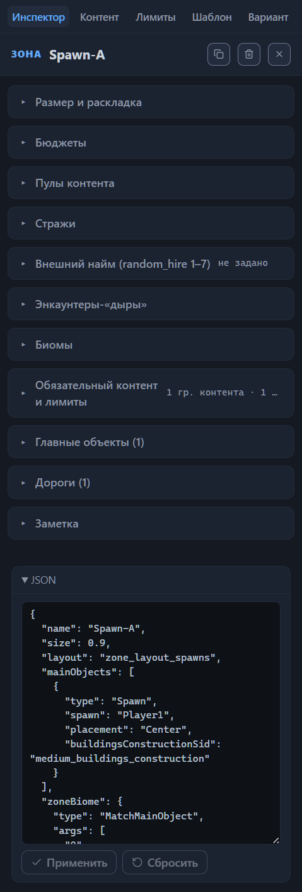
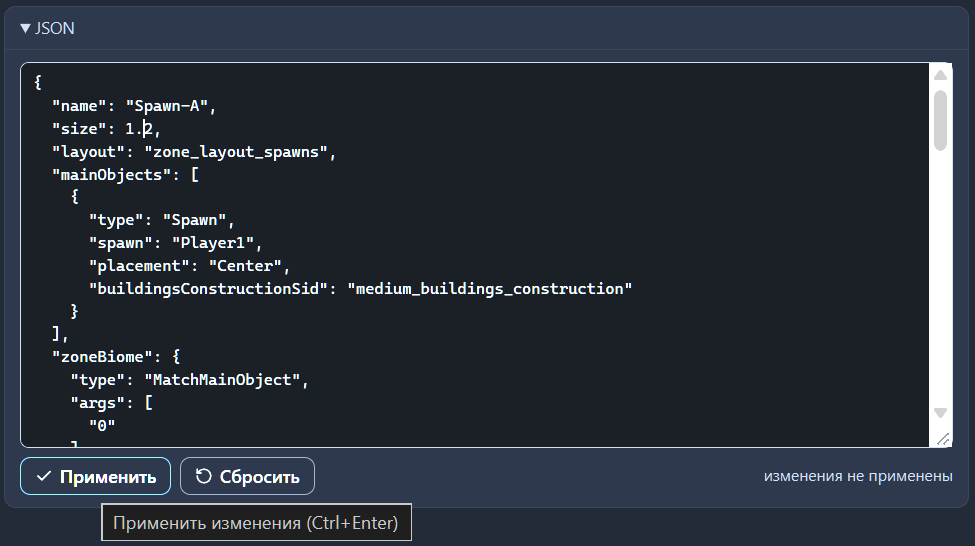
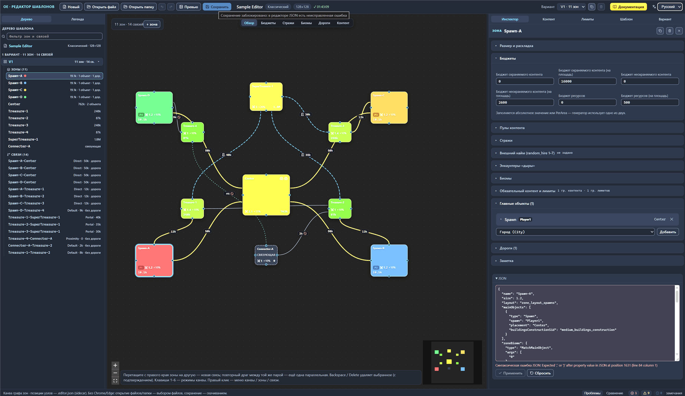

# Прямая правка JSON

Редактор показывает каждую часть шаблона текстом: зона, связь и шаблон целиком доступны как записи формата .rmg.json, а запись можно поправить и вернуть в шаблон. Так в шаблон попадают ключи, для которых в интерфейсе нет поля, и целые фрагменты, скопированные из другого шаблона.

Правка устроена как черновик: набранный текст не меняет шаблон, пока вы его не примените, а редактор проверяет текст на лету и не даёт сохранить шаблон со сломанным черновиком. Ниже — общие приёмы: где находятся блоки, как применить и сбросить текст, что проверяет редактор и как выйти из ошибки. Состав и особенности корневого блока описаны в главе [Настройки шаблона (корень)](root.md#json-секция-корня), строки панели «Проблемы» — в главе [Проверка шаблона (валидатор)](validator.md#ошибки-черновика-json-редактора).

## Три JSON-блока

В редакторе три JSON-блока: у зоны, у связи и у шаблона. Устроены они одинаково — поле с текстом, кнопки «Применить» и «Сбросить», статус «изменения не применены» под ними, — но показывают разную часть шаблона и проверяют разные поля.

### Блок зоны

Выберите зону на канве или в дереве шаблона и раскройте блок «JSON» в самом низу вкладки «Инспектор», под секциями свойств. В поле — объект зоны из списка `zones` активного варианта: те же ключи, что разобраны в главе [Зона: все свойства](zone.md), одним текстом с отступом в два пробела.

Блок открывается раскрытием и своё состояние не запоминает: в отличие от секций свойств, оно не пишется в sidecar-файл, поэтому после смены вкладки инспектора или нового открытия шаблона блок снова свёрнут.

«Применить» заменяет объект зоны в активном варианте. Одноимённые зоны других вариантов раскладки сохраняют своё содержимое; исключение — переименование: новое имя получает каждая одноимённая зона во всех вариантах.

Проверки блока:

- `name` — обязательное поле, непустая строка;
- имя не занято другой зоной.

Если в тексте другое имя зоны, применение срабатывает как переименование в поле «Имя зоны»: новое имя получает каждая зона с прежним именем во всех вариантах раскладки, а вместе с ним переносятся ссылки на зону, позиция узла в sidecar-файле и заметка зоны. Полный список того, что переносится, — в главе [Канва: правка графа](canvas-editing.md#переименование-зоны).

Обратите внимание: живая проверка сравнивает имя с именами других зон активного варианта, а при применении редактор дополнительно смотрит все варианты раскладки, в которых есть зона с прежним именем. Занятое имя отклоняет применение сообщением «Имя «X» уже занято другой зоной варианта».

### Блок связи

Выберите связь на канве или в дереве шаблона — блок «JSON» появится там же, под секциями свойств вкладки «Инспектор». В поле — объект связи из списка `connections` активного варианта; его поля разобраны в главе [Связи между зонами](connections.md).

«Применить» ищет связь по её имени, а при пустом поле «Имя связи» — по паре зон «источник-приёмник», и заменяет найденный объект на его месте в списке. Если в тексте другое имя (или имя появилось там, где его не было), связь получает новое имя, и дальше редактор опознаёт её уже по нему.

Проверки блока:

- `from` и `to` — обязательные непустые строки: имена зон того же варианта;
- `connectionType` — обязательная непустая строка.

Переименование связи не переносит ссылки на неё. Концы дорог зоны, которые указывают связь по имени, остаются с прежним именем и становятся битыми ссылками — валидатор отмечает их ошибкой (глава [Зона: все свойства](zone.md#битые-концы-и-предупреждения-валидатора)). Так же ведёт себя и поле «Имя связи» в инспекторе (глава [Связи между зонами](connections.md#имя-связи)), поэтому после переименования проверьте дороги зон, которые на эту связь ссылались.

Добавить связь текстом в этом блоке нельзя: поле показывает одну выбранную связь и заменяет её. Новую связь протяните перетаскиванием с правого края узла, а параллельный переход между той же парой зон добавьте повторным перетаскиванием или пунктом «Дублировать связь» контекстного меню (глава [Канва: правка графа](canvas-editing.md#создание-связи)). Блок пригодится для другого — перенести настройки одной связи на другую (раздел [«Настройки из другой связи»](#настройки-из-другой-связи)).

### Блок шаблона

Третий блок — JSON-секция корня, шестая секция вкладки «Шаблон» с заголовком «JSON шаблона (без зон и связей)». В поле — весь шаблон одним объектом: корневые настройки и список `variants`, у каждого варианта показаны все поля, кроме `zones` и `connections`. Состав блока, его ключи без полей интерфейса и правило слияния вариантов описаны в главе [Настройки шаблона (корень)](root.md#json-секция-корня); здесь — только общие приёмы. Раскрытие этой секции запоминается вместе с остальными секциями инспектора (глава [Файлы: открытие и сохранение](files.md#пара-файлов-шаблон-и-sidecar-файл)).

Зоны и связи через этот блок не правятся: вписанные вручную массивы `zones` и `connections` при применении заменяются текущими массивами шаблона — каждый вариант получает их по месту в списке. Число вариантов изменить тоже нельзя — проверка требует ровно столько элементов, сколько их в шаблоне. Варианты добавляют и удаляют кнопки-копия и корзина (глава [Варианты: управление и выбор](variant-manage.md#число-вариантов-и-json-секция-корня)).

«Применить» записывает разобранный объект как новый шаблон: корневые настройки и поля вариантов заменяются текстом, зоны и связи остаются прежними.

Проверки блока:

- `name` — обязательное поле, непустая строка;
- `variants` — список ровно из текущего числа элементов.

## Черновик и применение

Текст в поле любого блока — черновик. Шаблон меняется только после того, как вы нажмёте «Применить», поэтому правку можно бросить на середине и вернуть поле к текущему состоянию одной кнопкой.

Состояния черновика:

- Текст совпадает с текущим состоянием элемента — обе кнопки неактивны, статус «изменения не применены» не показан.
- Текст изменён и разбирается без ошибок — под полем появляется статус «изменения не применены», «Применить» и «Сбросить» активны.
- Текст изменён и не проходит проверку — поле подсвечено красным, под ним сообщение, «Применить» неактивна, «Сбросить» активна.

Применение правки:

1. Раскройте JSON-блок нужного элемента и поправьте текст.
2. Нажмите «Применить» или Ctrl+Enter (на macOS — Cmd+Enter).
3. Проверьте результат: канва и формы инспектора обновляются сразу, замечания на панели «Проблемы» пересчитываются тут же.

После успешного применения текст в поле приводится к записанному значению: редактор заново раскладывает его с отступом в два пробела, статус «изменения не применены» исчезает, кнопки гаснут. Применение — один шаг истории правок, поэтому Ctrl+Z возвращает элемент к прежнему состоянию вместе с формами инспектора (глава [Файлы: открытие и сохранение](files.md#отмена-и-повтор-действий)).

Клавиша Tab в поле вставляет два пробела, а не уводит курсор наружу — отступы набирать удобно. Подсветки синтаксиса и автодополнения в поле нет: опечатку видно только по сообщению проверки, поэтому сверяйте запятые и скобки до применения.

### Сброс черновика

Кнопка «Сбросить» возвращает текст к текущему состоянию элемента и снимает сообщение об ошибке; подсказка кнопки читается «Вернуть текст к текущему состоянию». Это не отмена действия: шаблон сброс не меняет, а неприменённый текст пропадает безвозвратно.

### Срок жизни черновика

Черновик блока зоны или связи живёт, пока открыта вкладка «Инспектор» и выбран элемент. Переход на другую вкладку, снятие выделения, «Новый» и открытие файла убирают блок вместе с текстом. У JSON-секции корня черновик привязан к вкладке «Шаблон»: выбор зоны или связи уводит инспектор на другую вкладку, и текст пропадает. В резервную копию сессии неприменённый черновик не попадает (глава [Файлы: открытие и сохранение](files.md#резервная-копия-сессии)).

Обратите внимание: выбор другой зоны или другой связи текст не очищает. Набранное остаётся в поле и становится черновиком нового элемента, а «Применить» запишет его уже в новый элемент. Применяйте или сбрасывайте черновик до выбора другого элемента, иначе запись прежней зоны или связи попадёт в новую: у зоны такое применение отклоняет проверка занятого имени, а у связи оно проходит молча и подменяет выбранный переход. Смена рода элемента — с зоны на связь и обратно — работает иначе: блок зоны и блок связи расположены в инспекторе отдельно, поэтому прежний блок убирается вместе с текстом, а новый открывается чистым.

Пока черновик не применён, блок не принимает внешние изменения. Правки в формах инспектора не попадают в текст, а при применении черновик перезаписывает элемент целиком и стирает их. Применяйте или сбрасывайте черновик перед правкой форм, иначе изменения форм пропадут.

## Проверка текста

Проверка живая: как только текст перестаёт совпадать с текущим состоянием элемента, редактор разбирает его и прогоняет проверки блока. При ошибке он подсвечивает поле красным, выводит под ним сообщение и гасит кнопку «Применить». Формулировки сообщений одни и те же в черновике и в строке на панели «Проблемы».

Общие для трёх блоков:

«Синтаксическая ошибка JSON: …»
: Текст не разбирается; после двоеточия — причина, которую назвал разбор.

«Ожидается JSON-объект {…}»
: Разбор удался, но результат — не объект: например, массив, число или строка.

Блок зоны:

«Не хватает обязательного поля name (непустая строка)»
: Ключ `name` пропал, стал пустой строкой или значением другого типа. То же сообщение появляется, когда применение не находит зону в активном варианте.

«Имя «X» уже занято другой зоной варианта»
: В тексте имя другой зоны того же варианта раскладки.

Блок связи:

«Не хватает обязательных полей from/to (непустые строки)»
: Ключ `from` или `to` пропал, пуст или не строка.

«Не хватает обязательного поля connectionType»
: Ключ типа связи пропал, пуст или не строка.

«Связь «X» не найдена в активном варианте»
: Применение не находит связь с этим id в активном варианте — например, связь удалили или переименовали, пока вы правили текст.

JSON-секция корня:

«Не хватает обязательного поля name (непустая строка)»
: Имя шаблона пропало из блока или стало пустой строкой.

«variants[] должен присутствовать и содержать ровно N элемент(ов) — зоны и связи нельзя добавлять или удалять через эту секцию»
: Список вариантов пропал, перестал быть списком или изменил длину; вместо N подставляется текущее число вариантов шаблона.

Эти проверки смотрят только на форму блока. Значения полей, ссылки и баланс шаблона проверяет валидатор (глава [Проверка шаблона (валидатор)](validator.md)) — после применения его отчёт пересчитывается сразу.

### Отклонённое применение

Блок ещё раз прогоняет проверки в момент нажатия «Применить»: пока вы правили текст, шаблон мог измениться. Отклонённое применение показывает то же сообщение под полем, текст оставляет как есть, а «Применить» не гасит — поправьте текст или нажмите «Сбросить». Шаблон при этом не портится: запись не проходит вовсе.

## Строка ошибки и блокировка сохранения

Неприменённая ошибка черновика видна не только в самом блоке. Панель «Проблемы» показывает её строкой со значком ошибки выше остальных замечаний: место называет раздел («JSON шаблона», «JSON зоны Spawn-A», «JSON связи Center-Spawn-A»), текст совпадает с сообщением под полем, а в конце строки стоит пометка «черновик не применён». Строка не кликабельна — переходить некуда, элемент и так открыт в инспекторе; подсказка строки читается «Ошибка в черновике JSON-редактора — исправьте текст или нажмите «Сбросить»».

Строка попадает в счётчик «ошибки», поэтому надписи «шаблон корректен» на панели не будет, даже если остальной шаблон чист. Сам валидатор неприменённый черновик не видит и проверяет шаблон без ваших правок (глава [Проверка шаблона (валидатор)](validator.md#ошибки-черновика-json-редактора)).

Пока ошибка не исправлена, кнопка «Сохранить» на верхней панели неактивна, а её подсказка читается «Сохранение заблокировано: в редакторе JSON есть неисправленная ошибка». Так редактор не даёт записать на диск состояние, которое сам не смог разобрать. Обойти блокировку нельзя: команда сохранения проверяет черновики и сама, независимо от состояния кнопки.

Выход из состояния:

1. Найдите блок по месту в строке замечания: «JSON шаблона» — вкладка «Шаблон», «JSON зоны» или «JSON связи» — вкладка «Инспектор» с выбранным элементом.
2. Исправьте текст — сообщение исчезнет сразу, «Применить» активируется, сохранение станет доступно.
3. Нажмите «Сбросить», если правка не нужна: текст вернётся к текущему состоянию, а ошибка снимется вместе со строкой на панели.

Черновик можно и бросить: уход с вкладки убирает блок вместе с текстом и ошибкой, блокировка сохранения снимается. Набранное при этом пропадает.

## Случаи прямой правки

Прямая правка — не основной способ работы. Всё, для чего в инспекторе есть поле, удобнее править полем: поля проверяют значения, подставляют имена из каталога и не дают ввести лишнее. Текстом стоит пользоваться в таких ситуациях.

### Значение из другого шаблона

Скопировать зону, связь, лэйаут или группу обязательного контента из другого шаблона быстрее, чем собрать то же заново. Фрагмент вставляют в JSON-блок (зону — в блок существующей зоны, лэйаут или группу — в JSON-секцию корня) или прямо в файл, если элемент нужно добавить (см. раздел [«Правка файла вне редактора»](#правка-файла-вне-редактора)).

Обратите внимание: имена в скопированном фрагменте — пулы, списки, лэйауты, группы обязательного контента и лимитов — принадлежат тому шаблону. В вашем шаблоне таких имён может не быть, и ссылки окажутся битыми: валидатор отмечает их замечаниями (глава [Проверка шаблона (валидатор)](validator.md#несуществующие-ссылки)). Пройдитесь по замечаниям до сохранения, иначе в шаблоне останутся имена, которых нет ни в нём, ни в базе игры, а поведение генератора на неизвестном имени не проверено.

### Настройки из другой связи

Настройки одного перехода переносят на другой текстом — это быстрее, чем повторять те же значения в формах. Так настраивают параллельные проходы одной пары зон и одинаковые переходы у разных игроков: группа синхронной стражи, зона стражи и дорога приезжают вместе с текстом.

1. Выберите связь-образец на канве или в дереве шаблона.
2. Скопируйте текст из блока «JSON связи» в конце вкладки «Инспектор».
3. Выберите связь, которой нужны те же настройки, и вставьте текст в её блок.
4. Поправьте в тексте поле `name` — на имя связи-приёмника, а при других зонах и поля `from` и `to`.
5. Нажмите «Применить» или Ctrl+Enter и сверьте формы инспектора с ожиданием.

Шаг 4 обязателен. «Применить» ищет связь по имени из текста, а при пустом имени — по паре зон, и заменяет найденную запись на месте. Оставили имя образца — связь-приёмник переименуется и получит чужие концы, а в варианте окажутся два перехода с одним адресом: ссылки на него в концах дорог и аргументах размещения станут неоднозначными, и валидатор отметит это справкой о совпадающих именах связей (глава [Проверка шаблона (валидатор)](validator.md#типовые-замечания-и-что-с-ними-делать)).

Обратите внимание: неприменённый текст не привязан к связи, из которой его скопировали. Выберите другой элемент — и набранное станет черновиком уже его, а «Применить» у связи молча заменит тот переход, который вы только что открыли. Применяйте или сбрасывайте черновик до переключения (раздел [«Срок жизни черновика»](#срок-жизни-черновика)).

### Ключ без поля интерфейса

JSON-блок показывает запись элемента целиком, включая ключи, для которых в инспекторе нет поля. В корне это, например, `contentPools` и `contentLists` (во всех штатных шаблонах они пустые) и `orientation` вне списка вариантов (*Назначение уточняется.*); в записях зон и связей — ключи, которые формат допускает, а интерфейс не показывает.

Текстом ключ можно удалить совсем: сотрите строку с ключом, и редактор не вернёт её обратно. Формы так не умеют — очистка полей оставляет в файле пустой объект (`orientation: {}`, `border: {}`), и убрать его можно только в JSON-секции корня (глава [Вариант: ориентация и граница](variant-layout.md#общие-правила-секций)). Прежде чем удалять ключ, сверьтесь с главой [Настройки шаблона (корень)](root.md#правила-игры): на пропуск записи, которую валидатор считает обязательной, он ответит предупреждением.

### Точечный аудит

Формы инспектора показывают только то, для чего есть поле, и сворачивают значения в подписи карточек. JSON-блок показывает запись элемента как она есть в шаблоне: все ключи, их значения, порядок и отсутствие ключей. Спорное значение сверяйте по блоку — например, какой ключ реально записан после очистки поля и есть ли в объекте связи флаг `road`.

Сравнить два варианта раскладки блоки зоны и связи не помогут: они показывают активный вариант. JSON-секция корня отдаёт все варианты сразу, но без зон и связей, а для попарного сравнения есть вкладка «Сравнение» (глава [Сравнение вариантов](compare.md)).

## Правка файла вне редактора

JSON-блоки правят то, что уже есть в шаблоне. Добавлять и удалять зоны, связи и варианты они не дают: блок зоны и блок связи показывают один выбранный элемент, а JSON-секция корня подменяет массивы зон и связей текущими. Элементы добавляют и удаляют кнопки интерфейса — «+ зона», перетаскивание связи, пункты контекстного меню; текстом такое изменение делают в самом файле `Название.rmg.json`.

Порядок работы:

1. Сохраните шаблон в редакторе — на диске появится тройка файлов с общим именем (глава [Файлы: открытие и сохранение](files.md#сохранение)).
2. Откройте `Название.rmg.json` в текстовом редакторе.
3. Внесите правку, следя за запятыми и скобками: файл должен остаться JSON-объектом с ключом `name` (строка) и ключом `variants` (список).
4. Сохраните файл.
5. Откройте его в редакторе кнопкой «Открыть файл» и посмотрите панель «Проблемы».

Редактор принимает файл, только если это шаблон: текст должен разбираться как JSON-объект, а в объекте должны быть `name` строкой и `variants` списком. Иначе вместо шаблона вы увидите уведомление «Файл — не JSON-объект» или «Файл не похож на .rmg.json: нет name / variants[]».

Обратите внимание: открытие файла очищает историю правок, поэтому отменить неудачную правку файла через Ctrl+Z не получится. Держите копию файла до изменения, иначе ошибка в тексте оставит вас без прежней версии шаблона.

Не переименовывайте зоны прямо в файле. Позиции узлов и заметки зон хранятся в sidecar-файле `.editor.json` под именами зон: после переименования мимо редактора старое имя остаётся в sidecar-файле, новое не находится, и узел встаёт в кольцо без позиции, а заметка зоны теряется. Переименовывайте зону в инспекторе — там заодно каскадом переносятся ссылки (глава [Канва: правка графа](canvas-editing.md#переименование-зоны)).

Правьте точечно и не меняйте форматирование всего файла. Сохранённый редактором файл набран с отступом-табуляцией и хранит ключи в порядке файла на момент открытия; следующее сохранение вернёт этот же стиль (глава [Справочник формата .rmg.json](rmg-json.md#автоматическая-запись)). Переформатирование превратит одну содержательную правку в изменения во всех строках файла, и сверить её с прежней версией станет трудно.

Открыв файл после правки, пройдитесь по замечаниям. Правка файла минует ограничения интерфейса — стрелки числовых полей, списки каталога, проверку имён, — поэтому значения вне диапазонов и неизвестные имена попадают в шаблон беспрепятственно; валидатор отвечает на них предупреждениями и справками (глава [Проверка шаблона (валидатор)](validator.md#типовые-замечания-и-что-с-ними-делать)).

## Куда дальше

- [Настройки шаблона (корень)](root.md#json-секция-корня) — состав корневого блока и его особенности.
- [Проверка шаблона (валидатор)](validator.md#ошибки-черновика-json-редактора) — как читается строка ошибки черновика на панели «Проблемы».
- [Справочник формата .rmg.json](rmg-json.md#словарь-полей) — имена полей интерфейса и ключи файла.
- [Файлы: открытие и сохранение](files.md#отмена-и-повтор-действий) — история правок и отмена применения.
- [Канва: правка графа](canvas-editing.md#создание-связи) — добавление зон и связей без текста, дублирование перехода.
- [Связи между зонами](connections.md#имя-связи) — имена связей и параллельные переходы.
