# Мой первый шаблон

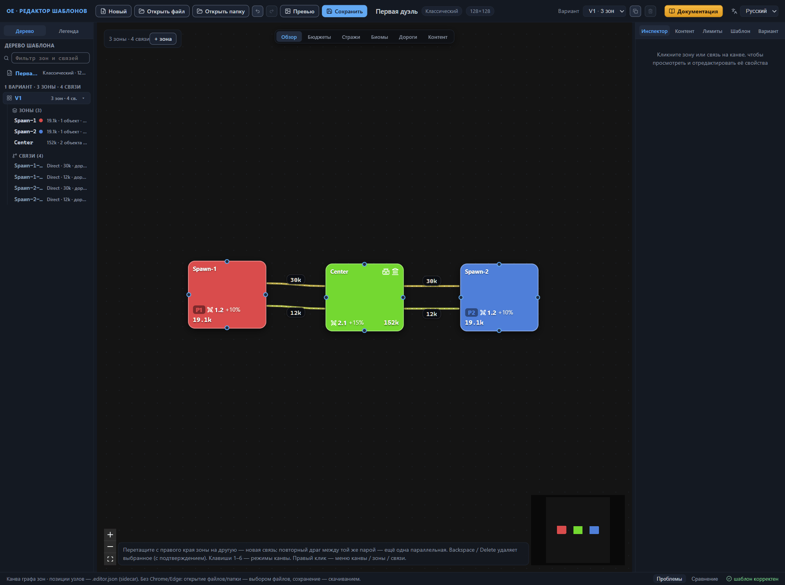

В этой главе соберём шаблон «Первая дуэль» с нуля — случайную карту для двух игроков. Его основа — три зоны и четыре связи: две стартовые зоны игроков, общий центр и по два прохода между каждым стартом и центром. Зона — часть карты со своими настройками наполнения, биома, стражи и объектов; связь — переход между двумя зонами. По пути пройдём главные операции автора шаблона — создание и наполнение зон, дублирование зон и связей, симметричную стражу, перенос настроек через JSON-блок и дороги — и закончим практикум проверкой: редактор покажет строку «шаблон корректен». Скажем честно: «Первая дуэль» — учебный шаблон, а не образец баланса; его числа — пример автора, а справочные диапазоны смотрите в справочных главах по мере надобности. Глава рассчитана на читателя, который прошёл [Быстрый старт](quick-start.md): общие шаги здесь не повторяются и даны ссылками.

**Особенности**:

- Три зоны: две стартовые у игроков и общая центральная.
- Четыре связи: по два прохода между каждым стартом и центром — главный и запасной послабее.
- Симметрия стартов: одинаковые проходы получают одинаковую стражу. Её держит группа синхронной стражи — именованная группа связей, в которой сила и прирост стражи равны.
- Зона второго игрока — дубликат первого, а её проход к центру — дубликат прохода первого игрока. Запасные проходы создаёт дублирование связи, а их настройки переносит текст через JSON-блок — поле прямой правки записи элемента.
- Один вариант раскладки V1 — единственная схема зон и связей; все действия идут в активном варианте.
- Обязательный контент (объекты, которые генератор размещает гарантированно) и лимиты количества (потолок числа объектов).

## Карта практикума

### Условия примера

Шаблон собирается от «Новый» до строки «шаблон корректен». Зафиксируем условия: следующие разделы придерживаются этих значений точно.

- **Название шаблона**
  : «Первая дуэль».
- **Зоны**
  : `Spawn-1` и `Spawn-2` — старты игроков; `Center` — общий центр.
- **Связи**
  : `Spawn-1-Center` и `Spawn-2-Center` — главные проходы; `Spawn-1-Center-1` и `Spawn-2-Center-1` — запасные. Проход первого игрока собственного имени не имеет и адресуется авто-именем — адресом, сложенным из имён его зон; проход второго игрока получает явное имя при дублировании, а запасным копиям редактор сам выдаёт имя с суффиксом `-1`.
- **Бюджет наполнения**
  : сколько ценности генератор должен разместить в зоне. Ценность — условная валюта баланса, в которой пересчитаны и контент, и стража. Стартам задаём бюджет «на площадь»: 16000 охраняемый, 2600 неохраняемый, 500 ресурсы; центру — абсолютные значения: 120000, 20000, 12000.
- **Пул контента**
  : именованный набор объектов игры, из которого генератор берёт наполнение. Стартам — пулы ступени t2, центру — t4 и t5: чем выше ступень, тем больше в пуле доля дорогих объектов.
- **Стража**
  : охрана контента и проходов в единицах ценности. Главные проходы — 30000, запасные — 12000; множитель силы стражей зон — 1.2 у стартов и 2.1 у центра.
- **Вариант раскладки**
  : один — V1; все действия идут в активном варианте.
- **Размер карты**
  : 128×128 клеток — значение по умолчанию, его не меняем.

Числа здесь — пример автора шаблона, а не норма игры. Смысл каждого поля и штатные диапазоны — в главах [Зона: все свойства](zone.md), [Связи между зонами](connections.md) и [Настройки шаблона (корень)](root.md).

### Порядок работ

Разделы идут не в произвольном порядке: последовательность шагов влияет на результат.

1. Зона первого игрока: создание, точка появления героя и наполнение — бюджеты, пулы контента, биомы (тип ландшафта зоны) и стражи.
2. Зона второго игрока — дубликат первой. Копию делают до появления связей и дорог: дублирование копирует зону целиком — вместе с главными объектами и дорогами. Скопировать позже — концы дорог копии упрутся в связи исходной зоны.
3. Центральная зона: город, заброшенный аванпост и наполнение.
4. Связь первого игрока «старт — центр» и её стража.
5. Связь второго игрока — дубликат первой: копия переносит стражу и группу синхронной стражи, замене подлежат только зона-источник и имя.
6. Запасные проходы: дублирование связей, затем перенос настроек через JSON-блок. Копия сразу несёт заполненные поля, а группа синхронной стражи приезжает вместе с текстом.
7. Дороги внутри зон — после того как связи получили итоговые имена: концы дорог ссылаются на связи по имени, а переименование связи ссылки не переносит. Устаревшее имя превращает конец дороги в ошибку валидатора.
8. Обязательный контент, лимиты количества, лэйаут зон (правила, по которым генератор строит рельеф внутри зоны) и правила игры.
9. Проверка: панель «Проблемы» и строка «шаблон корректен».

### Заготовка шаблона

1. Нажмите «Новый» на верхней панели. Редактор создаст пустой шаблон: один вариант раскладки, ноль зон, карта 128×128 (глава [Быстрый старт](quick-start.md#пустой-шаблон)). Если редактор откроет окно «Несохранённые изменения», подтвердите «Продолжить» — практикум начинается с чистого листа.
2. Оставьте размер карты по умолчанию: 128×128 клеток хватает на три зоны и четыре связи.
3. Перейдите на вкладку «Шаблон» правой панели.
4. В секции «Основное» впишите в поле «Название» «Первая дуэль» и нажмите Enter. Новое имя сразу появляется на верхней панели и в дереве шаблона — под ним шаблон попадёт в список шаблонов игры и в имя файла при сохранении.

## Зона первого игрока

### Создание и точка появления героя

Практика начинается со стартовой зоны первого игрока: создадим зону и добавим в неё первый главный объект — точку появления героя. Главные объекты — ключевые объекты зоны; в шаблоне их четыре типа: город, точка спауна игрока, заброшенный аванпост и арена адского пламени.

1. Нажмите «+ зона» в панели у левого верхнего угла канвы. Появляется заготовка зоны — с рабочим именем `Zone-1` и значениями по умолчанию; подробности в главе [Канва: правка графа](canvas-editing.md#добавление-зоны).
2. Откройте вкладку «Инспектор» на правой панели — там свойства выбранной зоны: заголовок «ЗОНА Zone-1» и список секций.
3. В секции «Размер и раскладка» впишите в поле «Имя зоны» `Spawn-1` и нажмите Enter. Новое имя сразу появляется в заголовке инспектора, в дереве шаблона и на узле канвы; процедура переименования описана в главе [Канва: правка графа](canvas-editing.md#переименование-зоны).
4. Раскройте секцию «Главные объекты». В секции есть строка добавления: выпадающий список типа и кнопка «Добавить».
5. В строке добавления выберите тип «Точка спауна игрока (Spawn)» и нажмите «Добавить». В секции появляется карточка Spawn, а заголовок становится «Главные объекты (1)».
6. Проверьте поля карточки: редактор подставил «Игрок (spawn)» — `Player1` и «Размещение» — «в центре зоны (Center)». Если значения другие, выберите их в выпадающих списках.
7. Поля «Аргументы размещения» и поля стражи оставьте пустыми: у точки появления героя стражу не настраивают.

Обратите внимание: числовые поля применяются по нажатию Enter или при переводе фокуса в другое поле.

Осмысленное имя зона получает сразу, до появления связей и дорог. Имя зоны служит адресом для ссылок: концы связей, зона стражи, аргументы размещения и концы дорог указывают на зоны по имени. Переименование каскадом переносит существующие ссылки, но пока ссылок нет — переносить нечего, и задать имя сейчас проще, чем править его позже. Генератор видит в имени только адрес, а префикс `Spawn-` у стартовых зон — практика штатных шаблонов.

Точка появления героя задаёт игрока зоны. Вместе с объектом `Player1` узел канвы получает цвет игрока 1 и метку «P1», а в режиме «Обзор» на нём добавляется флаг цвета игрока; расшифровку цветов даёт легенда канвы — вкладка «Легенда» на левой панели, группа «Игроки (Spawn)». Размещение «в центре зоны» приводит героя в предсказуемую точку — центр зоны, а не случайное место. Смысл полей точки появления описан в главе [Главные объекты зоны](main-objects.md#игрок-spawn), режимы размещения объекта собраны в главе [Главные объекты зоны](main-objects.md#размещение).

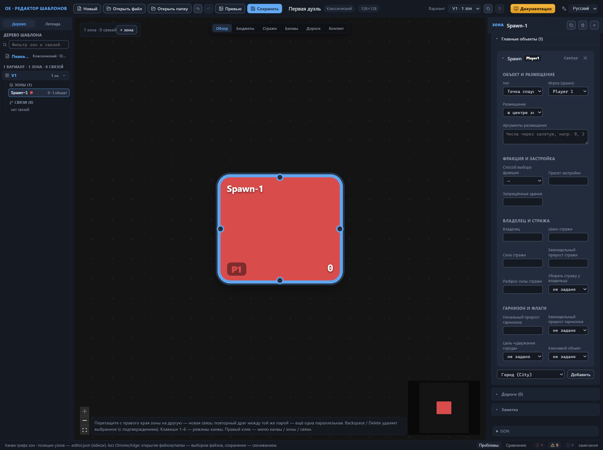

### Наполнение зоны

У зоны есть владелец; теперь наполним её содержимым. Настроек четыре группы: бюджет — ценность будущего наполнения, пулы — откуда генератор берёт объекты, биом — облик зоны, стражи — сила охраны вокруг содержимого.

1. Заполните секцию «Бюджеты»: в поле «Бюджет охраняемого контента (на площадь)» впишите 16000, в «Бюджет неохраняемого контента (на площадь)» — 2600, в «Бюджет ресурсов (на площадь)» — 500. Одноимённые поля без приписки «(на площадь)» оставьте пустыми.
2. Раскройте секцию «Пулы контента» — в ней три поля: «Пул охраняемого контента», «Пул неохраняемого контента» и «Пул ресурсов».
3. Нажмите «Каталог» у поля «Пул охраняемого контента» — откроется окно каталога. В поле поиска наберите `random_t2` и отметьте кнопкой «+» три строки: «Классический случайный пул · t2 · предметы» (`classic_template_pool_random_t2_item`), «Классический случайный пул · t2 · найм» (`classic_template_pool_random_t2_hire`), «Классический случайный пул · t2 · банки юнитов» (`classic_template_pool_random_t2_unit_bank`). Нажмите «Закрыть» — в поле появятся три плашки выбранных пулов.
4. Неохраняемый пул добавьте так же: «Каталог» у поля «Пул неохраняемого контента», поиск `unguarded_t2`, отметьте строку «Классический случайный пул · неохраняемый · t2 · базовый» (`classic_template_pool_random_unguarded_t2_base`) и нажмите «Закрыть» — в поле одна плашка.
5. Для «Пула ресурсов» повторите приём: поиск `general_resources_start`, строка «Контент-пул · общие ресурсы · стартовая зона · средняя» (`content_pool_general_resources_start_zone_medium`), «Закрыть» — пятая плашка на месте.
6. Раскройте секцию «Биомы». В ней три слоя: «Биом зоны (поверхность)», «Биом контента» и «Биом декораций (мета-объекты)».
7. В каждом слое выберите в списке «способ выбора» вариант «как у главного объекта (MatchMainObject)», а в списке «Главный объект» — строку «0 · Точка спауна игрока (Spawn) · Player1». Поле «Зона» оставьте пустым — «—».
8. В секции «Стражи» заполните три поля: «Множитель силы стражей» — 1.2, «Разброс силы стражей» — 0.05, «Еженедельный прирост стражей» — 0.1. Поля «Порог силы стражей» и «Модификатор дипломатии» оставьте пустыми, а «Реакция стражей (guardReactionDistribution)» не трогайте — у новой зоны она уже заполнена шестью единицами, и это нормально.

Бюджет «(на площадь)» растёт вместе с площадью зоны — иначе крупная зона растянет ту же ценность на бо́льшую площадь и окажется беднее соседней. Абсолютное значение и значение «(на площадь)» образуют пару: заполняют одно из двух, а генератор использует заполненное. Канва показывает результат сразу: в режиме «Обзор» на узле `Spawn-1` виден суммарный бюджет `19.1k` — сумма трёх слагаемых, а в режиме «Бюджеты» добавляется разбивка `G16k` охраняемый, `U2.6k` неохраняемый, `R500` ресурсы. Поля бюджетов описаны в главе [Зона: все свойства](zone.md#бюджеты), режимы канвы — в главе [Канва: режимы отображения](canvas-modes.md#режим-бюджеты).

Пулы с похожими именами стоят в каталоге рядом: «классические» и обычные одной ступени различаются только префиксом имени. Выбирайте строку, исходное имя которой совпадает с заданием упражнения, — оно показано прямо в строке каталога. Плашка в поле показывает русскую подпись пула, а кнопка «✕» убирает его. Имена пулов не вписывают вручную: опечатка создаст имя вне каталога, и валидатор предупредит о нём. Стартовая зона набирает пулы второй ступени (t2), центральная зона позже — четвёртой и пятой (t4, t5). Устройство окна каталога описано в главе [Быстрый старт](quick-start.md#первый-пул-контента), правила выбора пулов — в главе [Каталог пулов контента](pools.md#выбор-пула-для-зоны).

Способ «как у главного объекта» заставляет все три слоя наследовать биом главного объекта зоны — точки появления, объекта номер 0. Какой биом достанется точке появления, такими окажутся поверхность, содержимое и декорации — зона выглядит цельной; в демо-шаблоне редактора стартовые зоны настроены так же. Проверьте настройку на канве: переключите режим на «Биомы» — на узле появится метка «MO #0», биом от главного объекта номер 0, — и верните режим «Обзор». Способы выбора биома и их аргументы описаны в главе [Зона: все свойства](zone.md#биомы), режимы канвы — в главе [Канва: режимы отображения](canvas-modes.md#режим-биомы).

Множитель силы поднимает стражей вслед за бюджетом: чем ценнее содержимое зоны, тем сильнее охрана, которая его стережёт. Разброс 0.05 — штатное значение: при большем разбросе стража одинаковых зон заметно отличается от карты к карте. Еженедельный прирост 0.1 добавляет десятую часть силы стражей каждую неделю. Смысл полей собран в главе [Зона: все свойства](zone.md#стражи).

Секции «Внешний найм» и «Энкаунтеры-«дыры»» оставьте нетронутыми: упражнение их не использует. Свойства всех секций зоны перечисляет глава [Зона: все свойства](zone.md).

Зона наполнена. В режиме «Обзор» узел `Spawn-1` показывает имя, метку игрока `P1`, множитель силы стражей `1.2`, еженедельный прирост `+10%` и суммарный бюджет `19.1k`. Валидатор не сообщает ни одной ошибки; оставшиеся предупреждения касаются общих настроек шаблона — правил игры, лэйаута и групп контента — и зоны: «У зоны нет обязательного контента» у `Spawn-1`. Все они исчезнут в конце упражнения.

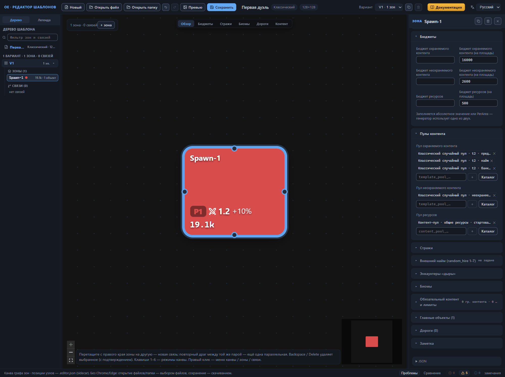

## Зона второго игрока

### Дублирование зоны

Вторая стартовая зона устроена точно так же, как первая: те же бюджеты, пулы, настройки биомов и стражей. Собирать их заново незачем — готовую зону копируют и меняют в копии два значения: имя и игрока. Копию делают до появления связей и дорог: зона с дорогами потянет за собой концы дорог, которые указывают на связи исходной зоны. Валидатор промолчит — такие связи в варианте есть, — а чужие адреса в дороге копии пришлось бы выискивать вручную.

1. Выделите узел `Spawn-1` на канве — инспектор покажет свойства зоны.
2. В заголовке инспектора, рядом с именем зоны, нажмите кнопку со значком копии (подсказка «Дублировать зону (копия без связей)») — копия появится на канве правее и ниже исходной зоны и сразу выделится. Копия наследует все настройки: бюджеты, пулы, биомы, стражей, главные объекты, группы обязательного контента и лимитов количества. Не копируются только связи и заметка зоны. Редактор даёт копии первое свободное имя из ряда Zone-N — в нашем примере `Zone-1`. Приёмы дублирования описаны в главе [Канва: правка графа](canvas-editing.md#дублирование-зоны).
3. В секции «Размер и раскладка» замените «Имя зоны» на `Spawn-2` и нажмите Enter — новое имя появится в заголовке инспектора, в дереве и на узле канвы. Подробности — в главе [Канва: правка графа](canvas-editing.md#переименование-зоны).
4. Раскройте секцию «Главные объекты», откройте карточку Spawn и выберите в списке «Игрок (spawn)» значение `Player2` — узел перекрасится в цвет игрока 2, а метка сменится на `P2`. Смысл поля описан в главе [Главные объекты зоны](main-objects.md#игрок-spawn).
5. Биомы копии не меняйте: выбор в списке «Главный объект» уже указывает на точку появления самой копии — она на месте.

Один игрок задаётся одной точкой появления на вариант: пока точка копии принадлежит `Player1`, валидатор сообщает ошибку про уже заданного игрока — смена значения в шаге 4 её убирает. Дублирование, как любое действие в редакторе, отменяется клавишами Ctrl+Z.

Зона второго игрока готова. В режиме «Обзор» на канве два узла: `Spawn-1` с меткой `P1` в цвете игрока 1 и `Spawn-2` с меткой `P2` в цвете игрока 2; на обоих видны множитель силы стражей `1.2`, прирост `+10%` и бюджет `19.1k`. Ошибок валидатор не сообщает; предупреждение «У зоны нет обязательного контента» теперь касается обеих стартовых зон и исчезнет в конце упражнения.

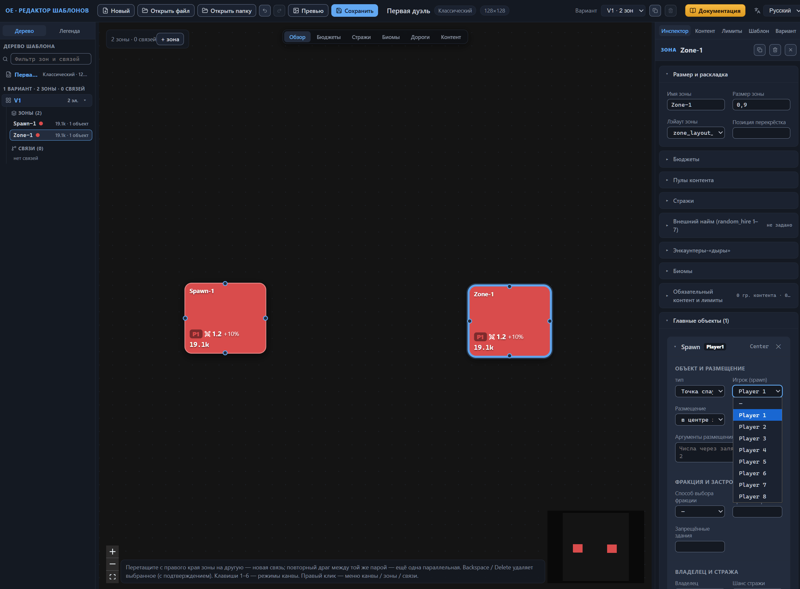

## Центральная зона

### Город и заброшенный аванпост

Третья зона — центр карты, место, к которому стремятся оба игрока. Она больше стартовых и наполняется богаче. Сначала создадим заготовку:

1. Нажмите «+ зона» на канве — появится новая зона, редактор даст ей первое свободное имя `Zone-1`.
2. В секции «Размер и раскладка» замените «Имя зоны» на `Center` и нажмите Enter — новое имя появится в заголовке инспектора, в дереве и на узле канвы.
3. В поле «Размер зоны» впишите 1.5 и нажмите Enter. Размер — относительный вес площади: зона весом 1.5 рядом с зонами весом 0.9 претендует примерно на вдвое большую долю площади карты. Смысл поля объяснён в главе [Зона: все свойства](zone.md#размер-зоны).

В центре два главных объекта: город — цель борьбы и источник фракции зоны — и заброшенный аванпост, вторая точка интереса. Охрана аванпоста слабее городской (12000 против 20000), поэтому его проще захватить — аванпост открывается игрокам раньше города.

4. Раскройте секцию «Главные объекты», в строке добавления выберите тип «Город (City)» и нажмите «Добавить» — в секции появится карточка City, а заголовок изменится на «Главные объекты (1)». Редактор уже заполнил «Размещение» — «в центре зоны (Center)» — и «Шанс стражи» — 1. Смысл полей карточки объяснён в главе [Главные объекты зоны](main-objects.md#тип-объекта).
5. В карточке City откройте «Способ выбора фракции» и выберите «FromList (список)» — под полем появится ряд чипов фракций: `human`, `demon`, `dungeon`, `nature`, `unfrozen`. Кликните чипы `human`, `demon` и `dungeon` — отмеченные чипы получают галочку. Генератор выберет фракцию города из этих трёх, поэтому в каждой партии центр оказывается разным. Режимы описаны в главе [Главные объекты зоны](main-objects.md#способ-выбора-фракции).
6. В поле «Пресет застройки» впишите имя `rich_buildings_construction` — рядом с именем появится бейдж «в каталоге»: имя распознано. Пресет задаёт уровень развития города. Подробности — в главе [Главные объекты зоны](main-objects.md#пресет-застройки).
7. Заполните поля стражи карточки City: «Сила стражи» — 20000, «Еженедельный прирост стражи» — 0.2; нажмите Enter после каждого значения. Смысл полей стражи собран в главе [Главные объекты зоны](main-objects.md#стража-объекта).
8. В строке добавления выберите тип «Заброшенный аванпост (AbandonedOutpost)» и нажмите «Добавить» — появится вторая карточка, а заголовок изменится на «Главные объекты (2)». «Шанс стражи» уже стоит в значении 1; в поле «Размещение» выберите «где угодно в зоне (Uniform)», а поля «Аргументы размещения» оставьте пустыми.
9. В карточке AbandonedOutpost заполните «Сила стражи» — 12000 и «Еженедельный прирост стражи» — 0.1. Поле «Владелец» оставьте пустым: аванпост остаётся нейтральным.

Номер главного объекта — это адрес для ссылок: концы дорог, биомы «как у главного объекта» и способ выбора фракции «Match» указывают на объекты по номеру, считая от нуля. Порядок карточек в секции задаёт номер, поэтому удаление карточки из середины списка сдвигает нумерацию, и ссылки молча начинают указывать на соседей.

Поля с неустановленным назначением в карточках не трогайте: «Запрещённые здания», переключатели вроде «Убирать стражу у владельца» и остальные оставьте в состоянии заготовки.

Центральная зона готова: размер 1.5, два главных объекта — город (размещение в центре, три фракции на выбор, пресет застройки, стража 1 / 20000 / 0.2) и заброшенный аванпост (размещение где угодно в зоне, стража 1 / 12000 / 0.1). Ошибок валидатор не сообщает; предупреждение «У зоны нет обязательного контента» теперь относится и к центральной зоне.

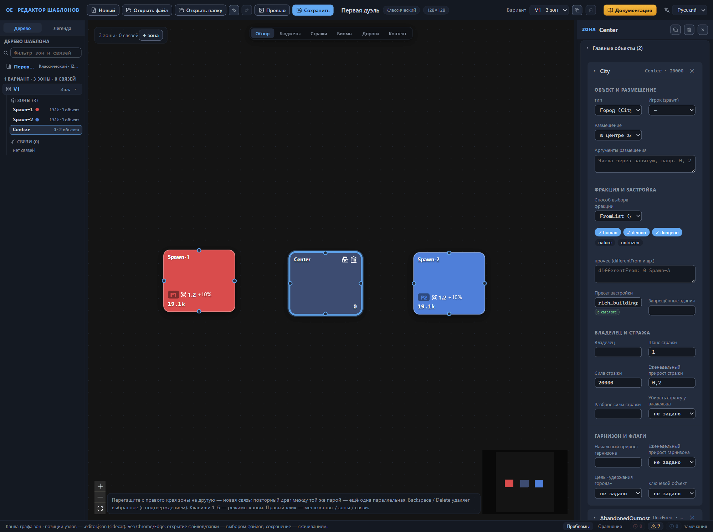

### Наполнение центральной зоны

Центральная зона наполняется теми же четырьмя группами настроек, что и стартовая: бюджет, пулы, биомы, стражи. Приёмы показаны в разделе «Наполнение зоны» выше, здесь приведены только значения и отличия.

1. В секции «Бюджеты» заполните поля без приписки «(на площадь)»: «Бюджет охраняемого контента» — 120000, «Бюджет неохраняемого контента» — 20000, «Бюджет ресурсов» — 12000. Поля «(на площадь)» оставьте пустыми. Стартовый бюджет растёт вместе с площадью, а центр карты один: его богатство задано абсолютным значением и не зависит от площади, которую генератор в итоге отдаст зоне. О паре полей — в главе [Зона: все свойства](zone.md#бюджеты).
2. Пулы добавьте кнопкой «Каталог»: в «Пул охраняемого контента» — `classic_template_pool_random_t4_item` и `classic_template_pool_random_t5_item`, в «Пул неохраняемого контента» — `classic_template_pool_random_unguarded_t4_base`, в «Пул ресурсов» — `content_pool_general_resources_treasure_zone_rich`. Ступени четвёртая и пятая вместо второй: содержимое центра крупнее стартового, иначе за него не стоит бороться. Связь ступени с бюджетом зоны объяснена в главе [Каталог пулов контента](pools.md#ступень-и-бюджет-зоны).
3. В секции «Биомы» у всех трёх слоёв оставьте способ выбора «из списка (FromList)» и кликните в каждом слое чип `Песок` — отмеченный чип получает галочку. Один чип фиксирует выбор биома: так штатные шаблоны задают пустынный центр. При пустом списке генератор выбирает биом сам. Способ описан в главе [Зона: все свойства](zone.md#из-списка-fromlist).
4. В секции «Стражи» заполните три поля: «Множитель силы стражей» — 2.1, «Разброс силы стражей» — 0.05, «Еженедельный прирост стражей» — 0.15. «Порог силы стражей» и «Модификатор дипломатии» оставьте пустыми, «Реакция стражей (guardReactionDistribution)» не трогайте. Множитель 2.1 поднимает оборону вслед за бюджетом, прирост добавляет страже 15 процентов силы каждую неделю. Смысл полей собран в главе [Зона: все свойства](zone.md#стражи).

Сравните результат на канве: в режиме «Бюджеты» центральный узел показывает `152k` и разбивку `G120k`, `U20k`, `R12k`, а стартовые узлы остаются при `19.1k` — бюджет центра примерно в восемь раз больше стартового. В режиме «Биомы» центральный узел отмечен `Песок`, стартовые — `MO #0`: у центра биом зафиксирован, у стартовых зон наследуется от точки появления. Верните канву в режим «Обзор». О режимах канвы — в главе [Канва: режимы отображения](canvas-modes.md#режим-бюджеты).

Наполнение центральной зоны закончено. Ошибок валидатор не сообщает; из семи предупреждений три — зонные «У зоны нет обязательного контента», они исчезнут в конце упражнения.

## Проходы к центру

### Создание связи и стража прохода

Зоны готовы, и осталось соединить их проходами. Главных проходов будет два: от каждой стартовой зоны к центральной. Создадим проход первого игрока перетаскиванием и сразу настроим его стражу: связь-заготовка несёт дежурную охрану — силу 8000 и еженедельный прирост 0.1. Заменим её значения на числа практикума и зададим связи группу синхронной стражи — позже в неё же войдёт проход второго игрока. Второй проход получим дублированием готового — копия перенесёт все настройки.

1. Наведите курсор на правый край узла `Spawn-1` — появится точка-крепление. Потяните точку к узлу `Center` и отпустите кнопку мыши на нём: связь создана, она выделена, а инспектор открыл её свойства с заголовком «СВЯЗЬ». Приём описан подробно в главе [Канва: правка графа](canvas-editing.md#создание-связи).
2. Найдите в инспекторе секцию «Стража» — она раскрыта по умолчанию, сразу после секции «Связь». Если выделение успело пропасть, щёлкните по линии связи на канве или по строке `Spawn-1-Center` в дереве шаблона.
3. В поле «Сила стражи» введите 30000 и нажмите Enter. Это пример прохода, который игроки открывают не в первый день; сила стражи измеряется той же условной валютой ценности, что и бюджеты зон. Стража перехода и её поля описаны в главе [Связи между зонами](connections.md#стража).
4. «Еженедельный прирост стражи» задайте равным 0.15 и нажмите Enter. Прирост — доля, на которую стража растёт каждую неделю: при 0.15 стража силой 30000 за первую неделю вырастет на 4500.
5. Поле «Разброс силы стражи» оставьте пустым.
6. В списке «Зона стражи» выберите `Center` — стража берётся из центральной зоны. Пустое поле оставило бы стражу посередине перехода. Смысл поля — в главе [Связи между зонами](connections.md#зона-стражи).
7. Впишите в «Группа синхронной стражи» имя `spawn_main_guard` и нажмите Enter. Поле подсказывает имена групп, которые уже носят другие связи того же варианта; в первой связи подсказок ещё нет — имя вводим сами. Группа описана в главе [Связи между зонами](connections.md#группа-синхронной-стражи).

Тип и дорога остались заготовочными: «прямой коридор (Direct)», дорога по связи включена — в практикуме их менять не потребуется. Повторный драг между той же парой зон добавляет ещё одну, параллельную связь; связь зоны с самой собой не создаётся. Концы перехода инспектор показывает в полях «Зона-источник» — `Spawn-1` и «Зона-приёмник» — `Center`. Поле «Имя связи» осталось пустым, плейсхолдер в нём гласит «Авто: From-To» — связь живёт под авто-именем `Spawn-1-Center`, сложенным из имён её зон. Авто-имя оставьте как есть: концы дорог внутри зон ссылаются на связь по имени, а переименование связи ссылки не переносит — битые концы становятся ошибкой валидатора. Переименовывайте связь до появления ссылок на неё или не переименовывайте вовсе. Имя связи и правила переименования описаны в разделе [Имя связи](canvas-editing.md#имя-связи), направление перетаскивания и роли источника с приёмником — в разделе [Создание связи](canvas-editing.md#создание-связи); смысл полей связи собран в главе [Связи между зонами](connections.md#связь).

Группа синхронной стражи — главный инструмент симметрии равных стартов: связи одной группы получают одинаковую охрану. Валидатор сверяет внутри группы три поля — силу стражи, еженедельный прирост и разброс — и только по заполненным значениям: пустой «Разброс силы стражи» расхождением не считается. Если значения разъезжаются — например, силу изменили только у одной связи, — предупреждение называет группу и показывает разнесённые значения: стражи «не будут симметричны». Группа из одной связи получает справку «синхронизировать некого» — она исчезнет, когда в группу войдёт второй главный проход.

Группу видно на канве без инспектора: переключитесь в режим «Стражи» — проход окрашен цветом, вычисленным из имени группы, а бейдж посреди линии показывает значение охраны `30k`; в легенде группа помечена значком ◆. После проверки верните режим «Обзор». О режимах канвы — в главе [Канва: режимы отображения](canvas-modes.md#режим-стражи).

Обратите внимание: замечания валидатора о связи несут номер варианта и имя связи — «V1 · связь Spawn-1-Center», а замечания о группах получают собственную область — «V1 · группа стражей spawn_main_guard». Поле «Дистанция» появляется только у связей типа «зоны рядом (Proximity)» — у прямого коридора его нет. Отрицательные значения силы стражи в упражнении не используются: это эксперимент с невыясненным смыслом. Остальные поля секции «Стража» оставьте как есть.

Стража главного прохода готова: связь несёт 30000 / 0.15, зону стражи `Center` и группу `spawn_main_guard`. В дереве шаблона появилась группа «Связи» с одной записью, а счётчик на канве показывает «3 зоны · 1 связь». Ошибок валидатор не сообщает; к семи прежним предупреждениям добавляется справка о группе из одной связи — она исчезнет в следующем разделе, а предупреждения — в конце упражнения. У запасных проходов будет собственная группа `spawn_side_guard` — две группы держат два одинаковых набора проходов, и симметрия сохраняется отдельно у главных путей и отдельно у запасных.

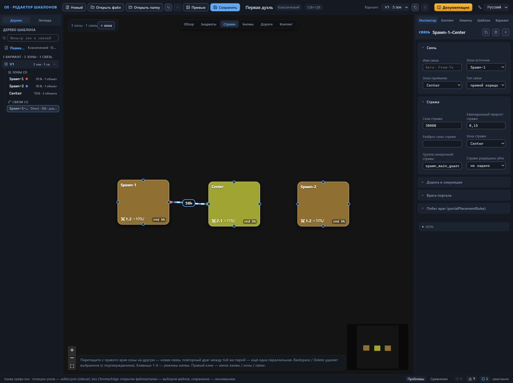

### Связь второго игрока дублированием

Второй главный проход устроен точно так же, как первый: тот же тип, дорога по связи, стража и группа. Вводить значения во второй раз незачем — готовую связь копируют и меняют в копии два поля.

1. Выделите связь `Spawn-1-Center`: щёлкните по её линии на канве или по строке с тем же именем в дереве шаблона.
2. В заголовке инспектора, рядом с именем связи, нажмите кнопку со значком копии — она здесь такая же, как у зоны, а подсказка читается «Дублировать связь». Редактор даст копии имя `Spawn-1-Center-1`, поставит её в дереве сразу за исходной связью и выделит. Копия наследует все поля связи целиком: тип, дорогу по связи, силу и еженедельный прирост стражи, зону стражи и группу синхронной стражи. Тот же пункт «Дублировать связь» есть в контекстном меню — по правому клику на линии канвы или на строке связи в дереве. Подробности — в главе [Канва: правка графа](canvas-editing.md#дублирование-связи).
3. В списке «Зона-источник» выберите `Spawn-2` — конец линии переедет ко второй стартовой зоне. «Зона-приёмник» остаётся `Center`.
4. В поле «Имя связи» замените `Spawn-1-Center-1` на `Spawn-2-Center` и нажмите Enter — новое имя появится в заголовке инспектора и в дереве шаблона.

Без переименования проход остался бы `Spawn-1-Center-1`: концы уже указывают на `Spawn-2` и `Center`, а имя ещё помнит первую пару. Имя — адрес для ссылок: концы дорог внутри зон указывают на связь по имени, и позже дорога зоны `Spawn-2` будет искать в списке именно `Spawn-2-Center`. Переименовывать связь сейчас безопасно — ссылок на неё ещё нет, переносить нечего.

Копия принесла с собой стражу и группу: второй проход несёт те же 30000 / 0.15, зону стражи `Center` и группу `spawn_main_guard` — симметрия стартов держится без ручного ввода. В группе теперь две связи, и справка «синхронизировать некого» исчезла. Дерево шаблона показывает в группе «Связи» две записи — `Spawn-1-Center` и `Spawn-2-Center`, а счётчик на канве — «3 зоны · 2 связи». Ошибок валидатор не сообщает, семь прежних предупреждений на месте.

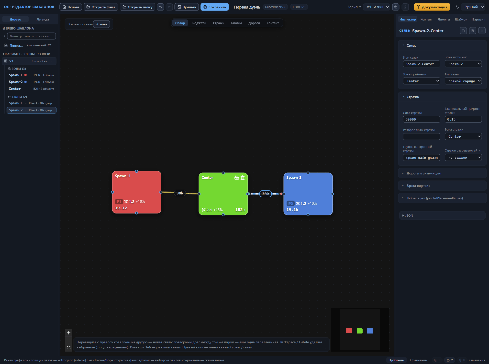

### Запасные проходы

Запасные проходы строятся дублированием главных: копия наследует готовые настройки, и остаётся поменять только числа и группу. Второй запасной проход заново не настраивают — от первого он отличается только концами, а сила стражи, прирост, зона стражи, группа и дорога у них одинаковые, — поэтому его настройки переносят текстом через JSON-блок: поле прямой правки записи элемента внизу вкладки «Инспектор». Новую связь блок не добавляет — текст заменяет выбранную связь, поэтому копию сначала создаёт дублирование. Выгода переноса: группа синхронной стражи, зона стражи и дорога приезжают вместе с текстом, и симметрия запасных проходов собирается без ручного ввода. Приёмы описаны в главах [Канва: правка графа](canvas-editing.md#дублирование-связи) и [Прямая правка JSON](json-editor.md#настройки-из-другой-связи).

1. Щёлкните правой кнопкой мыши по линии `Spawn-1-Center` на канве и выберите в контекстном меню «Дублировать связь». Редактор сам даст копии имя `Spawn-1-Center-1`, поставит её в дереве сразу за исходной связью и выделит.
2. В секции «Стража» копии введите «Сила стражи» 12000 и «Еженедельный прирост стражи» 0.1.
3. Замените в поле «Группа синхронной стражи» унаследованное имя `spawn_main_guard` на `spawn_side_guard` и нажмите Enter; «Зона стражи» остаётся `Center`. Пока в группе одна связь, валидатор выдаёт справку «Группа «spawn_side_guard» из одной связи — синхронизировать некого» — она исчезнет после переноса настроек во вторую копию. Смысл группы — в главе [Связи между зонами](connections.md#группа-синхронной-стражи).
4. Продублируйте тем же способом линию `Spawn-2-Center` — появится копия `Spawn-2-Center-1`. Её поля не трогайте: их заменит перенесённый текст JSON-блока.
5. Выделите связь `Spawn-1-Center-1` и раскройте блок «JSON» внизу вкладки «Инспектор» — в поле виден объект этой связи. Скопируйте весь текст блока; устройство блока — в главе [Прямая правка JSON](json-editor.md#блок-связи).
6. Откройте связь `Spawn-2-Center-1` и вставьте скопированный текст в её блок «JSON». Под полем появится статус «изменения не применены», кнопки «Применить» и «Сбросить» станут активными: текст в поле — черновик, шаблон он ещё не меняет (глава [Прямая правка JSON](json-editor.md#черновик-и-применение)).
7. Поправьте в тексте два поля: `"name"` — на `"Spawn-2-Center-1"`, `"from"` — на `"Spawn-2"`. Значение `"to"` остаётся `"Center"`.
8. Нажмите «Применить» или Ctrl+Enter. Формы инспектора обновятся сразу: «Сила стражи» — 12000, «Еженедельный прирост стражи» — 0.1, «Зона стражи» — `Center`, «Группа синхронной стражи» — `spawn_side_guard`. Текст в поле вернётся к записанному состоянию, кнопки погаснут.
9. Проверьте панель «Проблемы»: справка «Группа «spawn_side_guard» из одной связи — синхронизировать некого» исчезла — в группе теперь две связи, ошибок нет.

Дублирование копирует связь целиком, включая группу, — отсюда обязательная проверка группы в шаге 3. Если копия главного прохода оставит имя `spawn_main_guard` при новых числах, валидатор предупредит о расхождении силы стражи в группе, а симметрия стартов потеряется. Поэтому запасной проход переводят в собственную группу `spawn_side_guard`. Два прохода у каждой пары зон оправданы практикой игры: главный за 30000 игроки открывают не в первый день, а запасной за 12000 даёт второй маршрут раньше; набор проходов у обоих стартов остаётся одинаковым.

Шаг 7 пропускать нельзя. «Применить» ищет связь по имени из текста, а при пустом имени — по паре «источник-приёмник», и заменяет найденную запись на месте. Если оставить имя и концы образца, редактор переименует выбранную связь в `Spawn-1-Center-1` и даст ей чужие концы: в варианте окажутся два неразличимых прохода, а ссылки по имени — концы дорог и аргументы размещения — станут неоднозначными.

Связи с суффиксом `-N` лучше не переименовывать: концы дорог ссылаются на связи по имени, и переименование ссылки не переносит. Параллельную связь создаёт и повторный драг между той же парой зон, но он даёт пустую заготовку (8000 / 0.1) вместо готовых настроек копии. «Удалить связь» убирает ровно одну связь. Дублирование запускается и кнопкой-копией в заголовке инспектора — той, что описана в разделе «Связь второго игрока дублированием»; результат у обоих способов одинаковый.

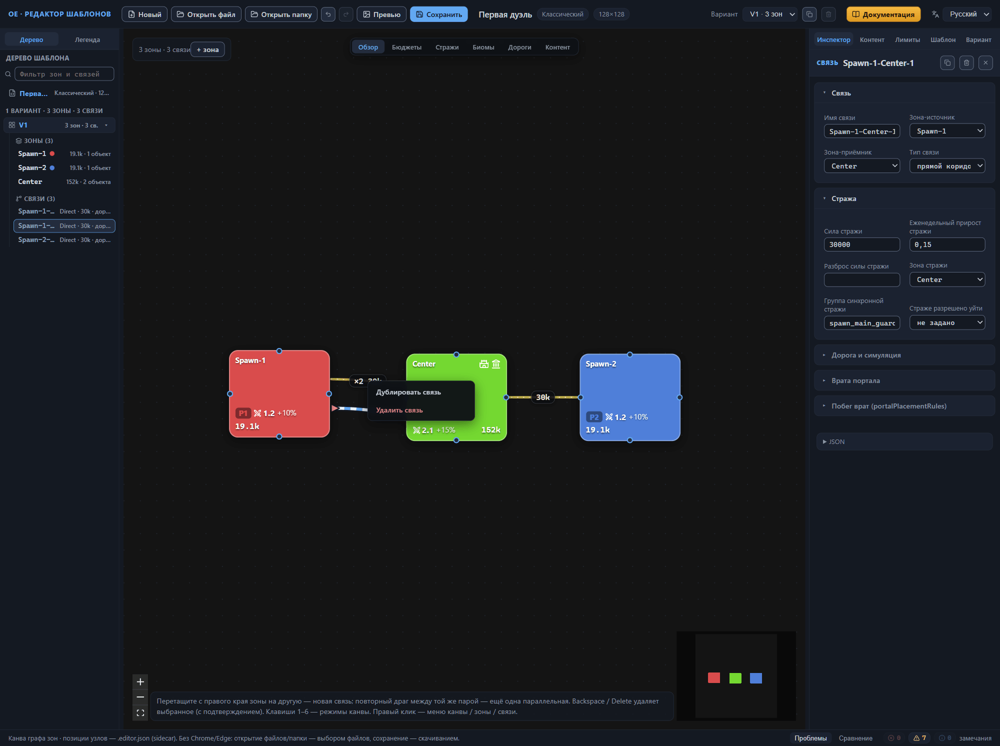

Обратите внимание: неприменённый черновик не привязан к связи, из которой скопирован. Выбор другого элемента текст не очищает — набранное становится черновиком нового элемента, и «Применить» молча заменит открытый переход. Применяйте или сбрасывайте черновик до смены выделения (глава [Прямая правка JSON](json-editor.md#срок-жизни-черновика)). Ошибка в черновике видна и на панели «Проблемы»: её строка попадает в счётчик «ошибки», надпись «шаблон корректен» пропадает, а кнопка «Сохранить» остаётся неактивной, пока текст не исправлен (глава [Прямая правка JSON](json-editor.md#строка-ошибки-и-блокировка-сохранения)). До применения шаблон не меняется, а правки форм не попадают в текст черновика; применение — один шаг истории, Ctrl+Z возвращает связь вместе с формами. «Сбросить» уничтожает набранный текст безвозвратно.

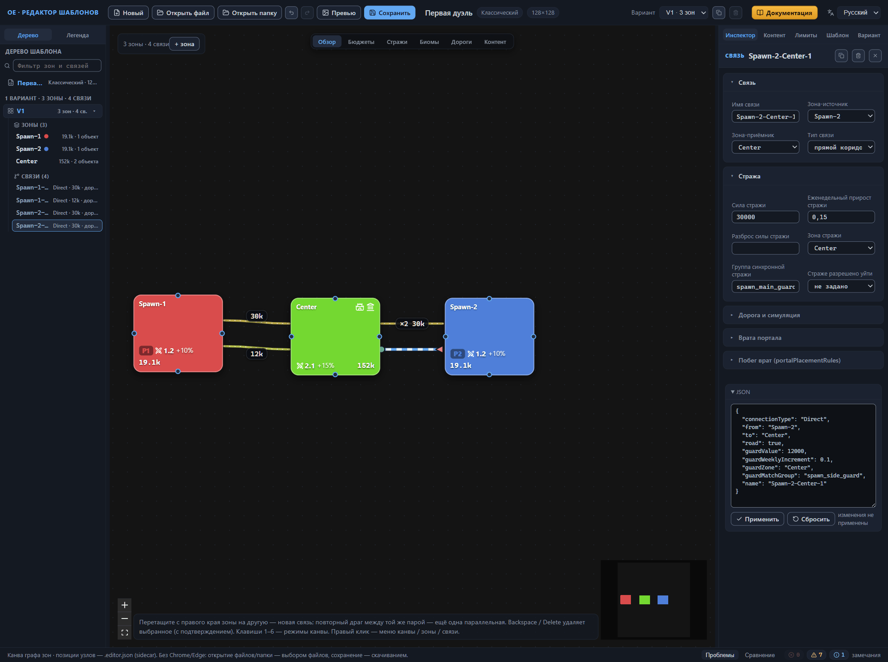

Запасные проходы готовы: в дереве и на канве четыре связи («3 зоны · 4 связи»), строки дерева показывают «Direct · 12k · дорога» у каждой копии. В режиме канвы «Стражи» обе запасные линии окрашены одним цветом из имени группы `spawn_side_guard`, а два главных прохода — другим; бейджи посреди линий показывают `30k` у главных и `12k` у запасных. Верните режим «Обзор» — о режимах канвы читайте в главе [Канва: режимы отображения](canvas-modes.md#режим-стражи). Ошибок валидатор не сообщает, семь прежних предупреждений на месте — они исчезнут в конце упражнения.

## Дороги внутри зон

Проходы готовы, осталось показать генератору, как добраться от главных объектов зоны до выходов. Дорога зоны — маршрут внутри зоны: по таким маршрутам генератор прокладывает дорожную сеть. Не путайте её с дорогой по связи — флагом `road`, который включён у всех четырёх проходов. В практикуме каждая зона получает ровно одну каменную дорогу: от главного объекта к выходу через главный проход. Об устройстве дорог — глава [Зона: все свойства](zone.md#дороги), о флаге связи — глава [Связи между зонами](connections.md#дорога-и-симуляция).

1. Выберите в дереве строку `Spawn-1` и раскройте секцию «Дороги». Она показывает подсказку «У зоны нет дорог — добавьте первую.» Нажмите кнопку «дорогу» — появится карточка дороги, а заголовок изменится на «Дороги (1)».
2. Проверьте поля карточки. «поверхность» стоит в значении «каменная · Stone»; «Откуда — конец дороги» — тип «объект зоны · MainObject», значение `Spawn [0] · Player1`; «Куда — конец дороги» — тип «связь · Connection», значение `Spawn-1-Center`. Заготовка описывает связку «объект → выход из зоны» и попадает точно на главный проход — ничего не меняйте.
3. Добавьте дорогу зоне `Spawn-2` и посмотрите на «Куда»: заготовка подставила первую связь варианта — `Spawn-1-Center`. Выберите в списке «связь варианта» значение `Spawn-2-Center`.
4. У зоны `Center` карточку не правьте: «Откуда» — `City [0]` (нулевой объект — город), «Куда» — `Spawn-1-Center`.

Редактор создаёт запись дороги в списке дорог редактируемой зоны — дорога `Spawn-2` остаётся дорогой `Spawn-2`. `Spawn-1-Center` в «Куда» — лишь ссылка по умолчанию на связь варианта: связь соединяет две зоны и не принадлежит ни одной из них, поэтому дорога с таким адресом не создаётся «в чужой зоне». Заготовка всегда подставляет первую связь варианта и нулевой объект этой зоны. У `Spawn-1` и `Center` она попала в цель, у `Spawn-2` — нет: проверяйте оба конца каждой дороги и при нужде меняйте адрес вручную (о селекторах концов — глава [Зона: все свойства](zone.md#концы-дороги)).

Переключите канву в режим «Дороги». Поверх узлов появятся три ортогональных маршрута — по одному у каждой зоны; на концах стоят маркеры: ■ — главный объект, у точки появления он окрашен цветом игрока, ◯ — связь. Все четыре связи нарисованы светлой плотной линией с тонкой белой штриховой нитью, их бейджи подписаны «дорога». Верните режим «Обзор» (глава [Канва: режимы отображения](canvas-modes.md#режим-дороги)).

Обратите внимание: дорога у каждой зоны одна, хотя проходов у пары два — запасной собственного маршрута не получил. Смена типа конца очищает его аргумент — адрес точки выбирайте заново. Кнопка ✕ на карточке удаляет дорогу без подтверждения, Ctrl+Z возвращает её; удаление последней дороги убирает список дорог из файла целиком. Переименование связи концы дорог не обновляет — именно поэтому дороги появляются после итоговых имён связей, наш порядок работ это соблюдает. Конец типа «элемент обязательного контента (MandatoryContent)» генератор ищет только среди групп, подключённых зоне; в практикуме такие концы не понадобятся — группы появятся ближе к финалу упражнения.

Дороги не добавили новых замечаний: на панели «Проблемы» по-прежнему нет ошибок и стоят те же семь предупреждений — они исчезнут в следующем разделе.

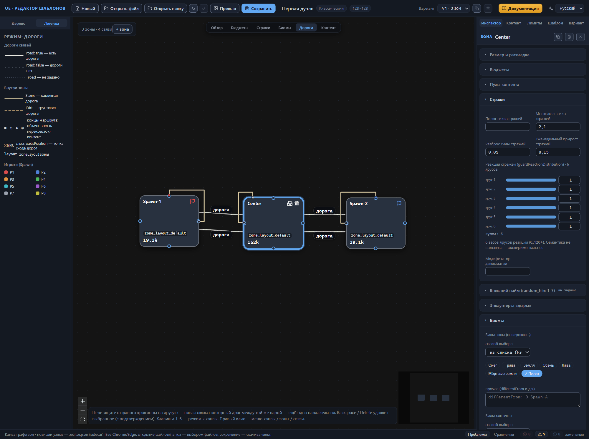

## Корневые настройки

Зоны, связи и дороги готовы. Осталось то, что живёт вне раскладки зон: группы обязательного контента и лимитов количества, лэйаут зон и правила игры. Группы обеих панелей лежат в корне файла, вне списка вариантов, поэтому действуют одинаково во всех вариантах раскладки, а зоны подключают их по имени.

### Группы обязательного контента

Обязательный контент — объекты, которые генератор размещает гарантированно, независимо от бюджетов зоны. Хранится он группами: группе дают имя, а зоны ссылаются на это имя. В практикуме групп две, потому что состав у стартовых зон и у центра разный: одна общая группа не дала бы различить их роли.

1. Откройте вкладку «Контент» правой панели — на ней панель «Обязательный контент». Пока групп нет, панель показывает сообщение «Групп нет — создайте первую.» и подсказку «Группы, на которые ссылаются зоны (zone.mandatoryContent).»
2. Нажмите «+ группа» в шапке панели: появится раскрытая карточка с тегом «MC» и именем `group_1`. Пустая группа сразу получает предупреждение «Группа пуста» — оно уйдёт вместе с первым элементом.
3. Впишите в поле имени шапки `group_spawn` и нажмите Enter. Имя фиксируется по Enter или при потере фокуса; зоны ссылаются на группу точным совпадением строки, поэтому имя задают до подключений.
4. Нажмите «+ объект» в карточке группы: добавится заготовка элемента — «Случайный легендарный предмет» (`random_item_legendary`) под охраной, с одним правилом размещения у дороги (тип «дорога · Road», полоса цели 0–0.4 — доля радиуса зоны, вес 1; устройство правил — в главе [Настройки шаблона (корень)](root.md#правила-размещения)). Предупреждение «Группа пуста» гаснет, сводка шапки показывает «1 эл. · 0 зон».
5. Повторите шаги 2–4 для второй группы: имя `group_center`, та же заготовка элемента.
6. Выберите зону `Spawn-1` в дереве шаблона — инспектор откроет её свойства.
7. Раскройте в инспекторе секцию «Обязательный контент и лимиты»: по умолчанию она свёрнута и несёт сводку «0 гр. контента · 0 гр. лимитов».
8. Впишите в поле «Группы обязательного контента» имя `group_spawn` и нажмите Enter — поле подсказывает группы корня, ещё не подключённые зоне, а введённое имя встаёт чипом: плашкой с читаемым именем группы и сводкой «1 эл.» Пустой ввод и дубликаты игнорируются молча.
9. Подключите ту же группу зоне `Spawn-2`, а зоне `Center` — группу `group_center`.

Подсказка чипа перечисляет содержимое группы построчно — «group_spawn / Случайный легендарный предмет (random_item_legendary)». Клик по имени чипа переносит к карточке группы: редактор переключает вкладку корневой панели, прокручивает список и подсвечивает карточку, а кнопка ✕ убирает имя из списка зоны. Набирайте имя точно или берите его из подсказок: редактор не сверяет ввод с корнем в момент набора, и незнакомого имени чип получит бейдж «не найдена», а валидатор — предупреждение о битой ссылке: так называют имя, которого нет среди групп корня.

Подключение видно в трёх местах. Сводка свёрнутой секции зоны считает оба списка: «0 гр. контента · 0 гр. лимитов» сменяются числом подключённых групп. Карточка группы получает чипы зон с подсказкой «Открыть зону …» и сводку «1 эл. · 2 зон» у `group_spawn`, «1 эл. · 1 зон» у `group_center`. Три предупреждения «У зоны нет обязательного контента (обычно ≥1 группа)» уходят с панели «Проблемы»; корневое «Нет групп обязательного контента (обычно 2–13)» гаснет ещё раньше — с первой созданной группой. Состав групп и устройство карточек описаны в главе [Настройки шаблона (корень)](root.md#обязательный-контент), ссылка со стороны зоны — в главе [Зона: все свойства](zone.md#обязательный-контент-и-лимиты).

Проверьте результат на канве: переключите режим на «Контент». У каждой зоны появится точка элемента с подписью, пунктирное кольцо правила размещения и пунктирная нить между ними, а в подножии узла — имена подключённых групп и сумма элементов групп («1 эл.»). Верните режим «Обзор»; о режимах канвы — глава [Канва: режимы отображения](canvas-modes.md#режим-контент).

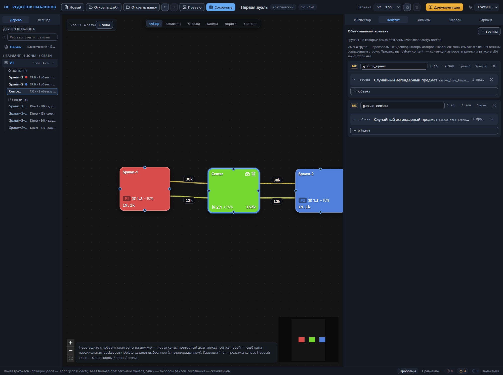

### Группы лимитов количества

Лимиты количества сдерживают число объектов сверху: потолок не даёт генератору засеять зоны одной находкой. Устройство то же, что у обязательного контента, — группы в корне и ссылки по имени из зон; отличаются тег карточки («CC» вместо «MC») и сводка («N лим. · M зон»).

1. Откройте вкладку «Лимиты» правой панели — на ней панель «Лимиты количества».
2. Нажмите «+ группа» в шапке панели: появится группа `content_limits_1`.
3. Переименуйте её в `content_limits_spawn` тем же приёмом, что и имя группы контента.
4. Нажмите «+ лимит»: добавится заготовка лимита — «Ящик Пандоры» (`pandora_box`), вариант −1 (все варианты объекта), максимальное количество 1. Сводка шапки покажет «1 лим. · 0 зон».
5. Создайте тем же способом вторую группу `content_limits_center` с таким же лимитом.
6. Подключите группы зонам приёмом раздела выше, поле «Группы лимитов количества» той же секции: `Spawn-1` и `Spawn-2` — `content_limits_spawn`, `Center` — `content_limits_center`. Чипы лимитов несут сводку «1 лим.», а подсказка перечисляет пределы: «content_limits_spawn / Ящик Пандоры (pandora_box): не более 1».

Замечания «Список групп лимитов пуст» в практикуме не было и не появится: оно ставится зоне, у которой список групп существует и пуст, а у созданных зон списка не было вовсе — ключ появляется в файле только вместе с первым именем. Корневое «Нет групп лимитов количества (обычно 2–25)» гаснет с первой группой, как и у обязательного контента, а сводка секции зоны дочитывает второй список: «1 гр. контента · 1 гр. лимитов». Смысл лимитов и устройство карточек — в главе [Настройки шаблона (корень)](root.md#лимиты-количества).

### Лэйаут зон и правила игры

Два последних предупреждения касаются лэйаута зон и правил игры. Оба шага уже описаны в главе [Быстрый старт](quick-start.md#поля-лэйаута-зоны): значения лэйаута возьмите из его таблицы, правила игры заполните по разделу [«Правила игры»](quick-start.md#правила-игры) той же главы — здесь значения не повторяются. Лэйаут `zone_layout_default` зоны уже носят: редактор назначает новой зоне первый лэйаут списка, поэтому на вкладке «Шаблон» в секции «Лэйауты зон (zoneLayouts)» заполните поля единственной карточки и не создавайте новую.

После этих двух шагов панель «Проблемы» пустеет и показывает строку «шаблон корректен» — замечаний не осталось ни одного. «Корректен» означает отсутствие замечаний проверки, а не приговор балансу; разбор типовых замечаний этого практикума и финал упражнения — в следующем разделе. Смысл полей лэйаута и правил игры собран в главе [Настройки шаблона (корень)](root.md#лэйауты-зон).

## Проверка и финал

К этому разделу практикум подошёл с пустым списком замечаний: каждое гасло по ходу работы — группы контента и лимитов закрыли зонные и корневые замечания, лэйаут и правила игры — два последних. Откройте вкладку «Проблемы» нижней панели: счётчики ошибок, предупреждений и справок стоят на нуле, а вместо списка замечаний панель показывает строку «шаблон корректен». «Корректен» — это отсутствие замечаний проверки, а не приговор балансу: сколько ценности оставить в зонах и где поставить стражу, проверка за вас не решает (глава [Быстрый старт](quick-start.md#строка-шаблон-корректен)). Устройство панели и поведение клика по замечанию описаны в главах [Быстрый старт](quick-start.md#замечания-валидатора) и [Проверка шаблона (валидатор)](validator.md).

### Типовые замечания этого практикума

Соберём в один список промахи, которые на этом маршруте случаются чаще всего, — с причиной и способом починки. Тексты замечаний приведены дословно, как их показывает панель; серьёзность и область строки — тоже её словами.

- **«Player1 уже задан в зоне Spawn-1»** — ошибка, область «V1 · Spawn-2».
  : Причина — точка появления в копии зоны осталась у первого игрока, а один игрок задаётся одной точкой на вариант. Сделать — в карточке Spawn копии выбрать `Player2`, как в разделе «Зона второго игрока».
- **«В группе «spawn_main_guard» guardValue различаются (29000 / 30000) — стражи не будут симметричны»** — предупреждение, область «V1 · группа стражей spawn_main_guard».
  : Причина — дублированный запасной проход остался в группе главного прохода с другими числами. Сделать — перевести копию в группу `spawn_side_guard` или сравнять числа внутри группы.
- **«В группе «spawn_side_guard» guardValue различаются (12000 / 30000) — стражи не будут симметричны»** — предупреждение, область «V1 · группа стражей spawn_side_guard».
  : Причина — перенесённый через JSON-блок текст не применился ко второму запасному проходу, и тот несёт числа главного. Сделать — нажать «Применить» в блоке связи или ввести числа в формах.
- **«Группа «spawn_main_guard» из одной связи — синхронизировать некого»** — справка, область «V1 · группа стражей spawn_main_guard».
  : Причина — группа задана только одному проходу: второе имя ещё не введено или дублирование не состоялось. Сделать — ничего срочного: справка гаснет, когда в группу входит вторая связь.
- **«Совпадающие авто-имена связей (From–To без суффикса): Spawn-1-Center-1»** — справка, область «V1».
  : Причина — в перенесённом тексте JSON не поправили `name`, и две связи варианта получили одно имя. Сделать — поправить имя в тексте и применить его снова.
- **«Связь «Spawn-1-Center» не найдена в варианте»** — ошибка, область «V1 · Spawn-1 · дорога 1»; вторая такая же строка приходит зоне `Center`.
  : Причина — конец дороги указывает на связь, которой в варианте нет: связь переименовали или удалили после дорог. Сделать — вернуть связи прежнее имя или выбрать в конце дороги существующую связь.
- **«Пул «…» не найден в каталоге (всего пулов: …)»** — предупреждение, область зоны с опечаткой.
  : Причина — имя пула вписали вручную с опечаткой. Сделать — убрать плашку кнопкой ✕ и добавить имя из каталога.
- **«У зоны нет обязательного контента (обычно ≥1 группа)»** — предупреждение, область зоны без группы.
  : Причина — зоне не подключили группу обязательного контента либо плашку имени убрали крестиком. Сделать — вписать имя группы в поле «Группы обязательного контента» секции «Обязательный контент и лимиты».

### Финал: сохранение и установка

Практикум закончен: шаблон «Первая дуэль» собран и проверен в редакторе. Осталось сохранить его: кнопка «Сохранить» на верхней панели активна, а её подсказка гласит «Выбрать папку и сохранить .rmg.json + .editor.json + PNG превью» — редактор попросит папку и положит туда сразу три файла. Игре нужны два из них: файл шаблона и картинку превью скопируйте в папку пользовательских шаблонов (глава [Установка шаблона в игру](install.md#папка-для-шаблонов)). Sidecar-файл игре не нужен, но держите его рядом с шаблоном: в нём живут позиции узлов схемы и заметки зон (глава [Файлы: открытие и сохранение](files.md#пара-файлов-шаблон-и-sidecar-файл)).

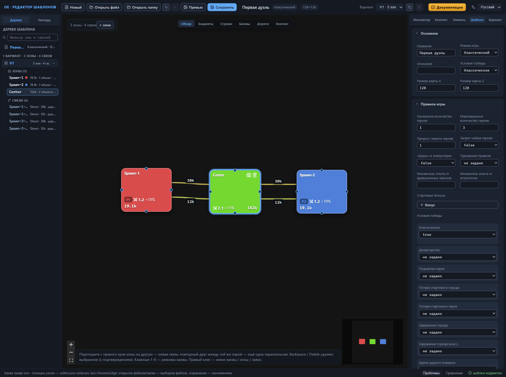

## Куда дальше

- [Канва: правка графа](canvas-editing.md) — приёмы перестройки схемы: зоны, связи, дублирование, контекстное меню.
- [Зона: все свойства](zone.md) — справочник полей зоны: бюджеты, пулы, биомы, стражи, дороги.
- [Связи между зонами](connections.md) — справочник полей связи: типы, стража, группы синхронной стражи, дороги и порталы.
- [Проверка шаблона (валидатор)](validator.md) — полный каталог замечаний и их причин.
- [Файлы: открытие и сохранение](files.md) — пара файлов шаблона, папки сохранения, отмены и резервная копия сессии.
- [Установка шаблона в игру](install.md) — папка пользовательских шаблонов и проверка карты в игре.
